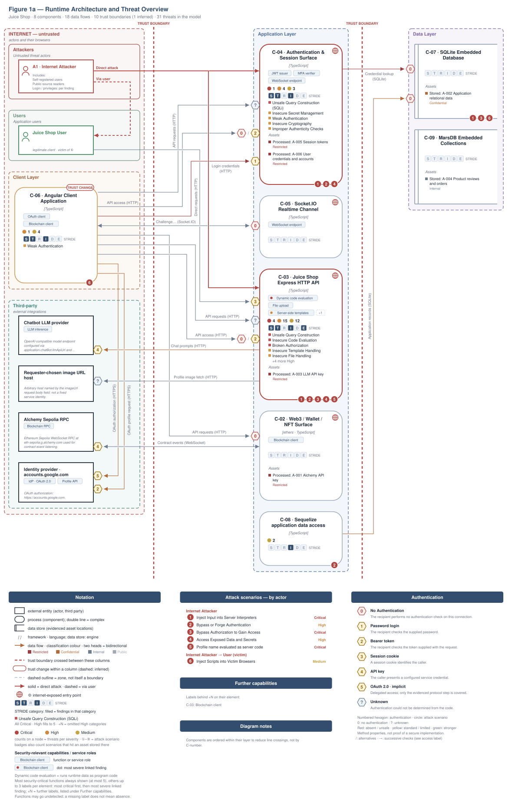
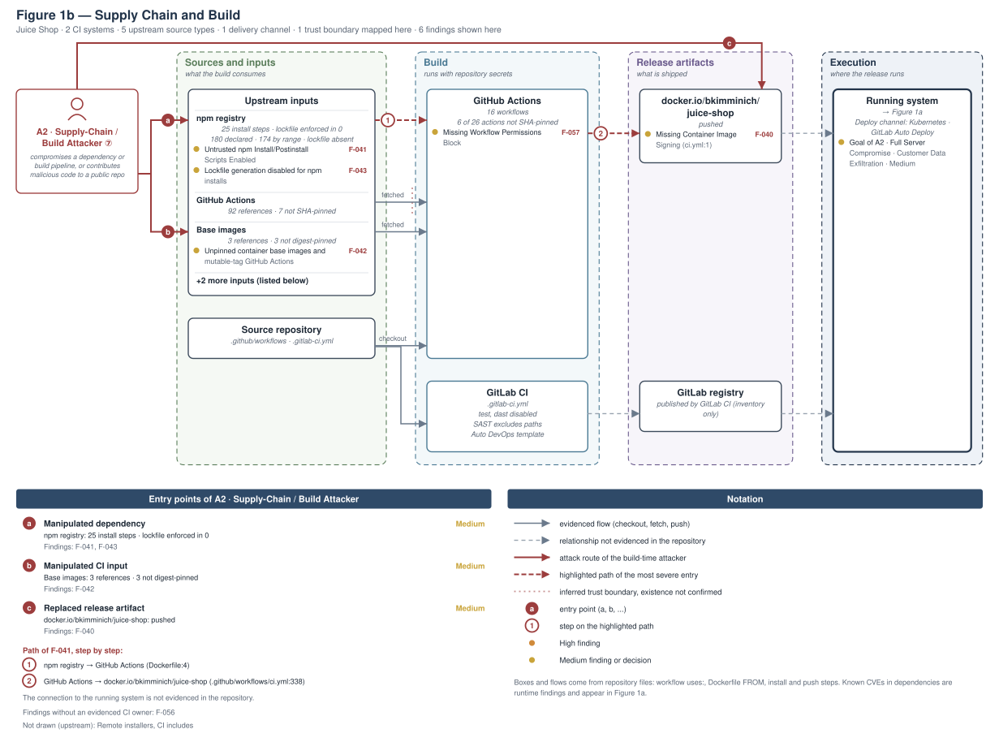
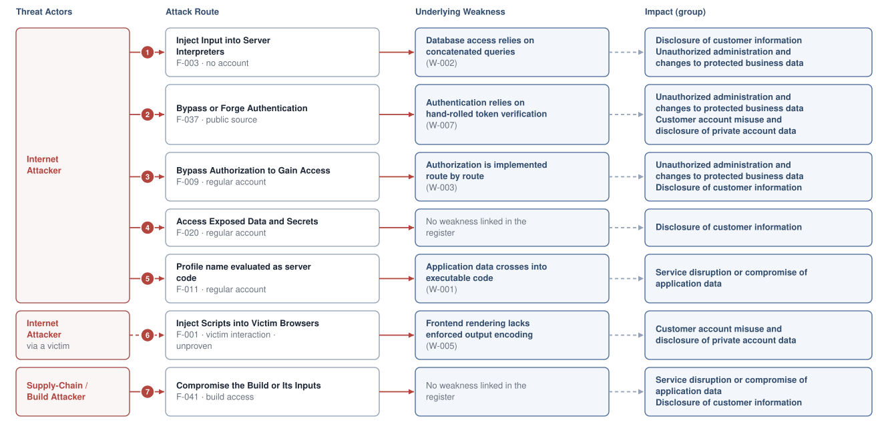
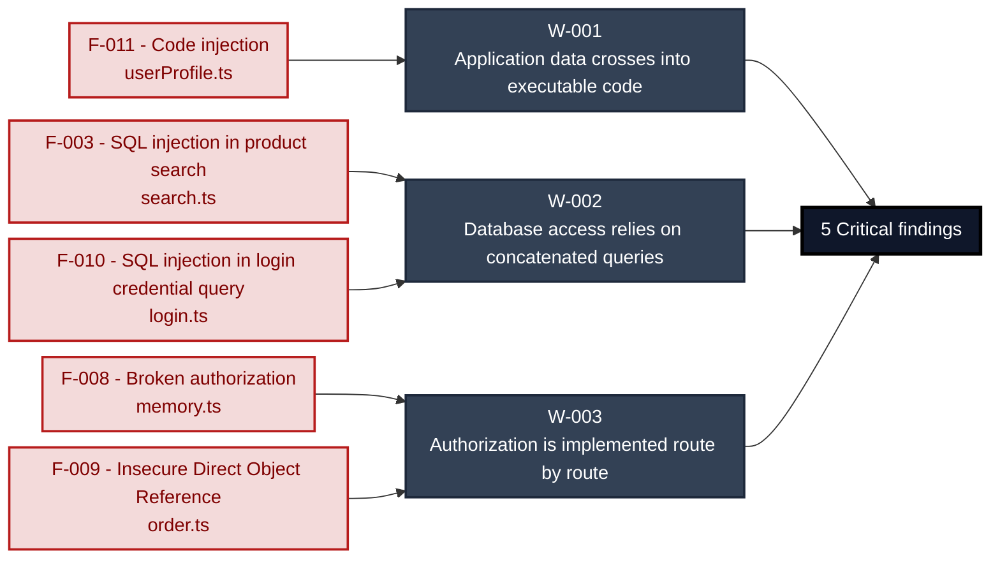
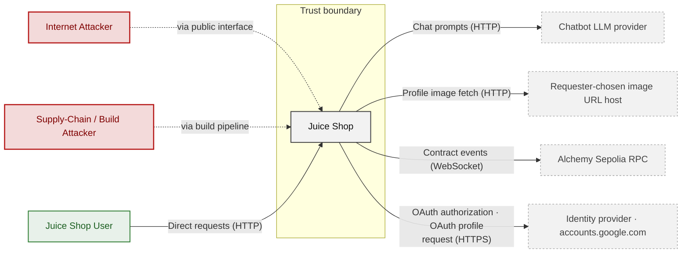
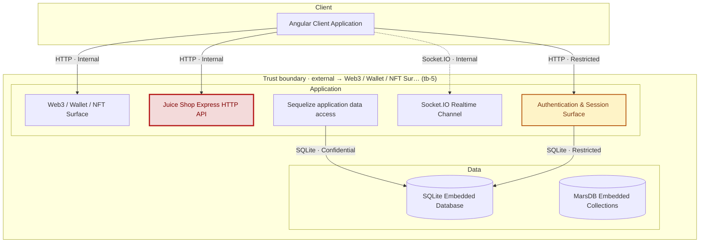

# Security Assessment Report - Juice Shop

_Analysis of security architecture and threats_

_Generated by appsec-advisor v0.1.0a0 (analysis v5)_

---

> | | |
> |---|---|
> | **Project** | Juice Shop |
> | **Repository** | `https://github.com/juice-shop/juice-shop.git` |
> | **Homepage** | `https://github.com/juice-shop/juice-shop` |

---

## Changelog

_Append-only history of assessment runs. Most recent first._

| Version | Date | Mode | Depth | Reasoning | Baseline → Current | Δ Threats | Code | Note |
|--------|--------------------|--------|--------|--------------|------------------|----------------|--------|---------------|
| v1 | 2026-10-26 07:12 CET | full | quick | sonnet-economy | _(initial)_ | 51 total | - | first full scan |

---

> ⚠ **Quick depth - reduced-scope assessment.**
> 
> This report ran with intentionally narrower depth to keep wall-time short:
> 
> - **5 components** under full STRIDE analysis (`criteria-selected: frontend`, auth, and internet-exposed components only)
> - **Max 2 threats per STRIDE category** per component (vs. unlimited at standard/thorough)
> - **No CVSS vectors**, no per-finding evidence excerpts
> - **No §3 Attack Walkthroughs** (entirely skipped at `--quick`)
> - **No [§9](#9-abuse-cases) abuse-case verification** (skipped at `--quick`; re-run with `--abuse-cases`)
> - **No LLM-enriched [§7](#7-weakness-register) architecture narrative** (scaffold + control tables only)
> - **No QA reviewer pass**, no architect-level review
> 
> Re-run at standard depth (the default, no depth flag; ≈ +30 min) for full STRIDE coverage and QA,
> or with `--thorough` (≈ +90 min) for architect review and enriched architecture sections.

---

## Table of Contents

- [Management Summary](#management-summary)
- [Critical Findings by Root Cause](#critical-findings-by-root-cause)
1. [System Overview](#1-system-overview)
   - [Scope](#scope)
   - [Identified Actors](#identified-actors)
   - [Trust Boundaries](#trust-boundaries)
   - [Platform Security Settings](#platform-security-settings)
2. [Architecture Diagrams](#2-architecture-diagrams)
   - [2.1 System Context](#21-system-context)
   - [2.2 Container Architecture](#22-container-architecture)
   - [2.3 Components](#23-components)
4. [Assets](#4-assets)
5. [Attack Surface](#5-attack-surface)
   - [5.1 Unauthenticated Entry Points (69)](#51-unauthenticated-entry-points-69)
   - [5.2 Authenticated Entry Points (40)](#52-authenticated-entry-points-40)
7. [Weakness Register](#7-weakness-register)
8. [Findings Register](#8-findings-register)
9. [Abuse Cases](#9-abuse-cases)
10. [Mitigation Register](#10-mitigation-register)
11. [Out of Scope](#11-out-of-scope)
   - [Not Covered by This Method](#not-covered-by-this-method)
   - [Excluded from This Assessment](#excluded-from-this-assessment)
- [Appendix: Run Statistics](#appendix-run-statistics)
- [Appendix A - Attack Vector Taxonomy](#appendix-a-vektor-taxonomy)

> _Section numbering is non-contiguous: §3, §6 are omitted at the current (quick) depth and return at standard depth (the default) or with `--thorough`. The remaining sections keep their original numbers so existing cross-references stay valid._

---

## Management Summary

### Verdict

🔴 **Critical security concerns** - This web shop lets anonymous visitors bypass sign-in, read the customer database and run commands on the server. It should run only as an isolated training target, never holding real customer data or reachable from the internet.

**Risk distribution:** 🔴 Critical: 4 · 🟠 High: 12 · 🟡 Medium: 15 · 🟢 Low: n/a · **Total: 31**<br/>**Assessment evidence:** 26 of 28 finding(s) confirmed in code<br/>**Weakness classes:** 28 (22 implementation, 6 design) - see [§7 Weakness Register](#7-weakness-register)

<br/>

**Security concerns behind this assessment:**

<blockquote style="border-left: 3px solid #dc2626; padding: 16px 20px; margin: 0;">

- **Login bypass and database exposure** — SQL injection in login and product search lets anonymous visitors sign in as anyone and read other tables, including password hashes. *(🔴 [F-010](#f-010), 🔴 [F-003](#f-003) → [W-002](#w-002))*
- **Server takeover by a signed-in user** — Code injection through the profile name lets any registered user run commands on the server. *(🔴 [F-011](#f-011) → [W-001](#w-001))*
- **Other customers' data read and changed** — Missing ownership checks (IDOR) let any signed-in customer read and modify another customer's records. *(🔴 [F-008](#f-008), 🔴 [F-009](#f-009) → [W-003](#w-003))*
- **Anyone can register as administrator** — Mass assignment on account registration lets an unauthenticated visitor create an account with the administrator role. *(🟠 [F-036](#f-036))*
- **Forged logins from published signing key** — The token signing key is committed to source, so anyone with repository access can mint valid logins for any user. *(🟠 [F-018](#f-018) → [W-006](#w-006))*

</blockquote>

<br/>

Until these gaps are closed, a breach would expose every customer record and give attackers full control of the server and its accounts.

**About this assessment:** An AI-assisted threat model derived from the implementation of Juice Shop. It reconstructs the implemented architecture (9 components and 4 external services, see [§2](#2-architecture-diagrams)) and identifies threats and control gaps in it.

**Method and limits:** Automated static analysis of code and configuration, not a pentest or a team threat-modeling session; Low and Informational findings not reported (threshold: medium) - see [§11 Out of Scope](#11-out-of-scope).

### Remediation Priorities

The root causes behind the findings, ranked by severity, each with the measures to do first. The lasting fix under a root cause removes it and every finding it causes. Every mitigation that fixes a Critical finding is listed. Details in the [§7 Weakness Register](#7-weakness-register) and the [§10 Mitigation Register](#10-mitigation-register).

<table style="table-layout:fixed;width:100%">
<colgroup><col width="34%" style="width:34%"><col width="46%" style="width:46%"><col width="12%" style="width:12%"><col width="8%" style="width:8%"></colgroup>
<thead><tr><th>Root cause → lasting fix</th><th>Do first</th><th>Resolves</th><th>Effort</th></tr></thead>
<tbody>
<tr><td rowspan="1" style="overflow-wrap:break-word">🔴 <a href="#w-001">W-001</a> - Application data crosses into executable code<br/><em>→ replace evaluation of application values with a data parser or a fixed set of operations whose arguments remain data</em></td><td style="overflow-wrap:break-word">● <a href="#m-022">M-022</a> - Remove eval and template substitution of username</td><td>🔴 <a href="#f-011">F-011</a></td><td>Low</td></tr>
<tr><td rowspan="2" style="overflow-wrap:break-word">🔴 <a href="#w-002">W-002</a> - Database access relies on concatenated queries<br/><em>→ provide one parameterised repository or query-builder path and prohibit application-value interpolation in database queries</em></td><td style="overflow-wrap:break-word">● <a href="#m-019">M-019</a> - Use parameterized database queries (<a href="#f-003">F-003</a>)</td><td>🔴 <a href="#f-003">F-003</a></td><td>Low</td></tr>
<tr><td style="overflow-wrap:break-word">● <a href="#m-021">M-021</a> - Use bound parameters in login query</td><td>🔴 <a href="#f-010">F-010</a></td><td>Low</td></tr>
<tr><td rowspan="3" style="overflow-wrap:break-word">🔴 <a href="#w-003">W-003</a> - Authorization is implemented route by route<br/><em>→ enforce authorization through a shared server-side policy layer and make ownership and tenant scope mandatory inputs to data access</em></td><td style="overflow-wrap:break-word">● <a href="#m-020">M-020</a> - Enforce object-level (ownership) authorization (<a href="#f-008">F-008</a>)</td><td>🔴 <a href="#f-008">F-008</a><br/>🔴 <a href="#f-009">F-009</a></td><td>Medium</td></tr>
<tr><td style="overflow-wrap:break-word">◕ <a href="#m-035">M-035</a> - Verify basket owner before checkout</td><td>🟠 <a href="#f-029">F-029</a></td><td>Low</td></tr>
<tr><td style="overflow-wrap:break-word">◕ <a href="#m-036">M-036</a> - Enforce review ownership and a string id</td><td>🟠 <a href="#f-030">F-030</a></td><td>Low</td></tr>
<tr><td rowspan="1" style="overflow-wrap:break-word">🟠 <a href="#w-006">W-006</a> - Secrets are committed to source instead of a managed store<br/><em>→ move every secret to a managed secret store or injected environment configuration, rotate the exposed values, and add secret-scanning to CI</em></td><td style="overflow-wrap:break-word">◕ <a href="#m-026">M-026</a> - Load JWT private key from secret store</td><td>🟠 <a href="#f-018">F-018</a></td><td>Medium</td></tr>
<tr><td rowspan="1" style="overflow-wrap:break-word">🟠 <a href="#w-004">W-004</a> - Document-database queries take their structure from application values<br/><em>→ build document queries from fixed operator structures, coerce request values to the expected scalar types, and disable server-side JavaScript evaluation in the database</em></td><td style="overflow-wrap:break-word">◕ <a href="#m-031">M-031</a> - Query orders by exact match instead of \$where</td><td>🟠 <a href="#f-025">F-025</a></td><td>Low</td></tr>
<tr><td rowspan="1" style="overflow-wrap:break-word">🟡 <a href="#w-007">W-007</a> - Authentication relies on hand-rolled token verification<br/><em>→ centralise token validation on a vetted library with pinned algorithms, issuer and audience checks, and managed signing keys</em></td><td style="overflow-wrap:break-word">◕ <a href="#m-023">M-023</a> - Enforce JWT signature and algorithm verification (<a href="#f-013">F-013</a>)</td><td>🟠 <a href="#f-013">F-013</a></td><td>Medium</td></tr>
<tr><td rowspan="1" style="overflow-wrap:break-word"><em>No root cause linked</em></td><td style="overflow-wrap:break-word">◕ <a href="#m-038">M-038</a> - Allowlist client-controlled fields</td><td>🟠 <a href="#f-036">F-036</a></td><td>Low</td></tr>
</tbody>
</table>

*10 more P1/P2 mitigations and 37 P3/P4 backlog items in the [§10 Mitigation Register](#10-mitigation-register). ● P1 · ◕ P2 · ◑ P3 · ○ P4*

### Open Questions for the Team

The code cannot answer these questions; the people who own the business and the deployment can. Each question states under it what its answer changes.

- _How critical are Application relational data, Alchemy API key and LLM API key to the business, and what harm would their disclosure, manipulation or unavailability cause?_
  The answer weights the impact rating and fix order of every finding that reaches these assets.
- _Which operations on other users' or tenants' data in Juice Shop Express HTTP API are intended for support staff or administrators?_ ([W-003](#w-003): [F-009](#f-009), [F-029](#f-029), [F-030](#f-030) +5 more)
  Each access confirmed as intended narrows the finding to the remaining routes; if none are intended, every listed route is a live authorization gap.
- _Which sensitive business records can the production database account used by Juice Shop Express HTTP API or Authentication & Session Surface access?_ ([W-002](#w-002): [F-003](#f-003), [F-010](#f-010))
  Personal or regulated data in reach raises both the breach impact and any notification duty; a narrowly scoped account limits the blast radius.

### Security Posture & Top Threats

**Figure 1a - Runtime Architecture and Threat Overview**

At runtime, Juice Shop has 8 components in 3 layers and exchanges data with 4 external services. Figure 1a shows these data flows and where each of the 6 attack scenarios below begins. The complete boundary catalogue remains in [§1 Trust Boundaries](#trust-boundaries).

<picture><source media="(prefers-color-scheme: dark)" srcset="security-assessment-juice-shop-quick-v0.1.0.figure1-dark.svg"></picture>

**Build pipeline**, not drawn in this runtime view: GitHub Actions, GitLab CI. ⑦ A2 · Supply-Chain / Build Attacker → [Figure 1b](#figure-1b).

Role access and finding assignments are listed in [Identified Actors](#identified-actors).

**Actor grouping.** Regular self-registered users are grouped with anonymous internet attackers because registration is open. Repository readers are grouped with anonymous internet attackers because the source repository is public. Each finding retains its login and privilege requirements.

<a id="figure-1b"></a>

**Figure 1b - Supply Chain and Build**

Juice Shop builds in GitHub Actions, GitLab CI. Figure 1b shows the inputs, build systems and release artifacts the repository evidences, with 6 findings attached to them. The highlighted path follows 🟡 [F-041](#f-041) — Untrusted npm Install/Postinstall Scripts Enabled as far as the repository evidences it.

<picture><source media="(prefers-color-scheme: dark)" srcset="security-assessment-juice-shop-quick-v0.1.0.figure1b-dark.svg"></picture>

**Figure 2 - Attack Routes and Impact**

Each numbered route names one example finding from the corresponding Top Threats group with its access prerequisite, the register weakness it is linked to, and the group's potential business harm, which depends on deployment and affected assets. W-IDs in parentheses link the example to an existing weakness. The attack step, affected component and technical consequence are listed in the findings register. Red arrows indicate attacks; dashed red arrows involve a victim; grey arrows lead to potential harm.

<picture><source media="(prefers-color-scheme: dark)" srcset="security-assessment-juice-shop-quick-v0.1.0.figure2-dark.svg"></picture>

**Threat actors.** The actors below drive the numbered attack paths in the figures above. The **Juice Shop User** is the *victim* of client-side attacks (XSS / CSRF), not an attacker. Figure 2 marks victim interaction on the applicable attack routes.

- **Juice Shop User** — legitimate end user; target of client-side attacks; target of ⑥ Output Encoding / Cross-Site Scripting.
- **Internet Attacker** — can self-register a regular account; drives ① Insecure Query Construction & Data Access, ② Hardcoded Secrets & Weak Cryptography, ③ Broken Authorization & Access Control, ④ Sensitive File & Secret Exposure, ⑤ Remote Code Execution (unsafe eval).
- **Supply-Chain / Build Attacker** — compromises a dependency or build pipeline, or contributes malicious code to a public repo; drives ⑦ Build Pipeline & Dependency Integrity.

**7 structural threats**, grouped by weakness class - each row is one threat, not one finding. *Threat Description* states the general architectural weakness (STRIDE in brackets); *Findings* lists the concrete instances, each linked to [§8 Findings Register](#8-findings-register) with its component; *Risk & Impact* combines severity with business consequence.

| # | Threat Description | Findings (→ Component) | Risk & Impact | Fix |
|---|------------------------------------|------------------------------------------------|------------------------------------|--------|
| <a id="path-injection"></a>① | **Insecure Query Construction & Data Access** _(T·I)_<br/>Request values are placed into database queries or parsers without safe binding, letting callers change query meaning and read data. | <span style="white-space:nowrap">🔴&nbsp;[F-003](#f-003)</span> - SQL injection in product search <span style="white-space:nowrap">→&nbsp;[C-03](#c-03)</span>&nbsp;Juice Shop Express HTTP API<br/><span style="white-space:nowrap">🔴&nbsp;[F-010](#f-010)</span> - SQL injection in login credential query <span style="white-space:nowrap">→&nbsp;[C-04](#c-04)</span>&nbsp;Authentication & Session Surface<br/><span style="white-space:nowrap">🟠&nbsp;[F-025](#f-025)</span> - NoSQL JavaScript injection in \$where predicates <span style="white-space:nowrap">→&nbsp;[C-03](#c-03)</span>&nbsp;Juice Shop Express HTTP API<br/><span style="white-space:nowrap">🟠&nbsp;[F-027](#f-027)</span> - XML external entity expansion in complaint upload <span style="white-space:nowrap">→&nbsp;[C-03](#c-03)</span>&nbsp;Juice Shop Express HTTP API<br/><span style="white-space:nowrap">🟠&nbsp;[F-026](#f-026)</span> - Input compiled as template source <span style="white-space:nowrap">→&nbsp;[C-03](#c-03)</span>&nbsp;Juice Shop Express HTTP API | 🔴 **Critical**<br/>Customer Data Exfiltration · Full Admin Takeover | <span style="white-space:nowrap">● [M-019](#m-019)</span> — Use parameterized database queries (F-003)<br/><span style="white-space:nowrap">● [M-021](#m-021)</span> — Use bound parameters in login query |
| <a id="path-auth-bypass"></a>② | **Hardcoded Secrets & Weak Cryptography** _(S·E)_<br/>Weak token handling, including a committed signing key and no algorithm allowlist, lets attackers obtain accepted credentials without legitimate sign-in. | <span style="white-space:nowrap">🟠&nbsp;[F-013](#f-013)</span> - JWT verify call missing algorithms allowlist <span style="white-space:nowrap">→&nbsp;[C-03](#c-03)</span>&nbsp;Juice Shop Express HTTP API<br/><span style="white-space:nowrap">🟠&nbsp;[F-014](#f-014)</span> - Non-cryptographic RNG for a <span style="white-space:nowrap">→&nbsp;[C-04](#c-04)</span>&nbsp;Authentication & Session Surface<br/><span style="white-space:nowrap">🟠&nbsp;[F-018](#f-018)</span> - Hardcoded JWT signing private key in source <span style="white-space:nowrap">→&nbsp;[C-04](#c-04)</span>&nbsp;Authentication & Session Surface<br/><span style="white-space:nowrap">🟡&nbsp;[F-037](#f-037)</span> - Chat trusts JWT decoded without signature verification <span style="white-space:nowrap">→&nbsp;[C-03](#c-03)</span>&nbsp;Juice Shop Express HTTP API<br/><span style="white-space:nowrap">🟡&nbsp;[F-052](#f-052)</span> - Unsalted `MD5` password hashing <span style="white-space:nowrap">→&nbsp;[C-04](#c-04)</span>&nbsp;Authentication & Session Surface<br/><span style="white-space:nowrap">🟡&nbsp;[F-054](#f-054)</span> - Password hashing with unsalted `MD5` in user model <span style="white-space:nowrap">→&nbsp;[C-08](#c-08)</span>&nbsp;Sequelize application data access<br/><span style="white-space:nowrap">🟡&nbsp;[F-055](#f-055)</span> - Security answers HMAC'd with hardcoded static key <span style="white-space:nowrap">→&nbsp;[C-08](#c-08)</span>&nbsp;Sequelize application data access | 🟠 **High**<br/>Full Admin Takeover · Customer Session Hijack | <span style="white-space:nowrap">◕ [M-023](#m-023)</span> — Enforce JWT signature and algorithm verification (F-013)<br/><span style="white-space:nowrap">◕ [M-024](#m-024)</span> — Use cryptographically secure random values |
| <a id="path-privilege-escalation"></a>③ | **Broken Authorization & Access Control** _(E·I)_<br/>Object ownership and role checks are missing or client-controlled, so users act on other customers' records or grant themselves administrator rights. | <span style="white-space:nowrap">🔴&nbsp;[F-008](#f-008)</span> - Broken authorization <span style="white-space:nowrap">→&nbsp;[C-03](#c-03)</span>&nbsp;Juice Shop Express HTTP API<br/><span style="white-space:nowrap">🔴&nbsp;[F-009](#f-009)</span> - Insecure Direct Object Reference <span style="white-space:nowrap">→&nbsp;[C-03](#c-03)</span>&nbsp;Juice Shop Express HTTP API<br/><span style="white-space:nowrap">🟠&nbsp;[F-029](#f-029)</span> - Checkout does not bind basket to authenticated user <span style="white-space:nowrap">→&nbsp;[C-03](#c-03)</span>&nbsp;Juice Shop Express HTTP API<br/><span style="white-space:nowrap">🟠&nbsp;[F-031](#f-031)</span> - IDOR / broken object-level authorization <span style="white-space:nowrap">→&nbsp;[C-03](#c-03)</span>&nbsp;Juice Shop Express HTTP API<br/><span style="white-space:nowrap">🟠&nbsp;[F-036](#f-036)</span> - Mass assignment of role on user registration <span style="white-space:nowrap">→&nbsp;[C-03](#c-03)</span>&nbsp;Juice Shop Express HTTP API<br/><span style="white-space:nowrap">🟠&nbsp;[F-022](#f-022)</span> - IDOR <span style="white-space:nowrap">→&nbsp;[C-03](#c-03)</span>&nbsp;Juice Shop Express HTTP API<br/><span style="white-space:nowrap">🟠&nbsp;[F-030](#f-030)</span> - Review update lacks ownership check <span style="white-space:nowrap">→&nbsp;[C-03](#c-03)</span>&nbsp;Juice Shop Express HTTP API<br/><span style="white-space:nowrap">🟠&nbsp;[F-032](#f-032)</span> - IDOR / broken object-level authorization <span style="white-space:nowrap">→&nbsp;[C-03](#c-03)</span>&nbsp;Juice Shop Express HTTP API<br/><span style="white-space:nowrap">🟠&nbsp;[F-033](#f-033)</span> - Sensitive Routes Registered Without Authentication Middleware <span style="white-space:nowrap">→&nbsp;[C-03](#c-03)</span>&nbsp;Juice Shop Express HTTP API<br/><span style="white-space:nowrap">🟠&nbsp;[F-034](#f-034)</span> - Sensitive Routes Registered Without Authentication Middleware <span style="white-space:nowrap">→&nbsp;[C-03](#c-03)</span>&nbsp;Juice Shop Express HTTP API<br/><span style="white-space:nowrap">🟡&nbsp;[F-038](#f-038)</span> - Password change allowed without current password <span style="white-space:nowrap">→&nbsp;[C-03](#c-03)</span>&nbsp;Juice Shop Express HTTP API<br/><span style="white-space:nowrap">🟡&nbsp;[F-050](#f-050)</span> - User listing exposed to any authenticated user <span style="white-space:nowrap">→&nbsp;[C-03](#c-03)</span>&nbsp;Juice Shop Express HTTP API<br/><span style="white-space:nowrap">🟡&nbsp;[F-058](#f-058)</span> - Basket read lacks ownership check <span style="white-space:nowrap">→&nbsp;[C-03](#c-03)</span>&nbsp;Juice Shop Express HTTP API<br/><span style="white-space:nowrap">🟡&nbsp;[F-060](#f-060)</span> - Product write routes lack role authorization <span style="white-space:nowrap">→&nbsp;[C-03](#c-03)</span>&nbsp;Juice Shop Express HTTP API<br/><span style="white-space:nowrap">🟡&nbsp;[F-061](#f-061)</span> - Coupon discount cap enforced only in prompt <span style="white-space:nowrap">→&nbsp;[C-03](#c-03)</span>&nbsp;Juice Shop Express HTTP API | 🔴 **Critical**<br/>Full Admin Takeover · Customer Data Exfiltration | <span style="white-space:nowrap">● [M-020](#m-020)</span> — Enforce object-level (ownership) authorization (F-008)<br/><span style="white-space:nowrap">◕ [M-035](#m-035)</span> — Verify basket owner before checkout |
| <a id="path-sensitive-data-exposure"></a>④ | **Sensitive File & Secret Exposure** _(I)_<br/>Request-controlled file paths and outbound URLs let callers read or write files and reach internal services from the server. | <span style="white-space:nowrap">🟠&nbsp;[F-020](#f-020)</span> - Request-controlled layout path in data erasure <span style="white-space:nowrap">→&nbsp;[C-03](#c-03)</span>&nbsp;Juice Shop Express HTTP API<br/><span style="white-space:nowrap">🟠&nbsp;[F-021](#f-021)</span> - Zip slip arbitrary file write in complaint upload <span style="white-space:nowrap">→&nbsp;[C-03](#c-03)</span>&nbsp;Juice Shop Express HTTP API<br/><span style="white-space:nowrap">🟠&nbsp;[F-028](#f-028)</span> - Server-side request forgery <span style="white-space:nowrap">→&nbsp;[C-03](#c-03)</span>&nbsp;Juice Shop Express HTTP API<br/><span style="white-space:nowrap">🟡&nbsp;[F-045](#f-045)</span> - Allowlist bypass <span style="white-space:nowrap">→&nbsp;[C-03](#c-03)</span>&nbsp;Juice Shop Express HTTP API<br/><span style="white-space:nowrap">🟡&nbsp;[F-048](#f-048)</span> - Memories listing exposes joined user records <span style="white-space:nowrap">→&nbsp;[C-03](#c-03)</span>&nbsp;Juice Shop Express HTTP API<br/><span style="white-space:nowrap">🟡&nbsp;[F-049](#f-049)</span> - Unauthenticated exposure of encryption key directory <span style="white-space:nowrap">→&nbsp;[C-03](#c-03)</span>&nbsp;Juice Shop Express HTTP API<br/><span style="white-space:nowrap">🟡&nbsp;[F-051](#f-051)</span> - User list exposed to any authenticated caller <span style="white-space:nowrap">→&nbsp;[C-04](#c-04)</span>&nbsp;Authentication & Session Surface | 🟠 **High**<br/>Customer Data Exfiltration | <span style="white-space:nowrap">◕ [M-028](#m-028)</span> — Constrain file paths to a safe base directory (F-020)<br/><span style="white-space:nowrap">◕ [M-029](#m-029)</span> — Constrain zip entries to the upload directory |
| <a id="path-remote-code-execution"></a>⑤ | **Remote Code Execution (unsafe eval)** _(E)_<br/>User-supplied text is evaluated as code on the server, giving a signed-in user command execution. | <span style="white-space:nowrap">🔴&nbsp;[F-011](#f-011)</span> - Code injection <span style="white-space:nowrap">→&nbsp;[C-03](#c-03)</span>&nbsp;Juice Shop Express HTTP API | 🔴 **Critical**<br/>Full Server Compromise | <span style="white-space:nowrap">● [M-022](#m-022)</span> — Remove eval and template substitution of username |
| <a id="path-cross-site-scripting"></a>⑥ | **Output Encoding / Cross-Site Scripting** _(T·I)_<br/>attacker-controlled content is rendered in the victim's browser without sanitization; combined with session tokens held in JavaScript-readable storage, any payload yields immediate account takeover. | <span style="white-space:nowrap">🟡&nbsp;[F-001](#f-001)</span> - Angular Trusted-HTML Sanitizer Bypass XSS <span style="white-space:nowrap">→&nbsp;[C-06](#c-06)</span>&nbsp;Angular Client Application<br/><span style="white-space:nowrap">🟡&nbsp;[F-002](#f-002)</span> - Session Token Stored in `localStorage` <span style="white-space:nowrap">→&nbsp;[C-06](#c-06)</span>&nbsp;Angular Client Application<br/><span style="white-space:nowrap">🟡&nbsp;[F-047](#f-047)</span> - DOM XSS <span style="white-space:nowrap">→&nbsp;[C-06](#c-06)</span>&nbsp;Angular Client Application | 🟡 **Medium**<br/>Customer Session Hijack | <span style="white-space:nowrap">◑ [M-017](#m-017)</span> — Render feedback as text, drop sanitizer bypass<br/><span style="white-space:nowrap">◑ [M-018](#m-018)</span> — Store session tokens in HttpOnly, Secure cookies |
| <a id="path-supply-chain"></a>⑦ | **Build Pipeline & Dependency Integrity** _(T·E)_<br/>a dependency, build input, pipeline step or published artifact can be replaced or altered, so attacker-controlled code reaches the shipped application.<br/>Path through the build: [Figure 1b](#figure-1b) | <span style="white-space:nowrap">🟡&nbsp;[F-040](#f-040)</span> - Missing Container Image Signing <span style="white-space:nowrap">→&nbsp;[C-01](#c-01)</span>&nbsp;CI/CD Pipeline<br/><span style="white-space:nowrap">🟡&nbsp;[F-041](#f-041)</span> - Untrusted npm Install/Postinstall Scripts Enabled <span style="white-space:nowrap">→&nbsp;[C-01](#c-01)</span>&nbsp;CI/CD Pipeline<br/><span style="white-space:nowrap">🟡&nbsp;[F-042](#f-042)</span> - Unpinned container base images and mutable-tag GitHub Actions <span style="white-space:nowrap">→&nbsp;[C-01](#c-01)</span>&nbsp;CI/CD Pipeline<br/><span style="white-space:nowrap">🟡&nbsp;[F-043](#f-043)</span> - Lockfile generation disabled for npm installs <span style="white-space:nowrap">→&nbsp;[C-01](#c-01)</span>&nbsp;CI/CD Pipeline<br/><span style="white-space:nowrap">🟡&nbsp;[F-056](#f-056)</span> - Container Runs as Root <span style="white-space:nowrap">→&nbsp;[C-01](#c-01)</span>&nbsp;CI/CD Pipeline<br/><span style="white-space:nowrap">🟡&nbsp;[F-057](#f-057)</span> - Missing Workflow Permissions Block <span style="white-space:nowrap">→&nbsp;[C-01](#c-01)</span>&nbsp;CI/CD Pipeline | 🟡 **Medium**<br/>Full Server Compromise · Customer Data Exfiltration | <span style="white-space:nowrap">◑ [M-008](#m-008)</span> — Manual review: verify Missing Container Image Signing<br/><span style="white-space:nowrap">◑ [M-012](#m-012)</span> — Sign and verify release artifacts |

_STRIDE: S spoofing · T tampering · R repudiation · I information disclosure · D denial of service · E elevation of privilege. Risk, findings, components, impact and Fix are derived deterministically; only the one-line weakness description is authored._

### AI / LLM Exposure

This system embeds an LLM/AI surface (an LLM/AI integration); the risks below are architectural - they follow from how untrusted input reaches the model's prompt, tools, and outputs.

- **[LLM01](https://genai.owasp.org/llmrisk/llm01/) Prompt Injection** — Untrusted user input reaches the LLM prompt/context without sufficient trust separation, letting an attacker override system instructions, redirect tool calls, or coerce unintended model behaviour. _([C-03](#c-03) — Juice Shop Express HTTP API)_
  - ↳ 🟡 [F-046](#f-046) — Client-supplied chat messages used as model context _([ASI01](https://genai.owasp.org/resource/owasp-top-10-for-agentic-applications-for-2026/))_

- **[LLM06](https://genai.owasp.org/llmrisk/llm06/) Excessive Agency** — The LLM is granted tool/function-calling authority without a secondary authorization boundary, so a manipulated model turn can invoke privileged actions on the user's behalf. _([C-03](#c-03) — Juice Shop Express HTTP API)_
  - ↳ 🟡 [F-037](#f-037) — Chat trusts JWT decoded without signature verification _([ASI03](https://genai.owasp.org/resource/owasp-top-10-for-agentic-applications-for-2026/))_
  - ↳ 🟡 [F-061](#f-061) — Coupon discount cap enforced only in prompt _([ASI02](https://genai.owasp.org/resource/owasp-top-10-for-agentic-applications-for-2026/))_

### Operational Strengths

Operational controls rated Adequate or Partial - grouped into broad clusters. Clusters demoted to Weak by open Critical/High findings are excluded here.

<table style="table-layout:fixed;width:100%">
<colgroup><col width="20%" style="width:20%"><col width="33%" style="width:33%"><col width="47%" style="width:47%"></colgroup>
<thead><tr><th>Strength</th><th>What's in Place</th><th>Effectiveness</th></tr></thead>
<tbody>
<tr><td style="overflow-wrap:break-word"><strong>Container &amp; Supply-Chain Hardening</strong></td><td style="overflow-wrap:break-word"><em>Build-time and runtime hardening - minimal base image, non-root execution, dependency inventory.</em><br/>Container image hardening<br/>Dependency lockfile and install integrity</td><td style="overflow-wrap:break-word">✅ Adequate</td></tr>
<tr><td style="overflow-wrap:break-word"><strong>Hardened HTTP Stack</strong></td><td style="overflow-wrap:break-word"><em>Browser-facing HTTP hardening - security headers, cookie flags, cross-origin policy, and abuse-protection limits.</em><br/>Socket.IO CORS origin restriction<br/>Rate limiting</td><td style="overflow-wrap:break-word">⚠️ Partial - Coverage incomplete - see <a href="#7-weakness-register">§7</a> control assessment.</td></tr>
<tr><td style="overflow-wrap:break-word"><strong>Observability &amp; Audit</strong></td><td style="overflow-wrap:break-word"><em>Runtime visibility - access logging, audit trails, and operational telemetry for post-incident review.</em><br/>HTTP access logging<br/>Metrics endpoint exposure</td><td style="overflow-wrap:break-word">⚠️ Partial - Coverage incomplete - see <a href="#7-weakness-register">§7</a> control assessment.</td></tr>
</tbody>
</table>

**Bottom line:** These controls narrow specific attack surfaces but none eliminates a Critical finding on its own.

---

<a id="critical-attack-chain"></a><a id="critical-attack-tree"></a><a id="critical-findings-by-root-cause"></a>
## Critical Findings by Root Cause

5 of 5 Critical findings trace back to 3 root causes; fixing a root cause addresses every finding linked to it.



**Structural fixes** (full detail in [§7 Weakness Register](#7-weakness-register)):

- **[W-001](#w-001)** — Replace evaluation of application values with a data parser or a fixed set of operations whose arguments remain data _(closes [F-011](#f-011))_
- **[W-002](#w-002)** — Provide one parameterised repository or query-builder path and prohibit application-value interpolation in database queries _(closes [F-003](#f-003), [F-010](#f-010))_
- **[W-003](#w-003)** — Enforce authorization through a shared server-side policy layer and make ownership and tenant scope mandatory inputs to data access _(closes [F-008](#f-008), [F-009](#f-009))_

---

## 1. System Overview

Probably the most modern and sophisticated insecure web application

**Repository:** `https://github.com/juice-shop/juice-shop.git`
**Runtime:** Node\.js 22 - 26

### Scope

This threat model covers 9 components of juice-shop3: 

- CI/CD Pipeline
- Web3 / Wallet / NFT Surface
- Juice Shop Express HTTP API
- Authentication & Session Surface
- Socket\.IO Realtime Channel
- Angular Client Application
- SQLite Embedded Database
- Sequelize application data access
- MarsDB Embedded Collections

**Not individually examined:** 126 source files in 4 components had no route, lead or security signal (CI/CD Pipeline 5, Angular Client Application 109, Sequelize application data access 11, MarsDB Embedded Collections 1).

**Not assessed:** 1 security-relevant code location was read but could not be judged (Web3 / Wallet / NFT Surface 1); `security-assessment.yaml` records each with its reason under `meta.undecided_targets`.

**Not assigned to any component:** 135 program files belong to no component and were not analysed (`data/` 97, `lib/` 22, `frontend/` 5, `(repository root)` 4, `rsn/` 4, `models/` 1, `routes/` 1, `views/` 1).

**Out of scope:** third-party hosted dependencies, browser runtime, operating-system kernel, and the underlying network infrastructure.

**Basis:** An automated, AI-assisted threat model built from the repository's source code and configuration - static analysis only, no dynamic or penetration testing. It describes the system as built, not as designed.

---

<a id="identified-actors"></a>
### Identified Actors

Figure 1a draws **Internet Attacker** as attacker and **Juice Shop User** as legitimate role of Juice Shop. [Figure 1b](#figure-1b) draws **Supply-Chain / Build Attacker** and the build it attacks. Each row gives that actor's access and the findings attributed to it.

| Actor | Type | Access | Scenarios | Attributed findings |
|----------------------|-------------|----------------------|--------------|-------------------|
| A1 · Internet Attacker | Attacker | can self-register a regular account | ① ② ③ ④ ⑤ ⑥ | 🔴 1 · 🟠 4 · 🟡 3 |
| A2 · Supply-Chain / Build Attacker | Attacker | compromises a dependency or build pipeline, or contributes malicious code to a public repo · [Figure 1b](#figure-1b) | ⑦ | 🟡 6 |
| Juice Shop User | Role (victim) | legitimate client | ⑥ | - |

37 findings are not represented in the actor counts (4 Critical, 15 High, 18 Medium). These counts cover assigned findings only; absence from them does not establish inaccessibility.

---

### Trust Boundaries

Each row names a crossing and the condition it relies on. A modelled crossing does not prove that its control works.

<table style="table-layout:fixed;width:100%">
<colgroup><col width="7%" style="width:7%"><col width="25%" style="width:25%"><col width="36%" style="width:36%"><col width="32%" style="width:32%"></colgroup>
<thead><tr><th>ID</th><th>Crossing</th><th>Required condition</th><th>Findings / open question</th></tr></thead>
<tbody>
<tr><td style="white-space:nowrap"><a id="tb-1"></a>tb-1</td><td style="overflow-wrap:break-word">external → Juice Shop Express HTTP API</td><td style="overflow-wrap:break-word">Every state-changing or user-specific route is registered behind <code>security.isAuthorized()</code>.<br/>Control: <code>security.isAuthorized()</code> route middleware</td><td style="overflow-wrap:break-word">31 related findings; relevance to this crossing remains unverified.</td></tr>
<tr><td style="white-space:nowrap"><a id="tb-2"></a>tb-2</td><td style="overflow-wrap:break-word">external → Juice Shop Express HTTP API</td><td style="overflow-wrap:break-word">Routes outside <code>isAuthorized()</code> expose nothing that requires a verified caller identity.<br/>Control: not identified</td><td style="overflow-wrap:break-word">31 related findings; relevance to this crossing remains unverified.</td></tr>
<tr><td style="white-space:nowrap"><a id="tb-3"></a>tb-3</td><td style="overflow-wrap:break-word">external → Authentication &amp;amp; Session Surface</td><td style="overflow-wrap:break-word">Every state-changing or user-specific REST route is registered behind <code>security.isAuthorized()</code>.<br/>Control: <code>security.isAuthorized()</code> <code>expressJwt</code> middleware</td><td style="overflow-wrap:break-word">7 related findings; relevance to this crossing remains unverified.</td></tr>
<tr><td style="white-space:nowrap"><a id="tb-4"></a>tb-4</td><td style="overflow-wrap:break-word">external → Socket.IO Realtime Channel</td><td style="overflow-wrap:break-word">Every Socket.IO event handler treats client-supplied data as untrusted input.<br/>Control: not identified</td><td style="overflow-wrap:break-word">No linked finding establishes a gap; control effectiveness is not established.</td></tr>
<tr><td style="white-space:nowrap"><a id="tb-5"></a>tb-5</td><td style="overflow-wrap:break-word">external → Web3 / Wallet / NFT Surface<br/>Crossing: inferred</td><td style="overflow-wrap:break-word">Every request to the <code>/rest/web3</code> routes is treated as attacker-controlled and checked server-side.<br/>Control: not identified</td><td style="overflow-wrap:break-word">No linked finding establishes a gap; control effectiveness is not established.</td></tr>
<tr><td style="white-space:nowrap"><a id="tb-6"></a>tb-6</td><td style="overflow-wrap:break-word">external → CI/CD Pipeline<br/>Crossing: inferred</td><td style="overflow-wrap:break-word">Every third-party action the pipeline executes is pinned to an immutable commit SHA.<br/>Control: SHA-pinned action references</td><td style="overflow-wrap:break-word">6 related findings; relevance to this crossing remains unverified.</td></tr>
<tr><td style="white-space:nowrap"><a id="tb-7"></a>tb-7</td><td style="overflow-wrap:break-word">Authentication &amp;amp; Session Surface → SQLite Embedded Database</td><td style="overflow-wrap:break-word">Request-supplied email and password never become SQL text in the login query.<br/>Control: not identified</td><td style="overflow-wrap:break-word">Gap evidenced: <em>Query construction</em><br/>🔴 <a href="#f-010">F-010</a></td></tr>
<tr><td style="white-space:nowrap"><a id="tb-8"></a>tb-8</td><td style="overflow-wrap:break-word">Sequelize application data access → SQLite Embedded Database</td><td style="overflow-wrap:break-word">Every query reaches SQLite through Sequelize parameter binding, never concatenated SQL text.<br/>Control: Sequelize parameter binding</td><td style="overflow-wrap:break-word">No linked finding establishes a gap; control effectiveness is not established.</td></tr>
<tr><td style="white-space:nowrap"><a id="tb-9"></a>tb-9</td><td style="overflow-wrap:break-word">Juice Shop Express HTTP API → external</td><td style="overflow-wrap:break-word">Only content intended for the model provider leaves the server in chat prompts and tool context.<br/>Control: not identified</td><td style="overflow-wrap:break-word">Gap evidenced: <em>Egress destination</em><br/>🟠 <a href="#f-028">F-028</a></td></tr>
<tr><td style="white-space:nowrap"><a id="tb-10"></a>tb-10</td><td style="overflow-wrap:break-word">Web3 / Wallet / NFT Surface → external</td><td style="overflow-wrap:break-word">Contract event data from the RPC provider is treated as untrusted before it influences challenge state.<br/>Control: not identified</td><td style="overflow-wrap:break-word">No linked finding establishes a gap; control effectiveness is not established.</td></tr>
<tr><td style="white-space:nowrap"><a id="tb-11"></a>tb-11</td><td style="overflow-wrap:break-word">Angular Client Application → external</td><td style="overflow-wrap:break-word">The OAuth access token is accepted as identity only after the provider's response is verified.<br/>Control: not identified</td><td style="overflow-wrap:break-word">No linked finding establishes a gap; control effectiveness is not established.</td></tr>
</tbody>
</table>

Crossing types, source evidence and provenance are retained in `security-assessment.yaml`.

---

### Platform Security Settings

Settings of the hosting platform at check time, not of the examined source revision. `set` means configured, not effective. `not checkable` means unknown, not missing protection.

Repository selection 1: skipped (local repository; supply a GitHub or GitLab URL to check its platform settings).

---

## 2. Architecture Diagrams

### 2.1 System Context

Who uses and attacks Juice Shop, and which external systems it exchanges data with. Solid arrows name the data a flow carries; dashed red arrows are attack routes. Actors carry the names Figure 1 uses (C4 Level 1).



**Key takeaway:** Juice Shop serves Juice Shop User and depends on Chatbot LLM provider, Requester-chosen image URL host, Alchemy Sepolia RPC and Identity provider · accounts.google.com; Internet Attacker and Supply-Chain / Build Attacker attack it.

### 2.2 Container Architecture

How the system decomposes into deployable units. Each box is a separate runtime process or service container; arrows show synchronous request paths between them. Components with ≥3 Critical findings carry a red border, ≥2 High amber (C4 Level 2).



*Trust boundaries not drawn above: Authentication & Session Surface → SQLite Embedded Database (tb-7), Sequelize application data access → SQLite Embedded Database (tb-8), Web3 / Wallet / NFT Surface → external (tb-10), Juice Shop Express HTTP API → external (tb-9), +2 more - every boundary is listed in [§1 Trust Boundaries](#trust-boundaries).*

**Key takeaway:** The system decomposes into 1 client, 5 application and 2 data unit(s); Juice Shop Express HTTP API carries the most Critical findings (4) and bounds the worst-case blast radius. The build plane (CI/CD Pipeline) is shown in [Figure 1b](#figure-1b).

### 2.3 Components

How each component is reached, what it handles, how many threats hit it, and how effective the controls evidenced on it are. The component table below holds source paths and linked threats per `C-NN`; per-finding evidence is in [§8 Findings Register](#8-findings-register).

<!-- detail-table -->
| Component | Inbound flows | Data handled | Threats | Controls: worst effectiveness per domain |
|----------------------|----------------------|------------|----------------------|----------------------|
| [C-01](#c-01) · CI/CD Pipeline | none modeled | – | 6 (🟡 6) | 🟠 Weak: Supply chain (4) |
| [C-02](#c-02) · Web3 / Wallet / NFT Surface | 1 unauthenticated | Internal | none | – |
| [C-03](#c-03) · Juice Shop Express HTTP API | 2 unauthenticated<br/>1 authentication unknown<br/>2 authenticated (bearer, cookie) | Confidential | 31 (🔴 4 · 🟠 15 · 🟡 12) | – |
| [C-04](#c-04) · Authentication &amp; Session Surface | 1 unauthenticated<br/>1 authentication unknown<br/>2 authenticated (bearer, password) | Restricted | 8 (🔴 1 · 🟠 4 · 🟡 3) | – |
| [C-05](#c-05) · Socket\.IO Realtime Channel | 1 unauthenticated | Internal | none | – |
| [C-06](#c-06) · Angular Client Application | none modeled | Restricted | 5 (🟠 1 · 🟡 4) | – |
| [C-07](#c-07) · SQLite Embedded Database | 2 unauthenticated | Restricted | none | 🟠 Weak: AuthZ (2) |
| [C-08](#c-08) · Sequelize application data access | none modeled | Confidential | 2 (🟡 2) | 🟠 Weak: AuthZ (2) |
| [C-09](#c-09) · MarsDB Embedded Collections | none modeled | – | none | – |
| System-wide: evidence not tied to one<br/>component | – | – | – | 🔴 Missing: AuthN (8), AuthZ (3), Input /<br/>query (6), Supply chain (4)<br/>🟠 Weak: Session (3), Secrets / crypto (2),<br/>Transport, LLM<br/>🟡 Partial: Logging |

*🔴 **Unsafe**: relied upon but defeated or trivially bypassable - fix it · 🔴 **Missing**: never built - add it · 🟠 **Weak**: present, with exploitable gaps · 🟡 **Partial**: covers some surfaces, meaningful gaps remain · 🟢 **Adequate**: present and sound. A control counts for the component whose paths hold its implementation evidence; a domain without an evidenced control is not listed; (n) counts the controls behind a rating. Threat counts use the Figure 1 attribution; §6 holds the full assessment.*

**Key takeaway:** No component has a control rated Unsafe or Missing; 6 components have no component-specific control (C-02, C-03, C-04, C-05, C-06, C-09); 29 controls apply system-wide.

| ID | Name | Type | Key Paths | Linked Threats |
|----|----------------------|-----------|----------------------------------------|------------------------------------------------|
| <a id="c-01"></a><a id="component-4ae14de3062e9ced"></a><span style="white-space:nowrap">C-01</span> | CI/CD Pipeline | application | `.dockerignore`<br/>`.github/workflows/ci.yml`<br/>`.github/workflows/codeql-analysis.yml`<br/>`.github/workflows/frontend-bundle-analysis.yml`<br/>`.github/workflows/image_actions.yml` | 🟡 [F-040](#f-040) — Missing Container Image Signing<br/>🟡 [F-041](#f-041) — Untrusted npm Install/Postinstall Scripts Enabled<br/>🟡 [F-042](#f-042) — Unpinned container base images and mutable-tag GitHub Actions<br/>🟡 [F-043](#f-043) — Lockfile generation disabled for npm installs<br/>🟡 [F-056](#f-056) — Container Runs as Root<br/>🟡 [F-057](#f-057) — Missing Workflow Permissions Block |
| <a id="c-02"></a><a id="component-54ef4e76d013d5e3"></a><span style="white-space:nowrap">C-02</span> | Web3 / Wallet / NFT Surface | application | `routes/checkKeys.ts`<br/>`routes/nftMint.ts`<br/>`routes/redirect.ts`<br/>`routes/web3Wallet.ts` | - |
| <a id="c-03"></a><a id="component-a2c8aa88e99c273d"></a><span style="white-space:nowrap">C-03</span> | Juice Shop Express HTTP API | application | `routes/address.ts`<br/>`routes/appConfiguration.ts`<br/>`routes/appVersion.ts`<br/>`routes/b2bOrder.ts`<br/>`routes/basket.ts` | 🔴 [F-003](#f-003) — SQL injection in product search<br/>🔴 [F-008](#f-008) — Broken authorization<br/>🔴 [F-009](#f-009) — Insecure Direct Object Reference<br/>🔴 [F-011](#f-011) — Code injection<br/>🟠 [F-013](#f-013) — JWT verify call missing algorithms allowlist<br/>🟠 [F-020](#f-020) — Request-controlled layout path in data erasure<br/>🟠 [F-021](#f-021) — Zip slip arbitrary file write in complaint upload<br/>🟠 [F-022](#f-022) — IDOR<br/>🟠 [F-025](#f-025) — NoSQL JavaScript injection in \$where predicates<br/>🟠 [F-026](#f-026) — Input compiled as template source<br/>🟠 [F-027](#f-027) — XML external entity expansion in complaint upload<br/>🟠 [F-028](#f-028) — Server-side request forgery<br/>🟠 [F-029](#f-029) — Checkout does not bind basket to authenticated user<br/>🟠 [F-030](#f-030) — Review update lacks ownership check<br/>🟠 [F-031](#f-031) — IDOR / broken object-level authorization<br/>🟠 [F-032](#f-032) — IDOR / broken object-level authorization<br/>🟠 [F-033](#f-033) — Sensitive Routes Registered Without Authentication Middleware<br/>🟠 [F-034](#f-034) — Sensitive Routes Registered Without Authentication Middleware<br/>🟠 [F-036](#f-036) — Mass assignment of role on user registration<br/>🟡 [F-037](#f-037) — Chat trusts JWT decoded without signature verification<br/>🟡 [F-038](#f-038) — Password change allowed without current password<br/>🟡 [F-044](#f-044) — Wallet top-up accepts arbitrary amount<br/>🟡 [F-045](#f-045) — Allowlist bypass<br/>🟡 [F-046](#f-046) — Client-supplied chat messages used as model context<br/>🟡 [F-048](#f-048) — Memories listing exposes joined user records<br/>🟡 [F-049](#f-049) — Unauthenticated exposure of encryption key directory<br/>🟡 [F-050](#f-050) — User listing exposed to any authenticated user<br/>🟡 [F-058](#f-058) — Basket read lacks ownership check<br/>🟡 [F-059](#f-059) — Free deluxe upgrade<br/>🟡 [F-060](#f-060) — Product write routes lack role authorization<br/>🟡 [F-061](#f-061) — Coupon discount cap enforced only in prompt |
| <a id="c-04"></a><a id="component-b5b9297602be7181"></a><span style="white-space:nowrap">C-04</span> | Authentication & Session Surface | application | `lib/insecurity.ts`<br/>`lib/startup/registerWebsocketEvents.ts`<br/>`routes/2fa.ts`<br/>`routes/authenticatedUsers.ts`<br/>`routes/login.ts` | 🔴 [F-010](#f-010) — SQL injection in login credential query<br/>🟠 [F-014](#f-014) — Non-cryptographic RNG for a<br/>🟠 [F-017](#f-017) — Password reset relies solely on security answer<br/>🟠 [F-018](#f-018) — Hardcoded JWT signing private key in source<br/>🟡 [F-039](#f-039) — No brute-force throttling on login endpoint<br/>🟡 [F-051](#f-051) — User list exposed to any authenticated caller<br/>🟡 [F-052](#f-052) — Unsalted MD5 password hashing |
| <a id="c-05"></a><a id="component-b938558efdc70166"></a><span style="white-space:nowrap">C-05</span> | Socket\.IO Realtime Channel | application | `lib/startup/registerWebsocketEvents.ts` | - |
| <a id="c-06"></a><a id="component-c8272de79e7e00a2"></a><span style="white-space:nowrap">C-06</span> | Angular Client Application | client | `frontend/src/app/Models/backup.model.ts`<br/>`frontend/src/app/Models/challenge.model.ts`<br/>`frontend/src/app/Models/deliveryMethod.model.ts`<br/>`frontend/src/app/Models/hint.model.ts`<br/>`frontend/src/app/Models/product.model.ts` | 🟠 [F-019](#f-019) — Predictable OAuth account password derived from email<br/>🟡 [F-001](#f-001) — Angular Trusted-HTML Sanitizer Bypass XSS<br/>🟡 [F-002](#f-002) — Session Token Stored in localStorage<br/>🟡 [F-047](#f-047) — DOM XSS<br/>🟡 [F-053](#f-053) — Passwords sent in GET query string |
| <a id="c-07"></a><a id="component-c8ef162882af3179"></a><span style="white-space:nowrap">C-07</span> | SQLite Embedded Database | data | `models/index.ts` | - |
| <a id="c-08"></a><a id="component-d853fa131a0133b0"></a><span style="white-space:nowrap">C-08</span> | Sequelize application data access | application | `models/address.ts`<br/>`models/basket.ts`<br/>`models/basketitem.ts`<br/>`models/captcha.ts`<br/>`models/card.ts` | 🟡 [F-054](#f-054) — Password hashing with unsalted MD5 in user model<br/>🟡 [F-055](#f-055) — Security answers HMAC'd with hardcoded static key |
| <a id="c-09"></a><a id="component-f0b26ba864e7efb3"></a><span style="white-space:nowrap">C-09</span> | MarsDB Embedded Collections | data | `data/mongodb.ts` | - |

> **Legend:** `-->` synchronous request/response (REST, HTTPS, gRPC) · `-.->` asynchronous / event-driven (WebSocket, queue, pub-sub) · **red border** ≥ 3 Critical threats on the component · **amber border** ≥ 2 High threats

---

## 4. Assets

Information assets and the classification level that drives the Confidentiality / Integrity / Availability targets used in [§8 Findings Register](#8-findings-register) risk scoring.

<table style="table-layout:fixed;width:100%">
<colgroup><col width="22%" style="width:22%"><col width="13%" style="width:13%"><col width="32%" style="width:32%"><col width="33%" style="width:33%"></colgroup>
<thead><tr><th>Asset</th><th>Classification</th><th>Description</th><th>Linked Threats</th></tr></thead>
<tbody>
<tr><td style="overflow-wrap:break-word">Alchemy API key</td><td>Restricted</td><td>RPC credential read from <code>ALCHEMY_API_KEY</code> and used in the wss URL.</td><td style="overflow-wrap:break-word">🟡 <a href="#f-001">F-001</a> — Angular Trusted-HTML Sanitizer Bypass XSS<br/>🔴 <a href="#f-003">F-003</a> — SQL injection in product search<br/>🔴 <a href="#f-010">F-010</a> — SQL injection in login credential query<br/>🟡 <a href="#f-039">F-039</a> — No brute-force throttling on login endpoint<br/>🟡 <a href="#f-047">F-047</a> — DOM XSS<br/>🟡 <a href="#f-052">F-052</a> — Unsalted MD5 password hashing</td></tr>
<tr><td style="overflow-wrap:break-word">LLM API key</td><td>Restricted</td><td>Provider credential read from <code>LLM_API_KEY</code>.</td><td style="overflow-wrap:break-word">🟡 <a href="#f-001">F-001</a> — Angular Trusted-HTML Sanitizer Bypass XSS<br/>🔴 <a href="#f-003">F-003</a> — SQL injection in product search<br/>🔴 <a href="#f-010">F-010</a> — SQL injection in login credential query<br/>🟡 <a href="#f-039">F-039</a> — No brute-force throttling on login endpoint<br/>🟡 <a href="#f-047">F-047</a> — DOM XSS<br/>🟡 <a href="#f-052">F-052</a> — Unsalted MD5 password hashing</td></tr>
<tr><td style="overflow-wrap:break-word">Session tokens</td><td>Restricted</td><td>Tokens issued at login and tracked in an authenticated-users map.</td><td style="overflow-wrap:break-word">🟡 <a href="#f-001">F-001</a> — Angular Trusted-HTML Sanitizer Bypass XSS<br/>🟡 <a href="#f-002">F-002</a> — Session Token Stored in localStorage<br/>🟠 <a href="#f-013">F-013</a> — JWT verify call missing algorithms allowlist<br/>🟡 <a href="#f-037">F-037</a> — Chat trusts JWT decoded without signature verification<br/>🟡 <a href="#f-040">F-040</a> — Missing Container Image Signing<br/>🟡 <a href="#f-047">F-047</a> — DOM XSS</td></tr>
<tr><td style="overflow-wrap:break-word">User credentials and accounts</td><td>Restricted</td><td>Emails and hashed passwords checked at login, with TOTP secret state, stored in the Users table.</td><td style="overflow-wrap:break-word">🟡 <a href="#f-001">F-001</a> — Angular Trusted-HTML Sanitizer Bypass XSS<br/>🔴 <a href="#f-003">F-003</a> — SQL injection in product search<br/>🔴 <a href="#f-010">F-010</a> — SQL injection in login credential query<br/>🟡 <a href="#f-039">F-039</a> — No brute-force throttling on login endpoint<br/>🟡 <a href="#f-047">F-047</a> — DOM XSS<br/>🟡 <a href="#f-052">F-052</a> — Unsalted MD5 password hashing</td></tr>
<tr><td style="overflow-wrap:break-word">Application relational data</td><td>Confidential</td><td>Users, baskets, addresses, cards, wallets and other records held in SQLite.</td><td style="overflow-wrap:break-word">🟡 <a href="#f-001">F-001</a> — Angular Trusted-HTML Sanitizer Bypass XSS<br/>🔴 <a href="#f-003">F-003</a> — SQL injection in product search<br/>🔴 <a href="#f-008">F-008</a> — Broken authorization<br/>🔴 <a href="#f-009">F-009</a> — Insecure Direct Object Reference<br/>🔴 <a href="#f-010">F-010</a> — SQL injection in login credential query<br/>🟠 <a href="#f-022">F-022</a> — IDOR<br/>🟠 <a href="#f-029">F-029</a> — Checkout does not bind basket to authenticated user<br/>🟠 <a href="#f-030">F-030</a> — Review update lacks ownership check<br/>🟠 <a href="#f-031">F-031</a> — IDOR / broken object-level authorization<br/>🟠 <a href="#f-032">F-032</a> — IDOR / broken object-level authorization<br/>🟠 <a href="#f-033">F-033</a> — Sensitive Routes Registered Without Authentication Middleware<br/>🟠 <a href="#f-034">F-034</a> — Sensitive Routes Registered Without Authentication Middleware<br/>🟡 <a href="#f-047">F-047</a> — DOM XSS<br/>🟡 <a href="#f-050">F-050</a> — User listing exposed to any authenticated user<br/>🟡 <a href="#f-058">F-058</a> — Basket read lacks ownership check<br/>🟡 <a href="#f-060">F-060</a> — Product write routes lack role authorization</td></tr>
<tr><td style="overflow-wrap:break-word">Product reviews and orders</td><td>Internal</td><td>MarsDB collections for reviews and orders.</td><td style="overflow-wrap:break-word">-</td></tr>
</tbody>
</table>

---

## 5. Attack Surface

Network-reachable entry points classified by authentication requirement. Each row links to the threat(s) referenced in its **Notes** column. The **Risk** column reflects the highest-severity linked finding. Entry points with no linked finding are still listed when they sit on a sensitive surface (authentication, registration, management) or look like a missing-auth/authz suspect - marked **⚑ Review** in Notes.

### 5.1 Unauthenticated Entry Points (69)

<table style="table-layout:fixed;width:100%">
<colgroup><col width="9%" style="width:9%"><col width="30%" style="width:30%"><col width="14%" style="width:14%"><col width="47%" style="width:47%"></colgroup>
<thead><tr><th>Method</th><th>Route</th><th>Risk</th><th>Notes</th></tr></thead>
<tbody>
<tr><td>POST</td><td style="overflow-wrap:anywhere"><code>/rest/user/login</code></td><td>🔴 Critical</td><td>🔴 <a href="#f-010">F-010</a> — SQL injection in login credential query<br/>🟡 <a href="#f-039">F-039</a> — No brute-force throttling on login endpoint<br/>Public by design</td></tr>
<tr><td>GET</td><td style="overflow-wrap:anywhere"><code>/rest/products/search</code></td><td>🔴 Critical</td><td>🔴 <a href="#f-003">F-003</a> — SQL injection in product search</td></tr>
<tr><td>POST</td><td style="overflow-wrap:anywhere"><code>/api/Users</code></td><td>🟠 High</td><td>🟠 <a href="#f-036">F-036</a> — Mass assignment of role on user registration<br/>🟡 <a href="#f-050">F-050</a> — User listing exposed to any authenticated user</td></tr>
<tr><td>POST</td><td style="overflow-wrap:anywhere"><code>/file-upload</code></td><td>🟠 High</td><td>🟠 <a href="#f-021">F-021</a> — Zip slip arbitrary file write in complaint upload<br/>🟠 <a href="#f-027">F-027</a> — XML external entity expansion in complaint upload<br/>🟠 <a href="#f-033">F-033</a> — Sensitive Routes Registered Without Authentication Middleware</td></tr>
<tr><td>POST</td><td style="overflow-wrap:anywhere"><code>/rest/2fa/verify</code></td><td>🟠 High</td><td>🟠 <a href="#f-013">F-013</a> — JWT verify call missing algorithms allowlist<br/>Public by design</td></tr>
<tr><td>PUT</td><td style="overflow-wrap:anywhere"><code>/rest/products/:id/reviews</code></td><td>🟠 High</td><td>🟠 <a href="#f-030">F-030</a> — Review update lacks ownership check</td></tr>
<tr><td>POST</td><td style="overflow-wrap:anywhere"><code>/rest/user/reset-password</code></td><td>🟠 High</td><td>🟠 <a href="#f-017">F-017</a> — Password reset relies solely on security answer<br/>Public by design</td></tr>
<tr><td>GET</td><td style="overflow-wrap:anywhere"><code>/rest/products/:id/reviews</code></td><td>🟠 High</td><td>🟠 <a href="#f-030">F-030</a> — Review update lacks ownership check</td></tr>
<tr><td>GET</td><td style="overflow-wrap:anywhere"><code>/rest/track-order/:id</code></td><td>🟠 High</td><td>🟠 <a href="#f-025">F-025</a> — NoSQL JavaScript injection in $where predicates</td></tr>
<tr><td>GET</td><td style="overflow-wrap:anywhere"><code>/​this/​page/​is/​hidden/​behind/​an/​incredibly/​high/​paywall/​that/​could/​only/​be/​unlocked/​by/​sending/​1btc/​to/​us</code></td><td>🟠 High</td><td>🟠 <a href="#f-025">F-025</a> — NoSQL JavaScript injection in $where predicates</td></tr>
<tr><td>POST</td><td style="overflow-wrap:anywhere"><code>/rest/chat</code></td><td>🟡 Medium</td><td>🟡 <a href="#f-037">F-037</a> — Chat trusts JWT decoded without signature verification<br/>🟡 <a href="#f-046">F-046</a> — Client-supplied chat messages used as model context<br/>🟡 <a href="#f-061">F-061</a> — Coupon discount cap enforced only in prompt</td></tr>
<tr><td>POST</td><td style="overflow-wrap:anywhere"><code>/rest/deluxe-membership</code></td><td>🟡 Medium</td><td>🟡 <a href="#f-059">F-059</a> — Free deluxe upgrade</td></tr>
<tr><td>POST</td><td style="overflow-wrap:anywhere"><code>/rest/memories</code></td><td>🟡 Medium</td><td>🟡 <a href="#f-048">F-048</a> — Memories listing exposes joined user records</td></tr>
<tr><td>PUT</td><td style="overflow-wrap:anywhere"><code>/rest/wallet/balance</code></td><td>🟡 Medium</td><td>🟡 <a href="#f-044">F-044</a> — Wallet top-up accepts arbitrary amount</td></tr>
<tr><td>ALL</td><td style="overflow-wrap:anywhere"><code>/encryptionkeys/:file</code></td><td>🟡 Medium</td><td>🟡 <a href="#f-049">F-049</a> — Unauthenticated exposure of encryption key directory</td></tr>
<tr><td>GET</td><td style="overflow-wrap:anywhere"><code>/rest/deluxe-membership</code></td><td>🟡 Medium</td><td>🟡 <a href="#f-059">F-059</a> — Free deluxe upgrade</td></tr>
<tr><td>GET</td><td style="overflow-wrap:anywhere"><code>/rest/memories</code></td><td>🟡 Medium</td><td>🟡 <a href="#f-048">F-048</a> — Memories listing exposes joined user records</td></tr>
<tr><td>GET</td><td style="overflow-wrap:anywhere"><code>/rest/user/change-password</code></td><td>🟡 Medium</td><td>🟡 <a href="#f-038">F-038</a> — Password change allowed without current password<br/>🟡 <a href="#f-053">F-053</a> — Passwords sent in GET query string</td></tr>
<tr><td>GET</td><td style="overflow-wrap:anywhere"><code>/rest/wallet/balance</code></td><td>🟡 Medium</td><td>🟡 <a href="#f-044">F-044</a> — Wallet top-up accepts arbitrary amount</td></tr>
<tr><td>POST</td><td style="overflow-wrap:anywhere"><code>/api/Addresss</code></td><td>-</td><td><em>⚑ Review: no auth guard detected</em></td></tr>
<tr><td>PUT</td><td style="overflow-wrap:anywhere"><code>/api/Addresss/:id</code></td><td>-</td><td><em>⚑ Review: no auth guard detected</em></td></tr>
<tr><td>DELETE</td><td style="overflow-wrap:anywhere"><code>/api/Addresss/:id</code></td><td>-</td><td><em>⚑ Review: no auth guard detected</em></td></tr>
<tr><td>POST</td><td style="overflow-wrap:anywhere"><code>/api/Cards</code></td><td>-</td><td><em>⚑ Review: no auth guard detected</em></td></tr>
<tr><td>DELETE</td><td style="overflow-wrap:anywhere"><code>/api/Cards/:id</code></td><td>-</td><td><em>⚑ Review: no auth guard detected</em></td></tr>
<tr><td>POST</td><td style="overflow-wrap:anywhere"><code>/api/Feedbacks</code></td><td>-</td><td><em>⚑ Review: no auth guard detected</em></td></tr>
<tr><td>GET</td><td style="overflow-wrap:anywhere"><code>/metrics</code></td><td>-</td><td>Management surface<br/><em>⚑ Review: no auth guard detected</em></td></tr>
<tr><td>GET</td><td style="overflow-wrap:anywhere"><code>/​rest/​admin/​application-​configuration</code></td><td>-</td><td>Management surface<br/><em>⚑ Review: no auth guard detected</em></td></tr>
<tr><td>GET</td><td style="overflow-wrap:anywhere"><code>/​rest/​admin/​application-​version</code></td><td>-</td><td>Management surface<br/><em>⚑ Review: no auth guard detected</em></td></tr>
<tr><td>PUT</td><td style="overflow-wrap:anywhere"><code>/​rest/​continue-​code-​findIt/​apply/​:​continueCode</code></td><td>-</td><td><em>⚑ Review: no auth guard detected</em></td></tr>
<tr><td>PUT</td><td style="overflow-wrap:anywhere"><code>/​rest/​continue-​code-​fixIt/​apply/​:​continueCode</code></td><td>-</td><td><em>⚑ Review: no auth guard detected</em></td></tr>
<tr><td>PUT</td><td style="overflow-wrap:anywhere"><code>/​rest/​continue-​code/​apply/​:​continueCode</code></td><td>-</td><td><em>⚑ Review: no auth guard detected</em></td></tr>
<tr><td>POST</td><td style="overflow-wrap:anywhere"><code>/rest/user/data-export</code></td><td>-</td><td><em>⚑ Review: no auth guard detected</em></td></tr>
<tr><td>POST</td><td style="overflow-wrap:anywhere"><code>/rest/web3/submitKey</code></td><td>-</td><td><em>⚑ Review: no auth guard detected</em></td></tr>
<tr><td>POST</td><td style="overflow-wrap:anywhere"><code>/​rest/​web3/​walletExploitAddress</code></td><td>-</td><td><em>⚑ Review: no auth guard detected</em></td></tr>
<tr><td>POST</td><td style="overflow-wrap:anywhere"><code>/rest/web3/walletNFTVerify</code></td><td>-</td><td><em>⚑ Review: no auth guard detected</em></td></tr>
<tr><td>POST</td><td style="overflow-wrap:anywhere"><code>/snippets/fixes</code></td><td>-</td><td><em>⚑ Review: no auth guard detected</em></td></tr>
<tr><td>POST</td><td style="overflow-wrap:anywhere"><code>/snippets/verdict</code></td><td>-</td><td><em>⚑ Review: no auth guard detected</em></td></tr>
</tbody>
</table>

_32 further entry point(s) in this category carry no linked finding and no elevated review signal, and are not listed individually (69 total). The complete route inventory is available in `.route-inventory.json` and, when exported, `pentest-tasks.yaml`._

### 5.2 Authenticated Entry Points (40)

<table style="table-layout:fixed;width:100%">
<colgroup><col width="9%" style="width:9%"><col width="30%" style="width:30%"><col width="14%" style="width:14%"><col width="47%" style="width:47%"></colgroup>
<thead><tr><th>Method</th><th>Route</th><th>Risk</th><th>Notes</th></tr></thead>
<tbody>
<tr><td>GET</td><td style="overflow-wrap:anywhere"><code>/profile</code></td><td>🔴 Critical</td><td>🔴 <a href="#f-011">F-011</a> — Code injection<br/>🟠 <a href="#f-028">F-028</a> — Server-side request forgery</td></tr>
<tr><td>POST</td><td style="overflow-wrap:anywhere"><code>/profile</code></td><td>🔴 Critical</td><td>🔴 <a href="#f-011">F-011</a> — Code injection<br/>🟠 <a href="#f-028">F-028</a> — Server-side request forgery<br/>Authorization not confirmed (review)</td></tr>
<tr><td>PUT</td><td style="overflow-wrap:anywhere"><code>/api/BasketItems/:id</code></td><td>🟠 High</td><td>🟠 <a href="#f-022">F-022</a> — IDOR<br/>🟠 <a href="#f-031">F-031</a> — IDOR / broken object-level authorization<br/>Authorization not confirmed (review)</td></tr>
<tr><td>GET</td><td style="overflow-wrap:anywhere"><code>/rest/basket/:id</code></td><td>🟠 High</td><td>🟠 <a href="#f-029">F-029</a> — Checkout does not bind basket to authenticated user<br/>🟠 <a href="#f-032">F-032</a> — IDOR / broken object-level authorization<br/>🟡 <a href="#f-058">F-058</a> — Basket read lacks ownership check</td></tr>
<tr><td>PUT</td><td style="overflow-wrap:anywhere"><code>/​rest/​basket/​:​id/​coupon/​:​coupon</code></td><td>🟠 High</td><td>🟠 <a href="#f-032">F-032</a> — IDOR / broken object-level authorization<br/>🟡 <a href="#f-058">F-058</a> — Basket read lacks ownership check<br/>Authorization not confirmed (review)</td></tr>
<tr><td>POST</td><td style="overflow-wrap:anywhere"><code>/api/BasketItems</code></td><td>🟠 High</td><td>🟠 <a href="#f-022">F-022</a> — IDOR<br/>🟠 <a href="#f-031">F-031</a> — IDOR / broken object-level authorization<br/>Authorization not confirmed (review)</td></tr>
<tr><td>GET</td><td style="overflow-wrap:anywhere"><code>/api/Users</code></td><td>🟠 High</td><td>🟠 <a href="#f-036">F-036</a> — Mass assignment of role on user registration<br/>🟡 <a href="#f-050">F-050</a> — User listing exposed to any authenticated user</td></tr>
<tr><td>POST</td><td style="overflow-wrap:anywhere"><code>/profile/image/file</code></td><td>🟠 High</td><td>🟠 <a href="#f-028">F-028</a> — Server-side request forgery<br/>Authorization not confirmed (review)</td></tr>
<tr><td>POST</td><td style="overflow-wrap:anywhere"><code>/profile/image/url</code></td><td>🟠 High</td><td>🟠 <a href="#f-028">F-028</a> — Server-side request forgery<br/>Authorization not confirmed (review)</td></tr>
<tr><td>PATCH</td><td style="overflow-wrap:anywhere"><code>/rest/products/reviews</code></td><td>🟠 High</td><td>🟠 <a href="#f-030">F-030</a> — Review update lacks ownership check<br/>Authorization not confirmed (review)</td></tr>
<tr><td>POST</td><td style="overflow-wrap:anywhere"><code>/rest/products/reviews</code></td><td>🟠 High</td><td>🟠 <a href="#f-030">F-030</a> — Review update lacks ownership check<br/>Authorization not confirmed (review)</td></tr>
<tr><td>DELETE</td><td style="overflow-wrap:anywhere"><code>/api/Products/:id</code></td><td>🟡 Medium</td><td>🟡 <a href="#f-060">F-060</a> — Product write routes lack role authorization<br/>Authorization not confirmed (review)</td></tr>
<tr><td>PUT</td><td style="overflow-wrap:anywhere"><code>/api/Products/:id</code></td><td>🟡 Medium</td><td>🟡 <a href="#f-060">F-060</a> — Product write routes lack role authorization<br/>Authorization not confirmed (review)</td></tr>
<tr><td>POST</td><td style="overflow-wrap:anywhere"><code>/rest/basket/:id/checkout</code></td><td>🟡 Medium</td><td>🟡 <a href="#f-058">F-058</a> — Basket read lacks ownership check<br/>Authorization not confirmed (review)</td></tr>
<tr><td>POST</td><td style="overflow-wrap:anywhere"><code>/api/Products</code></td><td>🟡 Medium</td><td>🟡 <a href="#f-060">F-060</a> — Product write routes lack role authorization<br/>Authorization not confirmed (review)</td></tr>
<tr><td>GET</td><td style="overflow-wrap:anywhere"><code>/​rest/​user/​authentication-​details</code></td><td>🟡 Medium</td><td>🟡 <a href="#f-051">F-051</a> — User list exposed to any authenticated caller</td></tr>
<tr><td>PUT</td><td style="overflow-wrap:anywhere"><code>/api/Cards/:id</code></td><td>-</td><td>Authorization not confirmed (review)<br/><em>⚑ Review: no authz guard detected</em></td></tr>
<tr><td>PUT</td><td style="overflow-wrap:anywhere"><code>/api/Feedbacks/:id</code></td><td>-</td><td>Authorization not confirmed (review)<br/><em>⚑ Review: no authz guard detected</em></td></tr>
<tr><td>DELETE</td><td style="overflow-wrap:anywhere"><code>/api/Quantitys/:id</code></td><td>-</td><td>Authorization not confirmed (review)<br/><em>⚑ Review: no authz guard detected</em></td></tr>
<tr><td>PUT</td><td style="overflow-wrap:anywhere"><code>/api/Recycles/:id</code></td><td>-</td><td>Authorization not confirmed (review)<br/><em>⚑ Review: no authz guard detected</em></td></tr>
<tr><td>DELETE</td><td style="overflow-wrap:anywhere"><code>/api/Recycles/:id</code></td><td>-</td><td>Authorization not confirmed (review)<br/><em>⚑ Review: no authz guard detected</em></td></tr>
<tr><td>POST</td><td style="overflow-wrap:anywhere"><code>/rest/2fa/disable</code></td><td>-</td><td>Public by design<br/><em>⚑ Review: auth/token endpoint</em></td></tr>
<tr><td>POST</td><td style="overflow-wrap:anywhere"><code>/rest/2fa/setup</code></td><td>-</td><td>Public by design<br/><em>⚑ Review: auth/token endpoint</em></td></tr>
<tr><td>GET</td><td style="overflow-wrap:anywhere"><code>/rest/2fa/status</code></td><td>-</td><td>Public by design<br/><em>⚑ Review: auth/token endpoint</em></td></tr>
<tr><td>PUT</td><td style="overflow-wrap:anywhere"><code>/​rest/​order-​history/​:​id/​delivery-​status</code></td><td>-</td><td>Authorization not confirmed (review)<br/><em>⚑ Review: no authz guard detected</em></td></tr>
</tbody>
</table>

_15 further entry point(s) in this category carry no linked finding and no elevated review signal, and are not listed individually (40 total). The complete route inventory is available in `.route-inventory.json` and, when exported, `pentest-tasks.yaml`._

---

_§6 Security Architecture is omitted at `--quick` depth. Re-run at standard depth (the default, no depth flag; ≈ +30 min) or with `--thorough` (≈ +90 min) to render the per-domain analysis._

---

<a id="weakness-register"></a>
## 7. Weakness Register

Systemic control gaps behind the findings, ordered by severity (W-001 = most severe). Each weakness names the missing, home-grown, or misused control, the findings that evidence it, the components it spans, and its remediation. A weakness may also rest on observed unsafe practice or an absent architectural control with no confirmed exploit - only confirmed findings carry a CVSS score.

- 🔴 **Critical** · [W-001](#w-001) - Application data crosses into executable code · confirmed · 1 finding · 1 component
- 🔴 **Critical** · [W-002](#w-002) - Database access relies on concatenated queries · confirmed · 2 findings · 2 components
- 🔴 **Critical** · [W-003](#w-003) - Authorization is implemented route by route · confirmed · 13 findings · 1 component
- 🟠 **High** · [W-004](#w-004) - Document-database queries take their structure from application values · confirmed · 1 finding · 1 component
- 🟠 **High** · [W-005](#w-005) - Frontend rendering lacks enforced output encoding · design-risk · 2 findings · 2 components
- 🟠 **High** · [W-006](#w-006) - Secrets are committed to source instead of a managed store · design-risk · 2 findings · 4 components
- 🟡 **Medium** · [W-007](#w-007) - Authentication relies on hand-rolled token verification · confirmed · 3 findings · 2 components
- 🟡 **Medium** · [W-008](#w-008) - No brute-force throttling on login endpoint (`login.ts:32`) · observed-practice · 1 finding · 1 component
- 🟡 **Medium** · [W-009](#w-009) - Password change allowed without current password (`changePassword.ts:39`) · observed-practice · 1 finding · 1 component
- 🟡 **Medium** · [W-010](#w-010) - Password reset relies solely on security answer (`routes/resetPassword.ts:41`, rou · observed-practice · 1 finding · 1 component
- 🟡 **Medium** · [W-011](#w-011) - Unbounded unauthenticated LLM chat consumption (`chat.ts:203`) · observed-practice · 0 findings · 1 component
- 🟡 **Medium** · [W-012](#w-012) - Application data builds operating-system commands · observed-practice · 0 findings · 1 component
- 🟡 **Medium** · [W-013](#w-013) - Application data crosses into template source · observed-practice · 1 finding · 1 component
- 🟡 **Medium** · [W-014](#w-014) - Stored user text flows into model context (`chat.ts:83`) · observed-practice · 0 findings · 1 component
- 🟡 **Medium** · [W-015](#w-015) - XML external entity expansion in complaint upload (`fileUpload.ts:76`) · observed-practice · 1 finding · 1 component
- 🟡 **Medium** · [W-016](#w-016) - Client-side role guards trust unverified JWT claims (`app.guard.ts:54`) · observed-practice · 0 findings · 1 component
- 🟡 **Medium** · [W-017](#w-017) - Cookie-authenticated changes lack request authenticity checks · observed-practice · 0 findings · 1 component
- 🟡 **Medium** · [W-018](#w-018) - Browser scripts retain reusable session credentials · observed-practice · 1 finding · 1 component
- 🟡 **Medium** · [W-019](#w-019) - Memories listing exposes joined user records (`memory.ts:24`) · observed-practice · 1 finding · 1 component
- 🟡 **Medium** · [W-020](#w-020) - Unauthenticated application configuration endpoint (`appConfiguration.ts:15`) · observed-practice · 0 findings · 1 component
- 🟡 **Medium** · [W-021](#w-021) - Confidential discount rule embedded in system prompt (`chat.ts:105`) · observed-practice · 0 findings · 1 component
- 🟡 **Medium** · [W-022](#w-022) - Card numbers stored in plaintext columns (`card.ts:39`) · observed-practice · 0 findings · 1 component
- 🟡 **Medium** · [W-023](#w-023) - Passwords sent in GET query string (`user.service.ts:54`) · observed-practice · 1 finding · 1 component
- 🟡 **Medium** · [W-024](#w-024) - OAuth access token sent in URL query string (`user.service.ts:68`) · observed-practice · 0 findings · 1 component
- 🟡 **Medium** · [W-025](#w-025) - Security-sensitive data uses weak cryptographic primitives · observed-practice · 3 findings · 2 components
- 🟡 **Medium** · [W-026](#w-026) - Build pipeline trusts mutable third-party references · design-risk · 1 finding · 1 component
- 🟢 **Low** · [W-027](#w-027) - Endpoints are reachable without enforced authentication · confirmed · 0 findings · 1 component
- 🟢 **Low** · [W-028](#w-028) - OAuth sign-in requests are not bound to the user's browser session · observed-practice · 0 findings · 1 component

<a id="w-001"></a>
### W-001 — Application data crosses into executable code

🔴 **Critical** · implementation weakness · confirmed · 1 finding

An interpreter evaluates application values as code. The affected path mixes data processing with executable program construction instead of constraining callers to predefined operations.

**Confirmed findings:**

- 🔴 [F-011](#f-011) — Code injection

**Affected components:** [C-03](#c-03)

**Remediation:**

- **Structural** — replace evaluation of application values with a data parser or a fixed set of operations whose arguments remain data
- **Tactical** — ● [M-022](#m-022) — Remove eval and template substitution of username

<a id="w-002"></a>
### W-002 — Database access relies on concatenated queries

🔴 **Critical** · design weakness · confirmed · 2 findings

Database queries are assembled from application values instead of passing those values through an enforced parameterised data-access path. This leaves every call site responsible for preserving query structure.

**Architectural anti-pattern - Raw SQL string interpolation.** Login and search build queries by concatenating request values instead of binding parameters. Fixing one route leaves the same pattern elsewhere; a data-access standard is needed.

**Confirmed findings:**

- 🔴 [F-003](#f-003) — SQL injection in product search
- 🔴 [F-010](#f-010) — SQL injection in login credential query

**Practice sites:**

- `routes/login.ts:34`
- `routes/search.ts:23`

**Architecture evidence:** Parameterized Queries, ORM / Repository Layer, Source evidence (`routes/vulnCodeSnippet.ts:46`)

**Affected components:** [C-03](#c-03), [C-04](#c-04)

**Remediation:**

- **Structural** — provide one parameterised repository or query-builder path and prohibit application-value interpolation in database queries
- **Tactical** — ● [M-019](#m-019) — Use parameterized database queries (F-003), ● [M-021](#m-021) — Use bound parameters in login query

<a id="w-003"></a>
### W-003 — Authorization is implemented route by route

🔴 **Critical** · design weakness · confirmed · 13 findings

Authorization depends on per-handler checks instead of a policy boundary that consistently enforces role, ownership, and tenant scope. New routes can bypass protection by omitting a local check.

**Architectural anti-pattern - Missing server-side authorization layer.** Ownership and role checks are written route by route, so many routes omit them. A shared authorization layer is needed, not individual patches.

**Confirmed findings:**

- 🔴 [F-009](#f-009) — Insecure Direct Object Reference
- 🟠 [F-029](#f-029) — Checkout does not bind basket to authenticated user
- 🟠 [F-030](#f-030) — Review update lacks ownership check
- 🟠 [F-032](#f-032) — IDOR / broken object-level authorization
- 🟠 [F-033](#f-033) — Sensitive Routes Registered Without Authentication Middleware
- 🟡 [F-050](#f-050) — User listing exposed to any authenticated user
- 🟡 [F-058](#f-058) — Basket read lacks ownership check
- 🟡 [F-061](#f-061) — Coupon discount cap enforced only in prompt

**Practice sites:**

- 🔴 [F-008](#f-008) — Broken authorization
- 🟠 [F-022](#f-022) — IDOR
- 🟠 [F-031](#f-031) — IDOR / broken object-level authorization
- 🟠 [F-034](#f-034) — Sensitive Routes Registered Without Authentication Middleware
- 🟡 [F-060](#f-060) — Product write routes lack role authorization

**Architecture evidence:** Centralised AuthZ Policy, Role / Scope Enforcement, Ownership Check, Source evidence (`server.ts:371`), Source evidence (`server.ts:389`), Source evidence (`server.ts:390`) (+66 more)

**Affected components:** [C-03](#c-03)

**Remediation:**

- **Structural** — enforce authorization through a shared server-side policy layer and make ownership and tenant scope mandatory inputs to data access
- **Tactical** — ● [M-020](#m-020) — Enforce object-level (ownership) authorization (F-008), ◕ [M-035](#m-035) — Verify basket owner before checkout, ◕ [M-036](#m-036) — Enforce review ownership and a string id, ◑ [M-049](#m-049) — Restrict user listing to admin role, ◑ [M-054](#m-054) — Bind basket access to authenticated user, ◑ [M-057](#m-057) — Enforce correct server-side authorization, ◑ [M-001](#m-001) — Manual review: verify Broken authorization attacker-controlled owner ID in resource query…, ◑ [M-004](#m-004) — Manual review: verify IDOR resource lookup by URL parameter without ownership filter…, ◕ [M-030](#m-030) — Enforce object-level (ownership) authorization (F-022), ◑ [M-006](#m-006) — Manual review: verify IDOR / broken object-level authorization PUT `/api/BasketItems/:id`, ◑ [M-007](#m-007) — Manual review: verify Sensitive Routes Registered Without Authentication Middleware, ◕ [M-037](#m-037) — Enforce server-side authorization on every endpoint (F-034), ◑ [M-056](#m-056) — Add admin guard to product write routes

<a id="w-004"></a>
### W-004 — Document-database queries take their structure from application values

🟠 **High** · implementation weakness · confirmed · 1 finding

Document-store queries take operators or JavaScript predicates from application values instead of fixed query structures with typed values. Callers can change what a query selects, for example through injected operators or evaluated expressions.

**Confirmed findings:**

- 🟠 [F-025](#f-025) — NoSQL JavaScript injection in \$where predicates

**Affected components:** [C-03](#c-03)

**Remediation:**

- **Structural** — build document queries from fixed operator structures, coerce request values to the expected scalar types, and disable server-side JavaScript evaluation in the database
- **Tactical** — ◕ [M-031](#m-031) — Query orders by exact match instead of \$where

<a id="w-005"></a>
### W-005 — Frontend rendering lacks enforced output encoding

🟠 **High** · design weakness · design-risk · 2 findings

Browser rendering paths write HTML or DOM content directly without one enforced contextual-encoding or sanitisation boundary. Safety depends on each individual component using the right API.

**Practice sites:**

- 🟡 [F-001](#f-001) — Angular Trusted-HTML Sanitizer Bypass XSS
- 🟡 [F-047](#f-047) — DOM XSS
- `frontend/src/app/data-export/data-export.component.ts:57`
- `frontend/src/app/data-export/data-export.component.ts:71`
- `models/product.ts:55`
- `frontend/src/app/about/about.component.ts:119`
- `frontend/src/app/administration/administration.component.ts:73`
- `frontend/src/app/administration/administration.component.ts:91`
- `frontend/src/app/data-export/data-export.component.ts:57`
- `frontend/src/app/last-login-ip/last-login-ip.component.ts:39`

**Architecture evidence:** Template Autoescape, Output Encoding, Content Security Policy, Source evidence (`frontend/src/app/about/about.component.ts:119`), Source evidence (`frontend/src/app/last-login-ip/last-login-ip.component.ts:39`), Source evidence (`frontend/src/app/administration/administration.component.ts:73`) (+5 more)

**Affected components:** [C-06](#c-06), [C-08](#c-08)

**Remediation:**

- **Structural** — use framework-safe rendering by default and isolate any required raw HTML behind one reviewed sanitisation and Trusted Types policy
- **Tactical** — ◑ [M-017](#m-017) — Render feedback as text, drop sanitizer bypass, ◑ [M-010](#m-010) — Manual review: verify DOM XSS via trusted HTML from JWT claim, ◑ [M-046](#m-046) — Render lastLoginIp as text, not trusted HTML

<a id="w-006"></a>
### W-006 — Secrets are committed to source instead of a managed store

🟠 **High** · design weakness · design-risk · 2 findings

Cryptographic keys, credentials, and other high-entropy secrets are embedded as literals in source or config rather than resolved at runtime from a managed secret store, so anyone with repository read access obtains reusable signing material and credentials.

**Architectural anti-pattern - Secrets hardcoded in source.** Signing keys and secrets live in the repository rather than a managed store, so repository readers can mint credentials. Rotation and a secret store are required.

**Practice sites:**

- 🟠 [F-018](#f-018) — Hardcoded JWT signing private key in source
- 🟡 [F-055](#f-055) — Security answers HMAC'd with hardcoded static key
- `frontend/src/app/login/login.component.ts:62`
- `routes/checkKeys.ts:10`

**Architecture evidence:** Managed Secret Store, Runtime Secret Injection, Source evidence (`routes/checkKeys.ts:10`), Source evidence (`lib/insecurity.ts:21`)

**Affected components:** [C-02](#c-02), [C-04](#c-04), [C-06](#c-06), [C-08](#c-08)

**Remediation:**

- **Structural** — move every secret to a managed secret store or injected environment configuration, rotate the exposed values, and add secret-scanning to CI
- **Tactical** — ◕ [M-026](#m-026) — Load JWT private key from secret store, ◑ [M-053](#m-053) — Use per-record salted slow hash

<a id="w-007"></a>
### W-007 — Authentication relies on hand-rolled token verification

🟡 **Medium** · implementation weakness · confirmed · 3 findings

Token validation is implemented in application code rather than behind one vetted and consistently configured authentication path. Algorithm, issuer, audience, and key-handling checks can diverge between callers.

**Confirmed findings:**

- 🟡 [F-037](#f-037) — Chat trusts JWT decoded without signature verification

**Practice sites:**

- 🟠 [F-013](#f-013) — JWT verify call missing algorithms allowlist
- 🟡 [F-040](#f-040) — Missing Container Image Signing

**Affected components:** [C-01](#c-01), [C-03](#c-03)

**Remediation:**

- **Structural** — centralise token validation on a vetted library with pinned algorithms, issuer and audience checks, and managed signing keys
- **Tactical** — ◑ [M-039](#m-039) — Verify JWT signature before trusting identity, ◑ [M-002](#m-002) — Manual review: verify JWT verify call missing algorithms allowlist, ◕ [M-023](#m-023) — Enforce JWT signature and algorithm verification (F-013), ◑ [M-008](#m-008) — Manual review: verify Missing Container Image Signing, ◑ [M-012](#m-012) — Sign and verify release artifacts

<a id="w-008"></a>
### W-008 — No brute-force throttling on login endpoint (login.ts:32)

🟡 **Medium** · implementation weakness · observed-practice · 1 finding

**Practice sites:**

- 🟡 [F-039](#f-039) — No brute-force throttling on login endpoint

**Affected components:** [C-04](#c-04)

**Remediation:**

- **Tactical** — ◑ [M-041](#m-041) — Rate-limit and lock out repeated authentication attempts

<a id="w-009"></a>
### W-009 — Password change allowed without current password (changePassword.ts:39)

🟡 **Medium** · implementation weakness · observed-practice · 1 finding

**Practice sites:**

- 🟡 [F-038](#f-038) — Password change allowed without current password

**Affected components:** [C-03](#c-03)

**Remediation:**

- **Tactical** — ◑ [M-040](#m-040) — Require current password

<a id="w-010"></a>
### W-010 — Password reset relies solely on security answer (routes/resetPassword.ts:41, rou

🟡 **Medium** · implementation weakness · observed-practice · 1 finding

Password reset relies solely on security answer (`routes/resetPassword.ts:41`, `routes/resetPassword.ts:10`)

**Practice sites:**

- 🟠 [F-017](#f-017) — Password reset relies solely on security answer

**Affected components:** [C-04](#c-04)

**Remediation:**

- **Tactical** — ◕ [M-025](#m-025) — Require emailed token and throttle resets

<a id="w-011"></a>
### W-011 — Unbounded unauthenticated LLM chat consumption (chat.ts:203)

🟡 **Medium** · implementation weakness · observed-practice

**Practice sites:**

- `routes/chat.ts:203`

**Affected components:** [C-03](#c-03)

<a id="w-012"></a>
### W-012 — Application data builds operating-system commands

🟡 **Medium** · implementation weakness · observed-practice

A command line is assembled from application values and handed to a shell. Shell syntax in those values runs as further commands with the privileges of the service.

**Practice sites:**

- `.github/workflows/update-news-www.yml:19`

**Affected components:** [C-01](#c-01)

**Remediation:**

- **Structural** — call a fixed executable with an argument list and no shell, and accept only allowlisted argument values from callers

<a id="w-013"></a>
### W-013 — Application data crosses into template source

🟡 **Medium** · implementation weakness · observed-practice · 1 finding

Template construction treats application values as template source. Rendering can therefore interpret data as template instructions.

**Practice sites:**

- 🟠 [F-026](#f-026) — Input compiled as template source

**Affected components:** [C-03](#c-03)

**Remediation:**

- **Structural** — compile fixed templates and pass application values only through their data-binding interface
- **Tactical** — ◕ [M-032](#m-032) — Remove server-side evaluation of untrusted input (F-026)

<a id="w-014"></a>
### W-014 — Stored user text flows into model context (chat.ts:83)

🟡 **Medium** · implementation weakness · observed-practice

**Practice sites:**

- `routes/chat.ts:83`

**Affected components:** [C-03](#c-03)

<a id="w-015"></a>
### W-015 — XML external entity expansion in complaint upload (fileUpload.ts:76)

🟡 **Medium** · implementation weakness · observed-practice · 1 finding

**Practice sites:**

- 🟠 [F-027](#f-027) — XML external entity expansion in complaint upload

**Affected components:** [C-03](#c-03)

**Remediation:**

- **Tactical** — ◑ [M-005](#m-005) — Manual review: verify XML external entity expansion in complaint upload, ◕ [M-033](#m-033) — Disable XML external entity (XXE) resolution

<a id="w-016"></a>
### W-016 — Client-side role guards trust unverified JWT claims (app.guard.ts:54)

🟡 **Medium** · implementation weakness · observed-practice

**Practice sites:**

- `frontend/src/app/app.guard.ts:54`

**Affected components:** [C-06](#c-06)

<a id="w-017"></a>
### W-017 — Cookie-authenticated changes lack request authenticity checks

🟡 **Medium** · implementation weakness · observed-practice

A state-changing operation accepts ambient browser credentials without an enforced check that the authenticated user initiated the request. The affected mutation path lacks a request-authenticity boundary.

**Practice sites:**

- `frontend/src/app/login/login.component.ts:148`

**Affected components:** [C-06](#c-06)

**Remediation:**

- **Structural** — enforce framework CSRF protection or validated origin and anti-CSRF tokens on every mutation that accepts ambient browser credentials

<a id="w-018"></a>
### W-018 — Browser scripts retain reusable session credentials

🟡 **Medium** · implementation weakness · observed-practice · 1 finding

Browser code retains reusable authentication credentials in script-readable storage. Script execution in the same origin can obtain the credentials and reuse the authenticated session.

**Architectural anti-pattern - SPA without BFF.** The Angular client keeps the session token in browser storage reachable by script, and no backend-for-frontend holds it server-side. Moving it to an HttpOnly Secure `SameSite=Strict` cookie closes this.

**Practice sites:**

- 🟡 [F-002](#f-002) — Session Token Stored in localStorage

**Affected components:** [C-06](#c-06)

**Remediation:**

- **Structural** — move reusable credentials behind a server-managed session boundary and keep browser-visible state free of reusable authentication secrets
- **Tactical** — ◑ [M-018](#m-018) — Store session tokens in HttpOnly, Secure cookies

<a id="w-019"></a>
### W-019 — Memories listing exposes joined user records (memory.ts:24)

🟡 **Medium** · implementation weakness · observed-practice · 1 finding

**Practice sites:**

- 🟡 [F-048](#f-048) — Memories listing exposes joined user records

**Affected components:** [C-03](#c-03)

**Remediation:**

- **Tactical** — ◑ [M-011](#m-011) — Manual review: verify Memories listing exposes joined user records, ◑ [M-047](#m-047) — Stop exposing internal information to clients

<a id="w-020"></a>
### W-020 — Unauthenticated application configuration endpoint (appConfiguration.ts:15)

🟡 **Medium** · implementation weakness · observed-practice

**Practice sites:**

- `routes/appConfiguration.ts:15`

**Affected components:** [C-03](#c-03)

<a id="w-021"></a>
### W-021 — Confidential discount rule embedded in system prompt (chat.ts:105)

🟡 **Medium** · implementation weakness · observed-practice

**Practice sites:**

- `routes/chat.ts:105`

**Affected components:** [C-03](#c-03)

<a id="w-022"></a>
### W-022 — Card numbers stored in plaintext columns (card.ts:39)

🟡 **Medium** · implementation weakness · observed-practice

**Practice sites:**

- `models/card.ts:39`

**Affected components:** [C-08](#c-08)

<a id="w-023"></a>
### W-023 — Passwords sent in GET query string (user.service.ts:54)

🟡 **Medium** · implementation weakness · observed-practice · 1 finding

**Practice sites:**

- 🟡 [F-053](#f-053) — Passwords sent in GET query string

**Affected components:** [C-06](#c-06)

**Remediation:**

- **Tactical** — ◑ [M-051](#m-051) — Send passwords in POST body

<a id="w-024"></a>
### W-024 — OAuth access token sent in URL query string (user.service.ts:68)

🟡 **Medium** · implementation weakness · observed-practice

**Practice sites:**

- `frontend/src/app/Services/user.service.ts:68`

**Affected components:** [C-06](#c-06)

<a id="w-025"></a>
### W-025 — Security-sensitive data uses weak cryptographic primitives

🟡 **Medium** · implementation weakness · observed-practice · 3 findings

Password, token, or integrity protection uses a weak hash, predictable random source, or insufficient work factor. The application may use a standard library, but the selected primitive does not provide the required security property.

**Practice sites:**

- 🟠 [F-014](#f-014) — Non-cryptographic RNG for a
- 🟡 [F-052](#f-052) — Unsalted MD5 password hashing
- 🟡 [F-054](#f-054) — Password hashing with unsalted MD5 in user model

**Affected components:** [C-04](#c-04), [C-08](#c-08)

**Remediation:**

- **Structural** — standardise on a password KDF, a CSPRNG for secrets, and modern authenticated cryptographic primitives with centrally reviewed parameters
- **Tactical** — ◑ [M-003](#m-003) — Manual review: verify Non-cryptographic RNG for a, ◕ [M-024](#m-024) — Use cryptographically secure random values, ◑ [M-050](#m-050) — Hash passwords with a strong, salted algorithm, ◑ [M-052](#m-052) — Use modern cryptographic hash and KDF algorithms

<a id="w-026"></a>
### W-026 — Build pipeline trusts mutable third-party references

🟡 **Medium** · design weakness · design-risk · 1 finding

CI/CD workflows resolve third-party actions and other build dependencies to mutable tags or branches instead of immutable commit digests, so a retagged or compromised upstream runs inside the pipeline with its token and secret scope.

**Practice sites:**

- 🟡 [F-043](#f-043) — Lockfile generation disabled for npm installs — .npmrc:1

**Architecture evidence:** Commit-SHA Action Pinning, Dependency Provenance Verification, Source evidence (`.github/workflows/image_actions.yml:33`), Source evidence (`.github/workflows/image_actions.yml:42`), Source evidence (`.github/workflows/ci.yml:188`)

**Affected components:** [C-01](#c-01)

**Remediation:**

- **Structural** — pin every third-party action and build dependency to an immutable commit SHA (or a vetted internal mirror) and enforce SHA-pinning in CI
- **Tactical** — ◑ [M-042](#m-042) — Set least-privilege CI workflow permissions

<a id="w-027"></a>
### W-027 — Endpoints are reachable without enforced authentication

🟢 **Low** · design weakness · confirmed

Sensitive API routes and real-time channels are exposed without an enforced authentication check at the endpoint boundary. Access control depends on each handler (or the caller) remembering to require a session, so an unauthenticated client can reach privileged operations directly.

**Architecture evidence:** Route Authentication Middleware, Server-Side Session Enforcement, Source evidence (`server.ts:309`), Source evidence (`server.ts:312`), Source evidence (`server.ts:402`), Source evidence (`server.ts:404`) (+4 more)

**Affected components:** [C-05](#c-05)

**Remediation:**

- **Structural** — enforce authentication centrally at the routing and channel boundary so every exposed endpoint requires a verified session unless explicitly marked public

<a id="w-028"></a>
### W-028 — OAuth sign-in requests are not bound to the user's browser session

🟢 **Low** · implementation weakness · observed-practice

The client starts OAuth or OpenID Connect sign-in without a per-request state value that its callback verifies. A forged authorization response can then complete sign-in in the victim's browser with the attacker's grant.

**Practice sites:**

- `frontend/src/app/login/login.component.ts:148`

**Affected components:** [C-06](#c-06)

**Remediation:**

- **Structural** — start every sign-in through a maintained OAuth/OIDC client that generates and verifies state (and PKCE) for each authorization request

---

## 8. Findings Register

Findings are grouped by severity (Critical → High → Medium → Low); within a tier they are ordered by attack vektor (Repo-Read → Internet-Anon → Internet-User → Victim-Required). Every finding card shows **Severity · Component · Location**, **Issue**, **Fix**, and **Classification** (with external CWE / OWASP links). **Evidence**, **Root cause**, violated requirements, the weakness, and the trust boundary gap appear when they apply.

**Risk Distribution:** 🔴 Critical: 5 · 🟠 High: 19 · 🟡 Medium: 27 · 🟢 Low: n/a · **Total findings: 51**
*This register counts every finding card below. The Management Summary's risk distribution (Total: 31) counts folded insecure-practice sites under their weakness and adds each design risk once.*
**STRIDE Coverage:** Spoofing: 8 · Tampering: 18 · Repudiation: 0 · Information Disclosure: 11 · Denial of Service: 0 · Elevation of Privilege: 14

The root causes and the fixes to do first are summarized in **Remediation Priorities** in the Management Summary; evidence-backed weaknesses are documented in the [Weakness Register](#weakness-register).

**Findings index:**<br/>🔴 [F-003](#f-003) — SQL injection in product search<br/>🔴 [F-008](#f-008) — Broken authorization<br/>🔴 [F-009](#f-009) — Insecure Direct Object Reference<br/>🔴 [F-010](#f-010) — SQL injection in login credential query<br/>🔴 [F-011](#f-011) — Code injection<br/>🟠 [F-013](#f-013) — JWT verify call missing algorithms allowlist<br/>🟠 [F-014](#f-014) — Non-cryptographic RNG for a<br/>🟠 [F-017](#f-017) — Password reset relies solely on security answer<br/>🟠 [F-018](#f-018) — Hardcoded JWT signing private key in source<br/>🟠 [F-019](#f-019) — Predictable OAuth account password derived from email<br/>🟠 [F-020](#f-020) — Request-controlled layout path in data erasure<br/>🟠 [F-021](#f-021) — Zip slip arbitrary file write in complaint upload<br/>🟠 [F-022](#f-022) — IDOR<br/>🟠 [F-025](#f-025) — NoSQL JavaScript injection in \$where predicates<br/>🟠 [F-026](#f-026) — Input compiled as template source<br/>🟠 [F-027](#f-027) — XML external entity expansion in complaint upload<br/>🟠 [F-028](#f-028) — Server-side request forgery<br/>🟠 [F-029](#f-029) — Checkout does not bind basket to authenticated user<br/>🟠 [F-030](#f-030) — Review update lacks ownership check<br/>🟠 [F-031](#f-031) — IDOR / broken object-level authorization<br/>🟠 [F-032](#f-032) — IDOR / broken object-level authorization<br/>🟠 [F-033](#f-033) — Sensitive Routes Registered Without Authentication Middleware<br/>🟠 [F-034](#f-034) — Sensitive Routes Registered Without Authentication Middleware<br/>🟠 [F-036](#f-036) — Mass assignment of role on user registration<br/>🟡 [F-001](#f-001) — Angular Trusted-HTML Sanitizer Bypass XSS<br/>🟡 [F-002](#f-002) — Session Token Stored in localStorage<br/>🟡 [F-037](#f-037) — Chat trusts JWT decoded without signature verification<br/>🟡 [F-038](#f-038) — Password change allowed without current password<br/>🟡 [F-039](#f-039) — No brute-force throttling on login endpoint<br/>🟡 [F-040](#f-040) — Missing Container Image Signing<br/>🟡 [F-041](#f-041) — Untrusted npm Install/Postinstall Scripts Enabled<br/>🟡 [F-042](#f-042) — Unpinned container base images and mutable-tag GitHub Actions<br/>🟡 [F-043](#f-043) — Lockfile generation disabled for npm installs<br/>🟡 [F-044](#f-044) — Wallet top-up accepts arbitrary amount<br/>🟡 [F-045](#f-045) — Allowlist bypass<br/>🟡 [F-046](#f-046) — Client-supplied chat messages used as model context<br/>🟡 [F-047](#f-047) — DOM XSS<br/>🟡 [F-048](#f-048) — Memories listing exposes joined user records<br/>🟡 [F-049](#f-049) — Unauthenticated exposure of encryption key directory<br/>🟡 [F-050](#f-050) — User listing exposed to any authenticated user<br/>🟡 [F-051](#f-051) — User list exposed to any authenticated caller<br/>🟡 [F-052](#f-052) — Unsalted MD5 password hashing<br/>🟡 [F-053](#f-053) — Passwords sent in GET query string<br/>🟡 [F-054](#f-054) — Password hashing with unsalted MD5 in user model<br/>🟡 [F-055](#f-055) — Security answers HMAC'd with hardcoded static key<br/>🟡 [F-056](#f-056) — Container Runs as Root<br/>🟡 [F-057](#f-057) — Missing Workflow Permissions Block<br/>🟡 [F-058](#f-058) — Basket read lacks ownership check<br/>🟡 [F-059](#f-059) — Free deluxe upgrade<br/>🟡 [F-060](#f-060) — Product write routes lack role authorization<br/>🟡 [F-061](#f-061) — Coupon discount cap enforced only in prompt

<a id="th-01"></a><a id="th-05"></a><a id="th-06"></a><a id="th-02"></a><a id="th-03"></a><a id="th-07"></a><a id="th-08"></a><a id="th-10"></a><a id="th-04"></a><a id="th-09"></a><a id="th-11"></a><a id="th-14"></a><a id="th-17"></a>

### 🔴 Critical (5)

<a id="t-003"></a><a id="f-003"></a>
#### F-003 · SQL injection in product search

**Severity:** 🔴 Critical  ·  **Component:** [C-03](#c-03) - Juice Shop Express HTTP API  ·  **Location:** `routes/search.ts:23`

**Found by:** survey and scanners

**Weakness:** [W-002](#w-002) - Database access relies on concatenated queries

**Issue:** An unauthenticated caller sends GET `/rest/products/search?q=`. The q value is interpolated into a raw SQL LIKE query with only a 200-character cap.

A UNION payload can read other tables such as Users with password hashes, and more generally the attacker can alter the query to exfiltrate or modify rows, bypass authentication, or escalate to full database control.

**Evidence:** ✓ verified

```typescript
  20 │   return (req: Request, res: Response, next: NextFunction) => {
  21 │     let criteria: any = req.query.q === 'undefined' ? '' : req.query.q ?? ''
  22 │     criteria = (criteria.length <= 200) ? criteria : criteria.substring(0, 200)
→ 23 │     models.sequelize.query(`SELECT * FROM Products WHERE ((name LIKE '%${criteria}%' OR description LIKE '%${criteria}%') AND deletedAt IS NULL) ORDER BY name`) // vuln-code-snippet vuln-line unionSqlInjectionChallenge dbSchemaChallenge
  24 │       .then(([products]: any) => {
  25 │         const dataString = JSON.stringify(products)
  26 │         if (challengeUtils.notSolved(challenges.unionSqlInjectionChallenge)) { // vuln-code-snippet hide-start
```

**Fix:** Switch all SQL execution to parameterised queries or ORM-bound parameters → ● [M-019](#m-019) — Use parameterized database queries (🔴 [F-003](#f-003))

**Classification:** Injection · STRIDE: Tampering · [CWE-89](https://cwe.mitre.org/data/definitions/89.html) · [OWASP A05:2025](https://owasp.org/Top10/2025/A05_2025-Injection/)

<a id="t-009"></a><a id="f-009"></a>
#### F-009 · Insecure Direct Object Reference

**Severity:** 🔴 Critical  ·  **Component:** [C-03](#c-03) - Juice Shop Express HTTP API  ·  **Location:** Multiple locations (3)

**Weakness:** [W-003](#w-003) - Authorization is implemented route by route

**Instances (3):** `routes/order.ts`: 148, 150, 157

**Issue:** A signed-in attacker puts another user's ID into the owner field of the request (`req.body.UserId` and the like); the query trusts it instead of the session identity, so the attacker reads or changes every other user's records - horizontal privilege escalation across all accounts.

**Evidence:** ✓ verified

```typescript
routes/order.ts
  145 │
  146 │           if (req.body.UserId) {
  147 │             if (req.body.orderDetails && req.body.orderDetails.paymentId === 'wallet') {
→ 148 │               const wallet = await WalletModel.findOne({ where: { UserId: req.body.UserId } })
  149 │               if ((wallet != null) && wallet.balance >= totalPrice) {
  150 │                 await WalletModel.decrement({ balance: totalPrice }, { where: { UserId: req.body.UserId } })
  151 │               } else {
```

**Fix:** Tie every object lookup to the requesting user's identity and reject cross-tenant references → ● [M-020](#m-020) — Enforce object-level (ownership) authorization (🔴 [F-008](#f-008))

**Classification:** Broken Access Control · STRIDE: Tampering · [CWE-639](https://cwe.mitre.org/data/definitions/639.html) · [OWASP A01:2025](https://owasp.org/Top10/2025/A01_2025-Broken_Access_Control/)

<a id="t-010"></a><a id="f-010"></a>
#### F-010 · SQL injection in login credential query

**Severity:** 🔴 Critical  ·  **Component:** [C-04](#c-04) - Authentication & Session Surface  ·  **Location:** `routes/login.ts:34`

**Found by:** survey and scanners

**Weakness:** [W-002](#w-002) - Database access relies on concatenated queries

**Trust boundary gap:** [tb-7](#tb-7) - Authentication &amp; Session Surface → SQLite Embedded Database · Query construction: Login input reaches SQLite as concatenated SQL text rather than bound parameters.

**Issue:** An unauthenticated attacker posts an email such as admin@example' -- or ' OR 1=1-- to the login endpoint POST `/rest/user/login`. The value is interpolated into the SQL string; the injected comment removes the password and `deletedAt` predicates so the query returns the admin row, bypassing the password check, and the server issues a valid `RS256` JWT for that account.

Only the password is hashed before interpolation; nothing protects the email value.

**Evidence:** ✓ verified

```typescript
  31 │
  32 │   return (req: Request, res: Response, next: NextFunction) => {
  33 │     verifyPreLoginChallenges(req) // vuln-code-snippet hide-line
→ 34 │     models.sequelize.query(`SELECT * FROM Users WHERE email = '${req.body.email || ''}' AND password = '${security.hash(req.body.password || '')}' AND deletedAt IS NULL`, { model: UserModel, plain: true }) // vuln-code-snippet vuln-line loginAdminChallenge loginBenderChallenge loginJimChallenge
  35 │       .then((authenticatedUser) => { // vuln-code-snippet neutral-line loginAdminChallenge loginBenderChallenge loginJimChallenge
  36 │         const user = utils.queryResultToJson(authenticatedUser)
  37 │         if (user.data?.id && user.data.totpSecret !== '') {
```

**Fix:** Switch all SQL execution to parameterised queries or ORM-bound parameters → ● [M-021](#m-021) — Use bound parameters in login query

**Classification:** Injection · STRIDE: Tampering · [CWE-89](https://cwe.mitre.org/data/definitions/89.html) · [OWASP A05:2025](https://owasp.org/Top10/2025/A05_2025-Injection/)

<a id="t-008"></a><a id="f-008"></a>
#### F-008 · Broken authorization

**Severity:** 🔴 Critical  ·  **Component:** [C-03](#c-03) - Juice Shop Express HTTP API  ·  **Location:** `routes/memory.ts:15`

**Weakness:** [W-003](#w-003) - Authorization is implemented route by route

**Issue:** A signed-in attacker puts another user's ID into the owner field of the request (`req.body.UserId` and the like); the query trusts it instead of the session identity, so the attacker reads or changes every other user's records - horizontal privilege escalation across all accounts.

**Evidence:** ◌ ambiguous

```typescript
  12 │     const record = {
  13 │       caption: req.body.caption,
  14 │       imagePath: 'assets/public/images/uploads/' + req.file?.filename,
→ 15 │       UserId: req.body.UserId
  16 │     }
  17 │     const memory = await MemoryModel.create(record)
  18 │     res.status(200).json({ status: 'success', data: memory })
```

**Fix:** Tie every object lookup to the requesting user's identity and reject cross-tenant references → ◑ [M-001](#m-001) — Manual review: verify Broken authorization attacker-controlled owner ID in resource query… · ● [M-020](#m-020) — Enforce object-level (ownership) authorization (🔴 [F-008](#f-008))

**Classification:** Broken Access Control · STRIDE: Tampering · [CWE-639](https://cwe.mitre.org/data/definitions/639.html) · [OWASP A01:2025](https://owasp.org/Top10/2025/A01_2025-Broken_Access_Control/)

<a id="t-011"></a><a id="f-011"></a>
#### F-011 · Code injection

**Severity:** 🔴 Critical  ·  **Component:** [C-03](#c-03) - Juice Shop Express HTTP API  ·  **Location:** `routes/userProfile.ts:61`

**Found by:** survey and scanners

**Weakness:** [W-001](#w-001) - Application data crosses into executable code

**Issue:** A logged-in user sets username to #{code} via POST `/profile`, for example username=#{`process.mainModule.require('child_process').execSync('id')`}. GET `/profile` then evals the stored username server-side and also substitutes it into a pug template that is compiled, giving arbitrary server-side JavaScript execution.

The branch is gated by the `usernameXss` challenge flag, which is not a control. The scanner traced the persisted record read to this expression; attacker control and active configuration still need verification per the scanner.

**Evidence:** ✓ verified

```typescript
  58 │         if (!code) {
  59 │           throw new Error('Username is null')
  60 │         }
→ 61 │         username = eval(code) // eslint-disable-line no-eval
  62 │       } catch (err) {
  63 │         username = '\\' + username
  64 │       }
```

**Fix:** Replace runtime code generation (eval/Function/template render) with a data-only execution path → ● [M-022](#m-022) — Remove eval and template substitution of username

**Classification:** Code Execution via Unsafe Deserialization or Eval · STRIDE: Elevation of Privilege · [CWE-95](https://cwe.mitre.org/data/definitions/95.html) · [OWASP A08:2025](https://owasp.org/Top10/2025/A08_2025-Software_or_Data_Integrity_Failures/)

### 🟠 High (19)

<a id="t-018"></a><a id="f-018"></a>
#### F-018 · Hardcoded JWT signing private key in source

**Severity:** 🟠 High  ·  **Component:** [C-04](#c-04) - Authentication & Session Surface  ·  **Location:** `lib/insecurity.ts:21`

**Weakness:** [W-006](#w-006) - Secrets are committed to source instead of a managed store

**Issue:** Anyone with read access to the repository can use the embedded RSA private key to sign `RS256` tokens with arbitrary user data and role claims, which `isAuthorized` accepts as valid.

**Evidence:** ✓ verified

```typescript
  19 │
  20 │ export const publicKey = fs ? fs.readFileSync('encryptionkeys/jwt.pub', 'utf8') : 'placeholder-public-key'
→ 21 │ const privateKey = '[PEM PRIVATE KEY — REDACTED] …
  22 │
  23 │ interface ResponseWithUser {
```

**Fix:** Move the credential out of source control into a secret store and rotate it → ◕ [M-026](#m-026) — Load JWT private key from secret store

**Classification:** Cryptographic Failures · STRIDE: Spoofing · [CWE-798](https://cwe.mitre.org/data/definitions/798.html) · [OWASP A04:2025](https://owasp.org/Top10/2025/A04_2025-Cryptographic_Failures/)

<a id="t-013"></a><a id="f-013"></a>
#### F-013 · JWT verify call missing algorithms allowlist

**Severity:** 🟠 High _(raw Critical)_  ·  **Component:** [C-03](#c-03) - Juice Shop Express HTTP API  ·  **Location:** Multiple locations (2)

**Weakness:** [W-007](#w-007) - Authentication relies on hand-rolled token verification

**Instances (2):** `routes/verify.ts`: 120; `lib/insecurity.ts`: 189

**Issue:** Without an explicit algorithm allowlist, attackers can forge tokens with `alg:none` (older lib versions) or use the public key as an HMAC secret to mint valid signatures.

**Evidence:** ◌ ambiguous

```typescript
routes/verify.ts
  118 │     }
  119 │
→ 120 │     jwt.verify(token, security.publicKey, (err: jwt.VerifyErrors | null) => {
  121 │       if (err === null) {
  122 │         challengeUtils.solveIf(challenge, () => {
```

**Fix:** Pin the signature algorithm explicitly and reject `alg:none` and unknown algorithms → ◑ [M-002](#m-002) — Manual review: verify JWT verify call missing algorithms allowlist · ◕ [M-023](#m-023) — Enforce JWT signature and algorithm verification (🟠 [F-013](#f-013))

**Classification:** Broken Authentication · STRIDE: Spoofing · [CWE-347](https://cwe.mitre.org/data/definitions/347.html) · [OWASP A07:2025](https://owasp.org/Top10/2025/A07_2025-Authentication_Failures/)

<a id="t-014"></a><a id="f-014"></a>
#### F-014 · Non-cryptographic RNG for a

**Severity:** 🟠 High  ·  **Component:** [C-04](#c-04) - Authentication & Session Surface  ·  **Location:** `lib/insecurity.ts:53`

**Weakness:** [W-025](#w-025) - Security-sensitive data uses weak cryptographic primitives

**Issue:** A predictable token/secret lets an attacker guess or brute-force session identifiers, reset links, or OTPs.

**Evidence:** ◌ ambiguous

```typescript
  51 │
  52 │ export const isAuthorized = () => expressJwt(({ secret: publicKey }) as any)
→ 53 │ export const denyAll = () => expressJwt({ secret: '' + Math.random() } as any)
  54 │ export const authorize = (user = {}) => jwt.sign(user, privateKey, { expiresIn: '6h', algorithm: 'RS256' })
  55 │ export const verify = (token: string) => token ? (jws.verify as ((token: string, secret: string) => boolean))(token, publicKey) : false
```

**Fix:** Switch to a cryptographically secure RNG (`crypto.randomBytes` / OS `/dev/urandom`) → ◑ [M-003](#m-003) — Manual review: verify Non-cryptographic RNG for a · ◕ [M-024](#m-024) — Use cryptographically secure random values

**Classification:** Cryptographic Failures · STRIDE: Spoofing · [CWE-330](https://cwe.mitre.org/data/definitions/330.html) · [OWASP A04:2025](https://owasp.org/Top10/2025/A04_2025-Cryptographic_Failures/)

<a id="t-017"></a><a id="f-017"></a>
#### F-017 · Password reset relies solely on security answer

**Severity:** 🟠 High  ·  **Component:** [C-04](#c-04) - Authentication & Session Surface  ·  **Location:** Multiple locations (2)

**Found by:** survey and scanners

**Weakness:** [W-010](#w-010) - Password reset relies solely on security answer (`routes/resetPassword.ts:41`, rou

**Instances (2):** `routes/resetPassword.ts`: 41, 10

**Issue:** An unauthenticated attacker who knows, researches or guesses a user's security answer can satisfy the recovery check (`routes/resetPassword.ts:41`, `routes/resetPassword.ts:10`) and reset the password for any email without a token, rate limit, or notification to the owner, taking over the account without the original credential. The answer is compared via HMAC with a hardcoded key, with no throttling or out-of-band verification.

**Evidence:** ✓ verified

```typescript
routes/resetPassword.ts
  39 │         }]
  40 │       })
→ 41 │       if ((data != null) && security.hmac(answer) === data.answer) {
  42 │         const user = await UserModel.findByPk(data.UserId)
  43 │         if (user) {
```

**Fix:** ◕ [M-025](#m-025) — Require emailed token and throttle resets

**Classification:** Broken Authentication · STRIDE: Spoofing · [CWE-640](https://cwe.mitre.org/data/definitions/640.html) · [OWASP A07:2025](https://owasp.org/Top10/2025/A07_2025-Authentication_Failures/)

<a id="t-019"></a><a id="f-019"></a>
#### F-019 · Predictable OAuth account password derived from email

**Severity:** 🟠 High  ·  **Component:** [C-06](#c-06) - Angular Client Application  ·  **Location:** `frontend/src/app/oauth/oauth.component.ts:30`

**Issue:** After OAuth login the client registers the user with a password equal to base64 of the reversed email and later logs in with that same derived value. An attacker who knows a victim's email can compute the password and log in through the normal login endpoint, taking over the account.

**Evidence:** ✓ verified

```typescript
  28 │     this.userService.oauthLogin(this.parseRedirectUrlParams().access_token).subscribe({
  29 │       next: (profile: any) => {
→ 30 │         const password = btoa(profile.email.split('').reverse().join(''))
  31 │         this.userService.save({ email: profile.email, password, passwordRepeat: password }).subscribe({
  32 │           next: () => {
```

**Fix:** ◕ [M-027](#m-027) — Stop deriving OAuth passwords from the email

**Classification:** OAuth / OIDC Misconfiguration · STRIDE: Spoofing · [CWE-1391](https://cwe.mitre.org/data/definitions/1391.html) · [OWASP A07:2025](https://owasp.org/Top10/2025/A07_2025-Authentication_Failures/)

<a id="t-020"></a><a id="f-020"></a>
#### F-020 · Request-controlled layout path in data erasure

**Severity:** 🟠 High  ·  **Component:** [C-03](#c-03) - Juice Shop Express HTTP API  ·  **Location:** Multiple locations (2)

**Found by:** survey and scanners

**Instances (2):** `routes/dataErasure.ts`: 107, 104

**Issue:** POST `/dataerasure` passes `req.body.layout` to `path.resolve` and then `res.render` with the body spread (`routes/dataErasure.ts:107`, `routes/dataErasure.ts:104`). A request-controlled path with ../ can read arbitrary files such as `/etc/passwd`, source or secrets, or write outside the intended root per the scanner; the survey shows local file content disclosure of the first 100 characters.

Login is required, and a weak lowercase substring blocklist (ftp, `ctf.key`, encryptionkeys) is the only control.

**Evidence:** ✓ verified

```typescript
routes/dataErasure.ts
  102 │
  103 │       if (req.body.layout) {
→ 104 │         const filePath: string = path.resolve(req.body.layout).toLowerCase()
  105 │         const isForbiddenFile: boolean = (filePath.includes('ftp') || filePath.includes('ctf.key') || filePath.includes('encryptionkeys'))
  106 │         if (!isForbiddenFile) {
```

**Fix:** Resolve and normalise every constructed path and reject anything that escapes the intended base directory → ◕ [M-028](#m-028) — Constrain file paths to a safe base directory (🟠 [F-020](#f-020))

**Classification:** Insecure File Handling · STRIDE: Tampering · [CWE-22](https://cwe.mitre.org/data/definitions/22.html) · [OWASP A06:2025](https://owasp.org/Top10/2025/A06_2025-Insecure_Design/)

<a id="t-021"></a><a id="f-021"></a>
#### F-021 · Zip slip arbitrary file write in complaint upload

**Severity:** 🟠 High  ·  **Component:** [C-03](#c-03) - Juice Shop Express HTTP API  ·  **Location:** `routes/fileUpload.ts:34`

**Issue:** An attacker uploads a .zip with entry paths like ../..`/ftp/legal.md`; the containment check only tests that the resolved path includes the working directory, which any traversal inside the app tree satisfies, and the entry is written to disk.

**Evidence:** ✓ verified

```typescript
  32 │     challengeUtils.solveIf(challenges.fileWriteChallenge, () => { return absolutePath === path.resolve('ftp/legal.md') })
  33 │     if (absolutePath.includes(path.resolve('.'))) {
→ 34 │       await pipeline(entry.stream(), fs.createWriteStream('uploads/complaints/' + fileName))
  35 │     }
  36 │   }
```

**Fix:** Resolve and normalise every constructed path and reject anything that escapes the intended base directory → ◕ [M-029](#m-029) — Constrain zip entries to the upload directory

**Classification:** Insecure File Handling · STRIDE: Tampering · [CWE-22](https://cwe.mitre.org/data/definitions/22.html) · [OWASP A06:2025](https://owasp.org/Top10/2025/A06_2025-Insecure_Design/)

<a id="t-025"></a><a id="f-025"></a>
#### F-025 · NoSQL JavaScript injection in \$where predicates

**Severity:** 🟠 High  ·  **Component:** [C-03](#c-03) - Juice Shop Express HTTP API  ·  **Location:** Multiple locations (2)

**Found by:** survey and scanners

**Weakness:** [W-004](#w-004) - Document-database queries take their structure from application values

**Instances (2):** `routes/trackOrder.ts`: 18; `routes/showProductReviews.ts`: 36

**Issue:** Two unauthenticated routes place request input into executable \$where JavaScript predicates. At `routes/trackOrder.ts:18`, `/rest/track-order/:id` takes an id that is either stripped by a character filter (when the `reflectedXss` challenge is disabled) or only truncated to 60 characters, then interpolated into the predicate.

Attacker control, access prerequisites and active configuration still need verification per the scanner.

**Evidence:** ✓ verified

```typescript
routes/trackOrder.ts
  16 │
  17 │     challengeUtils.solveIf(challenges.reflectedXssChallenge, () => { return utils.contains(id, '<iframe src="javascript:alert(`xss`)">') })
→ 18 │     db.ordersCollection.find({ $where: `this.orderId === '${id}'` }).then((order: any) => {
  19 │       const result = utils.queryResultToJson(order)
  20 │       challengeUtils.solveIf(challenges.noSqlOrdersChallenge, () => { return result.data.length > 1 })
```

**Fix:** Replace string concatenation in query operators with parameter binding → ◕ [M-031](#m-031) — Query orders by exact match instead of \$where

**Classification:** Injection · STRIDE: Tampering · [CWE-943](https://cwe.mitre.org/data/definitions/943.html) · [OWASP A05:2025](https://owasp.org/Top10/2025/A05_2025-Injection/)

<a id="t-027"></a><a id="f-027"></a>
#### F-027 · XML external entity expansion in complaint upload

**Severity:** 🟠 High  ·  **Component:** [C-03](#c-03) - Juice Shop Express HTTP API  ·  **Location:** `routes/fileUpload.ts:76`

**Weakness:** [W-015](#w-015) - XML external entity expansion in complaint upload (`fileUpload.ts:76`)

**Issue:** An unauthenticated caller posts an .xml file to `/file-upload`; `parseXmlString` enables entity substitution, DTD loading and filesystem input providers, so external entities such as `file:///etc/passwd` are resolved and echoed in the error message.

**Evidence:** ◌ ambiguous

```typescript
  74 │       const data = file.buffer.toString()
  75 │       try {
→ 76 │         const xmlString = await parseXmlString(data)
  77 │         challengeUtils.solveIf(challenges.xxeFileDisclosureChallenge, () => { return (utils.matchesEtcPasswdFile(xmlString) || utils.matchesSystemIniFile(xmlString)) })
  78 │         res.status(410)
```

**Fix:** Disable external entity resolution on every XML parser and reject DOCTYPE declarations → ◑ [M-005](#m-005) — Manual review: verify XML external entity expansion in complaint upload · ◕ [M-033](#m-033) — Disable XML external entity (XXE) resolution

**Classification:** Insecure File Handling · STRIDE: Information Disclosure · [CWE-611](https://cwe.mitre.org/data/definitions/611.html) · [OWASP A06:2025](https://owasp.org/Top10/2025/A06_2025-Insecure_Design/)

<a id="t-029"></a><a id="f-029"></a>
#### F-029 · Checkout does not bind basket to authenticated user

**Severity:** 🟠 High  ·  **Component:** [C-03](#c-03) - Juice Shop Express HTTP API  ·  **Location:** Multiple locations (2)

**Found by:** survey and scanners

**Weakness:** [W-003](#w-003) - Authorization is implemented route by route

**Instances (2):** `routes/order.ts`: 35; `server.ts`: 604

**Issue:** A logged-in user posts `/rest/basket/:id/checkout` (`server.ts:604`) with another user's basket id. The handler `placeOrder` (`routes/order.ts:35`) loads the basket by id only, with no ownership comparison; `isAuthorized()` requires only a login.

Any authenticated user can access another user's object.

**Evidence:** ✓ verified

```typescript
routes/order.ts
  33 │   return (req: Request, res: Response, next: NextFunction) => {
  34 │     const id = req.params.id
→ 35 │     BasketModel.findOne({ where: { id }, include: [{ model: ProductModel, paranoid: false, as: 'Products' }] })
  36 │       .then(async (basket: BasketModel | null) => {
  37 │         if (basket != null) {
```

**Fix:** Tie every object lookup to the requesting user's identity and reject cross-tenant references → ◕ [M-035](#m-035) — Verify basket owner before checkout

**Classification:** Broken Access Control · STRIDE: Elevation of Privilege · [CWE-639](https://cwe.mitre.org/data/definitions/639.html) · [OWASP A01:2025](https://owasp.org/Top10/2025/A01_2025-Broken_Access_Control/)

<a id="t-030"></a><a id="f-030"></a>
#### F-030 · Review update lacks ownership check

**Severity:** 🟠 High  ·  **Component:** [C-03](#c-03) - Juice Shop Express HTTP API  ·  **Location:** `routes/updateProductReviews.ts:18`

**Weakness:** [W-003](#w-003) - Authorization is implemented route by route

**Issue:** A logged-in user sends PATCH `/rest/products/reviews` with an arbitrary id (or a query operator object such as `{"$ne":-1}`) and `multi:true`. The update filters only on `req.body.id`, so the user can overwrite other users' review messages in bulk.

**Evidence:** ✓ verified

```typescript
  16 │     const user = security.authenticatedUsers.from(req) // vuln-code-snippet vuln-line forgedReviewChallenge
  17 │     db.reviewsCollection.update( // vuln-code-snippet neutral-line forgedReviewChallenge
→ 18 │       { _id: req.body.id }, // vuln-code-snippet vuln-line noSqlReviewsChallenge forgedReviewChallenge
  19 │       { $set: { message: req.body.message } },
  20 │       { multi: true } // vuln-code-snippet vuln-line noSqlReviewsChallenge
```

**Fix:** Tie every object lookup to the requesting user's identity and reject cross-tenant references → ◕ [M-036](#m-036) — Enforce review ownership and a string id

**Classification:** Broken Access Control · STRIDE: Elevation of Privilege · [CWE-639](https://cwe.mitre.org/data/definitions/639.html) · [OWASP A01:2025](https://owasp.org/Top10/2025/A01_2025-Broken_Access_Control/)

<a id="t-031"></a><a id="f-031"></a>
#### F-031 · IDOR / broken object-level authorization

**Severity:** 🟠 High  ·  **Component:** [C-03](#c-03) - Juice Shop Express HTTP API  ·  **Location:** Multiple locations (2)

**Weakness:** [W-003](#w-003) - Authorization is implemented route by route

**Instances (2):** `server.ts`: 426, 603

**Issue:** The `PUT /api/BasketItems/:id` handler (`server.ts:426`) loads a resource by a request-supplied id and enforces authentication but no ownership predicate in the handler body, so any authenticated user can access another user's object.

**Evidence:** ◌ ambiguous

```typescript
server.ts
  424 │   app.use('/b2b/v2', security.isAuthorized())
  425 │   /* Check if the quantity is available in stock and limit per user not exceeded, then add item to basket */
→ 426 │   app.put('/api/BasketItems/:id', security.appendUserId(), utils.asyncHandler(basketItems.quantityCheckBeforeBasketItemUpdate()))
  427 │   app.post('/api/BasketItems', security.appendUserId(), utils.asyncHandler(basketItems.quantityCheckBeforeBasketItemAddition()), utils.asyncHandler(basketItems.addBasketItem()))
  428 │   /* Accounting users are allowed to check and update quantities */
```

**Fix:** Tie every object lookup to the requesting user's identity and reject cross-tenant references → ◑ [M-006](#m-006) — Manual review: verify IDOR / broken object-level authorization PUT `/api/BasketItems/:id`

**Classification:** Broken Access Control · STRIDE: Elevation of Privilege · [CWE-639](https://cwe.mitre.org/data/definitions/639.html) · [OWASP A01:2025](https://owasp.org/Top10/2025/A01_2025-Broken_Access_Control/)

<a id="t-032"></a><a id="f-032"></a>
#### F-032 · IDOR / broken object-level authorization

**Severity:** 🟠 High  ·  **Component:** [C-03](#c-03) - Juice Shop Express HTTP API  ·  **Location:** `server.ts:605`

**Weakness:** [W-003](#w-003) - Authorization is implemented route by route

**Issue:** The `PUT /rest/basket/:id/coupon/:coupon` handler (`server.ts:605`) loads a resource by a request-supplied id and enforces authentication but no ownership predicate in the handler body, so any authenticated user can access another user's object.

**Evidence:** ✓ verified

```typescript
  603 │   app.get('/rest/basket/:id', utils.asyncHandler(retrieveBasket()))
  604 │   app.post('/rest/basket/:id/checkout', placeOrder())
→ 605 │   app.put('/rest/basket/:id/coupon/:coupon', utils.asyncHandler(applyCoupon()))
  606 │   app.get('/rest/admin/application-version', utils.asyncHandler(retrieveAppVersion()))
  607 │   app.get('/rest/admin/application-configuration', utils.asyncHandler(retrieveAppConfiguration()))
```

**Fix:** Tie every object lookup to the requesting user's identity and reject cross-tenant references → _not yet mapped ([§10](#10-mitigation-register))_

**Classification:** Broken Access Control · STRIDE: Elevation of Privilege · [CWE-639](https://cwe.mitre.org/data/definitions/639.html) · [OWASP A01:2025](https://owasp.org/Top10/2025/A01_2025-Broken_Access_Control/)

<a id="t-033"></a><a id="f-033"></a>
#### F-033 · Sensitive Routes Registered Without Authentication Middleware

**Severity:** 🟠 High  ·  **Component:** [C-03](#c-03) - Juice Shop Express HTTP API  ·  **Location:** Multiple locations (10)

**Weakness:** [W-003](#w-003) - Authorization is implemented route by route

**Instances (10):** `server.ts`: 309, 606, 607, 612, 613, 614, 671, 673 … (+2 more)

**Issue:** The state-changing / management route `POST /file-upload` (`server.ts:309`) has no authentication or authorization check in its handler body, so it is reachable by an unauthenticated caller.

**Evidence:** ✓ verified

```typescript
server.ts
  307 │   app.use(bodyParser.urlencoded({ extended: true }))
  308 │   /* File Upload */
→ 309 │   app.post('/file-upload', uploadToMemory.single('file'), ensureFileIsPassed, metrics.observeFileUploadMetricsMiddleware(), checkUploadSize, checkFileType, handleZipFileUpload, handleXmlUpload, handleYamlUpload)
  310 │   app.post('/profile/image/file', uploadToMemory.single('file'), ensureFileIsPassed, metrics.observeFileUploadMetricsMiddleware(), utils.asyncHandler(profileImageFileUpload()))
  311 │   app.post('/profile/image/url', uploadToMemory.single('file'), utils.asyncHandler(profileImageUrlUpload()))
```

**Fix:** _no mitigation mapped - see [§10](#10-mitigation-register)_

**Classification:** Broken Access Control · STRIDE: Elevation of Privilege · [CWE-862](https://cwe.mitre.org/data/definitions/862.html) · [OWASP A01:2025](https://owasp.org/Top10/2025/A01_2025-Broken_Access_Control/)

<a id="t-034"></a><a id="f-034"></a>
#### F-034 · Sensitive Routes Registered Without Authentication Middleware

**Severity:** 🟠 High  ·  **Component:** [C-03](#c-03) - Juice Shop Express HTTP API  ·  **Location:** Multiple locations (9)

**Weakness:** [W-003](#w-003) - Authorization is implemented route by route

**Instances (9):** `server.ts`: 310, 311, 641, 667, 402, 406, 638, 644 … (+1 more)

**Issue:** The route registration carries no authentication marker, so an anonymous attacker may call this state-changing operation on a sensitive resource directly, unless a downstream check the scanner cannot see stops it.

**Evidence:** ◌ ambiguous

```typescript
server.ts
  308 │   /* File Upload */
  309 │   app.post('/file-upload', uploadToMemory.single('file'), ensureFileIsPassed, metrics.observeFileUploadMetricsMiddleware(), checkUploadSize, checkFileType, handleZipFileUpload, handleXmlUpload, handleYamlUpload)
→ 310 │   app.post('/profile/image/file', uploadToMemory.single('file'), ensureFileIsPassed, metrics.observeFileUploadMetricsMiddleware(), utils.asyncHandler(profileImageFileUpload()))
  311 │   app.post('/profile/image/url', uploadToMemory.single('file'), utils.asyncHandler(profileImageUrlUpload()))
  312 │   app.post('/rest/memories', uploadToDisk.single('image'), ensureFileIsPassed, security.appendUserId(), metrics.observeFileUploadMetricsMiddleware(), utils.asyncHandler(addMemory()))
```

**Fix:** ◑ [M-007](#m-007) — Manual review: verify Sensitive Routes Registered Without Authentication Middleware · ◕ [M-037](#m-037) — Enforce server-side authorization on every endpoint (🟠 [F-034](#f-034))

**Classification:** Broken Access Control · STRIDE: Elevation of Privilege · [CWE-862](https://cwe.mitre.org/data/definitions/862.html) · [OWASP A01:2025](https://owasp.org/Top10/2025/A01_2025-Broken_Access_Control/)

<a id="t-036"></a><a id="f-036"></a>
#### F-036 · Mass assignment of role on user registration

**Severity:** 🟠 High - elevated to Critical: reaches a privileged operation on an unauthenticated endpoint  ·  **Component:** [C-03](#c-03) - Juice Shop Express HTTP API  ·  **Location:** `server.ts:420`

**Issue:** An unauthenticated attacker POSTs `/api/Users` with `role=admin`. The route's middleware only observes the field for challenge tracking and does not strip it, and the User model accepts admin, so the attacker registers an admin account.

**Evidence:** ✓ verified

```typescript
  418 │     next()
  419 │   })
→ 420 │   app.post('/api/Users', verify.registerAdminChallenge())
  421 │   app.post('/api/Users', verify.passwordRepeatChallenge()) // vuln-code-snippet hide-end
  422 │   app.post('/api/Users', verify.emptyUserRegistration())
```

**Fix:** ◕ [M-038](#m-038) — Allowlist client-controlled fields

**Classification:** Broken Access Control · STRIDE: Elevation of Privilege · [CWE-915](https://cwe.mitre.org/data/definitions/915.html) · [OWASP A01:2025](https://owasp.org/Top10/2025/A01_2025-Broken_Access_Control/)

<a id="t-022"></a><a id="f-022"></a>
#### F-022 · IDOR

**Severity:** 🟠 High  ·  **Component:** [C-03](#c-03) - Juice Shop Express HTTP API  ·  **Location:** `routes/basketItems.ts:68`

**Weakness:** [W-003](#w-003) - Authorization is implemented route by route

**Issue:** Any authenticated user can substitute another user's resource ID in the URL and read or modify the target record because the query filter has no ownership clause. Admin-only routes are excluded via the counter-pattern allowlist.

**Evidence:** ◌ ambiguous

```typescript
  66 │   return async (req: Request, res: Response, next: NextFunction) => {
  67 │     try {
→ 68 │       const item = await BasketItemModel.findOne({ where: { id: req.params.id } })
  69 │       const user = security.authenticatedUsers.from(req)
  70 │       challengeUtils.solveIf(challenges.basketManipulateChallenge, () => { return user && req.body.BasketId && user.bid != req.body.BasketId }) // eslint-disable-line eqeqeq
```

**Fix:** Tie every object lookup to the requesting user's identity and reject cross-tenant references → ◑ [M-004](#m-004) — Manual review: verify IDOR resource lookup by URL parameter without ownership filter… · ◕ [M-030](#m-030) — Enforce object-level (ownership) authorization (🟠 [F-022](#f-022))

**Classification:** Broken Access Control · STRIDE: Tampering · [CWE-639](https://cwe.mitre.org/data/definitions/639.html) · [OWASP A01:2025](https://owasp.org/Top10/2025/A01_2025-Broken_Access_Control/)

<a id="t-026"></a><a id="f-026"></a>
#### F-026 · Input compiled as template source

**Severity:** 🟠 High  ·  **Component:** [C-03](#c-03) - Juice Shop Express HTTP API  ·  **Location:** `routes/userProfile.ts:87`

**Weakness:** [W-013](#w-013) - Application data crosses into template source

**Issue:** Persisted record read reaches an executable expression. Observed path conditions: if (username) {. The unsafe path is observed; attacker control, access prerequisites, and active configuration require verification.

**Evidence:** ✓ verified

```typescript
  85 │     try {
  86 │       const pug = (await import('pug')).default
→ 87 │       const fn = pug.compile(template)
  88 │       const CSP = `img-src 'self' ${user?.profileImage}; script-src 'self' 'unsafe-eval'`
  89 │
```

**Fix:** ◕ [M-032](#m-032) — Remove server-side evaluation of untrusted input (🟠 [F-026](#f-026))

**Classification:** Injection · STRIDE: Tampering · [CWE-1336](https://cwe.mitre.org/data/definitions/1336.html) · [OWASP A05:2025](https://owasp.org/Top10/2025/A05_2025-Injection/)

<a id="t-028"></a><a id="f-028"></a>
#### F-028 · Server-side request forgery

**Severity:** 🟠 High  ·  **Component:** [C-03](#c-03) - Juice Shop Express HTTP API  ·  **Location:** `routes/profileImageUrlUpload.ts:24`

**Trust boundary gap:** [tb-9](#tb-9) - Juice Shop Express HTTP API → external · Egress destination: The finding's evidence line is the interface this boundary cites; CWE-918 breaks its egress-destination condition.

**Issue:** A logged-in user posts `imageUrl` to `/profile/image/url`. The server passes it to `fetch()` with no scheme, host or private-address check. The response body is saved under the public uploads directory, so it can be read back.

**Evidence:** ✓ verified

```typescript
  22 │       if (loggedInUser) {
  23 │         try {
→ 24 │           const response = await fetch(url)
  25 │           if (!response.ok || !response.body) {
  26 │             throw new Error('url returned a non-OK status code or an empty body')
```

**Fix:** Validate the URL scheme + host against an explicit allow-list before issuing outbound requests → ◕ [M-034](#m-034) — Validate and allowlist outbound request targets

**Classification:** Server-Side Request Forgery · STRIDE: Information Disclosure · [CWE-918](https://cwe.mitre.org/data/definitions/918.html) · [OWASP A01:2025](https://owasp.org/Top10/2025/A01_2025-Broken_Access_Control/)

### 🟡 Medium (27)

<a id="t-055"></a><a id="f-055"></a>
#### F-055 · Security answers HMAC'd with hardcoded static key

**Severity:** 🟡 Medium  ·  **Component:** [C-08](#c-08) - Sequelize application data access  ·  **Location:** `models/securityAnswer.ts:45`

**Weakness:** [W-006](#w-006) - Secrets are committed to source instead of a managed store

**Issue:** SecurityAnswer values are protected using `security.hmac`, which uses a fixed key embedded in source. Anyone with the source and a copy of the table can run offline guessing of low-entropy answers and use them to reset passwords.

**Evidence:** ✓ verified

**Fix:** Move the credential out of source control into a secret store and rotate it → ◑ [M-053](#m-053) — Use per-record salted slow hash

**Classification:** Cryptographic Failures · STRIDE: Information Disclosure · [CWE-798](https://cwe.mitre.org/data/definitions/798.html) · [OWASP A04:2025](https://owasp.org/Top10/2025/A04_2025-Cryptographic_Failures/)

<a id="t-037"></a><a id="f-037"></a>
#### F-037 · Chat trusts JWT decoded without signature verification

**Severity:** 🟡 Medium  ·  **Component:** [C-03](#c-03) - Juice Shop Express HTTP API  ·  **Location:** `routes/chat.ts:45`

**Weakness:** [W-007](#w-007) - Authentication relies on hand-rolled token verification

**Issue:** `getUserId` reads the user id from `security.decode(token)` with no signature check; an attacker forges a token with another user's id and the `getOrderById` tool then returns that user's orders and the prompt names them.

**Evidence:** ✓ verified

**Fix:** Pin the signature algorithm explicitly and reject `alg:none` and unknown algorithms → ◑ [M-039](#m-039) — Verify JWT signature before trusting identity

**Classification:** Broken Authentication · STRIDE: Spoofing · [CWE-347](https://cwe.mitre.org/data/definitions/347.html) · [OWASP A07:2025](https://owasp.org/Top10/2025/A07_2025-Authentication_Failures/)

<a id="t-038"></a><a id="f-038"></a>
#### F-038 · Password change allowed without current password

**Severity:** 🟡 Medium  ·  **Component:** [C-03](#c-03) - Juice Shop Express HTTP API  ·  **Location:** `routes/changePassword.ts:39`

**Weakness:** [W-009](#w-009) - Password change allowed without current password (`changePassword.ts:39`)

**Issue:** `changePassword` only verifies the current password when supplied, so a holder of a stolen token can set a new password by omitting the current parameter; passwords also travel in the GET query string.

**Evidence:** ✓ verified

**Fix:** ◑ [M-040](#m-040) — Require current password

**Classification:** Broken Authentication · STRIDE: Spoofing · [CWE-620](https://cwe.mitre.org/data/definitions/620.html) · [OWASP A07:2025](https://owasp.org/Top10/2025/A07_2025-Authentication_Failures/)

<a id="t-039"></a><a id="f-039"></a>
#### F-039 · No brute-force throttling on login endpoint

**Severity:** 🟡 Medium  ·  **Component:** [C-04](#c-04) - Authentication & Session Surface  ·  **Location:** `routes/login.ts:32`

**Weakness:** [W-008](#w-008) - No brute-force throttling on login endpoint (`login.ts:32`)

**Issue:** An attacker can submit unlimited password guesses to the login handler, which has no lockout or rate limiter, enabling credential stuffing and password spraying.

**Evidence:** ✓ verified

**Fix:** Apply rate limiting and lock-out thresholds on authentication endpoints → ◑ [M-041](#m-041) — Rate-limit and lock out repeated authentication attempts

**Classification:** Broken Authentication · STRIDE: Spoofing · [CWE-307](https://cwe.mitre.org/data/definitions/307.html) · [OWASP A07:2025](https://owasp.org/Top10/2025/A07_2025-Authentication_Failures/)

<a id="t-044"></a><a id="f-044"></a>
#### F-044 · Wallet top-up accepts arbitrary amount

**Severity:** 🟡 Medium  ·  **Component:** [C-03](#c-03) - Juice Shop Express HTTP API  ·  **Location:** `routes/wallet.ts:27`

**Issue:** An authenticated user with any saved card calls PUT `/rest/wallet/balance` with a client-chosen balance. It is incremented without a payment charge or range check, so the user can credit unlimited funds or send negative values.

**Evidence:** ✓ verified

**Fix:** ◑ [M-043](#m-043) — Validate top-up amount and charge card

**Classification:** Broken Access Control · STRIDE: Tampering · [CWE-20](https://cwe.mitre.org/data/definitions/20.html) · [OWASP A01:2025](https://owasp.org/Top10/2025/A01_2025-Broken_Access_Control/)

<a id="t-045"></a><a id="f-045"></a>
#### F-045 · Allowlist bypass

**Severity:** 🟡 Medium  ·  **Component:** [C-03](#c-03) - Juice Shop Express HTTP API  ·  **Location:** `routes/fileServer.ts:28`

**Issue:** The `/ftp` handler validates the extension is .md or .pdf and then truncates the name at a null byte before `sendFile`; an attacker requests a name like `package.json.bak`%`2500.md` to read a non-allowlisted file.

**Evidence:** ◌ ambiguous

**Fix:** ◑ [M-009](#m-009) — Manual review: verify Allowlist bypass through poison null byte truncation · ◑ [M-044](#m-044) — Validate extension after null byte removal

**Classification:** Insecure File Handling · STRIDE: Tampering · [CWE-158](https://cwe.mitre.org/data/definitions/158.html) · [OWASP A06:2025](https://owasp.org/Top10/2025/A06_2025-Insecure_Design/)

<a id="t-046"></a><a id="f-046"></a>
#### F-046 · Client-supplied chat messages used as model context

**Severity:** 🟡 Medium  ·  **Component:** [C-03](#c-03) - Juice Shop Express HTTP API  ·  **Location:** `routes/chat.ts:206`

**Issue:** LLM01/ASI01: POST `/rest/chat` passes `req.body.messages` straight into `streamText`, so an anonymous caller can inject assistant or system-style turns, fake tool results and fabricated history to steer the model.

**Evidence:** ✓ verified

**Fix:** ◑ [M-045](#m-045) — Validate roles and history of chat messages

**Classification:** Injection · STRIDE: Tampering · [CWE-1427](https://cwe.mitre.org/data/definitions/1427.html) · [OWASP A05:2025](https://owasp.org/Top10/2025/A05_2025-Injection/)

<a id="t-049"></a><a id="f-049"></a>
#### F-049 · Unauthenticated exposure of encryption key directory

**Severity:** 🟡 Medium  ·  **Component:** [C-03](#c-03) - Juice Shop Express HTTP API  ·  **Location:** Multiple locations (2)

**Instances (2):** `routes/keyServer.ts`: 14; `routes/logfileServer.ts`: 14

**Issue:** Any anonymous client can browse `/encryptionkeys` and download key files via `serveKeyFiles`, which only blocks slashes; key material such as the JWT public key and premium key is disclosed.

**Evidence:** ✓ verified

**Fix:** ◑ [M-048](#m-048) — Remove public serving of key directory

**Classification:** Unauthenticated Management Plane · STRIDE: Information Disclosure · [CWE-552](https://cwe.mitre.org/data/definitions/552.html) · [OWASP A01:2025](https://owasp.org/Top10/2025/A01_2025-Broken_Access_Control/)

<a id="t-050"></a><a id="f-050"></a>
#### F-050 · User listing exposed to any authenticated user

**Severity:** 🟡 Medium  ·  **Component:** [C-03](#c-03) - Juice Shop Express HTTP API  ·  **Location:** `server.ts:363`

**Weakness:** [W-003](#w-003) - Authorization is implemented route by route

**Issue:** Any logged-in user can call GET `/api/Users` and list every account's email, role and related attributes, since only `isAuthorized` (authentication) guards the route.

**Evidence:** ✓ verified

**Fix:** Tie every object lookup to the requesting user's identity and reject cross-tenant references → ◑ [M-049](#m-049) — Restrict user listing to admin role

**Classification:** Broken Access Control · STRIDE: Information Disclosure · [CWE-639](https://cwe.mitre.org/data/definitions/639.html) · [OWASP A01:2025](https://owasp.org/Top10/2025/A01_2025-Broken_Access_Control/)

<a id="t-052"></a><a id="f-052"></a>
#### F-052 · Unsalted MD5 password hashing

**Severity:** 🟡 Medium  ·  **Component:** [C-04](#c-04) - Authentication & Session Surface  ·  **Location:** `lib/insecurity.ts:41`

**Found by:** survey and scanners

**Weakness:** [W-025](#w-025) - Security-sensitive data uses weak cryptographic primitives

**Issue:** `lib/insecurity.ts:41` hashes passwords with fast, unsalted `MD5` (the scanner also flags `MD5`/SHA-1 as collision-broken). If the user table is leaked, passwords can be cracked by rainbow tables or brute force, and the same hash is used to authenticate in login.

A hardcoded HMAC key also protects security answers (line 42).

**Evidence:** ✓ verified

**Fix:** Replace the broken hash with a salted password-hashing function (bcrypt/Argon2id) → ◑ [M-050](#m-050) — Hash passwords with a strong, salted algorithm

**Classification:** Cryptographic Failures · STRIDE: Information Disclosure · [CWE-916](https://cwe.mitre.org/data/definitions/916.html) · [OWASP A04:2025](https://owasp.org/Top10/2025/A04_2025-Cryptographic_Failures/)

<a id="t-059"></a><a id="f-059"></a>
#### F-059 · Free deluxe upgrade

**Severity:** 🟡 Medium  ·  **Component:** [C-03](#c-03) - Juice Shop Express HTTP API  ·  **Location:** `routes/deluxe.ts:43`

**Issue:** An authenticated customer posts to `/rest/deluxe-membership` with a `paymentMode` other than wallet or card; no payment branch runs and the role is still updated to deluxe without charge.

**Evidence:** ✓ verified

**Fix:** ◑ [M-055](#m-055) — Require a validated payment before role upgrade

**Classification:** Broken Access Control · STRIDE: Elevation of Privilege · [CWE-840](https://cwe.mitre.org/data/definitions/840.html) · [OWASP A01:2025](https://owasp.org/Top10/2025/A01_2025-Broken_Access_Control/)

<a id="t-060"></a><a id="f-060"></a>
#### F-060 · Product write routes lack role authorization

**Severity:** 🟡 Medium  ·  **Component:** [C-03](#c-03) - Juice Shop Express HTTP API  ·  **Location:** `server.ts:369`

**Weakness:** [W-003](#w-003) - Authorization is implemented route by route

**Issue:** POST `/api/Products` requires only authentication, and PUT `/api/Products/:id` has no guard registered because its line is commented out. A customer or anonymous caller can create or modify products through the generated finale endpoints.

**Evidence:** ✓ verified

**Fix:** ◑ [M-056](#m-056) — Add admin guard to product write routes

**Classification:** Broken Access Control · STRIDE: Elevation of Privilege · [CWE-862](https://cwe.mitre.org/data/definitions/862.html) · [OWASP A01:2025](https://owasp.org/Top10/2025/A01_2025-Broken_Access_Control/)

<a id="t-061"></a><a id="f-061"></a>
#### F-061 · Coupon discount cap enforced only in prompt

**Severity:** 🟡 Medium  ·  **Component:** [C-03](#c-03) - Juice Shop Express HTTP API  ·  **Location:** `routes/chat.ts:184`

**Weakness:** [W-003](#w-003) - Authorization is implemented route by route

**Issue:** LLM06/ASI02: `generateCoupon` executes with any model-supplied number; the 10% cap and verified-order policy exist only in the prompt and description, so prompt injection yields arbitrary discount codes.

**Evidence:** ✓ verified

**Fix:** ◑ [M-057](#m-057) — Enforce correct server-side authorization

**Classification:** Broken Access Control · STRIDE: Elevation of Privilege · [CWE-863](https://cwe.mitre.org/data/definitions/863.html) · [OWASP A01:2025](https://owasp.org/Top10/2025/A01_2025-Broken_Access_Control/)

<a id="t-002"></a><a id="f-002"></a>
#### F-002 · Session Token Stored in localStorage

**Severity:** 🟡 Medium  ·  **Component:** [C-06](#c-06) - Angular Client Application  ·  **Location:** Multiple locations (4)

**Weakness:** [W-018](#w-018) - Browser scripts retain reusable session credentials

**Instances (4):** `frontend/src/app/Services/request.interceptor.ts`: 13; `frontend/src/app/login/login.component.ts`: 101; `frontend/src/app/payment/payment.component.ts`: 232; `frontend/src/app/two-factor-auth-enter/two-factor-auth-enter.component.ts`: 53

**Issue:** The interceptor attaches a bearer token stored in script-readable `localStorage`; any XSS (e.g. the feedback sink) can read and exfiltrate it for session hijack.

**Evidence:** ✓ verified

**Fix:** ◑ [M-018](#m-018) — Store session tokens in HttpOnly, Secure cookies

**Classification:** Insecure Client-Side Storage · STRIDE: Information Disclosure · [CWE-922](https://cwe.mitre.org/data/definitions/922.html) · [OWASP A04:2025](https://owasp.org/Top10/2025/A04_2025-Cryptographic_Failures/)

<a id="t-048"></a><a id="f-048"></a>
#### F-048 · Memories listing exposes joined user records

**Severity:** 🟡 Medium  ·  **Component:** [C-03](#c-03) - Juice Shop Express HTTP API  ·  **Location:** `routes/memory.ts:24`

**Weakness:** [W-019](#w-019) - Memories listing exposes joined user records (`memory.ts:24`)

**Issue:** GET `/rest/memories` has no authentication and returns MemoryModel rows including the associated UserModel; unless the model excludes sensitive attributes, fields like email or password hash reach anonymous callers.

**Evidence:** ◌ ambiguous

**Fix:** Restrict the response to the minimum fields needed and never echo secrets → ◑ [M-011](#m-011) — Manual review: verify Memories listing exposes joined user records · ◑ [M-047](#m-047) — Stop exposing internal information to clients

**Classification:** Error Information Disclosure · STRIDE: Information Disclosure · [CWE-200](https://cwe.mitre.org/data/definitions/200.html) · [OWASP A02:2025](https://owasp.org/Top10/2025/A02_2025-Security_Misconfiguration/)

<a id="t-051"></a><a id="f-051"></a>
#### F-051 · User list exposed to any authenticated caller

**Severity:** 🟡 Medium  ·  **Component:** [C-04](#c-04) - Authentication & Session Surface  ·  **Location:** `routes/authenticatedUsers.ts:12`

**Issue:** Any logged-in user can call the authentication-details endpoint and receive every user's record (emails, roles, last login), enabling reconnaissance and targeted attacks.

**Evidence:** ✓ verified

**Fix:** Restrict the response to the minimum fields needed and never echo secrets → ◑ [M-049](#m-049) — Restrict user listing to admin role

**Classification:** Error Information Disclosure · STRIDE: Information Disclosure · [CWE-200](https://cwe.mitre.org/data/definitions/200.html) · [OWASP A02:2025](https://owasp.org/Top10/2025/A02_2025-Security_Misconfiguration/)

<a id="t-053"></a><a id="f-053"></a>
#### F-053 · Passwords sent in GET query string

**Severity:** 🟡 Medium  ·  **Component:** [C-06](#c-06) - Angular Client Application  ·  **Location:** `frontend/src/app/Services/user.service.ts:54`

**Weakness:** [W-023](#w-023) - Passwords sent in GET query string (`user.service.ts:54`)

**Issue:** `changePassword` places the current and new passwords in the URL of a GET request, so they can leak into server, proxy and browser logs and history.

**Evidence:** ✓ verified

**Fix:** ◑ [M-051](#m-051) — Send passwords in POST body

**Classification:** Cryptographic Failures · STRIDE: Information Disclosure · [CWE-598](https://cwe.mitre.org/data/definitions/598.html) · [OWASP A04:2025](https://owasp.org/Top10/2025/A04_2025-Cryptographic_Failures/)

<a id="t-054"></a><a id="f-054"></a>
#### F-054 · Password hashing with unsalted MD5 in user model

**Severity:** 🟡 Medium  ·  **Component:** [C-08](#c-08) - Sequelize application data access  ·  **Location:** `models/user.ts:76`

**Weakness:** [W-025](#w-025) - Security-sensitive data uses weak cryptographic primitives

**Issue:** The User password setter hashes with `security.hash`, which is unsalted `MD5`. An attacker who obtains the Users table, for example through a SQL injection elsewhere or a database file leak, can crack the hashes quickly with rainbow tables or GPU brute force and recover plaintext passwords.

**Evidence:** ✓ verified

**Fix:** Replace the broken hash with a salted password-hashing function (bcrypt/Argon2id) → ◑ [M-052](#m-052) — Use modern cryptographic hash and KDF algorithms

**Classification:** Cryptographic Failures · STRIDE: Information Disclosure · [CWE-328](https://cwe.mitre.org/data/definitions/328.html) · [OWASP A04:2025](https://owasp.org/Top10/2025/A04_2025-Cryptographic_Failures/)

<a id="t-058"></a><a id="f-058"></a>
#### F-058 · Basket read lacks ownership check

**Severity:** 🟡 Medium  ·  **Component:** [C-03](#c-03) - Juice Shop Express HTTP API  ·  **Location:** `routes/basket.ts:19`

**Weakness:** [W-003](#w-003) - Authorization is implemented route by route

**Issue:** GET `/rest/basket/:id` and PUT coupon look up baskets by the URL id; `isAuthorized` only checks a valid token, so any user can read or modify another user's basket.

**Evidence:** ✓ verified

**Fix:** Tie every object lookup to the requesting user's identity and reject cross-tenant references → ◑ [M-054](#m-054) — Bind basket access to authenticated user

**Classification:** Broken Access Control · STRIDE: Elevation of Privilege · [CWE-639](https://cwe.mitre.org/data/definitions/639.html) · [OWASP A01:2025](https://owasp.org/Top10/2025/A01_2025-Broken_Access_Control/)

<a id="t-001"></a><a id="f-001"></a>
#### F-001 · Angular Trusted-HTML Sanitizer Bypass XSS

**Severity:** 🟡 Medium  ·  **Component:** [C-06](#c-06) - Angular Client Application  ·  **Location:** Multiple locations (6)

**Weakness:** [W-005](#w-005) - Frontend rendering lacks enforced output encoding

**Instances (6):** `frontend/src/app/about/about.component.ts`: 119; `frontend/src/app/administration/administration.component.ts`: 91; `frontend/src/app/search-result/search-result.component.ts`: 143, 110; `frontend/src/app/score-board/score-board.component.ts`: 82; `frontend/src/app/track-result/track-result.component.ts`: 48

**Issue:** An attacker submits a feedback comment containing HTML/script via the feedback endpoint. The About page fetches all feedback, concatenates the comment into an HTML string, marks it trusted, and renders it with `innerHTML`, executing the script in every visitor's browser and exposing the `localStorage` bearer token.

**Evidence:** ✓ verified

**Fix:** Output-encode untrusted strings at every sink and remove all `bypassSecurityTrustHtml` calls → ◑ [M-017](#m-017) — Render feedback as text, drop sanitizer bypass

**Classification:** Cross-Site Scripting (XSS) · STRIDE: Tampering · [CWE-79](https://cwe.mitre.org/data/definitions/79.html) · [OWASP A05:2025](https://owasp.org/Top10/2025/A05_2025-Injection/)

<a id="t-047"></a><a id="f-047"></a>
#### F-047 · DOM XSS

**Severity:** 🟡 Medium  ·  **Component:** [C-06](#c-06) - Angular Client Application  ·  **Location:** `frontend/src/app/last-login-ip/last-login-ip.component.ts:39`

**Weakness:** [W-005](#w-005) - Frontend rendering lacks enforced output encoding

**Issue:** The component decodes the JWT from `localStorage` and wraps `payload.data.lastLoginIp` in HTML marked as trusted, then binds it with `innerHTML`. If an attacker can get script-bearing markup into the `lastLoginIp` claim (for example via a spoofed client IP header recorded at logout), the markup executes in the victim's session and can read the token.

**Evidence:** ◌ ambiguous

**Fix:** Output-encode untrusted strings at every sink and remove all `bypassSecurityTrustHtml` calls → ◑ [M-010](#m-010) — Manual review: verify DOM XSS via trusted HTML from JWT claim · ◑ [M-046](#m-046) — Render lastLoginIp as text, not trusted HTML

**Classification:** Cross-Site Scripting (XSS) · STRIDE: Tampering · [CWE-79](https://cwe.mitre.org/data/definitions/79.html) · [OWASP A05:2025](https://owasp.org/Top10/2025/A05_2025-Injection/)

<a id="t-040"></a><a id="f-040"></a>
#### F-040 · Missing Container Image Signing

**Severity:** 🟡 Medium  ·  **Component:** [C-01](#c-01) - CI/CD Pipeline  ·  **Location:** `.github/workflows/ci.yml:1`

**Weakness:** [W-007](#w-007) - Authentication relies on hand-rolled token verification

**Issue:** Missing Container Image Signing: Unsigned container images cannot be verified for provenance - any registry intermediary could substitute them.

**Evidence:** ◌ ambiguous

**Fix:** Pin the signature algorithm explicitly and reject `alg:none` and unknown algorithms → ◑ [M-008](#m-008) — Manual review: verify Missing Container Image Signing · ◑ [M-012](#m-012) — Sign and verify release artifacts

**Classification:** Broken Authentication · STRIDE: Tampering · [CWE-347](https://cwe.mitre.org/data/definitions/347.html) · [OWASP A07:2025](https://owasp.org/Top10/2025/A07_2025-Authentication_Failures/)

<a id="t-041"></a><a id="f-041"></a>
#### F-041 · Untrusted npm Install/Postinstall Scripts Enabled

**Severity:** 🟡 Medium  ·  **Component:** [C-01](#c-01) - CI/CD Pipeline  ·  **Location:** Multiple locations (2)

**Instances (2):** `Dockerfile`: 4; `package.json`: 56

**Issue:** Dependency Install Scripts Run at Build Time: Without `--ignore-scripts`, any compromised dependency publisher can execute postinstall code at build time.

**Evidence:** ✓ verified

**Fix:** ◑ [M-013](#m-013) — Disable untrusted package install scripts

**Classification:** Supply-Chain Integrity · STRIDE: Tampering · [CWE-506](https://cwe.mitre.org/data/definitions/506.html) · [OWASP A03:2025](https://owasp.org/Top10/2025/A03_2025-Software_Supply_Chain_Failures/)

<a id="t-042"></a><a id="f-042"></a>
#### F-042 · Unpinned container base images and mutable-tag GitHub Actions

**Severity:** 🟡 Medium  ·  **Component:** [C-01](#c-01) - CI/CD Pipeline  ·  **Location:** Multiple locations (5)

**Found by:** survey and scanners

**Instances (5):** `Dockerfile`: 1; `test/smoke/Dockerfile`: 1; `.github/workflows/ci.yml`: 188; `.github/workflows/image_actions.yml`: 33; `.github/workflows/codeql-analysis.yml`: 23

**Issue:** Build inputs are referenced by mutable refs. `Dockerfile:1` builds from node:24 and the distroless runtime by tag, and `test/smoke/Dockerfile:1` uses alpine by tag, none by digest, so a replaced upstream image would flow into published images.

The finding holds further places beyond those cited (`location_count` 5).

**Evidence:** ✓ verified

**Fix:** Replace the unmaintained dependency with a maintained equivalent or fork it under ownership → ◑ [M-014](#m-014) — Pin the container base image to an immutable digest

**Classification:** Supply-Chain Integrity · STRIDE: Tampering · [CWE-1104](https://cwe.mitre.org/data/definitions/1104.html) · [OWASP A03:2025](https://owasp.org/Top10/2025/A03_2025-Software_Supply_Chain_Failures/)

<a id="t-043"></a><a id="f-043"></a>
#### F-043 · Lockfile generation disabled for npm installs

**Severity:** 🟡 Medium  ·  **Component:** [C-01](#c-01) - CI/CD Pipeline  ·  **Location:** `.npmrc:1`

**Weakness:** [W-026](#w-026) - Build pipeline trusts mutable third-party references

**Issue:** The `.npmrc` sets lockfile generation off, so CI and Docker builds run npm install and resolve fresh semver ranges each time. A malicious release of any dependency or transitive dependency is installed into test, release and image builds with no diff signal.

**Evidence:** ✓ verified

**Fix:** ◑ [M-042](#m-042) — Set least-privilege CI workflow permissions

**Classification:** Supply-Chain Integrity · STRIDE: Tampering · [CWE-1357](https://cwe.mitre.org/data/definitions/1357.html) · [OWASP A03:2025](https://owasp.org/Top10/2025/A03_2025-Software_Supply_Chain_Failures/)

<a id="t-056"></a><a id="f-056"></a>
#### F-056 · Container Runs as Root

**Severity:** 🟡 Medium  ·  **Component:** [C-01](#c-01) - CI/CD Pipeline  ·  **Location:** `test/smoke/Dockerfile:1`

**Issue:** Container Runs as Root: Containers running as root expand container-escape blast radius.

**Evidence:** ✓ verified

**Fix:** ◑ [M-015](#m-015) — Drop unnecessary privileges in build and runtime

**Classification:** Supply-Chain Integrity · STRIDE: Elevation of Privilege · [CWE-250](https://cwe.mitre.org/data/definitions/250.html) · [OWASP A03:2025](https://owasp.org/Top10/2025/A03_2025-Software_Supply_Chain_Failures/)

<a id="t-057"></a><a id="f-057"></a>
#### F-057 · Missing Workflow Permissions Block

**Severity:** 🟡 Medium  ·  **Component:** [C-01](#c-01) - CI/CD Pipeline  ·  **Location:** Multiple locations (4)

**Instances (4):** `.github/workflows/ci.yml`: 25; `.github/workflows/frontend-bundle-analysis.yml`: 13; `.github/workflows/image_actions.yml`: 21; `.github/workflows/lint-fixer.yml`: 6

**Issue:** Missing Workflow Permissions Block: Without an explicit permissions block at workflow or job level, the job inherits the repository default (commonly write-all) for `GITHUB_TOKEN` - any compromised step can push code, create releases, or approve PRs.

**Evidence:** ✓ verified

**Fix:** ◑ [M-016](#m-016) — Apply least-privilege permissions

**Classification:** Supply-Chain Integrity · STRIDE: Elevation of Privilege · [CWE-732](https://cwe.mitre.org/data/definitions/732.html) · [OWASP A03:2025](https://owasp.org/Top10/2025/A03_2025-Software_Supply_Chain_Failures/)

---

## 9. Abuse Cases

_Abuse-case verification did not run for this assessment (auto - quick depth). No abuse-case scenario was evaluated._

---

## 10. Mitigation Register

Each mitigation block lists the findings it **Addresses**, the CWEs it **Prevents**, and the **Priority** (P1 = before deployment, P2 = current sprint, P3 = next quarter, P4 = backlog). **Why**, **How**, and **Verification** appear when written; every P1 or P2 mitigation that changes code gives **How** and **Verification**. If a field is omitted, refer to the linked finding's *Evidence* line for file:line context and to the threat-category description in [§8 Findings Register](#8-findings-register) for the underlying weakness.

**Mitigations index:**<br/>● [M-019](#m-019) — Use parameterized database queries (🔴 [F-003](#f-003))<br/>● [M-020](#m-020) — Enforce object-level (ownership) authorization (🔴 [F-008](#f-008))<br/>● [M-021](#m-021) — Use bound parameters in login query<br/>● [M-022](#m-022) — Remove eval and template substitution of username<br/>◕ [M-023](#m-023) — Enforce JWT signature and algorithm verification (🟠 [F-013](#f-013))<br/>◕ [M-024](#m-024) — Use cryptographically secure random values<br/>◕ [M-025](#m-025) — Require emailed token and throttle resets<br/>◕ [M-026](#m-026) — Load JWT private key from secret store<br/>◕ [M-027](#m-027) — Stop deriving OAuth passwords from the email<br/>◕ [M-028](#m-028) — Constrain file paths to a safe base directory (🟠 [F-020](#f-020))<br/>◕ [M-029](#m-029) — Constrain zip entries to the upload directory<br/>◕ [M-030](#m-030) — Enforce object-level (ownership) authorization (🟠 [F-022](#f-022))<br/>◕ [M-031](#m-031) — Query orders by exact match instead of \$where<br/>◕ [M-032](#m-032) — Remove server-side evaluation of untrusted input (🟠 [F-026](#f-026))<br/>◕ [M-033](#m-033) — Disable XML external entity (XXE) resolution<br/>◕ [M-034](#m-034) — Validate and allowlist outbound request targets<br/>◕ [M-035](#m-035) — Verify basket owner before checkout<br/>◕ [M-036](#m-036) — Enforce review ownership and a string id<br/>◕ [M-037](#m-037) — Enforce server-side authorization on every endpoint (🟠 [F-034](#f-034))<br/>◕ [M-038](#m-038) — Allowlist client-controlled fields<br/>◑ [M-001](#m-001) — Manual review: verify Broken authorization attacker-controlled owner…<br/>◑ [M-002](#m-002) — Manual review: verify JWT verify call missing algorithms allowlist<br/>◑ [M-003](#m-003) — Manual review: verify Non-cryptographic RNG for a<br/>◑ [M-004](#m-004) — Manual review: verify IDOR resource lookup by URL parameter without…<br/>◑ [M-005](#m-005) — Manual review: verify XML external entity expansion in complaint upload<br/>◑ [M-006](#m-006) — Manual review: verify IDOR / broken object-level authorization PUT…<br/>◑ [M-007](#m-007) — Manual review: verify Sensitive Routes Registered Without…<br/>◑ [M-008](#m-008) — Manual review: verify Missing Container Image Signing<br/>◑ [M-009](#m-009) — Manual review: verify Allowlist bypass through poison null byte…<br/>◑ [M-010](#m-010) — Manual review: verify DOM XSS via trusted HTML from JWT claim<br/>◑ [M-011](#m-011) — Manual review: verify Memories listing exposes joined user records<br/>◑ [M-012](#m-012) — Sign and verify release artifacts<br/>◑ [M-013](#m-013) — Disable untrusted package install scripts<br/>◑ [M-014](#m-014) — Pin the container base image to an immutable digest<br/>◑ [M-015](#m-015) — Drop unnecessary privileges in build and runtime<br/>◑ [M-016](#m-016) — Apply least-privilege permissions<br/>◑ [M-017](#m-017) — Render feedback as text, drop sanitizer bypass<br/>◑ [M-018](#m-018) — Store session tokens in HttpOnly, Secure cookies<br/>◑ [M-039](#m-039) — Verify JWT signature before trusting identity<br/>◑ [M-040](#m-040) — Require current password<br/>◑ [M-041](#m-041) — Rate-limit and lock out repeated authentication attempts<br/>◑ [M-042](#m-042) — Set least-privilege CI workflow permissions<br/>◑ [M-043](#m-043) — Validate top-up amount and charge card<br/>◑ [M-044](#m-044) — Validate extension after null byte removal<br/>◑ [M-045](#m-045) — Validate roles and history of chat messages<br/>◑ [M-046](#m-046) — Render lastLoginIp as text, not trusted HTML<br/>◑ [M-047](#m-047) — Stop exposing internal information to clients<br/>◑ [M-048](#m-048) — Remove public serving of key directory<br/>◑ [M-049](#m-049) — Restrict user listing to admin role<br/>◑ [M-050](#m-050) — Hash passwords with a strong, salted algorithm<br/>◑ [M-051](#m-051) — Send passwords in POST body<br/>◑ [M-052](#m-052) — Use modern cryptographic hash and KDF algorithms<br/>◑ [M-053](#m-053) — Use per-record salted slow hash<br/>◑ [M-054](#m-054) — Bind basket access to authenticated user<br/>◑ [M-055](#m-055) — Require a validated payment before role upgrade<br/>◑ [M-056](#m-056) — Add admin guard to product write routes<br/>◑ [M-057](#m-057) — Enforce correct server-side authorization

### P1 — Immediate

<a id="m-019"></a>
#### M-019 — Use parameterized database queries (F-003)

**Addresses:**

- 🔴 [F-003](#f-003) — SQL injection in product search

**Weaknesses addressed:** [W-002](#w-002)

**Prevents CWEs:**

- [CWE-89](https://cwe.mitre.org/data/definitions/89.html) - SQL Injection

**Priority:** P1 - Immediate · **Effort:** Low · **File:** `routes/search.ts:23`

**How:**

1. Use `sequelize.query` with replacements or bind parameters for the LIKE terms.
2. Prefer ORM finders with `Op.like`.

_Generic CWE-89 pattern, not code from this repository:_

```typescript
// Reject string interpolation; use parameter binding.
await sequelize.query(
  'SELECT * FROM Users WHERE email = :email AND password = :password',
  { replacements: { email, password: hash(password) }, type: QueryTypes.SELECT }
)
```

**Verification:** Request q=')) `UNION SELECT id,email,password,1,1,1,1,1,1 FROM Users`-- and confirm no user rows are returned.

---

<a id="m-020"></a>
#### M-020 — Enforce object-level (ownership) authorization (F-008)

**Addresses:**

- 🔴 [F-008](#f-008) — Broken authorization
- 🔴 [F-009](#f-009) — Insecure Direct Object Reference

**Weaknesses addressed:** [W-003](#w-003)

**Prevents CWEs:**

- [CWE-639](https://cwe.mitre.org/data/definitions/639.html) - Authorization Bypass Through User-Controlled Key (IDOR)

**Priority:** P1 - Immediate · **Effort:** Medium · **File:** `routes/memory.ts:15`

**How:** Replace `req.body.UserId`/`userId`/`ownerId` with `req.user.id` (or equivalent session-derived identity) in every WHERE/filter clause.

1. Add a regression test (or CI check) that fails on the vulnerable pattern and passes once the fix is in place.

_Generic CWE-639 pattern, not code from this repository:_

```typescript
// Ownership check before touching a resource.
const basket = await Basket.findByPk(req.params.id)
if (!basket || basket.UserId !== req.user.id) return res.status(403).end()
```

**Verification:** Re-run the AUTHZ-001 scanner check; it reports no match at `routes/memory.ts:15`, and the regression test passes.

---

<a id="m-021"></a>
#### M-021 — Use bound parameters in login query

**Addresses:**

- 🔴 [F-010](#f-010) — SQL injection in login credential query

**Weaknesses addressed:** [W-002](#w-002)

**Prevents CWEs:**

- [CWE-89](https://cwe.mitre.org/data/definitions/89.html) - SQL Injection

**Priority:** P1 - Immediate · **Effort:** Low · **File:** `routes/login.ts:34`

**How:**

1. Replace the template-literal query with a parameterized query using replacements or bind for email and hashed password.
2. Prefer `UserModel.findOne` with a where clause and validate that email is a string.

_Generic CWE-89 pattern, not code from this repository:_

```typescript
// Reject string interpolation; use parameter binding.
await sequelize.query(
  'SELECT * FROM Users WHERE email = :email AND password = :password',
  { replacements: { email, password: hash(password) }, type: QueryTypes.SELECT }
)
```

**Verification:** POST `/rest/user/login` with email "' OR 1=1--" and confirm a 401 response.

**Reference:** [CWE-89: Improper Neutralization of Special Elements used in an SQL Command (SQL Injection)](https://cwe.mitre.org/data/definitions/89.html)

---

<a id="m-022"></a>
#### M-022 — Remove eval and template substitution of username

**Addresses:**

- 🔴 [F-011](#f-011) — Code injection

**Weaknesses addressed:** [W-001](#w-001)

**Prevents CWEs:**

- [CWE-95](https://cwe.mitre.org/data/definitions/95.html)

**Priority:** P1 - Immediate · **Effort:** Low · **File:** `routes/userProfile.ts:61`

**How:**

1. Delete the eval branch and render the username only as an escaped template variable.
2. Pass user data to pug as locals rather than string-replacing into the template source.

**Verification:** Set username to #{7*7}, load `/profile` and confirm the literal text is shown, not 49.

---

### P2 — This Sprint

<a id="m-023"></a>
#### M-023 — Enforce JWT signature and algorithm verification (F-013)

**Addresses:**

- 🟠 [F-013](#f-013) — JWT verify call missing algorithms allowlist

**Weaknesses addressed:** [W-007](#w-007)

**Prevents CWEs:**

- [CWE-347](https://cwe.mitre.org/data/definitions/347.html) - Improper Verification of Cryptographic Signature

**Priority:** P2 - This Sprint · **Effort:** Medium · **File:** `routes/verify.ts:120`

**How:** Always pass `algorithms: ['RS256']` (or the project's chosen alg) as the third argument's options object to `jwt.verify`.

1. Add a regression test (or CI check) that fails on the vulnerable pattern and passes once the fix is in place.

_Generic CWE-347 pattern, not code from this repository:_

```typescript
// Always verify on the public key; never trust the unsigned header.
const decoded = jwt.verify(token, publicKey, { algorithms: ['RS256'] })
```

**Verification:** Re-run the AUTHZ-005 scanner check; it reports no match at `routes/verify.ts:120`, and the regression test passes.

---

<a id="m-024"></a>
#### M-024 — Use cryptographically secure random values

**Addresses:**

- 🟠 [F-014](#f-014) — Non-cryptographic RNG for a

**Weaknesses addressed:** [W-025](#w-025)

**Prevents CWEs:**

- [CWE-330](https://cwe.mitre.org/data/definitions/330.html)

**Priority:** P2 - This Sprint · **Effort:** Medium · **File:** `lib/insecurity.ts:53`

**How:** Use `crypto.randomBytes` / `crypto.randomUUID` / webcrypto `getRandomValues` for any security value.

1. Add a regression test (or CI check) that fails on the vulnerable pattern and passes once the fix is in place.

**Verification:** Re-run the CRYPTO-002 scanner check; it reports no match at `lib/insecurity.ts:53`, and the regression test passes.

---

<a id="m-025"></a>
#### M-025 — Require emailed token and throttle resets

**Addresses:**

- 🟠 [F-017](#f-017) — Password reset relies solely on security answer

**Weaknesses addressed:** [W-010](#w-010)

**Prevents CWEs:**

- [CWE-640](https://cwe.mitre.org/data/definitions/640.html) - Weak Password Recovery Mechanism

**Priority:** P2 - This Sprint · **Effort:** Medium · **File:** `routes/resetPassword.ts:41`

**How:**

1. Issue a single-use, expiring reset token delivered to the account email and require it for the reset.
2. Rate limit reset attempts per account and IP.

**Verification:** Attempt repeated wrong answers and confirm throttling; confirm reset fails without the emailed token.

**Reference:** [CWE-640: Weak Password Recovery Mechanism](https://cwe.mitre.org/data/definitions/640.html)

---

<a id="m-026"></a>
#### M-026 — Load JWT private key from secret store

**Addresses:**

- 🟠 [F-018](#f-018) — Hardcoded JWT signing private key in source

**Weaknesses addressed:** [W-006](#w-006)

**Prevents CWEs:**

- [CWE-798](https://cwe.mitre.org/data/definitions/798.html) - Use of Hard-coded Credentials

**Priority:** P2 - This Sprint · **Effort:** Medium · **File:** `lib/insecurity.ts:21`

**How:**

1. Remove the key literal from source and load it from a secret store or environment-provided file.
2. Rotate the key pair and invalidate all issued tokens.

_Generic CWE-798 pattern, not code from this repository:_

```typescript
// Read secrets from env / vault, not the source.
const hmacKey = process.env.ORDER_HMAC_KEY
if (!hmacKey) throw new Error('ORDER_HMAC_KEY not set')
const sig = createHmac('sha256', hmacKey).update(payload).digest('hex')
```

**Verification:** Grep the repository for PRIVATE KEY and confirm no hits; confirm old tokens are rejected.

**Reference:** [CWE-798: Use of Hard-coded Credentials](https://cwe.mitre.org/data/definitions/798.html)

---

<a id="m-027"></a>
#### M-027 — Stop deriving OAuth passwords from the email

**Addresses:**

- 🟠 [F-019](#f-019) — Predictable OAuth account password derived from email

**Prevents CWEs:**

- [CWE-1391](https://cwe.mitre.org/data/definitions/1391.html)

**Priority:** P2 - This Sprint · **Effort:** Medium · **File:** `frontend/src/app/oauth/oauth.component.ts:30`

**How:**

1. Have the server create OAuth users with a random secret and verify the provider token server-side.
2. Remove client-side password derivation and the oauth flag login path.

**Verification:** Attempt POST `/rest/user/login` with the base64-reversed email for an OAuth-created user and confirm it is rejected.

---

<a id="m-028"></a>
#### M-028 — Constrain file paths to a safe base directory (F-020)

**Addresses:**

- 🟠 [F-020](#f-020) — Request-controlled layout path in data erasure

**Prevents CWEs:**

- [CWE-22](https://cwe.mitre.org/data/definitions/22.html)

**Priority:** P2 - This Sprint · **Effort:** Low · **File:** `routes/dataErasure.ts:104`

**How:**

1. Stop spreading `req.body` into render options and drop the layout parameter.
2. If needed, map layout to a fixed allowlist of templates.

**Verification:** POST `layout=`../..`/etc/passwd` and confirm the request is rejected.

---

<a id="m-029"></a>
#### M-029 — Constrain zip entries to the upload directory

**Addresses:**

- 🟠 [F-021](#f-021) — Zip slip arbitrary file write in complaint upload

**Prevents CWEs:**

- [CWE-22](https://cwe.mitre.org/data/definitions/22.html)

**Priority:** P2 - This Sprint · **Effort:** Low · **File:** `routes/fileUpload.ts:34`

**How:**

1. Resolve the target and require it to start with `path.resolve('uploads/complaints')` plus path separator.
2. Write to the resolved absolute path and skip directory or invalid entries.

**Verification:** Upload a zip with a ../..`/ftp/legal.md` entry and confirm the file is not written.

---

<a id="m-030"></a>
#### M-030 — Enforce object-level (ownership) authorization (F-022)

**Addresses:**

- 🟠 [F-022](#f-022) — IDOR

**Weaknesses addressed:** [W-003](#w-003)

**Prevents CWEs:**

- [CWE-639](https://cwe.mitre.org/data/definitions/639.html) - Authorization Bypass Through User-Controlled Key (IDOR)

**Priority:** P2 - This Sprint · **Effort:** Medium · **File:** `routes/basketItems.ts:68`

**How:** Add an owner column to the WHERE clause (UserId: `req.user.id`) or wrap the route in an `ensureOwnership`/`requireRole` middleware.

1. Add a regression test (or CI check) that fails on the vulnerable pattern and passes once the fix is in place.

_Generic CWE-639 pattern, not code from this repository:_

```typescript
// Ownership check before touching a resource.
const basket = await Basket.findByPk(req.params.id)
if (!basket || basket.UserId !== req.user.id) return res.status(403).end()
```

**Verification:** Re-run the AUTHZ-002 scanner check; it reports no match at `routes/basketItems.ts:68`, and the regression test passes.

---

<a id="m-031"></a>
#### M-031 — Query orders by exact match instead of \$where

**Addresses:**

- 🟠 [F-025](#f-025) — NoSQL JavaScript injection in \$where predicates

**Weaknesses addressed:** [W-004](#w-004)

**Prevents CWEs:**

- [CWE-943](https://cwe.mitre.org/data/definitions/943.html) - Special-Element Injection in Data Query

**Priority:** P2 - This Sprint · **Effort:** Low · **File:** `routes/trackOrder.ts:18`

**How:**

1. In `routes/trackOrder.ts`, replace \$where with a plain equality filter such as { `orderId: String`(id) }.
2. Always apply the character allowlist in `trackOrder` and require order ownership.
3. In `routes/showProductReviews.ts`, always use `Number(req.params.id)` and reject NaN.
4. Query reviews with { product: id } instead of \$where.

_Generic CWE-943 pattern, not code from this repository:_

```javascript
// Reject `$where` and operator keys from user-controlled input.
function safeQuery(filter) {
  for (const k of Object.keys(filter)) {
    if (k.startsWith('$')) throw new Error('operator not allowed')
  }
  return collection.find(filter)
}
```

**Verification:** Request `/rest/track-order/`' || true || ' and confirm at most the exact order is returned, and request `/rest/products/sleep`(2000)`/reviews` and confirm a 400 response with no delay.

---

<a id="m-032"></a>
#### M-032 — Remove server-side evaluation of untrusted input (F-026)

**Addresses:**

- 🟠 [F-026](#f-026) — Input compiled as template source

**Weaknesses addressed:** [W-013](#w-013)

**Prevents CWEs:**

- [CWE-1336](https://cwe.mitre.org/data/definitions/1336.html)

**Priority:** P2 - This Sprint · **Effort:** Medium · **File:** `routes/userProfile.ts:87`

**How:** Keep input as data; remove dynamic code or template-source compilation

1. Add a regression test (or CI check) that fails on the vulnerable pattern and passes once the fix is in place.

**Verification:** Re-run the INJ-NODE-008 scanner check; it reports no match at `routes/userProfile.ts:87`, and the regression test passes.

---

<a id="m-033"></a>
#### M-033 — Disable XML external entity (XXE) resolution

**Addresses:**

- 🟠 [F-027](#f-027) — XML external entity expansion in complaint upload

**Weaknesses addressed:** [W-015](#w-015)

**Prevents CWEs:**

- [CWE-611](https://cwe.mitre.org/data/definitions/611.html) - XML External Entity (XXE)

**Priority:** P2 - This Sprint · **Effort:** Low · **File:** `routes/fileUpload.ts:76`

**How:**

1. Remove `XML_PARSE_NOENT` and `XML_PARSE_DTDLOAD` from the parse options in `lib/xml.ts`.
2. Do not register filesystem input providers, or drop XML upload support.

_Generic CWE-611 pattern, not code from this repository:_

```javascript
// libxmljs2 — disable external entities and network fetch.
const doc = libxmljs.parseXml(xmlBuf, { noent: false, nonet: true, recover: false })
if (doc.errors.length) throw new Error('xml rejected')
```

**Verification:** Upload an XML with an external entity for `file:///etc/passwd` and confirm no file content is returned.

---

<a id="m-034"></a>
#### M-034 — Validate and allowlist outbound request targets

**Addresses:**

- 🟠 [F-028](#f-028) — Server-side request forgery

**Prevents CWEs:**

- [CWE-918](https://cwe.mitre.org/data/definitions/918.html) - Server-Side Request Forgery (SSRF)

**Priority:** P2 - This Sprint · **Effort:** Medium · **File:** `routes/profileImageUrlUpload.ts:24`

**How:**

1. Parse the URL and allow only https with hosts from an explicit allowlist.
2. Resolve DNS and reject loopback, link-local and private ranges; disable redirects or revalidate each hop.
3. Stop storing the raw URL as `profileImage` on fetch failure.

_Generic CWE-918 pattern, not code from this repository:_

```typescript
// Allowlist external image hosts; block private IP ranges.
const ALLOWED_HOSTS = new Set(['images.example.com', 'cdn.example.com'])
const url = new URL(input)
if (!ALLOWED_HOSTS.has(url.hostname)) throw new Error('host not allowed')
if (/^(10\.|172\.(1[6-9]|2[0-9]|3[01])\.|192\.168\.|127\.)/.test(url.hostname))
  throw new Error('private range blocked')
```

**Verification:** POST `imageUrl`=`http://127.0.0.1:3000/metrics` and `http://169.254.169.254/` and confirm both are rejected with no outbound request.

---

<a id="m-035"></a>
#### M-035 — Verify basket owner before checkout

**Addresses:**

- 🟠 [F-029](#f-029) — Checkout does not bind basket to authenticated user

**Weaknesses addressed:** [W-003](#w-003)

**Prevents CWEs:**

- [CWE-639](https://cwe.mitre.org/data/definitions/639.html) - Authorization Bypass Through User-Controlled Key (IDOR)

**Priority:** P2 - This Sprint · **Effort:** Low · **File:** `routes/order.ts:35`

**How:**

1. Compare `basket.UserId` with the authenticated user's id and reject mismatches.
2. Use the server-side user id for wallet operations instead of `req.body.UserId`.

_Generic CWE-639 pattern, not code from this repository:_

```typescript
// Ownership check before touching a resource.
const basket = await Basket.findByPk(req.params.id)
if (!basket || basket.UserId !== req.user.id) return res.status(403).end()
```

**Verification:** As user A, POST checkout for user B's basket id and confirm a 401/403 response and an unchanged basket.

---

<a id="m-036"></a>
#### M-036 — Enforce review ownership and a string id

**Addresses:**

- 🟠 [F-030](#f-030) — Review update lacks ownership check

**Weaknesses addressed:** [W-003](#w-003)

**Prevents CWEs:**

- [CWE-639](https://cwe.mitre.org/data/definitions/639.html) - Authorization Bypass Through User-Controlled Key (IDOR)

**Priority:** P2 - This Sprint · **Effort:** Low · **File:** `routes/updateProductReviews.ts:18`

**How:**

1. Require typeof id === 'string' and set `multi:false`.
2. Add author: `user.data.email` to the filter.

_Generic CWE-639 pattern, not code from this repository:_

```typescript
// Ownership check before touching a resource.
const basket = await Basket.findByPk(req.params.id)
if (!basket || basket.UserId !== req.user.id) return res.status(403).end()
```

**Verification:** As user A, PATCH another user's review id and with id `{"$ne":-1}`; confirm both modify zero documents.

---

<a id="m-037"></a>
#### M-037 — Enforce server-side authorization on every endpoint (F-034)

**Addresses:**

- 🟠 [F-034](#f-034) — Sensitive Routes Registered Without Authentication Middleware

**Weaknesses addressed:** [W-003](#w-003)

**Prevents CWEs:**

- [CWE-862](https://cwe.mitre.org/data/definitions/862.html) - Missing Authorization

**Priority:** P2 - This Sprint · **Effort:** Medium · **File:** `server.ts:310`

**How:** Add an explicit auth middleware (`isAuthorized()` / `passport.authenticate()` / `requireAuth`) to the route registration, or mark the route intentionally public via `app.get(...)` for read-only access only.

1. Add a regression test (or CI check) that fails on the vulnerable pattern and passes once the fix is in place.

_Generic CWE-862 pattern, not code from this repository:_

```typescript
// Add server-side role check on every admin route.
router.use('/admin/*', (req, res, next) => {
  if (req.user?.role !== 'admin') return res.status(403).end()
  next()
})
```

**Verification:** Re-run the AUTHZ-008 scanner check; it reports no match at `server.ts:310`, and the regression test passes.

---

<a id="m-038"></a>
#### M-038 — Allowlist client-controlled fields

**Addresses:**

- 🟠 [F-036](#f-036) — Mass assignment of role on user registration

**Prevents CWEs:**

- [CWE-915](https://cwe.mitre.org/data/definitions/915.html)

**Priority:** P2 - This Sprint · **Effort:** Low · **File:** `server.ts:420`

**How:**

1. Remove role from the request body in a registration middleware before finale handles it, or set it server-side to customer.
2. Allow role changes only through an admin-authorized path.

_Generic CWE-915 pattern, not code from this repository:_

```typescript
// Whitelist mutable fields server-side; never trust the body.
const ALLOWED = ['email', 'username'] as const
const patch = Object.fromEntries(
  Object.entries(req.body).filter(([k]) => ALLOWED.includes(k as any))
)
await user.update(patch)
```

**Verification:** POST `/api/Users` with role admin and confirm the created user has role customer.

---

### P3 — Next Quarter

<a id="m-001"></a>
#### M-001 — Manual review: verify Broken authorization attacker-controlled owner ID in resource query…

**Addresses:**

- 🔴 [F-008](#f-008) — Broken authorization

**Weaknesses addressed:** [W-003](#w-003)

**Priority:** P3 - Next Quarter · **Effort:** Medium · **File:** `routes/memory.ts:15`

**How:** The evidence-verifier sample could not confirm or refute the claim from the cited snippet alone. Have a developer familiar with this code path read ±20 lines around the cited location (`routes/memory.ts:15`) and decide whether to keep, downgrade, or remove this finding.

1. Replace `req.body.UserId`/`userId`/`ownerId` with `req.user.id` (or equivalent session-derived identity) in every WHERE/filter clause.
2. Add a regression test (or CI check) that fails on the vulnerable pattern and passes once the fix is in place.

_Generic CWE-639 pattern, not code from this repository:_

```typescript
// Ownership check before touching a resource.
const basket = await Basket.findByPk(req.params.id)
if (!basket || basket.UserId !== req.user.id) return res.status(403).end()
```

**Verification:** Re-run the AUTHZ-001 scanner check; it reports no match at `routes/memory.ts:15`, and the regression test passes.

---

<a id="m-002"></a>
#### M-002 — Manual review: verify JWT verify call missing algorithms allowlist

**Addresses:**

- 🟠 [F-013](#f-013) — JWT verify call missing algorithms allowlist

**Weaknesses addressed:** [W-007](#w-007)

**Priority:** P3 - Next Quarter · **Effort:** Medium · **File:** `routes/verify.ts:120`

**How:** The evidence-verifier sample could not confirm or refute the claim from the cited snippet alone. Have a developer familiar with this code path read ±20 lines around the cited location (`routes/verify.ts:120`) and decide whether to keep, downgrade, or remove this finding.

1. Always pass `algorithms: ['RS256']` (or the project's chosen alg) as the third argument's options object to `jwt.verify`.
2. Add a regression test (or CI check) that fails on the vulnerable pattern and passes once the fix is in place.

_Generic CWE-347 pattern, not code from this repository:_

```typescript
// Always verify on the public key; never trust the unsigned header.
const decoded = jwt.verify(token, publicKey, { algorithms: ['RS256'] })
```

**Verification:** Re-run the AUTHZ-005 scanner check; it reports no match at `routes/verify.ts:120`, and the regression test passes.

---

<a id="m-003"></a>
#### M-003 — Manual review: verify Non-cryptographic RNG for a at insecurity.ts:53

**Addresses:**

- 🟠 [F-014](#f-014) — Non-cryptographic RNG for a

**Weaknesses addressed:** [W-025](#w-025)

**Priority:** P3 - Next Quarter · **Effort:** Medium · **File:** `lib/insecurity.ts:53`

**How:** The evidence-verifier sample could not confirm or refute the claim from the cited snippet alone. Have a developer familiar with this code path read ±20 lines around the cited location (`lib/insecurity.ts:53`) and decide whether to keep, downgrade, or remove this finding.

1. Use `crypto.randomBytes` / `crypto.randomUUID` / webcrypto `getRandomValues` for any security value.
2. Add a regression test (or CI check) that fails on the vulnerable pattern and passes once the fix is in place.

**Verification:** Re-run the CRYPTO-002 scanner check; it reports no match at `lib/insecurity.ts:53`, and the regression test passes.

---

<a id="m-004"></a>
#### M-004 — Manual review: verify IDOR resource lookup by URL parameter without ownership filter…

**Addresses:**

- 🟠 [F-022](#f-022) — IDOR

**Weaknesses addressed:** [W-003](#w-003)

**Priority:** P3 - Next Quarter · **Effort:** Medium · **File:** `routes/basketItems.ts:68`

**How:** The evidence-verifier sample could not confirm or refute the claim from the cited snippet alone. Have a developer familiar with this code path read ±20 lines around the cited location (`routes/basketItems.ts:68`) and decide whether to keep, downgrade, or remove this finding.

1. Add an owner column to the WHERE clause (UserId: `req.user.id`) or wrap the route in an `ensureOwnership`/`requireRole` middleware.
2. Add a regression test (or CI check) that fails on the vulnerable pattern and passes once the fix is in place.

_Generic CWE-639 pattern, not code from this repository:_

```typescript
// Ownership check before touching a resource.
const basket = await Basket.findByPk(req.params.id)
if (!basket || basket.UserId !== req.user.id) return res.status(403).end()
```

**Verification:** Re-run the AUTHZ-002 scanner check; it reports no match at `routes/basketItems.ts:68`, and the regression test passes.

---

<a id="m-005"></a>
#### M-005 — Manual review: verify XML external entity expansion in complaint upload

**Addresses:**

- 🟠 [F-027](#f-027) — XML external entity expansion in complaint upload

**Weaknesses addressed:** [W-015](#w-015)

**Priority:** P3 - Next Quarter · **Effort:** Medium · **File:** `routes/fileUpload.ts:76`

**How:** The evidence-verifier sample could not confirm or refute the claim from the cited snippet alone. Have a developer familiar with this code path read ±20 lines around the cited location (`routes/fileUpload.ts:76`) and decide whether to keep, downgrade, or remove this finding.

1. Remove `XML_PARSE_NOENT` and `XML_PARSE_DTDLOAD` from the parse options in `lib/xml.ts`.
2. Do not register filesystem input providers, or drop XML upload support.

_Generic CWE-611 pattern, not code from this repository:_

```javascript
// libxmljs2 — disable external entities and network fetch.
const doc = libxmljs.parseXml(xmlBuf, { noent: false, nonet: true, recover: false })
if (doc.errors.length) throw new Error('xml rejected')
```

**Verification:** Upload an XML with an external entity for `file:///etc/passwd` and confirm no file content is returned.

---

<a id="m-006"></a>
#### M-006 — Manual review: verify IDOR / broken object-level authorization PUT /api/BasketItems/:id

**Addresses:**

- 🟠 [F-031](#f-031) — IDOR / broken object-level authorization

**Weaknesses addressed:** [W-003](#w-003)

**Priority:** P3 - Next Quarter · **Effort:** Medium · **File:** `server.ts:426`

**How:** The evidence-verifier sample could not confirm or refute the claim from the cited snippet alone. Have a developer familiar with this code path read ±20 lines around the cited location (`server.ts:426`) and decide whether to keep, downgrade, or remove this finding.

_Generic CWE-639 pattern, not code from this repository:_

```typescript
// Ownership check before touching a resource.
const basket = await Basket.findByPk(req.params.id)
if (!basket || basket.UserId !== req.user.id) return res.status(403).end()
```

**Verification:** Authenticate as user A; request `/api/Baskets/<B's id>` and confirm 403.

---

<a id="m-007"></a>
#### M-007 — Manual review: verify Sensitive Routes Registered Without Authentication Middleware

**Addresses:**

- 🟠 [F-034](#f-034) — Sensitive Routes Registered Without Authentication Middleware

**Weaknesses addressed:** [W-003](#w-003)

**Priority:** P3 - Next Quarter · **Effort:** Medium · **File:** `server.ts:310`

**How:** The evidence-verifier sample could not confirm or refute the claim from the cited snippet alone. Have a developer familiar with this code path read ±20 lines around the cited location (`server.ts:310`) and decide whether to keep, downgrade, or remove this finding.

1. Add an explicit auth middleware (`isAuthorized()` / `passport.authenticate()` / `requireAuth`) to the route registration, or mark the route intentionally public via `app.get(...)` for read-only access only.
2. Add a regression test (or CI check) that fails on the vulnerable pattern and passes once the fix is in place.

_Generic CWE-862 pattern, not code from this repository:_

```typescript
// Add server-side role check on every admin route.
router.use('/admin/*', (req, res, next) => {
  if (req.user?.role !== 'admin') return res.status(403).end()
  next()
})
```

**Verification:** Re-run the AUTHZ-008 scanner check; it reports no match at `server.ts:310`, and the regression test passes.

---

<a id="m-008"></a>
#### M-008 — Manual review: verify Missing Container Image Signing at ci.yml:1

**Addresses:**

- 🟡 [F-040](#f-040) — Missing Container Image Signing

**Weaknesses addressed:** [W-007](#w-007)

**Priority:** P3 - Next Quarter · **Effort:** Medium · **File:** `.github/workflows/ci.yml:1`

**How:** The evidence-verifier sample could not confirm or refute the claim from the cited snippet alone. Have a developer familiar with this code path read ±20 lines around the cited location (`.github/workflows/ci.yml:1`) and decide whether to keep, downgrade, or remove this finding.

1. Add cosign signing step to release workflow; or use actions/attest-build-provenance
2. Add a regression test (or CI check) that fails on the vulnerable pattern and passes once the fix is in place.

_Generic CWE-347 pattern, not code from this repository:_

```typescript
// Always verify on the public key; never trust the unsigned header.
const decoded = jwt.verify(token, publicKey, { algorithms: ['RS256'] })
```

**Verification:** Re-run the IAC-040 scanner check; it reports no match at `.github/workflows/ci.yml:1`, and the regression test passes.

---

<a id="m-009"></a>
#### M-009 — Manual review: verify Allowlist bypass through poison null byte truncation

**Addresses:**

- 🟡 [F-045](#f-045) — Allowlist bypass

**Priority:** P3 - Next Quarter · **Effort:** Medium · **File:** `routes/fileServer.ts:28`

**How:** The evidence-verifier sample could not confirm or refute the claim from the cited snippet alone. Have a developer familiar with this code path read ±20 lines around the cited location (`routes/fileServer.ts:28`) and decide whether to keep, downgrade, or remove this finding.

1. Reject any filename containing a null byte instead of truncating.
2. Apply the extension allowlist to the final name passed to `sendFile`.

**Verification:** Request `/ftp/package.json.bak%2500.md` and confirm a 4xx response.

---

<a id="m-010"></a>
#### M-010 — Manual review: verify DOM XSS via trusted HTML from JWT claim

**Addresses:**

- 🟡 [F-047](#f-047) — DOM XSS

**Weaknesses addressed:** [W-005](#w-005)

**Priority:** P3 - Next Quarter · **Effort:** Medium · **File:** `frontend/src/app/last-login-ip/last-login-ip.component.ts:39`

**How:** The evidence-verifier sample could not confirm or refute the claim from the cited snippet alone. Have a developer familiar with this code path read ±20 lines around the cited location (`frontend/src/app/last-login-ip/last-login-ip.component.ts:39`) and decide whether to keep, downgrade, or remove this finding.

1. Remove the trusted-HTML call and assign the claim as a plain string.
2. Bind with text interpolation instead of `innerHTML` in `last-login-ip.component.html`.

_Generic CWE-79 pattern, not code from this repository:_

```typescript
// Never call bypassSecurityTrust*; let Angular sanitize.
// template:  <div [innerHTML]="product.description"></div>
// component: no DomSanitizer.bypassSecurityTrustHtml(...)
this.product.description = raw  // bound directly; Angular escapes
```

**Verification:** Set `lastLoginIp` to an img onerror payload in a test token and confirm it renders as literal text without executing.

---

<a id="m-011"></a>
#### M-011 — Manual review: verify Memories listing exposes joined user records

**Addresses:**

- 🟡 [F-048](#f-048) — Memories listing exposes joined user records

**Weaknesses addressed:** [W-019](#w-019)

**Priority:** P3 - Next Quarter · **Effort:** Medium · **File:** `routes/memory.ts:24`

**How:** The evidence-verifier sample could not confirm or refute the claim from the cited snippet alone. Have a developer familiar with this code path read ±20 lines around the cited location (`routes/memory.ts:24`) and decide whether to keep, downgrade, or remove this finding.

1. Include UserModel with an attributes allowlist (id, username).
2. Require authentication on the route if memories are not public.

_Generic CWE-200 pattern, not code from this repository:_

```typescript
// Remove directory-listing middleware; require auth on management endpoints.
// app.use('/ftp', serveIndex(...))   // delete
app.use('/metrics', requireRole('admin'), promBundle())
```

**Verification:** Call GET `/rest/memories` and confirm no email or password fields appear.

---

<a id="m-012"></a>
#### M-012 — Sign and verify release artifacts

**Addresses:**

- 🟡 [F-040](#f-040) — Missing Container Image Signing

**Weaknesses addressed:** [W-007](#w-007)

**Prevents CWEs:**

- [CWE-347](https://cwe.mitre.org/data/definitions/347.html) - Improper Verification of Cryptographic Signature

**Priority:** P3 - Next Quarter · **Effort:** Low · **File:** `.github/workflows/ci.yml:1`

**How:** Add cosign signing step to release workflow; or use actions/attest-build-provenance - Unsigned container images cannot be verified for provenance - any registry intermediary could substitute them.

1. Add cosign signing step to release workflow; or use actions/attest-build-provenance
2. Add a regression test (or CI check) that fails on the vulnerable pattern and passes once the fix is in place.

_Generic CWE-347 pattern, not code from this repository:_

```typescript
// Always verify on the public key; never trust the unsigned header.
const decoded = jwt.verify(token, publicKey, { algorithms: ['RS256'] })
```

**Verification:** Re-run the IAC-040 scanner check; it reports no match at `.github/workflows/ci.yml:1`, and the regression test passes.

---

<a id="m-013"></a>
#### M-013 — Disable untrusted package install scripts

**Addresses:**

- 🟡 [F-041](#f-041) — Untrusted npm Install/Postinstall Scripts Enabled

**Prevents CWEs:**

- [CWE-506](https://cwe.mitre.org/data/definitions/506.html)

**Priority:** P3 - Next Quarter · **Effort:** Low · **File:** `Dockerfile:4`

**How:** Use `npm ci --ignore-scripts` and audit required postinstalls separately - Without `--ignore-scripts`, any compromised dependency publisher can execute postinstall code at build time.

1. Use `npm ci --ignore-scripts` and audit required postinstalls separately
2. Add a regression test (or CI check) that fails on the vulnerable pattern and passes once the fix is in place.

**Verification:** Re-run the IAC-005 scanner check; it reports no match at `Dockerfile:4`, and the regression test passes.

---

<a id="m-014"></a>
#### M-014 — Pin the container base image to an immutable digest

**Addresses:**

- 🟡 [F-042](#f-042) — Unpinned container base images and mutable-tag GitHub Actions

**Prevents CWEs:**

- [CWE-1104](https://cwe.mitre.org/data/definitions/1104.html) - Use of Unmaintained Third-Party Components

**Priority:** P3 - Next Quarter · **Effort:** Low · **File:** `Dockerfile:1`

**How:** Pin base image to @sha256:`<digest>` - Tag-only base images (FROM node:24) can be silently substituted by a malicious publisher. Digest-pinning (@sha256:…) ensures the exact image bytes are used on every build.

1. Reference base images as image:tag@sha256:digest in all Dockerfiles.
2. Use Renovate or Dependabot to update digests.
3. Pin coverallsapp/github-action and github/codeql-action to full commit SHAs with version comments.
4. Replace @main and @v8 refs in `image_actions.yml` with full commit SHAs and add explicit least-privilege permissions to the job.
5. Pin actions/checkout@v6 to a SHA as well.
6. Enable Dependabot for github-actions to keep pins current.

_Generic CWE-1104 pattern, not code from this repository:_

```bash
# Pin and audit dependencies; fail CI on known vulns.
npm audit --omit=dev --audit-level=high
# Upgrade unmaintained packages in package.json, then:
npm install && npm test
```

**Verification:** Run docker buildx imagetools inspect on each FROM to confirm digests match pinned values, and grep workflows for uses: lines lacking a 40-hex SHA and confirm none remain.

---

<a id="m-015"></a>
#### M-015 — Drop unnecessary privileges in build and runtime

**Addresses:**

- 🟡 [F-056](#f-056) — Container Runs as Root

**Prevents CWEs:**

- [CWE-250](https://cwe.mitre.org/data/definitions/250.html)

**Priority:** P3 - Next Quarter · **Effort:** Low · **File:** `test/smoke/Dockerfile:1`

**How:** Add USER `<non-root-uid>` - Containers running as root expand container-escape blast radius.

1. Add USER `<non-root-uid>`
2. Add a regression test (or CI check) that fails on the vulnerable pattern and passes once the fix is in place.

**Verification:** Re-run the IAC-002 scanner check; it reports no match at `test/smoke/Dockerfile:1`, and the regression test passes.

---

<a id="m-016"></a>
#### M-016 — Apply least-privilege permissions

**Addresses:**

- 🟡 [F-057](#f-057) — Missing Workflow Permissions Block

**Prevents CWEs:**

- [CWE-732](https://cwe.mitre.org/data/definitions/732.html)

**Priority:** P3 - Next Quarter · **Effort:** Low · **File:** `.github/workflows/ci.yml:25`

**How:** Add `permissions: { contents: read }` at workflow root; elevate per-job only where needed - Without an explicit permissions block at workflow or job level, the job inherits the repository default (commonly write-all) for `GITHUB_TOKEN` - any compromised step can push code, create releases, or approve PRs.

1. Add `permissions: { contents: read }` at workflow root; elevate per-job only where needed
2. Add a regression test (or CI check) that fails on the vulnerable pattern and passes once the fix is in place.

**Verification:** Re-run the IAC-010 scanner check; it reports no match at `.github/workflows/ci.yml:25`, and the regression test passes.

---

<a id="m-017"></a>
#### M-017 — Render feedback as text, drop sanitizer bypass

**Addresses:**

- 🟡 [F-001](#f-001) — Angular Trusted-HTML Sanitizer Bypass XSS

**Weaknesses addressed:** [W-005](#w-005)

**Prevents CWEs:**

- [CWE-79](https://cwe.mitre.org/data/definitions/79.html) - Cross-site Scripting

**Priority:** P3 - Next Quarter · **Effort:** Low · **File:** `frontend/src/app/about/about.component.ts:119`

**How:**

1. Remove the trust-as-HTML call and build the caption with Angular template bindings ({{ comment }}) so it is escaped.
2. Render star icons with a template loop instead of HTML strings in the comment.

_Generic CWE-79 pattern, not code from this repository:_

```typescript
// Never call bypassSecurityTrust*; let Angular sanitize.
// template:  <div [innerHTML]="product.description"></div>
// component: no DomSanitizer.bypassSecurityTrustHtml(...)
this.product.description = raw  // bound directly; Angular escapes
```

**Verification:** Submit a feedback comment with an img onerror payload and confirm the About page shows it as inert text.

---

<a id="m-018"></a>
#### M-018 — Store session tokens in HttpOnly, Secure cookies

**Addresses:**

- 🟡 [F-002](#f-002) — Session Token Stored in localStorage

**Weaknesses addressed:** [W-018](#w-018)

**Prevents CWEs:**

- [CWE-922](https://cwe.mitre.org/data/definitions/922.html) - Insecure Storage of Sensitive Information

**Priority:** P3 - Next Quarter · **Effort:** Medium · **File:** `frontend/src/app/Services/request.interceptor.ts:13`

**How:**

1. Issue the session as a Secure, HttpOnly, SameSite cookie from the server.
2. Remove `localStorage` token handling and the `Authorization` header injection.

_Generic CWE-922 pattern, not code from this repository:_

```typescript
// Move the JWT out of localStorage into an httpOnly cookie.
res.cookie('session', token, {
  httpOnly: true, secure: true, sameSite: 'lax', maxAge: 3600_000
})
```

**Verification:** Confirm `localStorage` has no token and `document.cookie` does not expose the session.

---

<a id="m-039"></a>
#### M-039 — Verify JWT signature before trusting identity

**Addresses:**

- 🟡 [F-037](#f-037) — Chat trusts JWT decoded without signature verification

**Weaknesses addressed:** [W-007](#w-007)

**Prevents CWEs:**

- [CWE-347](https://cwe.mitre.org/data/definitions/347.html) - Improper Verification of Cryptographic Signature

**Priority:** P3 - Next Quarter · **Effort:** Low · **File:** `routes/chat.ts:45`

**How:**

1. Use `security.verify` or `jwt.verify` with the public key in `getUserId`.
2. Register `security.isAuthorized()` on POST `/rest/chat` or reject unverified tokens.

_Generic CWE-347 pattern, not code from this repository:_

```typescript
// Always verify on the public key; never trust the unsigned header.
const decoded = jwt.verify(token, publicKey, { algorithms: ['RS256'] })
```

**Verification:** Send a forged unsigned token with a victim id and confirm `getOrderById` returns 'Customer not authenticated'.

---

<a id="m-040"></a>
#### M-040 — Require current password

**Addresses:**

- 🟡 [F-038](#f-038) — Password change allowed without current password

**Weaknesses addressed:** [W-009](#w-009)

**Prevents CWEs:**

- [CWE-620](https://cwe.mitre.org/data/definitions/620.html)

**Priority:** P3 - Next Quarter · **Effort:** Low · **File:** `routes/changePassword.ts:39`

**How:**

1. Reject requests lacking `currentPassword`.
2. Switch to POST with body parameters.

**Verification:** Call change-password without current and confirm a 401 response.

---

<a id="m-041"></a>
#### M-041 — Rate-limit and lock out repeated authentication attempts

**Addresses:**

- 🟡 [F-039](#f-039) — No brute-force throttling on login endpoint

**Weaknesses addressed:** [W-008](#w-008)

**Prevents CWEs:**

- [CWE-307](https://cwe.mitre.org/data/definitions/307.html) - Improper Restriction of Excessive Authentication Attempts

**Priority:** P3 - Next Quarter · **Effort:** Low · **File:** `routes/login.ts:32`

**How:**

1. Add `express-rate-limit` middleware to POST `/rest/user/login` keyed by IP and account.
2. Add progressive delay or temporary lockout after repeated failures.

_Generic CWE-307 pattern, not code from this repository:_

```typescript
// Per-IP + per-account rate limiting on auth endpoints.
import rateLimit from 'express-rate-limit'
app.use('/rest/user/login',
  rateLimit({ windowMs: 60_000, max: 5, standardHeaders: true }))
```

**Verification:** Send more than the limit of failed logins and confirm HTTP 429 is returned.

---

<a id="m-042"></a>
#### M-042 — Set least-privilege CI workflow permissions

**Addresses:**

- 🟡 [F-043](#f-043) — Lockfile generation disabled for npm installs

**Weaknesses addressed:** [W-026](#w-026)

**Prevents CWEs:**

- [CWE-1357](https://cwe.mitre.org/data/definitions/1357.html)

**Priority:** P3 - Next Quarter · **Effort:** Medium · **File:** `.npmrc:1`

**How:**

1. Remove `package-lock=false` from `.npmrc` and commit `package-lock.json` for root and frontend.
2. Replace npm install with npm ci in CI workflows and the `Dockerfile`; pin global tool versions exactly.

**Verification:** Run npm ci in CI and confirm it fails when `package.json` and the lockfile diverge.

---

<a id="m-043"></a>
#### M-043 — Validate top-up amount and charge card

**Addresses:**

- 🟡 [F-044](#f-044) — Wallet top-up accepts arbitrary amount

**Prevents CWEs:**

- [CWE-20](https://cwe.mitre.org/data/definitions/20.html)

**Priority:** P3 - Next Quarter · **Effort:** Medium · **File:** `routes/wallet.ts:27`

**How:**

1. Validate balance as a positive number within bounds.
2. Charge the card through a payment step before incrementing.

**Verification:** PUT a negative or huge balance and expect 400.

---

<a id="m-044"></a>
#### M-044 — Validate extension after null byte removal

**Addresses:**

- 🟡 [F-045](#f-045) — Allowlist bypass

**Prevents CWEs:**

- [CWE-158](https://cwe.mitre.org/data/definitions/158.html)

**Priority:** P3 - Next Quarter · **Effort:** Low · **File:** `routes/fileServer.ts:28`

**How:**

1. Reject any filename containing a null byte instead of truncating.
2. Apply the extension allowlist to the final name passed to `sendFile`.

**Verification:** Request `/ftp/package.json.bak%2500.md` and confirm a 4xx response.

---

<a id="m-045"></a>
#### M-045 — Validate roles and history of chat messages

**Addresses:**

- 🟡 [F-046](#f-046) — Client-supplied chat messages used as model context

**Prevents CWEs:**

- [CWE-1427](https://cwe.mitre.org/data/definitions/1427.html)

**Priority:** P3 - Next Quarter · **Effort:** Low · **File:** `routes/chat.ts:206`

**How:**

1. Validate `req.body.messages` with a zod schema allowing only user role, bounded count and length.
2. Keep conversation state server-side or sign it, and drop client-sent assistant/tool entries.

**Verification:** POST a messages array with a role of system or tool and confirm the server rejects it with 400.

---

<a id="m-046"></a>
#### M-046 — Render lastLoginIp as text, not trusted HTML

**Addresses:**

- 🟡 [F-047](#f-047) — DOM XSS

**Weaknesses addressed:** [W-005](#w-005)

**Prevents CWEs:**

- [CWE-79](https://cwe.mitre.org/data/definitions/79.html) - Cross-site Scripting

**Priority:** P3 - Next Quarter · **Effort:** Low · **File:** `frontend/src/app/last-login-ip/last-login-ip.component.ts:39`

**How:**

1. Remove the trusted-HTML call and assign the claim as a plain string.
2. Bind with text interpolation instead of `innerHTML` in `last-login-ip.component.html`.

_Generic CWE-79 pattern, not code from this repository:_

```typescript
// Never call bypassSecurityTrust*; let Angular sanitize.
// template:  <div [innerHTML]="product.description"></div>
// component: no DomSanitizer.bypassSecurityTrustHtml(...)
this.product.description = raw  // bound directly; Angular escapes
```

**Verification:** Set `lastLoginIp` to an img onerror payload in a test token and confirm it renders as literal text without executing.

---

<a id="m-047"></a>
#### M-047 — Stop exposing internal information to clients

**Addresses:**

- 🟡 [F-048](#f-048) — Memories listing exposes joined user records

**Weaknesses addressed:** [W-019](#w-019)

**Prevents CWEs:**

- [CWE-200](https://cwe.mitre.org/data/definitions/200.html) - Exposure of Sensitive Information

**Priority:** P3 - Next Quarter · **Effort:** Low · **File:** `routes/memory.ts:24`

**How:**

1. Include UserModel with an attributes allowlist (id, username).
2. Require authentication on the route if memories are not public.

_Generic CWE-200 pattern, not code from this repository:_

```typescript
// Remove directory-listing middleware; require auth on management endpoints.
// app.use('/ftp', serveIndex(...))   // delete
app.use('/metrics', requireRole('admin'), promBundle())
```

**Verification:** Call GET `/rest/memories` and confirm no email or password fields appear.

---

<a id="m-048"></a>
#### M-048 — Remove public serving of key directory

**Addresses:**

- 🟡 [F-049](#f-049) — Unauthenticated exposure of encryption key directory

**Prevents CWEs:**

- [CWE-552](https://cwe.mitre.org/data/definitions/552.html)

**Priority:** P3 - Next Quarter · **Effort:** Low · **File:** `routes/keyServer.ts:14`

**How:**

1. Remove the `/encryptionkeys` `serveIndex` and file routes from `server.ts`.
2. Keep keys outside the web-served tree.

**Verification:** GET `/encryptionkeys/` and a key file and confirm 404 or 401.

---

<a id="m-049"></a>
#### M-049 — Restrict user listing to admin role

**Addresses:**

- 🟡 [F-050](#f-050) — User listing exposed to any authenticated user
- 🟡 [F-051](#f-051) — User list exposed to any authenticated caller

**Weaknesses addressed:** [W-003](#w-003)

**Prevents CWEs:**

- [CWE-639](https://cwe.mitre.org/data/definitions/639.html) - Authorization Bypass Through User-Controlled Key (IDOR)
- [CWE-200](https://cwe.mitre.org/data/definitions/200.html) - Exposure of Sensitive Information

**Priority:** P3 - Next Quarter · **Effort:** Low · **File:** `server.ts:363`

**How:**

1. Require an admin role check on GET `/api/Users`.
2. Return only the caller's own record for non-admins.
3. Add a role check so only admin can call the endpoint.
4. Return only the minimal fields needed.

_Generic CWE-639 pattern, not code from this repository:_

```typescript
// Ownership check before touching a resource.
const basket = await Basket.findByPk(req.params.id)
if (!basket || basket.UserId !== req.user.id) return res.status(403).end()
```

_Additional example implementation in `server.ts:363` for [CWE-200](https://cwe.mitre.org/data/definitions/200.html):_

```typescript
// Remove directory-listing middleware; require auth on management endpoints.
// app.use('/ftp', serveIndex(...))   // delete
app.use('/metrics', requireRole('admin'), promBundle())
```

**Verification:** As a customer, GET `/api/Users` and expect 403. Additionally: Unauthenticated `GET /metrics` returns 401; `GET /ftp/` returns 404.

---

<a id="m-050"></a>
#### M-050 — Hash passwords with a strong, salted algorithm

**Addresses:**

- 🟡 [F-052](#f-052) — Unsalted MD5 password hashing

**Weaknesses addressed:** [W-025](#w-025)

**Prevents CWEs:**

- [CWE-916](https://cwe.mitre.org/data/definitions/916.html)

**Priority:** P3 - Next Quarter · **Effort:** Medium · **File:** `lib/insecurity.ts:41`

**How:**

1. Replace `MD5` with argon2id or bcrypt with per-user salts.
2. Migrate existing hashes on next successful login.

_Generic CWE-916 pattern, not code from this repository:_

```typescript
// Replace md5/sha1 password hashes with bcrypt or argon2.
import bcrypt from 'bcrypt'
const hash = await bcrypt.hash(plaintext, 12)
const ok = await bcrypt.compare(plaintext, storedHash)
```

**Verification:** Unit-test that two identical passwords produce different stored hashes.

---

<a id="m-051"></a>
#### M-051 — Send passwords in POST body

**Addresses:**

- 🟡 [F-053](#f-053) — Passwords sent in GET query string

**Weaknesses addressed:** [W-023](#w-023)

**Prevents CWEs:**

- [CWE-598](https://cwe.mitre.org/data/definitions/598.html)

**Priority:** P3 - Next Quarter · **Effort:** Low · **File:** `frontend/src/app/Services/user.service.ts:54`

**How:**

1. Change the password endpoint to POST with a JSON body.
2. Update `changePassword` to send current, new and repeat in the body.

**Verification:** Check that no password value appears in request URLs in access logs.

---

<a id="m-052"></a>
#### M-052 — Use modern cryptographic hash and KDF algorithms

**Addresses:**

- 🟡 [F-054](#f-054) — Password hashing with unsalted MD5 in user model

**Weaknesses addressed:** [W-025](#w-025)

**Prevents CWEs:**

- [CWE-328](https://cwe.mitre.org/data/definitions/328.html)

**Priority:** P3 - Next Quarter · **Effort:** Medium · **File:** `models/user.ts:76`

**How:**

1. Replace `security.hash` in the password setter with bcrypt or argon2id with per-password salt.
2. Migrate existing hashes by rehashing on next successful login.

**Verification:** Confirm stored password values are bcrypt/argon2 strings and differ for identical passwords.

---

<a id="m-053"></a>
#### M-053 — Use per-record salted slow hash

**Addresses:**

- 🟡 [F-055](#f-055) — Security answers HMAC'd with hardcoded static key

**Weaknesses addressed:** [W-006](#w-006)

**Prevents CWEs:**

- [CWE-798](https://cwe.mitre.org/data/definitions/798.html) - Use of Hard-coded Credentials

**Priority:** P3 - Next Quarter · **Effort:** Low · **File:** `models/securityAnswer.ts:45`

**How:**

1. Hash answers with a salted adaptive hash (argon2id/bcrypt) instead of a static-key HMAC.
2. If HMAC is retained, load the key from a secret store rather than source.

_Generic CWE-798 pattern, not code from this repository:_

```typescript
// Read secrets from env / vault, not the source.
const hmacKey = process.env.ORDER_HMAC_KEY
if (!hmacKey) throw new Error('ORDER_HMAC_KEY not set')
const sig = createHmac('sha256', hmacKey).update(payload).digest('hex')
```

**Verification:** Confirm no key literal exists in source and stored answers differ per record for identical input.

---

<a id="m-054"></a>
#### M-054 — Bind basket access to authenticated user

**Addresses:**

- 🟡 [F-058](#f-058) — Basket read lacks ownership check

**Weaknesses addressed:** [W-003](#w-003)

**Prevents CWEs:**

- [CWE-639](https://cwe.mitre.org/data/definitions/639.html) - Authorization Bypass Through User-Controlled Key (IDOR)

**Priority:** P3 - Next Quarter · **Effort:** Low · **File:** `routes/basket.ts:19`

**How:**

1. Compare basket id to the authenticated user's bid and return 403 on mismatch.
2. Apply the same check in `applyCoupon` and checkout.

_Generic CWE-639 pattern, not code from this repository:_

```typescript
// Ownership check before touching a resource.
const basket = await Basket.findByPk(req.params.id)
if (!basket || basket.UserId !== req.user.id) return res.status(403).end()
```

**Verification:** Log in as user A and GET `/rest/basket/`<B's id>; expect 403.

---

<a id="m-055"></a>
#### M-055 — Require a validated payment before role upgrade

**Addresses:**

- 🟡 [F-059](#f-059) — Free deluxe upgrade

**Prevents CWEs:**

- [CWE-840](https://cwe.mitre.org/data/definitions/840.html)

**Priority:** P3 - Next Quarter · **Effort:** Low · **File:** `routes/deluxe.ts:43`

**How:**

1. Reject any `paymentMode` other than wallet or card.
2. Verify payment success before calling `user.update`, and handle a missing wallet as an error.

**Verification:** POST `paymentMode`=free and confirm a 400 response and unchanged role.

---

<a id="m-056"></a>
#### M-056 — Add admin guard to product write routes

**Addresses:**

- 🟡 [F-060](#f-060) — Product write routes lack role authorization

**Weaknesses addressed:** [W-003](#w-003)

**Prevents CWEs:**

- [CWE-862](https://cwe.mitre.org/data/definitions/862.html) - Missing Authorization

**Priority:** P3 - Next Quarter · **Effort:** Low · **File:** `server.ts:369`

**How:**

1. Register an admin-role middleware on POST and PUT `/api/Products` routes.
2. Use `denyAll` for PUT if product edits are not intended.

_Generic CWE-862 pattern, not code from this repository:_

```typescript
// Add server-side role check on every admin route.
router.use('/admin/*', (req, res, next) => {
  if (req.user?.role !== 'admin') return res.status(403).end()
  next()
})
```

**Verification:** Send an unauthenticated PUT `/api/Products/1` and expect 401 or 403.

---

<a id="m-057"></a>
#### M-057 — Enforce correct server-side authorization

**Addresses:**

- 🟡 [F-061](#f-061) — Coupon discount cap enforced only in prompt

**Weaknesses addressed:** [W-003](#w-003)

**Prevents CWEs:**

- [CWE-863](https://cwe.mitre.org/data/definitions/863.html)

**Priority:** P3 - Next Quarter · **Effort:** Low · **File:** `routes/chat.ts:184`

**How:**

1. Use `z.number().max(10).min(1)` and re-check in execute.
2. Verify an authenticated user's eligible order server-side before generating a coupon.

**Verification:** Invoke the tool path with discount 50 and confirm it is rejected without a code.

---

### P4 — Backlog

_No P4 mitigations._

---

## 11. Out of Scope

### Not Covered by This Method

An automated, AI-assisted threat model built from the repository's source code and configuration - static analysis only, no dynamic or penetration testing. It models the system as built rather than as designed. It does not replace a threat-modeling session with the team. Business context was taken from `juice-shop3/docs/business-context.md`; design intent, runtime behaviour and production configuration are not covered, and each finding still needs confirmation in the deployed system.

- Design intent and the reasoning behind it - no design documents, ADRs or workshop context are read.
- Business processes and user journeys beyond the supplied business context.
- Runtime behaviour, deployment topology and production-only configuration.
- External and organizational controls.

Treat this report as review input, not sign-off.

### Excluded from This Assessment

The following items are **explicitly excluded** from this threat model. Findings against these areas should be tracked separately.

- Third-party hosted dependencies and SaaS endpoints
- Browser runtime vulnerabilities and end-user device security
- Operating system kernel and container runtime
- Underlying network infrastructure (DNS, BGP, ISP)
- Physical security of hosting facilities
- Opt-in threat actors, not assessed: malicious insiders with repository or pipeline access; malicious insiders with production access; attackers holding a user's device. Enable them with `enable:` in `.appsec/actors.yaml`.

---

## Appendix: Run Statistics

| Field | Value |
|----------------------|----------------------|
| Invocation | `/appsec-advisor:appsec-analyzer --hard-budget 30.0 --assessment-depth quick --trust-mode untrusted` |
| Generated | 2026-10-26 06:12 UTC |
| Mode | full |
| Assessment depth | quick |
| STRIDE per-category cap | 1 threat(s) per category per component<br/>(Critical/High-safe; `--stride-cap`) |
| Business context | `juice-shop3/docs/business-context.md` -<br/>applies to 51 finding(s) |
| Plugin version | 0.1.0a0 (analysis v5) |
| Reasoning models | sonnet-economy - STRIDE claude-sonnet-5-5,<br/>triage claude-sonnet-5-5, merger<br/>claude-sonnet-5-5 |
| Repository | `/home/mrohr/juice-shop3` |
| Output directory | `/tmp/quick` |
| Wall clock (active) | 22m 08s |
| Agent compute (Σ parallel dispatches) | 42m 40s |

### Per-Stage Breakdown

| Stage | Description | Agent | Model | Duration | Tool calls | Tokens |
|--------|------------------------------------|----------------------|--------|--------|----------|--------|
| 2 | Reconnaissance: recon scanner (1 job, 4<br/>model calls) | `recon_scanner` | - | 0m 58s | 0 | 0 |
| 3 | Architecture: architecture analyst (1 job, 3<br/>model calls) | `architecture_analyst` | - | 2m 00s | 0 | 0 |
| 7 | Trust Boundaries: trust boundary analyst (7<br/>jobs, 9 model calls) | `trust_boundary_analyst` | - | 2m 56s | 0 | 0 |
| 8 | Controls: control analyst (9 jobs, 12 model<br/>calls) | `control_analyst` | - | 2m 35s | 0 | 0 |
| 9 | Survey: evidence verifier (16 jobs, 24 model<br/>calls) | `evidence_verifier` | - | 10m 54s | 0 | 0 |
| 9 | Survey: stride analyzer (22 jobs, 26 model<br/>calls) | `stride_analyzer` | - | 20m 14s | 0 | 0 |
| 10 | Scan Synthesis: finding combiner (1 job, 1<br/>model calls) | `finding_combiner` | - | 0m 18s | 0 | 0 |
| 10 | Scan Synthesis: post stride synthesizer (1<br/>job, 1 model calls) | `post_stride_synthesizer` | - | 0m 09s | 0 | 0 |
| 10 | Scan Synthesis: threat merger (2 jobs, 2<br/>model calls) | `threat_merger` | - | 0m 27s | 0 | 0 |
| 11 | Finalization: ms renderer (1 job, 1 model<br/>calls) | `ms_renderer` | - | 0m 25s | 0 | 0 |
| 11 | Finalization: secarch renderer (1 job, 1<br/>model calls) | `secarch_renderer` | - | 1m 41s | 0 | 0 |
| **Total** | - | - | - | **42m 40s** | **0** | **0** |

---

<a id="appendix-a-vektor-taxonomy"></a>
## Appendix A — Attack Vector Taxonomy

This appendix defines the attacker-starting-position labels used in the Top Threats table and throughout [§8 Findings Register](#8-findings-register). Each label answers the question *what does the attacker need before the exploit begins?*

<a id="vektor-internet-anon"></a>
### Internet Anon

**Attacker position:** Unauthenticated attacker from the public internet · **Breach distance:** 1

**Preconditions:**

- Endpoint is reachable from the internet (no IP allowlist, no VPN)
- No authentication middleware blocks the request

**Typical CWEs:** [CWE-89](https://cwe.mitre.org/data/definitions/89.html) · [CWE-79](https://cwe.mitre.org/data/definitions/79.html) · [CWE-306](https://cwe.mitre.org/data/definitions/306.html) · [CWE-327](https://cwe.mitre.org/data/definitions/327.html) · [CWE-611](https://cwe.mitre.org/data/definitions/611.html) · [CWE-918](https://cwe.mitre.org/data/definitions/918.html)

**Typical OWASP Top 10:** A01:2025, A05:2025, A07:2025

<a id="vektor-internet-user"></a>
### Internet User

**Attacker position:** Any authenticated low-privilege user (valid JWT / session) · **Breach distance:** 2

**Preconditions:**

- Attacker has signed up or otherwise obtained a valid user session
- Endpoint is behind auth but not behind role/admin checks

**Typical CWEs:** [CWE-434](https://cwe.mitre.org/data/definitions/434.html) · [CWE-611](https://cwe.mitre.org/data/definitions/611.html) · [CWE-918](https://cwe.mitre.org/data/definitions/918.html) · [CWE-352](https://cwe.mitre.org/data/definitions/352.html) · [CWE-287](https://cwe.mitre.org/data/definitions/287.html)

**Typical OWASP Top 10:** A01:2025, A06:2025, A02:2025

<a id="vektor-internet-priv-user"></a>
### Internet Priv User

**Attacker position:** Authenticated admin-level user (JWT with admin role or equivalent) · **Breach distance:** 2

**Preconditions:**

- Attacker holds admin credentials or has elevated privileges
- Endpoint gated on admin role but still exploitable once reached

**Typical CWEs:** [CWE-862](https://cwe.mitre.org/data/definitions/862.html) · [CWE-79](https://cwe.mitre.org/data/definitions/79.html) · [CWE-94](https://cwe.mitre.org/data/definitions/94.html)

**Typical OWASP Top 10:** A01:2025

<a id="vektor-victim-required"></a>
### Victim-Required

**Attacker position:** Attacker needs victim interaction - social engineering, crafted link, or live session · **Breach distance:** 2

**Preconditions:**

- Victim must click a link, load a page, or have an active session
- Applies to XSS, CSRF, click-jacking, open redirect

**Typical CWEs:** [CWE-79](https://cwe.mitre.org/data/definitions/79.html) · [CWE-352](https://cwe.mitre.org/data/definitions/352.html) · [CWE-601](https://cwe.mitre.org/data/definitions/601.html) · [CWE-1021](https://cwe.mitre.org/data/definitions/1021.html)

**Typical OWASP Top 10:** A01:2025, A05:2025

<a id="vektor-build-time"></a>
### Build-Time

**Attacker position:** Attacker controls a build input - CI runner, dependency, base image, or external data fetched during build · **Breach distance:** 3

**Preconditions:**

- Compromise of a dependency, registry, or base image
- OR compromise of a CI runner with write access to artifacts

**Typical CWEs:** [CWE-506](https://cwe.mitre.org/data/definitions/506.html) · [CWE-829](https://cwe.mitre.org/data/definitions/829.html) · [CWE-1039](https://cwe.mitre.org/data/definitions/1039.html) · [CWE-1104](https://cwe.mitre.org/data/definitions/1104.html)

**Typical OWASP Top 10:** A08:2025

<a id="vektor-repo-read"></a>
### Repo-Read

**Attacker position:** Attacker gains read access to source repository (leaked clone, forked fork, insider, compromised developer workstation) · **Breach distance:** 3

**Preconditions:**

- Read access to the source tree at or after commit time
- No runtime exploit needed - the vulnerability is the content of the repo

**Typical CWEs:** [CWE-798](https://cwe.mitre.org/data/definitions/798.html) · [CWE-312](https://cwe.mitre.org/data/definitions/312.html) · [CWE-540](https://cwe.mitre.org/data/definitions/540.html)

**Typical OWASP Top 10:** A04:2025, A07:2025

<a id="vektor-n-a"></a>
### Architectural (no runtime entry point)

**Attacker position:** Architectural / meta-finding - no runtime entry point, the finding describes a design defect aggregating multiple code-level findings

**Preconditions:**

- Finding is AF-NNN (architectural) rather than F-NNN (code-level)