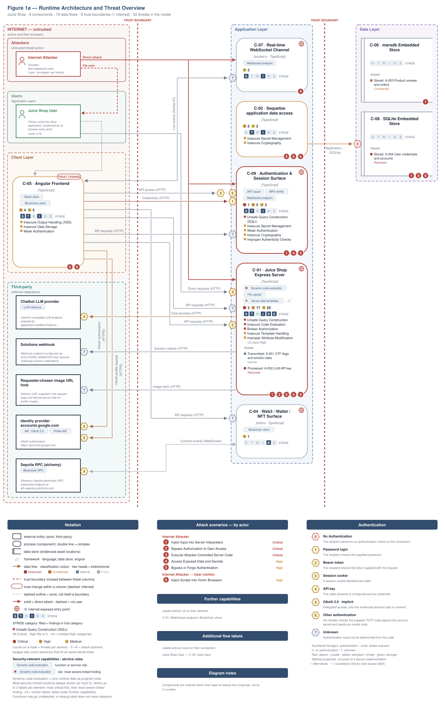
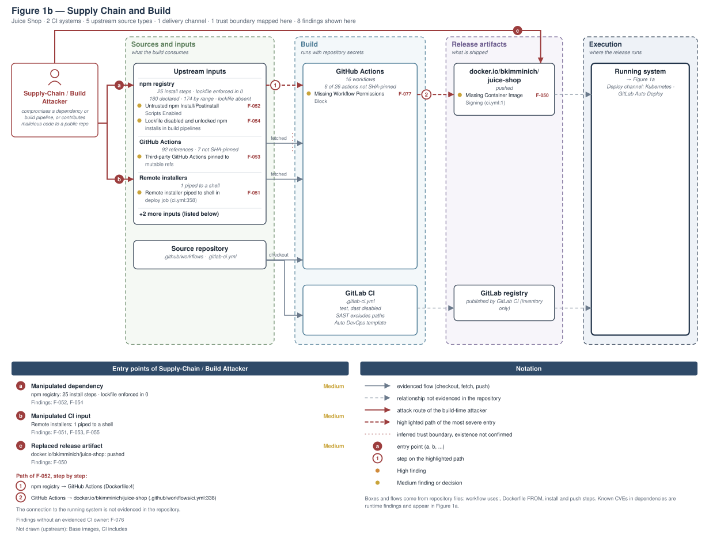
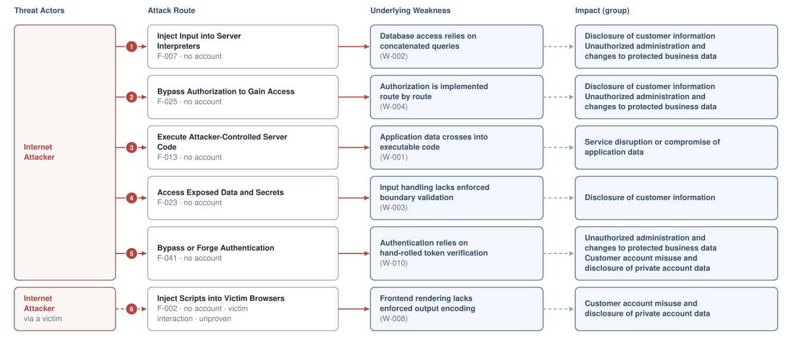
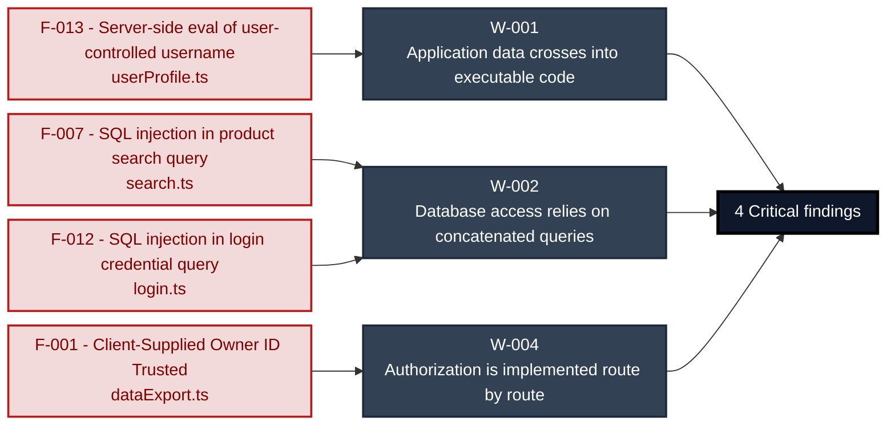
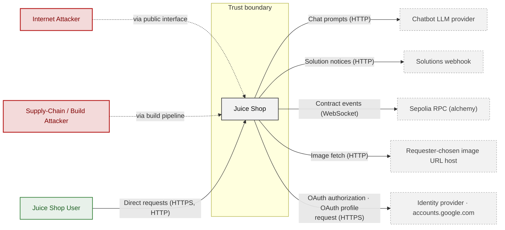
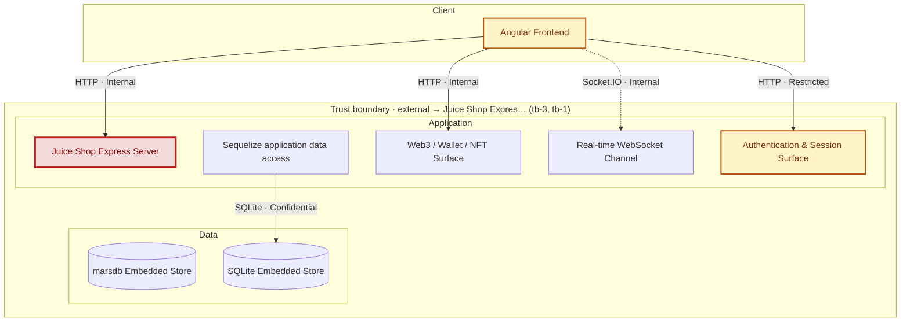

# Security Assessment Report - Juice Shop

_Analysis of security architecture and threats_

_Generated by AppSec Analyzer v0.1.0a0 (analysis v5)_

---

> | | |
> |---|---|
> | **Project** | Juice Shop |
> | **Repository** | `https://github.com/juice-shop/juice-shop.git` |
> | **Homepage** | `https://github.com/juice-shop/juice-shop` |

---

## Changelog

_Append-only history of assessment runs. Most recent first._
| Version | Date | Scan | Model | Δ Threats | Note |
|--------|--------------------|------------|--------------|----------------|---------------|
| v1 | 2026-11-03 15:47 CET | full · quick | sonnet-economy | 68 total | first full scan |

---

> ⚠ **Quick depth - reduced-scope assessment.**
> 
> This report ran with intentionally narrower depth to keep wall-time short:
> 
> - **7 components** under full STRIDE analysis (`criteria-selected: frontend`, auth, and internet-exposed components only)
> - **Max 2 threats per STRIDE category** per component (vs. unlimited at standard/thorough)
> - **No CVSS vectors**, no per-finding evidence excerpts
> - **No §3 Attack Walkthroughs** (entirely skipped at `--quick`)
> - **No [§9](#9-abuse-cases) abuse-case verification** (skipped at `--quick`; re-run with `--abuse-cases`)
> - **No LLM-enriched [§7](#7-weakness-register) architecture narrative** (scaffold + control tables only)
> - **No QA reviewer pass**, no architect-level review
> 
> Re-run at standard depth (the default, no depth flag; ≈ +30 min) for full STRIDE coverage and QA,
> or with `--thorough` (≈ +90 min) for architect review and enriched architecture sections.

---

## Table of Contents

- [Management Summary](#management-summary)
- [Critical Findings by Root Cause](#critical-findings-by-root-cause)
1. [System Overview](#1-system-overview)
   - [Scope](#scope)
   - [Identified Actors](#identified-actors)
   - [Trust Boundaries](#trust-boundaries)
   - [Platform Security Settings](#platform-security-settings)
2. [Architecture Diagrams](#2-architecture-diagrams)
   - [2.1 System Context](#21-system-context)
   - [2.2 Container Architecture](#22-container-architecture)
   - [2.3 Components](#23-components)
4. [Assets](#4-assets)
5. [Attack Surface](#5-attack-surface)
   - [5.1 Unauthenticated Entry Points (53)](#51-unauthenticated-entry-points-53)
   - [5.2 Authenticated Entry Points (60)](#52-authenticated-entry-points-60)
7. [Weakness Register](#7-weakness-register)
8. [Findings Register](#8-findings-register)
9. [Abuse Cases](#9-abuse-cases)
10. [Mitigation Register](#10-mitigation-register)
11. [Out of Scope](#11-out-of-scope)
   - [Not Covered by This Method](#not-covered-by-this-method)
   - [Excluded from This Assessment](#excluded-from-this-assessment)
- [Appendix: Run Statistics](#appendix-run-statistics)
- [Appendix A - Attack Vector Taxonomy](#appendix-a-vektor-taxonomy)

> _Section numbering is non-contiguous: §3, §6 are omitted at the current (quick) depth and return at standard depth (the default) or with `--thorough`. The remaining sections keep their original numbers so existing cross-references stay valid._

---

## Management Summary

### Verdict

🔴 **Critical security concerns** - This deliberately vulnerable web shop lets anonymous internet users take over accounts and run code on the server. Acceptable only as an isolated training target; it must never hold real data or be reachable outside a training network.

**Risk distribution:** 🔴 Critical: 3 · 🟠 High: 13 · 🟡 Medium: 16 · 🟢 Low: n/a · **Total: 32**<br/>**Findings register:** 68 · 🔴 Critical: 4 · 🟠 High: 25 · 🟡 Medium: 39 - the distribution above counts insecure-practice findings under their weakness; see [§8 Findings Register](#8-findings-register)<br/>**Assessment evidence:** 26 of 29 finding(s) confirmed in code<br/>**Weakness classes:** 35 (28 implementation, 7 design) - see [§7 Weakness Register](#7-weakness-register)

<br/>

**Security concerns behind this assessment:**

<blockquote style="border-left: 3px solid #dc2626; padding: 16px 20px; margin: 0;">

- **Anonymous login bypass and data theft** — SQL injection in login and product search lets unauthenticated users sign in as others and dump the user database. *(🔴 [F-012](#f-012), 🔴 [F-007](#f-007) → [W-002](#w-002))*
- **Server takeover through code execution** — A signed-in user can plant code in their profile name that the server then executes (server-side code injection). *(🔴 [F-013](#f-013) → [W-001](#w-001))*
- **Other customers' records read and changed** — Missing ownership checks (IDOR) let any signed-in customer read or change another customer's records. *(🔴 [F-001](#f-001), 🟠 [F-005](#f-005) → [W-004](#w-004))* — left open by the evidence review: 🔴 [F-001](#f-001) — Client-Supplied Owner ID Trusted, 🟠 [F-005](#f-005) — Missing Object Ownership Checks
- **Ordinary accounts become administrators** — Mass assignment on registration lets anyone supply a privileged role field and create an administrator account. *(🟠 [F-039](#f-039) → [W-006](#w-006))*
- **Hard-coded secrets allow forged logins** — Signing secrets committed to source let anyone with repository access forge login tokens for any user. *(🟠 [F-034](#f-034) → [W-009](#w-009))*
- **Browser script injection steals sessions** — Missing output encoding lets injected script run in visitors' browsers and read their stored login tokens. *(🟠 [F-002](#f-002) → [W-008](#w-008))*

</blockquote>

<br/>

Treat this system as a controlled training exercise only; real customers or production data would be fully exposed.

**About this assessment:** An AI-assisted threat model derived from the implementation of Juice Shop. It reconstructs the implemented architecture (9 components and 5 external services, see [§2](#2-architecture-diagrams)) and identifies threats and control gaps in it.

**Method and limits:** Automated static analysis of code and configuration, not a pentest or a team threat-modeling session; Low and Informational findings not reported (threshold: medium) - see [§11 Out of Scope](#11-out-of-scope).

### Remediation Priorities

The root causes behind the findings, ranked by severity, each with the measures to do first. The lasting fix under a root cause removes it and every finding it causes. Every mitigation that fixes a Critical finding is listed. Details in the [§7 Weakness Register](#7-weakness-register) and the [§10 Mitigation Register](#10-mitigation-register).

<table style="table-layout:fixed;width:100%;max-width:1240px">
<colgroup><col width="30%" style="width:30%"><col width="28%" style="width:28%"><col width="33%" style="width:33%"><col width="9%" style="width:9%"></colgroup>
<thead><tr><th>Root cause → lasting fix</th><th>Do first</th><th>Resolves</th><th>Effort</th></tr></thead>
<tbody>
<tr><td rowspan="1" style="overflow-wrap:break-word">🔴 <a href="#w-001">W-001</a> - Application data crosses into executable code<br/><em>→ replace evaluation of application values with a data parser or a fixed set of operations whose arguments remain data</em></td><td style="overflow-wrap:break-word">● <a href="#m-026">M-026</a> - Remove eval and escape username</td><td style="overflow-wrap:break-word">🔴 <a href="#f-013">F-013</a> - Server-side eval of user-controlled username</td><td style="white-space:nowrap">Low</td></tr>
<tr><td rowspan="2" style="overflow-wrap:break-word">🔴 <a href="#w-002">W-002</a> - Database access relies on concatenated queries<br/><em>→ provide one parameterised repository or query-builder path and prohibit application-value interpolation in database queries</em></td><td style="overflow-wrap:break-word">● <a href="#m-024">M-024</a> - Use parameterized database queries</td><td style="overflow-wrap:break-word">🔴 <a href="#f-007">F-007</a> - SQL injection in product search query</td><td style="white-space:nowrap">Low</td></tr>
<tr><td style="overflow-wrap:break-word">● <a href="#m-025">M-025</a> - Use bound parameters in login query</td><td style="overflow-wrap:break-word">🔴 <a href="#f-012">F-012</a> - SQL injection in login credential query</td><td style="white-space:nowrap">Low</td></tr>
<tr><td rowspan="3" style="overflow-wrap:break-word">🟠 <a href="#w-004">W-004</a> - Authorization is implemented route by route<br/><em>→ enforce authorization through a shared server-side policy layer and make ownership and tenant scope mandatory inputs to data access</em></td><td style="overflow-wrap:break-word">● <a href="#m-019">M-019</a> - Enforce object-level (ownership) authorization</td><td style="overflow-wrap:break-word">🔴 <a href="#f-001">F-001</a> - Client-Supplied Owner ID Trusted</td><td style="white-space:nowrap">Medium</td></tr>
<tr><td style="overflow-wrap:break-word">◕ <a href="#m-035">M-035</a> - Enforce object-level (ownership) authorization</td><td style="overflow-wrap:break-word">🟠 <a href="#f-025">F-025</a> - Basket item update lacks ownership check<br/>🟠 <a href="#f-027">F-027</a> - IDOR</td><td style="white-space:nowrap">Low</td></tr>
<tr><td style="overflow-wrap:break-word">◕ <a href="#m-036">M-036</a> - Guard Product PUT with <code>denyAll</code> or admin authorization</td><td style="overflow-wrap:break-word">🟠 <a href="#f-028">F-028</a> - Product update route lacks authorization</td><td style="white-space:nowrap">Low</td></tr>
<tr><td rowspan="1" style="overflow-wrap:break-word">🟠 <a href="#w-006">W-006</a> - Privileged attributes lack an enforced write allowlist<br/><em>→ define operation-specific write schemas and assign privileged attributes exclusively through server-side policy</em></td><td style="overflow-wrap:break-word">● <a href="#m-045">M-045</a> - Allowlist client-controlled fields</td><td style="overflow-wrap:break-word">🟠 <a href="#f-039">F-039</a> - Mass assignment on user registration endpoint</td><td style="white-space:nowrap">Low</td></tr>
<tr><td rowspan="2" style="overflow-wrap:break-word">🟠 <a href="#w-008">W-008</a> - Frontend rendering lacks enforced output encoding<br/><em>→ use framework-safe rendering by default and isolate any required raw HTML behind one reviewed sanitisation and Trusted Types policy</em></td><td style="overflow-wrap:break-word">◕ <a href="#m-020">M-020</a> - Encode output instead of bypassing the framework sanitizer</td><td style="overflow-wrap:break-word">🟠 <a href="#f-002">F-002</a> - Angular Sanitizer Bypass DOM XSS</td><td style="white-space:nowrap">Low</td></tr>
<tr><td style="overflow-wrap:break-word">◕ <a href="#m-021">M-021</a> - Remove sanitizer bypass and render IP as text</td><td style="overflow-wrap:break-word">🟠 <a href="#f-003">F-003</a> - Angular Sanitizer Bypass</td><td style="white-space:nowrap">Low</td></tr>
<tr><td rowspan="1" style="overflow-wrap:break-word">🟠 <a href="#w-009">W-009</a> - Secrets are committed to source instead of a managed store<br/><em>→ move every secret to a managed secret store or injected environment configuration, rotate the exposed values, and add secret-scanning to CI</em></td><td style="overflow-wrap:break-word">◕ <a href="#m-042">M-042</a> - Load signing keys from a secret store</td><td style="overflow-wrap:break-word">🟠 <a href="#f-034">F-034</a> - Hardcoded JWT private key and HMAC secret in source</td><td style="white-space:nowrap">Medium</td></tr>
</tbody>
</table>

*17 more P1/P2 mitigations and 50 P3/P4 backlog items in the [§10 Mitigation Register](#10-mitigation-register). ● P1 · ◕ P2 · ◑ P3 · ○ P4*

### Open Questions for the Team

The code cannot answer these questions; the people who own the business and the deployment can. Each question states under it what its answer changes.

- _How critical are User credentials and accounts, Product reviews and orders and LLM API key to the business, and what harm would their disclosure, manipulation or unavailability cause?_
  The answer weights the impact rating and fix order of every finding that reaches these assets.
- _Which sensitive business records can the production database account used by Juice Shop Express Server or Authentication & Session Surface access?_ ([W-002](#w-002): [F-007](#f-007), [F-012](#f-012))
  Personal or regulated data in reach raises both the breach impact and any notification duty; a narrowly scoped account limits the blast radius.
- _If an attacker runs code in Juice Shop Express Server, which other services, secrets or credentials can that process reach?_ ([F-013](#f-013), [F-073](#f-073) (unproven))
  Every reachable service or credential extends this from one component to a wider compromise and raises the priority of isolating that process; an isolated process contains it.

### Security Posture & Top Threats

**Figure 1a - Runtime Architecture and Threat Overview**

At runtime, Juice Shop has 8 components in 3 layers and exchanges data with 5 external services. Figure 1a shows these data flows and where each of the 6 attack scenarios below begins. The complete boundary catalogue remains in [§1 Trust Boundaries](#trust-boundaries).

<picture><source media="(prefers-color-scheme: dark)" srcset="security-assessment-juice-shop-quick-v0.1.0.figure1-dark.svg"></picture>

**Build pipeline**, not drawn in this runtime view: GitHub Actions, GitLab CI.  Supply-Chain / Build Attacker → [Figure 1b](#figure-1b).

Role access and finding assignments are listed in [Identified Actors](#identified-actors).

**Actor grouping.** Regular self-registered users are grouped with anonymous internet attackers because registration is open. Each finding retains its login and privilege requirements.

<a id="figure-1b"></a>

**Figure 1b - Supply Chain and Build**

Juice Shop builds in GitHub Actions, GitLab CI. Figure 1b shows the inputs, build systems and release artifacts the repository evidences, with 8 findings attached to them. The highlighted path follows 🟡 [F-052](#f-052) — Untrusted npm Install/Postinstall Scripts Enabled as far as the repository evidences it.

<picture><source media="(prefers-color-scheme: dark)" srcset="security-assessment-juice-shop-quick-v0.1.0.figure1b-dark.svg"></picture>

**Figure 2 - Attack Routes and Impact**

Each numbered route names one example finding from the corresponding Top Threats group with its access prerequisite, the register weakness it is linked to, and the group's potential business harm, which depends on deployment and affected assets. W-IDs in parentheses link the example to an existing weakness. The attack step, affected component and technical consequence are listed in the findings register. Red arrows indicate attacks; dashed red arrows involve a victim; grey arrows lead to potential harm.

<picture><source media="(prefers-color-scheme: dark)" srcset="security-assessment-juice-shop-quick-v0.1.0.figure2-dark.svg"></picture>

**Threat actors.** The actors below drive the numbered attack paths in the figures above. The **Juice Shop User** is the *victim* of client-side attacks (XSS / CSRF), not an attacker. Figure 2 marks victim interaction on the applicable attack routes.

- **Juice Shop User** — legitimate end user; target of client-side attacks; target of ⑥ Output Encoding / Cross-Site Scripting.
- **Internet Attacker** — can self-register a regular account; drives ① Insecure Query Construction & Data Access, ② Broken Authorization & Access Control, ③ Remote Code Execution (unsafe eval), ④ Sensitive File & Secret Exposure, ⑤ Hardcoded Secrets & Weak Cryptography, ⑥ Output Encoding / Cross-Site Scripting.

**6 structural threats**, grouped by weakness class - each row is one threat, not one finding. *Threat Description* states the general architectural weakness (STRIDE in brackets); *Findings* lists the concrete instances by severity under their component, each linked to the [§8 Findings Register](#8-findings-register), and on screen an ID shows its title when you point at it; *Risk & Impact* combines severity with business consequence; *Primary Measures* names the most important measures for this threat, most important first, one per root cause. All measures are in the [§10 Mitigation Register](#10-mitigation-register).

| # | Threat Description | Findings (→ Component) | Risk & Impact | Primary Measures |
|---|------------------------------------|------------------------------------------------|------------------------------------|----------------------|
| <a id="path-injection"></a>① | **Insecure Query Construction & Data Access** _(T·I)_<br/>Untrusted input is concatenated into database queries and template source, letting attackers bypass logins and read or alter stored data. | → [C-01](#c-01) Juice Shop Express Server<br/>🔴&nbsp;<span style="white-space:nowrap"><a href="#f-007" title="SQL injection in product search query">F-007</a></span><br/>🟠&nbsp;<span style="white-space:nowrap"><a href="#f-029" title="NoSQL predicate injection from request ids">F-029</a></span>, <span style="white-space:nowrap"><a href="#f-030" title="Input compiled as template source">F-030</a></span><br/>→ [C-09](#c-09) Authentication & Session Surface<br/>🔴&nbsp;<span style="white-space:nowrap"><a href="#f-012" title="SQL injection in login credential query">F-012</a></span><br/><details><summary>3 Medium</summary>→ [C-01](#c-01) Juice Shop Express Server<br/>🟡&nbsp;<span style="white-space:nowrap"><a href="#f-046" title="NoSQL operator injection">F-046</a></span>, <span style="white-space:nowrap"><a href="#f-047" title="NoSQL operator injection in review update">F-047</a></span>, <span style="white-space:nowrap"><a href="#f-060" title="XML parser resolves external entities and loads host files">F-060</a></span></details> | 🔴 Critical<br/>Customer Data Exfiltration · Full Admin Takeover | <span style="white-space:nowrap">● [M-024](#m-024)</span> - Use parameterized database queries<br/><span style="white-space:nowrap">◕ [M-037](#m-037)</span> - Use typed query predicates instead of \$where<br/><span style="white-space:nowrap">◕ [M-038](#m-038)</span> - Remove server-side evaluation of untrusted input |
| <a id="path-privilege-escalation"></a>② | **Broken Authorization & Access Control** _(E·I)_<br/>Object-level and function-level authorization gaps let ordinary or anonymous callers access other users' records and privileged operations. | → [C-01](#c-01) Juice Shop Express Server<br/>🔴&nbsp;<span style="white-space:nowrap"><a href="#f-001" title="Client-Supplied Owner ID Trusted">F-001</a></span><br/>🟠&nbsp;<span style="white-space:nowrap"><a href="#f-005" title="Missing Object Ownership Checks">F-005</a></span>, <span style="white-space:nowrap"><a href="#f-025" title="Basket item update lacks ownership check">F-025</a></span>, <span style="white-space:nowrap"><a href="#f-027" title="IDOR">F-027</a></span>, <span style="white-space:nowrap"><a href="#f-038" title="Product update API registered without authorization">F-038</a></span>, <span style="white-space:nowrap"><a href="#f-039" title="Mass assignment on user registration endpoint">F-039</a></span>, <span style="white-space:nowrap"><a href="#f-016" title="Password change does not require current password">F-016</a></span>, <span style="white-space:nowrap"><a href="#f-028" title="Product update route lacks authorization">F-028</a></span>, <span style="white-space:nowrap"><a href="#f-035" title="IDOR / broken object-level authorization">F-035</a></span>, <span style="white-space:nowrap"><a href="#f-036" title="Sensitive Routes Registered Without Authentication Middleware">F-036</a></span><br/><details><summary>3 Medium</summary>→ [C-01](#c-01) Juice Shop Express Server<br/>🟡&nbsp;<span style="white-space:nowrap"><a href="#f-006" title="Missing Basket Ownership Checks">F-006</a></span>, <span style="white-space:nowrap"><a href="#f-042" title="Feedback accepts forged user identifier">F-042</a></span>, <span style="white-space:nowrap"><a href="#f-061" title="User records readable by any authenticated user">F-061</a></span></details> | 🔴 Critical<br/>Customer Data Exfiltration · Full Admin Takeover | <span style="white-space:nowrap">● [M-019](#m-019)</span> - Enforce object-level (ownership) authorization<br/><span style="white-space:nowrap">● [M-045](#m-045)</span> - Allowlist client-controlled fields<br/><span style="white-space:nowrap">◕ [M-028](#m-028)</span> - Require current password via POST |
| <a id="path-remote-code-execution"></a>③ | **Remote Code Execution (unsafe eval)** _(E)_<br/>User-controlled strings reach server-side evaluation, allowing arbitrary code to run in the application process. | → [C-01](#c-01) Juice Shop Express Server<br/>🔴&nbsp;<span style="white-space:nowrap"><a href="#f-013" title="Server-side eval of user-controlled username">F-013</a></span><br/>🟡&nbsp;<span style="white-space:nowrap"><a href="#f-073" title="Order lines evaluated in vm context not a security">F-073</a></span> | 🔴 Critical<br/>Full Server Compromise | <span style="white-space:nowrap">● [M-026](#m-026)</span> - Remove eval and escape username |
| <a id="path-sensitive-data-exposure"></a>④ | **Sensitive File & Secret Exposure** _(I)_<br/>Path handling and exposed directories let attackers download key material or write and read files outside intended locations. | → [C-01](#c-01) Juice Shop Express Server<br/>🟠&nbsp;<span style="white-space:nowrap"><a href="#f-023" title="Path traversal">F-023</a></span>, <span style="white-space:nowrap"><a href="#f-024" title="Zip entry path traversal in file upload">F-024</a></span>, <span style="white-space:nowrap"><a href="#f-031" title="Unauthenticated encryption key file exposure">F-031</a></span>, <span style="white-space:nowrap"><a href="#f-032" title="Server-side request forgery in profile">F-032</a></span><br/><details><summary>7 Medium</summary>→ [C-01](#c-01) Juice Shop Express Server<br/>🟡&nbsp;<span style="white-space:nowrap"><a href="#f-056" title="Whoami field selector exposes password hash and JSONP">F-056</a></span>, <span style="white-space:nowrap"><a href="#f-058" title="Unauthenticated log file listing and download">F-058</a></span>, <span style="white-space:nowrap"><a href="#f-059" title="Order confirmation PDFs written to publicly listed">F-059</a></span><br/>→ [C-09](#c-09) Authentication & Session Surface<br/>🟡&nbsp;<span style="white-space:nowrap"><a href="#f-045" title="Redirect allowlist check by substring match">F-045</a></span>, <span style="white-space:nowrap"><a href="#f-068" title="User list with sensitive fields exposed to any">F-068</a></span><br/>→ [C-02](#c-02) Sequelize application data access<br/>🟡&nbsp;<span style="white-space:nowrap"><a href="#f-062" title="Payment card numbers stored in plaintext">F-062</a></span><br/>→ [C-07](#c-07) Real-time WebSocket Channel<br/>🟡&nbsp;<span style="white-space:nowrap"><a href="#f-067" title="Challenge flags replayed to every connecting">F-067</a></span></details> | 🟠 High<br/>Customer Data Exfiltration | <span style="white-space:nowrap">◕ [M-033](#m-033)</span> - Constrain file paths to a safe base directory<br/><span style="white-space:nowrap">◕ [M-039](#m-039)</span> - Stop serving key material over HTTP<br/><span style="white-space:nowrap">◕ [M-040](#m-040)</span> - Validate and allowlist outbound request targets |
| <a id="path-auth-bypass"></a>⑤ | **Hardcoded Secrets & Weak Cryptography** _(S·E)_<br/>Committed signing secrets and weak token or password handling allow attackers to forge identities or recover credentials. | → [C-01](#c-01) Juice Shop Express Server<br/>🟠&nbsp;<span style="white-space:nowrap"><a href="#f-015" title="JWT verify call missing algorithms allowlist">F-015</a></span><br/>→ [C-02](#c-02) Sequelize application data access<br/>🟠&nbsp;<span style="white-space:nowrap"><a href="#f-033" title="Unsalted MD5 password hashing">F-033</a></span><br/>→ [C-09](#c-09) Authentication & Session Surface<br/>🟠&nbsp;<span style="white-space:nowrap"><a href="#f-034" title="Hardcoded JWT private key and HMAC secret in source">F-034</a></span><br/><details><summary>2 Medium</summary>→ [C-01](#c-01) Juice Shop Express Server<br/>🟡&nbsp;<span style="white-space:nowrap"><a href="#f-041" title="Chat identity taken from JWT decoded without signature check">F-041</a></span><br/>→ [C-05](#c-05) Angular Frontend<br/>🟡&nbsp;<span style="white-space:nowrap"><a href="#f-066" title="Hardcoded test credentials in login component">F-066</a></span></details> | 🟠 High<br/>Full Admin Takeover · Customer Session Hijack | <span style="white-space:nowrap">◕ [M-027](#m-027)</span> - Enforce JWT signature and algorithm verification<br/><span style="white-space:nowrap">◕ [M-042](#m-042)</span> - Load signing keys from a secret store<br/><span style="white-space:nowrap">◕ [M-041](#m-041)</span> - Hash passwords with a strong, salted algorithm |
| <a id="path-cross-site-scripting"></a>⑥ | **Output Encoding / Cross-Site Scripting** _(T·I)_<br/>Frontend rendering bypasses output sanitization and keeps tokens in script-readable storage, so injected script can steal sessions. | → [C-05](#c-05) Angular Frontend<br/>🟠&nbsp;<span style="white-space:nowrap"><a href="#f-002" title="Angular Sanitizer Bypass DOM XSS">F-002</a></span>, <span style="white-space:nowrap"><a href="#f-003" title="Angular Sanitizer Bypass">F-003</a></span>, <span style="white-space:nowrap"><a href="#f-004" title="Bearer Token in Script-Readable Storage">F-004</a></span><br/>→ [C-02](#c-02) Sequelize application data access<br/>🟡&nbsp;<span style="white-space:nowrap"><a href="#f-049" title="Unsanitized product description enabling stored XSS">F-049</a></span> | 🟠 High<br/>Customer Session Hijack | <span style="white-space:nowrap">◕ [M-020](#m-020)</span> - Encode output instead of bypassing the framework sanitizer<br/><span style="white-space:nowrap">◕ [M-022](#m-022)</span> - Store session tokens in HttpOnly, Secure cookies |

**Further threats without Critical or High findings:** Build Pipeline & Dependency Integrity (🟡 8) · CSRF / Permissive CORS (🟡 1). Their findings are in the [§8 Findings Register](#8-findings-register).

_STRIDE: S spoofing · T tampering · R repudiation · I information disclosure · D denial of service · E elevation of privilege. Risk, findings, components, impact and primary measures are derived deterministically; only the one-line weakness description is authored._

### AI / LLM Exposure

This system embeds an LLM/AI surface (an LLM/AI integration); the risks below are architectural - they follow from how untrusted input reaches the model's prompt, tools, and outputs.

- **[ASI03](https://genai.owasp.org/resource/owasp-top-10-for-agentic-applications-for-2026/) Agent Identity & Privilege Abuse** — The agent can act with an over-broad or inherited identity instead of scoped delegation. _([C-01](#c-01) — Juice Shop Express Server)_
  - ↳ 🟡 [F-041](#f-041) — Chat identity taken from JWT decoded without signature check

- **[LLM01](https://genai.owasp.org/llmrisk/llm01/) Prompt Injection** — Untrusted user input reaches the LLM prompt/context without sufficient trust separation, letting an attacker override system instructions, redirect tool calls, or coerce unintended model behaviour. _([C-01](#c-01) — Juice Shop Express Server)_
  - ↳ 🟡 [F-048](#f-048) — Client-controlled chat roles and history reach the model _([ASI01](https://genai.owasp.org/resource/owasp-top-10-for-agentic-applications-for-2026/))_

- **[LLM05](https://genai.owasp.org/llmrisk/llm05/) Improper Output Handling** — LLM-generated output flows into a downstream sink (browser, shell, query, eval) without validation or encoding, turning a model completion into an injection vector. _([C-01](#c-01) — Juice Shop Express Server)_
  - ↳ 🟡 [F-072](#f-072) — Unbounded coupon discount from model-selected tool argument _([ASI02](https://genai.owasp.org/resource/owasp-top-10-for-agentic-applications-for-2026/))_

- **[LLM06](https://genai.owasp.org/llmrisk/llm06/) Excessive Agency** — The LLM is granted tool/function-calling authority without a secondary authorization boundary, so a manipulated model turn can invoke privileged actions on the user's behalf. _([C-01](#c-01) — Juice Shop Express Server)_
  - ↳ 🟡 [F-072](#f-072) — Unbounded coupon discount from model-selected tool argument _([ASI02](https://genai.owasp.org/resource/owasp-top-10-for-agentic-applications-for-2026/))_
  - ↳ 🟡 [F-075](#f-075) — Chatbot coupon tool accepts unbounded model-chosen discount _([ASI02](https://genai.owasp.org/resource/owasp-top-10-for-agentic-applications-for-2026/))_

- **[LLM10](https://genai.owasp.org/llmrisk/llm10/) Unbounded Consumption** — The LLM endpoint imposes no authentication, rate, or quota boundary, so any client can drive unbounded model invocations — uncontrolled provider cost and denial of service for legitimate users. _([C-01](#c-01) — Juice Shop Express Server)_
  - ↳ 🟡 [F-070](#f-070) — Unauthenticated chat route lacks request and token bounds

### Operational Strengths

Operational controls rated Adequate or Partial - grouped into broad clusters. Clusters demoted to Weak by open Critical/High findings are excluded here.

<table style="table-layout:fixed;width:100%;max-width:1240px">
<colgroup><col width="18%" style="width:18%"><col width="32%" style="width:32%"><col width="14%" style="width:14%"><col width="36%" style="width:36%"></colgroup>
<thead><tr><th>Strength</th><th>What's in Place</th><th>Effectiveness</th><th>Open gaps</th></tr></thead>
<tbody>
<tr><td style="overflow-wrap:break-word"><strong>Container &amp; Supply-Chain Hardening</strong></td><td style="overflow-wrap:break-word"><em>Build-time and runtime hardening - minimal base image, non-root execution, dependency inventory.</em><br/>Container image hardening<br/>Cookie signing secret and token handling<br/>Dependency lockfile and reproducible installs</td><td style="overflow-wrap:break-word">✅ Adequate</td><td style="overflow-wrap:break-word">-</td></tr>
<tr><td style="overflow-wrap:break-word"><strong>Hardened HTTP Stack</strong></td><td style="overflow-wrap:break-word"><em>Browser-facing HTTP hardening — security headers, cookie flags, cross-origin policy, and abuse-protection limits.</em><br/>WebSocket CORS origin restriction<br/>Rate limiting</td><td style="overflow-wrap:break-word">⚠️ Partial</td><td style="overflow-wrap:break-word">1 Medium finding remains open:<br/>🟡 <a href="#f-043">F-043</a> — OAuth implicit flow without state parameter</td></tr>
<tr><td style="overflow-wrap:break-word"><strong>Observability &amp; Audit</strong></td><td style="overflow-wrap:break-word"><em>Runtime visibility - access logging, audit trails, and operational telemetry for post-incident review.</em><br/>Error handling and logging for WebSocket listeners<br/>Access logging and exposed operational endpoints</td><td style="overflow-wrap:break-word">⚠️ Partial</td><td style="overflow-wrap:break-word">-</td></tr>
</tbody>
</table>

**Bottom line:** These controls narrow specific attack surfaces but none eliminates a Critical finding on its own.

---

<a id="critical-attack-chain"></a><a id="critical-attack-tree"></a><a id="critical-findings-by-root-cause"></a>
## Critical Findings by Root Cause

4 of 4 Critical findings trace back to 3 root causes; fixing a root cause addresses every finding linked to it.



**Structural fixes** (full detail in [§7 Weakness Register](#7-weakness-register)):

- **[W-001](#w-001)** — Replace evaluation of application values with a data parser or a fixed set of operations whose arguments remain data _(closes [F-013](#f-013))_
- **[W-002](#w-002)** — Provide one parameterised repository or query-builder path and prohibit application-value interpolation in database queries _(closes [F-007](#f-007), [F-012](#f-012))_
- **[W-004](#w-004)** — Enforce authorization through a shared server-side policy layer and make ownership and tenant scope mandatory inputs to data access _(closes [F-001](#f-001))_

---

## 1. System Overview

Probably the most modern and sophisticated insecure web application

**Repository:** `https://github.com/juice-shop/juice-shop.git`
**Runtime:** Node\.js 22 - 26

### Scope

This threat model covers 9 components of juice-shop: 

- Juice Shop Express Server
- Sequelize application data access
- CI/CD Pipeline
- Web3 / Wallet / NFT Surface
- Angular Frontend
- marsdb Embedded Store
- Real-time WebSocket Channel
- SQLite Embedded Store
- Authentication & Session Surface

**Not individually examined:** 133 source files in 5 components had no route, lead or security signal (Juice Shop Express Server 3, Sequelize application data access 12, CI/CD Pipeline 5, Angular Frontend 109, marsdb Embedded Store 4).

**Not analysed:** 92 TypeScript files the build leaves out, so their routes and code sites were not checked (`data/static/codefixes/accessLogDisclosureChallenge_1_correct.ts`, `data/static/codefixes/accessLogDisclosureChallenge_2.ts`, `data/static/codefixes/accessLogDisclosureChallenge_3.ts`, `data/static/codefixes/accessLogDisclosureChallenge_4.ts`, `data/static/codefixes/adminSectionChallenge_1_correct.ts`, `data/static/codefixes/adminSectionChallenge_2.ts`, `data/static/codefixes/adminSectionChallenge_3.ts`, `data/static/codefixes/adminSectionChallenge_4.ts`, `data/static/codefixes/changeProductChallenge_1.ts`, `data/static/codefixes/changeProductChallenge_2.ts` and 82 more).

**Not assessed:** 1 security-relevant code location was read but could not be judged (Web3 / Wallet / NFT Surface 1); `security-assessment.yaml` records each with its reason under `meta.undecided_targets`.

**Out of scope:** third-party hosted dependencies, browser runtime, operating-system kernel, and the underlying network infrastructure.

**Basis:** An automated, AI-assisted threat model built from the repository's source code and configuration - static analysis only, no dynamic or penetration testing. It describes the system as built, not as designed.

---

<a id="identified-actors"></a>
### Identified Actors

Figure 1a draws **Internet Attacker** as attacker and **Juice Shop User** as legitimate role of Juice Shop. [Figure 1b](#figure-1b) draws **Supply-Chain / Build Attacker** and the build it attacks. Each row gives that actor's access and the findings attributed to it.

| Actor | Type | Access | Findings |
|----------------------|-------------|----------------------|-----------------|
| Internet Attacker | Attacker | Can self-register a regular account | 🔴 4 · 🟠 25 · 🟡 29 |
| Supply-Chain / Build Attacker | Attacker | Compromises a dependency or build pipeline,<br/>or contributes malicious code to a public<br/>repo | 🟡 8 |
| Juice Shop User | Role (victim) | Person using the client application,<br/>evidenced by its browser entry point. | - |

2 findings (2 Medium) have no assigned actor. That does not mean they are out of reach.

---

### Trust Boundaries

Each row names a crossing and the condition it relies on. A modelled crossing does not prove that its control works.

<table style="table-layout:fixed;width:100%;max-width:1240px">
<colgroup><col width="20%" style="width:20%"><col width="25%" style="width:25%"><col width="21%" style="width:21%"><col width="34%" style="width:34%"></colgroup>
<thead><tr><th>Crossing</th><th>Required condition</th><th>Control</th><th>Status and findings</th></tr></thead>
<tbody>
<tr><td style="overflow-wrap:break-word"><a id="tb-2"></a>tb-2 · External → Authentication &amp; Session Surface</td><td style="overflow-wrap:break-word">Credentials from the login body never become SQL text.</td><td style="overflow-wrap:break-word">Login credential SQL query</td><td style="overflow-wrap:break-word"><strong>Gap:</strong> <em>Validation</em><br/>🔴 <a href="#f-012">F-012</a> — SQL injection in login credential query</td></tr>
<tr><td style="overflow-wrap:break-word"><a id="tb-9"></a>tb-9 · Juice Shop Express Server → external</td><td style="overflow-wrap:break-word">Only content intended for the LLM provider leaves the server in chat prompts.</td><td style="overflow-wrap:break-word">Not identified</td><td style="overflow-wrap:break-word"><strong>Gap:</strong> <em>Egress destination</em><br/>🟠 <a href="#f-032">F-032</a> — Server-side request forgery in profile</td></tr>
<tr><td style="overflow-wrap:break-word"><a id="tb-1"></a>tb-1 · External → Juice Shop Express Server</td><td style="overflow-wrap:break-word">Every state-changing or user-specific route is registered behind <code>security.<wbr>isAuthorized()</code> or <code>security.<wbr>denyAll()</code>.</td><td style="overflow-wrap:break-word"><code>security.<wbr>isAuthorized()</code> middleware</td><td style="overflow-wrap:break-word"><strong>Gap:</strong> <em>Authorization</em><br/>🟡 <a href="#f-061">F-061</a> — User records readable by any authenticated user</td></tr>
<tr><td style="overflow-wrap:break-word"><a id="tb-5"></a>tb-5 · External → CI/CD Pipeline<br/>Crossing: inferred</td><td style="overflow-wrap:break-word">Every workflow action reference is pinned to an immutable commit.</td><td style="overflow-wrap:break-word">SHA-pinned action references</td><td style="overflow-wrap:break-word"><strong>Gap:</strong> <em>Validation</em><br/>🟡 <a href="#f-053">F-053</a> — Third-party GitHub Actions pinned to mutable refs</td></tr>
<tr><td style="overflow-wrap:break-word"><a id="tb-8"></a>tb-8 · Angular Frontend → external</td><td style="overflow-wrap:break-word">Access tokens returned by Google are verified before the app trusts them.</td><td style="overflow-wrap:break-word">Not identified</td><td style="overflow-wrap:break-word"><strong>Gap:</strong> <em>Egress content</em><br/>🟡 <a href="#f-065">F-065</a> — OAuth access token placed in request URL query string<br/><em>Response trust</em><br/>🟡 <a href="#f-043">F-043</a> — OAuth implicit flow without state parameter</td></tr>
<tr><td style="overflow-wrap:break-word"><a id="tb-3"></a>tb-3 · External → Juice Shop Express Server</td><td style="overflow-wrap:break-word">Every state-changing or user-scoped route is registered behind <code>security.<wbr>isAuthorized()</code> before reaching its handler.</td><td style="overflow-wrap:break-word"><code>security.<wbr>isAuthorized()</code> route middleware</td><td style="overflow-wrap:break-word"><strong>Unverified:</strong> 39 related findings</td></tr>
<tr><td style="overflow-wrap:break-word"><a id="tb-4"></a>tb-4 · External → Real-time WebSocket Channel</td><td style="overflow-wrap:break-word">Only the intended frontend origin can open Socket.IO connections and emit events.</td><td style="overflow-wrap:break-word">Socket.IO CORS origin option</td><td style="overflow-wrap:break-word"><strong>Unverified:</strong> 2 related findings</td></tr>
<tr><td style="overflow-wrap:break-word"><a id="tb-6"></a>tb-6 · External → Web3 / Wallet / NFT Surface<br/>Crossing: inferred</td><td style="overflow-wrap:break-word">Every web3 route validates caller input before acting on keys or wallet addresses.</td><td style="overflow-wrap:break-word">Not identified</td><td style="overflow-wrap:break-word"><strong>Unverified:</strong> 1 related finding</td></tr>
<tr><td style="overflow-wrap:break-word"><a id="tb-7"></a>tb-7 · Sequelize application data access → SQLite Embedded Store</td><td style="overflow-wrap:break-word">Every query reaches SQLite through Sequelize parameter binding, never concatenated SQL text.</td><td style="overflow-wrap:break-word">Sequelize parameter binding</td><td style="overflow-wrap:break-word"><strong>No gap shown,</strong> control not confirmed</td></tr>
<tr><td style="overflow-wrap:break-word"><a id="tb-10"></a>tb-10 · Web3 / Wallet / NFT Surface → external</td><td style="overflow-wrap:break-word">Contract events from the Sepolia RPC are treated as untrusted input before solving challenges.</td><td style="overflow-wrap:break-word">Not identified</td><td style="overflow-wrap:break-word"><strong>No gap shown,</strong> control not confirmed</td></tr>
</tbody>
</table>

Crossing types, source evidence and provenance are retained in `security-assessment.yaml`.

---

### Platform Security Settings

Settings of the hosting platform at check time, not of the examined source revision. `set` means configured, not effective. `not checkable` means unknown, not missing protection.

Repository selection 1: skipped (local repository; supply a GitHub or GitLab URL to check its platform settings).

---

## 2. Architecture Diagrams

### 2.1 System Context

Who uses and attacks Juice Shop, and which external systems it exchanges data with. Solid arrows name the data a flow carries; dashed red arrows are attack routes. Actors carry the names Figure 1 uses (C4 Level 1).



**Key takeaway:** Juice Shop serves Juice Shop User and depends on Chatbot LLM provider, Solutions webhook, Sepolia RPC (alchemy), Requester-chosen image URL host and Identity provider · accounts.google.com; Internet Attacker and Supply-Chain / Build Attacker attack it.

### 2.2 Container Architecture

How the system decomposes into deployable units. Each box is a separate runtime process or service container; arrows show synchronous request paths between them. Components with ≥3 Critical findings carry a red border, ≥2 High amber (C4 Level 2).



*Trust boundaries not drawn above: Sequelize application data access → SQLite Embedded Store (tb-7), Juice Shop Express Server → external (tb-9), Web3 / Wallet / NFT Surface → external (tb-10), Angular Frontend → external (tb-8), +1 more - every boundary is listed in [§1 Trust Boundaries](#trust-boundaries).*

**Key takeaway:** The system decomposes into 1 client, 5 application and 2 data unit(s); Juice Shop Express Server carries the most Critical findings (3) and bounds the worst-case blast radius. The build plane (CI/CD Pipeline) is shown in [Figure 1b](#figure-1b).

### 2.3 Components

How many findings hit each component, which of its controls are weakest, and which findings matter most. Evidence is in the [§8 Findings Register](#8-findings-register).

<!-- detail-table -->
<table style="table-layout:fixed;width:100%;max-width:1240px">
<colgroup><col width="43%" style="width:43%"><col width="7%" style="width:7%"><col width="7%" style="width:7%"><col width="7%" style="width:7%"><col width="36%" style="width:36%"></colgroup>
<thead><tr><th>Component</th><th>🔴</th><th>🟠</th><th>🟡</th><th>Weakest controls and top findings</th></tr></thead>
<tbody>
<tr><td style="overflow-wrap:break-word"><a id="c-01"></a><a id="component-191fd03d5dfa5985"></a><strong>C-01 · Juice Shop Express Server</strong><br/>Mostly in <code>routes/</code></td><td style="overflow-wrap:break-word">3</td><td style="overflow-wrap:break-word">17</td><td style="overflow-wrap:break-word">20</td><td style="overflow-wrap:break-word">🔴 Missing: AuthN<br/>🟠 Weak: Input / query<br/>Top findings: <span style="white-space:nowrap"><a href="#f-013">F-013</a></span> · <span style="white-space:nowrap"><a href="#f-001">F-001</a></span> · <span style="white-space:nowrap"><a href="#f-007">F-007</a></span></td></tr>
<tr><td style="overflow-wrap:break-word"><a id="c-09"></a><a id="component-dff0840e0f4855be"></a><strong>C-09 · Authentication &amp; Session Surface</strong><br/>Mostly in <code>routes/</code></td><td style="overflow-wrap:break-word">1</td><td style="overflow-wrap:break-word">5</td><td style="overflow-wrap:break-word">2</td><td style="overflow-wrap:break-word">🔴 Missing: AuthN<br/>🟠 Weak: Input / query<br/>Top findings: <span style="white-space:nowrap"><a href="#f-012">F-012</a></span> · <span style="white-space:nowrap"><a href="#f-015">F-015</a></span> · <span style="white-space:nowrap"><a href="#f-020">F-020</a></span></td></tr>
<tr><td style="overflow-wrap:break-word"><a id="c-05"></a><a id="component-6ffaf23414c56207"></a><strong>C-05 · Angular Frontend</strong><br/>Mostly in <code>frontend/<wbr>src/<wbr>app/</code></td><td style="overflow-wrap:break-word">–</td><td style="overflow-wrap:break-word">4</td><td style="overflow-wrap:break-word">5</td><td style="overflow-wrap:break-word">Top findings: <span style="white-space:nowrap"><a href="#f-002">F-002</a></span> · <span style="white-space:nowrap"><a href="#f-017">F-017</a></span> · <span style="white-space:nowrap"><a href="#f-003">F-003</a></span></td></tr>
<tr><td style="overflow-wrap:break-word"><a id="c-02"></a><a id="component-290ae722e9565831"></a><strong>C-02 · Sequelize application data access</strong><br/>Mostly in <code>models/</code></td><td style="overflow-wrap:break-word">–</td><td style="overflow-wrap:break-word">2</td><td style="overflow-wrap:break-word">2</td><td style="overflow-wrap:break-word">🟠 Weak: AuthZ<br/>Top findings: <span style="white-space:nowrap"><a href="#f-033">F-033</a></span> · <span style="white-space:nowrap"><a href="#f-034">F-034</a></span> · <span style="white-space:nowrap"><a href="#f-062">F-062</a></span></td></tr>
<tr><td style="overflow-wrap:break-word"><a id="c-03"></a><a id="component-31ebe1b93ddf60d5"></a><strong>C-03 · CI/CD Pipeline</strong></td><td style="overflow-wrap:break-word">–</td><td style="overflow-wrap:break-word">–</td><td style="overflow-wrap:break-word">8</td><td style="overflow-wrap:break-word">🟠 Weak: Supply chain<br/>Top findings: <span style="white-space:nowrap"><a href="#f-051">F-051</a></span> · <span style="white-space:nowrap"><a href="#f-054">F-054</a></span> · <span style="white-space:nowrap"><a href="#f-050">F-050</a></span></td></tr>
<tr><td style="overflow-wrap:break-word"><a id="c-07"></a><a id="component-8c3a32ee53769307"></a><strong>C-07 · Real-time WebSocket Channel</strong><br/>Mostly in <code>lib/<wbr>startup/</code></td><td style="overflow-wrap:break-word">–</td><td style="overflow-wrap:break-word">–</td><td style="overflow-wrap:break-word">2</td><td style="overflow-wrap:break-word">🔴 Missing: AuthN<br/>🟠 Weak: Input / query<br/>Top findings: <span style="white-space:nowrap"><a href="#f-044">F-044</a></span> · <span style="white-space:nowrap"><a href="#f-067">F-067</a></span></td></tr>
<tr><td style="overflow-wrap:break-word"><a id="c-04"></a><a id="component-6ffadbc3868c2a3b"></a><strong>C-04 · Web3 / Wallet / NFT Surface</strong><br/>Mostly in <code>routes/</code></td><td style="overflow-wrap:break-word">–</td><td style="overflow-wrap:break-word">–</td><td style="overflow-wrap:break-word">1</td><td style="overflow-wrap:break-word">Top findings: <span style="white-space:nowrap"><a href="#f-071">F-071</a></span></td></tr>
<tr><td style="overflow-wrap:break-word"><a id="c-06"></a><a id="component-790db1fed70651aa"></a><strong>C-06 · marsdb Embedded Store</strong></td><td style="overflow-wrap:break-word">–</td><td style="overflow-wrap:break-word">–</td><td style="overflow-wrap:break-word">–</td><td style="overflow-wrap:break-word">–</td></tr>
<tr><td style="overflow-wrap:break-word"><a id="c-08"></a><a id="component-b213d5ab01236933"></a><strong>C-08 · SQLite Embedded Store</strong></td><td style="overflow-wrap:break-word">–</td><td style="overflow-wrap:break-word">–</td><td style="overflow-wrap:break-word">–</td><td style="overflow-wrap:break-word">🟠 Weak: AuthZ</td></tr>
<tr><td style="overflow-wrap:break-word">System-wide: evidence not tied to one component</td><td style="overflow-wrap:break-word">–</td><td style="overflow-wrap:break-word">–</td><td style="overflow-wrap:break-word">–</td><td style="overflow-wrap:break-word">🔴 Unsafe: AuthN<br/>🔴 Missing: AuthZ, Input / query, Supply chain<br/>🟠 Weak: Session, Secrets / crypto, Logging, LLM</td></tr>
</tbody>
</table>

*🔴 **Unsafe**: relied upon but defeated or trivially bypassable - fix it · 🔴 **Missing**: never built - add it · 🟠 **Weak**: present, with exploitable gaps · 🟡 **Partial**: covers some surfaces, meaningful gaps remain · 🟢 **Adequate**: present and sound. A control counts for the component whose paths hold its implementation evidence. A finding counts for every component it affects, so the columns can add up to more than the register. §6 holds the full assessment.*

**Key takeaway:** 3 components have at least one control rated Unsafe or Missing (C-01, C-07, C-09); 3 components have no component-specific control (C-04, C-05, C-06); 27 controls apply system-wide.

> **Legend:** `-->` synchronous request/response (REST, HTTPS, gRPC) · `-.->` asynchronous / event-driven (WebSocket, queue, pub-sub) · **red border** ≥ 3 Critical threats on the component · **amber border** ≥ 2 High threats

---

## 4. Assets

What needs protecting, how sensitive it is, and which findings are tied to it.

<table style="table-layout:fixed;width:100%;max-width:1240px">
<colgroup><col width="46%" style="width:46%"><col width="16%" style="width:16%"><col width="38%" style="width:38%"></colgroup>
<thead><tr><th>Asset</th><th>Sensitivity (assumed)</th><th>Findings</th></tr></thead>
<tbody>
<tr><td style="overflow-wrap:break-word"><strong>LLM API key</strong><br/>Provider credential read from LLM_API_KEY for chatbot calls.</td><td style="overflow-wrap:break-word">High</td><td style="overflow-wrap:break-word">🔴&nbsp;<span style="white-space:nowrap"><a href="#f-007">F-007</a></span>, <span style="white-space:nowrap"><a href="#f-012">F-012</a></span><br/>🟠&nbsp;<span style="white-space:nowrap"><a href="#f-002">F-002</a></span>, <span style="white-space:nowrap"><a href="#f-003">F-003</a></span>, <span style="white-space:nowrap"><a href="#f-033">F-033</a></span><br/><details><summary>2 Medium</summary>🟡 <a href="#f-049">F-049</a> - Unsanitized product description enabling stored XSS<br/>🟡 <a href="#f-063">F-063</a> - Wallet private key transmitted to backend server</details></td></tr>
<tr><td style="overflow-wrap:break-word"><strong>User credentials and accounts</strong><br/>Emails, password hashes and TOTP secrets in the Users table.</td><td style="overflow-wrap:break-word">High</td><td style="overflow-wrap:break-word">🔴&nbsp;<span style="white-space:nowrap"><a href="#f-007">F-007</a></span>, <span style="white-space:nowrap"><a href="#f-012">F-012</a></span><br/>🟠&nbsp;<span style="white-space:nowrap"><a href="#f-002">F-002</a></span>, <span style="white-space:nowrap"><a href="#f-003">F-003</a></span>, <span style="white-space:nowrap"><a href="#f-033">F-033</a></span><br/><details><summary>2 Medium</summary>🟡 <a href="#f-049">F-049</a> - Unsanitized product description enabling stored XSS<br/>🟡 <a href="#f-063">F-063</a> - Wallet private key transmitted to backend server</details></td></tr>
<tr><td style="overflow-wrap:break-word"><strong>Product reviews and orders</strong><br/>Review and order documents in embedded MarsDB collections.</td><td style="overflow-wrap:break-word">Medium</td><td style="overflow-wrap:break-word">🟠&nbsp;<span style="white-space:nowrap"><a href="#f-029">F-029</a></span><br/><details><summary>4 Medium</summary>🟡 <a href="#f-040">F-040</a> - Product review author taken from request<br/>🟡 <a href="#f-046">F-046</a> - NoSQL operator injection<br/>🟡 <a href="#f-047">F-047</a> - NoSQL operator injection in review update<br/>🟡 <a href="#f-069">F-069</a> - Blocking busy-wait sleep reachable</details></td></tr>
<tr><td style="overflow-wrap:break-word"><strong>CTF flags and solution data</strong><br/>Challenge solution notifications including CTF flag sent to the webhook.</td><td style="overflow-wrap:break-word">Low</td><td style="overflow-wrap:break-word">No finding linked</td></tr>
</tbody>
</table>

*Sensitivity is assumed from the code, not set by your organization. No finding linked means that no finding is tied to this asset yet. It does not mean the asset is safe.*

---

## 5. Attack Surface

Network-reachable entry points by authentication requirement. Routes with the same findings share a row, worst first. Entry points without Critical or High findings are collapsed.

### 5.1 Unauthenticated Entry Points (53)

<table style="table-layout:fixed;width:100%;max-width:1240px">
<colgroup><col width="62%" style="width:62%"><col width="38%" style="width:38%"></colgroup>
<thead><tr><th>Entry point</th><th>Findings</th></tr></thead>
<tbody>
<tr><td style="overflow-wrap:break-word">GET <code>/<wbr>rest/<wbr>products/<wbr>search</code></td><td style="overflow-wrap:break-word">🔴&nbsp;<span style="white-space:nowrap"><a href="#f-007">F-007</a></span></td></tr>
<tr><td style="overflow-wrap:break-word">GET <code>/<wbr>rest/<wbr>user/<wbr>change-password</code></td><td style="overflow-wrap:break-word">🟠&nbsp;<span style="white-space:nowrap"><a href="#f-016">F-016</a></span>, <span style="white-space:nowrap"><a href="#f-021">F-021</a></span><br/>🟡&nbsp;<span style="white-space:nowrap"><a href="#f-064">F-064</a></span></td></tr>
<tr><td style="overflow-wrap:break-word">POST <code>/<wbr>rest/<wbr>user/<wbr>reset-password</code></td><td style="overflow-wrap:break-word">🟠&nbsp;<span style="white-space:nowrap"><a href="#f-020">F-020</a></span>, <span style="white-space:nowrap"><a href="#f-021">F-021</a></span><br/>Public by design</td></tr>
<tr><td style="overflow-wrap:break-word">POST <code>/<wbr>api/<wbr>Users</code></td><td style="overflow-wrap:break-word">🟠&nbsp;<span style="white-space:nowrap"><a href="#f-039">F-039</a></span><br/>🟡&nbsp;<span style="white-space:nowrap"><a href="#f-061">F-061</a></span></td></tr>
<tr><td style="overflow-wrap:break-word">POST <code>/<wbr>file-upload</code></td><td style="overflow-wrap:break-word">🟠&nbsp;<span style="white-space:nowrap"><a href="#f-024">F-024</a></span></td></tr>
<tr><td style="overflow-wrap:break-word">ALL <code>/<wbr>encryptionkeys/:file</code></td><td style="overflow-wrap:break-word">🟠&nbsp;<span style="white-space:nowrap"><a href="#f-031">F-031</a></span></td></tr>
<tr><td style="overflow-wrap:break-word">GET <code>/<wbr>rest/<wbr>track-order/:id</code></td><td style="overflow-wrap:break-word">🟠&nbsp;<span style="white-space:nowrap"><a href="#f-029">F-029</a></span></td></tr>
</tbody>
</table>

<details><summary>17 more entry points without Critical or High findings</summary>
<table style="table-layout:fixed;width:100%;max-width:1240px">
<colgroup><col width="62%" style="width:62%"><col width="38%" style="width:38%"></colgroup>
<thead><tr><th>Entry point</th><th>Findings</th></tr></thead>
<tbody>
<tr><td style="overflow-wrap:break-word">POST <code>/<wbr>rest/<wbr>chat</code></td><td style="overflow-wrap:break-word">🟡&nbsp;<span style="white-space:nowrap"><a href="#f-041">F-041</a></span>, <span style="white-space:nowrap"><a href="#f-048">F-048</a></span>, <span style="white-space:nowrap"><a href="#f-070">F-070</a></span></td></tr>
<tr><td style="overflow-wrap:break-word">PUT · GET <code>/<wbr>rest/<wbr>products/:id/<wbr>reviews</code></td><td style="overflow-wrap:break-word">🟡&nbsp;<span style="white-space:nowrap"><a href="#f-046">F-046</a></span>, <span style="white-space:nowrap"><a href="#f-047">F-047</a></span></td></tr>
<tr><td style="overflow-wrap:break-word">POST <code>/<wbr>api/<wbr>Feedbacks</code></td><td style="overflow-wrap:break-word">🟡&nbsp;<span style="white-space:nowrap"><a href="#f-042">F-042</a></span></td></tr>
<tr><td style="overflow-wrap:break-word">GET <code>/<wbr>rest/<wbr>deluxe-membership</code></td><td style="overflow-wrap:break-word">🟡&nbsp;<span style="white-space:nowrap"><a href="#f-074">F-074</a></span></td></tr>
<tr><td style="overflow-wrap:break-word">GET <code>/<wbr>rest/<wbr>memories</code></td><td style="overflow-wrap:break-word">🟡&nbsp;<span style="white-space:nowrap"><a href="#f-057">F-057</a></span></td></tr>
<tr><td style="overflow-wrap:break-word">ALL <code>/<wbr>support/<wbr>logs/:file</code></td><td style="overflow-wrap:break-word">🟡&nbsp;<span style="white-space:nowrap"><a href="#f-058">F-058</a></span></td></tr>
<tr><td style="overflow-wrap:break-word">GET <code>/<wbr>metrics</code><br/>GET <code>/<wbr>rest/<wbr>admin/<wbr>application-configuration</code><br/>GET <code>/<wbr>rest/<wbr>admin/<wbr>application-version</code><br/>PUT <code>/<wbr>rest/<wbr>continue-code-findIt/<wbr>apply/:continueCode</code><br/>PUT <code>/<wbr>rest/<wbr>continue-code-fixIt/<wbr>apply/:continueCode</code><br/>PUT <code>/<wbr>rest/<wbr>continue-code/<wbr>apply/:continueCode</code><br/>POST <code>/<wbr>rest/<wbr>web3/<wbr>submitKey</code><br/>POST <code>/<wbr>rest/<wbr>web3/<wbr>walletExploitAddress</code><br/>POST <code>/<wbr>rest/<wbr>web3/<wbr>walletNFTVerify</code><br/>POST <code>/<wbr>snippets/<wbr>fixes</code><br/>POST <code>/<wbr>snippets/<wbr>verdict</code></td><td style="overflow-wrap:break-word">⚑ Review: no auth guard detected</td></tr>
</tbody>
</table>
</details>

_28 further entry point(s) in this category carry no linked finding and no elevated review signal, and are not listed individually (53 total). The complete route inventory is available in `.route-inventory.json` and, when exported, `pentest-tasks.yaml`._

### 5.2 Authenticated Entry Points (60)

<table style="table-layout:fixed;width:100%;max-width:1240px">
<colgroup><col width="62%" style="width:62%"><col width="38%" style="width:38%"></colgroup>
<thead><tr><th>Entry point</th><th>Findings</th></tr></thead>
<tbody>
<tr><td style="overflow-wrap:break-word">GET · POST <code>/<wbr>profile</code></td><td style="overflow-wrap:break-word">🔴&nbsp;<span style="white-space:nowrap"><a href="#f-013">F-013</a></span><br/>🟠&nbsp;<span style="white-space:nowrap"><a href="#f-032">F-032</a></span></td></tr>
<tr><td style="overflow-wrap:break-word">POST <code>/<wbr>rest/<wbr>user/<wbr>login</code></td><td style="overflow-wrap:break-word">🔴&nbsp;<span style="white-space:nowrap"><a href="#f-012">F-012</a></span></td></tr>
<tr><td style="overflow-wrap:break-word">POST <code>/<wbr>rest/<wbr>user/<wbr>data-export</code></td><td style="overflow-wrap:break-word">🔴&nbsp;<span style="white-space:nowrap"><a href="#f-001">F-001</a></span></td></tr>
<tr><td style="overflow-wrap:break-word">PUT <code>/<wbr>api/<wbr>BasketItems/:id</code><br/>POST <code>/<wbr>api/<wbr>BasketItems</code></td><td style="overflow-wrap:break-word">🟠&nbsp;<span style="white-space:nowrap"><a href="#f-005">F-005</a></span>, <span style="white-space:nowrap"><a href="#f-025">F-025</a></span></td></tr>
<tr><td style="overflow-wrap:break-word">DELETE <code>/<wbr>api/<wbr>Products/:id</code><br/>POST <code>/<wbr>api/<wbr>Products</code></td><td style="overflow-wrap:break-word">🟠&nbsp;<span style="white-space:nowrap"><a href="#f-028">F-028</a></span>, <span style="white-space:nowrap"><a href="#f-038">F-038</a></span></td></tr>
<tr><td style="overflow-wrap:break-word">GET · PUT · DELETE <code>/<wbr>api/<wbr>Users/:id</code><br/>GET <code>/<wbr>api/<wbr>Users</code></td><td style="overflow-wrap:break-word">🟠&nbsp;<span style="white-space:nowrap"><a href="#f-039">F-039</a></span><br/>🟡&nbsp;<span style="white-space:nowrap"><a href="#f-061">F-061</a></span></td></tr>
<tr><td style="overflow-wrap:break-word">GET <code>/<wbr>rest/<wbr>basket/:id</code><br/>PUT <code>/<wbr>rest/<wbr>basket/:id/<wbr>coupon/:coupon</code></td><td style="overflow-wrap:break-word">🟠&nbsp;<span style="white-space:nowrap"><a href="#f-035">F-035</a></span><br/>🟡&nbsp;<span style="white-space:nowrap"><a href="#f-006">F-006</a></span></td></tr>
<tr><td style="overflow-wrap:break-word">POST <code>/<wbr>rest/<wbr>2fa/<wbr>verify</code></td><td style="overflow-wrap:break-word">🟠&nbsp;<span style="white-space:nowrap"><a href="#f-015">F-015</a></span></td></tr>
<tr><td style="overflow-wrap:break-word">PUT <code>/<wbr>rest/<wbr>order-history/:id/<wbr>delivery-status</code><br/>GET <code>/<wbr>rest/<wbr>order-history</code><br/>GET <code>/<wbr>rest/<wbr>order-history/<wbr>orders</code></td><td style="overflow-wrap:break-word">🟠&nbsp;<span style="white-space:nowrap"><a href="#f-027">F-027</a></span></td></tr>
<tr><td style="overflow-wrap:break-word">GET · POST <code>/<wbr>dataerasure</code></td><td style="overflow-wrap:break-word">🟠&nbsp;<span style="white-space:nowrap"><a href="#f-023">F-023</a></span></td></tr>
<tr><td style="overflow-wrap:break-word">POST <code>/<wbr>profile/<wbr>image/<wbr>file</code><br/>POST <code>/<wbr>profile/<wbr>image/<wbr>url</code></td><td style="overflow-wrap:break-word">🟠&nbsp;<span style="white-space:nowrap"><a href="#f-032">F-032</a></span></td></tr>
<tr><td style="overflow-wrap:break-word">GET · PUT <code>/<wbr>rest/<wbr>wallet/<wbr>balance</code></td><td style="overflow-wrap:break-word">🟠&nbsp;<span style="white-space:nowrap"><a href="#f-022">F-022</a></span></td></tr>
</tbody>
</table>

<details><summary>14 more entry points without Critical or High findings</summary>
<table style="table-layout:fixed;width:100%;max-width:1240px">
<colgroup><col width="62%" style="width:62%"><col width="38%" style="width:38%"></colgroup>
<thead><tr><th>Entry point</th><th>Findings</th></tr></thead>
<tbody>
<tr><td style="overflow-wrap:break-word">PATCH · POST <code>/<wbr>rest/<wbr>products/<wbr>reviews</code></td><td style="overflow-wrap:break-word">🟡&nbsp;<span style="white-space:nowrap"><a href="#f-046">F-046</a></span>, <span style="white-space:nowrap"><a href="#f-047">F-047</a></span></td></tr>
<tr><td style="overflow-wrap:break-word">PUT <code>/<wbr>api/<wbr>Feedbacks/:id</code></td><td style="overflow-wrap:break-word">🟡&nbsp;<span style="white-space:nowrap"><a href="#f-042">F-042</a></span></td></tr>
<tr><td style="overflow-wrap:break-word">POST <code>/<wbr>rest/<wbr>basket/:id/<wbr>checkout</code></td><td style="overflow-wrap:break-word">🟡&nbsp;<span style="white-space:nowrap"><a href="#f-006">F-006</a></span></td></tr>
<tr><td style="overflow-wrap:break-word">POST <code>/<wbr>rest/<wbr>deluxe-membership</code></td><td style="overflow-wrap:break-word">🟡&nbsp;<span style="white-space:nowrap"><a href="#f-074">F-074</a></span></td></tr>
<tr><td style="overflow-wrap:break-word">POST <code>/<wbr>rest/<wbr>memories</code></td><td style="overflow-wrap:break-word">🟡&nbsp;<span style="white-space:nowrap"><a href="#f-057">F-057</a></span></td></tr>
<tr><td style="overflow-wrap:break-word">GET <code>/<wbr>rest/<wbr>user/<wbr>authentication-details</code></td><td style="overflow-wrap:break-word">🟡&nbsp;<span style="white-space:nowrap"><a href="#f-068">F-068</a></span></td></tr>
<tr><td style="overflow-wrap:break-word">PUT · DELETE · GET <code>/<wbr>api/<wbr>Addresss/:id</code><br/>PUT · DELETE · GET <code>/<wbr>api/<wbr>Cards/:id</code><br/>GET · DELETE <code>/<wbr>api/<wbr>Hints/:id</code><br/>DELETE <code>/<wbr>api/<wbr>Quantitys/:id</code><br/>PUT · DELETE <code>/<wbr>api/<wbr>Recycles/:id</code></td><td style="overflow-wrap:break-word">⚑ Review: no authz guard detected</td></tr>
<tr><td style="overflow-wrap:break-word">POST <code>/<wbr>rest/<wbr>2fa/<wbr>disable</code><br/>POST <code>/<wbr>rest/<wbr>2fa/<wbr>setup</code><br/>GET <code>/<wbr>rest/<wbr>2fa/<wbr>status</code></td><td style="overflow-wrap:break-word">⚑ Review: auth/token endpoint</td></tr>
</tbody>
</table>
</details>

_15 further entry point(s) in this category carry no linked finding and no elevated review signal, and are not listed individually (60 total). The complete route inventory is available in `.route-inventory.json` and, when exported, `pentest-tasks.yaml`._

---

_§6 Security Architecture is omitted at `--quick` depth. Re-run at standard depth (the default, no depth flag; ≈ +30 min) or with `--thorough` (≈ +90 min) to render the per-domain analysis._

---

<a id="weakness-register"></a>
## 7. Weakness Register

Systemic control gaps behind the findings, ordered by severity (W-001 = most severe). Each weakness names the missing, home-grown, or misused control, the findings that evidence it, the components it spans, and its remediation. A weakness may also rest on observed unsafe practice or an absent architectural control with no confirmed exploit - only confirmed findings carry a CVSS score.

- 🔴 Critical · [W-001](#w-001) - Application data crosses into executable code · confirmed · 2 findings · 1 component
- 🔴 Critical · [W-002](#w-002) - Database access relies on concatenated queries · confirmed · 2 findings · 2 components
- 🟠 High · [W-003](#w-003) - Input handling lacks enforced boundary validation · confirmed · 2 findings · 1 component
- 🟠 High · [W-004](#w-004) - Authorization is implemented route by route · confirmed · 11 findings · 1 component
- 🟠 High · [W-005](#w-005) - Document-database queries take their structure from application values · observed-practice · 2 findings · 1 component
- 🟠 High · [W-006](#w-006) - Privileged attributes lack an enforced write allowlist · observed-practice · 1 finding · 1 component
- 🟠 High · [W-007](#w-007) - Browser scripts retain reusable session credentials · observed-practice · 1 finding · 1 component
- 🟠 High · [W-008](#w-008) - Frontend rendering lacks enforced output encoding · design-risk · 3 findings · 2 components
- 🟠 High · [W-009](#w-009) - Secrets are committed to source instead of a managed store · design-risk · 2 findings · 3 components
- 🟡 Medium · [W-010](#w-010) - Authentication relies on hand-rolled token verification · confirmed · 3 findings · 2 components
- 🟡 Medium · [W-011](#w-011) - Endpoints are reachable without enforced authentication · confirmed · 2 findings · 2 components
- 🟡 Medium · [W-012](#w-012) - Password reset by security answer without throttling (`resetPassword.ts:41`) · observed-practice · 1 finding · 1 component
- 🟡 Medium · [W-013](#w-013) - Blocking busy-wait sleep reachable through where predicate · observed-practice · 1 finding · 1 component
- 🟡 Medium · [W-014](#w-014) - Unauthenticated chat route lacks request and token bounds (`chat.ts:203`) · observed-practice · 1 finding · 1 component
- 🟡 Medium · [W-015](#w-015) - Unbounded wallet set growth from unauthenticated input (`web3Wallet.ts:16`) · observed-practice · 1 finding · 1 component
- 🟡 Medium · [W-016](#w-016) - Unbounded chat request size and model output (`chat.ts:191`) · observed-practice · 0 findings · 1 component
- 🟡 Medium · [W-017](#w-017) - Application data builds operating-system commands · observed-practice · 0 findings · 1 component
- 🟡 Medium · [W-018](#w-018) - Application data crosses into template source · observed-practice · 1 finding · 1 component
- 🟡 Medium · [W-019](#w-019) - Client-controlled chat roles and history reach the model (`chat.ts:206`) · observed-practice · 1 finding · 1 component
- 🟡 Medium · [W-020](#w-020) - Stored product reviews returned to model as tool results (`chat.ts:149`) · observed-practice · 0 findings · 1 component
- 🟡 Medium · [W-021](#w-021) - XML parser resolves external entities and loads host files (`xml.ts:35`) · observed-practice · 1 finding · 1 component
- 🟡 Medium · [W-022](#w-022) - Role guards trust unverified decoded JWT claims (`app.guard.ts:54`) · observed-practice · 0 findings · 1 component
- 🟡 Medium · [W-023](#w-023) - Missing Workflow Permissions Block · observed-practice · 1 finding · 1 component
- 🟡 Medium · [W-024](#w-024) - OAuth sign-in requests are not bound to the user's browser session · observed-practice · 1 finding · 1 component
- 🟡 Medium · [W-025](#w-025) - Container base images not pinned by digest in `Dockerfile:22` and `Dockerfile:1` · observed-practice · 1 finding · 1 component
- 🟡 Medium · [W-026](#w-026) - Untrusted npm Install/Postinstall Scripts Enabled · observed-practice · 1 finding · 1 component
- 🟡 Medium · [W-027](#w-027) - Confidential discount rule stored in system prompt (`chat.ts:105`) · observed-practice · 0 findings · 1 component
- 🟡 Medium · [W-028](#w-028) - Payment card numbers stored in plaintext (`card.ts:39`) · observed-practice · 1 finding · 1 component
- 🟡 Medium · [W-029](#w-029) - Passwords sent as GET query parameters (`user.service.ts:54`) · observed-practice · 1 finding · 1 component
- 🟡 Medium · [W-030](#w-030) - OAuth access token placed in request URL query string (`user.service.ts:68`) · observed-practice · 1 finding · 1 component
- 🟡 Medium · [W-031](#w-031) - Order confirmation PDFs written to publicly listed directory (`order.ts:45`) · observed-practice · 1 finding · 1 component
- 🟡 Medium · [W-032](#w-032) - Redirect allowlist check by substring match (`insecurity.ts:136`) · observed-practice · 1 finding · 1 component
- 🟡 Medium · [W-033](#w-033) - Security-sensitive data uses weak cryptographic primitives · observed-practice · 1 finding · 2 components
- 🟡 Medium · [W-034](#w-034) - Build pipeline trusts mutable third-party references · design-risk · 2 findings · 1 component
- 🟢 Low · [W-035](#w-035) - Cookie-authenticated changes lack request authenticity checks · observed-practice · 0 findings · 1 component

<a id="w-001"></a>
### W-001 — Application data crosses into executable code

🔴 Critical · implementation weakness · confirmed · 2 findings

An interpreter evaluates application values as code. The affected path mixes data processing with executable program construction instead of constraining callers to predefined operations.

**Confirmed findings:**

- 🔴 [F-013](#f-013) — Server-side eval of user-controlled username

**Practice sites:**

- 🟡 [F-073](#f-073) — Order lines evaluated in vm context not a security

**Affected components:** [C-01](#c-01)

**Remediation:**

- **Structural** — replace evaluation of application values with a data parser or a fixed set of operations whose arguments remain data
- **Tactical** — ● [M-026](#m-026) — Remove eval and escape username, ◑ [M-012](#m-012) — Manual review: verify Order lines evaluated in vm context not a security boundary, ◑ [M-075](#m-075) — Replace eval with schema-validated order parsing

<a id="w-002"></a>
### W-002 — Database access relies on concatenated queries

🔴 Critical · design weakness · confirmed · 2 findings

Database queries are assembled from application values instead of passing those values through an enforced parameterised data-access path. This leaves every call site responsible for preserving query structure.

**Architectural anti-pattern - Raw SQL string interpolation.** Login and search build SQL by concatenating request values, bypassing the data access layer's parameter binding; each route needs fixing individually.

**Confirmed findings:**

- 🔴 [F-007](#f-007) — SQL injection in product search query
- 🔴 [F-012](#f-012) — SQL injection in login credential query

**Practice sites:**

- `routes/login.ts:34`
- `routes/search.ts:23`

**Architecture evidence:** Parameterized Queries, ORM / Repository Layer, Source evidence (`routes/vulnCodeSnippet.ts:46`)

**Affected components:** [C-01](#c-01), [C-09](#c-09)

**Remediation:**

- **Structural** — provide one parameterised repository or query-builder path and prohibit application-value interpolation in database queries
- **Tactical** — ● [M-024](#m-024) — Use parameterized database queries (F-007), ● [M-025](#m-025) — Use bound parameters in login query

<a id="w-003"></a>
### W-003 — Input handling lacks enforced boundary validation

🟠 High · design weakness · confirmed · 2 findings

Request handlers do not validate input against one enforced server-side schema or allowlist at the boundary - validation is either absent on the vulnerable parameters or limited to rejecting selected bad patterns (a blacklist). New encodings and unanticipated input forms can therefore reach downstream parsers or interpreters.

**Confirmed findings:**

- 🟠 [F-023](#f-023) — Path traversal
- 🟠 [F-024](#f-024) — Zip entry path traversal in file upload

**Architecture evidence:** Schema Validation, Allowlist Validation, Source evidence (`server.ts:204`), Source evidence (`server.ts:246`), Source evidence (`frontend/src/app/photo-wall/photo-wall.component.ts:93`), Source evidence (`frontend/src/hacking-instructor/helpers/helpers.ts:262`) (+4 more)

**Affected components:** [C-01](#c-01)

**Remediation:**

- **Structural** — enforce server-side schemas and domain-specific allowlists before input reaches parsing, persistence, or command construction
- **Tactical** — ◕ [M-033](#m-033) — Constrain file paths to a safe base directory (F-023), ◕ [M-034](#m-034) — Contain zip entries inside the target directory

<a id="w-004"></a>
### W-004 — Authorization is implemented route by route

🟠 High · design weakness · confirmed · 11 findings

Authorization depends on per-handler checks instead of a policy boundary that consistently enforces role, ownership, and tenant scope. New routes can bypass protection by omitting a local check.

**Architectural anti-pattern - Missing server-side authorization layer.** Ownership and role checks are applied route by route, and several routes have none, so each new route can reopen access to other users' data.

**Confirmed findings:**

- 🟡 [F-006](#f-006) — Missing Basket Ownership Checks
- 🟠 [F-025](#f-025) — Basket item update lacks ownership check
- 🟠 [F-028](#f-028) — Product update route lacks authorization
- 🟠 [F-038](#f-038) — Product update API registered without authorization

**Practice sites:**

- 🔴 [F-001](#f-001) — Client-Supplied Owner ID Trusted
- 🟠 [F-005](#f-005) — Missing Object Ownership Checks
- 🟠 [F-027](#f-027) — IDOR
- 🟠 [F-035](#f-035) — IDOR / broken object-level authorization
- 🟠 [F-036](#f-036) — Sensitive Routes Registered Without Authentication Middleware
- 🟡 [F-042](#f-042) — Feedback accepts forged user identifier
- 🟡 [F-061](#f-061) — User records readable by any authenticated user

**Architecture evidence:** Centralised AuthZ Policy, Role / Scope Enforcement, Ownership Check, Source evidence (`server.ts:366`), Source evidence (`server.ts:367`), Source evidence (`server.ts:371`) (+28 more)

**Affected components:** [C-01](#c-01)

**Remediation:**

- **Structural** — enforce authorization through a shared server-side policy layer and make ownership and tenant scope mandatory inputs to data access
- **Tactical** — ◑ [M-023](#m-023) — Check basket ownership against token user, ◕ [M-035](#m-035) — Enforce object-level (ownership) authorization (F-025), ◕ [M-036](#m-036) — Guard Product PUT with denyAll or admin authorization, ◕ [M-044](#m-044) — Guard Products PUT with authorization, ◑ [M-001](#m-001) — Manual review: verify Client-Supplied Owner ID Trusted, ● [M-019](#m-019) — Enforce object-level (ownership) authorization (F-001), ◑ [M-003](#m-003) — Manual review: verify Missing Object Ownership Checks, ◑ [M-006](#m-006) — Manual review: verify IDOR resource lookup by URL parameter without ownership filter…, ◑ [M-007](#m-007) — Manual review: verify IDOR / broken object-level authorization PUT…, ◑ [M-008](#m-008) — Manual review: verify Sensitive Routes Registered Without Authentication Middleware, ◕ [M-043](#m-043) — Enforce server-side authorization on every endpoint (F-036), ◑ [M-048](#m-048) — Bind feedback UserId to the authenticated token, ◕ [M-063](#m-063) — Enforce object-level (ownership) authorization (F-061)

<a id="w-005"></a>
### W-005 — Document-database queries take their structure from application values

🟠 High · implementation weakness · observed-practice · 2 findings

Document-store queries take operators or JavaScript predicates from application values instead of fixed query structures with typed values. Callers can change what a query selects, for example through injected operators or evaluated expressions.

**Practice sites:**

- 🟠 [F-029](#f-029) — NoSQL predicate injection from request ids
- 🟡 [F-046](#f-046) — NoSQL operator injection

**Affected components:** [C-01](#c-01)

**Remediation:**

- **Structural** — build document queries from fixed operator structures, coerce request values to the expected scalar types, and disable server-side JavaScript evaluation in the database
- **Tactical** — ◕ [M-037](#m-037) — Use typed query predicates instead of \$where, ◑ [M-009](#m-009) — Manual review: verify NoSQL operator injection via review id, ◑ [M-052](#m-052) — Validate review id as a string

<a id="w-006"></a>
### W-006 — Privileged attributes lack an enforced write allowlist

🟠 High · implementation weakness · observed-practice · 1 finding

Model binding accepts caller-selected attributes across a privileged write boundary. The affected binding path does not separate fields callers may change from fields reserved for server-side policy.

**Architectural anti-pattern - Mass-assignment / unscoped object binding.** Generated resources bind request bodies directly to models with no field allowlist, so clients can set privileged attributes such as roles.

**Practice sites:**

- 🟠 [F-039](#f-039) — Mass assignment on user registration endpoint

**Affected components:** [C-01](#c-01)

**Remediation:**

- **Structural** — define operation-specific write schemas and assign privileged attributes exclusively through server-side policy
- **Tactical** — ● [M-045](#m-045) — Allowlist client-controlled fields

<a id="w-007"></a>
### W-007 — Browser scripts retain reusable session credentials

🟠 High · implementation weakness · observed-practice · 1 finding

Browser code retains reusable authentication credentials in script-readable storage. Script execution in the same origin can obtain the credentials and reuse the authenticated session.

**Practice sites:**

- 🟠 [F-004](#f-004) — Bearer Token in Script-Readable Storage

**Affected components:** [C-05](#c-05)

**Remediation:**

- **Structural** — move reusable credentials behind a server-managed session boundary and keep browser-visible state free of reusable authentication secrets
- **Tactical** — ◕ [M-022](#m-022) — Store session tokens in HttpOnly, Secure cookies

<a id="w-008"></a>
### W-008 — Frontend rendering lacks enforced output encoding

🟠 High · design weakness · design-risk · 3 findings

Browser rendering paths write HTML or DOM content directly without one enforced contextual-encoding or sanitisation boundary. Safety depends on each individual component using the right API.

**Practice sites:**

- 🟠 [F-002](#f-002) — Angular Sanitizer Bypass DOM XSS
- 🟠 [F-003](#f-003) — Angular Sanitizer Bypass
- 🟡 [F-049](#f-049) — Unsanitized product description enabling stored XSS
- `frontend/src/app/data-export/data-export.component.ts:71`
- `frontend/src/app/about/about.component.ts:119`
- `frontend/src/app/administration/administration.component.ts:73`
- `frontend/src/app/administration/administration.component.ts:91`
- `frontend/src/app/data-export/data-export.component.ts:57`
- `frontend/src/app/last-login-ip/last-login-ip.component.ts:39`

**Architecture evidence:** Template Autoescape, Output Encoding, Content Security Policy, Source evidence (`frontend/src/app/about/about.component.ts:119`), Source evidence (`frontend/src/app/last-login-ip/last-login-ip.component.ts:39`), Source evidence (`frontend/src/app/administration/administration.component.ts:73`) (+5 more)

**Affected components:** [C-02](#c-02), [C-05](#c-05)

**Remediation:**

- **Structural** — use framework-safe rendering by default and isolate any required raw HTML behind one reviewed sanitisation and Trusted Types policy
- **Tactical** — ◕ [M-020](#m-020) — Encode output instead of bypassing the framework sanitizer (F-002), ◑ [M-002](#m-002) — Manual review: verify Angular Sanitizer Bypass via Trusted HTML, ◕ [M-021](#m-021) — Remove sanitizer bypass and render IP as text, ◑ [M-055](#m-055) — Always sanitize product description input

<a id="w-009"></a>
### W-009 — Secrets are committed to source instead of a managed store

🟠 High · design weakness · design-risk · 2 findings

Cryptographic keys, credentials, and other high-entropy secrets are embedded as literals in source or config rather than resolved at runtime from a managed secret store, so anyone with repository read access obtains reusable signing material and credentials.

**Architectural anti-pattern - Secrets hardcoded in source.** Token signing keys and secrets live in the repository instead of a managed store, so anyone with source access can forge identities and rotation requires a code change.

**Practice sites:**

- 🟠 [F-034](#f-034) — Hardcoded JWT private key and HMAC secret in source
- 🟡 [F-066](#f-066) — Hardcoded test credentials in login component
- `routes/checkKeys.ts:10`

**Architecture evidence:** Managed Secret Store, Runtime Secret Injection, Source evidence (`routes/checkKeys.ts:10`), Source evidence (`lib/insecurity.ts:21`)

**Affected components:** [C-04](#c-04), [C-05](#c-05), [C-09](#c-09)

**Remediation:**

- **Structural** — move every secret to a managed secret store or injected environment configuration, rotate the exposed values, and add secret-scanning to CI
- **Tactical** — ◕ [M-042](#m-042) — Load signing keys from a secret store, ◑ [M-068](#m-068) — Remove embedded test credentials from the bundle

<a id="w-010"></a>
### W-010 — Authentication relies on hand-rolled token verification

🟡 Medium · implementation weakness · confirmed · 3 findings

Token validation is implemented in application code rather than behind one vetted and consistently configured authentication path. Algorithm, issuer, audience, and key-handling checks can diverge between callers.

**Confirmed findings:**

- 🟡 [F-041](#f-041) — Chat identity taken from JWT decoded without signature check

**Practice sites:**

- 🟠 [F-015](#f-015) — JWT verify call missing algorithms allowlist
- 🟡 [F-050](#f-050) — Missing Container Image Signing

**Affected components:** [C-01](#c-01), [C-03](#c-03)

**Remediation:**

- **Structural** — centralise token validation on a vetted library with pinned algorithms, issuer and audience checks, and managed signing keys
- **Tactical** — ◑ [M-047](#m-047) — Verify JWT signature before trusting identity, ◑ [M-004](#m-004) — Manual review: verify JWT verify call missing algorithms allowlist, ◕ [M-027](#m-027) — Enforce JWT signature and algorithm verification (F-015), ◑ [M-010](#m-010) — Manual review: verify Missing Container Image Signing, ◑ [M-013](#m-013) — Sign and verify release artifacts

<a id="w-011"></a>
### W-011 — Endpoints are reachable without enforced authentication

🟡 Medium · design weakness · confirmed · 2 findings

Sensitive API routes and real-time channels are exposed without an enforced authentication check at the endpoint boundary. Access control depends on each handler (or the caller) remembering to require a session, so an unauthenticated client can reach privileged operations directly.

**Confirmed findings:**

- 🟡 [F-044](#f-044) — Unauthenticated WebSocket Channel

**Practice sites:**

- 🟡 [F-057](#f-057) — Unauthenticated memories listing with user records

**Architecture evidence:** Route Authentication Middleware, Server-Side Session Enforcement, Source evidence (`server.ts:309`), Source evidence (`server.ts:402`), Source evidence (`server.ts:404`), Source evidence (`server.ts:406`) (+4 more)

**Affected components:** [C-01](#c-01), [C-07](#c-07)

**Remediation:**

- **Structural** — enforce authentication centrally at the routing and channel boundary so every exposed endpoint requires a verified session unless explicitly marked public
- **Tactical** — ◑ [M-050](#m-050) — Add handshake authentication middleware, ◑ [M-059](#m-059) — Require auth and restrict returned user fields

<a id="w-012"></a>
### W-012 — Password reset by security answer without throttling (resetPassword.ts:41)

🟡 Medium · implementation weakness · observed-practice · 1 finding

**Practice sites:**

- 🟠 [F-021](#f-021) — Password reset by security answer

**Affected components:** [C-09](#c-09)

**Remediation:**

- **Tactical** — ◑ [M-005](#m-005) — Manual review: verify Password reset by security answer without throttling, ◕ [M-031](#m-031) — Harden reset flow with throttling and tokens

<a id="w-013"></a>
### W-013 — Blocking busy-wait sleep reachable through where predicate

🟡 Medium · implementation weakness · observed-practice · 1 finding

**Practice sites:**

- 🟡 [F-069](#f-069) — Blocking busy-wait sleep reachable

**Affected components:** [C-01](#c-01)

**Remediation:**

- **Tactical** — ◑ [M-071](#m-071) — Rate-limit expensive requests and bound input size

<a id="w-014"></a>
### W-014 — Unauthenticated chat route lacks request and token bounds (chat.ts:203)

🟡 Medium · implementation weakness · observed-practice · 1 finding

**Practice sites:**

- 🟡 [F-070](#f-070) — Unauthenticated chat route lacks request and token bounds

**Affected components:** [C-01](#c-01)

**Remediation:**

- **Tactical** — ◑ [M-072](#m-072) — Rate-limit and lock out repeated authentication attempts

<a id="w-015"></a>
### W-015 — Unbounded wallet set growth from unauthenticated input (web3Wallet.ts:16)

🟡 Medium · implementation weakness · observed-practice · 1 finding

**Practice sites:**

- 🟡 [F-071](#f-071) — Unbounded wallet set growth from unauthenticated input

**Affected components:** [C-04](#c-04)

**Remediation:**

- **Tactical** — ◑ [M-073](#m-073) — Validate and bound the wallet address set

<a id="w-016"></a>
### W-016 — Unbounded chat request size and model output (chat.ts:191)

🟡 Medium · implementation weakness · observed-practice

**Practice sites:**

- `routes/chat.ts:191`

**Affected components:** [C-01](#c-01)

<a id="w-017"></a>
### W-017 — Application data builds operating-system commands

🟡 Medium · implementation weakness · observed-practice

A command line is assembled from application values and handed to a shell. Shell syntax in those values runs as further commands with the privileges of the service.

**Practice sites:**

- `.github/workflows/update-news-www.yml:19`

**Affected components:** [C-03](#c-03)

**Remediation:**

- **Structural** — call a fixed executable with an argument list and no shell, and accept only allowlisted argument values from callers

<a id="w-018"></a>
### W-018 — Application data crosses into template source

🟡 Medium · implementation weakness · observed-practice · 1 finding

Template construction treats application values as template source. Rendering can therefore interpret data as template instructions.

**Practice sites:**

- 🟠 [F-030](#f-030) — Input compiled as template source

**Affected components:** [C-01](#c-01)

**Remediation:**

- **Structural** — compile fixed templates and pass application values only through their data-binding interface
- **Tactical** — ◕ [M-038](#m-038) — Remove server-side evaluation of untrusted input (F-030)

<a id="w-019"></a>
### W-019 — Client-controlled chat roles and history reach the model (chat.ts:206)

🟡 Medium · implementation weakness · observed-practice · 1 finding

**Practice sites:**

- 🟡 [F-048](#f-048) — Client-controlled chat roles and history reach the model

**Affected components:** [C-01](#c-01)

**Remediation:**

- **Tactical** — ◑ [M-054](#m-054) — Validate chat message roles and content

<a id="w-020"></a>
### W-020 — Stored product reviews returned to model as tool results (chat.ts:149)

🟡 Medium · implementation weakness · observed-practice

**Practice sites:**

- `routes/chat.ts:149`

**Affected components:** [C-01](#c-01)

<a id="w-021"></a>
### W-021 — XML parser resolves external entities and loads host files (xml.ts:35)

🟡 Medium · implementation weakness · observed-practice · 1 finding

**Practice sites:**

- 🟡 [F-060](#f-060) — XML parser resolves external entities and loads host files

**Affected components:** [C-01](#c-01)

**Remediation:**

- **Tactical** — ◑ [M-011](#m-011) — Manual review: verify XML parser resolves external entities and loads host files, ◑ [M-062](#m-062) — Disable XML external entity (XXE) resolution

<a id="w-022"></a>
### W-022 — Role guards trust unverified decoded JWT claims (app.guard.ts:54)

🟡 Medium · implementation weakness · observed-practice

**Practice sites:**

- `frontend/src/app/app.guard.ts:54`

**Affected components:** [C-05](#c-05)

<a id="w-023"></a>
### W-023 — Missing Workflow Permissions Block

🟡 Medium · implementation weakness · observed-practice · 1 finding

**Practice sites:**

- 🟡 [F-077](#f-077) — Missing Workflow Permissions Block

**Affected components:** [C-03](#c-03)

**Remediation:**

- **Tactical** — ◑ [M-018](#m-018) — Apply least-privilege permissions

<a id="w-024"></a>
### W-024 — OAuth sign-in requests are not bound to the user's browser session

🟡 Medium · implementation weakness · observed-practice · 1 finding

The client starts OAuth or OpenID Connect sign-in without a per-request state value that its callback verifies. A forged authorization response can then complete sign-in in the victim's browser with the attacker's grant.

**Practice sites:**

- 🟡 [F-043](#f-043) — OAuth implicit flow without state parameter

**Affected components:** [C-05](#c-05)

**Remediation:**

- **Structural** — start every sign-in through a maintained OAuth/OIDC client that generates and verifies state (and PKCE) for each authorization request
- **Tactical** — ◑ [M-049](#m-049) — Add anti-CSRF protection to state-changing requests

<a id="w-025"></a>
### W-025 — Container base images not pinned by digest in Dockerfile:22 and Dockerfile:1

🟡 Medium · implementation weakness · observed-practice · 1 finding

**Practice sites:**

- 🟡 [F-055](#f-055) — Container base images not pinned by digest

**Affected components:** [C-03](#c-03)

**Remediation:**

- **Tactical** — ◑ [M-016](#m-016) — Pin the container base image to an immutable digest

<a id="w-026"></a>
### W-026 — Untrusted npm Install/Postinstall Scripts Enabled

🟡 Medium · implementation weakness · observed-practice · 1 finding

**Practice sites:**

- 🟡 [F-052](#f-052) — Untrusted npm Install/Postinstall Scripts Enabled

**Affected components:** [C-03](#c-03)

**Remediation:**

- **Tactical** — ◑ [M-014](#m-014) — Disable untrusted package install scripts

<a id="w-027"></a>
### W-027 — Confidential discount rule stored in system prompt (chat.ts:105)

🟡 Medium · implementation weakness · observed-practice

**Practice sites:**

- `routes/chat.ts:105`

**Affected components:** [C-01](#c-01)

<a id="w-028"></a>
### W-028 — Payment card numbers stored in plaintext (card.ts:39)

🟡 Medium · implementation weakness · observed-practice · 1 finding

**Practice sites:**

- 🟡 [F-062](#f-062) — Payment card numbers stored in plaintext

**Affected components:** [C-02](#c-02)

**Remediation:**

- **Tactical** — ◑ [M-064](#m-064) — Encrypt or tokenize stored card numbers

<a id="w-029"></a>
### W-029 — Passwords sent as GET query parameters (user.service.ts:54)

🟡 Medium · implementation weakness · observed-practice · 1 finding

**Practice sites:**

- 🟡 [F-064](#f-064) — Passwords sent as GET query parameters

**Affected components:** [C-05](#c-05)

**Remediation:**

- **Tactical** — ◑ [M-066](#m-066) — Send password changes in a POST body

<a id="w-030"></a>
### W-030 — OAuth access token placed in request URL query string (user.service.ts:68)

🟡 Medium · implementation weakness · observed-practice · 1 finding

**Practice sites:**

- 🟡 [F-065](#f-065) — OAuth access token placed in request URL query string

**Affected components:** [C-05](#c-05)

**Remediation:**

- **Tactical** — ◑ [M-067](#m-067) — Send OAuth token in Authorization header

<a id="w-031"></a>
### W-031 — Order confirmation PDFs written to publicly listed directory (order.ts:45)

🟡 Medium · implementation weakness · observed-practice · 1 finding

**Practice sites:**

- 🟡 [F-059](#f-059) — Order confirmation PDFs written to publicly listed

**Affected components:** [C-01](#c-01)

**Remediation:**

- **Tactical** — ◑ [M-061](#m-061) — Store order PDFs outside the public ftp directory

<a id="w-032"></a>
### W-032 — Redirect allowlist check by substring match (insecurity.ts:136)

🟡 Medium · implementation weakness · observed-practice · 1 finding

**Practice sites:**

- 🟡 [F-045](#f-045) — Redirect allowlist check by substring match

**Affected components:** [C-09](#c-09)

**Remediation:**

- **Tactical** — ◑ [M-051](#m-051) — Validate redirect targets against an allowlist

<a id="w-033"></a>
### W-033 — Security-sensitive data uses weak cryptographic primitives

🟡 Medium · implementation weakness · observed-practice · 1 finding

Password, token, or integrity protection uses a weak hash, predictable random source, or insufficient work factor. The application may use a standard library, but the selected primitive does not provide the required security property.

**Practice sites:**

- 🟠 [F-033](#f-033) — Unsalted MD5 password hashing
- `Gruntfile.js:75`

**Affected components:** [C-02](#c-02), [C-05](#c-05)

**Remediation:**

- **Structural** — standardise on a password KDF, a CSPRNG for secrets, and modern authenticated cryptographic primitives with centrally reviewed parameters
- **Tactical** — ◕ [M-041](#m-041) — Hash passwords with a strong, salted algorithm

<a id="w-034"></a>
### W-034 — Build pipeline trusts mutable third-party references

🟡 Medium · design weakness · design-risk · 2 findings

CI/CD workflows resolve third-party actions and other build dependencies to mutable tags or branches instead of immutable commit digests, so a retagged or compromised upstream runs inside the pipeline with its token and secret scope.

**Practice sites:**

- 🟡 [F-053](#f-053) — Third-party GitHub Actions pinned to mutable refs
- 🟡 [F-054](#f-054) — Lockfile disabled and unlocked npm installs in build pipelines — .npmrc:1

**Architecture evidence:** Commit-SHA Action Pinning, Dependency Provenance Verification, Source evidence (`.github/workflows/image_actions.yml:33`), Source evidence (`.github/workflows/image_actions.yml:42`), Source evidence (`.github/workflows/ci.yml:188`)

**Affected components:** [C-03](#c-03)

**Remediation:**

- **Structural** — pin every third-party action and build dependency to an immutable commit SHA (or a vetted internal mirror) and enforce SHA-pinning in CI
- **Tactical** — ◑ [M-015](#m-015) — Pin third-party dependencies to immutable versions, ◑ [M-057](#m-057) — Commit lockfiles and install from them

<a id="w-035"></a>
### W-035 — Cookie-authenticated changes lack request authenticity checks

🟢 Low · implementation weakness · observed-practice

A state-changing operation accepts ambient browser credentials without an enforced check that the authenticated user initiated the request. The affected mutation path lacks a request-authenticity boundary.

**Practice sites:**

- `routes/updateUserProfile.ts:38`

**Affected components:** [C-01](#c-01)

**Remediation:**

- **Structural** — enforce framework CSRF protection or validated origin and anti-CSRF tokens on every mutation that accepts ambient browser credentials

---

## 8. Findings Register

Findings are grouped by severity (Critical → High → Medium → Low); within a tier they are ordered by attack vektor (Repo-Read → Internet-Anon → Internet-User → Victim-Required). Every finding card shows **Severity · Component · Location**, **Issue**, **Fix**, and **Classification** (with external CWE / OWASP links). **Evidence**, **Root cause**, violated requirements, the weakness, and the trust boundary gap appear when they apply.

**Risk Distribution:** 🔴 Critical: 4 · 🟠 High: 25 · 🟡 Medium: 39 · 🟢 Low: n/a · **Total findings: 68**
*This register counts every finding card below. The Management Summary's risk distribution (Total: 32) counts folded insecure-practice sites under their weakness and adds each design risk once.*
**STRIDE Coverage:** Spoofing: 11 · Tampering: 23 · Repudiation: 0 · Information Disclosure: 18 · Denial of Service: 3 · Elevation of Privilege: 13

The root causes and the fixes to do first are summarized in **Remediation Priorities** in the Management Summary; evidence-backed weaknesses are documented in the [Weakness Register](#weakness-register).

**Findings index:**<br/>🔴 [F-001](#f-001) — Client-Supplied Owner ID Trusted<br/>🔴 [F-007](#f-007) — SQL injection in product search query<br/>🔴 [F-012](#f-012) — SQL injection in login credential query<br/>🔴 [F-013](#f-013) — Server-side eval of user-controlled username<br/>🟠 [F-002](#f-002) — Angular Sanitizer Bypass DOM XSS<br/>🟠 [F-003](#f-003) — Angular Sanitizer Bypass<br/>🟠 [F-004](#f-004) — Bearer Token in Script-Readable Storage<br/>🟠 [F-005](#f-005) — Missing Object Ownership Checks<br/>🟠 [F-015](#f-015) — JWT verify call missing algorithms allowlist<br/>🟠 [F-016](#f-016) — Password change does not require current password<br/>🟠 [F-017](#f-017) — Predictable password derived from OAuth email<br/>🟠 [F-020](#f-020) — Password reset accepts a security-question answer<br/>🟠 [F-021](#f-021) — Password reset by security answer<br/>🟠 [F-022](#f-022) — Wallet top-up accepts arbitrary balance without payment<br/>🟠 [F-023](#f-023) — Path traversal<br/>🟠 [F-024](#f-024) — Zip entry path traversal in file upload<br/>🟠 [F-025](#f-025) — Basket item update lacks ownership check<br/>🟠 [F-027](#f-027) — IDOR<br/>🟠 [F-028](#f-028) — Product update route lacks authorization<br/>🟠 [F-029](#f-029) — NoSQL predicate injection from request ids<br/>🟠 [F-030](#f-030) — Input compiled as template source<br/>🟠 [F-031](#f-031) — Unauthenticated encryption key file exposure<br/>🟠 [F-032](#f-032) — Server-side request forgery in profile<br/>🟠 [F-033](#f-033) — Unsalted MD5 password hashing<br/>🟠 [F-034](#f-034) — Hardcoded JWT private key and HMAC secret in source<br/>🟠 [F-035](#f-035) — IDOR / broken object-level authorization<br/>🟠 [F-036](#f-036) — Sensitive Routes Registered Without Authentication Middleware<br/>🟠 [F-038](#f-038) — Product update API registered without authorization<br/>🟠 [F-039](#f-039) — Mass assignment on user registration endpoint<br/>🟡 [F-006](#f-006) — Missing Basket Ownership Checks<br/>🟡 [F-040](#f-040) — Product review author taken from request<br/>🟡 [F-041](#f-041) — Chat identity taken from JWT decoded without signature check<br/>🟡 [F-042](#f-042) — Feedback accepts forged user identifier<br/>🟡 [F-043](#f-043) — OAuth implicit flow without state parameter<br/>🟡 [F-044](#f-044) — Unauthenticated WebSocket Channel<br/>🟡 [F-045](#f-045) — Redirect allowlist check by substring match<br/>🟡 [F-046](#f-046) — NoSQL operator injection<br/>🟡 [F-047](#f-047) — NoSQL operator injection in review update<br/>🟡 [F-048](#f-048) — Client-controlled chat roles and history reach the model<br/>🟡 [F-049](#f-049) — Unsanitized product description enabling stored XSS<br/>🟡 [F-050](#f-050) — Missing Container Image Signing<br/>🟡 [F-051](#f-051) — Remote installer piped to shell in deploy job<br/>🟡 [F-052](#f-052) — Untrusted npm Install/Postinstall Scripts Enabled<br/>🟡 [F-053](#f-053) — Third-party GitHub Actions pinned to mutable refs<br/>🟡 [F-054](#f-054) — Lockfile disabled and unlocked npm installs in build pipelines<br/>🟡 [F-055](#f-055) — Container base images not pinned by digest<br/>🟡 [F-056](#f-056) — Whoami field selector exposes password hash and JSONP<br/>🟡 [F-057](#f-057) — Unauthenticated memories listing with user records<br/>🟡 [F-058](#f-058) — Unauthenticated log file listing and download<br/>🟡 [F-059](#f-059) — Order confirmation PDFs written to publicly listed<br/>🟡 [F-060](#f-060) — XML parser resolves external entities and loads host files<br/>🟡 [F-061](#f-061) — User records readable by any authenticated user<br/>🟡 [F-062](#f-062) — Payment card numbers stored in plaintext<br/>🟡 [F-063](#f-063) — Wallet private key transmitted to backend server<br/>🟡 [F-064](#f-064) — Passwords sent as GET query parameters<br/>🟡 [F-065](#f-065) — OAuth access token placed in request URL query string<br/>🟡 [F-066](#f-066) — Hardcoded test credentials in login component<br/>🟡 [F-067](#f-067) — Challenge flags replayed to every connecting<br/>🟡 [F-068](#f-068) — User list with sensitive fields exposed to any<br/>🟡 [F-069](#f-069) — Blocking busy-wait sleep reachable<br/>🟡 [F-070](#f-070) — Unauthenticated chat route lacks request and token bounds<br/>🟡 [F-071](#f-071) — Unbounded wallet set growth from unauthenticated input<br/>🟡 [F-072](#f-072) — Unbounded coupon discount from model-selected tool argument<br/>🟡 [F-073](#f-073) — Order lines evaluated in vm context not a security<br/>🟡 [F-074](#f-074) — Deluxe membership upgrade without payment<br/>🟡 [F-075](#f-075) — Chatbot coupon tool accepts unbounded model-chosen discount<br/>🟡 [F-076](#f-076) — Container Runs as Root<br/>🟡 [F-077](#f-077) — Missing Workflow Permissions Block

<a id="th-01"></a><a id="th-05"></a><a id="th-06"></a><a id="th-02"></a><a id="th-03"></a><a id="th-04"></a><a id="th-07"></a><a id="th-08"></a><a id="th-09"></a><a id="th-10"></a><a id="th-11"></a><a id="th-12"></a><a id="th-14"></a><a id="th-15"></a><a id="th-17"></a><a id="th-18"></a>

### 🔴 Critical (4)

<a id="t-001"></a><a id="f-001"></a>
#### F-001 · Client-Supplied Owner ID Trusted

**Severity:** 🔴 Critical  ·  **Component:** [C-01](#c-01) - Juice Shop Express Server  ·  **Location:** Multiple locations (7)

**Reliability:** Low. Not confirmed, this may be a false positive: Memories queried by `req.body.UserId`, but the route registration (possible `appendUserId` overwrite of `body.UserId`) is not in the supplied source.

**Weakness:** [W-004](#w-004) - Authorization is implemented route by route

**Instances (7):** `routes/dataExport.ts`: 26; `routes/deluxe.ts`: 25, 30, 35; `routes/payment.ts`: 21, 41, 70

**Issue:** A signed-in attacker puts another user's ID into the owner field of the request (`req.body.UserId` and the like); the query trusts it instead of the session identity, so the attacker reads or changes every other user's records - horizontal privilege escalation across all accounts.

**Evidence:** ◌ ambiguous

```typescript
routes/dataExport.ts
  23 │
  24 │         let memories, orders, reviews
  25 │         try {
→ 26 │           memories = await MemoryModel.findAll({ where: { UserId: req.body.UserId } })
  27 │         } catch (error) {
  28 │           next(error)
  29 │           return
```

**Fix:** Tie every object lookup to the requesting user's identity and reject cross-tenant references → ◑ [M-001](#m-001) — Manual review: verify Client-Supplied Owner ID Trusted · ● [M-019](#m-019) — Enforce object-level (ownership) authorization (🔴 [F-001](#f-001))

**Classification:** Broken Access Control · STRIDE: Tampering · [CWE-639](https://cwe.mitre.org/data/definitions/639.html) · [OWASP A01:2025](https://owasp.org/Top10/2025/A01_2025-Broken_Access_Control/)

<a id="t-007"></a><a id="f-007"></a>
#### F-007 · SQL injection in product search query

**Severity:** 🔴 Critical  ·  **Component:** [C-01](#c-01) - Juice Shop Express Server  ·  **Location:** `routes/search.ts:23`

**Found by:** survey and scanners

**Reliability:** Medium. A model review confirmed it, but the survey and verification did not both find it.

**Weakness:** [W-002](#w-002) - Database access relies on concatenated queries

**Issue:** An unauthenticated attacker sends a crafted q parameter to `/rest/products/search`. At `routes/search.ts:23` it is concatenated into a raw SQL string, enabling UNION queries that dump users and the schema, and potentially modification of rows or escalation to full database control.

The only control is a 200-character truncation, and the route is registered without auth.

**Evidence:** ✓ verified

```typescript
  20 │   return (req: Request, res: Response, next: NextFunction) => {
  21 │     let criteria: any = req.query.q === 'undefined' ? '' : req.query.q ?? ''
  22 │     criteria = (criteria.length <= 200) ? criteria : criteria.substring(0, 200)
→ 23 │     models.sequelize.query(`SELECT * FROM Products WHERE ((name LIKE '%${criteria}%' OR description LIKE '%${criteria}%') AND deletedAt IS NULL) ORDER BY name`) // vuln-code-snippet vuln-line unionSqlInjectionChallenge dbSchemaChallenge
  24 │       .then(([products]: any) => {
  25 │         const dataString = JSON.stringify(products)
  26 │         if (challengeUtils.notSolved(challenges.unionSqlInjectionChallenge)) { // vuln-code-snippet hide-start
```

**Fix:** Switch all SQL execution to parameterised queries or ORM-bound parameters → ● [M-024](#m-024) — Use parameterized database queries (🔴 [F-007](#f-007))

**Classification:** Injection · STRIDE: Tampering · [CWE-89](https://cwe.mitre.org/data/definitions/89.html) · [OWASP A05:2025](https://owasp.org/Top10/2025/A05_2025-Injection/)

<a id="t-013"></a><a id="f-013"></a>
#### F-013 · Server-side eval of user-controlled username

**Severity:** 🔴 Critical  ·  **Component:** [C-01](#c-01) - Juice Shop Express Server  ·  **Location:** `routes/userProfile.ts:61`

**Found by:** survey and scanners

**Reliability:** Medium. A model review confirmed it, but the survey and verification did not both find it.

**Weakness:** [W-001](#w-001) - Application data crosses into executable code

**Issue:** A user sets a username of the form #{...}; GET `/profile` evaluates it with eval, running arbitrary JavaScript in the server process. The attacker registers and logs in to get a token cookie, POSTs `/profile` with a username such as #{`process.mainModule.require('child_process').execSync('id')`}, then GETs `/profile` so the server evals the stored username, and reads the output or runs arbitrary code with the server's privileges.

The persisted record read reaches the eval. Scanners note that attacker control, prerequisites and active configuration need verification.

**Evidence:** ✓ verified

```typescript
  58 │         if (!code) {
  59 │           throw new Error('Username is null')
  60 │         }
→ 61 │         username = eval(code) // eslint-disable-line no-eval
  62 │       } catch (err) {
  63 │         username = '\\' + username
  64 │       }
```

**Fix:** Replace runtime code generation (eval/Function/template render) with a data-only execution path → ● [M-026](#m-026) — Remove eval and escape username

**Classification:** Code Execution via Unsafe Deserialization or Eval · STRIDE: Elevation of Privilege · [CWE-95](https://cwe.mitre.org/data/definitions/95.html) · [OWASP A08:2025](https://owasp.org/Top10/2025/A08_2025-Software_or_Data_Integrity_Failures/)

<a id="t-012"></a><a id="f-012"></a>
#### F-012 · SQL injection in login credential query

**Severity:** 🔴 Critical  ·  **Component:** [C-09](#c-09) - Authentication & Session Surface  ·  **Location:** `routes/login.ts:34`

**Found by:** survey and scanners

**Reliability:** Medium. A model review confirmed it, but the survey and verification did not both find it.

**Weakness:** [W-002](#w-002) - Database access relies on concatenated queries

**Trust boundary gap:** [tb-2](#tb-2) 🌐 External - external → Authentication &amp; Session Surface · Validation: Login credentials cross the internet boundary and reach SQL text instead of bound parameters.

**Issue:** An unauthenticated attacker posts a crafted email such as ' OR 1=1-- to `/rest/user/login`. At `routes/login.ts:34` the value is interpolated into the SQL string.

The injected comment removes the password and `deletedAt` conditions, so the password check is bypassed and a signed JWT is issued for any account, including admin. The password is `MD5`-hashed before interpolation, but the email is not neutralized.

**Evidence:** ✓ verified

```typescript
  31 │
  32 │   return (req: Request, res: Response, next: NextFunction) => {
  33 │     verifyPreLoginChallenges(req) // vuln-code-snippet hide-line
→ 34 │     models.sequelize.query(`SELECT * FROM Users WHERE email = '${req.body.email || ''}' AND password = '${security.hash(req.body.password || '')}' AND deletedAt IS NULL`, { model: UserModel, plain: true }) // vuln-code-snippet vuln-line loginAdminChallenge loginBenderChallenge loginJimChallenge
  35 │       .then((authenticatedUser) => { // vuln-code-snippet neutral-line loginAdminChallenge loginBenderChallenge loginJimChallenge
  36 │         const user = utils.queryResultToJson(authenticatedUser)
  37 │         if (user.data?.id && user.data.totpSecret !== '') {
```

**Fix:** Switch all SQL execution to parameterised queries or ORM-bound parameters → ● [M-025](#m-025) — Use bound parameters in login query

**Classification:** Injection · STRIDE: Tampering · [CWE-89](https://cwe.mitre.org/data/definitions/89.html) · [OWASP A05:2025](https://owasp.org/Top10/2025/A05_2025-Injection/)

### 🟠 High (25)

<a id="t-034"></a><a id="f-034"></a>
#### F-034 · Hardcoded JWT private key and HMAC secret in source

**Severity:** 🟠 High  ·  **Component:** [C-09](#c-09) - Authentication & Session Surface  ·  **Location:** Multiple locations (2)

**Reliability:** Medium. A model review confirmed it, but the survey and verification did not both find it.

**Weakness:** [W-009](#w-009) - Secrets are committed to source instead of a managed store

**Instances (2):** `models/securityAnswer.ts`: 45; `lib/insecurity.ts`: 21

**Issue:** The `RS256` private key and the HMAC key for security answers are embedded in source. Anyone with repository or build access can forge JWTs for any user or role, or compute security-answer HMACs.

**Evidence:** ✓ verified

```typescript
lib/insecurity.ts
  19 │
  20 │ export const publicKey = fs ? fs.readFileSync('encryptionkeys/jwt.pub', 'utf8') : 'placeholder-public-key'
→ 21 │ const privateKey = '[PEM PRIVATE KEY — REDACTED] …
  22 │
  23 │ interface ResponseWithUser {
```

**Fix:** Move the credential out of source control into a secret store and rotate it → ◕ [M-042](#m-042) — Load signing keys from a secret store

**Classification:** Cryptographic Failures · STRIDE: Information Disclosure · [CWE-798](https://cwe.mitre.org/data/definitions/798.html) · [OWASP A04:2025](https://owasp.org/Top10/2025/A04_2025-Cryptographic_Failures/)

<a id="t-004"></a><a id="f-004"></a>
#### F-004 · Bearer Token in Script-Readable Storage

**Severity:** 🟠 High  ·  **Component:** [C-05](#c-05) - Angular Frontend  ·  **Location:** Multiple locations (4)

**Reliability:** Medium. A model review confirmed it, but the survey and verification did not both find it.

**Weakness:** [W-007](#w-007) - Browser scripts retain reusable session credentials

**Instances (4):** `frontend/src/app/login/login.component.ts`: 101; `frontend/src/app/payment/payment.component.ts`: 232; `frontend/src/app/two-factor-auth-enter/two-factor-auth-enter.component.ts`: 53; `frontend/src/app/Services/request.interceptor.ts`: 16

**Issue:** After a deluxe upgrade, the SPA stores the refreshed JWT in `localStorage` and a JavaScript-set cookie. Any script that runs in the origin can read it, for example via XSS. The attacker can exfiltrate the token and replay it as the victim.

**Evidence:** ✓ verified

**Fix:** ◕ [M-022](#m-022) — Store session tokens in HttpOnly, Secure cookies

**Classification:** Insecure Client-Side Storage · STRIDE: Information Disclosure · [CWE-922](https://cwe.mitre.org/data/definitions/922.html) · [OWASP A04:2025](https://owasp.org/Top10/2025/A04_2025-Cryptographic_Failures/)

<a id="t-005"></a><a id="f-005"></a>
#### F-005 · Missing Object Ownership Checks

**Severity:** 🟠 High  ·  **Component:** [C-01](#c-01) - Juice Shop Express Server  ·  **Location:** Multiple locations (7)

**Reliability:** Low. Not confirmed, this may be a false positive: Auth (line 359) and `appendUserId` are applied, but the ownership check inside `quantityCheckBeforeBasketItemUpdate` is not in the supplied source.

**Weakness:** [W-004](#w-004) - Authorization is implemented route by route

**Instances (7):** `server.ts`: 426, 441, 442, 451, 452, 603, 604

**Issue:** The `PUT /api/BasketItems/:id` handler (`server.ts:426`) loads a resource by a request-supplied id and enforces authentication but no ownership predicate in the handler body, so any authenticated user can access another user's object.

**Evidence:** ◌ ambiguous

```typescript
server.ts
  424 │   app.use('/b2b/v2', security.isAuthorized())
  425 │   /* Check if the quantity is available in stock and limit per user not exceeded, then add item to basket */
→ 426 │   app.put('/api/BasketItems/:id', security.appendUserId(), utils.asyncHandler(basketItems.quantityCheckBeforeBasketItemUpdate()))
  427 │   app.post('/api/BasketItems', security.appendUserId(), utils.asyncHandler(basketItems.quantityCheckBeforeBasketItemAddition()), utils.asyncHandler(basketItems.addBasketItem()))
  428 │   /* Accounting users are allowed to check and update quantities */
```

**Fix:** Tie every object lookup to the requesting user's identity and reject cross-tenant references → ◑ [M-003](#m-003) — Manual review: verify Missing Object Ownership Checks

**Classification:** Broken Access Control · STRIDE: Elevation of Privilege · [CWE-639](https://cwe.mitre.org/data/definitions/639.html) · [OWASP A01:2025](https://owasp.org/Top10/2025/A01_2025-Broken_Access_Control/)

<a id="t-015"></a><a id="f-015"></a>
#### F-015 · JWT verify call missing algorithms allowlist

**Severity:** 🟠 High _(raw Critical)_  ·  **Component:** [C-01](#c-01) - Juice Shop Express Server  ·  **Location:** Multiple locations (3)

**Reliability:** Low. Not confirmed, this may be a false positive: verify call lacks an algorithms allowlist, but here it only gates challenge-solving; no access decision is shown depending on it.

**Weakness:** [W-010](#w-010) - Authentication relies on hand-rolled token verification

**Instances (3):** `routes/verify.ts`: 120; `lib/insecurity.ts`: 53, 189

**Issue:** Without an explicit algorithm allowlist, attackers can forge tokens with `alg:none` (older lib versions) or use the public key as an HMAC secret to mint valid signatures.

**Evidence:** ◌ ambiguous

```typescript
routes/verify.ts
  118 │     }
  119 │
→ 120 │     jwt.verify(token, security.publicKey, (err: jwt.VerifyErrors | null) => {
  121 │       if (err === null) {
  122 │         challengeUtils.solveIf(challenge, () => {
```

**Fix:** Pin the signature algorithm explicitly and reject `alg:none` and unknown algorithms → ◑ [M-004](#m-004) — Manual review: verify JWT verify call missing algorithms allowlist · ◕ [M-027](#m-027) — Enforce JWT signature and algorithm verification (🟠 [F-015](#f-015))

**Classification:** Broken Authentication · STRIDE: Spoofing · [CWE-347](https://cwe.mitre.org/data/definitions/347.html) · [OWASP A07:2025](https://owasp.org/Top10/2025/A07_2025-Authentication_Failures/)

<a id="t-016"></a><a id="f-016"></a>
#### F-016 · Password change does not require current password

**Severity:** 🟠 High  ·  **Component:** [C-01](#c-01) - Juice Shop Express Server  ·  **Location:** `routes/changePassword.ts:39`

**Reliability:** Medium. A model review confirmed it, but the survey and verification did not both find it.

**Issue:** `changePassword` verifies the current password only when supplied (if `currentPassword`). Omitting the parameter changes the password for the token holder, and the GET with passwords in the query string is CSRF-able and logged.

**Evidence:** ✓ verified

```typescript
  37 │     }
  38 │
→ 39 │     if (currentPassword && security.hash(currentPassword) !== loggedInUser.data.password) {
  40 │       res.status(401).send(res.__('Current password is not correct.'))
  41 │       return
```

**Fix:** ◕ [M-028](#m-028) — Require current password via POST

**Classification:** Broken Authentication · STRIDE: Spoofing · [CWE-620](https://cwe.mitre.org/data/definitions/620.html) · [OWASP A07:2025](https://owasp.org/Top10/2025/A07_2025-Authentication_Failures/)

<a id="t-017"></a><a id="f-017"></a>
#### F-017 · Predictable password derived from OAuth email

**Severity:** 🟠 High  ·  **Component:** [C-05](#c-05) - Angular Frontend  ·  **Location:** `frontend/src/app/oauth/oauth.component.ts:30`

**Reliability:** Medium. A model review confirmed it, but the survey and verification did not both find it.

**Issue:** The OAuth flow registers and logs in accounts with btoa of the reversed email as the password. An attacker who knows a victim's email computes the password and logs in via the login API, taking over the account.

**Evidence:** ✓ verified

```typescript
  28 │     this.userService.oauthLogin(this.parseRedirectUrlParams().access_token).subscribe({
  29 │       next: (profile: any) => {
→ 30 │         const password = btoa(profile.email.split('').reverse().join(''))
  31 │         this.userService.save({ email: profile.email, password, passwordRepeat: password }).subscribe({
  32 │           next: () => {
```

**Fix:** ◕ [M-029](#m-029) — Use random or server-issued credentials for OAuth users

**Classification:** OAuth / OIDC Misconfiguration · STRIDE: Spoofing · [CWE-1391](https://cwe.mitre.org/data/definitions/1391.html) · [OWASP A07:2025](https://owasp.org/Top10/2025/A07_2025-Authentication_Failures/)

<a id="t-020"></a><a id="f-020"></a>
#### F-020 · Password reset accepts a security-question answer

**Severity:** 🟠 High  ·  **Component:** [C-09](#c-09) - Authentication & Session Surface  ·  **Location:** `routes/resetPassword.ts:10`

**Reliability:** Medium. A model review confirmed it, but the survey and verification did not both find it.

**Issue:** An attacker who can research or guess the answer can satisfy the recovery check and take over the account without the original credential.

**Evidence:** ✓ verified

```typescript
   8 │
   9 │ import type { Memory as MemoryConfig } from '../lib/config.schema'
→ 10 │ import { SecurityAnswerModel } from '../models/securityAnswer'
  11 │ import * as challengeUtils from '../lib/challengeUtils'
  12 │ import { challenges, users } from '../data/datacache'
```

**Fix:** ◕ [M-030](#m-030) — Replace security-question recovery with a CSPRNG reset token delivered…

**Classification:** Broken Authentication · STRIDE: Spoofing · [CWE-640](https://cwe.mitre.org/data/definitions/640.html) · [OWASP A07:2025](https://owasp.org/Top10/2025/A07_2025-Authentication_Failures/)

<a id="t-021"></a><a id="f-021"></a>
#### F-021 · Password reset by security answer

**Severity:** 🟠 High  ·  **Component:** [C-09](#c-09) - Authentication & Session Surface  ·  **Location:** `routes/resetPassword.ts:41`

**Reliability:** Low. Not confirmed, this may be a false positive: The route registration at `server.ts:598` shows no rate limit, but global `app.use` throttling elsewhere in `server.ts` is not visible.

**Weakness:** [W-012](#w-012) - Password reset by security answer without throttling (`resetPassword.ts:41`)

**Issue:** An unauthenticated attacker posts a victim's email and guessed security answers to `/rest/user/reset-password`. Only a single HMAC answer comparison protects the reset, no rate limit is registered on the route, and a match changes the password.

**Evidence:** ◌ ambiguous

```typescript
  39 │         }]
  40 │       })
→ 41 │       if ((data != null) && security.hmac(answer) === data.answer) {
  42 │         const user = await UserModel.findByPk(data.UserId)
  43 │         if (user) {
```

**Fix:** ◑ [M-005](#m-005) — Manual review: verify Password reset by security answer without throttling · ◕ [M-031](#m-031) — Harden reset flow with throttling and tokens

**Classification:** Broken Authentication · STRIDE: Spoofing · [CWE-640](https://cwe.mitre.org/data/definitions/640.html) · [OWASP A07:2025](https://owasp.org/Top10/2025/A07_2025-Authentication_Failures/)

<a id="t-022"></a><a id="f-022"></a>
#### F-022 · Wallet top-up accepts arbitrary balance without payment

**Severity:** 🟠 High  ·  **Component:** [C-01](#c-01) - Juice Shop Express Server  ·  **Location:** `routes/wallet.ts:27`

**Reliability:** Medium. A model review confirmed it, but the survey and verification did not both find it.

**Issue:** PUT `/rest/wallet/balance` increments the wallet by the client-supplied `req.body.balance` after only confirming the card exists. No charge is made to the card and no amount validation is applied. A negative or huge value can credit the wallet.

**Evidence:** ✓ verified

```typescript
  25 │     if (card != null) {
  26 │       try {
→ 27 │         await WalletModel.increment({ balance: req.body.balance }, { where: { UserId: req.body.UserId } })
  28 │         res.status(200).json({ status: 'success', data: req.body.balance })
  29 │       } catch {
```

**Fix:** ◕ [M-032](#m-032) — Validate top-up amount and charge the card server-side

**Classification:** Injection · STRIDE: Tampering · [CWE-20](https://cwe.mitre.org/data/definitions/20.html) · [OWASP A05:2025](https://owasp.org/Top10/2025/A05_2025-Injection/)

<a id="t-023"></a><a id="f-023"></a>
#### F-023 · Path traversal

**Severity:** 🟠 High  ·  **Component:** [C-01](#c-01) - Juice Shop Express Server  ·  **Location:** `routes/dataErasure.ts:104`

**Found by:** survey and scanners

**Reliability:** Medium. A model review confirmed it, but the survey and verification did not both find it.

**Weakness:** [W-003](#w-003) - Input handling lacks enforced boundary validation

**Issue:** An authenticated user POSTs `/dataerasure` with a layout body field. At `routes/dataErasure.ts:104` the value is resolved and only blocked by a substring deny-list (ftp, `ctf.key`, encryptionkeys) on the lowercased resolved path.

A request-controlled path with ../ can read arbitrary files such as `/etc/passwd`, source or secrets.

**Evidence:** ✓ verified

```typescript
  102 │
  103 │       if (req.body.layout) {
→ 104 │         const filePath: string = path.resolve(req.body.layout).toLowerCase()
  105 │         const isForbiddenFile: boolean = (filePath.includes('ftp') || filePath.includes('ctf.key') || filePath.includes('encryptionkeys'))
  106 │         if (!isForbiddenFile) {
```

**Fix:** Resolve and normalise every constructed path and reject anything that escapes the intended base directory → ◕ [M-033](#m-033) — Constrain file paths to a safe base directory (🟠 [F-023](#f-023))

**Classification:** Insecure File Handling · STRIDE: Tampering · [CWE-22](https://cwe.mitre.org/data/definitions/22.html) · [OWASP A06:2025](https://owasp.org/Top10/2025/A06_2025-Insecure_Design/)

<a id="t-024"></a><a id="f-024"></a>
#### F-024 · Zip entry path traversal in file upload

**Severity:** 🟠 High  ·  **Component:** [C-01](#c-01) - Juice Shop Express Server  ·  **Location:** `routes/fileUpload.ts:34`

**Reliability:** Medium. A model review confirmed it, but the survey and verification did not both find it.

**Weakness:** [W-003](#w-003) - Input handling lacks enforced boundary validation

**Issue:** An anonymous client uploads a zip to `/file-upload` with entry names containing ../. The check only tests that the resolved path contains the working directory, then writes to uploads/complaints plus the raw name, allowing files to be written elsewhere inside the app directory.

**Evidence:** ✓ verified

```typescript
  32 │     challengeUtils.solveIf(challenges.fileWriteChallenge, () => { return absolutePath === path.resolve('ftp/legal.md') })
  33 │     if (absolutePath.includes(path.resolve('.'))) {
→ 34 │       await pipeline(entry.stream(), fs.createWriteStream('uploads/complaints/' + fileName))
  35 │     }
  36 │   }
```

**Fix:** Resolve and normalise every constructed path and reject anything that escapes the intended base directory → ◕ [M-034](#m-034) — Contain zip entries inside the target directory

**Classification:** Insecure File Handling · STRIDE: Tampering · [CWE-22](https://cwe.mitre.org/data/definitions/22.html) · [OWASP A06:2025](https://owasp.org/Top10/2025/A06_2025-Insecure_Design/)

<a id="t-025"></a><a id="f-025"></a>
#### F-025 · Basket item update lacks ownership check

**Severity:** 🟠 High  ·  **Component:** [C-01](#c-01) - Juice Shop Express Server  ·  **Location:** `routes/basketItems.ts:68`

**Found by:** survey and scanners

**Reliability:** Medium. A model review confirmed it, but the survey and verification did not both find it.

**Weakness:** [W-004](#w-004) - Authorization is implemented route by route

**Issue:** PUT `/api/BasketItems/:id` loads the item by the URL id with no ownership clause and does not compare its basket to the caller; a mismatch only triggers challenge detection. The route has `isAuthorized`, but ownership is not enforced, so any authenticated user can substitute another user's item id and modify or read their basket items.

**Evidence:** ✓ verified

```typescript
  66 │   return async (req: Request, res: Response, next: NextFunction) => {
  67 │     try {
→ 68 │       const item = await BasketItemModel.findOne({ where: { id: req.params.id } })
  69 │       const user = security.authenticatedUsers.from(req)
  70 │       challengeUtils.solveIf(challenges.basketManipulateChallenge, () => { return user && req.body.BasketId && user.bid != req.body.BasketId }) // eslint-disable-line eqeqeq
```

**Fix:** Tie every object lookup to the requesting user's identity and reject cross-tenant references → ◕ [M-035](#m-035) — Enforce object-level (ownership) authorization (🟠 [F-025](#f-025))

**Classification:** Broken Access Control · STRIDE: Tampering · [CWE-639](https://cwe.mitre.org/data/definitions/639.html) · [OWASP A01:2025](https://owasp.org/Top10/2025/A01_2025-Broken_Access_Control/)

<a id="t-027"></a><a id="f-027"></a>
#### F-027 · IDOR

**Severity:** 🟠 High  ·  **Component:** [C-01](#c-01) - Juice Shop Express Server  ·  **Location:** `routes/orderHistory.ts:36`

**Reliability:** Low. Not confirmed, this may be a false positive: Update by id has no ownership clause, but the route's access control (possibly admin/accounting only) is not shown.

**Weakness:** [W-004](#w-004) - Authorization is implemented route by route

**Issue:** Any authenticated user can substitute another user's resource ID in the URL and read or modify the target record because the query filter has no ownership clause. Admin-only routes are excluded via the counter-pattern allowlist.

**Evidence:** ◌ ambiguous

```typescript
  34 │     const deliveryStatus = !req.body.deliveryStatus
  35 │     const eta = deliveryStatus ? '0' : '1'
→ 36 │     await ordersCollection.update({ _id: req.params.id }, { $set: { delivered: deliveryStatus, eta } })
  37 │     res.status(200).json({ status: 'success' })
  38 │   }
```

**Fix:** Tie every object lookup to the requesting user's identity and reject cross-tenant references → ◑ [M-006](#m-006) — Manual review: verify IDOR resource lookup by URL parameter without ownership filter… · ◕ [M-035](#m-035) — Enforce object-level (ownership) authorization (🟠 [F-025](#f-025))

**Classification:** Broken Access Control · STRIDE: Tampering · [CWE-639](https://cwe.mitre.org/data/definitions/639.html) · [OWASP A01:2025](https://owasp.org/Top10/2025/A01_2025-Broken_Access_Control/)

<a id="t-028"></a><a id="f-028"></a>
#### F-028 · Product update route lacks authorization

**Severity:** 🟠 High  ·  **Component:** [C-01](#c-01) - Juice Shop Express Server  ·  **Location:** `server.ts:485`

**Reliability:** Medium. A model review confirmed it, but the survey and verification did not both find it.

**Weakness:** [W-004](#w-004) - Authorization is implemented route by route

**Issue:** The generated Product resource exposes PUT `/api/Products/:id`. The matching authorization registration is commented out, so an unauthenticated caller can edit product names and descriptions, including HTML descriptions rendered to other users.

**Evidence:** ✓ verified

```typescript
  483 │   const autoModels = [
  484 │     { name: 'User', exclude: ['password', 'totpSecret'], model: UserModel },
→ 485 │     { name: 'Product', exclude: [], model: ProductModel },
  486 │     { name: 'Feedback', exclude: [], model: FeedbackModel },
  487 │     { name: 'BasketItem', exclude: [], model: BasketItemModel },
```

**Fix:** ◕ [M-036](#m-036) — Guard Product PUT with denyAll or admin authorization

**Classification:** Broken Access Control · STRIDE: Tampering · [CWE-862](https://cwe.mitre.org/data/definitions/862.html) · [OWASP A01:2025](https://owasp.org/Top10/2025/A01_2025-Broken_Access_Control/)

<a id="t-029"></a><a id="f-029"></a>
#### F-029 · NoSQL predicate injection from request ids

**Severity:** 🟠 High  ·  **Component:** [C-01](#c-01) - Juice Shop Express Server  ·  **Location:** Multiple locations (2)

**Found by:** survey and scanners

**Reliability:** Medium. A model review confirmed it, but the survey and verification did not both find it.

**Weakness:** [W-005](#w-005) - Document-database queries take their structure from application values

**Instances (2):** `routes/trackOrder.ts`: 18; `routes/showProductReviews.ts`: 36

**Issue:** An unauthenticated attacker supplies a crafted id to `/rest/track-order/:id`. At `routes/trackOrder.ts:18`, when the challenge-dependent truncation branch is used (`utils.trunc(req.params.id, 60)`), the id is interpolated into a \$where JavaScript predicate, so the attacker can manipulate the predicate and read other orders.

Scanner results say attacker control, access prerequisites and active configuration still need verification.

**Evidence:** ✓ verified

```typescript
routes/trackOrder.ts
  16 │
  17 │     challengeUtils.solveIf(challenges.reflectedXssChallenge, () => { return utils.contains(id, '<iframe src="javascript:alert(`xss`)">') })
→ 18 │     db.ordersCollection.find({ $where: `this.orderId === '${id}'` }).then((order: any) => {
  19 │       const result = utils.queryResultToJson(order)
  20 │       challengeUtils.solveIf(challenges.noSqlOrdersChallenge, () => { return result.data.length > 1 })
```

**Fix:** Replace string concatenation in query operators with parameter binding → ◕ [M-037](#m-037) — Use typed query predicates instead of \$where

**Classification:** Injection · STRIDE: Tampering · [CWE-943](https://cwe.mitre.org/data/definitions/943.html) · [OWASP A05:2025](https://owasp.org/Top10/2025/A05_2025-Injection/)

<a id="t-030"></a><a id="f-030"></a>
#### F-030 · Input compiled as template source

**Severity:** 🟠 High  ·  **Component:** [C-01](#c-01) - Juice Shop Express Server  ·  **Location:** `routes/userProfile.ts:87`

**Reliability:** Medium. A model review confirmed it, but the survey and verification did not both find it.

**Weakness:** [W-018](#w-018) - Application data crosses into template source

**Issue:** Persisted record read reaches an executable expression. Observed path conditions: if (username) {. The unsafe path is observed; attacker control, access prerequisites, and active configuration require verification.

**Evidence:** ✓ verified

```typescript
  85 │     try {
  86 │       const pug = (await import('pug')).default
→ 87 │       const fn = pug.compile(template)
  88 │       const CSP = `img-src 'self' ${user?.profileImage}; script-src 'self' 'unsafe-eval'`
  89 │
```

**Fix:** ◕ [M-038](#m-038) — Remove server-side evaluation of untrusted input (🟠 [F-030](#f-030))

**Classification:** Injection · STRIDE: Tampering · [CWE-1336](https://cwe.mitre.org/data/definitions/1336.html) · [OWASP A05:2025](https://owasp.org/Top10/2025/A05_2025-Injection/)

<a id="t-031"></a><a id="f-031"></a>
#### F-031 · Unauthenticated encryption key file exposure

**Severity:** 🟠 High  ·  **Component:** [C-01](#c-01) - Juice Shop Express Server  ·  **Location:** `routes/keyServer.ts:14`

**Reliability:** Medium. A model review confirmed it, but the survey and verification did not both find it.

**Issue:** An anonymous client lists `/encryptionkeys` and downloads key files via `serveKeyFiles`, which sends any slash-free filename from the encryptionkeys directory without authentication.

**Evidence:** ✓ verified

```typescript
  12 │
  13 │     if (!file.includes('/')) {
→ 14 │       res.sendFile(path.resolve('encryptionkeys/', file))
  15 │     } else {
  16 │       res.status(403)
```

**Fix:** ◕ [M-039](#m-039) — Stop serving key material over HTTP

**Classification:** Unauthenticated Management Plane · STRIDE: Information Disclosure · [CWE-552](https://cwe.mitre.org/data/definitions/552.html) · [OWASP A01:2025](https://owasp.org/Top10/2025/A01_2025-Broken_Access_Control/)

<a id="t-032"></a><a id="f-032"></a>
#### F-032 · Server-side request forgery in profile

**Severity:** 🟠 High  ·  **Component:** [C-01](#c-01) - Juice Shop Express Server  ·  **Location:** `routes/profileImageUrlUpload.ts:24`

**Reliability:** Medium. A model review confirmed it, but the survey and verification did not both find it.

**Trust boundary gap:** [tb-9](#tb-9) - Juice Shop Express Server → external · Egress destination: The finding's evidence line is the interface this boundary cites; CWE-918 breaks its egress-destination condition.

**Issue:** An authenticated user posts `imageUrl` pointing at an internal or metadata address; the server fetches it and stores the response as a public image, exposing internal content.

**Evidence:** ✓ verified

```typescript
  22 │       if (loggedInUser) {
  23 │         try {
→ 24 │           const response = await fetch(url)
  25 │           if (!response.ok || !response.body) {
  26 │             throw new Error('url returned a non-OK status code or an empty body')
```

**Fix:** Validate the URL scheme + host against an explicit allow-list before issuing outbound requests → ◕ [M-040](#m-040) — Validate and allowlist outbound request targets

**Classification:** Server-Side Request Forgery · STRIDE: Information Disclosure · [CWE-918](https://cwe.mitre.org/data/definitions/918.html) · [OWASP A01:2025](https://owasp.org/Top10/2025/A01_2025-Broken_Access_Control/)

<a id="t-033"></a><a id="f-033"></a>
#### F-033 · Unsalted MD5 password hashing

**Severity:** 🟠 High  ·  **Component:** [C-02](#c-02) - Sequelize application data access  ·  **Location:** Multiple locations (2)

**Found by:** survey and scanners

**Reliability:** Medium. A model review confirmed it, but the survey and verification did not both find it.

**Weakness:** [W-033](#w-033) - Security-sensitive data uses weak cryptographic primitives

**Instances (2):** `models/user.ts`: 76; `lib/insecurity.ts`: 41

**Issue:** The User password setter and the hash function at `lib/insecurity.ts:41` hash passwords with a single unsalted `MD5` round, and the hash is used directly for login and 2FA password checks. An attacker who obtains the SQLite file or a dump of the Users table, for example through SQL injection, can crack passwords quickly with rainbow tables, precomputed tables or GPU brute force and take over accounts.

`MD5` and `SHA-1` are also collision-broken, so they are forgeable for integrity of attacker-influenced data.

**Evidence:** ✓ verified - A non-iterating hash is used for password storage.

**Fix:** Replace the broken hash with a salted password-hashing function (bcrypt/Argon2id) → ◕ [M-041](#m-041) — Hash passwords with a strong, salted algorithm

**Classification:** Cryptographic Failures · STRIDE: Information Disclosure · [CWE-916](https://cwe.mitre.org/data/definitions/916.html) · [OWASP A04:2025](https://owasp.org/Top10/2025/A04_2025-Cryptographic_Failures/)

<a id="t-035"></a><a id="f-035"></a>
#### F-035 · IDOR / broken object-level authorization

**Severity:** 🟠 High  ·  **Component:** [C-01](#c-01) - Juice Shop Express Server  ·  **Location:** `server.ts:605`

**Reliability:** Low. Not confirmed, this may be a false positive: Auth middleware guards the route, but `applyCoupon`'s ownership check is not in the supplied source.

**Weakness:** [W-004](#w-004) - Authorization is implemented route by route

**Issue:** The `PUT /rest/basket/:id/coupon/:coupon` handler (`server.ts:605`) loads a resource by a request-supplied id and enforces authentication but no ownership predicate in the handler body, so any authenticated user can access another user's object.

**Evidence:** ◌ ambiguous

```typescript
  603 │   app.get('/rest/basket/:id', utils.asyncHandler(retrieveBasket()))
  604 │   app.post('/rest/basket/:id/checkout', placeOrder())
→ 605 │   app.put('/rest/basket/:id/coupon/:coupon', utils.asyncHandler(applyCoupon()))
  606 │   app.get('/rest/admin/application-version', utils.asyncHandler(retrieveAppVersion()))
  607 │   app.get('/rest/admin/application-configuration', utils.asyncHandler(retrieveAppConfiguration()))
```

**Fix:** Tie every object lookup to the requesting user's identity and reject cross-tenant references → ◑ [M-007](#m-007) — Manual review: verify IDOR / broken object-level authorization PUT…

**Classification:** Broken Access Control · STRIDE: Elevation of Privilege · [CWE-639](https://cwe.mitre.org/data/definitions/639.html) · [OWASP A01:2025](https://owasp.org/Top10/2025/A01_2025-Broken_Access_Control/)

<a id="t-036"></a><a id="f-036"></a>
#### F-036 · Sensitive Routes Registered Without Authentication Middleware

**Severity:** 🟠 High  ·  **Component:** [C-01](#c-01) - Juice Shop Express Server  ·  **Location:** Multiple locations (3)

**Reliability:** Low. Not confirmed, this may be a false positive: Route has no middleware auth marker, but the handler (`profileImageFileUpload`) may check the cookie itself; that source was not supplied.

**Weakness:** [W-004](#w-004) - Authorization is implemented route by route

**Instances (3):** `server.ts`: 310, 641, 667

**Issue:** The route registration carries no authentication marker, so an anonymous attacker may call this state-changing operation on a sensitive resource directly, unless a downstream check the scanner cannot see stops it.

**Evidence:** ◌ ambiguous

```typescript
server.ts
  308 │   /* File Upload */
  309 │   app.post('/file-upload', uploadToMemory.single('file'), ensureFileIsPassed, metrics.observeFileUploadMetricsMiddleware(), checkUploadSize, checkFileType, handleZipFileUpload, handleXmlUpload, handleYamlUpload)
→ 310 │   app.post('/profile/image/file', uploadToMemory.single('file'), ensureFileIsPassed, metrics.observeFileUploadMetricsMiddleware(), utils.asyncHandler(profileImageFileUpload()))
  311 │   app.post('/profile/image/url', uploadToMemory.single('file'), utils.asyncHandler(profileImageUrlUpload()))
  312 │   app.post('/rest/memories', uploadToDisk.single('image'), ensureFileIsPassed, security.appendUserId(), metrics.observeFileUploadMetricsMiddleware(), utils.asyncHandler(addMemory()))
```

**Fix:** ◑ [M-008](#m-008) — Manual review: verify Sensitive Routes Registered Without Authentication Middleware · ◕ [M-043](#m-043) — Enforce server-side authorization on every endpoint (🟠 [F-036](#f-036))

**Classification:** Broken Access Control · STRIDE: Elevation of Privilege · [CWE-862](https://cwe.mitre.org/data/definitions/862.html) · [OWASP A01:2025](https://owasp.org/Top10/2025/A01_2025-Broken_Access_Control/)

<a id="t-038"></a><a id="f-038"></a>
#### F-038 · Product update API registered without authorization

**Severity:** 🟠 High  ·  **Component:** [C-01](#c-01) - Juice Shop Express Server  ·  **Location:** `server.ts:503`

**Reliability:** Medium. A model review confirmed it, but the survey and verification did not both find it.

**Weakness:** [W-004](#w-004) - Authorization is implemented route by route

**Issue:** The PUT `/api/Products/:id` guard is commented out while finale exposes the Product resource endpoints. Unauthenticated callers can modify product data.

**Evidence:** ✓ verified

```typescript
  501 │     const resource = finale.resource({
  502 │       model,
→ 503 │       endpoints: [`/api/${name}s`, `/api/${name}s/:id`],
  504 │       excludeAttributes: exclude,
  505 │       pagination: false,
```

**Fix:** ◕ [M-044](#m-044) — Guard Products PUT with authorization

**Classification:** Broken Access Control · STRIDE: Elevation of Privilege · [CWE-862](https://cwe.mitre.org/data/definitions/862.html) · [OWASP A01:2025](https://owasp.org/Top10/2025/A01_2025-Broken_Access_Control/)

<a id="t-039"></a><a id="f-039"></a>
#### F-039 · Mass assignment on user registration endpoint

**Severity:** 🟠 High - elevated to Critical: reaches a privileged operation on an unauthenticated endpoint  ·  **Component:** [C-01](#c-01) - Juice Shop Express Server  ·  **Location:** `server.ts:484`

**Reliability:** Medium. A model review confirmed it, but the survey and verification did not both find it.

**Weakness:** [W-006](#w-006) - Privileged attributes lack an enforced write allowlist

**Issue:** POST `/api/Users` is unauthenticated and handled by a generated finale resource. The User model has no field allow-list at the resource definition. An attacker can send role admin in the registration body.

**Evidence:** ✓ verified

```typescript
  482 │
  483 │   const autoModels = [
→ 484 │     { name: 'User', exclude: ['password', 'totpSecret'], model: UserModel },
  485 │     { name: 'Product', exclude: [], model: ProductModel },
  486 │     { name: 'Feedback', exclude: [], model: FeedbackModel },
```

**Fix:** ● [M-045](#m-045) — Allowlist client-controlled fields

**Classification:** Broken Access Control · STRIDE: Elevation of Privilege · [CWE-915](https://cwe.mitre.org/data/definitions/915.html) · [OWASP A01:2025](https://owasp.org/Top10/2025/A01_2025-Broken_Access_Control/)

<a id="t-002"></a><a id="f-002"></a>
#### F-002 · Angular Sanitizer Bypass DOM XSS

**Severity:** 🟠 High  ·  **Component:** [C-05](#c-05) - Angular Frontend  ·  **Location:** Multiple locations (4)

**Reliability:** Medium. A model review confirmed it, but the survey and verification did not both find it.

**Weakness:** [W-008](#w-008) - Frontend rendering lacks enforced output encoding

**Instances (4):** `frontend/src/app/about/about.component.ts`: 119; `frontend/src/app/administration/administration.component.ts`: 73; `frontend/src/app/data-export/data-export.component.ts`: 57; `frontend/src/app/search-result/search-result.component.ts`: 143

**Issue:** An attacker submits a feedback comment containing script or event-handler HTML. The About page wraps the comment in trusted-HTML, so Angular's sanitizer is skipped and the markup runs in every visitor's origin. The script can read the bearer token held in `localStorage`.

**Evidence:** ✓ verified

```typescript
frontend/src/app/about/about.component.ts
  117 │             feedbacks[i].comment
  118 │           }</p><div class="feedback-stars">(${this.stars[feedbacks[i].rating]})</div></figcaption>`
→ 119 │           feedbacks[i].comment = this.sanitizer.bypassSecurityTrustHtml(
  120 │             feedbacks[i].comment
  121 │           )
```

**Fix:** Output-encode untrusted strings at every sink and remove all `bypassSecurityTrustHtml` calls → ◕ [M-020](#m-020) — Encode output instead of bypassing the framework sanitizer (🟠 [F-002](#f-002))

**Classification:** Cross-Site Scripting (XSS) · STRIDE: Tampering · [CWE-79](https://cwe.mitre.org/data/definitions/79.html) · [OWASP A05:2025](https://owasp.org/Top10/2025/A05_2025-Injection/)

<a id="t-003"></a><a id="f-003"></a>
#### F-003 · Angular Sanitizer Bypass

**Severity:** 🟠 High  ·  **Component:** [C-05](#c-05) - Angular Frontend  ·  **Location:** Multiple locations (4)

**Reliability:** Low. Not confirmed, this may be a false positive: Bypass of the sanitizer on the `lastLoginIp` claim is shown; attacker influence over the claim is unproven and the `innerHTML` template is not supplied.

**Weakness:** [W-008](#w-008) - Frontend rendering lacks enforced output encoding

**Instances (4):** `frontend/src/app/last-login-ip/last-login-ip.component.ts`: 39; `frontend/src/app/score-board/score-board.component.ts`: 82; `frontend/src/app/search-result/search-result.component.ts`: 110; `frontend/src/app/track-result/track-result.component.ts`: 48

**Issue:** The component decodes the JWT from `localStorage` and injects the `lastLoginIp` claim into HTML marked as trusted, rendered via `innerHTML`. If an attacker can influence that value, script runs in the victim's session and can read the token.

**Evidence:** ◌ ambiguous

```typescript
frontend/src/app/last-login-ip/last-login-ip.component.ts
  37 │       if (payload.data.lastLoginIp) {
  38 │
→ 39 │         this.lastLoginIp = this.sanitizer.bypassSecurityTrustHtml(`<small>${payload.data.lastLoginIp}</small>`)
  40 │       }
  41 │     }
```

**Fix:** Output-encode untrusted strings at every sink and remove all `bypassSecurityTrustHtml` calls → ◑ [M-002](#m-002) — Manual review: verify Angular Sanitizer Bypass via Trusted HTML · ◕ [M-021](#m-021) — Remove sanitizer bypass and render IP as text

**Classification:** Cross-Site Scripting (XSS) · STRIDE: Tampering · [CWE-79](https://cwe.mitre.org/data/definitions/79.html) · [OWASP A05:2025](https://owasp.org/Top10/2025/A05_2025-Injection/)

### 🟡 Medium (39)

<a id="t-066"></a><a id="f-066"></a>
#### F-066 · Hardcoded test credentials in login component

**Severity:** 🟡 Medium  ·  **Component:** [C-05](#c-05) - Angular Frontend  ·  **Location:** `frontend/src/app/login/login.component.ts:62`

**Reliability:** Medium. A model review confirmed it, but the survey and verification did not both find it.

**Weakness:** [W-009](#w-009) - Secrets are committed to source instead of a managed store

**Issue:** The shipped bundle contains a testing account email and password in plain text, readable by anyone who downloads the SPA, giving login access if the account exists.

**Evidence:** ✓ verified

**Fix:** Move the credential out of source control into a secret store and rotate it → ◑ [M-068](#m-068) — Remove embedded test credentials from the bundle

**Classification:** Cryptographic Failures · STRIDE: Information Disclosure · [CWE-798](https://cwe.mitre.org/data/definitions/798.html) · [OWASP A04:2025](https://owasp.org/Top10/2025/A04_2025-Cryptographic_Failures/)

<a id="t-006"></a><a id="f-006"></a>
#### F-006 · Missing Basket Ownership Checks

**Severity:** 🟡 Medium  ·  **Component:** [C-01](#c-01) - Juice Shop Express Server  ·  **Location:** Multiple locations (4)

**Reliability:** Medium. A model review confirmed it, but the survey and verification did not both find it.

**Weakness:** [W-004](#w-004) - Authorization is implemented route by route

**Instances (4):** `routes/basket.ts`: 19; `routes/coupon.ts`: 18; `routes/basketItems.ts`: 37; `routes/order.ts`: 35

**Issue:** GET `/rest/basket/:id` requires a valid JWT but `retrieveBasket` looks up the basket by `req.params.id` only. Any authenticated user reads another user's basket contents.

**Evidence:** ✓ verified

**Fix:** Tie every object lookup to the requesting user's identity and reject cross-tenant references → ◑ [M-023](#m-023) — Check basket ownership against token user

**Classification:** Broken Access Control · STRIDE: Elevation of Privilege · [CWE-639](https://cwe.mitre.org/data/definitions/639.html) · [OWASP A01:2025](https://owasp.org/Top10/2025/A01_2025-Broken_Access_Control/)

<a id="t-040"></a><a id="f-040"></a>
#### F-040 · Product review author taken from request

**Severity:** 🟡 Medium  ·  **Component:** [C-01](#c-01) - Juice Shop Express Server  ·  **Location:** `routes/createProductReviews.ts:26`

**Reliability:** Medium. A model review confirmed it, but the survey and verification did not both find it.

**Issue:** PUT `/rest/products/:id/reviews` is registered without `isAuthorized`, and `createProductReviews` stores `req.body.author` as provided. Anyone can post reviews attributed to arbitrary users.

**Evidence:** ✓ verified

**Fix:** ◑ [M-046](#m-046) — Derive review author from verified token

**Classification:** Broken Authentication · STRIDE: Spoofing · [CWE-290](https://cwe.mitre.org/data/definitions/290.html) · [OWASP A07:2025](https://owasp.org/Top10/2025/A07_2025-Authentication_Failures/)

<a id="t-041"></a><a id="f-041"></a>
#### F-041 · Chat identity taken from JWT decoded without signature check

**Severity:** 🟡 Medium  ·  **Component:** [C-01](#c-01) - Juice Shop Express Server  ·  **Location:** `routes/chat.ts:45`

**Reliability:** Medium. A model review confirmed it, but the survey and verification did not both find it.

**Weakness:** [W-010](#w-010) - Authentication relies on hand-rolled token verification

**Issue:** ASI03: `getUserId` uses `security.decode`, which only decodes the JWT payload (`jws.decode`) without verifying the signature. An attacker sends a forged token with another user's `data.id`; `getOrderById` and the username lookup then act as that user.

**Evidence:** ✓ verified

**Fix:** Pin the signature algorithm explicitly and reject `alg:none` and unknown algorithms → ◑ [M-047](#m-047) — Verify JWT signature before trusting identity

**Classification:** Broken Authentication · STRIDE: Spoofing · [CWE-347](https://cwe.mitre.org/data/definitions/347.html) · [OWASP A07:2025](https://owasp.org/Top10/2025/A07_2025-Authentication_Failures/)

<a id="t-042"></a><a id="f-042"></a>
#### F-042 · Feedback accepts forged user identifier

**Severity:** 🟡 Medium  ·  **Component:** [C-01](#c-01) - Juice Shop Express Server  ·  **Location:** `server.ts:402`

**Reliability:** Medium. A model review confirmed it, but the survey and verification did not both find it.

**Weakness:** [W-004](#w-004) - Authorization is implemented route by route

**Issue:** POST `/api/Feedbacks` has no authentication middleware, and its only pre-handlers are challenge checks. The server takes UserId from the request body, so an attacker can post feedback attributed to any user.

**Evidence:** ✓ verified

**Fix:** Tie every object lookup to the requesting user's identity and reject cross-tenant references → ◑ [M-048](#m-048) — Bind feedback UserId to the authenticated token

**Classification:** Broken Access Control · STRIDE: Spoofing · [CWE-639](https://cwe.mitre.org/data/definitions/639.html) · [OWASP A01:2025](https://owasp.org/Top10/2025/A01_2025-Broken_Access_Control/)

<a id="t-044"></a><a id="f-044"></a>
#### F-044 · Unauthenticated WebSocket Channel

**Severity:** 🟡 Medium  ·  **Component:** [C-07](#c-07) - Real-time WebSocket Channel  ·  **Location:** Multiple locations (2)

**Reliability:** Medium. A model review confirmed it, but the survey and verification did not both find it.

**Weakness:** [W-011](#w-011) - Endpoints are reachable without enforced authentication

**Instances (2):** `lib/startup/registerWebsocketEvents.ts`: 23, 36

**Issue:** An attacker, including a non-browser client that ignores CORS, opens a Socket\.IO connection to the server without credentials and can emit to every registered handler and receive all events.

**Evidence:** ✓ verified

**Fix:** ◑ [M-050](#m-050) — Add handshake authentication middleware

**Classification:** Unauthenticated Management Plane · STRIDE: Spoofing · [CWE-306](https://cwe.mitre.org/data/definitions/306.html) · [OWASP A01:2025](https://owasp.org/Top10/2025/A01_2025-Broken_Access_Control/)

<a id="t-046"></a><a id="f-046"></a>
#### F-046 · NoSQL operator injection

**Severity:** 🟡 Medium  ·  **Component:** [C-01](#c-01) - Juice Shop Express Server  ·  **Location:** `routes/likeProductReviews.ts:25`

**Reliability:** Low. Not confirmed, this may be a false positive: Unvalidated body id is used directly as _id query, but multi-document update behavior and JSON body object parsing are not shown in the supplied windows.

**Weakness:** [W-005](#w-005) - Document-database queries take their structure from application values

**Issue:** An authenticated user POSTs `/rest/products/reviews` with id as an object such as `{"$ne":null}`. The unvalidated body value is used directly as the _id query in `findOne` and update, so the like counter and `likedBy` of unintended reviews are modified.

**Evidence:** ◌ ambiguous

**Fix:** Replace string concatenation in query operators with parameter binding → ◑ [M-009](#m-009) — Manual review: verify NoSQL operator injection via review id · ◑ [M-052](#m-052) — Validate review id as a string

**Classification:** Injection · STRIDE: Tampering · [CWE-943](https://cwe.mitre.org/data/definitions/943.html) · [OWASP A05:2025](https://owasp.org/Top10/2025/A05_2025-Injection/)

<a id="t-047"></a><a id="f-047"></a>
#### F-047 · NoSQL operator injection in review update

**Severity:** 🟡 Medium  ·  **Component:** [C-01](#c-01) - Juice Shop Express Server  ·  **Location:** `routes/updateProductReviews.ts:18`

**Reliability:** Medium. A model review confirmed it, but the survey and verification did not both find it.

**Issue:** An authenticated user sends PATCH `/rest/products/reviews` with id as an operator object like `{"$ne":-1}`; with `multi:true` every review message is overwritten, including other users' reviews.

**Evidence:** ✓ verified

**Fix:** Replace string concatenation in query operators with parameter binding → ◑ [M-053](#m-053) — Validate review id type and enforce author ownership

**Classification:** Injection · STRIDE: Tampering · [CWE-943](https://cwe.mitre.org/data/definitions/943.html) · [OWASP A05:2025](https://owasp.org/Top10/2025/A05_2025-Injection/)

<a id="t-048"></a><a id="f-048"></a>
#### F-048 · Client-controlled chat roles and history reach the model

**Severity:** 🟡 Medium  ·  **Component:** [C-01](#c-01) - Juice Shop Express Server  ·  **Location:** `routes/chat.ts:206`

**Reliability:** Medium. A model review confirmed it, but the survey and verification did not both find it.

**Weakness:** [W-019](#w-019) - Client-controlled chat roles and history reach the model (`chat.ts:206`)

**Issue:** LLM01/ASI01 - Prompt Injection: `req.body.messages` is passed unchanged as the model messages array, so a caller can supply fabricated assistant or tool-role turns and history to override the prompt-only coupon and scope rules. The username is also interpolated into the system prompt.

**Evidence:** ✓ verified

**Fix:** ◑ [M-054](#m-054) — Validate chat message roles and content

**Classification:** Injection · STRIDE: Tampering · [CWE-1427](https://cwe.mitre.org/data/definitions/1427.html) · [OWASP A05:2025](https://owasp.org/Top10/2025/A05_2025-Injection/)

<a id="t-056"></a><a id="f-056"></a>
#### F-056 · Whoami field selector exposes password hash and JSONP

**Severity:** 🟡 Medium  ·  **Component:** [C-01](#c-01) - Juice Shop Express Server  ·  **Location:** `routes/currentUser.ts:30`

**Reliability:** Medium. A model review confirmed it, but the survey and verification did not both find it.

**Issue:** `retrieveLoggedInUser` returns any `user.data` field named in the fields query parameter, including password hash, and supports a JSONP callback. An attacker script or XSS can read these cross-origin.

**Evidence:** ✓ verified

**Fix:** Restrict the response to the minimum fields needed and never echo secrets → ◑ [M-058](#m-058) — Allowlist whoami fields and drop JSONP

**Classification:** Error Information Disclosure · STRIDE: Information Disclosure · [CWE-200](https://cwe.mitre.org/data/definitions/200.html) · [OWASP A02:2025](https://owasp.org/Top10/2025/A02_2025-Security_Misconfiguration/)

<a id="t-057"></a><a id="f-057"></a>
#### F-057 · Unauthenticated memories listing with user records

**Severity:** 🟡 Medium  ·  **Component:** [C-01](#c-01) - Juice Shop Express Server  ·  **Location:** `routes/memory.ts:24`

**Reliability:** Medium. A model review confirmed it, but the survey and verification did not both find it.

**Weakness:** [W-011](#w-011) - Endpoints are reachable without enforced authentication

**Issue:** Any anonymous client calls GET `/rest/memories`. The route has no authorization middleware and the handler returns all memories with the joined UserModel, exposing other users' user data.

**Evidence:** ✓ verified

**Fix:** ◑ [M-059](#m-059) — Require auth and restrict returned user fields

**Classification:** Unauthenticated Management Plane · STRIDE: Information Disclosure · [CWE-306](https://cwe.mitre.org/data/definitions/306.html) · [OWASP A01:2025](https://owasp.org/Top10/2025/A01_2025-Broken_Access_Control/)

<a id="t-058"></a><a id="f-058"></a>
#### F-058 · Unauthenticated log file listing and download

**Severity:** 🟡 Medium  ·  **Component:** [C-01](#c-01) - Juice Shop Express Server  ·  **Location:** `routes/logfileServer.ts:14`

**Reliability:** Medium. A model review confirmed it, but the survey and verification did not both find it.

**Issue:** An anonymous client browses `/support/logs` and fetches any file by name; `serveLogFiles` sends it from the logs directory with no authentication, exposing access logs with request details.

**Evidence:** ✓ verified

**Fix:** ◑ [M-060](#m-060) — Restrict log endpoints to administrators

**Classification:** Unauthenticated Management Plane · STRIDE: Information Disclosure · [CWE-538](https://cwe.mitre.org/data/definitions/538.html) · [OWASP A01:2025](https://owasp.org/Top10/2025/A01_2025-Broken_Access_Control/)

<a id="t-059"></a><a id="f-059"></a>
#### F-059 · Order confirmation PDFs written to publicly listed

**Severity:** 🟡 Medium  ·  **Component:** [C-01](#c-01) - Juice Shop Express Server  ·  **Location:** `routes/order.ts:45`

**Reliability:** Medium. A model review confirmed it, but the survey and verification did not both find it.

**Weakness:** [W-031](#w-031) - Order confirmation PDFs written to publicly listed directory (`order.ts:45`)

**Issue:** Checkout writes order PDFs containing customer email and items into ftp/, which `server.ts` serves with directory listing and no authentication; anyone can browse and download them.

**Evidence:** ✓ verified

**Fix:** ◑ [M-061](#m-061) — Store order PDFs outside the public ftp directory

**Classification:** Error Information Disclosure · STRIDE: Information Disclosure · [CWE-552](https://cwe.mitre.org/data/definitions/552.html) · [OWASP A02:2025](https://owasp.org/Top10/2025/A02_2025-Security_Misconfiguration/)

<a id="t-060"></a><a id="f-060"></a>
#### F-060 · XML parser resolves external entities and loads host files

**Severity:** 🟡 Medium  ·  **Component:** [C-01](#c-01) - Juice Shop Express Server  ·  **Location:** `lib/xml.ts:35`

**Reliability:** Low. Not confirmed, this may be a false positive: Parser enables NOENT/DTDLOAD and registers fs providers, but no caller or attacker-controlled input path is shown.

**Weakness:** [W-021](#w-021) - XML parser resolves external entities and loads host files (`xml.ts:35`)

**Issue:** `parseXmlString` enables NOENT and DTDLOAD and registers filesystem input providers. An attacker submitting XML with an external entity such as `file:///etc/passwd` gets host file contents in the output. Callers were not read, so reachability is unconfirmed.

**Evidence:** ◌ ambiguous

**Fix:** Disable external entity resolution on every XML parser and reject DOCTYPE declarations → ◑ [M-011](#m-011) — Manual review: verify XML parser resolves external entities and loads host files · ◑ [M-062](#m-062) — Disable XML external entity (XXE) resolution

**Classification:** Insecure File Handling · STRIDE: Information Disclosure · [CWE-611](https://cwe.mitre.org/data/definitions/611.html) · [OWASP A06:2025](https://owasp.org/Top10/2025/A06_2025-Insecure_Design/)

<a id="t-061"></a><a id="f-061"></a>
#### F-061 · User records readable by any authenticated user

**Severity:** 🟡 Medium - elevated to High because verified finding evidence ties the weakness to confirmed internet ingress tb-1  ·  **Component:** [C-01](#c-01) - Juice Shop Express Server  ·  **Location:** `server.ts:365`

**Reliability:** Medium. A model review confirmed it, but the survey and verification did not both find it.

**Weakness:** [W-004](#w-004) - Authorization is implemented route by route

**Trust boundary gap:** [tb-1](#tb-1) 🌐 External - external → Juice Shop Express Server · Authorization: The finding's evidence line is the interface this boundary cites; CWE-639 breaks its authorization condition.<br>_⬆ Confirmed internet ingress at tb-1 raised this finding: Medium → High._

**Issue:** Any logged-in user can request GET `/api/Users/:id` or GET `/api/Users` and read other users' records. Only `isAuthorized` guards the routes, with no ownership check. Only password and `totpSecret` are excluded from the response.

**Evidence:** ✓ verified

**Fix:** Tie every object lookup to the requesting user's identity and reject cross-tenant references → ◕ [M-063](#m-063) — Enforce object-level (ownership) authorization (🟡 [F-061](#f-061))

**Classification:** Broken Access Control · STRIDE: Information Disclosure · [CWE-639](https://cwe.mitre.org/data/definitions/639.html) · [OWASP A01:2025](https://owasp.org/Top10/2025/A01_2025-Broken_Access_Control/)

<a id="t-063"></a><a id="f-063"></a>
#### F-063 · Wallet private key transmitted to backend server

**Severity:** 🟡 Medium  ·  **Component:** [C-05](#c-05) - Angular Frontend  ·  **Location:** `frontend/src/app/Services/keys.service.ts:45`

**Reliability:** Medium. A model review confirmed it, but the survey and verification did not both find it.

**Issue:** `KeysService.submitKey` posts a user's wallet `privateKey` in the request body to the Juice Shop backend. Anyone who can read server logs, proxies or the backend process, or who intercepts non-TLS traffic, obtains the key and can take control of the on-chain assets.

**Evidence:** ✓ verified

**Fix:** ◑ [M-065](#m-065) — Stop sending private keys to the server

**Classification:** Broken Authentication · STRIDE: Information Disclosure · [CWE-522](https://cwe.mitre.org/data/definitions/522.html) · [OWASP A07:2025](https://owasp.org/Top10/2025/A07_2025-Authentication_Failures/)

<a id="t-064"></a><a id="f-064"></a>
#### F-064 · Passwords sent as GET query parameters

**Severity:** 🟡 Medium  ·  **Component:** [C-05](#c-05) - Angular Frontend  ·  **Location:** `frontend/src/app/Services/user.service.ts:54`

**Reliability:** Medium. A model review confirmed it, but the survey and verification did not both find it.

**Weakness:** [W-029](#w-029) - Passwords sent as GET query parameters (`user.service.ts:54`)

**Issue:** `changePassword` puts the current and new passwords in the URL query string of a GET request. They are exposed in server and proxy logs, browser history and `Referer` headers, where an attacker with log or history access can recover them.

**Evidence:** ✓ verified

**Fix:** ◑ [M-066](#m-066) — Send password changes in a POST body

**Classification:** Cryptographic Failures · STRIDE: Information Disclosure · [CWE-598](https://cwe.mitre.org/data/definitions/598.html) · [OWASP A04:2025](https://owasp.org/Top10/2025/A04_2025-Cryptographic_Failures/)

<a id="t-065"></a><a id="f-065"></a>
#### F-065 · OAuth access token placed in request URL query string

**Severity:** 🟡 Medium  ·  **Component:** [C-05](#c-05) - Angular Frontend  ·  **Location:** `frontend/src/app/Services/user.service.ts:68`

**Reliability:** Medium. A model review confirmed it, but the survey and verification did not both find it.

**Weakness:** [W-030](#w-030) - OAuth access token placed in request URL query string (`user.service.ts:68`)

**Trust boundary gap:** [tb-8](#tb-8) - Angular Frontend → external · Egress content: The access token crosses the client-to-Google boundary inside the URL query string.

**Issue:** The Google access token from the implicit flow is appended to the userinfo URL as a query parameter. The token can leak through browser history, logs and intermediaries and be replayed against Google APIs.

**Evidence:** ✓ verified

**Fix:** ◑ [M-067](#m-067) — Send OAuth token in Authorization header

**Classification:** Cryptographic Failures · STRIDE: Information Disclosure · [CWE-598](https://cwe.mitre.org/data/definitions/598.html) · [OWASP A04:2025](https://owasp.org/Top10/2025/A04_2025-Cryptographic_Failures/)

<a id="t-067"></a><a id="f-067"></a>
#### F-067 · Challenge flags replayed to every connecting

**Severity:** 🟡 Medium  ·  **Component:** [C-07](#c-07) - Real-time WebSocket Channel  ·  **Location:** `lib/startup/registerWebsocketEvents.ts:30`

**Reliability:** Medium. A model review confirmed it, but the survey and verification did not both find it.

**Issue:** Upon connecting, any client receives all stored notifications, each including the CTF flag, and later solve events are broadcast to all sockets, exposing flags to unauthenticated parties.

**Evidence:** ✓ verified

**Fix:** Restrict the response to the minimum fields needed and never echo secrets → ◑ [M-069](#m-069) — Send notifications only to authorized sessions

**Classification:** Error Information Disclosure · STRIDE: Information Disclosure · [CWE-200](https://cwe.mitre.org/data/definitions/200.html) · [OWASP A02:2025](https://owasp.org/Top10/2025/A02_2025-Security_Misconfiguration/)

<a id="t-069"></a><a id="f-069"></a>
#### F-069 · Blocking busy-wait sleep reachable

**Severity:** 🟡 Medium  ·  **Component:** [C-01](#c-01) - Juice Shop Express Server  ·  **Location:** `routes/showProductReviews.ts:36`

**Reliability:** Medium. A model review confirmed it, but the survey and verification did not both find it.

**Weakness:** [W-013](#w-013) - Blocking busy-wait sleep reachable through where predicate

**Issue:** An unauthenticated attacker requests `/rest/products/:id/reviews` with an id containing `sleep(2000)`; the \$where predicate spins the Node event loop for up to 2s per request, so a few parallel requests stall the server.

**Evidence:** ✓ verified

**Fix:** Bound the request rate and the per-request resource budget on this endpoint → ◑ [M-071](#m-071) — Rate-limit expensive requests and bound input size

**Classification:** Denial of Service · STRIDE: Denial of Service · [CWE-400](https://cwe.mitre.org/data/definitions/400.html) · [OWASP A06:2025](https://owasp.org/Top10/2025/A06_2025-Insecure_Design/)

<a id="t-070"></a><a id="f-070"></a>
#### F-070 · Unauthenticated chat route lacks request and token bounds

**Severity:** 🟡 Medium  ·  **Component:** [C-01](#c-01) - Juice Shop Express Server  ·  **Location:** `routes/chat.ts:203`

**Reliability:** Medium. A model review confirmed it, but the survey and verification did not both find it.

**Weakness:** [W-014](#w-014) - Unauthenticated chat route lacks request and token bounds (`chat.ts:203`)

**Issue:** LLM10: POST `/rest/chat` has no authentication or rate limit, accepts unbounded messages arrays, and sets no max output tokens. Each request drives up to ten provider steps; an attacker can exhaust provider quota and cost.

**Evidence:** ✓ verified

**Fix:** Bound the request rate and the per-request resource budget on this endpoint → ◑ [M-072](#m-072) — Rate-limit and lock out repeated authentication attempts

**Classification:** Denial of Service · STRIDE: Denial of Service · [CWE-770](https://cwe.mitre.org/data/definitions/770.html) · [OWASP A06:2025](https://owasp.org/Top10/2025/A06_2025-Insecure_Design/)

<a id="t-071"></a><a id="f-071"></a>
#### F-071 · Unbounded wallet set growth from unauthenticated input

**Severity:** 🟡 Medium  ·  **Component:** [C-04](#c-04) - Web3 / Wallet / NFT Surface  ·  **Location:** `routes/web3Wallet.ts:16`

**Reliability:** Medium. A model review confirmed it, but the survey and verification did not both find it.

**Weakness:** [W-015](#w-015) - Unbounded wallet set growth from unauthenticated input (`web3Wallet.ts:16`)

**Issue:** The `walletExploitAddress` handler adds any `req.body.walletAddress` value to an in-memory Set before any validation. An attacker can send many requests with unique or very large values and grow process memory without limit.

**Evidence:** ✓ verified

**Fix:** Bound the request rate and the per-request resource budget on this endpoint → ◑ [M-073](#m-073) — Validate and bound the wallet address set

**Classification:** Denial of Service · STRIDE: Denial of Service · [CWE-770](https://cwe.mitre.org/data/definitions/770.html) · [OWASP A06:2025](https://owasp.org/Top10/2025/A06_2025-Insecure_Design/)

<a id="t-072"></a><a id="f-072"></a>
#### F-072 · Unbounded coupon discount from model-selected tool argument

**Severity:** 🟡 Medium  ·  **Component:** [C-01](#c-01) - Juice Shop Express Server  ·  **Location:** `routes/chat.ts:184`

**Reliability:** Medium. A model review confirmed it, but the survey and verification did not both find it.

**Issue:** LLM06/ASI02 - Excessive Agency: the `generateCoupon` tool accepts any `z.number()` discount and `execute()` passes it straight to `security.generateCoupon`. The 10% maximum and damaged-order requirement exist only in the system prompt, so an attacker who prompt-injects the chatbot can obtain a coupon with an arbitrary discount (e.g. 90%).

**Evidence:** ✓ verified

**Fix:** ◑ [M-074](#m-074) — Enforce coupon discount limits server-side

**Classification:** Broken Access Control · STRIDE: Elevation of Privilege · [CWE-20](https://cwe.mitre.org/data/definitions/20.html) · [OWASP A01:2025](https://owasp.org/Top10/2025/A01_2025-Broken_Access_Control/)

<a id="t-073"></a><a id="f-073"></a>
#### F-073 · Order lines evaluated in vm context not a security

**Severity:** 🟡 Medium  ·  **Component:** [C-01](#c-01) - Juice Shop Express Server  ·  **Location:** `routes/b2bOrder.ts:23`

**Reliability:** Low. Not confirmed, this may be a false positive: User input is evaluated via notevil inside a vm, but a notevil escape to code execution is not demonstrated in the window.

**Weakness:** [W-001](#w-001) - Application data crosses into executable code

**Issue:** Authenticated users post `orderLinesData` that is evaluated with notevil inside a node vm context. vm is not a security sandbox, so a notevil escape yields code execution; only a 2s timeout bounds it.

**Evidence:** ◌ ambiguous

**Fix:** Replace runtime code generation (eval/Function/template render) with a data-only execution path → ◑ [M-012](#m-012) — Manual review: verify Order lines evaluated in vm context not a security boundary · ◑ [M-075](#m-075) — Replace eval with schema-validated order parsing

**Classification:** Code Execution via Unsafe Deserialization or Eval · STRIDE: Elevation of Privilege · [CWE-94](https://cwe.mitre.org/data/definitions/94.html) · [OWASP A08:2025](https://owasp.org/Top10/2025/A08_2025-Software_or_Data_Integrity_Failures/)

<a id="t-074"></a><a id="f-074"></a>
#### F-074 · Deluxe membership upgrade without payment

**Severity:** 🟡 Medium  ·  **Component:** [C-01](#c-01) - Juice Shop Express Server  ·  **Location:** `routes/deluxe.ts:43`

**Reliability:** Medium. A model review confirmed it, but the survey and verification did not both find it.

**Issue:** A logged-in customer POSTs `/rest/deluxe-membership` with a `paymentMode` that is neither wallet nor card. Neither payment branch runs and the code proceeds to set the role to deluxe and issue a new token, granting paid privileges for free.

**Evidence:** ✓ verified

**Fix:** ◑ [M-076](#m-076) — Enforce payment mode allow-list before upgrade

**Classification:** Broken Access Control · STRIDE: Elevation of Privilege · [CWE-841](https://cwe.mitre.org/data/definitions/841.html) · [OWASP A01:2025](https://owasp.org/Top10/2025/A01_2025-Broken_Access_Control/)

<a id="t-075"></a><a id="f-075"></a>
#### F-075 · Chatbot coupon tool accepts unbounded model-chosen discount

**Severity:** 🟡 Medium  ·  **Component:** [C-01](#c-01) - Juice Shop Express Server  ·  **Location:** `routes/chat.ts:184`

**Reliability:** Medium. A model review confirmed it, but the survey and verification did not both find it.

**Issue:** LLM06/ASI02: the 10% cap and damaged-order condition exist only in the system prompt. An unauthenticated caller prompt-injects the chatbot, which calls `generateCoupon` with any number.

The execute handler passes it straight to `security.generateCoupon` with no server-side range or eligibility check.

**Evidence:** ✓ verified

**Fix:** ◑ [M-077](#m-077) — Enforce coupon limits server-side

**Classification:** Broken Access Control · STRIDE: Elevation of Privilege · [CWE-1284](https://cwe.mitre.org/data/definitions/1284.html) · [OWASP A01:2025](https://owasp.org/Top10/2025/A01_2025-Broken_Access_Control/)

<a id="t-062"></a><a id="f-062"></a>
#### F-062 · Payment card numbers stored in plaintext

**Severity:** 🟡 Medium  ·  **Component:** [C-02](#c-02) - Sequelize application data access  ·  **Location:** `models/card.ts:39`

**Reliability:** Medium. A model review confirmed it, but the survey and verification did not both find it.

**Weakness:** [W-028](#w-028) - Payment card numbers stored in plaintext (`card.ts:39`)

**Issue:** The Card model stores full card numbers unencrypted in SQLite. An attacker with read access to the database file obtains usable card data.

**Evidence:** ✓ verified

**Fix:** Encrypt the data in transit and at rest with vetted primitives → ◑ [M-064](#m-064) — Encrypt or tokenize stored card numbers

**Classification:** Cryptographic Failures · STRIDE: Information Disclosure · [CWE-311](https://cwe.mitre.org/data/definitions/311.html) · [OWASP A04:2025](https://owasp.org/Top10/2025/A04_2025-Cryptographic_Failures/)

<a id="t-068"></a><a id="f-068"></a>
#### F-068 · User list with sensitive fields exposed to any

**Severity:** 🟡 Medium  ·  **Component:** [C-09](#c-09) - Authentication & Session Surface  ·  **Location:** `routes/authenticatedUsers.ts:25`

**Reliability:** Medium. A model review confirmed it, but the survey and verification did not both find it.

**Issue:** Any authenticated caller of `/rest/user/authentication-details` receives every user's record, including email, role, `deluxeToken` and last login IP. The route has only `isAuthorized`, with no role check.

**Evidence:** ✓ verified

**Fix:** Restrict the response to the minimum fields needed and never echo secrets → ◑ [M-070](#m-070) — Restrict and minimize user list output

**Classification:** Error Information Disclosure · STRIDE: Information Disclosure · [CWE-200](https://cwe.mitre.org/data/definitions/200.html) · [OWASP A02:2025](https://owasp.org/Top10/2025/A02_2025-Security_Misconfiguration/)

<a id="t-043"></a><a id="f-043"></a>
#### F-043 · OAuth implicit flow without state parameter

**Severity:** 🟡 Medium  ·  **Component:** [C-05](#c-05) - Angular Frontend  ·  **Location:** `frontend/src/app/login/login.component.ts:148`

**Reliability:** Medium. A model review confirmed it, but the survey and verification did not both find it.

**Weakness:** [W-024](#w-024) - OAuth sign-in requests are not bound to the user's browser session

**Trust boundary gap:** [tb-8](#tb-8) - Angular Frontend → external · Response trust: Token returned by the provider is accepted without state or nonce binding.

**Issue:** The Google login uses `response_type=token` with no state or nonce, so an attacker can feed a victim a token or redirect and log them into an attacker-chosen session, and tokens travel in the URL fragment.

**Evidence:** ✓ verified

**Fix:** Enforce a same-origin or signed CSRF token on every state-changing endpoint → ◑ [M-049](#m-049) — Add anti-CSRF protection to state-changing requests

**Classification:** Cross-Site Request Forgery (CSRF) · STRIDE: Spoofing · [CWE-352](https://cwe.mitre.org/data/definitions/352.html) · [OWASP A01:2025](https://owasp.org/Top10/2025/A01_2025-Broken_Access_Control/)

<a id="t-045"></a><a id="f-045"></a>
#### F-045 · Redirect allowlist check by substring match

**Severity:** 🟡 Medium  ·  **Component:** [C-09](#c-09) - Authentication & Session Surface  ·  **Location:** `lib/insecurity.ts:136`

**Reliability:** Medium. A model review confirmed it, but the survey and verification did not both find it.

**Weakness:** [W-032](#w-032) - Redirect allowlist check by substring match (`insecurity.ts:136`)

**Issue:** `isRedirectAllowed` uses `url.includes` against allowlisted URLs, so an attacker URL that contains an allowlisted URL as a query parameter passes. A victim can be redirected to a phishing site if a redirect route uses this check.

**Evidence:** ✓ verified

**Fix:** ◑ [M-051](#m-051) — Validate redirect targets against an allowlist

**Classification:** Open Redirect · STRIDE: Spoofing · [CWE-601](https://cwe.mitre.org/data/definitions/601.html) · [OWASP A01:2025](https://owasp.org/Top10/2025/A01_2025-Broken_Access_Control/)

<a id="t-049"></a><a id="f-049"></a>
#### F-049 · Unsanitized product description enabling stored XSS

**Severity:** 🟡 Medium  ·  **Component:** [C-02](#c-02) - Sequelize application data access  ·  **Location:** `models/product.ts:45`

**Reliability:** Medium. A model review confirmed it, but the survey and verification did not both find it.

**Weakness:** [W-008](#w-008) - Frontend rendering lacks enforced output encoding

**Issue:** When the restful XSS challenge is enabled, the description setter stores input unmodified. An attacker able to write products can persist script markup that executes in viewers' browsers if rendered unescaped.

**Evidence:** ✓ verified

**Fix:** Output-encode untrusted strings at every sink and remove all `bypassSecurityTrustHtml` calls → ◑ [M-055](#m-055) — Always sanitize product description input

**Classification:** Cross-Site Scripting (XSS) · STRIDE: Tampering · [CWE-79](https://cwe.mitre.org/data/definitions/79.html) · [OWASP A05:2025](https://owasp.org/Top10/2025/A05_2025-Injection/)

<a id="t-050"></a><a id="f-050"></a>
#### F-050 · Missing Container Image Signing

**Severity:** 🟡 Medium  ·  **Component:** [C-03](#c-03) - CI/CD Pipeline  ·  **Location:** `.github/workflows/ci.yml:1`

**Reliability:** Low. Not confirmed, this may be a false positive: Absence claim spans many files; only part of `ci.yml` and few others were supplied, so no signing step cannot be established across the set.

**Weakness:** [W-010](#w-010) - Authentication relies on hand-rolled token verification

**Issue:** Missing Container Image Signing: Unsigned container images cannot be verified for provenance - any registry intermediary could substitute them.

**Evidence:** ◌ ambiguous

**Fix:** Pin the signature algorithm explicitly and reject `alg:none` and unknown algorithms → ◑ [M-010](#m-010) — Manual review: verify Missing Container Image Signing · ◑ [M-013](#m-013) — Sign and verify release artifacts

**Classification:** Broken Authentication · STRIDE: Tampering · [CWE-347](https://cwe.mitre.org/data/definitions/347.html) · [OWASP A07:2025](https://owasp.org/Top10/2025/A07_2025-Authentication_Failures/)

<a id="t-051"></a><a id="f-051"></a>
#### F-051 · Remote installer piped to shell in deploy job

**Severity:** 🟡 Medium  ·  **Component:** [C-03](#c-03) - CI/CD Pipeline  ·  **Location:** `.github/workflows/ci.yml:358`

**Reliability:** Medium. A model review confirmed it, but the survey and verification did not both find it.

**Issue:** The heroku job downloads an install script and executes it without integrity verification in the job that deploys master and develop. A compromised or intercepted script runs with the job's token and prior to the Heroku deploy step.

**Evidence:** ✓ verified

**Fix:** ◑ [M-056](#m-056) — Verify or remove the piped Heroku CLI installer

**Classification:** Supply-Chain Integrity · STRIDE: Tampering · [CWE-494](https://cwe.mitre.org/data/definitions/494.html) · [OWASP A03:2025](https://owasp.org/Top10/2025/A03_2025-Software_Supply_Chain_Failures/)

<a id="t-052"></a><a id="f-052"></a>
#### F-052 · Untrusted npm Install/Postinstall Scripts Enabled

**Severity:** 🟡 Medium  ·  **Component:** [C-03](#c-03) - CI/CD Pipeline  ·  **Location:** Multiple locations (2)

**Reliability:** Medium. A model review confirmed it, but the survey and verification did not both find it.

**Weakness:** [W-026](#w-026) - Untrusted npm Install/Postinstall Scripts Enabled

**Instances (2):** `Dockerfile`: 4; `package.json`: 56

**Issue:** Dependency Install Scripts Run at Build Time: Without `--ignore-scripts`, any compromised dependency publisher can execute postinstall code at build time.

**Evidence:** ✓ verified

**Fix:** ◑ [M-014](#m-014) — Disable untrusted package install scripts

**Classification:** Supply-Chain Integrity · STRIDE: Tampering · [CWE-506](https://cwe.mitre.org/data/definitions/506.html) · [OWASP A03:2025](https://owasp.org/Top10/2025/A03_2025-Software_Supply_Chain_Failures/)

<a id="t-053"></a><a id="f-053"></a>
#### F-053 · Third-party GitHub Actions pinned to mutable refs

**Severity:** 🟡 Medium  ·  **Component:** [C-03](#c-03) - CI/CD Pipeline  ·  **Location:** Multiple locations (3)

**Found by:** survey and scanners

**Reliability:** Medium. A model review confirmed it, but the survey and verification did not both find it.

**Weakness:** [W-034](#w-034) - Build pipeline trusts mutable third-party references

**Trust boundary gap:** [tb-5](#tb-5) - external → CI/CD Pipeline · Validation: The boundary assumes every action reference is pinned to an immutable commit; this reference is a mutable tag.

**Instances (3):** `.github/workflows/ci.yml`: 188; `.github/workflows/image_actions.yml`: 33; `.github/workflows/codeql-analysis.yml`: 23

**Issue:** Third-party actions are referenced by mutable tags or branches, so a compromised publisher could retroactively inject malicious code. At `.github/workflows/ci.yml:188` the coverage step uses a floating major tag (v2) and receives the `GITHUB_TOKEN`, while nearly all other actions in that file are pinned to commit SHAs.

At `.github/workflows/codeql-analysis.yml:23` a tag-based action reference was also flagged.

**Evidence:** ✓ verified

**Fix:** ◑ [M-015](#m-015) — Pin third-party dependencies to immutable versions

**Classification:** Supply-Chain Integrity · STRIDE: Tampering · [CWE-829](https://cwe.mitre.org/data/definitions/829.html) · [OWASP A03:2025](https://owasp.org/Top10/2025/A03_2025-Software_Supply_Chain_Failures/)

<a id="t-054"></a><a id="f-054"></a>
#### F-054 · Lockfile disabled and unlocked npm installs in build pipelines

**Severity:** 🟡 Medium  ·  **Component:** [C-03](#c-03) - CI/CD Pipeline  ·  **Location:** `.npmrc:1`

**Reliability:** Medium. A model review confirmed it, but the survey and verification did not both find it.

**Weakness:** [W-034](#w-034) - Build pipeline trusts mutable third-party references

**Issue:** The repo config disables lockfiles, and CI, release packaging and the Docker build run npm install with semver ranges. A malicious release of any transitive dependency is pulled into test runners, release archives and the pushed DockerHub image with no diff signal.

**Evidence:** ✓ verified

**Fix:** ◑ [M-057](#m-057) — Commit lockfiles and install from them

**Classification:** Supply-Chain Integrity · STRIDE: Tampering · [CWE-829](https://cwe.mitre.org/data/definitions/829.html) · [OWASP A03:2025](https://owasp.org/Top10/2025/A03_2025-Software_Supply_Chain_Failures/)

<a id="t-055"></a><a id="f-055"></a>
#### F-055 · Container base images not pinned by digest

**Severity:** 🟡 Medium  ·  **Component:** [C-03](#c-03) - CI/CD Pipeline  ·  **Location:** Multiple locations (3)

**Found by:** survey and scanners

**Reliability:** Medium. A model review confirmed it, but the survey and verification did not both find it.

**Weakness:** [W-025](#w-025) - Container base images not pinned by digest in `Dockerfile:22` and `Dockerfile:1`

**Instances (3):** `Dockerfile`: 22, 1; `test/smoke/Dockerfile`: 1

**Issue:** Base images are referenced by mutable tags (for example FROM node:24 at `Dockerfile:1`) rather than digests, and the smoke-test image uses an untagged base (`Dockerfile:22` is cited for the build and runtime images). A malicious publisher could silently substitute an image, and a replaced or compromised upstream image would flow into the pushed production image.

The finding holds further places beyond the two cited, with `location_count` 3.

**Evidence:** ✓ verified

**Fix:** Replace the unmaintained dependency with a maintained equivalent or fork it under ownership → ◑ [M-016](#m-016) — Pin the container base image to an immutable digest

**Classification:** Supply-Chain Integrity · STRIDE: Tampering · [CWE-1104](https://cwe.mitre.org/data/definitions/1104.html) · [OWASP A03:2025](https://owasp.org/Top10/2025/A03_2025-Software_Supply_Chain_Failures/)

<a id="t-076"></a><a id="f-076"></a>
#### F-076 · Container Runs as Root

**Severity:** 🟡 Medium  ·  **Component:** [C-03](#c-03) - CI/CD Pipeline  ·  **Location:** `test/smoke/Dockerfile:1`

**Reliability:** Medium. A model review confirmed it, but the survey and verification did not both find it.

**Issue:** Container Runs as Root: Containers running as root expand container-escape blast radius.

**Evidence:** ✓ verified

**Fix:** ◑ [M-017](#m-017) — Drop unnecessary privileges in build and runtime

**Classification:** Supply-Chain Integrity · STRIDE: Elevation of Privilege · [CWE-250](https://cwe.mitre.org/data/definitions/250.html) · [OWASP A03:2025](https://owasp.org/Top10/2025/A03_2025-Software_Supply_Chain_Failures/)

<a id="t-077"></a><a id="f-077"></a>
#### F-077 · Missing Workflow Permissions Block

**Severity:** 🟡 Medium  ·  **Component:** [C-03](#c-03) - CI/CD Pipeline  ·  **Location:** Multiple locations (4)

**Reliability:** Medium. A model review confirmed it, but the survey and verification did not both find it.

**Weakness:** [W-023](#w-023) - Missing Workflow Permissions Block

**Instances (4):** `.github/workflows/ci.yml`: 25; `.github/workflows/frontend-bundle-analysis.yml`: 13; `.github/workflows/image_actions.yml`: 21; `.github/workflows/lint-fixer.yml`: 6

**Issue:** Missing Workflow Permissions Block: Without an explicit permissions block at workflow or job level, the job inherits the repository default (commonly write-all) for `GITHUB_TOKEN` - any compromised step can push code, create releases, or approve PRs.

**Evidence:** ✓ verified

**Fix:** ◑ [M-018](#m-018) — Apply least-privilege permissions

**Classification:** Supply-Chain Integrity · STRIDE: Elevation of Privilege · [CWE-732](https://cwe.mitre.org/data/definitions/732.html) · [OWASP A03:2025](https://owasp.org/Top10/2025/A03_2025-Software_Supply_Chain_Failures/)

_**Reliability** says how sure this report is that a finding is real, not how severe it is. It is a judgement, not a probability._

---

## 9. Abuse Cases

_Abuse-case verification did not run for this assessment (auto - quick depth). No abuse-case scenario was evaluated._

---

## 10. Mitigation Register

Changes are ordered by priority: P1 before deployment, P2 this sprint, P3 next quarter, P4 backlog. Each entry links its findings and gives the available implementation steps and checks.

### P1 — Immediate

<a id="m-019"></a>
#### M-019 — Enforce object-level (ownership) authorization (F-001)

**Addresses:**

- 🔴 [F-001](#f-001) — Client-Supplied Owner ID Trusted

**Weaknesses addressed:** [W-004](#w-004)

**Prevents CWEs:**

- [CWE-639](https://cwe.mitre.org/data/definitions/639.html) - Authorization Bypass Through User-Controlled Key (IDOR)

**Priority:** P1 - Immediate · **Effort:** Medium · **File:** `routes/dataExport.ts:26`

**How:** Replace `req.body.UserId`/`userId`/`ownerId` with `req.user.id` (or equivalent session-derived identity) in every WHERE/filter clause.

1. Add a regression test (or CI check) that fails on the vulnerable pattern and passes once the fix is in place.

**Verification:** Re-run the AUTHZ-001 scanner check; it reports no match at `routes/dataExport.ts:26`, and the regression test passes.

---

<a id="m-024"></a>
#### M-024 — Use parameterized database queries (F-007)

**Addresses:**

- 🔴 [F-007](#f-007) — SQL injection in product search query

**Weaknesses addressed:** [W-002](#w-002)

**Prevents CWEs:**

- [CWE-89](https://cwe.mitre.org/data/definitions/89.html) - SQL Injection

**Priority:** P1 - Immediate · **Effort:** Low · **File:** `routes/search.ts:23`

**How:**

1. Replace string interpolation with `sequelize.query` replacements or bind parameters for the LIKE terms.
2. Reject or escape wildcard characters and keep the length cap.

**Verification:** Request `/rest/products/search?q=`')) UNION SELECT 1-- and confirm no SQL error or extra rows.

**Reference:** [CWE-89: Improper Neutralization of Special Elements used in an SQL Command (SQL Injection)](https://cwe.mitre.org/data/definitions/89.html)

---

<a id="m-025"></a>
#### M-025 — Use bound parameters in login query

**Addresses:**

- 🔴 [F-012](#f-012) — SQL injection in login credential query

**Weaknesses addressed:** [W-002](#w-002)

**Prevents CWEs:**

- [CWE-89](https://cwe.mitre.org/data/definitions/89.html) - SQL Injection

**Priority:** P1 - Immediate · **Effort:** Low · **File:** `routes/login.ts:34`

**How:**

1. Replace the interpolated query with `UserModel.findOne` or `sequelize.query` using replacements for email and password hash.
2. Reject non-string email and password values before querying.

**Verification:** POST `/rest/user/login` with email "' OR 1=1--" and expect a 401 response.

**Reference:** [CWE-89: Improper Neutralization of Special Elements used in an SQL Command (SQL Injection)](https://cwe.mitre.org/data/definitions/89.html)

---

<a id="m-026"></a>
#### M-026 — Remove eval and escape username

**Addresses:**

- 🔴 [F-013](#f-013) — Server-side eval of user-controlled username

**Weaknesses addressed:** [W-001](#w-001)

**Prevents CWEs:**

- [CWE-95](https://cwe.mitre.org/data/definitions/95.html)

**Priority:** P1 - Immediate · **Effort:** Low · **File:** `routes/userProfile.ts:61`

**How:**

1. Delete the eval branch and render username via pug escaping with a data model instead of string replace.
2. Validate username on update to reject template and script syntax.

**Verification:** Set username to #{7*7} and confirm the profile shows the literal text, not 49.

**Reference:** [CWE-95](https://cwe.mitre.org/data/definitions/95.html)

---

<a id="m-045"></a>
#### M-045 — Allowlist client-controlled fields

**Addresses:**

- 🟠 [F-039](#f-039) — Mass assignment on user registration endpoint

**Weaknesses addressed:** [W-006](#w-006)

**Prevents CWEs:**

- [CWE-915](https://cwe.mitre.org/data/definitions/915.html)

**Priority:** P1 - Immediate · **Effort:** Low · **File:** `server.ts:484`

**How:**

1. Whitelist the accepted fields (email, password, security answer) and drop role and other privileged attributes.
2. Return after sending the 400 response in the registration validator.

**Verification:** POST `/api/Users` with role set to admin; expect the created user to have the default customer role.

---

### P2 — This Sprint

<a id="m-020"></a>
#### M-020 — Encode output instead of bypassing the framework sanitizer (F-002)

**Addresses:**

- 🟠 [F-002](#f-002) — Angular Sanitizer Bypass DOM XSS

**Weaknesses addressed:** [W-008](#w-008)

**Prevents CWEs:**

- [CWE-79](https://cwe.mitre.org/data/definitions/79.html) - Cross-site Scripting

**Priority:** P2 - This Sprint · **Effort:** Low · **File:** `frontend/src/app/about/about.component.ts:119`

**How:**

1. Stop concatenating the comment into an HTML string; bind it as text with interpolation and build the star markup in the template.
2. Remove the DomSanitizer trusted-HTML call, or sanitize the comment server-side with an allow-list before storage.
3. Add a `Content-Security-Policy` that blocks inline script.

**Verification:** Submit a feedback comment of &lt;img `src=x` `onerror=alert`(1)&gt; and open the About page; no script must execute and the text must render literally.

**Reference:** [CWE-79: Improper Neutralization of Input During Web Page Generation (XSS)](https://cwe.mitre.org/data/definitions/79.html)

---

<a id="m-021"></a>
#### M-021 — Remove sanitizer bypass and render IP as text

**Addresses:**

- 🟠 [F-003](#f-003) — Angular Sanitizer Bypass

**Weaknesses addressed:** [W-008](#w-008)

**Prevents CWEs:**

- [CWE-79](https://cwe.mitre.org/data/definitions/79.html) - Cross-site Scripting

**Priority:** P2 - This Sprint · **Effort:** Low · **File:** `frontend/src/app/last-login-ip/last-login-ip.component.ts:39`

**How:**

1. Bind the value with interpolation instead of `innerHTML` and drop the DomSanitizer trust call.
2. Validate the IP format server-side before it is stored in the token.

**Verification:** Set `lastLoginIp` to an img onerror payload and confirm it renders as inert text.

---

<a id="m-022"></a>
#### M-022 — Store session tokens in HttpOnly, Secure cookies

**Addresses:**

- 🟠 [F-004](#f-004) — Bearer Token in Script-Readable Storage

**Weaknesses addressed:** [W-007](#w-007)

**Prevents CWEs:**

- [CWE-922](https://cwe.mitre.org/data/definitions/922.html) - Insecure Storage of Sensitive Information

**Priority:** P2 - This Sprint · **Effort:** Medium · **File:** `frontend/src/app/payment/payment.component.ts:232`

**How:**

1. Have the server set the session token as an HttpOnly, Secure, SameSite cookie.
2. Remove the `localStorage.setItem` and `cookieService.put` token calls and send the cookie automatically with API requests.
3. Add a restrictive `Content-Security-Policy` to limit script injection.

**Verification:** Search the frontend for `localStorage`.`setItem`('token' and confirm no matches. Confirm `document.cookie` does not expose the session cookie.

---

<a id="m-027"></a>
#### M-027 — Enforce JWT signature and algorithm verification (F-015)

**Addresses:**

- 🟠 [F-015](#f-015) — JWT verify call missing algorithms allowlist

**Weaknesses addressed:** [W-010](#w-010)

**Prevents CWEs:**

- [CWE-347](https://cwe.mitre.org/data/definitions/347.html) - Improper Verification of Cryptographic Signature

**Priority:** P2 - This Sprint · **Effort:** Medium · **File:** `routes/verify.ts:120`

**How:** Always pass `algorithms: ['RS256']` (or the project's chosen alg) as the third argument's options object to `jwt.verify`.

1. Add a regression test (or CI check) that fails on the vulnerable pattern and passes once the fix is in place.

**Verification:** Re-run the AUTHZ-005 scanner check; it reports no match at `routes/verify.ts:120`, and the regression test passes.

---

<a id="m-028"></a>
#### M-028 — Require current password via POST

**Addresses:**

- 🟠 [F-016](#f-016) — Password change does not require current password

**Prevents CWEs:**

- [CWE-620](https://cwe.mitre.org/data/definitions/620.html)

**Priority:** P2 - This Sprint · **Effort:** Low · **File:** `routes/changePassword.ts:39`

**How:**

1. Reject requests without a correct current password.
2. Move to a POST body and add CSRF protection.

**Verification:** curl -H '`Authorization`: Bearer `<t>`' '`/rest/user/change-password?new=a`&`repeat=a`' and expect 401.

---

<a id="m-029"></a>
#### M-029 — Use random or server-issued credentials for OAuth users

**Addresses:**

- 🟠 [F-017](#f-017) — Predictable password derived from OAuth email

**Prevents CWEs:**

- [CWE-1391](https://cwe.mitre.org/data/definitions/1391.html)

**Priority:** P2 - This Sprint · **Effort:** Medium · **File:** `frontend/src/app/oauth/oauth.component.ts:30`

**How:**

1. Stop creating OAuth users with a client-derived password; have the server verify the Google token and issue the session directly.
2. Reset passwords of accounts already created with the derived scheme.

**Verification:** Attempt POST `/rest/user/login` with email and `btoa(reversed email)`; it must be rejected.

---

<a id="m-030"></a>
#### M-030 — Replace security-question recovery with a CSPRNG reset token delivered…

**Addresses:**

- 🟠 [F-020](#f-020) — Password reset accepts a security-question answer

**Prevents CWEs:**

- [CWE-640](https://cwe.mitre.org/data/definitions/640.html) - Weak Password Recovery Mechanism

**Priority:** P2 - This Sprint · **Effort:** Medium · **File:** `routes/resetPassword.ts:10`

**How:** Replace security-question recovery with a CSPRNG reset token delivered through a verified out-of-band channel; expire it quickly and invalidate it after one use.

1. Add a regression test (or CI check) that fails on the vulnerable pattern and passes once the fix is in place.

**Verification:** Re-run the AUTHN-001 scanner check; it reports no match at `routes/resetPassword.ts:10`, and the regression test passes.

---

<a id="m-031"></a>
#### M-031 — Harden reset flow with throttling and tokens

**Addresses:**

- 🟠 [F-021](#f-021) — Password reset by security answer

**Weaknesses addressed:** [W-012](#w-012)

**Prevents CWEs:**

- [CWE-640](https://cwe.mitre.org/data/definitions/640.html) - Weak Password Recovery Mechanism

**Priority:** P2 - This Sprint · **Effort:** Medium · **File:** `routes/resetPassword.ts:41`

**How:**

1. Add rate limiting and lockout to `/rest/user/reset-password`.
2. Use an emailed single-use expiring reset token instead of only a security question.

**Verification:** Send 200 wrong-answer requests to `/rest/user/reset-password` and confirm throttling returns 429.

**Reference:** [CWE-640: Weak Password Recovery Mechanism](https://cwe.mitre.org/data/definitions/640.html)

---

<a id="m-032"></a>
#### M-032 — Validate top-up amount and charge the card server-side

**Addresses:**

- 🟠 [F-022](#f-022) — Wallet top-up accepts arbitrary balance without payment

**Prevents CWEs:**

- [CWE-20](https://cwe.mitre.org/data/definitions/20.html)

**Priority:** P2 - This Sprint · **Effort:** Medium · **File:** `routes/wallet.ts:27`

**How:**

1. Validate that balance is a finite positive number within limits.
2. Charge the payment method through the payment provider before incrementing.

**Verification:** PUT `/rest/wallet/balance` with balance -100 or 1e9; expect HTTP 400.

---

<a id="m-033"></a>
#### M-033 — Constrain file paths to a safe base directory (F-023)

**Addresses:**

- 🟠 [F-023](#f-023) — Path traversal

**Weaknesses addressed:** [W-003](#w-003)

**Prevents CWEs:**

- [CWE-22](https://cwe.mitre.org/data/definitions/22.html)

**Priority:** P2 - This Sprint · **Effort:** Low · **File:** `routes/dataErasure.ts:104`

**How:**

1. Do not spread `req.body` into `res.render` options; pass only the explicitly needed fields.
2. Ignore or allow-list the layout value instead of using a deny-list.

**Verification:** POST `/dataerasure` with layout set to an arbitrary local file path and confirm no file content is rendered.

---

<a id="m-034"></a>
#### M-034 — Contain zip entries inside the target directory

**Addresses:**

- 🟠 [F-024](#f-024) — Zip entry path traversal in file upload

**Weaknesses addressed:** [W-003](#w-003)

**Prevents CWEs:**

- [CWE-22](https://cwe.mitre.org/data/definitions/22.html)

**Priority:** P2 - This Sprint · **Effort:** Low · **File:** `routes/fileUpload.ts:34`

**How:**

1. Resolve the entry against the target dir and require the result to start with that dir plus path separator.
2. Write to the validated absolute path, not the raw entry name.

**Verification:** Upload a zip with entry ../..`/ftp/legal.md` and confirm nothing is written outside uploads/complaints.

---

<a id="m-035"></a>
#### M-035 — Enforce object-level (ownership) authorization (F-025)

**Addresses:**

- 🟠 [F-025](#f-025) — Basket item update lacks ownership check
- 🟠 [F-027](#f-027) — IDOR

**Weaknesses addressed:** [W-004](#w-004)

**Prevents CWEs:**

- [CWE-639](https://cwe.mitre.org/data/definitions/639.html) - Authorization Bypass Through User-Controlled Key (IDOR)

**Priority:** P2 - This Sprint · **Effort:** Low · **File:** `routes/basketItems.ts:68`

**How:**

1. Query the item joined to the caller's basket id.
2. Return 401/403 when the item belongs elsewhere.
3. Add an owner column to the WHERE clause (UserId: `req.user.id`) or wrap the route in an `ensureOwnership`/`requireRole` middleware.
4. Add a regression test (or CI check) that fails on the vulnerable pattern and passes once the fix is in place.

**Verification:** As user A, PUT `/api/BasketItems/`&lt;B's item id> and expect rejection.

---

<a id="m-036"></a>
#### M-036 — Guard Product PUT with denyAll or admin authorization

**Addresses:**

- 🟠 [F-028](#f-028) — Product update route lacks authorization

**Weaknesses addressed:** [W-004](#w-004)

**Prevents CWEs:**

- [CWE-862](https://cwe.mitre.org/data/definitions/862.html) - Missing Authorization

**Priority:** P2 - This Sprint · **Effort:** Low · **File:** `server.ts:485`

**How:**

1. Register `security.denyAll()` or an admin check for PUT `/api/Products/:id` before finale.
2. Sanitize product descriptions on write.

**Verification:** Send an unauthenticated PUT `/api/Products/1`; expect 401.

---

<a id="m-037"></a>
#### M-037 — Use typed query predicates instead of \$where

**Addresses:**

- 🟠 [F-029](#f-029) — NoSQL predicate injection from request ids

**Weaknesses addressed:** [W-005](#w-005)

**Prevents CWEs:**

- [CWE-943](https://cwe.mitre.org/data/definitions/943.html) - Special-Element Injection in Data Query

**Priority:** P2 - This Sprint · **Effort:** Low · **File:** `routes/trackOrder.ts:18`

**How:**

1. Query with { `orderId: id` } instead of a \$where string in `routes/trackOrder.ts`.
2. Remove the challenge-dependent branches so sanitization always applies in `routes/trackOrder.ts` and `routes/showProductReviews.ts`.
3. In `routes/showProductReviews.ts`, always convert the id with Number and avoid building executable predicates from request input.

**Verification:** Request `/rest/track-order/`' || '1'=='1 and a crafted id on the product reviews route with the challenge flags enabled, and confirm only exact matches are returned and no predicate is altered.

**Reference:** [CWE-943: Improper Neutralization of Special Elements in Data Query Logic (NoSQL Injection)](https://cwe.mitre.org/data/definitions/943.html)

---

<a id="m-038"></a>
#### M-038 — Remove server-side evaluation of untrusted input (F-030)

**Addresses:**

- 🟠 [F-030](#f-030) — Input compiled as template source

**Weaknesses addressed:** [W-018](#w-018)

**Prevents CWEs:**

- [CWE-1336](https://cwe.mitre.org/data/definitions/1336.html)

**Priority:** P2 - This Sprint · **Effort:** Medium · **File:** `routes/userProfile.ts:87`

**How:** Keep input as data; remove dynamic code or template-source compilation

1. Add a regression test (or CI check) that fails on the vulnerable pattern and passes once the fix is in place.

**Verification:** Re-run the INJ-NODE-008 scanner check; it reports no match at `routes/userProfile.ts:87`, and the regression test passes.

---

<a id="m-039"></a>
#### M-039 — Stop serving key material over HTTP

**Addresses:**

- 🟠 [F-031](#f-031) — Unauthenticated encryption key file exposure

**Prevents CWEs:**

- [CWE-552](https://cwe.mitre.org/data/definitions/552.html)

**Priority:** P2 - This Sprint · **Effort:** Low · **File:** `routes/keyServer.ts:14`

**How:**

1. Remove the `/encryptionkeys` routes and directory listing.
2. Store keys outside the web root and load them from a secrets manager.

**Verification:** curl `/encryptionkeys/``&lt;file&gt;` and expect 404/403.

---

<a id="m-040"></a>
#### M-040 — Validate and allowlist outbound request targets

**Addresses:**

- 🟠 [F-032](#f-032) — Server-side request forgery in profile

**Prevents CWEs:**

- [CWE-918](https://cwe.mitre.org/data/definitions/918.html) - Server-Side Request Forgery (SSRF)

**Priority:** P2 - This Sprint · **Effort:** Medium · **File:** `routes/profileImageUrlUpload.ts:24`

**How:**

1. Allow only https URLs and resolve the host, rejecting loopback, link-local and private addresses.
2. Disable redirects, enforce size and timeout limits, and verify the fetched content is an image.

**Verification:** POST `imageUrl`=`http://127.0.0.1:3000/rest/admin/application-version` and confirm the request is rejected.

**Reference:** [CWE-918: Server-Side Request Forgery (SSRF)](https://cwe.mitre.org/data/definitions/918.html)

---

<a id="m-041"></a>
#### M-041 — Hash passwords with a strong, salted algorithm

**Addresses:**

- 🟠 [F-033](#f-033) — Unsalted MD5 password hashing

**Weaknesses addressed:** [W-033](#w-033)

**Prevents CWEs:**

- [CWE-916](https://cwe.mitre.org/data/definitions/916.html)

**Priority:** P2 - This Sprint · **Effort:** Medium · **File:** `models/user.ts:76`

**How:**

1. Replace `security.hash` for passwords with argon2id or bcrypt using a per-user salt.
2. Rehash existing passwords on next successful login.

**Verification:** Inspect stored `Users.password` values and confirm they carry an argon2 or bcrypt prefix and differ for identical passwords.

**Reference:** [CWE-916: Use of Password Hash with Insufficient Computational Effort](https://cwe.mitre.org/data/definitions/916.html)

---

<a id="m-042"></a>
#### M-042 — Load signing keys from a secret store

**Addresses:**

- 🟠 [F-034](#f-034) — Hardcoded JWT private key and HMAC secret in source

**Weaknesses addressed:** [W-009](#w-009)

**Prevents CWEs:**

- [CWE-798](https://cwe.mitre.org/data/definitions/798.html) - Use of Hard-coded Credentials

**Priority:** P2 - This Sprint · **Effort:** Medium · **File:** `lib/insecurity.ts:21`

**How:**

1. Remove the private key and HMAC key from source and load them from environment or a secret manager.
2. Rotate the exposed keys and invalidate tokens issued with them.

**Verification:** Search the repository for PEM blocks and the old HMAC literal and confirm none remain.

**Reference:** [CWE-798: Use of Hard-coded Credentials](https://cwe.mitre.org/data/definitions/798.html)

---

<a id="m-043"></a>
#### M-043 — Enforce server-side authorization on every endpoint (F-036)

**Addresses:**

- 🟠 [F-036](#f-036) — Sensitive Routes Registered Without Authentication Middleware

**Weaknesses addressed:** [W-004](#w-004)

**Prevents CWEs:**

- [CWE-862](https://cwe.mitre.org/data/definitions/862.html) - Missing Authorization

**Priority:** P2 - This Sprint · **Effort:** Medium · **File:** `server.ts:310`

**How:** Add an explicit auth middleware (`isAuthorized()` / `passport.authenticate()` / `requireAuth`) to the route registration, or mark the route intentionally public via `app.get(...)` for read-only access only.

1. Add a regression test (or CI check) that fails on the vulnerable pattern and passes once the fix is in place.

**Verification:** Re-run the AUTHZ-008 scanner check; it reports no match at `server.ts:310`, and the regression test passes.

---

<a id="m-044"></a>
#### M-044 — Guard Products PUT with authorization

**Addresses:**

- 🟠 [F-038](#f-038) — Product update API registered without authorization

**Weaknesses addressed:** [W-004](#w-004)

**Prevents CWEs:**

- [CWE-862](https://cwe.mitre.org/data/definitions/862.html) - Missing Authorization

**Priority:** P2 - This Sprint · **Effort:** Low · **File:** `server.ts:503`

**How:**

1. Register `security.isAuthorized()` (or `isAccounting`) for PUT `/api/Products/:id` before finale.
2. Add a regression test for unauthenticated updates.

**Verification:** curl -X PUT -H '`Content-Type`: application/json' -d '{"price":1}' `/api/Products/1` and expect 401.

---

<a id="m-063"></a>
#### M-063 — Enforce object-level (ownership) authorization (F-061)

**Addresses:**

- 🟡 [F-061](#f-061) — User records readable by any authenticated user

**Weaknesses addressed:** [W-004](#w-004)

**Prevents CWEs:**

- [CWE-639](https://cwe.mitre.org/data/definitions/639.html) - Authorization Bypass Through User-Controlled Key (IDOR)

**Priority:** P2 - This Sprint · **Effort:** Low · **File:** `server.ts:365`

**How:**

1. Compare the :id parameter with the authenticated user id, or require an admin role, before the finale read handler runs.
2. Remove the list endpoint, or restrict it to admins, and return a minimal field set.

**Verification:** Authenticate as user A and request GET `/api/Users/`&lt;B id&gt;; expect HTTP 403.

---

### P3 — Next Quarter

<a id="m-001"></a>
#### M-001 — Manual review: verify Client-Supplied Owner ID Trusted at dataExport.ts:26

**Addresses:**

- 🔴 [F-001](#f-001) — Client-Supplied Owner ID Trusted

**Weaknesses addressed:** [W-004](#w-004)

**Priority:** P3 - Next Quarter · **Effort:** Medium · **File:** `routes/dataExport.ts:26`

**How:** The evidence-verifier sample could not confirm or refute the claim from the cited snippet alone. Have a developer familiar with this code path read ±20 lines around the cited location (`routes/dataExport.ts:26`) and decide whether to keep, downgrade, or remove this finding.

---

<a id="m-002"></a>
#### M-002 — Manual review: verify Angular Sanitizer Bypass via Trusted HTML

**Addresses:**

- 🟠 [F-003](#f-003) — Angular Sanitizer Bypass

**Weaknesses addressed:** [W-008](#w-008)

**Priority:** P3 - Next Quarter · **Effort:** Medium · **File:** `frontend/src/app/last-login-ip/last-login-ip.component.ts:39`

**How:** The evidence-verifier sample could not confirm or refute the claim from the cited snippet alone. Have a developer familiar with this code path read ±20 lines around the cited location (`frontend/src/app/last-login-ip/last-login-ip.component.ts:39`) and decide whether to keep, downgrade, or remove this finding.

---

<a id="m-003"></a>
#### M-003 — Manual review: verify Missing Object Ownership Checks at server.ts:426

**Addresses:**

- 🟠 [F-005](#f-005) — Missing Object Ownership Checks

**Weaknesses addressed:** [W-004](#w-004)

**Priority:** P3 - Next Quarter · **Effort:** Medium · **File:** `server.ts:426`

**How:** The evidence-verifier sample could not confirm or refute the claim from the cited snippet alone. Have a developer familiar with this code path read ±20 lines around the cited location (`server.ts:426`) and decide whether to keep, downgrade, or remove this finding.

---

<a id="m-004"></a>
#### M-004 — Manual review: verify JWT verify call missing algorithms allowlist

**Addresses:**

- 🟠 [F-015](#f-015) — JWT verify call missing algorithms allowlist

**Weaknesses addressed:** [W-010](#w-010)

**Priority:** P3 - Next Quarter · **Effort:** Medium · **File:** `routes/verify.ts:120`

**How:** The evidence-verifier sample could not confirm or refute the claim from the cited snippet alone. Have a developer familiar with this code path read ±20 lines around the cited location (`routes/verify.ts:120`) and decide whether to keep, downgrade, or remove this finding.

---

<a id="m-005"></a>
#### M-005 — Manual review: verify Password reset by security answer without throttling

**Addresses:**

- 🟠 [F-021](#f-021) — Password reset by security answer

**Weaknesses addressed:** [W-012](#w-012)

**Priority:** P3 - Next Quarter · **Effort:** Medium · **File:** `routes/resetPassword.ts:41`

**How:** The evidence-verifier sample could not confirm or refute the claim from the cited snippet alone. Have a developer familiar with this code path read ±20 lines around the cited location (`routes/resetPassword.ts:41`) and decide whether to keep, downgrade, or remove this finding.

---

<a id="m-006"></a>
#### M-006 — Manual review: verify IDOR resource lookup by URL parameter without ownership filter…

**Addresses:**

- 🟠 [F-027](#f-027) — IDOR

**Weaknesses addressed:** [W-004](#w-004)

**Priority:** P3 - Next Quarter · **Effort:** Medium · **File:** `routes/orderHistory.ts:36`

**How:** The evidence-verifier sample could not confirm or refute the claim from the cited snippet alone. Have a developer familiar with this code path read ±20 lines around the cited location (`routes/orderHistory.ts:36`) and decide whether to keep, downgrade, or remove this finding.

---

<a id="m-007"></a>
#### M-007 — Manual review: verify IDOR / broken object-level authorization PUT…

**Addresses:**

- 🟠 [F-035](#f-035) — IDOR / broken object-level authorization

**Weaknesses addressed:** [W-004](#w-004)

**Priority:** P3 - Next Quarter · **Effort:** Medium · **File:** `server.ts:605`

**How:** The evidence-verifier sample could not confirm or refute the claim from the cited snippet alone. Have a developer familiar with this code path read ±20 lines around the cited location (`server.ts:605`) and decide whether to keep, downgrade, or remove this finding.

---

<a id="m-008"></a>
#### M-008 — Manual review: verify Sensitive Routes Registered Without Authentication Middleware

**Addresses:**

- 🟠 [F-036](#f-036) — Sensitive Routes Registered Without Authentication Middleware

**Weaknesses addressed:** [W-004](#w-004)

**Priority:** P3 - Next Quarter · **Effort:** Medium · **File:** `server.ts:310`

**How:** The evidence-verifier sample could not confirm or refute the claim from the cited snippet alone. Have a developer familiar with this code path read ±20 lines around the cited location (`server.ts:310`) and decide whether to keep, downgrade, or remove this finding.

---

<a id="m-009"></a>
#### M-009 — Manual review: verify NoSQL operator injection via review id

**Addresses:**

- 🟡 [F-046](#f-046) — NoSQL operator injection

**Weaknesses addressed:** [W-005](#w-005)

**Priority:** P3 - Next Quarter · **Effort:** Medium · **File:** `routes/likeProductReviews.ts:25`

**How:** The evidence-verifier sample could not confirm or refute the claim from the cited snippet alone. Have a developer familiar with this code path read ±20 lines around the cited location (`routes/likeProductReviews.ts:25`) and decide whether to keep, downgrade, or remove this finding.

---

<a id="m-010"></a>
#### M-010 — Manual review: verify Missing Container Image Signing at ci.yml:1

**Addresses:**

- 🟡 [F-050](#f-050) — Missing Container Image Signing

**Weaknesses addressed:** [W-010](#w-010)

**Priority:** P3 - Next Quarter · **Effort:** Medium · **File:** `.github/workflows/ci.yml:1`

**How:** The evidence-verifier sample could not confirm or refute the claim from the cited snippet alone. Have a developer familiar with this code path read ±20 lines around the cited location (`.github/workflows/ci.yml:1`) and decide whether to keep, downgrade, or remove this finding.

---

<a id="m-011"></a>
#### M-011 — Manual review: verify XML parser resolves external entities and loads host files

**Addresses:**

- 🟡 [F-060](#f-060) — XML parser resolves external entities and loads host files

**Weaknesses addressed:** [W-021](#w-021)

**Priority:** P3 - Next Quarter · **Effort:** Medium · **File:** `lib/xml.ts:35`

**How:** The evidence-verifier sample could not confirm or refute the claim from the cited snippet alone. Have a developer familiar with this code path read ±20 lines around the cited location (`lib/xml.ts:35`) and decide whether to keep, downgrade, or remove this finding.

---

<a id="m-012"></a>
#### M-012 — Manual review: verify Order lines evaluated in vm context not a security boundary

**Addresses:**

- 🟡 [F-073](#f-073) — Order lines evaluated in vm context not a security

**Weaknesses addressed:** [W-001](#w-001)

**Priority:** P3 - Next Quarter · **Effort:** Medium · **File:** `routes/b2bOrder.ts:23`

**How:** The evidence-verifier sample could not confirm or refute the claim from the cited snippet alone. Have a developer familiar with this code path read ±20 lines around the cited location (`routes/b2bOrder.ts:23`) and decide whether to keep, downgrade, or remove this finding.

---

<a id="m-013"></a>
#### M-013 — Sign and verify release artifacts

**Addresses:**

- 🟡 [F-050](#f-050) — Missing Container Image Signing

**Weaknesses addressed:** [W-010](#w-010)

**Prevents CWEs:**

- [CWE-347](https://cwe.mitre.org/data/definitions/347.html) - Improper Verification of Cryptographic Signature

**Priority:** P3 - Next Quarter · **Effort:** Low · **File:** `.github/workflows/ci.yml:1`

**How:** Add cosign signing step to release workflow; or use actions/attest-build-provenance - Unsigned container images cannot be verified for provenance - any registry intermediary could substitute them.

1. Add cosign signing step to release workflow; or use actions/attest-build-provenance
2. Add a regression test (or CI check) that fails on the vulnerable pattern and passes once the fix is in place.

**Verification:** Re-run the IAC-040 scanner check; it reports no match at `.github/workflows/ci.yml:1`, and the regression test passes.

---

<a id="m-014"></a>
#### M-014 — Disable untrusted package install scripts

**Addresses:**

- 🟡 [F-052](#f-052) — Untrusted npm Install/Postinstall Scripts Enabled

**Weaknesses addressed:** [W-026](#w-026)

**Prevents CWEs:**

- [CWE-506](https://cwe.mitre.org/data/definitions/506.html)

**Priority:** P3 - Next Quarter · **Effort:** Low · **File:** `Dockerfile:4`

**How:** Use `npm ci --ignore-scripts` and audit required postinstalls separately - Without `--ignore-scripts`, any compromised dependency publisher can execute postinstall code at build time.

1. Use `npm ci --ignore-scripts` and audit required postinstalls separately
2. Add a regression test (or CI check) that fails on the vulnerable pattern and passes once the fix is in place.

**Verification:** Re-run the IAC-005 scanner check; it reports no match at `Dockerfile:4`, and the regression test passes.

---

<a id="m-015"></a>
#### M-015 — Pin third-party dependencies to immutable versions

**Addresses:**

- 🟡 [F-053](#f-053) — Third-party GitHub Actions pinned to mutable refs

**Weaknesses addressed:** [W-034](#w-034)

**Prevents CWEs:**

- [CWE-829](https://cwe.mitre.org/data/definitions/829.html)

**Priority:** P3 - Next Quarter · **Effort:** Low · **File:** `.github/workflows/ci.yml:188`

**How:** Pin every third-party action to a full 40-char commit SHA - Tag-based action references (@v3, @main) are mutable - a compromised publisher can retroactively inject malicious code into an already-used tag.

1. Replace the v2 tag in `ci.yml` with the commit SHA of the reviewed release and keep a version comment.
2. Pin calibreapp/image-actions, peter-evans/create-pull-request and checkout in `image_actions.yml` to full commit SHAs.
3. Pin the flagged action in `codeql-analysis.yml` to a full commit SHA.
4. Add an explicit minimal permissions block to `image_actions.yml`.
5. Enable Dependabot for github-actions to keep SHA pins current.

**Verification:** grep the workflow files for uses: lines lacking a 40-hex SHA and confirm none remain for third-party actions.

---

<a id="m-016"></a>
#### M-016 — Pin the container base image to an immutable digest

**Addresses:**

- 🟡 [F-055](#f-055) — Container base images not pinned by digest

**Weaknesses addressed:** [W-025](#w-025)

**Prevents CWEs:**

- [CWE-1104](https://cwe.mitre.org/data/definitions/1104.html) - Use of Unmaintained Third-Party Components

**Priority:** P3 - Next Quarter · **Effort:** Low · **File:** `Dockerfile:1`

**How:** Pin base image to @sha256:`<digest>` - Tag-only base images (FROM node:24) can be silently substituted by a malicious publisher. Digest-pinning (@sha256:…) ensures the exact image bytes are used on every build.

1. Pin FROM lines in `Dockerfile` and `test/smoke/Dockerfile` to sha256 digests and let Renovate or Dependabot update them.
2. Add provenance attestation to the build-push step.

**Verification:** Confirm every FROM line contains an @sha256 digest.

---

<a id="m-017"></a>
#### M-017 — Drop unnecessary privileges in build and runtime

**Addresses:**

- 🟡 [F-076](#f-076) — Container Runs as Root

**Prevents CWEs:**

- [CWE-250](https://cwe.mitre.org/data/definitions/250.html)

**Priority:** P3 - Next Quarter · **Effort:** Low · **File:** `test/smoke/Dockerfile:1`

**How:** Add USER `<non-root-uid>` - Containers running as root expand container-escape blast radius.

1. Add USER `<non-root-uid>`
2. Add a regression test (or CI check) that fails on the vulnerable pattern and passes once the fix is in place.

**Verification:** Re-run the IAC-002 scanner check; it reports no match at `test/smoke/Dockerfile:1`, and the regression test passes.

---

<a id="m-018"></a>
#### M-018 — Apply least-privilege permissions

**Addresses:**

- 🟡 [F-077](#f-077) — Missing Workflow Permissions Block

**Weaknesses addressed:** [W-023](#w-023)

**Prevents CWEs:**

- [CWE-732](https://cwe.mitre.org/data/definitions/732.html)

**Priority:** P3 - Next Quarter · **Effort:** Low · **File:** `.github/workflows/ci.yml:25`

**How:** Add `permissions: { contents: read }` at workflow root; elevate per-job only where needed - Without an explicit permissions block at workflow or job level, the job inherits the repository default (commonly write-all) for `GITHUB_TOKEN` - any compromised step can push code, create releases, or approve PRs.

1. Add `permissions: { contents: read }` at workflow root; elevate per-job only where needed
2. Add a regression test (or CI check) that fails on the vulnerable pattern and passes once the fix is in place.

**Verification:** Re-run the IAC-010 scanner check; it reports no match at `.github/workflows/ci.yml:25`, and the regression test passes.

---

<a id="m-023"></a>
#### M-023 — Check basket ownership against token user

**Addresses:**

- 🟡 [F-006](#f-006) — Missing Basket Ownership Checks

**Weaknesses addressed:** [W-004](#w-004)

**Prevents CWEs:**

- [CWE-639](https://cwe.mitre.org/data/definitions/639.html) - Authorization Bypass Through User-Controlled Key (IDOR)

**Priority:** P3 - Next Quarter · **Effort:** Low · **File:** `routes/basket.ts:19`

**How:**

1. Compare `basket.UserId` or `user.bid` to the authenticated user before returning.
2. Return 403 on mismatch.

**Verification:** curl -H '`Authorization`: Bearer &lt;`userA`&gt;' `/rest/basket/`&lt;`userB` basket id&gt; and expect 403.

---

<a id="m-046"></a>
#### M-046 — Derive review author from verified token

**Addresses:**

- 🟡 [F-040](#f-040) — Product review author taken from request

**Prevents CWEs:**

- [CWE-290](https://cwe.mitre.org/data/definitions/290.html)

**Priority:** P3 - Next Quarter · **Effort:** Low · **File:** `routes/createProductReviews.ts:26`

**How:**

1. Add `security.isAuthorized()` to the route.
2. Set author from the authenticated user, ignoring the body.

**Verification:** PUT a review with a foreign author and confirm the stored author is the caller or the request is rejected.

---

<a id="m-047"></a>
#### M-047 — Verify JWT signature before trusting identity

**Addresses:**

- 🟡 [F-041](#f-041) — Chat identity taken from JWT decoded without signature check

**Weaknesses addressed:** [W-010](#w-010)

**Prevents CWEs:**

- [CWE-347](https://cwe.mitre.org/data/definitions/347.html) - Improper Verification of Cryptographic Signature

**Priority:** P3 - Next Quarter · **Effort:** Low · **File:** `routes/chat.ts:45`

**How:**

1. Use `security.verify` and the `authenticatedUsers` map (or `isAuthorized` middleware) before reading `data.id`.
2. Return an unauthenticated error from tools when verification fails.

**Verification:** Send an order query with an unsigned JWT claiming another user's id and confirm the tool returns 'Customer not authenticated'.

---

<a id="m-048"></a>
#### M-048 — Bind feedback UserId to the authenticated token

**Addresses:**

- 🟡 [F-042](#f-042) — Feedback accepts forged user identifier

**Weaknesses addressed:** [W-004](#w-004)

**Prevents CWEs:**

- [CWE-639](https://cwe.mitre.org/data/definitions/639.html) - Authorization Bypass Through User-Controlled Key (IDOR)

**Priority:** P3 - Next Quarter · **Effort:** Low · **File:** `server.ts:402`

**How:**

1. Overwrite `req.body.UserId` from the verified token, or remove the field for anonymous posts.
2. Reject requests whose UserId differs from the token subject.

**Verification:** POST `/api/Feedbacks` with another user's UserId; expect rejection or override.

---

<a id="m-049"></a>
#### M-049 — Add anti-CSRF protection to state-changing requests

**Addresses:**

- 🟡 [F-043](#f-043) — OAuth implicit flow without state parameter

**Weaknesses addressed:** [W-024](#w-024)

**Prevents CWEs:**

- [CWE-352](https://cwe.mitre.org/data/definitions/352.html) - Cross-Site Request Forgery (CSRF)

**Priority:** P3 - Next Quarter · **Effort:** Medium · **File:** `frontend/src/app/login/login.component.ts:148`

**How:**

1. Use authorization code flow with PKCE and a random state verified on return.
2. Exchange the code server-side and validate the token audience.

**Verification:** Inspect the auth URL: it must contain state and `code_challenge` and use `response_type=code`.

---

<a id="m-050"></a>
#### M-050 — Add handshake authentication middleware

**Addresses:**

- 🟡 [F-044](#f-044) — Unauthenticated WebSocket Channel

**Weaknesses addressed:** [W-011](#w-011)

**Prevents CWEs:**

- [CWE-306](https://cwe.mitre.org/data/definitions/306.html)

**Priority:** P3 - Next Quarter · **Effort:** Medium · **File:** `lib/startup/registerWebsocketEvents.ts:23`

**How:**

1. Add `io.use` middleware that verifies a token from `socket.handshake.auth` before accepting connections.
2. Make the CORS origin configurable and reject non-allowed origins server-side.

**Verification:** Connect with a socket\.io client without a token and confirm the connection is refused.

---

<a id="m-051"></a>
#### M-051 — Validate redirect targets against an allowlist

**Addresses:**

- 🟡 [F-045](#f-045) — Redirect allowlist check by substring match

**Weaknesses addressed:** [W-032](#w-032)

**Prevents CWEs:**

- [CWE-601](https://cwe.mitre.org/data/definitions/601.html)

**Priority:** P3 - Next Quarter · **Effort:** Low · **File:** `lib/insecurity.ts:136`

**How:**

1. Compare the parsed URL against the allowlist with strict equality.
2. Reject any redirect target that is not an exact allowlist entry.

**Verification:** Test a URL with an allowlisted URL in its query string and confirm it is rejected.

**Reference:** [CWE-601: URL Redirection to Untrusted Site (Open Redirect)](https://cwe.mitre.org/data/definitions/601.html)

---

<a id="m-052"></a>
#### M-052 — Validate review id as a string

**Addresses:**

- 🟡 [F-046](#f-046) — NoSQL operator injection

**Weaknesses addressed:** [W-005](#w-005)

**Prevents CWEs:**

- [CWE-943](https://cwe.mitre.org/data/definitions/943.html) - Special-Element Injection in Data Query

**Priority:** P3 - Next Quarter · **Effort:** Low · **File:** `routes/likeProductReviews.ts:25`

**How:**

1. Reject non-string id values before querying.
2. Apply the like update atomically with a `likedBy` condition to avoid the race.

**Verification:** POST id as an object and expect a 400 with no data changed.

---

<a id="m-053"></a>
#### M-053 — Validate review id type and enforce author ownership

**Addresses:**

- 🟡 [F-047](#f-047) — NoSQL operator injection in review update

**Prevents CWEs:**

- [CWE-943](https://cwe.mitre.org/data/definitions/943.html) - Special-Element Injection in Data Query

**Priority:** P3 - Next Quarter · **Effort:** Low · **File:** `routes/updateProductReviews.ts:18`

**How:**

1. Require id to be a string and drop `multi:true`.
2. Add author: `user.data.email` to the filter.

**Verification:** PATCH with id `{"$ne":-1}` and expect rejection; editing another user's review returns 403.

**Reference:** [CWE-943: Improper Neutralization of Special Elements in Data Query Logic (NoSQL Injection)](https://cwe.mitre.org/data/definitions/943.html)

---

<a id="m-054"></a>
#### M-054 — Validate chat message roles and content

**Addresses:**

- 🟡 [F-048](#f-048) — Client-controlled chat roles and history reach the model

**Weaknesses addressed:** [W-019](#w-019)

**Prevents CWEs:**

- [CWE-1427](https://cwe.mitre.org/data/definitions/1427.html)

**Priority:** P3 - Next Quarter · **Effort:** Low · **File:** `routes/chat.ts:206`

**How:**

1. Validate messages with a zod schema that allows only user role, bounded count and length.
2. Keep authority decisions in server-side tool code rather than prompt text, and escape the interpolated username.

**Verification:** POST `/rest/chat` with an assistant or system role message and confirm a 400 response.

**Reference:** [OWASP GenAI: LLM01 Prompt Injection](https://genai.owasp.org/llmrisk/llm01-prompt-injection/)

---

<a id="m-055"></a>
#### M-055 — Always sanitize product description input

**Addresses:**

- 🟡 [F-049](#f-049) — Unsanitized product description enabling stored XSS

**Weaknesses addressed:** [W-008](#w-008)

**Prevents CWEs:**

- [CWE-79](https://cwe.mitre.org/data/definitions/79.html) - Cross-site Scripting

**Priority:** P3 - Next Quarter · **Effort:** Low · **File:** `models/product.ts:45`

**How:**

1. Apply `security.sanitizeSecure` to description regardless of challenge flags.
2. Encode output in the rendering layer.

**Verification:** Create a product with an iframe javascript: payload and confirm the stored value is sanitized.

**Reference:** [CWE-79: Improper Neutralization of Input During Web Page Generation (XSS)](https://cwe.mitre.org/data/definitions/79.html)

---

<a id="m-056"></a>
#### M-056 — Verify or remove the piped Heroku CLI installer

**Addresses:**

- 🟡 [F-051](#f-051) — Remote installer piped to shell in deploy job

**Prevents CWEs:**

- [CWE-494](https://cwe.mitre.org/data/definitions/494.html)

**Priority:** P3 - Next Quarter · **Effort:** Low · **File:** `.github/workflows/ci.yml:358`

**How:**

1. Remove the step if the pinned deploy action does not need the CLI, or install a version-pinned CLI package with a checksum.
2. Avoid executing unverified downloaded scripts.

**Verification:** grep workflows for curl or wget piped to sh and confirm none remain.

---

<a id="m-057"></a>
#### M-057 — Commit lockfiles and install from them

**Addresses:**

- 🟡 [F-054](#f-054) — Lockfile disabled and unlocked npm installs in build pipelines

**Weaknesses addressed:** [W-034](#w-034)

**Prevents CWEs:**

- [CWE-829](https://cwe.mitre.org/data/definitions/829.html)

**Priority:** P3 - Next Quarter · **Effort:** Medium · **File:** `.npmrc:1`

**How:**

1. Remove the lockfile-disabling setting from `.npmrc` and commit `package-lock.json` for root and frontend.
2. Replace npm install with npm ci in `ci.yml`, `release.yml` and the `Dockerfile`.
3. Pin global tools such as typescript and cyclonedx-npm to exact versions.

**Verification:** Run npm ci in a clean checkout and confirm it fails when `package-lock.json` drifts from `package.json`.

**Reference:** [CWE-829: Inclusion of Functionality from Untrusted Control Sphere](https://cwe.mitre.org/data/definitions/829.html)

---

<a id="m-058"></a>
#### M-058 — Allowlist whoami fields and drop JSONP

**Addresses:**

- 🟡 [F-056](#f-056) — Whoami field selector exposes password hash and JSONP

**Prevents CWEs:**

- [CWE-200](https://cwe.mitre.org/data/definitions/200.html) - Exposure of Sensitive Information

**Priority:** P3 - Next Quarter · **Effort:** Low · **File:** `routes/currentUser.ts:30`

**How:**

1. Allowlist id, email, `lastLoginIp` and `profileImage` for the fields parameter.
2. Remove the callback/jsonp branch.

**Verification:** GET `/rest/user/whoami?fields=password` with a valid cookie and expect no password.

---

<a id="m-059"></a>
#### M-059 — Require auth and restrict returned user fields

**Addresses:**

- 🟡 [F-057](#f-057) — Unauthenticated memories listing with user records

**Weaknesses addressed:** [W-011](#w-011)

**Prevents CWEs:**

- [CWE-306](https://cwe.mitre.org/data/definitions/306.html)

**Priority:** P3 - Next Quarter · **Effort:** Low · **File:** `routes/memory.ts:24`

**How:**

1. Add `security.isAuthorized()` to GET `/rest/memories`.
2. Select only non-sensitive attributes (e.g. username) from the joined user.

**Verification:** curl `/rest/memories` without a token and expect 401; with a token confirm no email or password fields.

---

<a id="m-060"></a>
#### M-060 — Restrict log endpoints to administrators

**Addresses:**

- 🟡 [F-058](#f-058) — Unauthenticated log file listing and download

**Prevents CWEs:**

- [CWE-538](https://cwe.mitre.org/data/definitions/538.html)

**Priority:** P3 - Next Quarter · **Effort:** Low · **File:** `routes/logfileServer.ts:14`

**How:**

1. Remove `serveIndex` and `serveLogFiles` from the public app or protect them with an admin check.
2. Move logs outside any served path.

**Verification:** curl `/support/logs` and `/support/logs/``&lt;file&gt;` without a token and expect 401/403.

---

<a id="m-061"></a>
#### M-061 — Store order PDFs outside the public ftp directory

**Addresses:**

- 🟡 [F-059](#f-059) — Order confirmation PDFs written to publicly listed

**Weaknesses addressed:** [W-031](#w-031)

**Prevents CWEs:**

- [CWE-552](https://cwe.mitre.org/data/definitions/552.html)

**Priority:** P3 - Next Quarter · **Effort:** Low · **File:** `routes/order.ts:45`

**How:**

1. Write PDFs to a private directory and serve them via an authenticated per-owner endpoint.
2. Disable directory listing on `/ftp`.

**Verification:** Browse `/ftp` after checkout and confirm no order_*.pdf is listed or fetchable.

**Reference:** [CWE-552](https://cwe.mitre.org/data/definitions/552.html)

---

<a id="m-062"></a>
#### M-062 — Disable XML external entity (XXE) resolution

**Addresses:**

- 🟡 [F-060](#f-060) — XML parser resolves external entities and loads host files

**Weaknesses addressed:** [W-021](#w-021)

**Prevents CWEs:**

- [CWE-611](https://cwe.mitre.org/data/definitions/611.html) - XML External Entity (XXE)

**Priority:** P3 - Next Quarter · **Effort:** Low · **File:** `lib/xml.ts:35`

**How:**

1. Remove `XML_PARSE_NOENT` and `XML_PARSE_DTDLOAD` options.
2. Do not call `xmlRegisterFsInputProviders`.

**Verification:** Parse XML with a file:// entity and confirm it is not expanded.

---

<a id="m-064"></a>
#### M-064 — Encrypt or tokenize stored card numbers

**Addresses:**

- 🟡 [F-062](#f-062) — Payment card numbers stored in plaintext

**Weaknesses addressed:** [W-028](#w-028)

**Prevents CWEs:**

- [CWE-311](https://cwe.mitre.org/data/definitions/311.html)

**Priority:** P3 - Next Quarter · **Effort:** Medium · **File:** `models/card.ts:39`

**How:**

1. Store only a payment-processor token and last four digits.
2. If storage is required, encrypt the field with a managed key.

**Verification:** Inspect the Cards table and confirm no full PAN appears in plaintext.

**Reference:** [CWE-311: Missing Encryption of Sensitive Data](https://cwe.mitre.org/data/definitions/311.html)

---

<a id="m-065"></a>
#### M-065 — Stop sending private keys to the server

**Addresses:**

- 🟡 [F-063](#f-063) — Wallet private key transmitted to backend server

**Prevents CWEs:**

- [CWE-522](https://cwe.mitre.org/data/definitions/522.html)

**Priority:** P3 - Next Quarter · **Effort:** Low · **File:** `frontend/src/app/Services/keys.service.ts:45`

**How:**

1. Remove the `submitKey` flow that sends a private key to the backend.
2. Do any key-based verification client-side, or use wallet signature challenges (sign a nonce) instead of sharing key material.
3. Enforce HTTPS and ensure request bodies of this route are never logged.

**Verification:** Search the frontend for `submitKey` and `privateKey` in HTTP request bodies and confirm none remain.

**Reference:** [CWE-522: Insufficiently Protected Credentials](https://cwe.mitre.org/data/definitions/522.html)

---

<a id="m-066"></a>
#### M-066 — Send password changes in a POST body

**Addresses:**

- 🟡 [F-064](#f-064) — Passwords sent as GET query parameters

**Weaknesses addressed:** [W-029](#w-029)

**Prevents CWEs:**

- [CWE-598](https://cwe.mitre.org/data/definitions/598.html)

**Priority:** P3 - Next Quarter · **Effort:** Low · **File:** `frontend/src/app/Services/user.service.ts:54`

**How:**

1. Change the client to POST the passwords as a JSON body.
2. Change the server route to accept only POST and stop logging request bodies.

**Verification:** Trigger a password change and confirm the request URL carries no password values and no query string appears in access logs.

**Reference:** [CWE-598: Use of GET Request Method With Sensitive Query Strings](https://cwe.mitre.org/data/definitions/598.html)

---

<a id="m-067"></a>
#### M-067 — Send OAuth token in Authorization header

**Addresses:**

- 🟡 [F-065](#f-065) — OAuth access token placed in request URL query string

**Weaknesses addressed:** [W-030](#w-030)

**Prevents CWEs:**

- [CWE-598](https://cwe.mitre.org/data/definitions/598.html)

**Priority:** P3 - Next Quarter · **Effort:** Medium · **File:** `frontend/src/app/Services/user.service.ts:68`

**How:**

1. Pass the token in an `Authorization`: Bearer header on the userinfo request.
2. Move to the authorization-code flow with PKCE instead of the implicit flow.

**Verification:** Inspect the userinfo request in the browser network tab and confirm no `access_token` appears in the URL.

**Reference:** [datatracker.ietf.org: Rfc6750](https://datatracker.ietf.org/doc/html/rfc6750#section-5.3)

---

<a id="m-068"></a>
#### M-068 — Remove embedded test credentials from the bundle

**Addresses:**

- 🟡 [F-066](#f-066) — Hardcoded test credentials in login component

**Weaknesses addressed:** [W-009](#w-009)

**Prevents CWEs:**

- [CWE-798](https://cwe.mitre.org/data/definitions/798.html) - Use of Hard-coded Credentials

**Priority:** P3 - Next Quarter · **Effort:** Low · **File:** `frontend/src/app/login/login.component.ts:62`

**How:**

1. Delete the credentials from the component and use test fixtures outside production code.
2. Rotate or disable the testing account.

**Verification:** grep the built bundle for the test password and confirm no match.

---

<a id="m-069"></a>
#### M-069 — Send notifications only to authorized sessions

**Addresses:**

- 🟡 [F-067](#f-067) — Challenge flags replayed to every connecting

**Prevents CWEs:**

- [CWE-200](https://cwe.mitre.org/data/definitions/200.html) - Exposure of Sensitive Information

**Priority:** P3 - Next Quarter · **Effort:** Medium · **File:** `lib/startup/registerWebsocketEvents.ts:30`

**How:**

1. Authenticate sockets and emit notifications only to the owning session's room.
2. Avoid including flag values in broadcast payloads.

**Verification:** Connect an unauthenticated client and confirm no 'challenge solved' events with flags are received.

---

<a id="m-070"></a>
#### M-070 — Restrict and minimize user list output

**Addresses:**

- 🟡 [F-068](#f-068) — User list with sensitive fields exposed to any

**Prevents CWEs:**

- [CWE-200](https://cwe.mitre.org/data/definitions/200.html) - Exposure of Sensitive Information

**Priority:** P3 - Next Quarter · **Effort:** Low · **File:** `routes/authenticatedUsers.ts:25`

**How:**

1. Require an admin role on this route.
2. Return only the fields required instead of spreading `dataValues`.

**Verification:** Call the endpoint with a customer token and expect 403.

**Reference:** [CWE-200: Exposure of Sensitive Information to an Unauthorized Actor](https://cwe.mitre.org/data/definitions/200.html)

---

<a id="m-071"></a>
#### M-071 — Rate-limit expensive requests and bound input size

**Addresses:**

- 🟡 [F-069](#f-069) — Blocking busy-wait sleep reachable

**Weaknesses addressed:** [W-013](#w-013)

**Prevents CWEs:**

- [CWE-400](https://cwe.mitre.org/data/definitions/400.html) - Uncontrolled Resource Consumption

**Priority:** P3 - Next Quarter · **Effort:** Low · **File:** `routes/showProductReviews.ts:36`

**How:**

1. Query with { product: `Number(id)` } and reject NaN.
2. Delete `global.sleep` and add rate limiting.

**Verification:** Request `/rest/products/sleep`(2000)`/reviews` and confirm a 400 with no delay.

**Reference:** [CWE-400: Uncontrolled Resource Consumption](https://cwe.mitre.org/data/definitions/400.html)

---

<a id="m-072"></a>
#### M-072 — Rate-limit and lock out repeated authentication attempts

**Addresses:**

- 🟡 [F-070](#f-070) — Unauthenticated chat route lacks request and token bounds

**Weaknesses addressed:** [W-014](#w-014)

**Prevents CWEs:**

- [CWE-770](https://cwe.mitre.org/data/definitions/770.html)

**Priority:** P3 - Next Quarter · **Effort:** Low · **File:** `routes/chat.ts:203`

**How:**

1. Add `rateLimit` and `isAuthorized` middleware to `/rest/chat`.
2. Cap message count and length, and set `maxOutputTokens`.

**Verification:** Send an oversized messages array and rapid repeated requests and confirm 4xx/429 responses.

---

<a id="m-073"></a>
#### M-073 — Validate and bound the wallet address set

**Addresses:**

- 🟡 [F-071](#f-071) — Unbounded wallet set growth from unauthenticated input

**Weaknesses addressed:** [W-015](#w-015)

**Prevents CWEs:**

- [CWE-770](https://cwe.mitre.org/data/definitions/770.html)

**Priority:** P3 - Next Quarter · **Effort:** Low · **File:** `routes/web3Wallet.ts:16`

**How:**

1. Validate `walletAddress` with ethers `isAddress` and reject other values.
2. Cap the set size or use an expiring cache, and apply rate limiting to the route.

**Verification:** Send repeated requests with unique and malformed addresses and confirm invalid ones are rejected and the set size stays bounded.

---

<a id="m-074"></a>
#### M-074 — Enforce coupon discount limits server-side

**Addresses:**

- 🟡 [F-072](#f-072) — Unbounded coupon discount from model-selected tool argument

**Prevents CWEs:**

- [CWE-20](https://cwe.mitre.org/data/definitions/20.html)

**Priority:** P3 - Next Quarter · **Effort:** Low · **File:** `routes/chat.ts:184`

**How:**

1. Bound the schema with `z.number().min(1).max(10)` and validate again inside `execute()`.
2. Verify a damaged order belonging to the authenticated user server-side before issuing a coupon, and require approval for coupons above policy.

**Verification:** Send a chat prompt forcing `generateCoupon` with discount 50 and confirm the server rejects it without issuing a code.

**Reference:** [CWE-20: Improper Input Validation](https://cwe.mitre.org/data/definitions/20.html)

---

<a id="m-075"></a>
#### M-075 — Replace eval with schema-validated order parsing

**Addresses:**

- 🟡 [F-073](#f-073) — Order lines evaluated in vm context not a security

**Weaknesses addressed:** [W-001](#w-001)

**Prevents CWEs:**

- [CWE-94](https://cwe.mitre.org/data/definitions/94.html) - Code Injection

**Priority:** P3 - Next Quarter · **Effort:** Medium · **File:** `routes/b2bOrder.ts:23`

**How:**

1. Parse `orderLinesData` as JSON against a schema instead of evaluating it.
2. If evaluation is required, use an isolated process or worker.

**Verification:** Submit an expression payload and confirm it is rejected as invalid input.

---

<a id="m-076"></a>
#### M-076 — Enforce payment mode allow-list before upgrade

**Addresses:**

- 🟡 [F-074](#f-074) — Deluxe membership upgrade without payment

**Prevents CWEs:**

- [CWE-841](https://cwe.mitre.org/data/definitions/841.html)

**Priority:** P3 - Next Quarter · **Effort:** Low · **File:** `routes/deluxe.ts:43`

**How:**

1. Reject any `paymentMode` other than wallet or card with a 400 before the role update.
2. Perform the debit and the role change atomically in one transaction.

**Verification:** POST `/rest/deluxe-membership` with `paymentMode` set to an unknown value and confirm a 400 with no role change.

---

<a id="m-077"></a>
#### M-077 — Enforce coupon limits server-side

**Addresses:**

- 🟡 [F-075](#f-075) — Chatbot coupon tool accepts unbounded model-chosen discount

**Prevents CWEs:**

- [CWE-1284](https://cwe.mitre.org/data/definitions/1284.html)

**Priority:** P3 - Next Quarter · **Effort:** Low · **File:** `routes/chat.ts:184`

**How:**

1. Validate discount with `z.number().min(1).max(10)` and re-check in execute.
2. Verify authenticated user and an eligible damaged order server-side before issuing a coupon.

**Verification:** Ask the chat to generate a 50% coupon and confirm the tool rejects it and no coupon is returned.

---

### P4 — Backlog

_No P4 mitigations._

---

## 11. Out of Scope

### Not Covered by This Method

An automated, AI-assisted threat model built from the repository's source code and configuration - static analysis only, no dynamic or penetration testing. It models the system as built rather than as designed. It does not replace a threat-modeling session with the team: business context, design intent, runtime behaviour and production configuration are not covered, and each finding still needs confirmation in the deployed system.

- Design intent and the reasoning behind it - no design documents, ADRs or workshop context are read.
- Business processes and user journeys that leave the code.
- Runtime behaviour, deployment topology and production-only configuration.
- External and organizational controls.

Treat this report as review input, not sign-off.

### Excluded from This Assessment

The following items are **explicitly excluded** from this threat model. Findings against these areas should be tracked separately.

- Third-party hosted dependencies and SaaS endpoints
- Browser runtime vulnerabilities and end-user device security
- Operating system kernel and container runtime
- Underlying network infrastructure (DNS, BGP, ISP)
- Physical security of hosting facilities
- Opt-in threat actors, not assessed: malicious insiders with repository or pipeline access; malicious insiders with production access; attackers holding a user's device. Enable them with `enable:` in `.appsec/actors.yaml`.

---

## Appendix: Run Statistics

| Field | Value |
|----------------------|----------------------|
| Command | `appsec-analyzer assess --hard-budget 12 --assessment-depth quick --trust-mode untrusted` |
| Code | `33518f5a0` with local changes on `master` |
| STRIDE per-category cap | 1 threat(s) per category per component<br/>(Critical/High-safe; `--stride-cap`) |
| Duration | 202m 28s |
| Model time | 0m 16s across parallel calls |

### Per-Stage Breakdown

| Stage | Calls | Model time |
|----------------|--------:|----------:|
| Reconnaissance | 0 | - |
| Architecture | 0 | - |
| Trust Boundaries | 0 | - |
| Controls | 0 | - |
| Survey | 0 | - |
| Evidence review | 0 | - |
| Scan Synthesis | 0 | - |
| Finalization | 1 | 0m 16s |
| **Total** | **1** | **0m 16s** |

*61 results came from an earlier run, so their time is not recorded.*

### Tokens by model

| Model | Calls | Uncached | Cache write | Cache read | Output | Cost (≈ USD) |
|-----------------|--------:|--------:|-----------:|----------:|--------:|------------:|
| claude-sonnet-5-5 | 1 | 424 | 41k | 0 | 2k | 0.12 |
| **Total** | **1** | **424** | **41k** | **0** | **2k** | **0.12** |

*Costs are estimates at API list prices. A subscription bills differently.*

### Contribution of analysis steps

Source anchors count locations, not independent weaknesses. Different anchors can describe the same problem. Semantic novelty and missing measurements are shown as unknown. Review confirmations do not establish an executed attack.

| Step | Additional locations | Repeated locations | New distinct problems | Stronger evidence | Contradictions | Recorded cost (USD) |
|---------------|--------------------:|------------------:|---------------------:|-----------------:|--------------:|-------------------:|
| Survey | 86 | unknown | unknown | unknown | unknown | 0.00 |
| Verification | unknown | unknown | unknown | unknown | unknown | 0.00 |
| Evidence review | unknown | unknown | 0 | 105 | 30 | 0.00 |
| Abuse cases | 0 | unknown | 0 | 0 | 0 | 0.00 |

Verification is compared with the original survey, including locations preserved inside consolidated findings. Abuse cases are compared with the findings immediately before their checks. Evidence review counts its recorded decisions. Costs include charged failed attempts when the run can attribute them; subscription use or unavailable accounting is unknown.

---

<a id="appendix-a-vektor-taxonomy"></a>
## Appendix A — Attack Vector Taxonomy

This appendix defines the attacker-starting-position labels used in the Top Threats table and throughout [§8 Findings Register](#8-findings-register). Each label answers the question *what does the attacker need before the exploit begins?*

<a id="vektor-internet-anon"></a>
### Internet Anon

**Attacker position:** Unauthenticated attacker from the public internet · **Breach distance:** 1

**Preconditions:**

- Endpoint is reachable from the internet (no IP allowlist, no VPN)
- No authentication middleware blocks the request

**Typical CWEs:** [CWE-89](https://cwe.mitre.org/data/definitions/89.html) · [CWE-79](https://cwe.mitre.org/data/definitions/79.html) · [CWE-306](https://cwe.mitre.org/data/definitions/306.html) · [CWE-327](https://cwe.mitre.org/data/definitions/327.html) · [CWE-611](https://cwe.mitre.org/data/definitions/611.html) · [CWE-918](https://cwe.mitre.org/data/definitions/918.html)

**Typical OWASP Top 10:** A01:2025, A05:2025, A07:2025

<a id="vektor-internet-user"></a>
### Internet User

**Attacker position:** Any authenticated low-privilege user (valid JWT / session) · **Breach distance:** 2

**Preconditions:**

- Attacker has signed up or otherwise obtained a valid user session
- Endpoint is behind auth but not behind role/admin checks

**Typical CWEs:** [CWE-434](https://cwe.mitre.org/data/definitions/434.html) · [CWE-611](https://cwe.mitre.org/data/definitions/611.html) · [CWE-918](https://cwe.mitre.org/data/definitions/918.html) · [CWE-352](https://cwe.mitre.org/data/definitions/352.html) · [CWE-287](https://cwe.mitre.org/data/definitions/287.html)

**Typical OWASP Top 10:** A01:2025, A06:2025, A02:2025

<a id="vektor-internet-priv-user"></a>
### Internet Priv User

**Attacker position:** Authenticated admin-level user (JWT with admin role or equivalent) · **Breach distance:** 2

**Preconditions:**

- Attacker holds admin credentials or has elevated privileges
- Endpoint gated on admin role but still exploitable once reached

**Typical CWEs:** [CWE-862](https://cwe.mitre.org/data/definitions/862.html) · [CWE-79](https://cwe.mitre.org/data/definitions/79.html) · [CWE-94](https://cwe.mitre.org/data/definitions/94.html)

**Typical OWASP Top 10:** A01:2025

<a id="vektor-victim-required"></a>
### Victim-Required

**Attacker position:** Attacker needs victim interaction - social engineering, crafted link, or live session · **Breach distance:** 2

**Preconditions:**

- Victim must click a link, load a page, or have an active session
- Applies to XSS, CSRF, click-jacking, open redirect

**Typical CWEs:** [CWE-79](https://cwe.mitre.org/data/definitions/79.html) · [CWE-352](https://cwe.mitre.org/data/definitions/352.html) · [CWE-601](https://cwe.mitre.org/data/definitions/601.html) · [CWE-1021](https://cwe.mitre.org/data/definitions/1021.html)

**Typical OWASP Top 10:** A01:2025, A05:2025

<a id="vektor-build-time"></a>
### Build-Time

**Attacker position:** Attacker controls a build input - CI runner, dependency, base image, or external data fetched during build · **Breach distance:** 3

**Preconditions:**

- Compromise of a dependency, registry, or base image
- OR compromise of a CI runner with write access to artifacts

**Typical CWEs:** [CWE-506](https://cwe.mitre.org/data/definitions/506.html) · [CWE-829](https://cwe.mitre.org/data/definitions/829.html) · [CWE-1039](https://cwe.mitre.org/data/definitions/1039.html) · [CWE-1104](https://cwe.mitre.org/data/definitions/1104.html)

**Typical OWASP Top 10:** A08:2025

<a id="vektor-repo-read"></a>
### Repo-Read

**Attacker position:** Attacker gains read access to source repository (leaked clone, forked fork, insider, compromised developer workstation) · **Breach distance:** 3

**Preconditions:**

- Read access to the source tree at or after commit time
- No runtime exploit needed - the vulnerability is the content of the repo

**Typical CWEs:** [CWE-798](https://cwe.mitre.org/data/definitions/798.html) · [CWE-312](https://cwe.mitre.org/data/definitions/312.html) · [CWE-540](https://cwe.mitre.org/data/definitions/540.html)

**Typical OWASP Top 10:** A04:2025, A07:2025

<a id="vektor-n-a"></a>
### Architectural (no runtime entry point)

**Attacker position:** Architectural / meta-finding - no runtime entry point, the finding describes a design defect aggregating multiple code-level findings

**Preconditions:**

- Finding is AF-NNN (architectural) rather than F-NNN (code-level)