# Security Assessment Report - Juice Shop

_Analysis of security architecture and threats_

_Generated by AppSec Analyzer v0.1.0a0 (analysis v5)_


---

> | | |
> |---|---|
> | **Project** | Juice Shop |
> | **Repository** | `https://github.com/juice-shop/juice-shop.git` |
> | **Homepage** | `https://github.com/juice-shop/juice-shop` |

---

## Changelog

_Append-only history of assessment runs. Most recent first._
| Version | Date | Scan | Model | Δ Threats | Note |
|--------|--------------------|---------------|--------------|----------------|---------------|
| v1 | 2026-11-03 12:42 CET | full · standard | sonnet-economy | 103 total | first full scan |

---

## Table of Contents

- [Management Summary](#management-summary)
- [Critical Findings by Root Cause](#critical-findings-by-root-cause)
1. [System Overview](#1-system-overview)
   - [Scope](#scope)
   - [Identified Actors](#identified-actors)
   - [Trust Boundaries](#trust-boundaries)
   - [Platform Security Settings](#platform-security-settings)
2. [Architecture Diagrams](#2-architecture-diagrams)
   - [2.1 System Context](#21-system-context)
   - [2.2 Container Architecture](#22-container-architecture)
   - [2.3 Components](#23-components)
3. [Attack Walkthroughs](#3-attack-walkthroughs)
   - [3.1 Systemic missing ownership checks (IDOR) in Memory](#31-systemic-missing-ownership-checks-idor-in-memory)
   - [3.2 Registration accepts privileged role field from request body](#32-registration-accepts-privileged-role-field-from-request-body)
   - [3.3 SQL injection in product search query](#33-sql-injection-in-product-search-query)
   - [3.4 Server-side eval of stored username in profile page](#34-server-side-eval-of-stored-username-in-profile-page)
   - [3.5 SQL injection in login query enables authentication bypass](#35-sql-injection-in-login-query-enables-authentication-bypass)
   - [3.6 Hardcoded JWT signing private key in source](#36-hardcoded-jwt-signing-private-key-in-source)
4. [Assets](#4-assets)
5. [Attack Surface](#5-attack-surface)
   - [5.1 Unauthenticated Entry Points (53)](#51-unauthenticated-entry-points-53)
   - [5.2 Authenticated Entry Points (60)](#52-authenticated-entry-points-60)
6. [Security Architecture](#6-security-architecture)
   - [6.1 Security Control Overview](#61-security-control-overview)
   - [6.2 Identity and Authentication Controls](#62-identity-and-authentication-controls)
   - [6.3 Session and Token Controls](#63-session-and-token-controls)
   - [6.4 Authorization Controls](#64-authorization-controls)
   - [6.5 Query Construction and Data Access Controls](#65-query-construction-and-data-access-controls)
   - [6.6 Input Boundary Validation Controls](#66-input-boundary-validation-controls)
   - [6.7 Output Encoding and Rendering Controls](#67-output-encoding-and-rendering-controls)
   - [6.8 Browser and Cross-Origin Controls](#68-browser-and-cross-origin-controls)
   - [6.9 Cryptography Secrets and Data Protection](#69-cryptography-secrets-and-data-protection)
   - [6.10 File Parser and Outbound Request Controls](#610-file-parser-and-outbound-request-controls)
   - [6.11 Operations Runtime and Supply Chain Controls](#611-operations-runtime-and-supply-chain-controls)
   - [6.12 Real-time and Not Applicable Controls](#612-real-time-and-not-applicable-controls)
   - [6.13 Defense-in-Depth Summary](#613-defense-in-depth-summary)
7. [Weakness Register](#7-weakness-register)
8. [Findings Register](#8-findings-register)
9. [Abuse Cases](#9-abuse-cases)
10. [Mitigation Register](#10-mitigation-register)
11. [Out of Scope](#11-out-of-scope)
   - [Not Covered by This Method](#not-covered-by-this-method)
   - [Excluded from This Assessment](#excluded-from-this-assessment)
- [Appendix: Verification Items](#appendix-verification-items)
- [Appendix: Run Statistics](#appendix-run-statistics)
- [Appendix A - Attack Vector Taxonomy](#appendix-a-vektor-taxonomy)

---

## Management Summary

### Verdict

🔴 **Critical security concerns** - This web shop lets attackers reach full server takeover, administrator accounts and customer data theft. It should run only as an isolated training target, never hold real customer data or payment cards, and never be exposed to the internet.

**Risk distribution:** 🔴 Critical: 4 · 🟠 High: 24 · 🟡 Medium: 27 · 🟢 Low: n/a · **Total: 55**<br/>**Findings register:** 103 · 🔴 Critical: 5 · 🟠 High: 46 · 🟡 Medium: 52 - the distribution above counts insecure-practice findings under their weakness; see [§8 Findings Register](#8-findings-register)<br/>**Assessment evidence:** 41 of 53 finding(s) confirmed in code<br/>**Weakness classes:** 37 (30 implementation, 7 design) - see [§7 Weakness Register](#7-weakness-register)

<br/>

**Security concerns behind this assessment:**

<blockquote style="border-left: 3px solid #dc2626; padding: 16px 20px; margin: 0;">

- **Server takeover through code execution** — A signed-in customer can run their own code on the server through a stored profile name (server-side code injection). *(🔴 [F-005](#f-005) → [W-001](#w-001))*
- **Customer data read and logins bypassed** — SQL injection lets anyone without an account read database tables and sign in without knowing a password. *(🔴 [F-004](#f-004), 🔴 [F-010](#f-010) → [W-002](#w-002))*
- **Anyone can become an administrator** — Mass assignment on registration lets an anonymous visitor create an account with the administrator role. *(🔴 [F-011](#f-011) → [W-003](#w-003))* — ✓ cited finding in a code-verified chain
- **Other customers' records exposed** — Missing ownership checks (IDOR) let any signed-in customer read and change other customers' records. *(🔴 [F-001](#f-001) → [W-007](#w-007))* — ✓ cited finding in a code-verified chain — left open by the evidence review: 🔴 [F-001](#f-001) — Systemic missing ownership checks
- **Logins can be forged for any user** — A hard-coded token signing key in the source lets anyone with repository access forge a login for any account. *(🟠 [F-021](#f-021) → [W-010](#w-010))* — ✓ cited finding in a code-verified chain

</blockquote>

<br/>

Treat the system as unsafe for real users or data until the listed fixes are made and independently re-tested.

**About this assessment:** An AI-assisted threat model derived from the implementation of Juice Shop. It reconstructs the implemented architecture (9 components and 5 external services, see [§2](#2-architecture-diagrams)) and identifies threats and control gaps in it.


**Method and limits:** Automated static analysis of code and configuration, not a pentest or a team threat-modeling session; Low and Informational findings not reported (threshold: medium) - see [§11 Out of Scope](#11-out-of-scope).

### Remediation Priorities

The root causes behind the findings, ranked by severity, each with the measures to do first. The lasting fix under a root cause removes it and every finding it causes. Every mitigation that fixes a Critical finding is listed. Details in the [§7 Weakness Register](#7-weakness-register) and the [§10 Mitigation Register](#10-mitigation-register).

<table style="table-layout:fixed;width:100%;max-width:1240px">
<colgroup><col width="30%" style="width:30%"><col width="28%" style="width:28%"><col width="33%" style="width:33%"><col width="9%" style="width:9%"></colgroup>
<thead><tr><th>Root cause → lasting fix</th><th>Do first</th><th>Resolves</th><th>Effort</th></tr></thead>
<tbody>
<tr><td rowspan="2" style="overflow-wrap:break-word">🔴 <a href="#w-001">W-001</a> - Application data crosses into executable code<br/><em>→ replace evaluation of application values with a data parser or a fixed set of operations whose arguments remain data</em></td><td style="overflow-wrap:break-word">● <a href="#m-027">M-027</a> - Remove eval of username</td><td style="overflow-wrap:break-word">🔴 <a href="#f-005">F-005</a> - Server-side eval of stored username in profile page</td><td style="white-space:nowrap">Low</td></tr>
<tr><td style="overflow-wrap:break-word">◕ <a href="#m-041">M-041</a> - Remove dynamic evaluation of order data</td><td style="overflow-wrap:break-word">🟠 <a href="#f-026">F-026</a> - B2B order payload evaluated by notevil sandbox</td><td style="white-space:nowrap">Medium</td></tr>
<tr><td rowspan="2" style="overflow-wrap:break-word">🔴 <a href="#w-002">W-002</a> - Database access relies on concatenated queries<br/><em>→ provide one parameterised repository or query-builder path and prohibit application-value interpolation in database queries</em></td><td style="overflow-wrap:break-word">● <a href="#m-026">M-026</a> - Use parameterized database queries</td><td style="overflow-wrap:break-word">🔴 <a href="#f-004">F-004</a> - SQL injection in product search query</td><td style="white-space:nowrap">Low</td></tr>
<tr><td style="overflow-wrap:break-word">● <a href="#m-028">M-028</a> - Use parameterized queries</td><td style="overflow-wrap:break-word">🔴 <a href="#f-010">F-010</a> - SQL injection in login query enables authentication bypass</td><td style="white-space:nowrap">Low</td></tr>
<tr><td rowspan="2" style="overflow-wrap:break-word">🔴 <a href="#w-003">W-003</a> - Privileged attributes lack an enforced write allowlist<br/><em>→ define operation-specific write schemas and assign privileged attributes exclusively through server-side policy</em></td><td style="overflow-wrap:break-word">● <a href="#m-029">M-029</a> - Strip role from registration request bodies</td><td style="overflow-wrap:break-word">🔴 <a href="#f-011">F-011</a> - Registration accepts privileged role field from request body</td><td style="white-space:nowrap">Low</td></tr>
<tr><td style="overflow-wrap:break-word">◕ <a href="#m-072">M-072</a> - Strip role from registration input</td><td style="overflow-wrap:break-word">🟠 <a href="#f-063">F-063</a> - Registration accepts client-supplied role</td><td style="white-space:nowrap">Low</td></tr>
<tr><td rowspan="1" style="overflow-wrap:break-word">🟠 <a href="#w-010">W-010</a> - Secrets are committed to source instead of a managed store<br/><em>→ move every secret to a managed secret store or injected environment configuration, rotate the exposed values, and add secret-scanning to CI</em></td><td style="overflow-wrap:break-word">● <a href="#m-036">M-036</a> - Load JWT private key from secret store</td><td style="overflow-wrap:break-word">🟠 <a href="#f-021">F-021</a> - Hardcoded JWT signing private key in source</td><td style="white-space:nowrap">Medium</td></tr>
<tr><td rowspan="3" style="overflow-wrap:break-word">🟠 <a href="#w-007">W-007</a> - Authorization is implemented route by route<br/><em>→ enforce authorization through a shared server-side policy layer and make ownership and tenant scope mandatory inputs to data access</em></td><td style="overflow-wrap:break-word">● <a href="#m-023">M-023</a> - Enforce object-level (ownership) authorization</td><td style="overflow-wrap:break-word">🔴 <a href="#f-001">F-001</a> - Systemic missing ownership checks</td><td style="white-space:nowrap">Low</td></tr>
<tr><td style="overflow-wrap:break-word">◕ <a href="#m-025">M-025</a> - Scope basket lookup to the caller</td><td style="overflow-wrap:break-word">🟠 <a href="#f-003">F-003</a> - Missing object ownership checks on basket resources</td><td style="white-space:nowrap">Low</td></tr>
<tr><td style="overflow-wrap:break-word">◕ <a href="#m-059">M-059</a> - Enforce ownership on user lookup by id</td><td style="overflow-wrap:break-word">🟠 <a href="#f-046">F-046</a> - Any authenticated user can read any user record by id</td><td style="white-space:nowrap">Low</td></tr>
<tr><td rowspan="3" style="overflow-wrap:break-word">🟠 <a href="#w-004">W-004</a> - Authentication relies on hand-rolled token verification<br/><em>→ centralise token validation on a vetted library with pinned algorithms, issuer and audience checks, and managed signing keys</em></td><td style="overflow-wrap:break-word">◕ <a href="#m-030">M-030</a> - Verify JWT signature before trusting identity</td><td style="overflow-wrap:break-word">🟠 <a href="#f-013">F-013</a> - Chat identity trusted from unverified JWT decode</td><td style="white-space:nowrap">Low</td></tr>
<tr><td style="overflow-wrap:break-word">◕ <a href="#m-031">M-031</a> - Enforce JWT signature and algorithm verification</td><td style="overflow-wrap:break-word">🟠 <a href="#f-014">F-014</a> - JWT verify call missing algorithms allowlist</td><td style="white-space:nowrap">Medium</td></tr>
<tr><td style="overflow-wrap:break-word">◕ <a href="#m-032">M-032</a> - Verify token signatures before trusting claims</td><td style="overflow-wrap:break-word">🟠 <a href="#f-015">F-015</a> - OAuth implicit flow without state, nonce or audience</td><td style="white-space:nowrap">Medium</td></tr>
</tbody>
</table>

*39 more P1/P2 mitigations and 68 P3/P4 backlog items in the [§10 Mitigation Register](#10-mitigation-register). ● P1 · ◕ P2 · ◑ P3 · ○ P4*

### Open Questions for the Team

The code cannot answer these questions; the people who own the business and the deployment can. Each question states under it what its answer changes.

- _How critical are Application records users, baskets, cards, addresses and sim, Alchemy API key and LLM API key to the business, and what harm would their disclosure, manipulation or unavailability cause?_
  The answer weights the impact rating and fix order of every finding that reaches these assets.
- _Which sensitive business records can the production database account used by Juice Shop Express API or Authentication & Session Surface access?_ ([W-002](#w-002): [F-004](#f-004), [F-010](#f-010))
  Personal or regulated data in reach raises both the breach impact and any notification duty; a narrowly scoped account limits the blast radius.
- _If an attacker runs code in Juice Shop Express API, which other services, secrets or credentials can that process reach?_ ([F-005](#f-005), [F-026](#f-026) (unproven))
  Every reachable service or credential extends this from one component to a wider compromise and raises the priority of isolating that process; an isolated process contains it.

### Security Posture & Top Threats

**Figure 1a - Runtime Architecture and Threat Overview**

At runtime, Juice Shop has 8 components in 3 layers and exchanges data with 5 external services. Figure 1a shows these data flows and where each of the 6 attack scenarios below begins. The complete boundary catalogue remains in [§1 Trust Boundaries](#trust-boundaries).

<picture><source media="(prefers-color-scheme: dark)" srcset="security-assessment-juice-shop-standard-v0.1.0.figure1-dark.svg">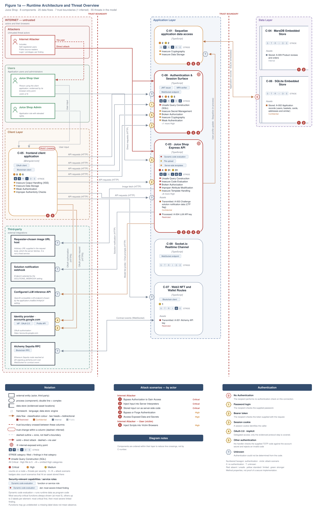</picture>

**Build pipeline**, not drawn in this runtime view: GitHub Actions, GitLab CI. ⑦ A2 · Supply-Chain / Build Attacker → [Figure 1b](#figure-1b).

Role access and finding assignments are listed in [Identified Actors](#identified-actors).

**Actor grouping.** Regular self-registered users are grouped with anonymous internet attackers because registration is open. Repository readers are grouped with anonymous internet attackers because the source repository is public. Each finding retains its login and privilege requirements.

<a id="figure-1b"></a>

**Figure 1b - Supply Chain and Build**

Juice Shop builds in GitHub Actions, GitLab CI. Figure 1b shows the inputs, build systems and release artifacts the repository evidences, with 8 findings attached to them. The highlighted path follows 🟠 [F-022](#f-022) — Lockfiles disabled so every build resolves floating dependencies — .npmrc:1 as far as the repository evidences it. The control assessment is in [§6.11](#611-operations-runtime-and-supply-chain-controls).

<picture><source media="(prefers-color-scheme: dark)" srcset="security-assessment-juice-shop-standard-v0.1.0.figure1b-dark.svg">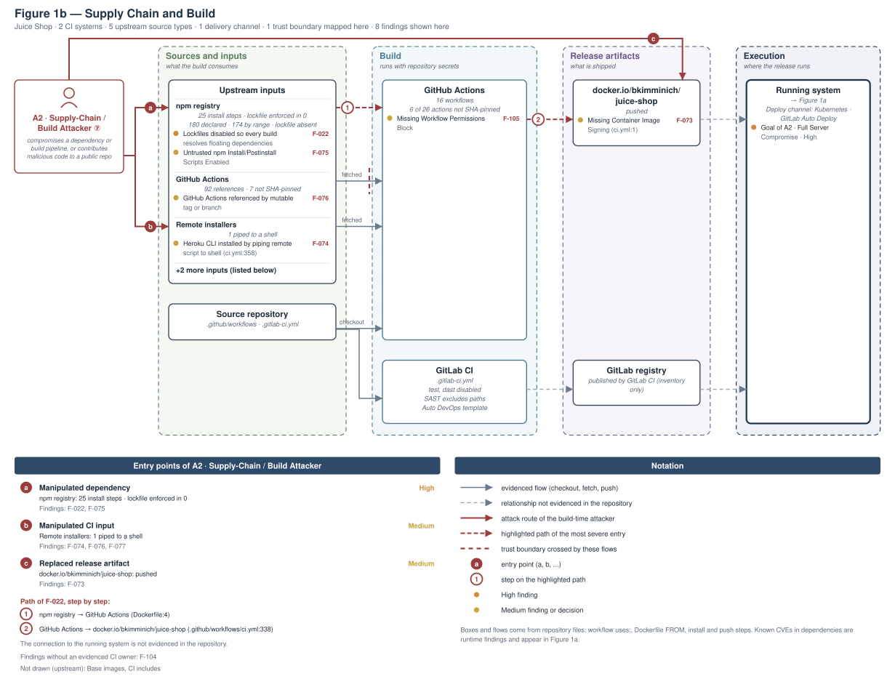</picture>

**Figure 2 - Attack Routes and Impact**

Each numbered route names one example finding from the corresponding Top Threats group with its access prerequisite, the register weakness it is linked to, and the group's potential business harm, which depends on deployment and affected assets. W-IDs in parentheses link the example to an existing weakness. The attack step, affected component and technical consequence are listed in the findings register. Red arrows indicate attacks; dashed red arrows involve a victim; grey arrows lead to potential harm.

<picture><source media="(prefers-color-scheme: dark)" srcset="security-assessment-juice-shop-standard-v0.1.0.figure2-dark.svg">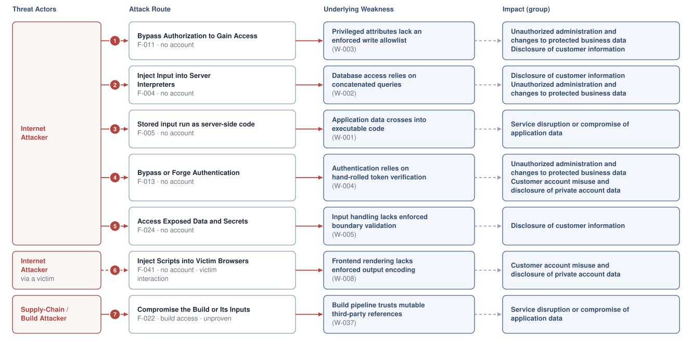</picture>

**Threat actors.** The actors below drive the numbered attack paths in the figures above. The **Juice Shop User** is the *victim* of client-side attacks (XSS / CSRF), not an attacker. Figure 2 marks victim interaction on the applicable attack routes.

- **Juice Shop User** — legitimate end user; target of client-side attacks; target of ⑥ Output Encoding / Cross-Site Scripting.
- **Internet Attacker** — can self-register a regular account; drives ① Broken Authorization & Access Control, ② Insecure Query Construction & Data Access, ③ Remote Code Execution (unsafe eval), ④ Hardcoded Secrets & Weak Cryptography, ⑤ Sensitive File & Secret Exposure, ⑥ Output Encoding / Cross-Site Scripting.
- **Supply-Chain / Build Attacker** — compromises a dependency or build pipeline, or contributes malicious code to a public repo; drives ⑦ Build Pipeline & Dependency Integrity.

**7 structural threats**, grouped by weakness class - each row is one threat, not one finding. *Threat Description* states the general architectural weakness (STRIDE in brackets); *Findings* lists the concrete instances by severity under their component, each linked to the [§8 Findings Register](#8-findings-register), and on screen an ID shows its title when you point at it; *Risk & Impact* combines severity with business consequence; *Primary Measures* names the most important measures for this threat, most important first, one per root cause. All measures are in the [§10 Mitigation Register](#10-mitigation-register).

| # | Threat Description | Findings (→ Component) | Risk & Impact | Primary Measures |
|---|------------------------------------|------------------------------------------------|------------------------------------|----------------------|
| <a id="path-privilege-escalation"></a>① | **Broken Authorization & Access Control** _(E·I)_<br/>Missing ownership and role checks let callers register as administrators and reach other users' records. | → [C-03](#c-03) Juice Shop Express API<br/>🔴&nbsp;<span style="white-space:nowrap"><a href="#f-001" title="Systemic missing ownership checks">F-001</a></span>, <span style="white-space:nowrap"><a href="#f-011" title="Registration accepts privileged role field from request body">F-011</a></span><br/>🟠&nbsp;<span style="white-space:nowrap"><a href="#f-057" title="Any logged-in user can list all user accounts">F-057</a></span>, <span style="white-space:nowrap"><a href="#f-061" title="Unauthenticated product update">F-061</a></span>, <span style="white-space:nowrap"><a href="#f-003" title="Missing object ownership checks on basket resources">F-003</a></span>, <span style="white-space:nowrap"><a href="#f-029" title="Password change without mandatory current password">F-029</a></span>, <span style="white-space:nowrap"><a href="#f-032" title="Request body can set UserId on generated create routes">F-032</a></span>, <span style="white-space:nowrap"><a href="#f-046" title="Any authenticated user can read any user record by id">F-046</a></span>, <span style="white-space:nowrap"><a href="#f-049" title="Basket checkout lacks object ownership checks">F-049</a></span>, <span style="white-space:nowrap"><a href="#f-050" title="Any user can edit other users' product">F-050</a></span>, <span style="white-space:nowrap"><a href="#f-051" title="Recycle records readable by any caller by id">F-051</a></span>, <span style="white-space:nowrap"><a href="#f-055" title="Key, log and quarantine files served without authorization">F-055</a></span>, <span style="white-space:nowrap"><a href="#f-056" title="Sensitive Routes Registered Without Authentication Middleware">F-056</a></span>, <span style="white-space:nowrap"><a href="#f-058" title="Any logged-in user can create products">F-058</a></span>, <span style="white-space:nowrap"><a href="#f-059" title="Any logged-in user can list all complaints">F-059</a></span>, <span style="white-space:nowrap"><a href="#f-062" title="Coupon tool discount policy enforced only in prompt">F-062</a></span>, <span style="white-space:nowrap"><a href="#f-063" title="Registration accepts client-supplied role">F-063</a></span><br/>→ [C-08](#c-08) Authentication & Session Surface<br/>🟠&nbsp;<span style="white-space:nowrap"><a href="#f-064" title="Missing role check on user list endpoint">F-064</a></span><br/><details><summary>13 Medium</summary>→ [C-03](#c-03) Juice Shop Express API<br/>🟡&nbsp;<span style="white-space:nowrap"><a href="#f-081" title="Feedback creation trusts UserId from request body">F-081</a></span>, <span style="white-space:nowrap"><a href="#f-082" title="Security answer creation accepts owner id from request body">F-082</a></span>, <span style="white-space:nowrap"><a href="#f-096" title="Order history filtered by lossy masked e-mail">F-096</a></span>, <span style="white-space:nowrap"><a href="#f-097" title="Unauthenticated order lookup by order id">F-097</a></span>, <span style="white-space:nowrap"><a href="#f-098" title="Order lookup by lossy vowel-masked e-mail in data">F-098</a></span>, <span style="white-space:nowrap"><a href="#f-106" title="Deluxe role granted without payment">F-106</a></span>, <span style="white-space:nowrap"><a href="#f-107" title="Basket item add checks first BasketId but saves last">F-107</a></span>, <span style="white-space:nowrap"><a href="#f-108" title="Product review author taken from request">F-108</a></span>, <span style="white-space:nowrap"><a href="#f-109" title="Basket items readable and deletable by any authenticated user">F-109</a></span>, <span style="white-space:nowrap"><a href="#f-110" title="Basket item creation can target another user's basket">F-110</a></span>, <span style="white-space:nowrap"><a href="#f-111" title="Privacy request creation not bound to authenticated user">F-111</a></span>, <span style="white-space:nowrap"><a href="#f-113" title="Any logged-in user can delete any feedback">F-113</a></span>, <span style="white-space:nowrap"><a href="#f-116" title="Address update lacks ownership check">F-116</a></span></details> | 🔴 Critical<br/>Full Admin Takeover · Customer Data Exfiltration | <span style="white-space:nowrap">● [M-023](#m-023)</span> - Enforce object-level (ownership) authorization<br/><span style="white-space:nowrap">● [M-029](#m-029)</span> - Strip role from registration request bodies<br/><span style="white-space:nowrap">◕ [M-044](#m-044)</span> - Require current password via POST body |
| <a id="path-injection"></a>② | **Insecure Query Construction & Data Access** _(T·I)_<br/>Request values are placed into database queries and XML parsing without safe handling, exposing data and bypassing login. | → [C-03](#c-03) Juice Shop Express API<br/>🔴&nbsp;<span style="white-space:nowrap"><a href="#f-004" title="SQL injection in product search query">F-004</a></span><br/>🟠&nbsp;<span style="white-space:nowrap"><a href="#f-033" title="NoSQL JavaScript injection in product">F-033</a></span>, <span style="white-space:nowrap"><a href="#f-045" title="XML external entity expansion in uploaded XML parsing">F-045</a></span>, <span style="white-space:nowrap"><a href="#f-028" title="XML parser enables external entities and DTD loading">F-028</a></span>, <span style="white-space:nowrap"><a href="#f-034" title="NoSQL JavaScript injection in order tracking &#36;where">F-034</a></span>, <span style="white-space:nowrap"><a href="#f-035" title="Pug template injection">F-035</a></span><br/>→ [C-08](#c-08) Authentication & Session Surface<br/>🔴&nbsp;<span style="white-space:nowrap"><a href="#f-010" title="SQL injection in login query enables authentication bypass">F-010</a></span><br/><details><summary>2 Medium</summary>→ [C-03](#c-03) Juice Shop Express API<br/>🟡&nbsp;<span style="white-space:nowrap"><a href="#f-083" title="NoSQL operator injection">F-083</a></span>, <span style="white-space:nowrap"><a href="#f-084" title="Review update lacks ownership check">F-084</a></span></details> | 🔴 Critical<br/>Customer Data Exfiltration · Full Admin Takeover | <span style="white-space:nowrap">● [M-026](#m-026)</span> - Use parameterized database queries<br/><span style="white-space:nowrap">◕ [M-046](#m-046)</span> - Use typed query predicates instead of \$where<br/><span style="white-space:nowrap">◕ [M-043](#m-043)</span> - Disable external entities and DTD loading |
| <a id="path-remote-code-execution"></a>③ | **Remote Code Execution (unsafe eval)** _(E)_<br/>Attacker-controlled values reach code evaluation functions on the server, letting a signed-in user run their own code. | → [C-03](#c-03) Juice Shop Express API<br/>🔴&nbsp;<span style="white-space:nowrap"><a href="#f-005" title="Server-side eval of stored username in profile page">F-005</a></span><br/>🟠&nbsp;<span style="white-space:nowrap"><a href="#f-026" title="B2B order payload evaluated by notevil sandbox">F-026</a></span> | 🔴 Critical<br/>Full Server Compromise | <span style="white-space:nowrap">● [M-027](#m-027)</span> - Remove eval of username<br/><span style="white-space:nowrap">◕ [M-041](#m-041)</span> - Remove dynamic evaluation of order data |
| <a id="path-auth-bypass"></a>④ | **Hardcoded Secrets & Weak Cryptography** _(S·E)_<br/>A committed signing key and weak token verification allow session tokens to be forged for arbitrary users. | → [C-03](#c-03) Juice Shop Express API<br/>🟠&nbsp;<span style="white-space:nowrap"><a href="#f-014" title="JWT verify call missing algorithms allowlist">F-014</a></span>, <span style="white-space:nowrap"><a href="#f-013" title="Chat identity trusted from unverified JWT decode">F-013</a></span><br/>→ [C-08](#c-08) Authentication & Session Surface<br/>🟠&nbsp;<span style="white-space:nowrap"><a href="#f-017" title="Non-cryptographic RNG for a secret/token">F-017</a></span>, <span style="white-space:nowrap"><a href="#f-021" title="Hardcoded JWT signing private key in source">F-021</a></span><br/>→ [C-01](#c-01) Sequelize application data access<br/>🟠&nbsp;<span style="white-space:nowrap"><a href="#f-043" title="Unsalted MD5 password hashing">F-043</a></span><br/><details><summary>3 Medium</summary>→ [C-08](#c-08) Authentication & Session Surface<br/>🟡&nbsp;<span style="white-space:nowrap"><a href="#f-070" title="JWT verification does not pin the signing algorithm">F-070</a></span><br/>→ [C-01](#c-01) Sequelize application data access<br/>🟡&nbsp;<span style="white-space:nowrap"><a href="#f-088" title="Hardcoded HMAC key for security answers">F-088</a></span><br/>→ [C-05](#c-05) frontend client application<br/>🟡&nbsp;<span style="white-space:nowrap"><a href="#f-101" title="Hardcoded test credentials in client bundle">F-101</a></span></details> | 🟠 High<br/>Full Admin Takeover · Customer Session Hijack | <span style="white-space:nowrap">◕ [M-030](#m-030)</span> - Verify JWT signature before trusting identity<br/><span style="white-space:nowrap">◕ [M-034](#m-034)</span> - Use cryptographically secure random values<br/><span style="white-space:nowrap">● [M-036](#m-036)</span> - Load JWT private key from secret store |
| <a id="path-sensitive-data-exposure"></a>⑤ | **Sensitive File & Secret Exposure** _(I)_<br/>Unprotected file-serving routes and path handling expose keys, logs and server files to unauthenticated callers. | → [C-03](#c-03) Juice Shop Express API<br/>🟠&nbsp;<span style="white-space:nowrap"><a href="#f-024" title="Path Traversal">F-024</a></span>, <span style="white-space:nowrap"><a href="#f-025" title="Zip slip arbitrary file write in complaint upload">F-025</a></span>, <span style="white-space:nowrap"><a href="#f-044" title="Unauthenticated serving of keys, logs and quarantine">F-044</a></span>, <span style="white-space:nowrap"><a href="#f-047" title="Server-side request forgery in profile">F-047</a></span><br/>→ [C-01](#c-01) Sequelize application data access<br/>🟠&nbsp;<span style="white-space:nowrap"><a href="#f-042" title="Payment card numbers stored in cleartext">F-042</a></span><br/><details><summary>5 Medium</summary>→ [C-03](#c-03) Juice Shop Express API<br/>🟡&nbsp;<span style="white-space:nowrap"><a href="#f-089" title="FTP file allow-list bypass">F-089</a></span>, <span style="white-space:nowrap"><a href="#f-090" title="Null byte bypass of public file extension allowlist">F-090</a></span>, <span style="white-space:nowrap"><a href="#f-091" title="Captcha answer returned in challenge response">F-091</a></span>, <span style="white-space:nowrap"><a href="#f-092" title="Current user endpoint exposes fields">F-092</a></span>, <span style="white-space:nowrap"><a href="#f-093" title="Unauthenticated memories endpoint returns joined user">F-093</a></span></details> | 🟠 High<br/>Customer Data Exfiltration | <span style="white-space:nowrap">◕ [M-039](#m-039)</span> - Constrain file paths to a safe base directory<br/><span style="white-space:nowrap">◕ [M-057](#m-057)</span> - Remove public serving of key, log and quarantine directories<br/><span style="white-space:nowrap">◕ [M-060](#m-060)</span> - Validate and allowlist outbound request targets |
| <a id="path-cross-site-scripting"></a>⑥ | **Output Encoding / Cross-Site Scripting** _(T·I)_<br/>Unsafely rendered user content runs script in a victim's browser, where session tokens are readable. | → [C-05](#c-05) frontend client application<br/>🟠&nbsp;<span style="white-space:nowrap"><a href="#f-002" title="Session Token in Script-Readable Storage">F-002</a></span>, <span style="white-space:nowrap"><a href="#f-037" title="Stored XSS">F-037</a></span>, <span style="white-space:nowrap"><a href="#f-041" title="DOM XSS">F-041</a></span>, <span style="white-space:nowrap"><a href="#f-038" title="Stored XSS">F-038</a></span>, <span style="white-space:nowrap"><a href="#f-039" title="Stored XSS">F-039</a></span>, <span style="white-space:nowrap"><a href="#f-040" title="DOM XSS">F-040</a></span><br/><details><summary>3 Medium</summary>→ [C-05](#c-05) frontend client application<br/>🟡&nbsp;<span style="white-space:nowrap"><a href="#f-086" title="Stored XSS">F-086</a></span>, <span style="white-space:nowrap"><a href="#f-087" title="XSS">F-087</a></span><br/>→ [C-01](#c-01) Sequelize application data access<br/>🟡&nbsp;<span style="white-space:nowrap"><a href="#f-072" title="Product description stored without sanitization">F-072</a></span></details> | 🟠 High<br/>Customer Session Hijack | <span style="white-space:nowrap">◕ [M-050](#m-050)</span> - Remove sanitizer bypass and encode feedback comments<br/><span style="white-space:nowrap">◕ [M-024](#m-024)</span> - Store session tokens in HttpOnly, Secure cookies |
| <a id="path-supply-chain"></a>⑦ | **Build Pipeline & Dependency Integrity** _(T·E)_<br/>Unpinned dependencies and mutable build references let a compromised upstream package alter what is built.<br/>Path through the build: [Figure 1b](#figure-1b) · controls: [§6.11](#611-operations-runtime-and-supply-chain-controls) | → [C-02](#c-02) CI/CD Pipeline<br/>🟠&nbsp;<span style="white-space:nowrap"><a href="#f-022" title="Lockfiles disabled so every build resolves floating dependencies">F-022</a></span><br/>🟡&nbsp;<span style="white-space:nowrap"><a href="#f-076" title="GitHub Actions referenced by mutable tag or branch">F-076</a></span>, <span style="white-space:nowrap"><a href="#f-073" title="Missing Container Image Signing">F-073</a></span><br/><details><summary>5 Medium</summary>→ [C-02](#c-02) CI/CD Pipeline<br/>🟡&nbsp;<span style="white-space:nowrap"><a href="#f-074" title="Heroku CLI installed by piping remote script to shell">F-074</a></span>, <span style="white-space:nowrap"><a href="#f-075" title="Untrusted npm Install/Postinstall Scripts Enabled">F-075</a></span>, <span style="white-space:nowrap"><a href="#f-077" title="Container base images referenced by tag instead of digest">F-077</a></span>, <span style="white-space:nowrap"><a href="#f-104" title="Container Runs as Root">F-104</a></span>, <span style="white-space:nowrap"><a href="#f-105" title="Missing Workflow Permissions Block">F-105</a></span></details> | 🟠 High<br/>Full Server Compromise | <span style="white-space:nowrap">◕ [M-083](#m-083)</span> - Pin third-party dependencies to immutable versions<br/><span style="white-space:nowrap">◕ [M-037](#m-037)</span> - Commit lockfiles and install from them |

**Further threats without Critical or High findings:** CSRF / Permissive CORS (🟡 1). Their findings are in the [§8 Findings Register](#8-findings-register).

_STRIDE: S spoofing · T tampering · R repudiation · I information disclosure · D denial of service · E elevation of privilege. Risk, findings, components, impact and primary measures are derived deterministically; only the one-line weakness description is authored._

**Verified attack chains.** 9 fully viable ([AC-T-002](#ac-t-002), [AC-B-002](#ac-b-002), [AC-T-004](#ac-t-004), [AC-B-005](#ac-b-005), [AC-B-007](#ac-b-007), [AC-T-005](#ac-t-005), [AC-B-003](#ac-b-003), [AC-B-001](#ac-b-001), [AC-T-007](#ac-t-007)). These chains combine individual findings into end-to-end exploitation paths verified step-by-step against the code - see [§9 Abuse Cases](#9-abuse-cases) for the per-step breakdown and blocking mitigations.

### AI / LLM Exposure

This system embeds an LLM/AI surface (an LLM/AI integration); the risks below are architectural - they follow from how untrusted input reaches the model's prompt, tools, and outputs. See **[§6 Security Architecture](#6-security-architecture)** for the per-control detail.


- **[LLM01](https://genai.owasp.org/llmrisk/llm01/) Prompt Injection** — Untrusted user input reaches the LLM prompt/context without sufficient trust separation, letting an attacker override system instructions, redirect tool calls, or coerce unintended model behaviour. _([C-03](#c-03) — Juice Shop Express API)_
  - ↳ 🟠 [F-036](#f-036) — Client-supplied chat messages passed to model unvalidated _([ASI01](https://genai.owasp.org/resource/owasp-top-10-for-agentic-applications-for-2026/))_
  - ↳ 🟡 [F-085](#f-085) — Stored product reviews fed to model as tool results _([ASI01](https://genai.owasp.org/resource/owasp-top-10-for-agentic-applications-for-2026/))_
  - ↳ 🟡 [F-115](#f-115) — Chatbot coupon limits enforced only by prompt text

- **[LLM06](https://genai.owasp.org/llmrisk/llm06/) Excessive Agency** — The LLM is granted tool/function-calling authority without a secondary authorization boundary, so a manipulated model turn can invoke privileged actions on the user's behalf. _([C-03](#c-03) — Juice Shop Express API)_
  - ↳ 🟠 [F-013](#f-013) — Chat identity trusted from unverified JWT decode _([ASI03](https://genai.owasp.org/resource/owasp-top-10-for-agentic-applications-for-2026/))_
  - ↳ 🟠 [F-062](#f-062) — Coupon tool discount policy enforced only in prompt _([ASI02](https://genai.owasp.org/resource/owasp-top-10-for-agentic-applications-for-2026/))_
  - ↳ 🟡 [F-114](#f-114) — Chatbot coupon limits enforced only by prompt text _([ASI02](https://genai.owasp.org/resource/owasp-top-10-for-agentic-applications-for-2026/))_
  - ↳ 🟡 [F-115](#f-115) — Chatbot coupon limits enforced only by prompt text

- **[LLM10](https://genai.owasp.org/llmrisk/llm10/) Unbounded Consumption** — The LLM endpoint imposes no authentication, rate, or quota boundary, so any client can drive unbounded model invocations — uncontrolled provider cost and denial of service for legitimate users. _([C-03](#c-03) — Juice Shop Express API)_
  - ↳ 🟠 [F-048](#f-048) — Unauthenticated chat endpoint lacks consumption limits

- **[LLM05](https://genai.owasp.org/llmrisk/llm05/) Improper Output Handling** — LLM-generated output flows into a downstream sink (browser, shell, query, eval) without validation or encoding, turning a model completion into an injection vector. _([C-03](#c-03) — Juice Shop Express API)_
  - ↳ 🟡 [F-114](#f-114) — Chatbot coupon limits enforced only by prompt text _([ASI02](https://genai.owasp.org/resource/owasp-top-10-for-agentic-applications-for-2026/))_

### Operational Strengths

Operational controls rated Adequate or Partial - grouped into broad clusters (full per-control breakdown in [§6](#6-security-architecture)). Clusters demoted to Weak by open Critical/High findings appear in [§6](#6-security-architecture) instead, not here.

<table style="table-layout:fixed;width:100%;max-width:1240px">
<colgroup><col width="18%" style="width:18%"><col width="32%" style="width:32%"><col width="14%" style="width:14%"><col width="36%" style="width:36%"></colgroup>
<thead><tr><th>Strength</th><th>What's in Place</th><th>Effectiveness</th><th>Open gaps</th></tr></thead>
<tbody>
<tr><td style="overflow-wrap:break-word"><strong>Container &amp; Supply-Chain Hardening</strong></td><td style="overflow-wrap:break-word"><em>Build-time and runtime hardening - minimal base image, non-root execution, dependency inventory.</em><br/>Container image hardening and SBOM generation<br/>Dependency lockfile and install integrity</td><td style="overflow-wrap:break-word">✅ Adequate</td><td style="overflow-wrap:break-word">-</td></tr>
<tr><td style="overflow-wrap:break-word"><strong>Hardened HTTP Stack</strong></td><td style="overflow-wrap:break-word"><em>Browser-facing HTTP hardening — security headers, cookie flags, cross-origin policy, and abuse-protection limits.</em><br/>Socket.io CORS origin restriction<br/>Rate limiting</td><td style="overflow-wrap:break-word">⚠️ Partial</td><td style="overflow-wrap:break-word">1 Medium finding remains open:<br/>🟡 <a href="#f-067">F-067</a> — OAuth implicit flow without state or nonce</td></tr>
<tr><td style="overflow-wrap:break-word"><strong>Observability &amp; Audit</strong></td><td style="overflow-wrap:break-word"><em>Runtime visibility - access logging, audit trails, and operational telemetry for post-incident review.</em><br/>WebSocket error logging and listener reset<br/>Access logging and exposure of logs/metrics</td><td style="overflow-wrap:break-word">⚠️ Partial</td><td style="overflow-wrap:break-word">-</td></tr>
</tbody>
</table>


**Bottom line:** These controls narrow specific attack surfaces but none eliminates a Critical finding on its own.

---

<a id="critical-attack-chain"></a><a id="critical-attack-tree"></a><a id="critical-findings-by-root-cause"></a>
## Critical Findings by Root Cause

5 of 5 Critical findings trace back to 4 root causes; fixing a root cause addresses every finding linked to it.

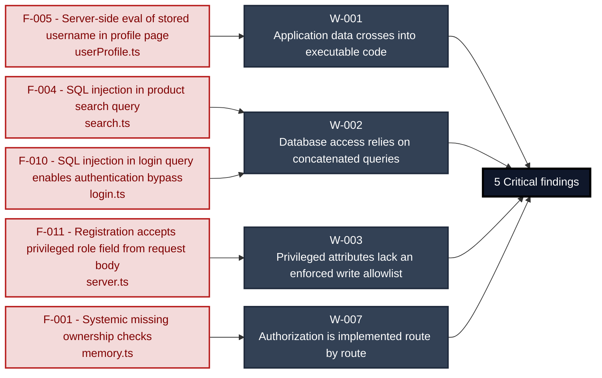

**Structural fixes** (full detail in [§7 Weakness Register](#7-weakness-register)):

- **[W-001](#w-001)** — Replace evaluation of application values with a data parser or a fixed set of operations whose arguments remain data _(closes [F-005](#f-005))_
- **[W-002](#w-002)** — Provide one parameterised repository or query-builder path and prohibit application-value interpolation in database queries _(closes [F-004](#f-004), [F-010](#f-010))_
- **[W-003](#w-003)** — Define operation-specific write schemas and assign privileged attributes exclusively through server-side policy _(closes [F-011](#f-011))_
- **[W-007](#w-007)** — Enforce authorization through a shared server-side policy layer and make ownership and tenant scope mandatory inputs to data access _(closes [F-001](#f-001))_

---

## 1. System Overview

Probably the most modern and sophisticated insecure web application

**Repository:** `https://github.com/juice-shop/juice-shop.git`
**Runtime:** Node\.js 22 - 26

### Scope

This threat model covers 9 components of juice-shop: 

- Sequelize application data access
- CI/CD Pipeline
- Juice Shop Express API
- MarsDB Embedded Store
- frontend client application
- SQLite Embedded Store
- Web3 NFT and Wallet Routes
- Authentication & Session Surface
- Socket\.io Realtime Channel

**Not individually examined:** 134 source files in 5 components had no route, lead or security signal (Sequelize application data access 12, CI/CD Pipeline 4, Juice Shop Express API 3, MarsDB Embedded Store 4, frontend client application 111).

**Not analysed:** 92 TypeScript files the build leaves out, so their routes and code sites were not checked (`data/static/codefixes/accessLogDisclosureChallenge_1_correct.ts`, `data/static/codefixes/accessLogDisclosureChallenge_2.ts`, `data/static/codefixes/accessLogDisclosureChallenge_3.ts`, `data/static/codefixes/accessLogDisclosureChallenge_4.ts`, `data/static/codefixes/adminSectionChallenge_1_correct.ts`, `data/static/codefixes/adminSectionChallenge_2.ts`, `data/static/codefixes/adminSectionChallenge_3.ts`, `data/static/codefixes/adminSectionChallenge_4.ts`, `data/static/codefixes/changeProductChallenge_1.ts`, `data/static/codefixes/changeProductChallenge_2.ts` and 82 more).

**Not assessed:** 2 security-relevant code locations were read but could not be judged (Juice Shop Express API 1, frontend client application 1); `security-assessment.yaml` records each with its reason under `meta.undecided_targets`.

**Out of scope:** third-party hosted dependencies, browser runtime, operating-system kernel, and the underlying network infrastructure.

**Basis:** An automated, AI-assisted threat model built from the repository's source code and configuration - static analysis only, no dynamic or penetration testing. It describes the system as built, not as designed.

---

<a id="identified-actors"></a>
### Identified Actors

Figure 1a draws **Internet Attacker** as attacker and **Juice Shop User** and **Juice Shop Admin** as legitimate roles of Juice Shop. [Figure 1b](#figure-1b) draws **Supply-Chain / Build Attacker** and the build it attacks. Each row gives that actor's access and the findings attributed to it.

| Actor | Type | Access | Findings |
|----------------------|---------------|----------------------|-----------------|
| A1 · Internet Attacker | Attacker | Can self-register a regular account | 🔴 5 · 🟠 44 · 🟡 43 |
| A2 · Supply-Chain / Build Attacker | Attacker | Compromises a dependency or build pipeline,<br/>or contributes malicious code to a public<br/>repo | 🟠 1 · 🟡 7 |
| Juice Shop User | Role (victim) | Person using the client application,<br/>evidenced by its browser entry point. | - |
| Juice Shop Admin | Privileged role | Application role with elevated rights. | - |

3 findings (1 High, 2 Medium) have no assigned actor. That does not mean they are out of reach.

---

### Trust Boundaries

Each row names a crossing and the condition it relies on. A modelled crossing does not prove that its control works.

<table style="table-layout:fixed;width:100%;max-width:1240px">
<colgroup><col width="20%" style="width:20%"><col width="25%" style="width:25%"><col width="21%" style="width:21%"><col width="34%" style="width:34%"></colgroup>
<thead><tr><th>Crossing</th><th>Required condition</th><th>Control</th><th>Status and findings</th></tr></thead>
<tbody>
<tr><td style="overflow-wrap:break-word"><a id="tb-1"></a>tb-1 · External → Juice Shop Express API</td><td style="overflow-wrap:break-word">Every state-changing or user-specific API route is registered behind <code>security.<wbr>isAuthorized()</code> before its handler runs.</td><td style="overflow-wrap:break-word"><code>security.<wbr>isAuthorized()</code> route middleware</td><td style="overflow-wrap:break-word"><strong>Gap:</strong> <em>Validation</em><br/>🔴 <a href="#f-004">F-004</a> — SQL injection in product search query<br/>🟠 <a href="#f-032">F-032</a> — Request body can set UserId on generated create routes<br/><em>Authorization</em><br/>🟠 <a href="#f-003">F-003</a> — Missing object ownership checks on basket resources<br/>🟠 <a href="#f-046">F-046</a> — Any authenticated user can read any user record by id<br/><em>Not tied to one control</em><br/>🟠 <a href="#f-049">F-049</a> — Basket checkout lacks object ownership checks</td></tr>
<tr><td style="overflow-wrap:break-word"><a id="tb-2"></a>tb-2 · External → Authentication &amp; Session Surface</td><td style="overflow-wrap:break-word">Every state-changing auth/session route verifies a signed JWT or credential before acting.</td><td style="overflow-wrap:break-word"><code>isAuthorized</code> <code>expressJwt</code> middleware</td><td style="overflow-wrap:break-word"><strong>Gap:</strong> <em>Validation</em><br/>🔴 <a href="#f-010">F-010</a> — SQL injection in login query enables authentication bypass<br/><em>Authentication</em><br/>🟡 <a href="#f-068">F-068</a> — Wide TOTP window and weak second-factor throttling</td></tr>
<tr><td style="overflow-wrap:break-word"><a id="tb-6"></a>tb-6 · Juice Shop Express API → external</td><td style="overflow-wrap:break-word">The server fetches only URLs that resolve to public image hosts, never internal or metadata addresses.</td><td style="overflow-wrap:break-word">Not identified</td><td style="overflow-wrap:break-word"><strong>Gap:</strong> <em>Egress destination</em><br/>🟠 <a href="#f-047">F-047</a> — Server-side request forgery in profile</td></tr>
<tr><td style="overflow-wrap:break-word"><a id="tb-3"></a>tb-3 · External → CI/CD Pipeline</td><td style="overflow-wrap:break-word">Only reviewed code and SHA-pinned third-party actions execute in the pipeline on push and <code>pull_request</code> triggers.</td><td style="overflow-wrap:break-word">SHA-pinned action references</td><td style="overflow-wrap:break-word"><strong>Gap:</strong> <em>Validation</em><br/>🟡 <a href="#f-076">F-076</a> — GitHub Actions referenced by mutable tag or branch</td></tr>
<tr><td style="overflow-wrap:break-word"><a id="tb-7"></a>tb-7 · Frontend client application → external</td><td style="overflow-wrap:break-word">Only the intended Google OAuth endpoints receive the client id and access token.</td><td style="overflow-wrap:break-word">Not identified</td><td style="overflow-wrap:break-word"><strong>Gap:</strong> <em>Egress content</em><br/>🟡 <a href="#f-100">F-100</a> — OAuth access token passed in URL query string</td></tr>
<tr><td style="overflow-wrap:break-word"><a id="tb-4"></a>tb-4 · External → Web3 NFT and Wallet Routes<br/>Crossing: inferred</td><td style="overflow-wrap:break-word">Web3 NFT routes only act for callers whose identity is established before the request is handled.</td><td style="overflow-wrap:break-word">Not identified</td><td style="overflow-wrap:break-word"><strong>Unverified:</strong> 1 related finding</td></tr>
<tr><td style="overflow-wrap:break-word"><a id="tb-5"></a>tb-5 · Sequelize application data access → SQLite Embedded Store</td><td style="overflow-wrap:break-word">Every query reaches SQLite through Sequelize parameter binding, never through concatenated SQL text.</td><td style="overflow-wrap:break-word">Sequelize parameter binding</td><td style="overflow-wrap:break-word"><strong>No gap shown,</strong> control not confirmed</td></tr>
<tr><td style="overflow-wrap:break-word"><a id="tb-8"></a>tb-8 · Web3 NFT and Wallet Routes → external</td><td style="overflow-wrap:break-word">Contract events received from the Alchemy RPC are treated as untrusted before they solve challenges.</td><td style="overflow-wrap:break-word">Not identified</td><td style="overflow-wrap:break-word"><strong>No gap shown,</strong> control not confirmed</td></tr>
</tbody>
</table>

Crossing types, source evidence and provenance are retained in `security-assessment.yaml`.

---

### Platform Security Settings

Settings of the hosting platform at check time, not of the examined source revision. `set` means configured, not effective. `not checkable` means unknown, not missing protection.

Repository selection 1: skipped (local repository; supply a GitHub or GitLab URL to check its platform settings).

---

## 2. Architecture Diagrams

### 2.1 System Context

Who uses and attacks Juice Shop, and which external systems it exchanges data with. Solid arrows name the data a flow carries; dashed red arrows are attack routes. Actors carry the names Figure 1 uses (C4 Level 1).

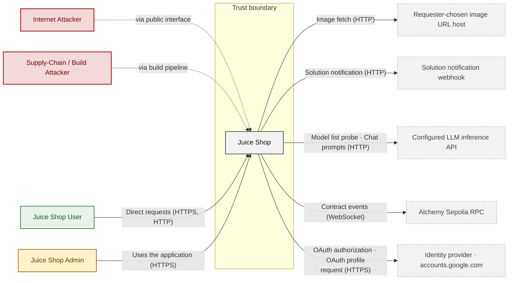

**Key takeaway:** Juice Shop serves Juice Shop User and Juice Shop Admin and depends on Requester-chosen image URL host, Solution notification webhook, Configured LLM inference API, Alchemy Sepolia RPC and Identity provider · accounts.google.com; Internet Attacker and Supply-Chain / Build Attacker attack it.

### 2.2 Container Architecture

How the system decomposes into deployable units. Each box is a separate runtime process or service container; arrows show synchronous request paths between them. Components with ≥3 Critical findings carry a red border, ≥2 High amber (C4 Level 2).

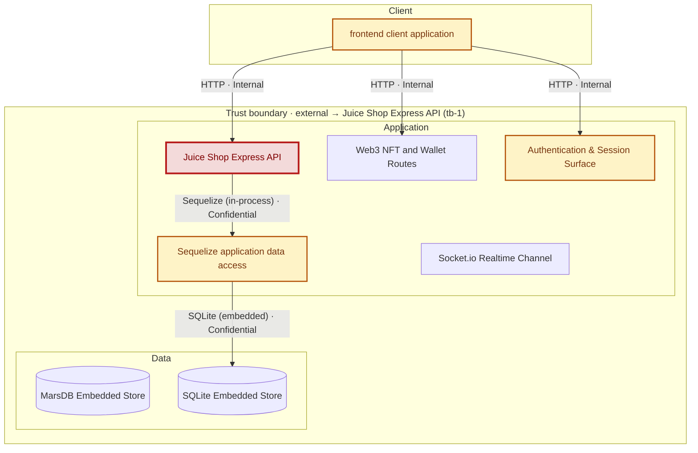

*Trust boundaries not drawn above: Sequelize application data access → SQLite Embedded Store (tb-5), Juice Shop Express API → external (tb-6), Web3 NFT and Wallet Routes → external (tb-8), external → CI/CD Pipeline (tb-3), +1 more - every boundary is listed in [§1 Trust Boundaries](#trust-boundaries).*

**Key takeaway:** The system decomposes into 1 client, 5 application and 2 data unit(s); Juice Shop Express API carries the most Critical findings (4) and bounds the worst-case blast radius. The build plane (CI/CD Pipeline) is shown in [Figure 1b](#figure-1b).

### 2.3 Components

How many findings hit each component, which of its controls are weakest, and which findings matter most. Evidence is in the [§8 Findings Register](#8-findings-register).

<!-- detail-table -->
<table style="table-layout:fixed;width:100%;max-width:1240px">
<colgroup><col width="43%" style="width:43%"><col width="7%" style="width:7%"><col width="7%" style="width:7%"><col width="7%" style="width:7%"><col width="36%" style="width:36%"></colgroup>
<thead><tr><th>Component</th><th>🔴</th><th>🟠</th><th>🟡</th><th>Weakest controls and top findings</th></tr></thead>
<tbody>
<tr><td style="overflow-wrap:break-word"><a id="c-03"></a><a id="component-3214f59f17b5ed30"></a><strong>C-03 · Juice Shop Express API</strong><br/>Mostly in <code>routes/</code></td><td style="overflow-wrap:break-word">4</td><td style="overflow-wrap:break-word">31</td><td style="overflow-wrap:break-word">31</td><td style="overflow-wrap:break-word">Top findings: <span style="white-space:nowrap"><a href="#f-005">F-005</a></span> · <span style="white-space:nowrap"><a href="#f-011">F-011</a></span> · <span style="white-space:nowrap"><a href="#f-001">F-001</a></span> · <span style="white-space:nowrap"><a href="#f-004">F-004</a></span></td></tr>
<tr><td style="overflow-wrap:break-word"><a id="c-08"></a><a id="component-dff0840e0f4855be"></a><strong>C-08 · Authentication &amp; Session Surface</strong></td><td style="overflow-wrap:break-word">1</td><td style="overflow-wrap:break-word">6</td><td style="overflow-wrap:break-word">5</td><td style="overflow-wrap:break-word">Top findings: <span style="white-space:nowrap"><a href="#f-010">F-010</a></span> · <span style="white-space:nowrap"><a href="#f-021">F-021</a></span> · <span style="white-space:nowrap"><a href="#f-014">F-014</a></span></td></tr>
<tr><td style="overflow-wrap:break-word"><a id="c-05"></a><a id="component-ad8557082c9ba53e"></a><strong>C-05 · frontend client application</strong><br/>Mostly in <code>frontend/<wbr>src/<wbr>app/</code></td><td style="overflow-wrap:break-word">–</td><td style="overflow-wrap:break-word">8</td><td style="overflow-wrap:break-word">6</td><td style="overflow-wrap:break-word">Top findings: <span style="white-space:nowrap"><a href="#f-016">F-016</a></span> · <span style="white-space:nowrap"><a href="#f-037">F-037</a></span> · <span style="white-space:nowrap"><a href="#f-041">F-041</a></span></td></tr>
<tr><td style="overflow-wrap:break-word"><a id="c-01"></a><a id="component-290ae722e9565831"></a><strong>C-01 · Sequelize application data access</strong><br/>Mostly in <code>models/</code></td><td style="overflow-wrap:break-word">–</td><td style="overflow-wrap:break-word">2</td><td style="overflow-wrap:break-word">2</td><td style="overflow-wrap:break-word">🟠 Weak: Secrets / crypto<br/>Top findings: <span style="white-space:nowrap"><a href="#f-042">F-042</a></span> · <span style="white-space:nowrap"><a href="#f-043">F-043</a></span> · <span style="white-space:nowrap"><a href="#f-072">F-072</a></span></td></tr>
<tr><td style="overflow-wrap:break-word"><a id="c-02"></a><a id="component-31ebe1b93ddf60d5"></a><strong>C-02 · CI/CD Pipeline</strong></td><td style="overflow-wrap:break-word">–</td><td style="overflow-wrap:break-word">1</td><td style="overflow-wrap:break-word">7</td><td style="overflow-wrap:break-word">🟠 Weak: Supply chain<br/>Top findings: <span style="white-space:nowrap"><a href="#f-022">F-022</a></span> · <span style="white-space:nowrap"><a href="#f-076">F-076</a></span> · <span style="white-space:nowrap"><a href="#f-073">F-073</a></span></td></tr>
<tr><td style="overflow-wrap:break-word"><a id="c-07"></a><a id="component-bab7a548597e750b"></a><strong>C-07 · Web3 NFT and Wallet Routes</strong><br/>Mostly in <code>routes/</code></td><td style="overflow-wrap:break-word">–</td><td style="overflow-wrap:break-word">–</td><td style="overflow-wrap:break-word">1</td><td style="overflow-wrap:break-word">Top findings: <span style="white-space:nowrap"><a href="#f-103">F-103</a></span></td></tr>
<tr><td style="overflow-wrap:break-word"><a id="c-04"></a><a id="component-790db1fed70651aa"></a><strong>C-04 · MarsDB Embedded Store</strong></td><td style="overflow-wrap:break-word">–</td><td style="overflow-wrap:break-word">–</td><td style="overflow-wrap:break-word">–</td><td style="overflow-wrap:break-word">–</td></tr>
<tr><td style="overflow-wrap:break-word"><a id="c-06"></a><a id="component-b213d5ab01236933"></a><strong>C-06 · SQLite Embedded Store</strong></td><td style="overflow-wrap:break-word">–</td><td style="overflow-wrap:break-word">–</td><td style="overflow-wrap:break-word">–</td><td style="overflow-wrap:break-word">🟠 Weak: Secrets / crypto</td></tr>
<tr><td style="overflow-wrap:break-word"><a id="c-09"></a><a id="component-f27040005c8b7342"></a><strong>C-09 · Socket\.io Realtime Channel</strong></td><td style="overflow-wrap:break-word">–</td><td style="overflow-wrap:break-word">–</td><td style="overflow-wrap:break-word">–</td><td style="overflow-wrap:break-word">–</td></tr>
<tr><td style="overflow-wrap:break-word">System-wide: evidence not tied to one component</td><td style="overflow-wrap:break-word">–</td><td style="overflow-wrap:break-word">–</td><td style="overflow-wrap:break-word">–</td><td style="overflow-wrap:break-word">🔴 Unsafe: AuthN<br/>🔴 Missing: AuthZ, Input / query, Supply chain<br/>🟠 Weak: Session, Secrets / crypto, Transport, Logging, LLM</td></tr>
</tbody>
</table>

*🔴 **Unsafe**: relied upon but defeated or trivially bypassable - fix it · 🔴 **Missing**: never built - add it · 🟠 **Weak**: present, with exploitable gaps · 🟡 **Partial**: covers some surfaces, meaningful gaps remain · 🟢 **Adequate**: present and sound. A control counts for the component whose paths hold its implementation evidence. A finding counts for every component it affects, so the columns can add up to more than the register. [§6](#6-security-architecture) holds the full assessment.*

**Key takeaway:** No component has a control rated Unsafe or Missing; 6 components have no component-specific control (C-03, C-04, C-05, C-07, C-08, C-09); 33 controls apply system-wide.

> **Legend:** `-->` synchronous request/response (REST, HTTPS, gRPC) · **red border** ≥ 3 Critical threats on the component · **amber border** ≥ 2 High threats

---

## 3. Attack Walkthroughs

This section walks through how the highest-risk findings are exploited - one short walkthrough per Critical, each with attack steps, a focused sequence diagram, and the primary mitigation. Which root cause each Critical traces back to is in [Critical Findings by Root Cause](#critical-findings-by-root-cause); full per-finding context (severity rationale, assets, detection signals) is in the [§8 Findings Register](#8-findings-register).

### 3.1 Systemic missing ownership checks (IDOR) in Memory

**Source:** 🔴 [F-001](#f-001) — `routes/memory.ts:15`

Severity 🔴 Critical ([CWE-639](https://cwe.mitre.org/data/definitions/639.html)). STRIDE: Tampering. See [§8 F-001](#f-001) for the full register row.

**Attack Steps**

1. At `routes/memory.ts:15`, a signed-in attacker places another user's ID in the owner field of the request (`req.body.UserId` and the like) and the query trusts it instead of the session identity, so an attacker can read or change other users' records.
2. At `routes/basketItems.ts:68`, a logged-in user sends PUT `/api/BasketItems/``&lt;id&gt;` for an item in another user's basket; the item is found by id only and the owner is never compared, although `isAuthorized` and `appendUserId` authenticate the caller.
3. The result is horizontal privilege escalation across accounts.

**Sequence Diagram**

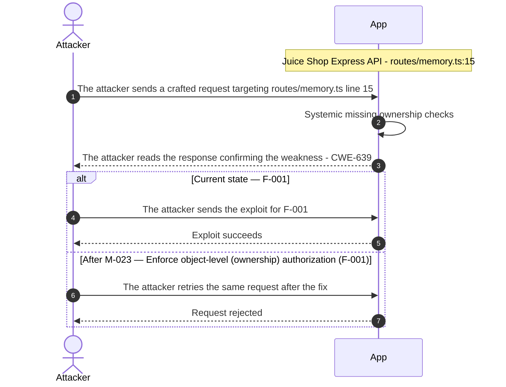

**Key takeaway:** Until ● [M-023](#m-023) (Enforce object-level (ownership) authorization (🔴 [F-001](#f-001))) lands, 🔴 [F-001](#f-001) — Systemic missing ownership checks is exploitable at `routes/memory.ts:15` (Critical-severity, [CWE-639](https://cwe.mitre.org/data/definitions/639.html)).

**Defense in Depth**

- Primary mitigation: ● [M-023](#m-023) (Enforce object-level (ownership) authorization (🔴 [F-001](#f-001)))
- Defence in depth: ◑ [M-001](#m-001) (Manual review: verify Systemic missing ownership checks in `routes/memory.ts:15`…)

### 3.2 Registration accepts privileged role field from request body

**Source:** 🔴 [F-011](#f-011) — `server.ts:501`

Severity 🔴 Critical ([CWE-915](https://cwe.mitre.org/data/definitions/915.html)). STRIDE: Elevation of Privilege. See [§8 F-011](#f-011) for the full register row.

**Attack Steps**

1. Send POST `/api/Users` with email, password, `passwordRepeat` and `role=admin`, with no credentials.
2. Log in with the new account and use the admin role on admin-only routes.

**Sequence Diagram**

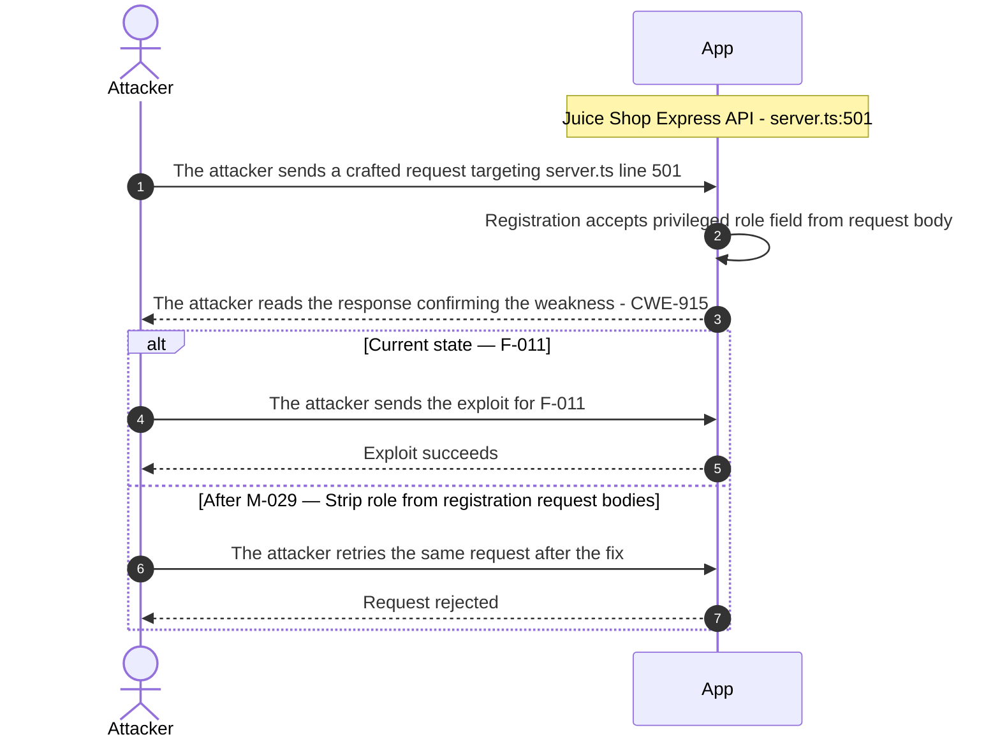

**Key takeaway:** Until ● [M-029](#m-029) (Strip role from registration request bodies) lands, 🔴 [F-011](#f-011) — Registration accepts privileged role field from request body is exploitable at `server.ts:501` (Critical-severity, [CWE-915](https://cwe.mitre.org/data/definitions/915.html)).

**Defense in Depth**

- Primary mitigation: ● [M-029](#m-029) (Strip role from registration request bodies)

### 3.3 SQL injection in product search query

**Source:** 🔴 [F-004](#f-004) — `routes/search.ts:23`

Severity 🔴 Critical ([CWE-89](https://cwe.mitre.org/data/definitions/89.html)). STRIDE: Tampering. See [§8 F-004](#f-004) for the full register row.

**Attack Steps**

1. An unauthenticated caller sends GET `/rest/products/search?q=` with a quote-closing UNION payload at `routes/search.ts:23`.
2. The q value is concatenated into a raw SQL string, so the caller can read other tables such as Users, including emails and password hashes, which come back in the JSON product list.
3. The only control is truncation of q to 200 characters, and the route has no authentication.

**Sequence Diagram**

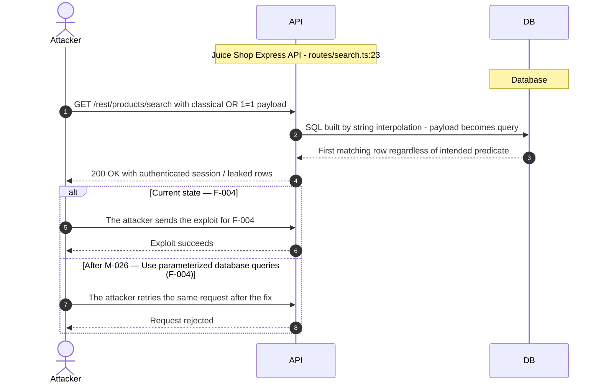

**Key takeaway:** Until ● [M-026](#m-026) (Use parameterized database queries (🔴 [F-004](#f-004))) lands, 🔴 [F-004](#f-004) — SQL injection in product search query is exploitable at `routes/search.ts:23` (Critical-severity, [CWE-89](https://cwe.mitre.org/data/definitions/89.html)).

**Defense in Depth**

- Primary mitigation: ● [M-026](#m-026) (Use parameterized database queries (🔴 [F-004](#f-004)))

### 3.4 Server-side eval of stored username in profile page

**Source:** 🔴 [F-005](#f-005) — `routes/userProfile.ts:61`

Severity 🔴 Critical ([CWE-95](https://cwe.mitre.org/data/definitions/95.html)). STRIDE: Tampering. See [§8 F-005](#f-005) for the full register row.

**Attack Steps**

1. Register or update my profile with username #{`process.mainModule.require('child_process').execSync('id')`}.
2. Log in and request GET `/profile` with my token cookie.
3. The server `eval()`s my code and I run arbitrary commands as the Node process user.

**Sequence Diagram**

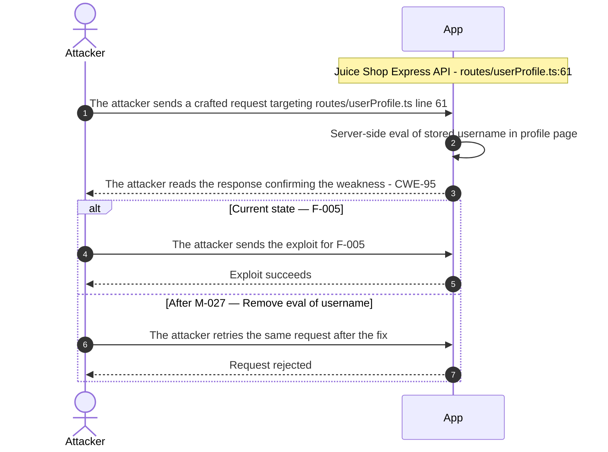

**Key takeaway:** Until ● [M-027](#m-027) (Remove eval of username) lands, 🔴 [F-005](#f-005) — Server-side eval of stored username in profile page is exploitable at `routes/userProfile.ts:61` (Critical-severity, [CWE-95](https://cwe.mitre.org/data/definitions/95.html)).

**Defense in Depth**

- Primary mitigation: ● [M-027](#m-027) (Remove eval of username)

### 3.5 SQL injection in login query enables authentication bypass

**Source:** 🔴 [F-010](#f-010) — `routes/login.ts:34`

Severity 🔴 Critical ([CWE-89](https://cwe.mitre.org/data/definitions/89.html)). STRIDE: Tampering. See [§8 F-010](#f-010) for the full register row.

**Attack Steps**

1. Send POST `/rest/user/login` with email set to a quote-terminated OR-true payload and any password.
2. Receive a signed JWT and basket id for the first matching user, typically the admin account.

**Sequence Diagram**

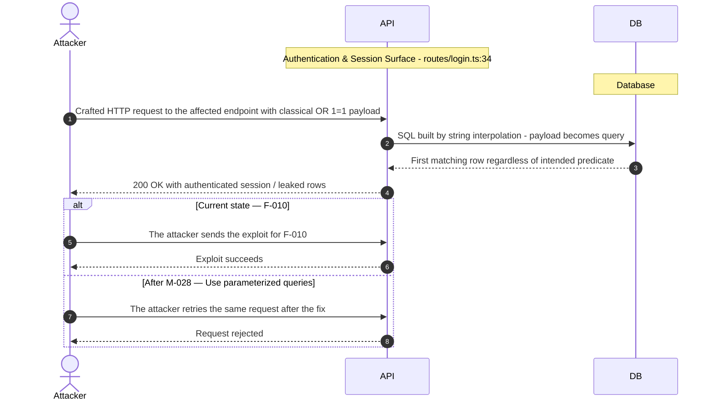

**Key takeaway:** Until ● [M-028](#m-028) (Use parameterized queries) lands, 🔴 [F-010](#f-010) — SQL injection in login query enables authentication bypass is exploitable at `routes/login.ts:34` (Critical-severity, [CWE-89](https://cwe.mitre.org/data/definitions/89.html)).

**Defense in Depth**

- Primary mitigation: ● [M-028](#m-028) (Use parameterized queries)

### 3.6 Hardcoded JWT signing private key in source

**Source:** 🟠 [F-021](#f-021) — `lib/insecurity.ts:21`

Severity 🟠 High ([CWE-798](https://cwe.mitre.org/data/definitions/798.html)). STRIDE: Spoofing. See [§8 F-021](#f-021) for the full register row.

**Attack Steps**

1. An attacker crafts a request that reaches the code at `lib/insecurity.ts:21`.
2. The attacker sends it; the missing control never rejects the crafted input.
3. The `RS256` private key used to sign all session tokens is embedded in source; anyone with repository or build access can forge a token for any user or role such as admin or accounting.

**Sequence Diagram**

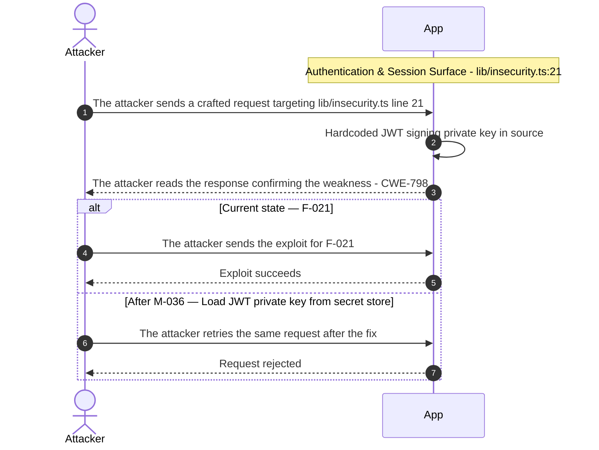

**Key takeaway:** Until ● [M-036](#m-036) (Load JWT private key from secret store) lands, 🟠 [F-021](#f-021) — Hardcoded JWT signing private key in source is exploitable at `lib/insecurity.ts:21` (High-severity, [CWE-798](https://cwe.mitre.org/data/definitions/798.html)).

**Defense in Depth**

- Primary mitigation: ● [M-036](#m-036) (Load JWT private key from secret store)

<!-- generated:walkthrough_renderer -->

---

## 4. Assets

What needs protecting, how sensitive it is, and which findings are tied to it.

<table style="table-layout:fixed;width:100%;max-width:1240px">
<colgroup><col width="46%" style="width:46%"><col width="16%" style="width:16%"><col width="38%" style="width:38%"></colgroup>
<thead><tr><th>Asset</th><th>Sensitivity (assumed)</th><th>Findings</th></tr></thead>
<tbody>
<tr><td style="overflow-wrap:break-word"><strong>Application records (users, baskets, cards, addresses and similar)</strong><br/>Sequelize models persisted in the SQLite file data/juiceshop.sqlite.</td><td style="overflow-wrap:break-word">Medium</td><td style="overflow-wrap:break-word">🔴&nbsp;<span style="white-space:nowrap"><a href="#f-001">F-001</a></span>, <span style="white-space:nowrap"><a href="#f-004">F-004</a></span>, <span style="white-space:nowrap"><a href="#f-010">F-010</a></span>, <span style="white-space:nowrap"><a href="#f-011">F-011</a></span><br/>🟠&nbsp;<span style="white-space:nowrap"><a href="#f-003">F-003</a></span>, <span style="white-space:nowrap"><a href="#f-032">F-032</a></span>, <span style="white-space:nowrap"><a href="#f-046">F-046</a></span>, <span style="white-space:nowrap"><a href="#f-049">F-049</a></span>, <span style="white-space:nowrap"><a href="#f-050">F-050</a></span>, <span style="white-space:nowrap"><a href="#f-051">F-051</a></span>, <span style="white-space:nowrap"><a href="#f-055">F-055</a></span>, <span style="white-space:nowrap"><a href="#f-056">F-056</a></span>, <span style="white-space:nowrap"><a href="#f-057">F-057</a></span>, <span style="white-space:nowrap"><a href="#f-058">F-058</a></span>, <span style="white-space:nowrap"><a href="#f-059">F-059</a></span>, <span style="white-space:nowrap"><a href="#f-061">F-061</a></span>, <span style="white-space:nowrap"><a href="#f-063">F-063</a></span>, <span style="white-space:nowrap"><a href="#f-064">F-064</a></span><br/><details><summary>12 Medium</summary>🟡 <a href="#f-081">F-081</a> - Feedback creation trusts UserId from request body<br/>🟡 <a href="#f-082">F-082</a> - Security answer creation accepts owner id from request body<br/>🟡 <a href="#f-096">F-096</a> - Order history filtered by lossy masked e-mail<br/>🟡 <a href="#f-097">F-097</a> - Unauthenticated order lookup by order id<br/>🟡 <a href="#f-106">F-106</a> - Deluxe role granted without payment<br/>🟡 <a href="#f-107">F-107</a> - Basket item add checks first BasketId but saves last<br/>🟡 <a href="#f-108">F-108</a> - Product review author taken from request<br/>🟡 <a href="#f-109">F-109</a> - Basket items readable and deletable by any authenticated user<br/>🟡 <a href="#f-110">F-110</a> - Basket item creation can target another user's basket<br/>🟡 <a href="#f-111">F-111</a> - Privacy request creation not bound to authenticated user<br/>🟡 <a href="#f-113">F-113</a> - Any logged-in user can delete any feedback<br/>🟡 <a href="#f-116">F-116</a> - Address update lacks ownership check</details></td></tr>
<tr><td style="overflow-wrap:break-word"><strong>Alchemy API key</strong><br/>Credential embedded in the Alchemy WebSocket URL.</td><td style="overflow-wrap:break-word">High</td><td style="overflow-wrap:break-word">🔴&nbsp;<span style="white-space:nowrap"><a href="#f-004">F-004</a></span>, <span style="white-space:nowrap"><a href="#f-010">F-010</a></span><br/>🟠&nbsp;<span style="white-space:nowrap"><a href="#f-037">F-037</a></span>, <span style="white-space:nowrap"><a href="#f-038">F-038</a></span>, <span style="white-space:nowrap"><a href="#f-039">F-039</a></span>, <span style="white-space:nowrap"><a href="#f-040">F-040</a></span>, <span style="white-space:nowrap"><a href="#f-041">F-041</a></span>, <span style="white-space:nowrap"><a href="#f-043">F-043</a></span><br/><details><summary>4 Medium</summary>🟡 <a href="#f-068">F-068</a> - Wide TOTP window and weak second-factor throttling<br/>🟡 <a href="#f-072">F-072</a> - Product description stored without sanitization<br/>🟡 <a href="#f-086">F-086</a> - Stored XSS<br/>🟡 <a href="#f-087">F-087</a> - XSS</details></td></tr>
<tr><td style="overflow-wrap:break-word"><strong>LLM API key</strong><br/>Credential read from the environment for the LLM provider client.</td><td style="overflow-wrap:break-word">High</td><td style="overflow-wrap:break-word">🔴&nbsp;<span style="white-space:nowrap"><a href="#f-004">F-004</a></span>, <span style="white-space:nowrap"><a href="#f-010">F-010</a></span><br/>🟠&nbsp;<span style="white-space:nowrap"><a href="#f-037">F-037</a></span>, <span style="white-space:nowrap"><a href="#f-038">F-038</a></span>, <span style="white-space:nowrap"><a href="#f-039">F-039</a></span>, <span style="white-space:nowrap"><a href="#f-040">F-040</a></span>, <span style="white-space:nowrap"><a href="#f-041">F-041</a></span>, <span style="white-space:nowrap"><a href="#f-043">F-043</a></span><br/><details><summary>4 Medium</summary>🟡 <a href="#f-068">F-068</a> - Wide TOTP window and weak second-factor throttling<br/>🟡 <a href="#f-072">F-072</a> - Product description stored without sanitization<br/>🟡 <a href="#f-086">F-086</a> - Stored XSS<br/>🟡 <a href="#f-087">F-087</a> - XSS</details></td></tr>
<tr><td style="overflow-wrap:break-word"><strong>Product reviews and orders</strong><br/>MarsDB collections 'posts' and 'orders'.</td><td style="overflow-wrap:break-word">Low</td><td style="overflow-wrap:break-word">🟠&nbsp;<span style="white-space:nowrap"><a href="#f-033">F-033</a></span>, <span style="white-space:nowrap"><a href="#f-034">F-034</a></span>, <span style="white-space:nowrap"><a href="#f-050">F-050</a></span><br/><details><summary>5 Medium</summary>🟡 <a href="#f-065">F-065</a> - Product review author taken from client<br/>🟡 <a href="#f-083">F-083</a> - NoSQL operator injection<br/>🟡 <a href="#f-084">F-084</a> - Review update lacks ownership check<br/>🟡 <a href="#f-085">F-085</a> - Stored product reviews fed to model as tool results<br/>🟡 <a href="#f-108">F-108</a> - Product review author taken from request</details></td></tr>
<tr><td style="overflow-wrap:break-word"><strong>Challenge solution notification data (CTF flag)</strong><br/>Payload with the solved challenge, CTF flag and host details sent to the configured webhook.</td><td style="overflow-wrap:break-word">Medium</td><td style="overflow-wrap:break-word">No finding linked</td></tr>
</tbody>
</table>

*Sensitivity is assumed from the code, not set by your organization. No finding linked means that no finding is tied to this asset yet. It does not mean the asset is safe.*

---

## 5. Attack Surface

Network-reachable entry points by authentication requirement. Routes with the same findings share a row, worst first. Entry points without Critical or High findings are collapsed.

### 5.1 Unauthenticated Entry Points (53)

<table style="table-layout:fixed;width:100%;max-width:1240px">
<colgroup><col width="62%" style="width:62%"><col width="38%" style="width:38%"></colgroup>
<thead><tr><th>Entry point</th><th>Findings</th></tr></thead>
<tbody>
<tr><td style="overflow-wrap:break-word">POST <code>/<wbr>api/<wbr>Users</code></td><td style="overflow-wrap:break-word">🔴&nbsp;<span style="white-space:nowrap"><a href="#f-011">F-011</a></span><br/>🟠&nbsp;<span style="white-space:nowrap"><a href="#f-046">F-046</a></span>, <span style="white-space:nowrap"><a href="#f-057">F-057</a></span></td></tr>
<tr><td style="overflow-wrap:break-word">GET <code>/<wbr>rest/<wbr>products/<wbr>search</code></td><td style="overflow-wrap:break-word">🔴&nbsp;<span style="white-space:nowrap"><a href="#f-004">F-004</a></span></td></tr>
<tr><td style="overflow-wrap:break-word">POST <code>/<wbr>rest/<wbr>chat</code></td><td style="overflow-wrap:break-word">🟠&nbsp;<span style="white-space:nowrap"><a href="#f-013">F-013</a></span>, <span style="white-space:nowrap"><a href="#f-048">F-048</a></span><br/>🟡&nbsp;<span style="white-space:nowrap"><a href="#f-115">F-115</a></span></td></tr>
<tr><td style="overflow-wrap:break-word">POST <code>/<wbr>file-upload</code></td><td style="overflow-wrap:break-word">🟠&nbsp;<span style="white-space:nowrap"><a href="#f-025">F-025</a></span>, <span style="white-space:nowrap"><a href="#f-045">F-045</a></span></td></tr>
<tr><td style="overflow-wrap:break-word">GET <code>/<wbr>api/<wbr>Recycles</code><br/>GET <code>/<wbr>api/<wbr>Recycles/:id</code></td><td style="overflow-wrap:break-word">🟠&nbsp;<span style="white-space:nowrap"><a href="#f-032">F-032</a></span>, <span style="white-space:nowrap"><a href="#f-051">F-051</a></span></td></tr>
<tr><td style="overflow-wrap:break-word">ALL <code>/<wbr>encryptionkeys/:file</code><br/>ALL <code>/<wbr>ftp/<wbr>quarantine/:file</code><br/>ALL <code>/<wbr>support/<wbr>logs/:file</code></td><td style="overflow-wrap:break-word">🟠&nbsp;<span style="white-space:nowrap"><a href="#f-044">F-044</a></span>, <span style="white-space:nowrap"><a href="#f-055">F-055</a></span></td></tr>
<tr><td style="overflow-wrap:break-word">PUT · GET <code>/<wbr>rest/<wbr>products/:id/<wbr>reviews</code></td><td style="overflow-wrap:break-word">🟠&nbsp;<span style="white-space:nowrap"><a href="#f-050">F-050</a></span><br/>🟡&nbsp;<span style="white-space:nowrap"><a href="#f-083">F-083</a></span>, <span style="white-space:nowrap"><a href="#f-084">F-084</a></span></td></tr>
<tr><td style="overflow-wrap:break-word">GET <code>/<wbr>rest/<wbr>user/<wbr>change-password</code></td><td style="overflow-wrap:break-word">🟠&nbsp;<span style="white-space:nowrap"><a href="#f-029">F-029</a></span><br/>🟡&nbsp;<span style="white-space:nowrap"><a href="#f-066">F-066</a></span>, <span style="white-space:nowrap"><a href="#f-099">F-099</a></span></td></tr>
<tr><td style="overflow-wrap:break-word">POST <code>/<wbr>rest/<wbr>user/<wbr>reset-password</code></td><td style="overflow-wrap:break-word">🟠&nbsp;<span style="white-space:nowrap"><a href="#f-020">F-020</a></span><br/>🟡&nbsp;<span style="white-space:nowrap"><a href="#f-071">F-071</a></span><br/>Public by design</td></tr>
<tr><td style="overflow-wrap:break-word">GET <code>/<wbr>rest/<wbr>track-order/:id</code></td><td style="overflow-wrap:break-word">🟠&nbsp;<span style="white-space:nowrap"><a href="#f-034">F-034</a></span><br/>🟡&nbsp;<span style="white-space:nowrap"><a href="#f-097">F-097</a></span></td></tr>
<tr><td style="overflow-wrap:break-word">GET <code>/<wbr>rest/<wbr>user/<wbr>security-question</code></td><td style="overflow-wrap:break-word">🟠&nbsp;<span style="white-space:nowrap"><a href="#f-020">F-020</a></span><br/>🟡&nbsp;<span style="white-space:nowrap"><a href="#f-094">F-094</a></span></td></tr>
</tbody>
</table>

<details><summary>16 more entry points without Critical or High findings</summary>
<table style="table-layout:fixed;width:100%;max-width:1240px">
<colgroup><col width="62%" style="width:62%"><col width="38%" style="width:38%"></colgroup>
<thead><tr><th>Entry point</th><th>Findings</th></tr></thead>
<tbody>
<tr><td style="overflow-wrap:break-word">POST <code>/<wbr>api/<wbr>Feedbacks</code></td><td style="overflow-wrap:break-word">🟡&nbsp;<span style="white-space:nowrap"><a href="#f-081">F-081</a></span>, <span style="white-space:nowrap"><a href="#f-113">F-113</a></span></td></tr>
<tr><td style="overflow-wrap:break-word">GET <code>/<wbr>rest/<wbr>deluxe-membership</code></td><td style="overflow-wrap:break-word">🟡&nbsp;<span style="white-space:nowrap"><a href="#f-106">F-106</a></span>, <span style="white-space:nowrap"><a href="#f-112">F-112</a></span></td></tr>
<tr><td style="overflow-wrap:break-word">POST <code>/<wbr>rest/<wbr>web3/<wbr>walletExploitAddress</code></td><td style="overflow-wrap:break-word">🟡&nbsp;<span style="white-space:nowrap"><a href="#f-103">F-103</a></span></td></tr>
<tr><td style="overflow-wrap:break-word">GET <code>/<wbr>rest/<wbr>captcha</code></td><td style="overflow-wrap:break-word">🟡&nbsp;<span style="white-space:nowrap"><a href="#f-091">F-091</a></span><br/>Public by design</td></tr>
<tr><td style="overflow-wrap:break-word">GET <code>/<wbr>rest/<wbr>memories</code></td><td style="overflow-wrap:break-word">🟡&nbsp;<span style="white-space:nowrap"><a href="#f-093">F-093</a></span></td></tr>
<tr><td style="overflow-wrap:break-word">GET <code>/<wbr>rest/<wbr>user/<wbr>whoami</code></td><td style="overflow-wrap:break-word">🟡&nbsp;<span style="white-space:nowrap"><a href="#f-092">F-092</a></span></td></tr>
<tr><td style="overflow-wrap:break-word">GET <code>/<wbr>metrics</code><br/>GET <code>/<wbr>rest/<wbr>admin/<wbr>application-configuration</code><br/>GET <code>/<wbr>rest/<wbr>admin/<wbr>application-version</code><br/>PUT <code>/<wbr>rest/<wbr>continue-code-findIt/<wbr>apply/:continueCode</code><br/>PUT <code>/<wbr>rest/<wbr>continue-code-fixIt/<wbr>apply/:continueCode</code><br/>PUT <code>/<wbr>rest/<wbr>continue-code/<wbr>apply/:continueCode</code><br/>POST <code>/<wbr>rest/<wbr>web3/<wbr>submitKey</code><br/>POST <code>/<wbr>rest/<wbr>web3/<wbr>walletNFTVerify</code><br/>POST <code>/<wbr>snippets/<wbr>fixes</code><br/>POST <code>/<wbr>snippets/<wbr>verdict</code></td><td style="overflow-wrap:break-word">⚑ Review: no auth guard detected</td></tr>
</tbody>
</table>
</details>

_22 further entry point(s) in this category carry no linked finding and no elevated review signal, and are not listed individually (53 total). The complete route inventory is available in `.route-inventory.json` and, when exported, `pentest-tasks.yaml`._

### 5.2 Authenticated Entry Points (60)

<table style="table-layout:fixed;width:100%;max-width:1240px">
<colgroup><col width="62%" style="width:62%"><col width="38%" style="width:38%"></colgroup>
<thead><tr><th>Entry point</th><th>Findings</th></tr></thead>
<tbody>
<tr><td style="overflow-wrap:break-word">GET · PUT · DELETE <code>/<wbr>api/<wbr>Users/:id</code><br/>GET <code>/<wbr>api/<wbr>Users</code></td><td style="overflow-wrap:break-word">🔴&nbsp;<span style="white-space:nowrap"><a href="#f-011">F-011</a></span><br/>🟠&nbsp;<span style="white-space:nowrap"><a href="#f-046">F-046</a></span>, <span style="white-space:nowrap"><a href="#f-057">F-057</a></span></td></tr>
<tr><td style="overflow-wrap:break-word">PUT <code>/<wbr>api/<wbr>BasketItems/:id</code><br/>POST <code>/<wbr>api/<wbr>BasketItems</code></td><td style="overflow-wrap:break-word">🔴&nbsp;<span style="white-space:nowrap"><a href="#f-001">F-001</a></span><br/>🟠&nbsp;<span style="white-space:nowrap"><a href="#f-003">F-003</a></span><br/>🟡&nbsp;<span style="white-space:nowrap"><a href="#f-109">F-109</a></span></td></tr>
<tr><td style="overflow-wrap:break-word">GET · POST <code>/<wbr>profile</code></td><td style="overflow-wrap:break-word">🔴&nbsp;<span style="white-space:nowrap"><a href="#f-005">F-005</a></span><br/>🟠&nbsp;<span style="white-space:nowrap"><a href="#f-047">F-047</a></span><br/>🟡&nbsp;<span style="white-space:nowrap"><a href="#f-079">F-079</a></span></td></tr>
<tr><td style="overflow-wrap:break-word">POST <code>/<wbr>rest/<wbr>user/<wbr>login</code></td><td style="overflow-wrap:break-word">🔴&nbsp;<span style="white-space:nowrap"><a href="#f-010">F-010</a></span><br/>🟡&nbsp;<span style="white-space:nowrap"><a href="#f-102">F-102</a></span></td></tr>
<tr><td style="overflow-wrap:break-word">DELETE <code>/<wbr>api/<wbr>Products/:id</code><br/>POST <code>/<wbr>api/<wbr>Products</code></td><td style="overflow-wrap:break-word">🟠&nbsp;<span style="white-space:nowrap"><a href="#f-058">F-058</a></span>, <span style="white-space:nowrap"><a href="#f-061">F-061</a></span></td></tr>
<tr><td style="overflow-wrap:break-word">PUT · DELETE <code>/<wbr>api/<wbr>Recycles/:id</code><br/>POST <code>/<wbr>api/<wbr>Recycles</code></td><td style="overflow-wrap:break-word">🟠&nbsp;<span style="white-space:nowrap"><a href="#f-032">F-032</a></span>, <span style="white-space:nowrap"><a href="#f-051">F-051</a></span></td></tr>
<tr><td style="overflow-wrap:break-word">GET <code>/<wbr>rest/<wbr>basket/:id</code></td><td style="overflow-wrap:break-word">🟠&nbsp;<span style="white-space:nowrap"><a href="#f-003">F-003</a></span>, <span style="white-space:nowrap"><a href="#f-049">F-049</a></span></td></tr>
<tr><td style="overflow-wrap:break-word">GET · POST <code>/<wbr>api/<wbr>Complaints</code></td><td style="overflow-wrap:break-word">🟠&nbsp;<span style="white-space:nowrap"><a href="#f-032">F-032</a></span>, <span style="white-space:nowrap"><a href="#f-059">F-059</a></span></td></tr>
<tr><td style="overflow-wrap:break-word">GET · PUT <code>/<wbr>rest/<wbr>wallet/<wbr>balance</code></td><td style="overflow-wrap:break-word">🟠&nbsp;<span style="white-space:nowrap"><a href="#f-023">F-023</a></span>, <span style="white-space:nowrap"><a href="#f-027">F-027</a></span></td></tr>
<tr><td style="overflow-wrap:break-word">POST <code>/<wbr>profile/<wbr>image/<wbr>file</code></td><td style="overflow-wrap:break-word">🟠&nbsp;<span style="white-space:nowrap"><a href="#f-047">F-047</a></span><br/>🟡&nbsp;<span style="white-space:nowrap"><a href="#f-079">F-079</a></span>, <span style="white-space:nowrap"><a href="#f-080">F-080</a></span></td></tr>
<tr><td style="overflow-wrap:break-word">GET <code>/<wbr>rest/<wbr>order-history/<wbr>orders</code></td><td style="overflow-wrap:break-word">🟠&nbsp;<span style="white-space:nowrap"><a href="#f-026">F-026</a></span><br/>🟡&nbsp;<span style="white-space:nowrap"><a href="#f-096">F-096</a></span>, <span style="white-space:nowrap"><a href="#f-098">F-098</a></span></td></tr>
<tr><td style="overflow-wrap:break-word">PATCH · POST <code>/<wbr>rest/<wbr>products/<wbr>reviews</code></td><td style="overflow-wrap:break-word">🟠&nbsp;<span style="white-space:nowrap"><a href="#f-050">F-050</a></span><br/>🟡&nbsp;<span style="white-space:nowrap"><a href="#f-083">F-083</a></span>, <span style="white-space:nowrap"><a href="#f-084">F-084</a></span></td></tr>
<tr><td style="overflow-wrap:break-word">POST <code>/<wbr>rest/<wbr>2fa/<wbr>verify</code></td><td style="overflow-wrap:break-word">🟠&nbsp;<span style="white-space:nowrap"><a href="#f-014">F-014</a></span><br/>🟡&nbsp;<span style="white-space:nowrap"><a href="#f-068">F-068</a></span></td></tr>
<tr><td style="overflow-wrap:break-word">POST · GET <code>/<wbr>api/<wbr>PrivacyRequests</code></td><td style="overflow-wrap:break-word">🟠&nbsp;<span style="white-space:nowrap"><a href="#f-032">F-032</a></span><br/>🟡&nbsp;<span style="white-space:nowrap"><a href="#f-111">F-111</a></span></td></tr>
<tr><td style="overflow-wrap:break-word">POST <code>/<wbr>profile/<wbr>image/<wbr>url</code></td><td style="overflow-wrap:break-word">🟠&nbsp;<span style="white-space:nowrap"><a href="#f-047">F-047</a></span><br/>🟡&nbsp;<span style="white-space:nowrap"><a href="#f-079">F-079</a></span></td></tr>
<tr><td style="overflow-wrap:break-word">POST <code>/<wbr>rest/<wbr>basket/:id/<wbr>checkout</code><br/>PUT <code>/<wbr>rest/<wbr>basket/:id/<wbr>coupon/:coupon</code></td><td style="overflow-wrap:break-word">🟠&nbsp;<span style="white-space:nowrap"><a href="#f-003">F-003</a></span></td></tr>
<tr><td style="overflow-wrap:break-word">POST <code>/<wbr>b2b/<wbr>v2/<wbr>orders</code></td><td style="overflow-wrap:break-word">🟠&nbsp;<span style="white-space:nowrap"><a href="#f-026">F-026</a></span></td></tr>
<tr><td style="overflow-wrap:break-word">GET · POST <code>/<wbr>dataerasure</code></td><td style="overflow-wrap:break-word">🟠&nbsp;<span style="white-space:nowrap"><a href="#f-024">F-024</a></span></td></tr>
<tr><td style="overflow-wrap:break-word">GET <code>/<wbr>rest/<wbr>user/<wbr>authentication-details</code></td><td style="overflow-wrap:break-word">🟠&nbsp;<span style="white-space:nowrap"><a href="#f-064">F-064</a></span></td></tr>
</tbody>
</table>

<details><summary>15 more entry points without Critical or High findings</summary>
<table style="table-layout:fixed;width:100%;max-width:1240px">
<colgroup><col width="62%" style="width:62%"><col width="38%" style="width:38%"></colgroup>
<thead><tr><th>Entry point</th><th>Findings</th></tr></thead>
<tbody>
<tr><td style="overflow-wrap:break-word">PUT <code>/<wbr>api/<wbr>Feedbacks/:id</code></td><td style="overflow-wrap:break-word">🟡&nbsp;<span style="white-space:nowrap"><a href="#f-081">F-081</a></span>, <span style="white-space:nowrap"><a href="#f-113">F-113</a></span></td></tr>
<tr><td style="overflow-wrap:break-word">POST <code>/<wbr>rest/<wbr>deluxe-membership</code></td><td style="overflow-wrap:break-word">🟡&nbsp;<span style="white-space:nowrap"><a href="#f-106">F-106</a></span>, <span style="white-space:nowrap"><a href="#f-112">F-112</a></span></td></tr>
<tr><td style="overflow-wrap:break-word">PUT · DELETE · GET <code>/<wbr>api/<wbr>Addresss/:id</code><br/>POST · GET <code>/<wbr>api/<wbr>Addresss</code></td><td style="overflow-wrap:break-word">🟡&nbsp;<span style="white-space:nowrap"><a href="#f-116">F-116</a></span></td></tr>
<tr><td style="overflow-wrap:break-word">PUT <code>/<wbr>rest/<wbr>order-history/:id/<wbr>delivery-status</code><br/>GET <code>/<wbr>rest/<wbr>order-history</code></td><td style="overflow-wrap:break-word">🟡&nbsp;<span style="white-space:nowrap"><a href="#f-096">F-096</a></span></td></tr>
<tr><td style="overflow-wrap:break-word">GET <code>/<wbr>api/<wbr>SecurityAnswers</code></td><td style="overflow-wrap:break-word">🟡&nbsp;<span style="white-space:nowrap"><a href="#f-082">F-082</a></span></td></tr>
<tr><td style="overflow-wrap:break-word">POST <code>/<wbr>rest/<wbr>memories</code></td><td style="overflow-wrap:break-word">🟡&nbsp;<span style="white-space:nowrap"><a href="#f-093">F-093</a></span></td></tr>
<tr><td style="overflow-wrap:break-word">POST <code>/<wbr>rest/<wbr>user/<wbr>data-export</code></td><td style="overflow-wrap:break-word">🟡&nbsp;<span style="white-space:nowrap"><a href="#f-098">F-098</a></span></td></tr>
<tr><td style="overflow-wrap:break-word">PUT · DELETE · GET <code>/<wbr>api/<wbr>Cards/:id</code><br/>GET · DELETE <code>/<wbr>api/<wbr>Hints/:id</code><br/>DELETE <code>/<wbr>api/<wbr>Quantitys/:id</code></td><td style="overflow-wrap:break-word">⚑ Review: no authz guard detected</td></tr>
<tr><td style="overflow-wrap:break-word">POST <code>/<wbr>rest/<wbr>2fa/<wbr>disable</code><br/>POST <code>/<wbr>rest/<wbr>2fa/<wbr>setup</code><br/>GET <code>/<wbr>rest/<wbr>2fa/<wbr>status</code></td><td style="overflow-wrap:break-word">⚑ Review: auth/token endpoint</td></tr>
</tbody>
</table>
</details>

_6 further entry point(s) in this category carry no linked finding and no elevated review signal, and are not listed individually (60 total). The complete route inventory is available in `.route-inventory.json` and, when exported, `pentest-tasks.yaml`._

---

## 6. Security Architecture

This chapter is organized by security-control category. Findings are listed only where the affected control is described.

_Cataloged controls: 41 total - 3 adequate, 17 partial, 13 weak, 3 unsafe, 5 missing._

**How to read the verdicts.** Every control category (and every sub-control below it) carries exactly one status. The two red verdicts do **not** mean the same thing - this is the distinction that decides what you have to do about a finding:

| Status | Meaning | What to do |
|----------|------------------------------------|----------------------|
| 🔴 Unsafe | Present and relied upon, but defeated or<br/>trivially bypassable | Fix the existing control |
| 🔴 Missing | Control was never built | Add the control |
| 🟠 Weak | Present, but has exploitable gaps | Strengthen it |
| 🟡 Partial | Present, but with meaningful gaps | Close the gap |
| 🟢 Adequate | Control is present and sound | Nothing, keep it |

So "🔴 Unsafe" on a control category does *not* mean the control is absent - it means the control exists but does not hold (e.g. an `MD5` password hash, a raw-SQL query path, a hardcoded signing key). "🔴 Missing" is reserved for controls that were never built (e.g. no `Content-Security-Policy` header).

### 6.1 Security Control Overview

<!-- §6.1 MECHANICAL-FROZEN — DO NOT EDIT (overview table is pregenerator-owned) -->

| Control category | Verdict | Findings | Weakest controls |
|----------------------|---------|----------------|----------------------|
| [6.10 File Parser and Outbound Request Controls](#610-file-parser-and-outbound-request-controls) | 🔴 Missing | 13 | Outbound URL fetch restrictions (profile<br/>image URL), Webhook destination and payload<br/>handling |
| [6.2 Identity and Authentication Controls](#62-identity-and-authentication-controls) | 🔴 Unsafe | 11 | Hardcoded test credentials in client,<br/>Route-level authentication for Web3 listener<br/>endpoints |
| [6.11 Operations Runtime and Supply Chain Controls](#611-operations-runtime-and-supply-chain-controls) | 🔴 Missing | 8 | Build pipeline and dependency controls,<br/>Dependency lockfile and install integrity |
| [6.5 Query Construction and Data Access Controls](#65-query-construction-and-data-access-controls) | 🔴 Unsafe | 6 | Login query construction, NoSQL query<br/>construction in chatbot tools |
| [6.6 Input Boundary Validation Controls](#66-input-boundary-validation-controls) | 🔴 Missing | 4 | Validation of `walletAddress` request input,<br/>Redirect allowlist and sanitization |
| [6.12 Real-time and Not Applicable Controls](#612-real-time-and-not-applicable-controls) | 🔴 Missing | – | Socket\.io connection authentication and<br/>authorization, LLM tool-call guardrails<br/>(`generateCoupon` policy) |
| [6.4 Authorization Controls](#64-authorization-controls) | 🟠 Weak | 30 | Route-level authorization middleware in<br/>`server.ts`, Per-object ownership check in the<br/>chatbot `getOrderById` tool |
| [6.7 Output Encoding and Rendering Controls](#67-output-encoding-and-rendering-controls) | 🟠 Weak | 8 | Guest basket client-side input sanitization |
| [6.9 Cryptography Secrets and Data Protection](#69-cryptography-secrets-and-data-protection) | 🟠 Weak | 5 | Transport protection for API calls, Database<br/>storage protection (encryption at rest and<br/>engine credentials) |
| [6.3 Session and Token Controls](#63-session-and-token-controls) | 🟠 Weak | 1 | Client-side session token storage, Session<br/>Token Issuance (JWT Based) |
| [6.8 Browser and Cross-Origin Controls](#68-browser-and-cross-origin-controls) | 🟠 Weak | 1 | Socket\.io CORS origin restriction |

<!-- §6.1 MECHANICAL-FROZEN END -->

### 6.2 Identity and Authentication Controls

<a id="ctrl-identity-and-authentication-controls"></a>


**Systemic weaknesses:** [W-004](#w-004), [W-011](#w-011), [W-012](#w-012), [W-013](#w-013)
**Verdict:** 🔴 Unsafe - login, registration and the supporting flows are present but defeated by SQL injection, client-controlled roles and weak recovery.

<!-- The line below is mechanically derived from the controls table — LLM must not re-author it. -->
**Controls covered:**

- [6.2.1 OAuth implicit flow redirect URI allow-listing](#621-oauth-implicit-flow-redirect-uri-allow-listing)
- [6.2.2 Password change over GET with credentials in query string](#622-password-change-over-get-with-credentials-in-query-string)
- [6.2.3 Second factor (TOTP) and password reset](#623-second-factor-totp-and-password-reset)
- [6.2.4 User Registration](#624-user-registration)

**Implemented controls:** Database connection authentication, Cookie-based authentication on profile and image routes, OAuth implicit flow redirect URI allow-listing, Hardcoded test credentials in client, Password change over GET with credentials in query string.

**Assessment:** Authentication is built from a raw-SQL password login, open registration, a frontend OAuth adapter, optional TOTP and a security-question reset. The knowledge factor is broken at login (🔴 [F-010](#f-010)) and registration (🔴 [F-011](#f-011)). Each successful flow ends with the server issuing a session token; its signing, validation, storage and lifecycle are described in [§6.3 Session and Token Controls](#63-session-and-token-controls).

<!-- §6.2 AUTH-MECHANISMS-FROZEN — deterministic inventory, pregenerator-owned. DO NOT EDIT. -->
**Authentication mechanisms.** Each name links to the section that assesses it.

<table style="table-layout:fixed;width:100%;max-width:1240px">
<colgroup><col width="40%" style="width:40%"><col width="16%" style="width:16%"><col width="44%" style="width:44%"></colgroup>
<thead><tr><th>Mechanism</th><th>Status</th><th>Findings</th></tr></thead>
<tbody>
<tr><td style="overflow-wrap:break-word"><a href="#62-identity-and-authentication-controls">User registration</a></td><td style="overflow-wrap:break-word"><span style="white-space:nowrap">🔴 Unsafe</span></td><td style="overflow-wrap:break-word">🔴&nbsp;<span style="white-space:nowrap"><a href="#f-011">F-011</a></span><br/>🟠&nbsp;<span style="white-space:nowrap"><a href="#f-063">F-063</a></span></td></tr>
<tr><td style="overflow-wrap:break-word"><a href="#62-identity-and-authentication-controls">Password login</a></td><td style="overflow-wrap:break-word"><span style="white-space:nowrap">🔴 Unsafe</span></td><td style="overflow-wrap:break-word">🔴&nbsp;<span style="white-space:nowrap"><a href="#f-010">F-010</a></span></td></tr>
<tr><td style="overflow-wrap:break-word"><a href="#62-identity-and-authentication-controls">Password reset / change</a></td><td style="overflow-wrap:break-word"><span style="white-space:nowrap">🟠 Weak</span></td><td style="overflow-wrap:break-word">🟠&nbsp;<span style="white-space:nowrap"><a href="#f-020">F-020</a></span>, <span style="white-space:nowrap"><a href="#f-029">F-029</a></span><br/>🟡&nbsp;<span style="white-space:nowrap"><a href="#f-066">F-066</a></span>, <span style="white-space:nowrap"><a href="#f-071">F-071</a></span>, <span style="white-space:nowrap"><a href="#f-094">F-094</a></span></td></tr>
<tr><td style="overflow-wrap:break-word"><a href="#69-cryptography-secrets-and-data-protection">Password storage (hashing)</a></td><td style="overflow-wrap:break-word"><span style="white-space:nowrap">🟠 Weak</span></td><td style="overflow-wrap:break-word">🟠&nbsp;<span style="white-space:nowrap"><a href="#f-043">F-043</a></span><br/>🟡&nbsp;<span style="white-space:nowrap"><a href="#f-102">F-102</a></span></td></tr>
<tr><td style="overflow-wrap:break-word"><a href="#63-session-and-token-controls">Session-token storage</a></td><td style="overflow-wrap:break-word"><span style="white-space:nowrap">🟠 Weak</span></td><td style="overflow-wrap:break-word">–</td></tr>
<tr><td style="overflow-wrap:break-word"><a href="#63-session-and-token-controls">JWT / bearer-token session</a></td><td style="overflow-wrap:break-word"><span style="white-space:nowrap">🟡 Partial</span></td><td style="overflow-wrap:break-word">🟠&nbsp;<span style="white-space:nowrap"><a href="#f-013">F-013</a></span>, <span style="white-space:nowrap"><a href="#f-014">F-014</a></span>, <span style="white-space:nowrap"><a href="#f-021">F-021</a></span><br/>🟡&nbsp;<span style="white-space:nowrap"><a href="#f-070">F-070</a></span>, <span style="white-space:nowrap"><a href="#f-102">F-102</a></span></td></tr>
<tr><td style="overflow-wrap:break-word"><a href="#62-identity-and-authentication-controls">OAuth / OIDC federated login</a></td><td style="overflow-wrap:break-word"><span style="white-space:nowrap">🟡 Partial</span></td><td style="overflow-wrap:break-word">🟠&nbsp;<span style="white-space:nowrap"><a href="#f-015">F-015</a></span>, <span style="white-space:nowrap"><a href="#f-016">F-016</a></span><br/>🟡&nbsp;<span style="white-space:nowrap"><a href="#f-067">F-067</a></span>, <span style="white-space:nowrap"><a href="#f-100">F-100</a></span></td></tr>
<tr><td style="overflow-wrap:break-word"><a href="#62-identity-and-authentication-controls">Multi-factor authentication (TOTP / 2FA)</a></td><td style="overflow-wrap:break-word"><span style="white-space:nowrap">🟡 Partial</span></td><td style="overflow-wrap:break-word">🟡&nbsp;<span style="white-space:nowrap"><a href="#f-068">F-068</a></span></td></tr>
</tbody>
</table>

<!-- §6.2 AUTH-MECHANISMS-FROZEN END -->

**Findings in this category without a control:**

- 🟠 [F-013](#f-013) — Chat identity trusted from unverified JWT decode
- 🟠 [F-014](#f-014) — JWT verify call missing algorithms allowlist
- 🟠 [F-015](#f-015) — OAuth implicit flow without state, nonce or audience
- 🟠 [F-020](#f-020) — Password reset relies on security-question answer
- 🟠 [F-029](#f-029) — Password change without mandatory current password
- 🟠 [F-043](#f-043) — Unsalted MD5 password hashing
- 🟡 [F-065](#f-065) — Product review author taken from client
- 🟡 [F-068](#f-068) — Wide TOTP window and weak second-factor throttling
- 🟡 [F-069](#f-069) — Token verification does not enforce expiry on role checks
- 🟡 [F-070](#f-070) — JWT verification does not pin the signing algorithm
- 🟡 [F-095](#f-095) — Unauthenticated access to logs and encryption keys

<a id="database-connection-authentication"></a>
**Database connection authentication.**


**Status:** 🟠 Weak - SQLite has no login of its own, so access depends on the app process and file permissions.

Sequelize connects to an embedded SQLite file using placeholder credentials. There is no database account to authenticate; only the Node process and the file system gate access.

**Security assessment**

<!-- Model assessment (facts the narrative must not contradict): Sequelize is configured with placeholder credentials for an embedded SQLite engine, which has no login of its own. Access control to the database depends entirely on the application process and on file-system permissions of the storage file. File permissions were not inspected. -->
Credentials carry no protective value here, and file permissions were not inspected.

- Placeholder username and password are ignored by the engine, so any process that can read the storage file reaches all data.
- Protection rests on host controls outside the inspected source.

**Relevant findings**

- None linked to this control; see the other findings of this category.

<a id="cookie-based-authentication-on-profile-and-image-routes"></a>
**Cookie-based authentication on profile and image routes.**


**Status:** 🟡 Partial - unknown tokens are rejected, but the cookie secret is hardcoded and CSRF protection is absent.

Profile and image routes read the `token` cookie and look it up in an in-memory session map. Requests with an unknown token are rejected before the handler runs.

**Security assessment**

<!-- Model assessment (facts the narrative must not contradict): The handler looks up an in-memory session map by the token cookie and rejects unknown tokens. The cookie parser uses a hardcoded secret, 'kekse'. No CSRF protection was observed on state-changing POST routes. -->
The lookup works, but the surrounding cookie handling is thin:

- The cookie parser signs with the hardcoded secret `kekse`, so signed cookies can be forged by anyone with the source.
- State-changing POST routes show no CSRF protection.

**Relevant findings**

- None linked to this control; see the other findings of this category.

<a id="oauth-implicit-flow-redirect-uri-allow-listing"></a>
#### 6.2.1 OAuth implicit flow redirect URI allow-listing

**Status:** 🟡 Partial - the origin check works, but the implicit flow lacks state, nonce and audience validation.

`login.component.ts` enables Google login only when the current origin matches a configured authorized redirect. The access token returns in the URL fragment and is exchanged for a local session through `UserService.oauthLogin()`.

The diagram shows how the frontend OAuth adapter ends in the local login:
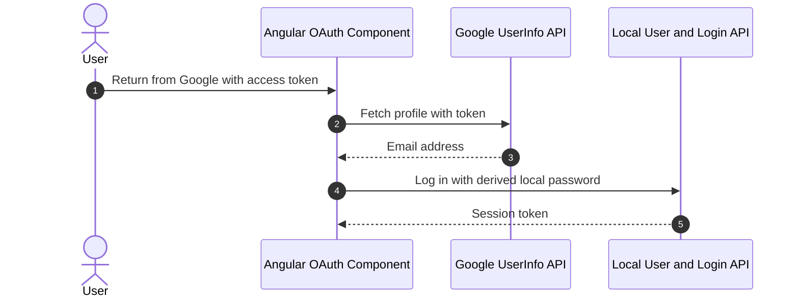

**Security assessment**

<!-- Model assessment (facts the narrative must not contradict): The client enables Google login only when the current origin matches a configured authorized redirect. It uses the implicit flow (response_type=token) with no state or nonce parameter, and the access token is passed in a URL query string to the userinfo call in user.service.ts. -->
OAuth acts as an identity hint, then converts into a local-password login:

- The implicit flow sends no state or nonce, so login can be forced or replayed (🟠 [F-015](#f-015), 🟡 [F-067](#f-067)).
- The local password is derived predictably from the email address (🟠 [F-016](#f-016)).
- The access token travels in a URL query string (🟡 [F-100](#f-100)).


**Relevant findings**

- None linked to this control; see the other findings of this category.

<a id="hardcoded-test-credentials-in-client"></a>
**Hardcoded test credentials in client.**


**Status:** 🔴 Unsafe - a test username and password ship inside the client bundle, readable by every visitor.

`login.component.ts` carries a prefilled test account in the Angular bundle that every browser downloads.

**Security assessment**

<!-- Model assessment (facts the narrative must not contradict): A test username and password are embedded in the shipped client bundle. This is a credential exposure. -->
The credential exposure is a single weakness:

- Anyone who opens the bundle can try the embedded account against the login (🟡 [F-101](#f-101)).

**Relevant findings**

- None linked to this control; see the other findings of this category.

<a id="password-change-over-get-with-credentials-in-query-string"></a>
#### 6.2.2 Password change over GET with credentials in query string

**Status:** 🟠 Weak - credentials in a GET query string leak through logs, history and referrers.

`user.service.ts` sends the current and new password as query parameters on a GET to the password-change route, which Express then handles in `routes/changePassword.ts`.

The diagram shows the intended password-change request path:
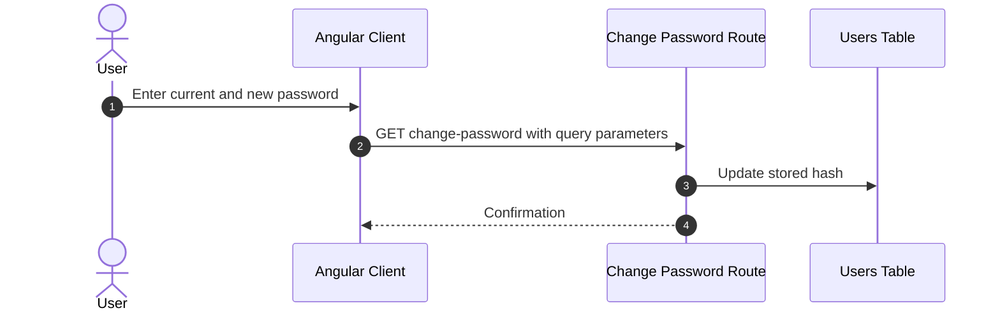

**Security assessment**

<!-- Model assessment (facts the narrative must not contradict): The current and new passwords are sent as URL query parameters on a GET request. They can leak through logs, history and referrers, and the request is not protected against CSRF. -->
Three weaknesses sit on this flow:

- Passwords appear in URLs and can leak to logs and referrers (🟡 [F-099](#f-099)).
- The current password is not mandatory, so a stolen session can change it (🟠 [F-029](#f-029)).
- Any non-empty new password is accepted (🟡 [F-066](#f-066)).


**Relevant findings**

- None linked to this control; see the other findings of this category.

<a id="route-level-authentication-for-web3-listener-endpoints"></a>
**Route-level authentication for Web3 listener endpoints.**


**Status:** 🔴 Missing - Web3 listener handlers perform no authentication checks, so unauthenticated callers can trigger listener creation.

This control is not evidenced in the repository.

**Security assessment**

<!-- Model assessment (facts the narrative must not contradict): Handlers perform no authentication or caller checks within the module; any middleware applied at route registration in server.ts was not inspected. Unauthenticated callers can trigger creation of the shared WebSocket listener. -->
Unauthenticated callers can trigger creation of the shared WebSocket listener:

- Handlers in the Web3 module check no identity or caller, and any middleware at route registration was not inspected.
- Unbounded wallet address growth follows from the same open entry point (🟡 [F-103](#f-103)).

**Relevant findings**

- None linked to this control; see the other findings of this category.

<a id="second-factor-totp-and-password-reset"></a>
#### 6.2.3 Second factor (TOTP) and password reset

**Status:** 🟡 Partial - TOTP checks bind to a typed temporary token, but the window is wide and throttling is weak.

`routes/2fa.ts` offers TOTP as an optional second factor: setup requires the password, and verification checks a typed temporary token. Password reset is a separate path that relies on a security-question answer.

The diagram shows the positive TOTP verification path after password login:
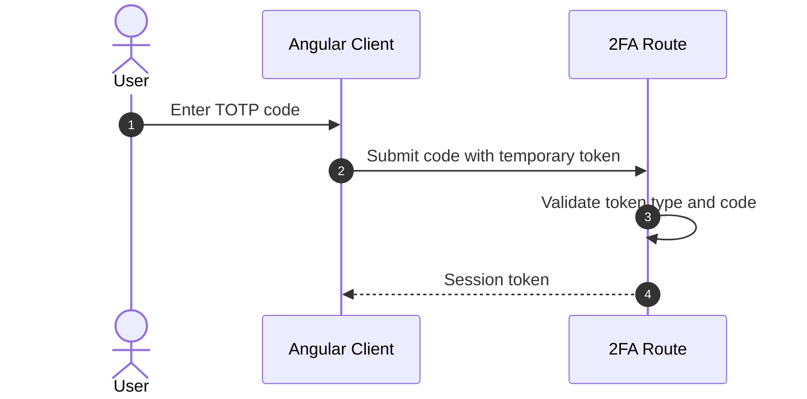

**Security assessment**

<!-- Model assessment (facts the narrative must not contradict): TOTP checks bind to a typed temporary token. The setup flow requires the password. The TOTP window is wide (epochTolerance 30). No rate limiting or lockout is visible in the inspected files. Password reset relies solely on a security-question answer with no throttling. -->
The second factor and recovery path both have gaps:

- The TOTP window is wide and no lockout is visible, so codes can be guessed (🟡 [F-068](#f-068)).
- Reset depends only on a security-question answer (🟠 [F-020](#f-020)).
- Reset sets no password strength policy (🟡 [F-071](#f-071)).
- The security-question endpoint reveals account details (🟡 [F-094](#f-094)).


**Relevant findings**

- None linked to this control; see the other findings of this category.

<a id="user-registration"></a>
#### 6.2.4 User Registration

**Status:** 🔴 Unsafe - registration accepts a client-supplied role, so anyone can create a privileged account.

<!-- Model implementation note (facts for the intro): Present at POST /api/Users -->
`POST /api/Users`, generated by the REST layer in `server.ts`, creates accounts straight from the request body. New users then log in through the normal password flow.

The diagram shows the intended registration path:
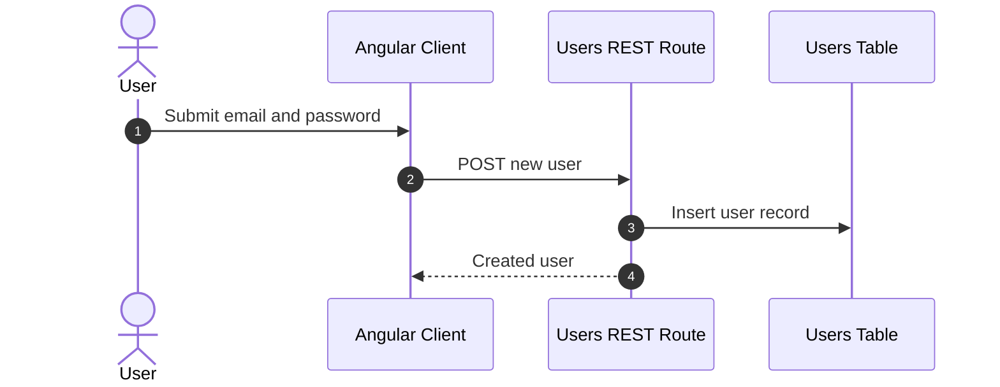

**Security assessment**

Registration trusts the request body:

- A role field in the body is stored as given, so a new account can start as admin (🔴 [F-011](#f-011), 🟠 [F-063](#f-063)).
- The route is registered without authentication middleware logic limiting what fields are accepted (🟠 [F-056](#f-056)).


**Relevant findings**

- 🔴 [F-011](#f-011) — Registration accepts privileged role field from request body
- 🟠 [F-056](#f-056) — Sensitive Routes Registered Without Authentication Middleware
- 🟠 [F-063](#f-063) — Registration accepts client-supplied role

### 6.3 Session and Token Controls

<a id="ctrl-session-and-token-controls"></a>

**Verdict:** 🟠 Weak - tokens are signed with `RS256` and expire, but the key is public, storage is script-readable and revocation is absent.

<!-- The line below is mechanically derived from the controls table — LLM must not re-author it. -->
**Controls covered:**

- [6.3.1 Client-side session token storage](#631-client-side-session-token-storage)
- [6.3.2 Session Token Issuance](#632-session-token-issuance)

**Implemented controls:** Client-side session token storage, Session Token Issuance (JWT Based).

**Assessment:** This application uses a single locally-signed JWT for every session, whichever [§6.2](#62-identity-and-authentication-controls) flow created it. The sub-sections trace issuance and browser storage; the token is script-readable (🟠 [F-002](#f-002)), its key is hardcoded (🟠 [F-021](#f-021)), and no revocation exists.

**Findings in this category without a control:**

- 🟠 [F-002](#f-002) — Session Token in Script-Readable Storage

<a id="client-side-session-token-storage"></a>
#### 6.3.1 Client-side session token storage

**Status:** 🟠 Weak - the JWT sits in `localStorage` and a script-set cookie, so any XSS reads the session.

The Angular client keeps the JWT in `localStorage` and also writes it to a JavaScript-set cookie with an 8-hour expiry. Requests attach it from there.

**Security assessment**

<!-- Model assessment (facts the narrative must not contradict): The JWT is stored in localStorage and in a JavaScript-set cookie (put with an 8-hour expiry, no HttpOnly or Secure option visible). Any script running in the page can read it, so an XSS flaw exposes the session. -->
Storage is readable by page scripts:

- No `HttpOnly` or `Secure` option is visible on the cookie, so script-readable storage exposes the session (🟠 [F-002](#f-002)).
- The many XSS findings in [§6.7](#67-output-encoding-and-rendering-controls) therefore convert directly to account takeover.

**Relevant findings**

- None linked to this control; see the other findings of this category.

<a id="session-token-issuance"></a><a id="session-token-issuance-jwt-based"></a>
#### 6.3.2 Session Token Issuance

**Status:** 🟡 Partial - `RS256` and a 6h expiry are in place, but the key is public and the algorithm is not pinned.

`lib/insecurity.ts` signs a JWT with `RS256` on login, valid for 6 hours, and keeps issued tokens in an in-memory map.

The diagram shows token issuance after a successful login:
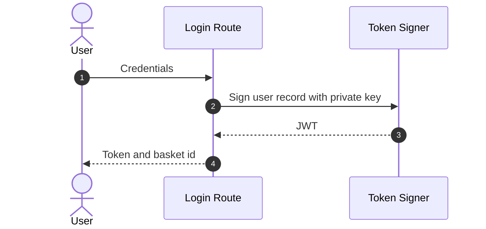

**Security assessment**

<!-- Model assessment (facts the narrative must not contradict): Tokens are signed with RS256 and expire after 6h. The private key is embedded in source. The full user record, including the password hash, goes into the token payload. verify() uses jws.verify without pinning the algorithm. Tokens live in an in-memory map with no revocation. -->
Issuance and validation each carry defects:

- The RSA private key is committed to source, so anyone can mint tokens (🟠 [F-021](#f-021)).
- Verification does not pin the algorithm (🟠 [F-014](#f-014), 🟡 [F-070](#f-070)).
- The password hash is placed inside the token payload (🟡 [F-102](#f-102)).
- Role checks skip expiry enforcement (🟡 [F-069](#f-069)).
- The in-memory map gives no revocation.


**Relevant findings**

- None linked to this control; see the other findings of this category.

### 6.4 Authorization Controls

<a id="ctrl-authorization-controls"></a>


**Systemic weaknesses:** [W-003](#w-003), [W-007](#w-007), [W-022](#w-022), [W-023](#w-023), [W-024](#w-024), [W-025](#w-025)
**Verdict:** 🟠 Weak - middleware guards many routes, but coverage is uneven and object ownership is rarely checked.

<!-- The line below is mechanically derived from the controls table — LLM must not re-author it. -->
**Controls covered:**

- [6.4.1 Route-level authorization middleware in server.ts](#641-route-level-authorization-middleware-in-serverts)
- [6.4.2 Per-object ownership check in the chatbot getOrderById tool](#642-per-object-ownership-check-in-the-chatbot-getorderbyid-tool)
- [6.4.3 Role checks and user binding](#643-role-checks-and-user-binding)

**Implemented controls:** Route-level authorization middleware in `server.ts`, Per-object ownership check in the chatbot `getOrderById` tool, Role checks and user binding.

**Assessment:** Authorization relies on per-route middleware in `server.ts` with no shared server-side pattern. Gaps span unguarded routes (🟠 [F-061](#f-061), 🟠 [F-056](#f-056)), missing ownership checks (🔴 [F-001](#f-001)) and client-supplied identifiers (🟠 [F-032](#f-032)).

**Findings in this category without a control:**

- 🔴 [F-001](#f-001) — Systemic missing ownership checks
- 🟠 [F-003](#f-003) — Missing object ownership checks on basket resources
- 🔴 [F-011](#f-011) — Registration accepts privileged role field from request body
- 🟠 [F-032](#f-032) — Request body can set UserId on generated create routes
- 🟠 [F-046](#f-046) — Any authenticated user can read any user record by id
- 🟠 [F-049](#f-049) — Basket checkout lacks object ownership checks
- 🟠 [F-050](#f-050) — Any user can edit other users' product
- 🟠 [F-051](#f-051) — Recycle records readable by any caller by id
- 🟠 [F-055](#f-055) — Key, log and quarantine files served without authorization
- 🟠 [F-056](#f-056) — Sensitive Routes Registered Without Authentication Middleware
- 🟠 [F-057](#f-057) — Any logged-in user can list all user accounts
- 🟠 [F-058](#f-058) — Any logged-in user can create products
- 🟠 [F-059](#f-059) — Any logged-in user can list all complaints
- 🟠 [F-061](#f-061) — Unauthenticated product update
- 🟠 [F-062](#f-062) — Coupon tool discount policy enforced only in prompt
- 🟠 [F-063](#f-063) — Registration accepts client-supplied role
- 🟠 [F-064](#f-064) — Missing role check on user list endpoint
- 🟡 [F-081](#f-081) — Feedback creation trusts UserId from request body
- 🟡 [F-082](#f-082) — Security answer creation accepts owner id from request body
- 🟡 [F-096](#f-096) — Order history filtered by lossy masked e-mail
- 🟡 [F-097](#f-097) — Unauthenticated order lookup by order id
- 🟡 [F-098](#f-098) — Order lookup by lossy vowel-masked e-mail in data
- 🟡 [F-106](#f-106) — Deluxe role granted without payment
- 🟡 [F-107](#f-107) — Basket item add checks first BasketId but saves last
- 🟡 [F-108](#f-108) — Product review author taken from request
- 🟡 [F-109](#f-109) — Basket items readable and deletable by any authenticated user
- 🟡 [F-110](#f-110) — Basket item creation can target another user's basket
- 🟡 [F-111](#f-111) — Privacy request creation not bound to authenticated user
- 🟡 [F-113](#f-113) — Any logged-in user can delete any feedback
- 🟡 [F-116](#f-116) — Address update lacks ownership check

<a id="route-level-authorization-middleware-in-serverts"></a>
#### 6.4.1 Route-level authorization middleware in server.ts

**Status:** 🟡 Partial - `isAuthorized`, `denyAll` and `isAccounting` guard many routes, but coverage has holes.

`server.ts` attaches `isAuthorized`, `denyAll` and `isAccounting` per route to protect much of the REST and API surface.

**Security assessment**

<!-- Model assessment (facts the narrative must not contradict): isAuthorized, denyAll and isAccounting guard many routes. Coverage is uneven. PUT /api/Products is not guarded (the line is commented out), and /rest/chat, /rest/memories and PUT /rest/products/:id/reviews have no isAuthorized middleware at the route. The accounting IP filter uses a malformed placeholder address. -->
Coverage is uneven:

- `PUT /api/Products` has its guard commented out (🟠 [F-061](#f-061)).
- Several routes register with no authentication middleware (🟠 [F-056](#f-056)).
- Any logged-in user can list accounts, complaints and create products (🟠 [F-057](#f-057), 🟠 [F-059](#f-059), 🟠 [F-058](#f-058)).
- Any logged-in user can delete feedback (🟡 [F-113](#f-113)).
- Key, log and quarantine files are served openly (🟠 [F-055](#f-055)).

**Relevant findings**

- None linked to this control; see the other findings of this category.

<a id="per-object-ownership-check-in-the-chatbot-getorderbyid-tool"></a>
#### 6.4.2 Per-object ownership check in the chatbot getOrderById tool

**Status:** 🟡 Partial - the tool authenticates the user, but compares a lossy vowel-masked email.

The chatbot `getOrderById` tool in `routes/chat.ts` authenticates the caller and filters orders by the user's masked email address.

**Security assessment**

<!-- Model assessment (facts the narrative must not contradict): The tool authenticates the user and compares the order email with a vowel-masked user email. The masking is lossy, so different emails can collide. Inspected scope: the chat.ts tool definitions and the system prompt. Tool calls are model-directed and need no approval step. -->
The ownership test is imprecise:

- Vowel masking is lossy, so different emails collide and can read each other's orders (🟡 [F-096](#f-096), 🟡 [F-098](#f-098)).
- Tool calls are model-directed with no approval step.
- Order tracking by id needs no login at all (🟡 [F-097](#f-097)).

**Relevant findings**

- None linked to this control; see the other findings of this category.

<a id="role-checks-and-user-binding"></a>
#### 6.4.3 Role checks and user binding

**Status:** 🟡 Partial - role claims are verified per route, so coverage depends on each route's wiring.

`isAccounting`, `isDeluxe` and `isCustomer` verify the token signature and read the role claim. `appendUserId` binds `UserId` from the server-side token map.

**Security assessment**

<!-- Model assessment (facts the narrative must not contradict): isAccounting, isDeluxe and isCustomer verify the signature and check the role claim. appendUserId binds UserId from the server-side token map. The checks are applied per route, so coverage depends on how routes use them. -->
Role checks help only where applied:

- Ownership is missing across baskets, orders and records (🔴 [F-001](#f-001), 🟠 [F-003](#f-003), 🟠 [F-049](#f-049)).
- The user list lacks a role check (🟠 [F-064](#f-064)).
- Deluxe status is granted without payment (🟡 [F-106](#f-106)).

**Relevant findings**

- None linked to this control; see the other findings of this category.

### 6.5 Query Construction and Data Access Controls

<a id="ctrl-query-construction-and-data-access-controls"></a>


**Systemic weaknesses:** [W-002](#w-002), [W-006](#w-006)
**Verdict:** 🔴 Unsafe - raw SQL and string-built NoSQL selectors defeat the query layer on the login and search routes.

<!-- The line below is mechanically derived from the controls table — LLM must not re-author it. -->
**Controls covered:**

- [6.5.1 Transaction mode and busy-retry configuration](#651-transaction-mode-and-busy-retry-configuration)
- [6.5.2 NoSQL query construction in chatbot tools](#652-nosql-query-construction-in-chatbot-tools)
- [6.5.3 Login query construction](#653-login-query-construction)

**Implemented controls:** Transaction mode and busy-retry configuration, NoSQL query construction in chatbot tools, Login query construction.

**Assessment:** Sequelize models back most access, yet login and search call raw SQL (🔴 [F-010](#f-010), 🔴 [F-004](#f-004)) and MarsDB selectors take user-shaped input (🟠 [F-033](#f-033), 🟠 [F-034](#f-034) (NoSQL JavaScript injection in order tracking \$where)). Transaction settings do not offset this.

**Findings in this category without a control:**

- 🔴 [F-004](#f-004) — SQL injection in product search query
- 🔴 [F-010](#f-010) — SQL injection in login query enables authentication bypass
- 🟠 [F-033](#f-033) — NoSQL JavaScript injection in product
- 🟠 [F-034](#f-034) — NoSQL JavaScript injection in order tracking \$where
- 🟡 [F-083](#f-083) — NoSQL operator injection
- 🟡 [F-084](#f-084) — Review update lacks ownership check

<a id="transaction-mode-and-busy-retry-configuration"></a>
#### 6.5.1 Transaction mode and busy-retry configuration

**Status:** 🟡 Partial - IMMEDIATE transactions and busy retries help consistency, not input safety.

Sequelize runs transactions in IMMEDIATE mode and retries `SQLITE_BUSY` failures up to 5 times.

**Security assessment**

<!-- Model assessment (facts the narrative must not contradict): Transactions use IMMEDIATE mode, and queries that fail with SQLITE_BUSY are retried up to 5 times. This helps write consistency and availability. It does not provide authorization or input safety. Query construction in the model files and routes was not inspected in this slice. -->
This setting covers write consistency only:

- It adds no authorization or input handling.
- Query construction in models and routes is assessed in the other sub-sections.

**Relevant findings**

- None linked to this control; see the other findings of this category.

<a id="nosql-query-construction-in-chatbot-tools"></a>
#### 6.5.2 NoSQL query construction in chatbot tools

**Status:** 🟠 Weak - one tool is parameterized, but the review lookup builds a `$where` string.

Chatbot tools in `routes/chat.ts` use parameterized Sequelize operators in `searchProducts`, while `getProductReviews` builds a MarsDB `$where` string from `Number(id)`.

**Security assessment**

<!-- Model assessment (facts the narrative must not contradict): getProductReviews builds a \$where string by concatenating Number(id). A non-numeric id becomes NaN, which limits injection. The searchProducts tool uses parameterized Sequelize operators. -->
The chatbot tools are comparatively tight, the review routes are not:

- `Number(id)` turns non-numeric input into NaN, which limits that tool.
- The same selector pattern is injectable elsewhere (🟠 [F-033](#f-033), 🟠 [F-034](#f-034) — NoSQL JavaScript injection in order tracking \$where (NoSQL JavaScript injection in order tracking \$where), 🟡 [F-083](#f-083) — NoSQL operator injection).
- Review updates lack an ownership check (🟡 [F-084](#f-084)).

**Relevant findings**

- None linked to this control; see the other findings of this category.

<a id="login-query-construction"></a>
#### 6.5.3 Login query construction

**Status:** 🔴 Unsafe - the email is interpolated into raw SQL, so the credential check is bypassed.

`routes/login.ts` `MD5`-hashes the submitted password, then builds the user lookup as a raw SQL string with `req.body.email` inside it.

The diagram shows the intended login lookup:
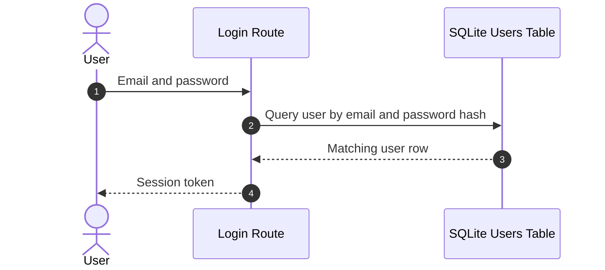

**Security assessment**

<!-- Model assessment (facts the narrative must not contradict): The login query interpolates req.body.email directly into a raw SQL string. The password is MD5-hashed first, but the email is not parameterized. This allows authentication bypass, so the credential check is defeated. -->
Only the password is processed before the query:

- The email is not parameterized, so a crafted value logs in as the first row, usually admin (🔴 [F-010](#f-010)).
- Product search repeats the pattern (🔴 [F-004](#f-004)).


**Relevant findings**

- None linked to this control; see the other findings of this category.

### 6.6 Input Boundary Validation Controls

<a id="ctrl-input-boundary-validation-controls"></a>

**Verdict:** 🔴 Missing - validation is ad hoc per route, with no shared schema, and key inputs go unchecked.

<!-- The line below is mechanically derived from the controls table — LLM must not re-author it. -->
**Controls covered:**

- [6.6.1 Validation Approach](#661-validation-approach)
- [6.6.2 Upload size and type limits](#662-upload-size-and-type-limits)
- [6.6.3 Validation of walletAddress request input](#663-validation-of-walletaddress-request-input)
- [6.6.4 Redirect allowlist and sanitization](#664-redirect-allowlist-and-sanitization)
- [6.6.5 Socket event payload validation](#665-socket-event-payload-validation)

**Implemented controls:** Upload size and type limits, Redirect allowlist and sanitization, Socket event payload validation.

**Assessment:** Upload limits exist, but request bodies have no schema validation. Wallet amounts (🟠 [F-023](#f-023)), wallet addresses (🟡 [F-103](#f-103)) and chat traffic (🟠 [F-048](#f-048)) pass through unchecked.

**Findings in this category without a control:**

- 🟠 [F-023](#f-023) — Wallet top-up accepts arbitrary client balance amount
- 🟠 [F-048](#f-048) — Unauthenticated chat endpoint lacks consumption limits
- 🟡 [F-103](#f-103) — Unbounded wallet address set growth on unauthenticated
- 🟡 [F-114](#f-114) — Chatbot coupon limits enforced only by prompt text

<a id="validation-approach"></a>
#### 6.6.1 Validation Approach

**Status:** 🟠 Weak - each route validates for itself, and no schema layer exists.

Validation is written inside individual route handlers and event handlers. No shared schema library or request validator was evidenced.

**Security assessment**

Missing shared validation leaves business inputs open:

- Wallet top-up accepts any client amount (🟠 [F-023](#f-023)).
- The chat endpoint has no consumption limits (🟠 [F-048](#f-048)).

**Relevant findings**

- None linked to this control; see the other findings of this category.

<a id="upload-size-and-type-limits"></a>
#### 6.6.2 Upload size and type limits

**Status:** 🟡 Partial - size and type caps exist, but the MIME type is client-declared.

Memory uploads cap at 200 KB, and the disk upload accepts only png and jpeg MIME types. Filenames pass through `sanitizeFilename`.

**Security assessment**

<!-- Model assessment (facts the narrative must not contradict): Memory uploads are capped at 200 KB, and the disk upload accepts only the png and jpeg MIME types. The MIME type is client-declared. The filename is sanitized with sanitizeFilename. -->
The caps help against casual abuse:

- The MIME type comes from the client and is not content-checked.
- Archive extraction still allows path escape (🟠 [F-025](#f-025)).

**Relevant findings**

- None linked to this control; see the other findings of this category.

<a id="validation-of-walletaddress-request-input"></a>
#### 6.6.3 Validation of walletAddress request input

**Status:** 🔴 Missing - `walletAddress` is stored without any type, format or length check.

This control is not evidenced in the repository.

**Security assessment**

<!-- Model assessment (facts the narrative must not contradict): req.body.walletAddress is added to an in-memory Set or looked up without type, format or length validation; unbounded additions to walletsConnected permit memory growth. -->
`req.body.walletAddress` goes into an in-memory Set or lookup with no checks:

- Unbounded additions grow `walletsConnected` and exhaust memory (🟡 [F-103](#f-103)).

**Relevant findings**

- None linked to this control; see the other findings of this category.

<a id="redirect-allowlist-and-sanitization"></a>
#### 6.6.4 Redirect allowlist and sanitization

**Status:** 🟠 Weak - the allowlist uses substring matching that can be bypassed.

Redirect targets are checked against an allowlist using `url.includes`. `saveLoginIp` sanitizes the header iteratively when challenge mode is off.

**Security assessment**

<!-- Model assessment (facts the narrative must not contradict): The redirect allowlist uses substring matching with url.includes, which can be bypassed. saveLoginIp sanitizes the header iteratively, but only when the challenge mode is off. -->
Substring matching does not pin the destination:

- A hostile URL containing an allowed string passes.
- Header sanitization is skipped in challenge mode.

**Relevant findings**

- None linked to this control; see the other findings of this category.

<a id="socket-event-payload-validation"></a>
#### 6.6.5 Socket event payload validation

**Status:** 🟠 Weak - event payloads are typed `any` with no schema checks.

Socket\.io handlers receive `any` payloads and run ad-hoc checks: substring matching, a regex with `isRedirectAllowed`, and `Array.isArray`.

**Security assessment**

<!-- Model assessment (facts the narrative must not contradict): Event payloads are typed 'any' and have no schema validation. The handlers only do ad-hoc checks, such as substring matching, a regex with an isRedirectAllowed check, and an Array.isArray check. These checks decide whether a challenge counts as solved. They are not security validation. The only rate limiting or size limiting in view is the Socket.io default. -->
These checks decide challenge state, not security:

- No schema, size limit or rate limit exists beyond Socket\.io defaults.
- Handlers act on whatever shape arrives.

**Relevant findings**

- None linked to this control; see the other findings of this category.

### 6.7 Output Encoding and Rendering Controls


**Systemic weaknesses:** [W-008](#w-008)
**Verdict:** 🟠 Weak - Angular escaping is bypassed in many components and stored markup is rendered unsanitized.

<!-- The line below is mechanically derived from the controls table — LLM must not re-author it. -->
**Controls covered:**

- [6.7.1 Guest basket client-side input sanitization](#671-guest-basket-client-side-input-sanitization)

**Implemented controls:** Guest basket client-side input sanitization.

**Assessment:** Stored and DOM XSS appear across the Angular client (🟠 [F-037](#f-037), 🟠 [F-038](#f-038), 🟠 [F-039](#f-039), 🟠 [F-040](#f-040), 🟠 [F-041](#f-041), 🟡 [F-086](#f-086), 🟡 [F-087](#f-087)), and the server stores product descriptions raw (🟡 [F-072](#f-072)). The one client-side sanitizer covers only guest baskets.

**Findings in this category without a control:**

- 🟠 [F-037](#f-037) — Stored XSS
- 🟠 [F-038](#f-038) — Stored XSS
- 🟠 [F-039](#f-039) — Stored XSS
- 🟠 [F-040](#f-040) — DOM XSS
- 🟠 [F-041](#f-041) — DOM XSS
- 🟡 [F-072](#f-072) — Product description stored without sanitization
- 🟡 [F-086](#f-086) — Stored XSS
- 🟡 [F-087](#f-087) — XSS

<a id="guest-basket-client-side-input-sanitization"></a>
#### 6.7.1 Guest basket client-side input sanitization

**Status:** 🟡 Partial - it validates the client's own stored basket only.

The guest basket code parses stored JSON in a try/catch and requires product ID and quantity to be positive integers.

**Security assessment**

<!-- Model assessment (facts the narrative must not contradict): Stored guest basket JSON is parsed in a try/catch, and the product ID and quantity are validated as positive integers. This only checks the client's own storage. The server must still enforce authorization and validation. -->
The check is local to the browser:

- It does not touch rendering of server data.
- The server must still enforce authorization and validation, and rendering sinks elsewhere remain exposed (🟠 [F-041](#f-041)).

**Relevant findings**

- None linked to this control; see the other findings of this category.

### 6.8 Browser and Cross-Origin Controls

**Verdict:** 🟠 Weak - only the Socket\.io CORS setting was evidenced, and it is hard-coded to localhost.

<!-- The line below is mechanically derived from the controls table — LLM must not re-author it. -->
**Controls covered:**

- [6.8.1 Socket\.io CORS origin restriction](#681-socketio-cors-origin-restriction)

**Implemented controls:** Socket\.io CORS origin restriction.

**Assessment:** Browser-side policy evidence is limited to the Socket\.io origin restriction, which suits development only. The OAuth flow also lacks state (🟡 [F-067](#f-067)).

**Findings in this category without a control:**

- 🟡 [F-067](#f-067) — OAuth implicit flow without state or nonce

<a id="socketio-cors-origin-restriction"></a>
#### 6.8.1 Socket\.io CORS origin restriction

**Status:** 🟡 Partial - limits browser origins, but is a fixed localhost value and not authentication.

Socket\.io CORS allows one hard-coded origin, `http://localhost:4200`.

**Security assessment**

<!-- Model assessment (facts the narrative must not contradict): CORS is limited to a single hard-coded origin, http://localhost:4200. This restricts browser cross-origin use only. It is not authentication, and non-browser clients ignore it. The fixed localhost value is also not suitable for a real deployment. -->
The setting is narrow in scope:

- Non-browser clients ignore CORS entirely.
- The fixed localhost origin does not fit a real deployment.

**Relevant findings**

- None linked to this control; see the other findings of this category.

### 6.9 Cryptography Secrets and Data Protection


**Systemic weaknesses:** [W-036](#w-036)
**Verdict:** 🟠 Weak - secrets are committed to source and passwords use fast unsalted hashing.

<!-- The line below is mechanically derived from the controls table — LLM must not re-author it. -->
**Controls covered:**

- [6.9.1 LLM API key handling and startup model probe](#691-llm-api-key-handling-and-startup-model-probe)
- [6.9.2 Transport protection for API calls](#692-transport-protection-for-api-calls)
- [6.9.3 Database storage protection](#693-database-storage-protection)
- [6.9.4 Alchemy API key handling](#694-alchemy-api-key-handling)
- [6.9.5 Password hashing and security-answer HMAC](#695-password-hashing-and-security-answer-hmac)

**Implemented controls:** LLM API key handling and startup model probe, Transport protection for API calls, Database storage protection (encryption at rest and engine credentials), Alchemy API key handling, Password hashing and security-answer HMAC.

**Assessment:** Keys and secrets sit in source (🟠 [F-021](#f-021), 🟡 [F-088](#f-088), 🟡 [F-101](#f-101)), tokens come from a non-cryptographic RNG (🟠 [F-017](#f-017)), cards are stored in cleartext (🟠 [F-042](#f-042)) and passwords use `MD5` (🟠 [F-043](#f-043) (Unsalted `MD5` password hashing)). Environment variables hold only the LLM and Alchemy keys.

**Findings in this category without a control:**

- 🟠 [F-017](#f-017) — Non-cryptographic RNG for a secret/token
- 🟠 [F-021](#f-021) — Hardcoded JWT signing private key in source
- 🟠 [F-042](#f-042) — Payment card numbers stored in cleartext
- 🟡 [F-088](#f-088) — Hardcoded HMAC key for security answers
- 🟡 [F-101](#f-101) — Hardcoded test credentials in client bundle

<a id="llm-api-key-handling-and-startup-model-probe"></a>
#### 6.9.1 LLM API key handling and startup model probe

**Status:** 🟡 Partial - key comes from an environment variable and the probe sends no key.

The LLM key is read from `LLM_API_KEY`. The URL is operator-configured, and the startup probe uses a 5-second timeout without sending the key.

**Security assessment**

<!-- Model assessment (facts the narrative must not contradict): The API key is read from the LLM_API_KEY environment variable, not hardcoded. The URL is operator-configured. The startup probe uses a 5-second timeout and sends no key. Transport security depends on the configured URL scheme. -->
Sourcing is sound, transport is open:

- Transport security depends on the configured URL scheme.
- No finding is routed here.

**Relevant findings**

- None linked to this control; see the other findings of this category.

<a id="transport-protection-for-api-calls"></a>
#### 6.9.2 Transport protection for API calls

**Status:** 🟠 Weak - API calls are modelled as HTTP with no TLS enforcement in source.

Angular services build API URLs from `environment.hostServer`, covering logins, payment cards and the private-key submission in `keys.service.ts`.

**Security assessment**

<!-- Model assessment (facts the narrative must not contradict): The services build API URLs from environment.hostServer. The flows are modelled as HTTP, and the source I read does not enforce TLS. Payment cards, login credentials and the private-key submission in keys.service.ts travel over these calls. Production TLS termination was not inspected. -->
TLS is not enforced in what was read:

- Credentials and card data travel over these calls.
- Production TLS termination was not inspected, so deployment may differ.

**Relevant findings**

- None linked to this control; see the other findings of this category.

<a id="database-storage-protection"></a><a id="database-storage-protection-encryption-at-rest-and-engine-credentials"></a>
#### 6.9.3 Database storage protection

**Status:** 🟠 Weak - a plain SQLite file with no encryption option configured.

Sequelize writes to `data/juiceshop.sqlite` with placeholder credentials that SQLite ignores.

**Security assessment**

<!-- Model assessment (facts the narrative must not contradict): The Sequelize instance uses placeholder credentials ('database','username','password'), which SQLite ignores. The store is a plain file at data/juiceshop.sqlite with no encryption option configured in this file. Protection depends on filesystem permissions and host controls, which were not inspected here. -->
Data at rest depends on the host:

- No encryption option is configured in this file.
- Payment card numbers are stored in cleartext in the database (🟠 [F-042](#f-042)).
- Filesystem permissions were not inspected.

**Relevant findings**

- None linked to this control; see the other findings of this category.

<a id="alchemy-api-key-handling"></a>
#### 6.9.4 Alchemy API key handling

**Status:** 🟡 Partial - the key is read from the environment and the socket uses `wss`, but it is embedded in the URL.

The Alchemy key is read from an environment variable and used to build a `wss` provider URL.

**Security assessment**

<!-- Model assessment (facts the narrative must not contradict): The key is read from an environment variable rather than hardcoded, and the connection uses wss. It falls back to an empty string silently, and the key is embedded in the URL. -->
Handling is better than hardcoding, with two gaps:

- The key falls back silently to an empty string.
- It is embedded in the URL, so URL logging exposes it.

**Relevant findings**

- None linked to this control; see the other findings of this category.

<a id="password-hashing-and-security-answer-hmac"></a>
#### 6.9.5 Password hashing and security-answer HMAC

**Status:** 🟠 Weak - passwords use unsalted `MD5` and the answer HMAC key is hardcoded.

`lib/insecurity.ts` hashes passwords with `MD5`. `models/securityAnswer.ts` computes security-answer HMACs with a key set in source.

**Security assessment**

<!-- Model assessment (facts the narrative must not contradict): Passwords are hashed with unsalted MD5, which is fast and easy to crack. The security-answer HMAC key is hardcoded in source. -->
Both primitives are weak:

- Unsalted `MD5` has no work factor, so a dump yields passwords quickly (🟠 [F-043](#f-043) — Unsalted MD5 password hashing (Unsalted `MD5` password hashing)).
- The HMAC key sits in the repository (🟡 [F-088](#f-088)).
- Session secrets draw on a non-cryptographic RNG (🟠 [F-017](#f-017)).

**Relevant findings**

- None linked to this control; see the other findings of this category.

### 6.10 File Parser and Outbound Request Controls

<a id="ctrl-file-parser-and-outbound-request-controls"></a>


**Systemic weaknesses:** [W-001](#w-001), [W-005](#w-005), [W-035](#w-035)
**Verdict:** 🔴 Missing - the profile image fetch has no outbound restrictions and several file and parser paths are open.

<!-- The line below is mechanically derived from the controls table — LLM must not re-author it. -->
**Controls covered:**

- [6.10.1 Outbound URL fetch restrictions](#6101-outbound-url-fetch-restrictions)
- [6.10.2 Webhook destination and payload handling](#6102-webhook-destination-and-payload-handling)

**Implemented controls:** Webhook destination and payload handling.

**Assessment:** Server-side fetch, template, XML, archive and eval paths are open: SSRF (🟠 [F-047](#f-047)), eval (🔴 [F-005](#f-005)), template injection (🟠 [F-035](#f-035)), XXE (🟠 [F-028](#f-028), 🟠 [F-045](#f-045)), zip slip (🟠 [F-025](#f-025)) and open key and log serving (🟠 [F-044](#f-044)). The webhook is the only mapped control.

**Findings in this category without a control:**

- 🔴 [F-005](#f-005) — Server-side eval of stored username in profile page
- 🟠 [F-024](#f-024) — Path Traversal
- 🟠 [F-025](#f-025) — Zip slip arbitrary file write in complaint upload
- 🟠 [F-026](#f-026) — B2B order payload evaluated by notevil sandbox
- 🟠 [F-028](#f-028) — XML parser enables external entities and DTD loading
- 🟠 [F-035](#f-035) — Pug template injection
- 🟠 [F-044](#f-044) — Unauthenticated serving of keys, logs and quarantine
- 🟠 [F-045](#f-045) — XML external entity expansion in uploaded XML parsing
- 🟠 [F-047](#f-047) — Server-side request forgery in profile
- 🟡 [F-089](#f-089) — FTP file allow-list bypass
- 🟡 [F-091](#f-091) — Captcha answer returned in challenge response
- 🟡 [F-092](#f-092) — Current user endpoint exposes fields
- 🟡 [F-093](#f-093) — Unauthenticated memories endpoint returns joined user

<a id="outbound-url-fetch-restrictions"></a><a id="outbound-url-fetch-restrictions-profile-image-url"></a>
#### 6.10.1 Outbound URL fetch restrictions

**Status:** 🔴 Missing - the server fetches any requester-supplied image URL.

This control is not evidenced in the repository.

**Security assessment**

<!-- Model assessment (facts the narrative must not contradict): The server fetches a requester-supplied imageUrl with no scheme, host, or private-address allowlist. Only a cookie-based login check precedes it. On fetch failure the raw URL is stored as the profile image. The extension check only chooses the file suffix. -->
`profileImageUrlUpload.ts` fetches `imageUrl` with no allowlist:

- Internal addresses are reachable (🟠 [F-047](#f-047)).
- Fetched content is stored without type checks (🟡 [F-079](#f-079)).
- A failed fetch stores the raw URL as the image.

**Relevant findings**

- None linked to this control; see the other findings of this category.

<a id="webhook-destination-and-payload-handling"></a>
#### 6.10.2 Webhook destination and payload handling

**Status:** 🟡 Partial - destination comes from operator configuration, but the payload leaks and is unsigned.

`SOLUTIONS_WEBHOOK` supplies the destination from the environment, and the notification is skipped when unset.

The diagram shows the webhook notification path:
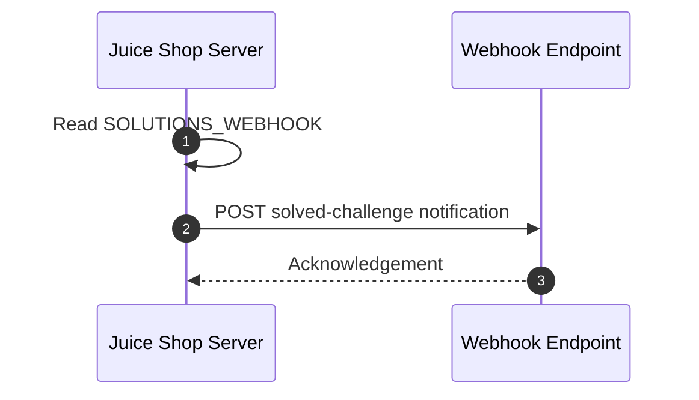

**Security assessment**

<!-- Model assessment (facts the narrative must not contradict): The webhook URL comes from the operator environment variable SOLUTIONS_WEBHOOK, not from request data. The notification is skipped when the variable is unset. The payload includes the CTF flag and host details, and the request has no authentication or signature. -->
Destination control is sound, delivery is not:

- The payload carries the CTF flag and host details.
- The request has no authentication or signature.


**Relevant findings**

- None linked to this control; see the other findings of this category.

### 6.11 Operations Runtime and Supply Chain Controls

**Build path.** [Figure 1b](#figure-1b) shows the inputs, build systems and release artifacts that Juice Shop evidences.

Highlighted path of 🟠 [F-022](#f-022) — Lockfiles disabled so every build resolves floating dependencies — .npmrc:1: npm registry → GitHub Actions → docker.io/bkimminich/juice-shop. The path stops where the evidence ends.

**Attack entries:**

- **Manipulated dependency**
  - 🟠 [F-022](#f-022) — Lockfiles disabled so every build resolves floating dependencies
  - 🟡 [F-075](#f-075) — Untrusted npm Install/Postinstall Scripts Enabled
- **Manipulated CI input**
  - 🟡 [F-074](#f-074) — Heroku CLI installed by piping remote script to shell
  - 🟡 [F-076](#f-076) — GitHub Actions referenced by mutable tag or branch
  - 🟡 [F-077](#f-077) — Container base images referenced by tag instead of digest
- **Replaced release artifact**
  - 🟡 [F-073](#f-073) — Missing Container Image Signing

**Not attributable to a build step:**

- 🟡 [F-104](#f-104) — Container Runs as Root


**Systemic weaknesses:** [W-026](#w-026), [W-027](#w-027), [W-037](#w-037)
**Verdict:** 🔴 Missing - lockfiles are disabled and dependency, install and workflow controls are incomplete.

<!-- The line below is mechanically derived from the controls table — LLM must not re-author it. -->
**Controls covered:**

- [6.11.1 GitHub Actions pinned to commit SHAs](#6111-github-actions-pinned-to-commit-shas)
- [6.11.2 Dependency lockfile and install integrity](#6112-dependency-lockfile-and-install-integrity)
- [6.11.3 Release credential handling and workflow privileges](#6113-release-credential-handling-and-workflow-privileges)
- [6.11.4 Container image hardening and SBOM generation](#6114-container-image-hardening-and-sbom-generation)
- [6.11.5 CI install script suppression for lint job](#6115-ci-install-script-suppression-for-lint-job)
- [6.11.6 Rate limiting](#6116-rate-limiting)
- [6.11.7 Access logging and exposure of logs/metrics](#6117-access-logging-and-exposure-of-logsmetrics)
- [6.11.8 Database concurrency and retry handling](#6118-database-concurrency-and-retry-handling)

**Implemented controls:** GitHub Actions pinned to commit SHAs, Dependency lockfile and install integrity, Release credential handling and workflow privileges, Container image hardening and SBOM generation, CI install script suppression for lint job.

**Assessment:** Container hardening and SHA-pinned actions help, but lockfiles are off (🟠 [F-022](#f-022)), install scripts run (🟡 [F-075](#f-075)), some actions use mutable tags (🟡 [F-076](#f-076)), and workflow permissions are unset (🟡 [F-105](#f-105)). Logs and metrics are served openly.

**Findings in this category without a control:**

- 🟠 [F-022](#f-022) — Lockfiles disabled so every build resolves floating dependencies
- 🟡 [F-073](#f-073) — Missing Container Image Signing
- 🟡 [F-074](#f-074) — Heroku CLI installed by piping remote script to shell
- 🟡 [F-075](#f-075) — Untrusted npm Install/Postinstall Scripts Enabled
- 🟡 [F-076](#f-076) — GitHub Actions referenced by mutable tag or branch
- 🟡 [F-077](#f-077) — Container base images referenced by tag instead of digest
- 🟡 [F-104](#f-104) — Container Runs as Root
- 🟡 [F-105](#f-105) — Missing Workflow Permissions Block

<a id="github-actions-pinned-to-commit-shas"></a>
#### 6.11.1 GitHub Actions pinned to commit SHAs

**Status:** 🟢 Adequate - third-party actions in the inspected workflows use full commit SHAs.

`ci.yml` and `release.yml` reference third-party actions by full commit SHA.

**Security assessment**

<!-- Model assessment (facts the narrative must not contradict): Third-party actions in ci.yml and release.yml are pinned to full commit SHAs, limiting tag-mutation supply-chain risk. One pinned action (dawidd6/action-get-tag) is noted as archived and pending replacement. -->
Pinning is incomplete across the repository:

- Other actions still use mutable tags or branches (🟡 [F-076](#f-076)).
- `dawidd6/action-get-tag` is archived and pending replacement.

**Relevant findings**

- None linked to this control; see the other findings of this category.

<a id="dependency-lockfile-and-install-integrity"></a>
#### 6.11.2 Dependency lockfile and install integrity

**Status:** 🟠 Weak - lockfiles are disabled, so every build resolves floating versions.

<!-- Model implementation note (facts for the intro): .npmrc; Dockerfile npm install; release.yml npm install -g -->
`.npmrc` sets `package-lock=false`. The `Dockerfile` and `release.yml` then run `npm install`, and global tools install at range or unpinned versions.

**Security assessment**

<!-- Model assessment (facts the narrative must not contradict): package-lock=false disables lockfiles, so CI, release packaging and Docker builds use npm install with floating ranges. Global tools (typescript, cyclonedx-npm, grunt-cli) are installed with range or unpinned versions, giving non-reproducible builds and exposure to compromised dependency releases. -->
Builds are not reproducible:

- A compromised dependency release flows into CI, release and image builds (🟠 [F-022](#f-022)).
- Install scripts run on those builds (🟡 [F-075](#f-075)).

**Relevant findings**

- None linked to this control; see the other findings of this category.

<a id="release-credential-handling-and-workflow-privileges"></a>
#### 6.11.3 Release credential handling and workflow privileges

**Status:** 🟡 Partial - credentials come from GitHub secrets, but token permissions are unrestricted.

<!-- Model implementation note (facts for the intro): .github/workflows/release.yml secrets usage -->
`release.yml` reads registry and release credentials from GitHub secrets, triggers on tags and creates draft releases.

**Security assessment**

<!-- Model assessment (facts the narrative must not contradict): Registry and release credentials come from GitHub secrets, tag-triggered releases, and releases are created as drafts. In the inspected ci.yml and release.yml no explicit top-level permissions block restricts GITHUB_TOKEN scope, so the repository default applies. Other workflows were not inspected. -->
Credential sourcing is sound, privilege scoping is not:

- No top-level `permissions` block limits `GITHUB_TOKEN`, so repository defaults apply (🟡 [F-105](#f-105)).
- Other workflows were not inspected.

**Relevant findings**

- None linked to this control; see the other findings of this category.

<a id="container-image-hardening-and-sbom-generation"></a>
#### 6.11.4 Container image hardening and SBOM generation

**Status:** 🟢 Adequate - multi-stage distroless build, non-root user and a generated SBOM.

<!-- Model implementation note (facts for the intro): Dockerfile -->
The `Dockerfile` uses a multi-stage build onto a distroless runtime, runs as user 65532, omits dev dependencies and generates a CycloneDX SBOM.

**Security assessment**

<!-- Model assessment (facts the narrative must not contradict): Multi-stage build with distroless runtime image, non-root user 65532, dev dependencies omitted and a CycloneDX SBOM generated. Base images are referenced by tag rather than digest. -->
Runtime hardening is solid, with reservations:

- Base images are referenced by tag, not digest (🟡 [F-077](#f-077)).
- A finding reports the container running as root (🟡 [F-104](#f-104)), which conflicts with the non-root user seen here and needs reconciling.
- Images are not signed (🟡 [F-073](#f-073)).

**Relevant findings**

- None linked to this control; see the other findings of this category.

<a id="ci-install-script-suppression-for-lint-job"></a>
#### 6.11.5 CI install script suppression for lint job

**Status:** 🟡 Partial - the lint job skips scripts, test jobs do not.

The lint job installs with `--ignore-scripts`. Test jobs run full `npm install` with lifecycle scripts.

**Security assessment**

<!-- Model assessment (facts the narrative must not contradict): The lint job installs with —ignore-scripts, but test jobs run full npm install including lifecycle scripts on PR-triggered runs. -->
Script suppression is partial:

- Pull-request-triggered test runs execute dependency install scripts (🟡 [F-075](#f-075)).
- A remote script piped to a shell adds a second path (🟡 [F-074](#f-074)).

**Relevant findings**

- None linked to this control; see the other findings of this category.

<a id="rate-limiting"></a>
#### 6.11.6 Rate limiting

**Status:** 🟠 Weak - limits cover few routes and the key can be spoofed.

Rate limits apply to reset-password and the 2FA routes. Express enables trust proxy unconditionally.

**Security assessment**

<!-- Model assessment (facts the narrative must not contradict): Rate limits exist on reset-password and the 2FA routes. The reset-password key generator trusts the X-Forwarded-For header, which a client can spoof to evade the limit. Trust proxy is enabled unconditionally. No limits were observed on /rest/chat or other routes. -->
Throttling is narrow and bypassable:

- The reset-password key generator trusts `X-Forwarded-For`, which clients can spoof.
- No limits cover `/rest/chat` (🟠 [F-048](#f-048)) or other routes.
- 2FA throttling is weak (🟡 [F-068](#f-068)).

**Relevant findings**

- None linked to this control; see the other findings of this category.

<a id="access-logging-and-exposure-of-logsmetrics"></a>
#### 6.11.7 Access logging and exposure of logs/metrics

**Status:** 🟠 Weak - logs and metrics are served without authentication.

Rotating `morgan` access logs are written to a logs directory, and `/metrics` exposes runtime data.

**Security assessment**

<!-- Model assessment (facts the narrative must not contradict): Rotating morgan access logs are written. The logs directory is served with directory listing and no authentication. /metrics is also served without authentication. -->
Logging exists, exposure undermines it:

- The logs directory is served with listing and no authentication (🟠 [F-044](#f-044), 🟡 [F-095](#f-095)).
- `/metrics` is also open.

**Relevant findings**

- None linked to this control; see the other findings of this category.

<a id="database-concurrency-and-retry-handling"></a>
#### 6.11.8 Database concurrency and retry handling

**Status:** 🟢 Adequate - busy retries and IMMEDIATE transactions reduce write conflicts.

Sequelize retries `SQLITE_BUSY` up to 5 times and runs IMMEDIATE transactions.

**Security assessment**

<!-- Model assessment (facts the narrative must not contradict): Retries on SQLITE_BUSY up to 5 times and uses IMMEDIATE transactions, which reduces lock contention and write-conflict failures. Query logging is disabled (logging: false), so this file produces no database audit trail. -->
This is an availability control only:

- Query logging is off (`logging: false`), so no database audit trail exists here.
- Wallet check and debit are not atomic at checkout (🟡 [F-078](#f-078)).

**Relevant findings**

- None linked to this control; see the other findings of this category.

### 6.12 Real-time and Not Applicable Controls

**Verdict:** 🔴 Missing - Socket\.io accepts every client without authentication, and LLM actions rely on prompt text.

<!-- The line below is mechanically derived from the controls table — LLM must not re-author it. -->
**Controls covered:**

- [6.12.1 LLM tool-call guardrails](#6121-llm-tool-call-guardrails)

**Implemented controls:** LLM tool-call guardrails (`generateCoupon` policy).

**Assessment:** `Socket.io` is present in the codebase. The connection handler has no authentication middleware or per-event authorization, so any client reads stored notifications and can delete entries. The chatbot guardrails sit only in prompt text.

<a id="llm-tool-call-guardrails"></a><a id="llm-tool-call-guardrails-generatecoupon-policy"></a>
#### 6.12.1 LLM tool-call guardrails

**Status:** 🟠 Weak - coupon limits exist only as prompt text and a schema description.

The `generateCoupon` tool in `routes/chat.ts` states a 10% cap and eligibility rules in the system prompt, and a zod schema describes the discount.

**Security assessment**

<!-- Model assessment (facts the narrative must not contradict): The 10% coupon cap and the eligibility conditions exist only as system-prompt text and a schema description. The zod schema has no max, and execute() generates a coupon for any discount value. A confidential escalation discount is embedded in the prompt. Nothing binds the action parameters to server-side policy or approval. -->
Policy is advisory to the model, not enforced:

- The schema has no `max`, and `execute()` issues a coupon for any value (🟠 [F-062](#f-062), 🟡 [F-114](#f-114), 🟡 [F-115](#f-115)).
- An escalation discount is embedded in the prompt.
- Chat inputs and stored reviews reach the model unvalidated (🟠 [F-036](#f-036), 🟡 [F-085](#f-085)).

**Relevant findings**

- None.

_Additional cataloged controls without a dedicated subsection (no implementation prose and no linked findings): Socket\.io connection authentication and authorization._

### 6.13 Defense-in-Depth Summary

<!-- §6.13 FORMAT — NEVER a table, at most 120 words, no file:line. Two short bullet lists: **What holds** (the individual positive controls that exist, strongest first, e.g. distroless runtime image, RS256 algorithm choice) and **Repair first** (the control-boundary repairs that would restore layered defense, each with its mitigation link [M-NNN](#m-nnn)). Do NOT emit a Markdown table — `| header |` lines under §6.13 are a contract violation. -->

**What holds**

- Distroless, non-root container image with SBOM.
- Third-party actions pinned to commit SHAs in the inspected workflows.
- `RS256` signing and a 6h token lifetime.
- Secrets for LLM and Alchemy read from environment variables.

**Repair first**

- Parameterize the login and search queries.
- Move the signing key and HMAC key out of source and pin the algorithm.
- Add server-side ownership and role checks, and stop accepting client roles.
- Re-enable lockfiles and restrict workflow permissions.

---

<a id="weakness-register"></a>
## 7. Weakness Register

Systemic control gaps behind the findings, ordered by severity (W-001 = most severe). Each weakness names the missing, home-grown, or misused control, the findings that evidence it, the components it spans, and its remediation. A weakness may also rest on observed unsafe practice or an absent architectural control with no confirmed exploit - only confirmed findings carry a CVSS score.

- 🔴 Critical · [W-001](#w-001) - Application data crosses into executable code · confirmed · 2 findings · 1 component
- 🔴 Critical · [W-002](#w-002) - Database access relies on concatenated queries · confirmed · 2 findings · 2 components
- 🔴 Critical · [W-003](#w-003) - Privileged attributes lack an enforced write allowlist · confirmed · 3 findings · 1 component
- 🟠 High · [W-004](#w-004) - Authentication relies on hand-rolled token verification · confirmed · 6 findings · 5 components
- 🟠 High · [W-005](#w-005) - Input handling lacks enforced boundary validation · confirmed · 3 findings · 1 component
- 🟠 High · [W-006](#w-006) - Document-database queries take their structure from application values · confirmed · 3 findings · 1 component
- 🟠 High · [W-007](#w-007) - Authorization is implemented route by route · confirmed · 25 findings · 3 components
- 🟠 High · [W-008](#w-008) - Frontend rendering lacks enforced output encoding · confirmed · 8 findings · 2 components
- 🟠 High · [W-009](#w-009) - Browser scripts retain reusable session credentials · observed-practice · 1 finding · 1 component
- 🟠 High · [W-010](#w-010) - Secrets are committed to source instead of a managed store · design-risk · 3 findings · 4 components
- 🟡 Medium · [W-011](#w-011) - Endpoints are reachable without enforced authentication · confirmed · 1 finding · 2 components
- 🟡 Medium · [W-012](#w-012) - Wide TOTP window and weak second-factor throttling (`2fa.ts:31`) · observed-practice · 1 finding · 1 component
- 🟡 Medium · [W-013](#w-013) - Password reset relies on security-question answer (`routes/resetPassword.ts:41`) · observed-practice · 1 finding · 1 component
- 🟡 Medium · [W-014](#w-014) - Unauthenticated chat endpoint lacks consumption limits (`chat.ts:203`) · observed-practice · 1 finding · 1 component
- 🟡 Medium · [W-015](#w-015) - Unbounded wallet address set growth on unauthenticated route (`web3Wallet.ts:16`) · observed-practice · 1 finding · 1 component
- 🟡 Medium · [W-016](#w-016) - Unbounded metric label cardinality from upload mimetype (`metrics.ts:77`) · observed-practice · 0 findings · 1 component
- 🟡 Medium · [W-017](#w-017) - Application data builds operating-system commands · observed-practice · 0 findings · 1 component
- 🟡 Medium · [W-018](#w-018) - Application data crosses into template source · observed-practice · 1 finding · 1 component
- 🟡 Medium · [W-019](#w-019) - Stored product reviews fed to model as tool results (`chat.ts:149`) · observed-practice · 1 finding · 1 component
- 🟡 Medium · [W-020](#w-020) - Username interpolated into system prompt (`chat.ts:83`) · observed-practice · 0 findings · 1 component
- 🟡 Medium · [W-021](#w-021) - XML parser enables external entities and DTD loading (`xml.ts:35`) · observed-practice · 1 finding · 1 component
- 🟡 Medium · [W-022](#w-022) - Client-side only role guards trust unverified JWT (`app.guard.ts:54`) · observed-practice · 0 findings · 1 component
- 🟡 Medium · [W-023](#w-023) - Missing Workflow Permissions Block · observed-practice · 1 finding · 1 component
- 🟡 Medium · [W-024](#w-024) - OAuth sign-in requests are not bound to the user's browser session · observed-practice · 1 finding · 1 component
- 🟡 Medium · [W-025](#w-025) - Cookie-authenticated changes lack request authenticity checks · observed-practice · 0 findings · 1 component
- 🟡 Medium · [W-026](#w-026) - Container base images referenced by tag instead of digest (`Dockerfile:22`, Docker · observed-practice · 1 finding · 1 component
- 🟡 Medium · [W-027](#w-027) - Untrusted npm Install/Postinstall Scripts Enabled · observed-practice · 1 finding · 1 component
- 🟡 Medium · [W-028](#w-028) - Unauthenticated memories endpoint returns joined user records (`memory.ts:24`) · observed-practice · 1 finding · 1 component
- 🟡 Medium · [W-029](#w-029) - Confidential discount rule embedded in chatbot system prompt (`routes/chat.ts:105` · observed-practice · 0 findings · 1 component
- 🟡 Medium · [W-030](#w-030) - LLM provider error text returned to client (`chat.ts:255`) · observed-practice · 0 findings · 1 component
- 🟡 Medium · [W-031](#w-031) - Unencrypted SQLite database file at rest (`index.ts:41`) · observed-practice · 0 findings · 1 component
- 🟡 Medium · [W-032](#w-032) - Payment card numbers stored in cleartext (`card.ts:38`) · observed-practice · 1 finding · 1 component
- 🟡 Medium · [W-033](#w-033) - Passwords sent in GET query string (`user.service.ts:54`) · observed-practice · 1 finding · 1 component
- 🟡 Medium · [W-034](#w-034) - OAuth access token passed in URL query string (frontend/src/app/Services/user.se · observed-practice · 1 finding · 1 component
- 🟡 Medium · [W-035](#w-035) - Substring redirect allowlist bypass (`insecurity.ts:136`) · observed-practice · 0 findings · 1 component
- 🟡 Medium · [W-036](#w-036) - Security-sensitive data uses weak cryptographic primitives · observed-practice · 2 findings · 2 components
- 🟡 Medium · [W-037](#w-037) - Build pipeline trusts mutable third-party references · design-risk · 2 findings · 1 component

<a id="w-001"></a>
### W-001 — Application data crosses into executable code

🔴 Critical · implementation weakness · confirmed · 2 findings

An interpreter evaluates application values as code. The affected path mixes data processing with executable program construction instead of constraining callers to predefined operations.

**Confirmed findings:**

- 🔴 [F-005](#f-005) — Server-side eval of stored username in profile page

**Practice sites:**

- 🟠 [F-026](#f-026) — B2B order payload evaluated by notevil sandbox

**Affected components:** [C-03](#c-03)

**Remediation:**

- **Structural** — replace evaluation of application values with a data parser or a fixed set of operations whose arguments remain data
- **Tactical** — ● [M-027](#m-027) — Remove eval of username, ◑ [M-004](#m-004) — Manual review: verify B2B order payload evaluated by notevil sandbox, ◕ [M-041](#m-041) — Remove dynamic evaluation of order data

<a id="w-002"></a>
### W-002 — Database access relies on concatenated queries

🔴 Critical · design weakness · confirmed · 2 findings

Database queries are assembled from application values instead of passing those values through an enforced parameterised data-access path. This leaves every call site responsible for preserving query structure.

**Architectural anti-pattern - Raw SQL string interpolation.** Several routes build database queries by concatenating request values, so each new route repeats the flaw. A point fix will not stop it; parameterized queries must be the default.

**Confirmed findings:**

- 🔴 [F-004](#f-004) — SQL injection in product search query
- 🔴 [F-010](#f-010) — SQL injection in login query enables authentication bypass

**Practice sites:**

- `routes/login.ts:34`
- `routes/search.ts:23`

**Architecture evidence:** Parameterized Queries, ORM / Repository Layer, Source evidence (`routes/vulnCodeSnippet.ts:46`)

**Affected components:** [C-03](#c-03), [C-08](#c-08)

**Remediation:**

- **Structural** — provide one parameterised repository or query-builder path and prohibit application-value interpolation in database queries
- **Tactical** — ● [M-026](#m-026) — Use parameterized database queries (F-004), ● [M-028](#m-028) — Use parameterized queries

<a id="w-003"></a>
### W-003 — Privileged attributes lack an enforced write allowlist

🔴 Critical · implementation weakness · confirmed · 3 findings

Model binding accepts caller-selected attributes across a privileged write boundary. The affected binding path does not separate fields callers may change from fields reserved for server-side policy.

**Architectural anti-pattern - Mass-assignment / unscoped object binding.** Generated resources bind request bodies directly to model fields, letting callers set privileged attributes such as role.

**Confirmed findings:**

- 🔴 [F-011](#f-011) — Registration accepts privileged role field from request body

**Practice sites:**

- 🟠 [F-063](#f-063) — Registration accepts client-supplied role
- 🟡 [F-082](#f-082) — Security answer creation accepts owner id from request body
- `server.ts:402`

**Affected components:** [C-03](#c-03)

**Remediation:**

- **Structural** — define operation-specific write schemas and assign privileged attributes exclusively through server-side policy
- **Tactical** — ● [M-029](#m-029) — Strip role from registration request bodies, ◑ [M-009](#m-009) — Manual review: verify Registration accepts client-supplied role, ◕ [M-072](#m-072) — Strip role from registration input, ◑ [M-088](#m-088) — Bind security answer owner to caller

<a id="w-004"></a>
### W-004 — Authentication relies on hand-rolled token verification

🟠 High · implementation weakness · confirmed · 6 findings

Token validation is implemented in application code rather than behind one vetted and consistently configured authentication path. Algorithm, issuer, audience, and key-handling checks can diverge between callers.

**Confirmed findings:**

- 🟠 [F-013](#f-013) — Chat identity trusted from unverified JWT decode

**Practice sites:**

- 🟠 [F-014](#f-014) — JWT verify call missing algorithms allowlist
- 🟠 [F-015](#f-015) — OAuth implicit flow without state, nonce or audience
- 🟡 [F-069](#f-069) — Token verification does not enforce expiry on role checks
- 🟡 [F-070](#f-070) — JWT verification does not pin the signing algorithm
- 🟡 [F-073](#f-073) — Missing Container Image Signing
- `routes/nftMint.ts:42`

**Affected components:** [C-02](#c-02), [C-03](#c-03), [C-05](#c-05), [C-07](#c-07), [C-08](#c-08)

**Remediation:**

- **Structural** — centralise token validation on a vetted library with pinned algorithms, issuer and audience checks, and managed signing keys
- **Tactical** — ◕ [M-030](#m-030) — Verify JWT signature before trusting identity, ◑ [M-002](#m-002) — Manual review: verify JWT verify call missing algorithms allowlist, ◕ [M-031](#m-031) — Enforce JWT signature and algorithm verification (F-014), ◕ [M-032](#m-032) — Verify token signatures before trusting claims, ◑ [M-078](#m-078) — Validate exp, iss and aud in token verification, ◑ [M-079](#m-079) — Pin RS256 when verifying tokens, ◑ [M-018](#m-018) — Sign and verify release artifacts

<a id="w-005"></a>
### W-005 — Input handling lacks enforced boundary validation

🟠 High · design weakness · confirmed · 3 findings

Request handlers do not validate input against one enforced server-side schema or allowlist at the boundary - validation is either absent on the vulnerable parameters or limited to rejecting selected bad patterns (a blacklist). New encodings and unanticipated input forms can therefore reach downstream parsers or interpreters.

**Confirmed findings:**

- 🟠 [F-024](#f-024) — Path Traversal
- 🟠 [F-025](#f-025) — Zip slip arbitrary file write in complaint upload
- 🟡 [F-089](#f-089) — FTP file allow-list bypass

**Practice sites:**

- `routes/vulnCodeFixes.ts:81`

**Architecture evidence:** Schema Validation, Allowlist Validation, Source evidence (`server.ts:204`), Source evidence (`server.ts:246`), Source evidence (`frontend/src/app/photo-wall/photo-wall.component.ts:93`), Source evidence (`frontend/src/hacking-instructor/helpers/helpers.ts:262`) (+4 more)

**Affected components:** [C-03](#c-03)

**Remediation:**

- **Structural** — enforce server-side schemas and domain-specific allowlists before input reaches parsing, persistence, or command construction
- **Tactical** — ◕ [M-039](#m-039) — Constrain file paths to a safe base directory (F-024), ◕ [M-040](#m-040) — Confine zip entries to the target directory, ◑ [M-095](#m-095) — Validate file name after normalization in FTP server

<a id="w-006"></a>
### W-006 — Document-database queries take their structure from application values

🟠 High · implementation weakness · confirmed · 3 findings

Document-store queries take operators or JavaScript predicates from application values instead of fixed query structures with typed values. Callers can change what a query selects, for example through injected operators or evaluated expressions.

**Confirmed findings:**

- 🟠 [F-034](#f-034) — NoSQL JavaScript injection in order tracking \$where

**Practice sites:**

- 🟠 [F-033](#f-033) — NoSQL JavaScript injection in product
- 🟡 [F-083](#f-083) — NoSQL operator injection

**Affected components:** [C-03](#c-03)

**Remediation:**

- **Structural** — build document queries from fixed operator structures, coerce request values to the expected scalar types, and disable server-side JavaScript evaluation in the database
- **Tactical** — ◕ [M-047](#m-047) — Replace \$where string with a parameterised find, ◕ [M-046](#m-046) — Use typed query predicates instead of \$where, ◑ [M-012](#m-012) — Manual review: verify NoSQL operator injection via unvalidated review id, ◑ [M-089](#m-089) — Validate review id as a string before querying

<a id="w-007"></a>
### W-007 — Authorization is implemented route by route

🟠 High · design weakness · confirmed · 25 findings

Authorization depends on per-handler checks instead of a policy boundary that consistently enforces role, ownership, and tenant scope. New routes can bypass protection by omitting a local check.

**Architectural anti-pattern - Missing server-side authorization layer.** Ownership and role checks are written route by route, so many routes omit them. A central policy layer is needed rather than individual patches.

**Confirmed findings:**

- 🟠 [F-003](#f-003) — Missing object ownership checks on basket resources
- 🟠 [F-050](#f-050) — Any user can edit other users' product
- 🟠 [F-055](#f-055) — Key, log and quarantine files served without authorization
- 🟠 [F-057](#f-057) — Any logged-in user can list all user accounts
- 🟠 [F-058](#f-058) — Any logged-in user can create products
- 🟠 [F-059](#f-059) — Any logged-in user can list all complaints
- 🟠 [F-061](#f-061) — Unauthenticated product update
- 🟠 [F-062](#f-062) — Coupon tool discount policy enforced only in prompt
- 🟠 [F-064](#f-064) — Missing role check on user list endpoint
- 🟡 [F-106](#f-106) — Deluxe role granted without payment
- 🟡 [F-107](#f-107) — Basket item add checks first BasketId but saves last
- 🟡 [F-108](#f-108) — Product review author taken from request
- 🟡 [F-109](#f-109) — Basket items readable and deletable by any authenticated user
- 🟡 [F-113](#f-113) — Any logged-in user can delete any feedback
- 🟡 [F-116](#f-116) — Address update lacks ownership check

**Practice sites:**

- 🔴 [F-001](#f-001) — Systemic missing ownership checks
- 🟠 [F-046](#f-046) — Any authenticated user can read any user record by id
- 🟠 [F-049](#f-049) — Basket checkout lacks object ownership checks
- 🟠 [F-051](#f-051) — Recycle records readable by any caller by id
- 🟠 [F-056](#f-056) — Sensitive Routes Registered Without Authentication Middleware
- 🟡 [F-096](#f-096) — Order history filtered by lossy masked e-mail
- 🟡 [F-097](#f-097) — Unauthenticated order lookup by order id
- 🟡 [F-098](#f-098) — Order lookup by lossy vowel-masked e-mail in data
- 🟡 [F-110](#f-110) — Basket item creation can target another user's basket
- 🟡 [F-111](#f-111) — Privacy request creation not bound to authenticated user
- `routes/chat.ts:169`
- `routes/nftMint.ts:42`

**Architecture evidence:** Centralised AuthZ Policy, Role / Scope Enforcement, Ownership Check, Source evidence (`server.ts:366`), Source evidence (`server.ts:367`), Source evidence (`server.ts:371`) (+28 more)

**Affected components:** [C-03](#c-03), [C-07](#c-07), [C-08](#c-08)

**Remediation:**

- **Structural** — enforce authorization through a shared server-side policy layer and make ownership and tenant scope mandatory inputs to data access
- **Tactical** — ◕ [M-025](#m-025) — Scope basket lookup to the caller, ◕ [M-063](#m-063) — Bind review updates to the authenticated author, ◕ [M-065](#m-065) — Require an administrator role for sensitive file routes, ◕ [M-067](#m-067) — Restrict user listing to administrators, ◕ [M-068](#m-068) — Require an admin role for product creation, ◕ [M-069](#m-069) — Restrict complaint listing to the caller or admins, ◕ [M-070](#m-070) — Guard product update route with role check, ◕ [M-071](#m-071) — Enforce coupon limits in server code, ◕ [M-073](#m-073) — Restrict user listing to admin role, ◑ [M-110](#m-110) — Enforce server-side authorization, ◑ [M-111](#m-111) — Bind basket id to authenticated user, ◑ [M-112](#m-112) — Bind review author to authenticated caller, ◑ [M-113](#m-113) — Enforce basket item ownership on lookup, ◑ [M-117](#m-117) — Require admin role for feedback deletion, ◑ [M-120](#m-120) — Bind address updates to the authenticated owner, ◑ [M-001](#m-001) — Manual review: verify Systemic missing ownership checks in `routes/memory.ts:15`…, ● [M-023](#m-023) — Enforce object-level (ownership) authorization (F-001), ◕ [M-059](#m-059) — Enforce ownership on user lookup by id, ◑ [M-006](#m-006) — Manual review: verify Basket checkout lacks object ownership checks, ◕ [M-062](#m-062) — Bind basket and wallet to the authenticated user, ◑ [M-007](#m-007) — Manual review: verify Recycle records readable by any caller by id, ◕ [M-064](#m-064) — Bind recycle lookups to the authenticated user, ◑ [M-008](#m-008) — Manual review: verify Sensitive Routes Registered Without Authentication Middleware, ◕ [M-066](#m-066) — Enforce server-side authorization on every endpoint (F-056), ◑ [M-102](#m-102) — Scope order history by user id, ◑ [M-103](#m-103) — Require ownership for order tracking, ◑ [M-016](#m-016) — Manual review: verify Order lookup by lossy vowel-masked e-mail in data export, ◑ [M-104](#m-104) — Enforce correct server-side authorization (F-098), ◑ [M-017](#m-017) — Manual review: verify Basket item creation can target another user's basket, ◑ [M-114](#m-114) — Bind basket item writes to the session basket, ◑ [M-115](#m-115) — Bind UserId to the authenticated user with appendUserId

<a id="w-008"></a>
### W-008 — Frontend rendering lacks enforced output encoding

🟠 High · design weakness · confirmed · 8 findings

Browser rendering paths write HTML or DOM content directly without one enforced contextual-encoding or sanitisation boundary. Safety depends on each individual component using the right API.

**Confirmed findings:**

- 🟠 [F-041](#f-041) — DOM XSS

**Practice sites:**

- 🟠 [F-037](#f-037) — Stored XSS
- 🟠 [F-038](#f-038) — Stored XSS
- 🟠 [F-039](#f-039) — Stored XSS
- 🟠 [F-040](#f-040) — DOM XSS
- 🟡 [F-072](#f-072) — Product description stored without sanitization
- 🟡 [F-086](#f-086) — Stored XSS
- 🟡 [F-087](#f-087) — XSS
- `frontend/src/app/data-export/data-export.component.ts:57`
- `frontend/src/app/data-export/data-export.component.ts:71`
- `frontend/src/app/score-board/score-board.component.ts:82`
- `frontend/src/app/about/about.component.ts:119`
- `frontend/src/app/administration/administration.component.ts:73`
- `frontend/src/app/administration/administration.component.ts:91`
- `frontend/src/app/data-export/data-export.component.ts:57`
- `frontend/src/app/last-login-ip/last-login-ip.component.ts:39`

**Architecture evidence:** Template Autoescape, Output Encoding, Content Security Policy, Source evidence (`frontend/src/app/about/about.component.ts:119`), Source evidence (`frontend/src/app/last-login-ip/last-login-ip.component.ts:39`), Source evidence (`frontend/src/app/administration/administration.component.ts:73`) (+5 more)

**Affected components:** [C-01](#c-01), [C-05](#c-05)

**Remediation:**

- **Structural** — use framework-safe rendering by default and isolate any required raw HTML behind one reviewed sanitisation and Trusted Types policy
- **Tactical** — ◕ [M-054](#m-054) — Remove sanitizer bypass for search query, ◕ [M-050](#m-050) — Remove sanitizer bypass and encode feedback comments, ◕ [M-051](#m-051) — Render user emails as text in admin table, ◕ [M-052](#m-052) — Remove sanitizer bypass and render text safely, ◑ [M-005](#m-005) — Manual review: verify DOM XSS via trusted last login IP from token, ◕ [M-053](#m-053) — Render last login IP as escaped text, ◑ [M-010](#m-010) — Manual review: verify Product description stored without sanitization, ◑ [M-081](#m-081) — Always sanitize product description input, ◑ [M-014](#m-014) — Manual review: verify Stored XSS via product descriptions trusted as HTML, ◑ [M-092](#m-092) — Stop trusting API product description HTML, ◑ [M-015](#m-015) — Manual review: verify XSS via order id trusted as HTML in order tracking, ◑ [M-093](#m-093) — Render order number as escaped text

<a id="w-009"></a>
### W-009 — Browser scripts retain reusable session credentials

🟠 High · implementation weakness · observed-practice · 1 finding

Browser code retains reusable authentication credentials in script-readable storage. Script execution in the same origin can obtain the credentials and reuse the authenticated session.

**Architectural anti-pattern - SPA without BFF.** The browser application keeps the session token in script-readable storage and no backend-for-frontend holds it server-side. Any script injection steals sessions; moving the token to a secure cookie closes it.

**Practice sites:**

- 🟠 [F-002](#f-002) — Session Token in Script-Readable Storage

**Affected components:** [C-05](#c-05)

**Remediation:**

- **Structural** — move reusable credentials behind a server-managed session boundary and keep browser-visible state free of reusable authentication secrets
- **Tactical** — ◕ [M-024](#m-024) — Store session tokens in HttpOnly, Secure cookies

<a id="w-010"></a>
### W-010 — Secrets are committed to source instead of a managed store

🟠 High · design weakness · design-risk · 3 findings

Cryptographic keys, credentials, and other high-entropy secrets are embedded as literals in source or config rather than resolved at runtime from a managed secret store, so anyone with repository read access obtains reusable signing material and credentials.

**Architectural anti-pattern - Secrets hardcoded in source.** Signing keys are committed to the repository instead of a managed secret store, so anyone with source access can forge tokens.

**Practice sites:**

- 🟠 [F-021](#f-021) — Hardcoded JWT signing private key in source
- 🟡 [F-088](#f-088) — Hardcoded HMAC key for security answers
- 🟡 [F-101](#f-101) — Hardcoded test credentials in client bundle
- `routes/checkKeys.ts:10`

**Architecture evidence:** Managed Secret Store, Runtime Secret Injection, Source evidence (`routes/checkKeys.ts:10`), Source evidence (`lib/insecurity.ts:21`)

**Affected components:** [C-01](#c-01), [C-03](#c-03), [C-05](#c-05), [C-08](#c-08)

**Remediation:**

- **Structural** — move every secret to a managed secret store or injected environment configuration, rotate the exposed values, and add secret-scanning to CI
- **Tactical** — ● [M-036](#m-036) — Load JWT private key from secret store, ◑ [M-094](#m-094) — Move secrets to a managed secret store (F-088), ◑ [M-107](#m-107) — Remove embedded test credentials

<a id="w-011"></a>
### W-011 — Endpoints are reachable without enforced authentication

🟡 Medium · design weakness · confirmed · 1 finding

Sensitive API routes and real-time channels are exposed without an enforced authentication check at the endpoint boundary. Access control depends on each handler (or the caller) remembering to require a session, so an unauthenticated client can reach privileged operations directly.

**Confirmed findings:**

- 🟡 [F-095](#f-095) — Unauthenticated access to logs and encryption keys

**Architecture evidence:** Route Authentication Middleware, Server-Side Session Enforcement, Source evidence (`server.ts:309`), Source evidence (`server.ts:402`), Source evidence (`server.ts:404`), Source evidence (`server.ts:406`) (+4 more)

**Affected components:** [C-03](#c-03), [C-09](#c-09)

**Remediation:**

- **Structural** — enforce authentication centrally at the routing and channel boundary so every exposed endpoint requires a verified session unless explicitly marked public
- **Tactical** — ◑ [M-101](#m-101) — Require authentication on every exposed endpoint

<a id="w-012"></a>
### W-012 — Wide TOTP window and weak second-factor throttling (2fa.ts:31)

🟡 Medium · implementation weakness · observed-practice · 1 finding

**Practice sites:**

- 🟡 [F-068](#f-068) — Wide TOTP window and weak second-factor throttling

**Affected components:** [C-08](#c-08)

**Remediation:**

- **Tactical** — ◑ [M-077](#m-077) — Narrow TOTP window and add account lockout

<a id="w-013"></a>
### W-013 — Password reset relies on security-question answer (routes/resetPassword.ts:41)

🟡 Medium · implementation weakness · observed-practice · 1 finding

**Practice sites:**

- 🟠 [F-020](#f-020) — Password reset relies on security-question answer

**Affected components:** [C-08](#c-08)

**Remediation:**

- **Tactical** — ◕ [M-035](#m-035) — Add throttling and stronger reset verification

<a id="w-014"></a>
### W-014 — Unauthenticated chat endpoint lacks consumption limits (chat.ts:203)

🟡 Medium · implementation weakness · observed-practice · 1 finding

**Practice sites:**

- 🟠 [F-048](#f-048) — Unauthenticated chat endpoint lacks consumption limits

**Affected components:** [C-03](#c-03)

**Remediation:**

- **Tactical** — ◕ [M-061](#m-061) — Add rate limiting and token budgets to chat

<a id="w-015"></a>
### W-015 — Unbounded wallet address set growth on unauthenticated route (web3Wallet.ts:16)

🟡 Medium · implementation weakness · observed-practice · 1 finding

**Practice sites:**

- 🟡 [F-103](#f-103) — Unbounded wallet address set growth on unauthenticated

**Affected components:** [C-07](#c-07)

**Remediation:**

- **Tactical** — ◑ [M-109](#m-109) — Validate and bound the wallet address set

<a id="w-016"></a>
### W-016 — Unbounded metric label cardinality from upload mimetype (metrics.ts:77)

🟡 Medium · implementation weakness · observed-practice

**Practice sites:**

- `routes/metrics.ts:77`

**Affected components:** [C-03](#c-03)

<a id="w-017"></a>
### W-017 — Application data builds operating-system commands

🟡 Medium · implementation weakness · observed-practice

A command line is assembled from application values and handed to a shell. Shell syntax in those values runs as further commands with the privileges of the service.

**Practice sites:**

- `.github/workflows/update-news-www.yml:19`

**Affected components:** [C-02](#c-02)

**Remediation:**

- **Structural** — call a fixed executable with an argument list and no shell, and accept only allowlisted argument values from callers

<a id="w-018"></a>
### W-018 — Application data crosses into template source

🟡 Medium · implementation weakness · observed-practice · 1 finding

Template construction treats application values as template source. Rendering can therefore interpret data as template instructions.

**Practice sites:**

- 🟠 [F-035](#f-035) — Pug template injection

**Affected components:** [C-03](#c-03)

**Remediation:**

- **Structural** — compile fixed templates and pass application values only through their data-binding interface
- **Tactical** — ◕ [M-048](#m-048) — Remove server-side evaluation of untrusted input (F-035)

<a id="w-019"></a>
### W-019 — Stored product reviews fed to model as tool results (chat.ts:149)

🟡 Medium · implementation weakness · observed-practice · 1 finding

**Practice sites:**

- 🟡 [F-085](#f-085) — Stored product reviews fed to model as tool results

**Affected components:** [C-03](#c-03)

**Remediation:**

- **Tactical** — ◑ [M-013](#m-013) — Manual review: verify Stored product reviews fed to model as tool results, ◑ [M-091](#m-091) — Isolate stored content from model instructions

<a id="w-020"></a>
### W-020 — Username interpolated into system prompt (chat.ts:83)

🟡 Medium · implementation weakness · observed-practice

**Practice sites:**

- `routes/chat.ts:83`

**Affected components:** [C-03](#c-03)

<a id="w-021"></a>
### W-021 — XML parser enables external entities and DTD loading (xml.ts:35)

🟡 Medium · implementation weakness · observed-practice · 1 finding

**Practice sites:**

- 🟠 [F-028](#f-028) — XML parser enables external entities and DTD loading

**Affected components:** [C-03](#c-03)

**Remediation:**

- **Tactical** — ◕ [M-043](#m-043) — Disable external entities and DTD loading

<a id="w-022"></a>
### W-022 — Client-side only role guards trust unverified JWT (app.guard.ts:54)

🟡 Medium · implementation weakness · observed-practice

**Practice sites:**

- `frontend/src/app/app.guard.ts:54`

**Affected components:** [C-05](#c-05)

<a id="w-023"></a>
### W-023 — Missing Workflow Permissions Block

🟡 Medium · implementation weakness · observed-practice · 1 finding

**Practice sites:**

- 🟡 [F-105](#f-105) — Missing Workflow Permissions Block

**Affected components:** [C-02](#c-02)

**Remediation:**

- **Tactical** — ◑ [M-022](#m-022) — Apply least-privilege permissions

<a id="w-024"></a>
### W-024 — OAuth sign-in requests are not bound to the user's browser session

🟡 Medium · implementation weakness · observed-practice · 1 finding

The client starts OAuth or OpenID Connect sign-in without a per-request state value that its callback verifies. A forged authorization response can then complete sign-in in the victim's browser with the attacker's grant.

**Practice sites:**

- 🟡 [F-067](#f-067) — OAuth implicit flow without state or nonce

**Affected components:** [C-05](#c-05)

**Remediation:**

- **Structural** — start every sign-in through a maintained OAuth/OIDC client that generates and verifies state (and PKCE) for each authorization request
- **Tactical** — ◑ [M-076](#m-076) — Add anti-CSRF protection to state-changing requests

<a id="w-025"></a>
### W-025 — Cookie-authenticated changes lack request authenticity checks

🟡 Medium · implementation weakness · observed-practice

A state-changing operation accepts ambient browser credentials without an enforced check that the authenticated user initiated the request. The affected mutation path lacks a request-authenticity boundary.

**Practice sites:**

- `routes/updateUserProfile.ts:38`

**Affected components:** [C-03](#c-03)

**Remediation:**

- **Structural** — enforce framework CSRF protection or validated origin and anti-CSRF tokens on every mutation that accepts ambient browser credentials

<a id="w-026"></a>
### W-026 — Container base images referenced by tag instead of digest (Dockerfile:22, Docker

🟡 Medium · implementation weakness · observed-practice · 1 finding

Container base images referenced by tag instead of digest (`Dockerfile:22`, `Dockerfile:1`)

**Practice sites:**

- 🟡 [F-077](#f-077) — Container base images referenced by tag instead of digest

**Affected components:** [C-02](#c-02)

**Remediation:**

- **Tactical** — ◑ [M-020](#m-020) — Pin the container base image to an immutable digest

<a id="w-027"></a>
### W-027 — Untrusted npm Install/Postinstall Scripts Enabled

🟡 Medium · implementation weakness · observed-practice · 1 finding

**Practice sites:**

- 🟡 [F-075](#f-075) — Untrusted npm Install/Postinstall Scripts Enabled

**Affected components:** [C-02](#c-02)

**Remediation:**

- **Tactical** — ◑ [M-019](#m-019) — Disable untrusted package install scripts

<a id="w-028"></a>
### W-028 — Unauthenticated memories endpoint returns joined user records (memory.ts:24)

🟡 Medium · implementation weakness · observed-practice · 1 finding

**Practice sites:**

- 🟡 [F-093](#f-093) — Unauthenticated memories endpoint returns joined user

**Affected components:** [C-03](#c-03)

**Remediation:**

- **Tactical** — ◑ [M-099](#m-099) — Limit memory response fields and require auth

<a id="w-029"></a>
### W-029 — Confidential discount rule embedded in chatbot system prompt (routes/chat.ts:105

🟡 Medium · implementation weakness · observed-practice

Confidential discount rule embedded in chatbot system prompt (`routes/chat.ts:105`)

**Practice sites:**

- `routes/chat.ts:105`

**Affected components:** [C-03](#c-03)

<a id="w-030"></a>
### W-030 — LLM provider error text returned to client (chat.ts:255)

🟡 Medium · implementation weakness · observed-practice

**Practice sites:**

- `routes/chat.ts:255`

**Affected components:** [C-03](#c-03)

<a id="w-031"></a>
### W-031 — Unencrypted SQLite database file at rest (index.ts:41)

🟡 Medium · implementation weakness · observed-practice

**Practice sites:**

- `models/index.ts:41`

**Affected components:** [C-06](#c-06)

<a id="w-032"></a>
### W-032 — Payment card numbers stored in cleartext (card.ts:38)

🟡 Medium · implementation weakness · observed-practice · 1 finding

**Practice sites:**

- 🟠 [F-042](#f-042) — Payment card numbers stored in cleartext

**Affected components:** [C-01](#c-01)

**Remediation:**

- **Tactical** — ◕ [M-055](#m-055) — Stop storing sensitive data in cleartext

<a id="w-033"></a>
### W-033 — Passwords sent in GET query string (user.service.ts:54)

🟡 Medium · implementation weakness · observed-practice · 1 finding

**Practice sites:**

- 🟡 [F-099](#f-099) — Passwords sent in GET query string

**Affected components:** [C-05](#c-05)

**Remediation:**

- **Tactical** — ◑ [M-105](#m-105) — Send password change as POST body

<a id="w-034"></a>
### W-034 — OAuth access token passed in URL query string (frontend/src/app/Services/user.se

🟡 Medium · implementation weakness · observed-practice · 1 finding

OAuth access token passed in URL query string (`frontend/src/app/Services/user.service.ts:68`)

**Practice sites:**

- 🟡 [F-100](#f-100) — OAuth access token passed in URL query string

**Affected components:** [C-05](#c-05)

**Remediation:**

- **Tactical** — ◑ [M-106](#m-106) — Send tokens in Authorization headers using the code flow

<a id="w-035"></a>
### W-035 — Substring redirect allowlist bypass (insecurity.ts:136)

🟡 Medium · implementation weakness · observed-practice

**Practice sites:**

- `lib/insecurity.ts:136`

**Affected components:** [C-08](#c-08)

<a id="w-036"></a>
### W-036 — Security-sensitive data uses weak cryptographic primitives

🟡 Medium · implementation weakness · observed-practice · 2 findings

Password, token, or integrity protection uses a weak hash, predictable random source, or insufficient work factor. The application may use a standard library, but the selected primitive does not provide the required security property.

**Practice sites:**

- 🟠 [F-017](#f-017) — Non-cryptographic RNG for a secret/token
- 🟠 [F-043](#f-043) — Unsalted MD5 password hashing

**Affected components:** [C-01](#c-01), [C-08](#c-08)

**Remediation:**

- **Structural** — standardise on a password KDF, a CSPRNG for secrets, and modern authenticated cryptographic primitives with centrally reviewed parameters
- **Tactical** — ◑ [M-003](#m-003) — Manual review: verify Non-cryptographic RNG for a secret/token, ◕ [M-034](#m-034) — Use cryptographically secure random values, ◕ [M-056](#m-056) — Hash passwords with a strong, salted algorithm

<a id="w-037"></a>
### W-037 — Build pipeline trusts mutable third-party references

🟡 Medium · design weakness · design-risk · 2 findings

CI/CD workflows resolve third-party actions and other build dependencies to mutable tags or branches instead of immutable commit digests, so a retagged or compromised upstream runs inside the pipeline with its token and secret scope.

**Practice sites:**

- 🟠 [F-022](#f-022) — Lockfiles disabled so every build resolves floating dependencies — .npmrc:1
- 🟡 [F-076](#f-076) — GitHub Actions referenced by mutable tag or branch

**Architecture evidence:** Commit-SHA Action Pinning, Dependency Provenance Verification, Source evidence (`.github/workflows/image_actions.yml:33`), Source evidence (`.github/workflows/image_actions.yml:42`), Source evidence (`.github/workflows/ci.yml:188`)

**Affected components:** [C-02](#c-02)

**Remediation:**

- **Structural** — pin every third-party action and build dependency to an immutable commit SHA (or a vetted internal mirror) and enforce SHA-pinning in CI
- **Tactical** — ◕ [M-037](#m-037) — Commit lockfiles and install from them, ◕ [M-083](#m-083) — Pin third-party dependencies to immutable versions

---

## 8. Findings Register

Findings are grouped by severity (Critical → High → Medium → Low); within a tier they are ordered by attack vektor (Repo-Read → Internet-Anon → Internet-User → Victim-Required). Every finding card shows **Severity · Component · Location**, **Issue**, **Fix**, and **Classification** (with external CWE / OWASP links). **Evidence**, **Root cause**, violated requirements, the weakness, and the trust boundary gap appear when they apply.

**Risk Distribution:** 🔴 Critical: 5 · 🟠 High: 46 · 🟡 Medium: 52 · 🟢 Low: n/a · **Total findings: 103**
*This register counts every finding card below. The Management Summary's risk distribution (Total: 55) counts folded insecure-practice sites under their weakness and adds each design risk once.*
**STRIDE Coverage:** Spoofing: 14 · Tampering: 38 · Repudiation: 0 · Information Disclosure: 22 · Denial of Service: 2 · Elevation of Privilege: 27

The root causes and the fixes to do first are summarized in **Remediation Priorities** in the Management Summary; evidence-backed weaknesses are documented in the [Weakness Register](#weakness-register).

**Findings index:**<br/>🔴 [F-001](#f-001) — Systemic missing ownership checks<br/>🔴 [F-004](#f-004) — SQL injection in product search query<br/>🔴 [F-005](#f-005) — Server-side eval of stored username in profile page<br/>🔴 [F-010](#f-010) — SQL injection in login query enables authentication bypass<br/>🔴 [F-011](#f-011) — Registration accepts privileged role field from request body<br/>🟠 [F-002](#f-002) — Session Token in Script-Readable Storage<br/>🟠 [F-003](#f-003) — Missing object ownership checks on basket resources<br/>🟠 [F-013](#f-013) — Chat identity trusted from unverified JWT decode<br/>🟠 [F-014](#f-014) — JWT verify call missing algorithms allowlist<br/>🟠 [F-015](#f-015) — OAuth implicit flow without state, nonce or audience<br/>🟠 [F-016](#f-016) — Predictable password derived from OAuth email<br/>🟠 [F-017](#f-017) — Non-cryptographic RNG for a secret/token<br/>🟠 [F-020](#f-020) — Password reset relies on security-question answer<br/>🟠 [F-021](#f-021) — Hardcoded JWT signing private key in source<br/>🟠 [F-022](#f-022) — Lockfiles disabled so every build resolves floating dependencies<br/>🟠 [F-023](#f-023) — Wallet top-up accepts arbitrary client balance amount<br/>🟠 [F-024](#f-024) — Path Traversal<br/>🟠 [F-025](#f-025) — Zip slip arbitrary file write in complaint upload<br/>🟠 [F-026](#f-026) — B2B order payload evaluated by notevil sandbox<br/>🟠 [F-027](#f-027) — Wallet top-up amount is taken from the request body<br/>🟠 [F-028](#f-028) — XML parser enables external entities and DTD loading<br/>🟠 [F-029](#f-029) — Password change without mandatory current password<br/>🟠 [F-032](#f-032) — Request body can set UserId on generated create routes<br/>🟠 [F-033](#f-033) — NoSQL JavaScript injection in product<br/>🟠 [F-034](#f-034) — NoSQL JavaScript injection in order tracking \$where<br/>🟠 [F-035](#f-035) — Pug template injection<br/>🟠 [F-036](#f-036) — Client-supplied chat messages passed to model unvalidated<br/>🟠 [F-037](#f-037) — Stored XSS<br/>🟠 [F-038](#f-038) — Stored XSS<br/>🟠 [F-039](#f-039) — Stored XSS<br/>🟠 [F-040](#f-040) — DOM XSS<br/>🟠 [F-041](#f-041) — DOM XSS<br/>🟠 [F-042](#f-042) — Payment card numbers stored in cleartext<br/>🟠 [F-043](#f-043) — Unsalted MD5 password hashing<br/>🟠 [F-044](#f-044) — Unauthenticated serving of keys, logs and quarantine<br/>🟠 [F-045](#f-045) — XML external entity expansion in uploaded XML parsing<br/>🟠 [F-046](#f-046) — Any authenticated user can read any user record by id<br/>🟠 [F-047](#f-047) — Server-side request forgery in profile<br/>🟠 [F-048](#f-048) — Unauthenticated chat endpoint lacks consumption limits<br/>🟠 [F-049](#f-049) — Basket checkout lacks object ownership checks<br/>🟠 [F-050](#f-050) — Any user can edit other users' product<br/>🟠 [F-051](#f-051) — Recycle records readable by any caller by id<br/>🟠 [F-055](#f-055) — Key, log and quarantine files served without authorization<br/>🟠 [F-056](#f-056) — Sensitive Routes Registered Without Authentication Middleware<br/>🟠 [F-057](#f-057) — Any logged-in user can list all user accounts<br/>🟠 [F-058](#f-058) — Any logged-in user can create products<br/>🟠 [F-059](#f-059) — Any logged-in user can list all complaints<br/>🟠 [F-061](#f-061) — Unauthenticated product update<br/>🟠 [F-062](#f-062) — Coupon tool discount policy enforced only in prompt<br/>🟠 [F-063](#f-063) — Registration accepts client-supplied role<br/>🟠 [F-064](#f-064) — Missing role check on user list endpoint<br/>🟡 [F-065](#f-065) — Product review author taken from client<br/>🟡 [F-066](#f-066) — Password change accepts any non-empty password<br/>🟡 [F-067](#f-067) — OAuth implicit flow without state or nonce<br/>🟡 [F-068](#f-068) — Wide TOTP window and weak second-factor throttling<br/>🟡 [F-069](#f-069) — Token verification does not enforce expiry on role checks<br/>🟡 [F-070](#f-070) — JWT verification does not pin the signing algorithm<br/>🟡 [F-071](#f-071) — Password reset enforces no password strength policy<br/>🟡 [F-072](#f-072) — Product description stored without sanitization<br/>🟡 [F-073](#f-073) — Missing Container Image Signing<br/>🟡 [F-074](#f-074) — Heroku CLI installed by piping remote script to shell<br/>🟡 [F-075](#f-075) — Untrusted npm Install/Postinstall Scripts Enabled<br/>🟡 [F-076](#f-076) — GitHub Actions referenced by mutable tag or branch<br/>🟡 [F-077](#f-077) — Container base images referenced by tag instead of digest<br/>🟡 [F-078](#f-078) — Non-atomic wallet balance check and debit at checkout<br/>🟡 [F-079](#f-079) — Fetched profile image stored without type<br/>🟡 [F-080](#f-080) — CSP header built from user-controlled profile image<br/>🟡 [F-081](#f-081) — Feedback creation trusts UserId from request body<br/>🟡 [F-082](#f-082) — Security answer creation accepts owner id from request body<br/>🟡 [F-083](#f-083) — NoSQL operator injection<br/>🟡 [F-084](#f-084) — Review update lacks ownership check<br/>🟡 [F-085](#f-085) — Stored product reviews fed to model as tool results<br/>🟡 [F-086](#f-086) — Stored XSS<br/>🟡 [F-087](#f-087) — XSS<br/>🟡 [F-088](#f-088) — Hardcoded HMAC key for security answers<br/>🟡 [F-089](#f-089) — FTP file allow-list bypass<br/>🟡 [F-090](#f-090) — Null byte bypass of public file extension allowlist<br/>🟡 [F-091](#f-091) — Captcha answer returned in challenge response<br/>🟡 [F-092](#f-092) — Current user endpoint exposes fields<br/>🟡 [F-093](#f-093) — Unauthenticated memories endpoint returns joined user<br/>🟡 [F-094](#f-094) — Security question endpoint reveals<br/>🟡 [F-095](#f-095) — Unauthenticated access to logs and encryption keys<br/>🟡 [F-096](#f-096) — Order history filtered by lossy masked e-mail<br/>🟡 [F-097](#f-097) — Unauthenticated order lookup by order id<br/>🟡 [F-098](#f-098) — Order lookup by lossy vowel-masked e-mail in data<br/>🟡 [F-099](#f-099) — Passwords sent in GET query string<br/>🟡 [F-100](#f-100) — OAuth access token passed in URL query string<br/>🟡 [F-101](#f-101) — Hardcoded test credentials in client bundle<br/>🟡 [F-102](#f-102) — Password hash embedded in signed JWT payload<br/>🟡 [F-103](#f-103) — Unbounded wallet address set growth on unauthenticated<br/>🟡 [F-104](#f-104) — Container Runs as Root<br/>🟡 [F-105](#f-105) — Missing Workflow Permissions Block<br/>🟡 [F-106](#f-106) — Deluxe role granted without payment<br/>🟡 [F-107](#f-107) — Basket item add checks first BasketId but saves last<br/>🟡 [F-108](#f-108) — Product review author taken from request<br/>🟡 [F-109](#f-109) — Basket items readable and deletable by any authenticated user<br/>🟡 [F-110](#f-110) — Basket item creation can target another user's basket<br/>🟡 [F-111](#f-111) — Privacy request creation not bound to authenticated user<br/>🟡 [F-112](#f-112) — Deluxe membership granted without verified payment<br/>🟡 [F-113](#f-113) — Any logged-in user can delete any feedback<br/>🟡 [F-114](#f-114) — Chatbot coupon limits enforced only by prompt text<br/>🟡 [F-115](#f-115) — Chatbot coupon limits enforced only by prompt text<br/>🟡 [F-116](#f-116) — Address update lacks ownership check

<a id="th-01"></a><a id="th-05"></a><a id="th-06"></a><a id="th-02"></a><a id="th-03"></a><a id="th-04"></a><a id="th-07"></a><a id="th-08"></a><a id="th-09"></a><a id="th-10"></a><a id="th-11"></a><a id="th-12"></a><a id="th-14"></a><a id="th-15"></a><a id="th-17"></a>

### 🔴 Critical (5)

<a id="t-001"></a><a id="f-001"></a>
#### F-001 · Systemic missing ownership checks

**Severity:** 🔴 Critical - verified attack-chain keystone in AC-T-002 (Bulk Data Exfiltration via Broken Object Authorization); see [§9](#9-abuse-cases)  ·  **Component:** [C-03](#c-03) - Juice Shop Express API  ·  **Location:** Multiple locations (5)

**Found by:** scanners and verification ([TC-AUTHZ-01](#tc-authz-01))

**Reliability:** Low. Not confirmed, this may be a false positive: UserId comes from `req.body`, but the POST `/rest/memories` route middleware (`appendUserId`) is not shown.

**Weakness:** [W-007](#w-007) - Authorization is implemented route by route

**Instances (5):** `routes/basketItems.ts`: 68; `routes/memory.ts`: 15; `routes/payment.ts`: 21, 41, 70

**Issue:** At `routes/memory.ts:15`, a signed-in attacker places another user's ID in the owner field of the request (`req.body.UserId` and the like) and the query trusts it instead of the session identity, so the attacker can read or change other users' records. At `routes/basketItems.ts:68`, a logged-in user sends PUT `/api/BasketItems/``&lt;id&gt;` for an item in another user's basket; the item is found by id only and the owner is never compared, although `isAuthorized` and `appendUserId` authenticate the caller.

The result is horizontal privilege escalation across accounts. The finding holds further places beyond these two cited locations (`location_count` is 5).

**Evidence:** ◌ ambiguous

```typescript
routes/memory.ts
  12 │     const record = {
  13 │       caption: req.body.caption,
  14 │       imagePath: 'assets/public/images/uploads/' + req.file?.filename,
→ 15 │       UserId: req.body.UserId
  16 │     }
  17 │     const memory = await MemoryModel.create(record)
  18 │     res.status(200).json({ status: 'success', data: memory })
```

**Fix:** Tie every object lookup to the requesting user's identity and reject cross-tenant references → ◑ [M-001](#m-001) — Manual review: verify Systemic missing ownership checks in `routes/memory.ts:15`… · ● [M-023](#m-023) — Enforce object-level (ownership) authorization (🔴 [F-001](#f-001))

**Classification:** Broken Access Control · STRIDE: Tampering · [CWE-639](https://cwe.mitre.org/data/definitions/639.html) · [OWASP A01:2025](https://owasp.org/Top10/2025/A01_2025-Broken_Access_Control/) · Verification items: [TC-AUTHZ-01](#tc-authz-01) · Rules: AUTHZ-001, AUTHZ-002 · walkthrough [Walkthrough §3.1](#31-systemic-missing-ownership-checks-idor-in-memory)

<a id="t-004"></a><a id="f-004"></a>
#### F-004 · SQL injection in product search query

**Severity:** 🔴 Critical  ·  **Component:** [C-03](#c-03) - Juice Shop Express API  ·  **Location:** `routes/search.ts:23`

**Found by:** survey, scanners and verification ([TC-INPUT-01](#tc-input-01))

**Reliability:** High. Probably real: a model review confirmed it, and the survey and verification each found it.

**Weakness:** [W-002](#w-002) - Database access relies on concatenated queries

**Trust boundary gap:** [tb-1](#tb-1) 🌐 External - external → Juice Shop Express API · Validation: The search route accepts unvalidated query input at the browser-to-API boundary and passes it to a SQL sink.

**Issue:** An unauthenticated caller sends GET `/rest/products/search?q=` with a quote-closing UNION payload. The q value is concatenated into a raw SQL string, so the caller can read other tables such as Users, including emails and password hashes, which come back in the JSON product list.

The only control is truncation of q to 200 characters, and the route has no authentication. The scanner finding at the same location also notes that interpolating request text into SQL can allow modifying rows or escalating to full database control.

**Evidence:** ✓ verified

```typescript
  20 │   return (req: Request, res: Response, next: NextFunction) => {
  21 │     let criteria: any = req.query.q === 'undefined' ? '' : req.query.q ?? ''
  22 │     criteria = (criteria.length <= 200) ? criteria : criteria.substring(0, 200)
→ 23 │     models.sequelize.query(`SELECT * FROM Products WHERE ((name LIKE '%${criteria}%' OR description LIKE '%${criteria}%') AND deletedAt IS NULL) ORDER BY name`) // vuln-code-snippet vuln-line unionSqlInjectionChallenge dbSchemaChallenge
  24 │       .then(([products]: any) => {
  25 │         const dataString = JSON.stringify(products)
  26 │         if (challengeUtils.notSolved(challenges.unionSqlInjectionChallenge)) { // vuln-code-snippet hide-start
```

**Fix:** Switch all SQL execution to parameterised queries or ORM-bound parameters → ● [M-026](#m-026) — Use parameterized database queries (🔴 [F-004](#f-004))

**Classification:** Injection · STRIDE: Tampering · [CWE-89](https://cwe.mitre.org/data/definitions/89.html) · [OWASP A05:2025](https://owasp.org/Top10/2025/A05_2025-Injection/) · Verification items: [TC-INPUT-01](#tc-input-01) · Rules: INJ-001 · walkthrough [Walkthrough §3.3](#33-sql-injection-in-product-search-query)

<a id="t-005"></a><a id="f-005"></a>
#### F-005 · Server-side eval of stored username in profile page

**Severity:** 🔴 Critical  ·  **Component:** [C-03](#c-03) - Juice Shop Express API  ·  **Location:** `routes/userProfile.ts:61`

**Found by:** survey, scanners and verification ([TC-INPUT-03](#tc-input-03))

**Reliability:** High. Probably real: a model review confirmed it, and the survey and verification each found it.

**Weakness:** [W-001](#w-001) - Application data crosses into executable code

**Issue:** An authenticated user stores a username of the form #{code}. When they load GET `/profile`, the handler strips the wrapper and passes the remainder to `eval()`, executing attacker JavaScript in the Node server process.

For example, a username such as #{`process.mainModule.require('child_process').execSync('id')`} would run commands as the Node process user. The scanner traced a persisted record read to this expression and notes that attacker control and configuration require verification.

**Evidence:** ✓ verified

```typescript
  58 │         if (!code) {
  59 │           throw new Error('Username is null')
  60 │         }
→ 61 │         username = eval(code) // eslint-disable-line no-eval
  62 │       } catch (err) {
  63 │         username = '\\' + username
  64 │       }
```

**Fix:** Replace runtime code generation (eval/Function/template render) with a data-only execution path → ● [M-027](#m-027) — Remove eval of username

**Classification:** Code Execution via Unsafe Deserialization or Eval · STRIDE: Tampering · [CWE-95](https://cwe.mitre.org/data/definitions/95.html) · [OWASP A08:2025](https://owasp.org/Top10/2025/A08_2025-Software_or_Data_Integrity_Failures/) · Verification items: [TC-INPUT-03](#tc-input-03) · Rules: INJ-NODE-007 · walkthrough [Walkthrough §3.4](#34-server-side-eval-of-stored-username-in-profile-page)

<a id="t-011"></a><a id="f-011"></a>
#### F-011 · Registration accepts privileged role field from request body

**Severity:** 🔴 Critical - reaches a privileged operation on an unauthenticated endpoint; verified attack-chain keystone in AC-T-002 (Bulk Data Exfiltration via Broken Object Authorization), AC-T-004 (Privilege Escalation via Mass-Assignment on Registration), +1 more; see [§9](#9-abuse-cases)  ·  **Component:** [C-03](#c-03) - Juice Shop Express API  ·  **Location:** `server.ts:501`

**Found by:** verification ([TC-AUTHZ-03](#tc-authz-03))

**Reliability:** Medium. A model review confirmed it, but the survey and verification did not both find it.

**Weakness:** [W-003](#w-003) - Privileged attributes lack an enforced write allowlist

**Issue:** An anonymous caller sends POST `/api/Users` with role set to admin. The generated user resource has no field allow-list, and the role validator accepts admin, so the new account is an administrator.

**Evidence:** ✓ verified

```typescript
  498 │   ]
  499 │
  500 │   for (const { name, exclude, model, include } of autoModels) {
→ 501 │     const resource = finale.resource({
  502 │       model,
  503 │       endpoints: [`/api/${name}s`, `/api/${name}s/:id`],
  504 │       excludeAttributes: exclude,
```

**Fix:** ● [M-029](#m-029) — Strip role from registration request bodies

**Classification:** Broken Access Control · STRIDE: Elevation of Privilege · [CWE-915](https://cwe.mitre.org/data/definitions/915.html) · [OWASP A01:2025](https://owasp.org/Top10/2025/A01_2025-Broken_Access_Control/) · Verification items: [TC-AUTHZ-03](#tc-authz-03) · walkthrough [Walkthrough §3.2](#32-registration-accepts-privileged-role-field-from-request-body)

<a id="t-010"></a><a id="f-010"></a>
#### F-010 · SQL injection in login query enables authentication bypass

**Severity:** 🔴 Critical  ·  **Component:** [C-08](#c-08) - Authentication & Session Surface  ·  **Location:** `routes/login.ts:34`

**Found by:** survey, scanners and verification ([TC-INPUT-01](#tc-input-01))

**Reliability:** High. Probably real: a model review confirmed it, and the survey and verification each found it.

**Weakness:** [W-002](#w-002) - Database access relies on concatenated queries

**Trust boundary gap:** [tb-2](#tb-2) 🌐 External - external → Authentication &amp; Session Surface · Validation: The finding's evidence line is the interface this boundary cites; CWE-89 breaks its validation condition.

**Issue:** An unauthenticated attacker posts a crafted email such as ' OR 1=1-- to `/rest/user/login` (`routes/login.ts:34`). The email is interpolated into a raw SQL query, so the password condition is bypassed and a signed JWT and basket id for the first matching user, typically the admin account, are issued.

The password is `MD5`-hashed before interpolation but the email is not neutralized. The scanner finding at the same location also notes that such interpolation can allow modifying rows or escalating to full database control.

**Evidence:** ✓ verified

```typescript
  31 │
  32 │   return (req: Request, res: Response, next: NextFunction) => {
  33 │     verifyPreLoginChallenges(req) // vuln-code-snippet hide-line
→ 34 │     models.sequelize.query(`SELECT * FROM Users WHERE email = '${req.body.email || ''}' AND password = '${security.hash(req.body.password || '')}' AND deletedAt IS NULL`, { model: UserModel, plain: true }) // vuln-code-snippet vuln-line loginAdminChallenge loginBenderChallenge loginJimChallenge
  35 │       .then((authenticatedUser) => { // vuln-code-snippet neutral-line loginAdminChallenge loginBenderChallenge loginJimChallenge
  36 │         const user = utils.queryResultToJson(authenticatedUser)
  37 │         if (user.data?.id && user.data.totpSecret !== '') {
```

**Fix:** Switch all SQL execution to parameterised queries or ORM-bound parameters → ● [M-028](#m-028) — Use parameterized queries

**Classification:** Injection · STRIDE: Tampering · [CWE-89](https://cwe.mitre.org/data/definitions/89.html) · [OWASP A05:2025](https://owasp.org/Top10/2025/A05_2025-Injection/) · Verification items: [TC-INPUT-01](#tc-input-01) · Rules: INJ-001 · walkthrough [Walkthrough §3.5](#35-sql-injection-in-login-query-enables-authentication-bypass)

### 🟠 High (46)

<a id="t-021"></a><a id="f-021"></a>
#### F-021 · Hardcoded JWT signing private key in source

**Severity:** 🟠 High - secret committed to the public source repo - extractable on clone, no prior access needed; elevated to Critical as a verified attack-chain keystone in AC-T-005 (Authentication Bypass via Exposed Secret Material); see [§9](#9-abuse-cases)  ·  **Component:** [C-08](#c-08) - Authentication & Session Surface  ·  **Location:** `lib/insecurity.ts:21`

**Reliability:** Medium. A model review confirmed it, but the survey and verification did not both find it.

**Weakness:** [W-010](#w-010) - Secrets are committed to source instead of a managed store

**Issue:** The `RS256` private key used to sign all session tokens is embedded in source; anyone with repository or build access can forge a token for any user or role such as admin or accounting.

**Evidence:** ✓ verified

```typescript
  19 │
  20 │ export const publicKey = fs ? fs.readFileSync('encryptionkeys/jwt.pub', 'utf8') : 'placeholder-public-key'
→ 21 │ const privateKey = '[PEM PRIVATE KEY — REDACTED] …
  22 │
  23 │ interface ResponseWithUser {
```

**Fix:** Move the credential out of source control into a secret store and rotate it → ● [M-036](#m-036) — Load JWT private key from secret store

**Classification:** Cryptographic Failures · STRIDE: Spoofing · [CWE-798](https://cwe.mitre.org/data/definitions/798.html) · [OWASP A04:2025](https://owasp.org/Top10/2025/A04_2025-Cryptographic_Failures/) · walkthrough [Walkthrough §3.6](#36-hardcoded-jwt-signing-private-key-in-source)

<a id="t-042"></a><a id="f-042"></a>
#### F-042 · Payment card numbers stored in cleartext

**Severity:** 🟠 High  ·  **Component:** [C-01](#c-01) - Sequelize application data access  ·  **Location:** `models/card.ts:38`

**Reliability:** Medium. A model review confirmed it, but the survey and verification did not both find it.

**Weakness:** [W-032](#w-032) - Payment card numbers stored in cleartext (`card.ts:38`)

**Issue:** The Card model persists the full card number as a plain integer column with no encryption. Anyone obtaining the SQLite file or a query result reads complete card numbers and expiry data.

**Evidence:** ✓ verified

```typescript
  36 │       },
  37 │       fullName: DataTypes.STRING,
→ 38 │       cardNum: {
  39 │         type: DataTypes.INTEGER,
  40 │         validate: {
```

**Fix:** ◕ [M-055](#m-055) — Stop storing sensitive data in cleartext

**Classification:** Cryptographic Failures · STRIDE: Information Disclosure · [CWE-312](https://cwe.mitre.org/data/definitions/312.html) · [OWASP A04:2025](https://owasp.org/Top10/2025/A04_2025-Cryptographic_Failures/)

<a id="t-002"></a><a id="f-002"></a>
#### F-002 · Session Token in Script-Readable Storage

**Severity:** 🟠 High  ·  **Component:** [C-05](#c-05) - frontend client application  ·  **Location:** Multiple locations (5)

**Reliability:** Medium. A model review confirmed it, but the survey and verification did not both find it.

**Weakness:** [W-009](#w-009) - Browser scripts retain reusable session credentials

**Instances (5):** `frontend/src/app/Services/request.interceptor.ts`: 16; `frontend/src/app/login/login.component.ts`: 101; `frontend/src/app/payment/payment.component.ts`: 232; `frontend/src/app/two-factor-auth-enter/two-factor-auth-enter.component.ts`: 53; `frontend/src/app/Services/basket.service.ts`: 64

**Issue:** The request interceptor reads the bearer token from `localStorage` on every request, so the token is stored where any injected script can read it. Combined with the XSS finding, an attacker can steal sessions.

**Evidence:** ✓ verified

**Fix:** ◕ [M-024](#m-024) — Store session tokens in HttpOnly, Secure cookies

**Classification:** Insecure Client-Side Storage · STRIDE: Information Disclosure · [CWE-922](https://cwe.mitre.org/data/definitions/922.html) · [OWASP A04:2025](https://owasp.org/Top10/2025/A04_2025-Cryptographic_Failures/)

<a id="t-003"></a><a id="f-003"></a>
#### F-003 · Missing object ownership checks on basket resources

**Severity:** 🟠 High - verified attack-chain keystone in AC-B-001 (User reads or changes data of another user or tenant); see [§9](#9-abuse-cases)  ·  **Component:** [C-03](#c-03) - Juice Shop Express API  ·  **Location:** Multiple locations (6)

**Found by:** survey, scanners and verification ([TC-AUTHZ-01](#tc-authz-01), [TC-AUTHZ-03](#tc-authz-03))

**Reliability:** High. Probably real: a model review confirmed it, and the survey and verification each found it.

**Weakness:** [W-007](#w-007) - Authorization is implemented route by route

**Trust boundary gap:** [tb-1](#tb-1) 🌐 External - external → Juice Shop Express API · Authorization: The finding's evidence line is the interface this boundary cites; CWE-639 breaks its authorization condition.

**Instances (6):** `routes/basket.ts`: 19; `routes/coupon.ts`: 18; `server.ts`: 426, 603, 604, 605

**Issue:** Authenticated users can reach other users' baskets by id. `retrieveBasket` (`routes/basket.ts:19`) loads a basket by `req.params.id` without comparing it to the user's basket, so ids can be enumerated to read contents.

Authentication via `isAuthorized` and `appendUserId` is present; the id comparison is only used to flag a challenge.

**Evidence:** ✓ verified

```typescript
routes/basket.ts
  17 │     try {
  18 │       const id = req.params.id
→ 19 │       const basket = await BasketModel.findOne({ where: { id }, include: [{ model: ProductModel, paranoid: false, as: 'Products' }] })
  20 │       /* jshint eqeqeq:false */
  21 │       challengeUtils.solveIf(challenges.basketAccessChallenge, () => {
```

**Fix:** Tie every object lookup to the requesting user's identity and reject cross-tenant references → ◕ [M-025](#m-025) — Scope basket lookup to the caller

**Classification:** Broken Access Control · STRIDE: Elevation of Privilege · [CWE-639](https://cwe.mitre.org/data/definitions/639.html) · [OWASP A01:2025](https://owasp.org/Top10/2025/A01_2025-Broken_Access_Control/) · Verification items: [TC-AUTHZ-01](#tc-authz-01), [TC-AUTHZ-03](#tc-authz-03) · Rules: AUTHZ-301

<a id="t-013"></a><a id="f-013"></a>
#### F-013 · Chat identity trusted from unverified JWT decode

**Severity:** 🟠 High - verified attack-chain contributor in AC-T-005 (Authentication Bypass via Exposed Secret Material); see [§9](#9-abuse-cases)  ·  **Component:** [C-03](#c-03) - Juice Shop Express API  ·  **Location:** `routes/chat.ts:45`

**Reliability:** Medium. A model review confirmed it, but the survey and verification did not both find it.

**Weakness:** [W-004](#w-004) - Authentication relies on hand-rolled token verification

**Issue:** `getUserId` reads the bearer token and calls `security.decode`, which is `jws.decode` without signature verification, then uses `data.id` as the caller identity. An attacker forges an unsigned or self-signed token carrying another user's id and calls POST `/rest/chat`; the `getOrderById` tool then returns that user's orders (LLM06, ASI03).

**Evidence:** ✓ verified

```typescript
  43 │   const token = utils.jwtFrom(req)
  44 │   if (!token) return undefined
→ 45 │   const decoded = security.decode(token) as { data?: { id?: number } } | undefined
  46 │   return decoded?.data?.id
  47 │ }
```

**Fix:** Pin the signature algorithm explicitly and reject `alg:none` and unknown algorithms → ◕ [M-030](#m-030) — Verify JWT signature before trusting identity

**Classification:** Broken Authentication · STRIDE: Spoofing · [CWE-347](https://cwe.mitre.org/data/definitions/347.html) · [OWASP A07:2025](https://owasp.org/Top10/2025/A07_2025-Authentication_Failures/)

<a id="t-014"></a><a id="f-014"></a>
#### F-014 · JWT verify call missing algorithms allowlist

**Severity:** 🟠 High _(raw Critical)_  ·  **Component:** [C-03](#c-03) - Juice Shop Express API  ·  **Location:** Multiple locations (2)

**Reliability:** Low. Not confirmed, this may be a false positive: verify lacks an algorithms allowlist, but result only drives challenge solving here; library version and any auth consumer are not shown.

**Weakness:** [W-004](#w-004) - Authentication relies on hand-rolled token verification

**Instances (2):** `routes/verify.ts`: 120; `lib/insecurity.ts`: 189

**Issue:** Without an explicit algorithm allowlist, attackers can forge tokens with `alg:none` (older lib versions) or use the public key as an HMAC secret to mint valid signatures.

**Evidence:** ◌ ambiguous

```typescript
routes/verify.ts
  118 │     }
  119 │
→ 120 │     jwt.verify(token, security.publicKey, (err: jwt.VerifyErrors | null) => {
  121 │       if (err === null) {
  122 │         challengeUtils.solveIf(challenge, () => {
```

**Fix:** Pin the signature algorithm explicitly and reject `alg:none` and unknown algorithms → ◑ [M-002](#m-002) — Manual review: verify JWT verify call missing algorithms allowlist · ◕ [M-031](#m-031) — Enforce JWT signature and algorithm verification (🟠 [F-014](#f-014))

**Classification:** Broken Authentication · STRIDE: Spoofing · [CWE-347](https://cwe.mitre.org/data/definitions/347.html) · [OWASP A07:2025](https://owasp.org/Top10/2025/A07_2025-Authentication_Failures/) · Verification items: [TC-AUTHN-02](#tc-authn-02) · Rules: AUTHZ-005

<a id="t-015"></a><a id="f-015"></a>
#### F-015 · OAuth implicit flow without state, nonce or audience

**Severity:** 🟠 High  ·  **Component:** [C-05](#c-05) - frontend client application  ·  **Location:** `frontend/src/app/login/login.component.ts:148`

**Found by:** verification ([TC-AUTHN-06](#tc-authn-06))

**Reliability:** Medium. A model review confirmed it, but the survey and verification did not both find it.

**Weakness:** [W-004](#w-004) - Authentication relies on hand-rolled token verification

**Issue:** The client starts Google sign-in with `response_type=token` and no state, nonce or PKCE, accepts any #`access_token` fragment, and logs the user in from the userinfo profile without checking the token was issued for this client. An attacker can inject a token obtained for another app, or forge the callback, to sign a victim session in as an attacker-chosen identity.

**Evidence:** ✓ verified

```typescript
  146 │
  147 │   googleLogin () {
→ 148 │     this.windowRefService.nativeWindow.location.replace(`${oauthProviderUrl}?client_id=${this.clientId}&response_type=token&scope=email&redirect_uri=${this.redirectUri}`)
  149 │   }
  150 │ }
```

**Fix:** ◕ [M-032](#m-032) — Verify token signatures before trusting claims

**Classification:** Supply-Chain Integrity · STRIDE: Spoofing · [CWE-345](https://cwe.mitre.org/data/definitions/345.html) · [OWASP A03:2025](https://owasp.org/Top10/2025/A03_2025-Software_Supply_Chain_Failures/) · Verification items: [TC-AUTHN-06](#tc-authn-06)

<a id="t-016"></a><a id="f-016"></a>
#### F-016 · Predictable password derived from OAuth email

**Severity:** 🟠 High  ·  **Component:** [C-05](#c-05) - frontend client application  ·  **Location:** `frontend/src/app/oauth/oauth.component.ts:30`

**Found by:** survey and verification ([TC-AUTHN-07](#tc-authn-07))

**Reliability:** High. Probably real: a model review confirmed it, and the survey and verification each found it.

**Issue:** At `frontend/src/app/oauth/oauth.component.ts:30` the client registers and logs in Google users with a password that is the base64 of the reversed email. Anyone who knows a victim's email can compute the password and sign in as that account through the normal login endpoint.

No client-side control was seen; the server login handler was not read.

**Evidence:** ✓ verified

```typescript
  28 │     this.userService.oauthLogin(this.parseRedirectUrlParams().access_token).subscribe({
  29 │       next: (profile: any) => {
→ 30 │         const password = btoa(profile.email.split('').reverse().join(''))
  31 │         this.userService.save({ email: profile.email, password, passwordRepeat: password }).subscribe({
  32 │           next: () => {
```

**Fix:** ◕ [M-033](#m-033) — Stop deriving passwords from the email

**Classification:** OAuth / OIDC Misconfiguration · STRIDE: Spoofing · [CWE-1391](https://cwe.mitre.org/data/definitions/1391.html) · [OWASP A07:2025](https://owasp.org/Top10/2025/A07_2025-Authentication_Failures/) · Verification items: [TC-AUTHN-07](#tc-authn-07)

<a id="t-020"></a><a id="f-020"></a>
#### F-020 · Password reset relies on security-question answer

**Severity:** 🟠 High - verified attack-chain keystone in AC-B-003 (User takes over another account); see [§9](#9-abuse-cases)  ·  **Component:** [C-08](#c-08) - Authentication & Session Surface  ·  **Location:** Multiple locations (2)

**Found by:** survey, scanners and verification ([TC-AUTHN-05](#tc-authn-05))

**Reliability:** High. Probably real: a model review confirmed it, and the survey and verification each found it.

**Weakness:** [W-013](#w-013) - Password reset relies on security-question answer (`routes/resetPassword.ts:41`)

**Instances (2):** `routes/resetPassword.ts`: 41, 10

**Issue:** An unauthenticated attacker posts an email, a security-question answer and a new password to `/rest/user/reset-password` (`routes/resetPassword.ts:41`, and the recovery check at `routes/resetPassword.ts:10`). If the HMAC of the answer matches, the password is replaced, with no email token or second factor, allowing account takeover where the answer can be researched or guessed.

The parts disagree on throttling: one found no rate limit on the route in the served lines, another found a per-IP limit of 100 requests per 5 minutes; neither shows per-account throttling or lockout.

**Evidence:** ✓ verified

```typescript
routes/resetPassword.ts
  39 │         }]
  40 │       })
→ 41 │       if ((data != null) && security.hmac(answer) === data.answer) {
  42 │         const user = await UserModel.findByPk(data.UserId)
  43 │         if (user) {
```

**Fix:** ◕ [M-035](#m-035) — Add throttling and stronger reset verification

**Classification:** Broken Authentication · STRIDE: Spoofing · [CWE-640](https://cwe.mitre.org/data/definitions/640.html) · [OWASP A07:2025](https://owasp.org/Top10/2025/A07_2025-Authentication_Failures/) · Verification items: [TC-AUTHN-05](#tc-authn-05) · Rules: AUTHN-001

<a id="t-023"></a><a id="f-023"></a>
#### F-023 · Wallet top-up accepts arbitrary client balance amount

**Severity:** 🟠 High - verified attack-chain keystone in AC-B-005 (User exceeds a limit or a one-time entitlement); see [§9](#9-abuse-cases)  ·  **Component:** [C-03](#c-03) - Juice Shop Express API  ·  **Location:** `routes/wallet.ts:27`

**Reliability:** Medium. A model review confirmed it, but the survey and verification did not both find it.

**Issue:** PUT `/rest/wallet/balance` increments the wallet by `req.body.balance` after only checking that the supplied card belongs to the user. No payment is charged and the amount is not validated, so a user can credit any amount, including huge values.

**Evidence:** ✓ verified

```typescript
  25 │     if (card != null) {
  26 │       try {
→ 27 │         await WalletModel.increment({ balance: req.body.balance }, { where: { UserId: req.body.UserId } })
  28 │         res.status(200).json({ status: 'success', data: req.body.balance })
  29 │       } catch {
```

**Fix:** ◕ [M-038](#m-038) — Validate and bound wallet top-up amount

**Classification:** Injection · STRIDE: Tampering · [CWE-20](https://cwe.mitre.org/data/definitions/20.html) · [OWASP A05:2025](https://owasp.org/Top10/2025/A05_2025-Injection/)

<a id="t-024"></a><a id="f-024"></a>
#### F-024 · Path Traversal

**Severity:** 🟠 High  ·  **Component:** [C-03](#c-03) - Juice Shop Express API  ·  **Location:** Multiple locations (2)

**Found by:** survey, scanners and verification ([TC-FILE-01](#tc-file-01))

**Reliability:** High. Probably real: a model review confirmed it, and the survey and verification each found it.

**Weakness:** [W-005](#w-005) - Input handling lacks enforced boundary validation

**Instances (2):** `routes/dataErasure.ts`: 107, 104

**Issue:** A request-controlled path with `../` can read arbitrary files (`/etc/passwd`, source, secrets) or write outside the intended root.

**Evidence:** ✓ verified

```typescript
routes/dataErasure.ts
  102 │
  103 │       if (req.body.layout) {
→ 104 │         const filePath: string = path.resolve(req.body.layout).toLowerCase()
  105 │         const isForbiddenFile: boolean = (filePath.includes('ftp') || filePath.includes('ctf.key') || filePath.includes('encryptionkeys'))
  106 │         if (!isForbiddenFile) {
```

**Fix:** Resolve and normalise every constructed path and reject anything that escapes the intended base directory → ◕ [M-039](#m-039) — Constrain file paths to a safe base directory (🟠 [F-024](#f-024))

**Classification:** Insecure File Handling · STRIDE: Tampering · [CWE-22](https://cwe.mitre.org/data/definitions/22.html) · [OWASP A06:2025](https://owasp.org/Top10/2025/A06_2025-Insecure_Design/) · Verification items: [TC-FILE-01](#tc-file-01) · Rules: INJ-004

<a id="t-025"></a><a id="f-025"></a>
#### F-025 · Zip slip arbitrary file write in complaint upload

**Severity:** 🟠 High  ·  **Component:** [C-03](#c-03) - Juice Shop Express API  ·  **Location:** `routes/fileUpload.ts:34`

**Found by:** survey and verification ([TC-FILE-01](#tc-file-01), [TC-FILE-02](#tc-file-02))

**Reliability:** High. Probably real: a model review confirmed it, and the survey and verification each found it.

**Weakness:** [W-005](#w-005) - Input handling lacks enforced boundary validation

**Issue:** POST `/file-upload` is unauthenticated. For an uploaded .zip, `extractZipBuffer` writes each entry to uploads/complaints/ plus the attacker-controlled entry name (`routes/fileUpload.ts:34`). The upload is capped at 200000 bytes, which does not prevent the traversal.

**Evidence:** ✓ verified

```typescript
  32 │     challengeUtils.solveIf(challenges.fileWriteChallenge, () => { return absolutePath === path.resolve('ftp/legal.md') })
  33 │     if (absolutePath.includes(path.resolve('.'))) {
→ 34 │       await pipeline(entry.stream(), fs.createWriteStream('uploads/complaints/' + fileName))
  35 │     }
  36 │   }
```

**Fix:** Resolve and normalise every constructed path and reject anything that escapes the intended base directory → ◕ [M-040](#m-040) — Confine zip entries to the target directory

**Classification:** Insecure File Handling · STRIDE: Tampering · [CWE-22](https://cwe.mitre.org/data/definitions/22.html) · [OWASP A06:2025](https://owasp.org/Top10/2025/A06_2025-Insecure_Design/) · Verification items: [TC-FILE-01](#tc-file-01), [TC-FILE-02](#tc-file-02)

<a id="t-026"></a><a id="f-026"></a>
#### F-026 · B2B order payload evaluated by notevil sandbox

**Severity:** 🟠 High  ·  **Component:** [C-03](#c-03) - Juice Shop Express API  ·  **Location:** `routes/b2bOrder.ts:23`

**Found by:** survey and verification ([TC-INPUT-03](#tc-input-03))

**Reliability:** Low. Not confirmed, this may be a false positive: Body data reaches notevil in vm, but no sandbox escape is shown; control ineffectiveness is unproven.

**Weakness:** [W-001](#w-001) - Application data crosses into executable code

**Issue:** At `routes/b2bOrder.ts:23`, POST `/b2b/v2/orders` passes `body.orderLinesData` to the notevil evaluator inside a node:vm context. A vm context is not a security boundary and sandboxed evaluators have a history of escapes, so an authenticated caller who escapes it may execute code on the server, or may tie up the worker until the 2 second timeout.

An escape was not demonstrated in the source read.

**Evidence:** ◌ ambiguous

```typescript
  21 │         const sandbox = { safeEval, orderLinesData }
  22 │         vm.createContext(sandbox)
→ 23 │         vm.runInContext('safeEval(orderLinesData)', sandbox, { timeout: 2000 })
  24 │         res.json({ cid: body.cid, orderNo: uniqueOrderNumber(), paymentDue: dateTwoWeeksFromNow() })
  25 │       } catch (err) {
```

**Fix:** Replace runtime code generation (eval/Function/template render) with a data-only execution path → ◑ [M-004](#m-004) — Manual review: verify B2B order payload evaluated by notevil sandbox · ◕ [M-041](#m-041) — Remove dynamic evaluation of order data

**Classification:** Code Execution via Unsafe Deserialization or Eval · STRIDE: Tampering · [CWE-94](https://cwe.mitre.org/data/definitions/94.html) · [OWASP A08:2025](https://owasp.org/Top10/2025/A08_2025-Software_or_Data_Integrity_Failures/) · Verification items: [TC-INPUT-03](#tc-input-03)

<a id="t-027"></a><a id="f-027"></a>
#### F-027 · Wallet top-up amount is taken from the request body

**Severity:** 🟠 High  ·  **Component:** [C-03](#c-03) - Juice Shop Express API  ·  **Location:** `routes/wallet.ts:27`

**Found by:** verification ([TC-AUTHZ-03](#tc-authz-03))

**Reliability:** Medium. A model review confirmed it, but the survey and verification did not both find it.

**Issue:** A user PUTs `/rest/wallet/balance` with any owned card id and an arbitrary balance. The server increments the wallet by that value with no payment, upper bound or sign check, crediting free funds.

**Evidence:** ✓ verified

```typescript
  25 │     if (card != null) {
  26 │       try {
→ 27 │         await WalletModel.increment({ balance: req.body.balance }, { where: { UserId: req.body.UserId } })
  28 │         res.status(200).json({ status: 'success', data: req.body.balance })
  29 │       } catch {
```

**Fix:** ◕ [M-042](#m-042) — Credit wallets only after a confirmed payment

**Classification:** Broken Access Control · STRIDE: Tampering · [CWE-472](https://cwe.mitre.org/data/definitions/472.html) · [OWASP A01:2025](https://owasp.org/Top10/2025/A01_2025-Broken_Access_Control/) · Verification items: [TC-AUTHZ-03](#tc-authz-03)

<a id="t-028"></a><a id="f-028"></a>
#### F-028 · XML parser enables external entities and DTD loading

**Severity:** 🟠 High  ·  **Component:** [C-03](#c-03) - Juice Shop Express API  ·  **Location:** `lib/xml.ts:35`

**Reliability:** Medium. A model review confirmed it, but the survey and verification did not both find it.

**Weakness:** [W-021](#w-021) - XML parser enables external entities and DTD loading (`xml.ts:35`)

**Issue:** `parseXmlString` sets `XML_PARSE_NOENT` and `XML_PARSE_DTDLOAD` and registers filesystem input providers, so a caller-supplied XML document can read local files such as `/etc/passwd` via external entities (XXE). The upload callers were not in the slices read.

**Evidence:** ✓ verified

```typescript
  33 │ export async function parseXmlString (data: string, timeoutMs = 2000): Promise<string> {
  34 │   const libxml2 = await loadLibxml2()
→ 35 │   const option = libxml2.ParseOption.XML_PARSE_NOENT | libxml2.ParseOption.XML_PARSE_DTDLOAD | libxml2.ParseOption.XML_PARSE_NOBLANKS | libxml2.ParseOption.XML_PARSE_NOCDATA
  36 │   const sandbox = { libxml2, data, option }
  37 │   vm.createContext(sandbox)
```

**Fix:** Disable external entity resolution on every XML parser and reject DOCTYPE declarations → ◕ [M-043](#m-043) — Disable external entities and DTD loading

**Classification:** Insecure File Handling · STRIDE: Tampering · [CWE-611](https://cwe.mitre.org/data/definitions/611.html) · [OWASP A06:2025](https://owasp.org/Top10/2025/A06_2025-Insecure_Design/)

<a id="t-029"></a><a id="f-029"></a>
#### F-029 · Password change without mandatory current password

**Severity:** 🟠 High  ·  **Component:** [C-03](#c-03) - Juice Shop Express API  ·  **Location:** `routes/changePassword.ts:39`

**Found by:** survey and verification ([TC-AUTHN-05](#tc-authn-05))

**Reliability:** High. Probably real: a model review confirmed it, and the survey and verification each found it.

**Issue:** At `routes/changePassword.ts:39`, the current password is verified only when one is supplied, so a request with only new and repeat parameters succeeds. The secrets travel in a GET query string. A token present in the in-memory session map is required; there is no CSRF defence.

**Evidence:** ✓ verified

```typescript
  37 │     }
  38 │
→ 39 │     if (currentPassword && security.hash(currentPassword) !== loggedInUser.data.password) {
  40 │       res.status(401).send(res.__('Current password is not correct.'))
  41 │       return
```

**Fix:** ◕ [M-044](#m-044) — Require current password via POST body

**Classification:** Broken Authentication · STRIDE: Tampering · [CWE-620](https://cwe.mitre.org/data/definitions/620.html) · [OWASP A07:2025](https://owasp.org/Top10/2025/A07_2025-Authentication_Failures/) · Verification items: [TC-AUTHN-05](#tc-authn-05)

<a id="t-032"></a><a id="f-032"></a>
#### F-032 · Request body can set UserId on generated create routes

**Severity:** 🟠 High  ·  **Component:** [C-03](#c-03) - Juice Shop Express API  ·  **Location:** `server.ts:382`

**Found by:** verification ([TC-AUTHZ-03](#tc-authz-03))

**Reliability:** Medium. A model review confirmed it, but the survey and verification did not both find it.

**Trust boundary gap:** [tb-1](#tb-1) 🌐 External - external → Juice Shop Express API · Validation: The finding's evidence line is the interface this boundary cites; CWE-915 breaks its validation condition.

**Issue:** POST `/api/Complaints`, `/api/PrivacyRequests` and `/api/Recycles` have no `appendUserId`, so the body UserId is persisted; an attacker creates records, such as deletion requests, in another user's name.

**Evidence:** ✓ verified

```typescript
  380 │   /* Complaints: POST and GET allowed when logged in only */
  381 │   app.get('/api/Complaints', security.isAuthorized())
→ 382 │   app.post('/api/Complaints', security.isAuthorized())
  383 │   app.use('/api/Complaints/:id', security.denyAll())
  384 │   /* Recycles: POST and GET allowed when logged in only */
```

**Fix:** ◕ [M-045](#m-045) — Force UserId from the authenticated session

**Classification:** Broken Access Control · STRIDE: Tampering · [CWE-915](https://cwe.mitre.org/data/definitions/915.html) · [OWASP A01:2025](https://owasp.org/Top10/2025/A01_2025-Broken_Access_Control/) · Verification items: [TC-AUTHZ-03](#tc-authz-03)

<a id="t-033"></a><a id="f-033"></a>
#### F-033 · NoSQL JavaScript injection in product

**Severity:** 🟠 High  ·  **Component:** [C-03](#c-03) - Juice Shop Express API  ·  **Location:** `routes/showProductReviews.ts:36`

**Found by:** survey, scanners and verification ([TC-INPUT-02](#tc-input-02))

**Reliability:** High. Probably real: a model review confirmed it, and the survey and verification each found it.

**Weakness:** [W-006](#w-006) - Document-database queries take their structure from application values

**Issue:** A caller requests GET `/rest/products/:id/reviews` with a crafted id, such as a JavaScript fragment (for example 1||true or a sleep call). At `routes/showProductReviews.ts:36`, when the `noSqlCommand` challenge flag is enabled, the id is only truncated to 40 characters and concatenated into a \$where string executed by the document database.

The scanner found request input read reaching the executable expression at line 36; it notes that attacker control, access prerequisites and active configuration require verification.

**Evidence:** ✓ verified

```typescript
  34 │     const t0 = new Date().getTime()
  35 │
→ 36 │     db.reviewsCollection.find({ $where: 'this.product == ' + id }).then((reviews: Review[]) => {
  37 │       const t1 = new Date().getTime()
  38 │       challengeUtils.solveIf(challenges.noSqlCommandChallenge, () => { return (t1 - t0) > 2000 })
```

**Fix:** Replace string concatenation in query operators with parameter binding → ◕ [M-046](#m-046) — Use typed query predicates instead of \$where

**Classification:** Injection · STRIDE: Tampering · [CWE-943](https://cwe.mitre.org/data/definitions/943.html) · [OWASP A05:2025](https://owasp.org/Top10/2025/A05_2025-Injection/) · Verification items: [TC-INPUT-02](#tc-input-02) · Rules: INJ-NODE-006

<a id="t-034"></a><a id="f-034"></a>
#### F-034 · NoSQL JavaScript injection in order tracking \$where

**Severity:** 🟠 High  ·  **Component:** [C-03](#c-03) - Juice Shop Express API  ·  **Location:** `routes/trackOrder.ts:18`

**Found by:** survey, scanners and verification ([TC-INPUT-02](#tc-input-02))

**Reliability:** High. Probably real: a model review confirmed it, and the survey and verification each found it.

**Weakness:** [W-006](#w-006) - Document-database queries take their structure from application values

**Issue:** At `routes/trackOrder.ts:18`, GET `/rest/track-order/:id` places the id (read at `routes/trackOrder.ts:15`) inside a \$where JavaScript string. The character filter that strips non-word characters applies only when the `reflectedXss` challenge is disabled; otherwise the id is only truncated to 60 characters.

The scanner notes that attacker control and active configuration require verification.

**Evidence:** ✓ verified

```typescript
  16 │
  17 │     challengeUtils.solveIf(challenges.reflectedXssChallenge, () => { return utils.contains(id, '<iframe src="javascript:alert(`xss`)">') })
→ 18 │     db.ordersCollection.find({ $where: `this.orderId === '${id}'` }).then((order: any) => {
  19 │       const result = utils.queryResultToJson(order)
  20 │       challengeUtils.solveIf(challenges.noSqlOrdersChallenge, () => { return result.data.length > 1 })
```

**Fix:** Replace string concatenation in query operators with parameter binding → ◕ [M-047](#m-047) — Replace \$where string with a parameterised find

**Classification:** Injection · STRIDE: Tampering · [CWE-943](https://cwe.mitre.org/data/definitions/943.html) · [OWASP A05:2025](https://owasp.org/Top10/2025/A05_2025-Injection/) · Verification items: [TC-INPUT-02](#tc-input-02) · Rules: INJ-NODE-006

<a id="t-035"></a><a id="f-035"></a>
#### F-035 · Pug template injection

**Severity:** 🟠 High  ·  **Component:** [C-03](#c-03) - Juice Shop Express API  ·  **Location:** `routes/userProfile.ts:87`

**Found by:** survey, scanners and verification ([TC-INPUT-03](#tc-input-03))

**Reliability:** High. Probably real: a model review confirmed it, and the survey and verification each found it.

**Weakness:** [W-018](#w-018) - Application data crosses into template source

**Issue:** The username is string-replaced into the pug template source before `pug.compile`. A logged-in user who stores a username containing pug syntax or interpolation has it compiled as template code, which can inject markup or script into the profile page and, per the verification part, run on the server.

The scanner traced the persisted record read to this point and notes that attacker control requires verification.

**Evidence:** ✓ verified

```typescript
  85 │     try {
  86 │       const pug = (await import('pug')).default
→ 87 │       const fn = pug.compile(template)
  88 │       const CSP = `img-src 'self' ${user?.profileImage}; script-src 'self' 'unsafe-eval'`
  89 │
```

**Fix:** ◕ [M-048](#m-048) — Remove server-side evaluation of untrusted input (🟠 [F-035](#f-035))

**Classification:** Injection · STRIDE: Tampering · [CWE-1336](https://cwe.mitre.org/data/definitions/1336.html) · [OWASP A05:2025](https://owasp.org/Top10/2025/A05_2025-Injection/) · Verification items: [TC-INPUT-03](#tc-input-03) · Rules: INJ-NODE-008

<a id="t-036"></a><a id="f-036"></a>
#### F-036 · Client-supplied chat messages passed to model unvalidated

**Severity:** 🟠 High  ·  **Component:** [C-03](#c-03) - Juice Shop Express API  ·  **Location:** `routes/chat.ts:206`

**Reliability:** Medium. A model review confirmed it, but the survey and verification did not both find it.

**Issue:** `req.body.messages` is passed unchanged to `streamText`. A caller can inject system, assistant or tool role entries and fabricated history to override the chatbot's rules and steer tool calls (LLM01, ASI01).

**Evidence:** ✓ verified

```typescript
  204 │         model: provider(model),
  205 │         system: systemPrompt,
→ 206 │         messages,
  207 │         tools: { ...chatTools },
  208 │         maxRetries: config.get<number>('application.chatBot.llmMaxRetries'),
```

**Fix:** ◕ [M-049](#m-049) — Validate chat message roles and schema

**Classification:** Injection · STRIDE: Tampering · [CWE-1427](https://cwe.mitre.org/data/definitions/1427.html) · [OWASP A05:2025](https://owasp.org/Top10/2025/A05_2025-Injection/)

<a id="t-043"></a><a id="f-043"></a>
#### F-043 · Unsalted MD5 password hashing

**Severity:** 🟠 High  ·  **Component:** [C-01](#c-01) - Sequelize application data access  ·  **Location:** Multiple locations (2)

**Found by:** survey, scanners and verification ([TC-AUTHN-04](#tc-authn-04))

**Reliability:** High. Probably real: a model review confirmed it, and the survey and verification each found it.

**Weakness:** [W-036](#w-036) - Security-sensitive data uses weak cryptographic primitives

**Instances (2):** `models/user.ts`: 76; `lib/insecurity.ts`: 41

**Issue:** The password setter hashes with `security.hash`, which at `lib/insecurity.ts:41` is a fast unsalted `MD5` digest with no work factor; it is used to store and compare passwords and in login, 2FA setup and disable. An attacker who obtains the SQLite file, a SQL injection dump, the user table or the hash carried in a token payload can crack passwords quickly with rainbow tables or GPU brute force and take over accounts.

No minimum password strength check is applied at the model.

**Evidence:** ✓ verified - A non-iterating hash is used for password storage.

**Fix:** Replace the broken hash with a salted password-hashing function (bcrypt/Argon2id) → ◕ [M-056](#m-056) — Hash passwords with a strong, salted algorithm

**Classification:** Cryptographic Failures · STRIDE: Information Disclosure · [CWE-916](https://cwe.mitre.org/data/definitions/916.html) · [OWASP A04:2025](https://owasp.org/Top10/2025/A04_2025-Cryptographic_Failures/) · Verification items: [TC-AUTHN-04](#tc-authn-04), [TC-CRYPTO-01](#tc-crypto-01) · Rules: CRYPTO-001

<a id="t-044"></a><a id="f-044"></a>
#### F-044 · Unauthenticated serving of keys, logs and quarantine

**Severity:** 🟠 High  ·  **Component:** [C-03](#c-03) - Juice Shop Express API  ·  **Location:** `routes/keyServer.ts:14`

**Found by:** verification ([TC-FILE-01](#tc-file-01))

**Reliability:** Medium. An automatic check confirmed part of the claim.

**Issue:** Anyone can request `/encryptionkeys/``<name>`, `/support/logs/``&lt;name&gt;` or `/ftp/quarantine/``&lt;name&gt;`; each handler only rejects slashes and sends the file, exposing signing keys, access logs and quarantined files.

**Evidence:** ✓ verified

```typescript
  12 │
  13 │     if (!file.includes('/')) {
→ 14 │       res.sendFile(path.resolve('encryptionkeys/', file))
  15 │     } else {
  16 │       res.status(403)
```

**Fix:** ◕ [M-057](#m-057) — Remove public serving of key, log and quarantine directories

**Classification:** Unauthenticated Management Plane · STRIDE: Information Disclosure · [CWE-552](https://cwe.mitre.org/data/definitions/552.html) · [OWASP A01:2025](https://owasp.org/Top10/2025/A01_2025-Broken_Access_Control/) · Verification items: [TC-FILE-01](#tc-file-01)

<a id="t-045"></a><a id="f-045"></a>
#### F-045 · XML external entity expansion in uploaded XML parsing

**Severity:** 🟠 High  ·  **Component:** [C-03](#c-03) - Juice Shop Express API  ·  **Location:** `lib/xml.ts:38`

**Found by:** verification ([TC-INPUT-06](#tc-input-06))

**Reliability:** Medium. An automatic check confirmed part of the claim.

**Issue:** A caller uploads an XML file to `/file-upload` with a DTD declaring an external entity such as `file:///etc/passwd`. The parser substitutes entities and loads the DTD, and the result is echoed in the error message.

**Evidence:** ✓ verified

```typescript
  36 │   const sandbox = { libxml2, data, option }
  37 │   vm.createContext(sandbox)
→ 38 │   const xmlDoc = vm.runInContext('libxml2.XmlDocument.fromString(data, { option })', sandbox, { timeout: timeoutMs })
  39 │   const xmlString = xmlDoc.toString()
  40 │   xmlDoc.dispose()
```

**Fix:** Disable external entity resolution on every XML parser and reject DOCTYPE declarations → ◕ [M-058](#m-058) — Disable entity substitution and DTD loading

**Classification:** Insecure File Handling · STRIDE: Information Disclosure · [CWE-611](https://cwe.mitre.org/data/definitions/611.html) · [OWASP A06:2025](https://owasp.org/Top10/2025/A06_2025-Insecure_Design/) · Verification items: [TC-INPUT-06](#tc-input-06)

<a id="t-046"></a><a id="f-046"></a>
#### F-046 · Any authenticated user can read any user record by id

**Severity:** 🟠 High  ·  **Component:** [C-03](#c-03) - Juice Shop Express API  ·  **Location:** `server.ts:365`

**Found by:** survey and verification ([TC-AUTHZ-01](#tc-authz-01))

**Reliability:** High. Probably real: a model review confirmed it, and the survey and verification each found it.

**Weakness:** [W-007](#w-007) - Authorization is implemented route by route

**Trust boundary gap:** [tb-1](#tb-1) 🌐 External - external → Juice Shop Express API · Authorization: The finding's evidence line is the interface this boundary cites; CWE-639 breaks its authorization condition.

**Issue:** GET `/api/Users/:id` (`server.ts:365`) is guarded only by `isAuthorized`, which verifies a valid JWT and does not compare :id with the token's user. Any logged-in user, such as a customer, can enumerate ids and read other accounts' records through the generated finale REST handler, including email, role, `deluxeToken` and last login IP.

One part notes the resource excludes password and `totpSecret` but nothing else; another did not read which fields the handler returns.

**Evidence:** ✓ verified

```typescript
  363 │   app.get('/api/Users', security.isAuthorized())
  364 │   app.route('/api/Users/:id')
→ 365 │     .get(security.isAuthorized())
  366 │     .put(security.denyAll())
  367 │     .delete(security.denyAll())
```

**Fix:** Tie every object lookup to the requesting user's identity and reject cross-tenant references → ◕ [M-059](#m-059) — Enforce ownership on user lookup by id

**Classification:** Broken Access Control · STRIDE: Information Disclosure · [CWE-639](https://cwe.mitre.org/data/definitions/639.html) · [OWASP A01:2025](https://owasp.org/Top10/2025/A01_2025-Broken_Access_Control/) · Verification items: [TC-AUTHZ-01](#tc-authz-01)

<a id="t-047"></a><a id="f-047"></a>
#### F-047 · Server-side request forgery in profile

**Severity:** 🟠 High  ·  **Component:** [C-03](#c-03) - Juice Shop Express API  ·  **Location:** `routes/profileImageUrlUpload.ts:24`

**Found by:** survey and verification ([TC-INPUT-05](#tc-input-05))

**Reliability:** High. Probably real: a model review confirmed it, and the survey and verification each found it.

**Trust boundary gap:** [tb-6](#tb-6) - Juice Shop Express API → external · Egress destination: The `imageUrl` destination is fetched with no public-address restriction at the egress crossing.

**Issue:** An authenticated user posts an `imageUrl`, such as an internal or cloud metadata address, to `/profile/image/url` (`routes/profileImageUrlUpload.ts:24`). The server fetches it with no scheme, host or private-address restriction and writes the response body into the public uploads directory, where the attacker downloads it.

Only a cookie login check applies.

**Evidence:** ✓ verified

```typescript
  22 │       if (loggedInUser) {
  23 │         try {
→ 24 │           const response = await fetch(url)
  25 │           if (!response.ok || !response.body) {
  26 │             throw new Error('url returned a non-OK status code or an empty body')
```

**Fix:** Validate the URL scheme + host against an explicit allow-list before issuing outbound requests → ◕ [M-060](#m-060) — Validate and allowlist outbound request targets

**Classification:** Server-Side Request Forgery · STRIDE: Information Disclosure · [CWE-918](https://cwe.mitre.org/data/definitions/918.html) · [OWASP A01:2025](https://owasp.org/Top10/2025/A01_2025-Broken_Access_Control/) · Verification items: [TC-INPUT-05](#tc-input-05)

<a id="t-048"></a><a id="f-048"></a>
#### F-048 · Unauthenticated chat endpoint lacks consumption limits

**Severity:** 🟠 High  ·  **Component:** [C-03](#c-03) - Juice Shop Express API  ·  **Location:** `routes/chat.ts:203`

**Reliability:** Medium. A model review confirmed it, but the survey and verification did not both find it.

**Weakness:** [W-014](#w-014) - Unauthenticated chat endpoint lacks consumption limits (`chat.ts:203`)

**Issue:** POST `/rest/chat` has no authentication, no rate limit and no bound on message count or size; each request can trigger up to 10 model steps and tool queries. An attacker floods the endpoint to exhaust provider quota and server resources (LLM10, ASI08).

**Evidence:** ✓ verified

```typescript
  201 │
  202 │     try {
→ 203 │       const result = streamText({
  204 │         model: provider(model),
  205 │         system: systemPrompt,
```

**Fix:** Bound the request rate and the per-request resource budget on this endpoint → ◕ [M-061](#m-061) — Add rate limiting and token budgets to chat

**Classification:** Denial of Service · STRIDE: Denial of Service · [CWE-770](https://cwe.mitre.org/data/definitions/770.html) · [OWASP A06:2025](https://owasp.org/Top10/2025/A06_2025-Insecure_Design/)

<a id="t-049"></a><a id="f-049"></a>
#### F-049 · Basket checkout lacks object ownership checks

**Severity:** 🟠 High  ·  **Component:** [C-03](#c-03) - Juice Shop Express API  ·  **Location:** `routes/order.ts:35`

**Reliability:** Low. Not confirmed, this may be a false positive: Basket is fetched by id with no owner check (true), but `appendUserId` covers `/rest/basket` so the wallet-charging claim is contradicted; basket-only impact unproven.

**Weakness:** [W-007](#w-007) - Authorization is implemented route by route

**Trust boundary gap:** [tb-1](#tb-1) 🌐 External - external → Juice Shop Express API · Authorization: Basket ids are not checked against the authenticated user before access.

**Issue:** A logged-in user calls POST `/rest/basket/`&lt;other id&gt;`/checkout`. The basket is found by id with no owner comparison. The wallet debit and bonus credit use the client-supplied `req.body.UserId`, so the caller can charge another user's wallet.

**Evidence:** ◌ ambiguous

```typescript
  33 │   return (req: Request, res: Response, next: NextFunction) => {
  34 │     const id = req.params.id
→ 35 │     BasketModel.findOne({ where: { id }, include: [{ model: ProductModel, paranoid: false, as: 'Products' }] })
  36 │       .then(async (basket: BasketModel | null) => {
  37 │         if (basket != null) {
```

**Fix:** Tie every object lookup to the requesting user's identity and reject cross-tenant references → ◑ [M-006](#m-006) — Manual review: verify Basket checkout lacks object ownership checks · ◕ [M-062](#m-062) — Bind basket and wallet to the authenticated user

**Classification:** Broken Access Control · STRIDE: Elevation of Privilege · [CWE-639](https://cwe.mitre.org/data/definitions/639.html) · [OWASP A01:2025](https://owasp.org/Top10/2025/A01_2025-Broken_Access_Control/)

<a id="t-050"></a><a id="f-050"></a>
#### F-050 · Any user can edit other users' product

**Severity:** 🟠 High  ·  **Component:** [C-03](#c-03) - Juice Shop Express API  ·  **Location:** `routes/updateProductReviews.ts:18`

**Found by:** verification ([TC-AUTHZ-01](#tc-authz-01))

**Reliability:** Medium. A model review confirmed it, but the survey and verification did not both find it.

**Weakness:** [W-007](#w-007) - Authorization is implemented route by route

**Issue:** An authenticated user PATCHes `/rest/products/reviews` with another review's id (or an operator object) and a new message. The handler updates by body id without comparing the author, and `multi:true` lets one request rewrite many reviews.

**Evidence:** ✓ verified

```typescript
  16 │     const user = security.authenticatedUsers.from(req) // vuln-code-snippet vuln-line forgedReviewChallenge
  17 │     db.reviewsCollection.update( // vuln-code-snippet neutral-line forgedReviewChallenge
→ 18 │       { _id: req.body.id }, // vuln-code-snippet vuln-line noSqlReviewsChallenge forgedReviewChallenge
  19 │       { $set: { message: req.body.message } },
  20 │       { multi: true } // vuln-code-snippet vuln-line noSqlReviewsChallenge
```

**Fix:** Tie every object lookup to the requesting user's identity and reject cross-tenant references → ◕ [M-063](#m-063) — Bind review updates to the authenticated author

**Classification:** Broken Access Control · STRIDE: Elevation of Privilege · [CWE-639](https://cwe.mitre.org/data/definitions/639.html) · [OWASP A01:2025](https://owasp.org/Top10/2025/A01_2025-Broken_Access_Control/) · Verification items: [TC-AUTHZ-01](#tc-authz-01)

<a id="t-051"></a><a id="f-051"></a>
#### F-051 · Recycle records readable by any caller by id

**Severity:** 🟠 High  ·  **Component:** [C-03](#c-03) - Juice Shop Express API  ·  **Location:** `server.ts:388`

**Found by:** verification ([TC-AUTHZ-01](#tc-authz-01))

**Reliability:** Low. Not confirmed, this may be a false positive: Route has no auth, but `getRecycleItem` handler source is not supplied to confirm id-only lookup.

**Weakness:** [W-007](#w-007) - Authorization is implemented route by route

**Issue:** An unauthenticated caller requests GET `/api/Recycles/:id`; the handler queries RecycleModel by id only, so any user's recycle record (UserId, AddressId, pickup data) is returned.

**Evidence:** ◌ ambiguous

```typescript
  386 │   app.post('/api/Recycles', security.isAuthorized())
  387 │   /* Challenge evaluation before finale takes over */
→ 388 │   app.get('/api/Recycles/:id', recycles.getRecycleItem())
  389 │   app.put('/api/Recycles/:id', security.denyAll())
  390 │   app.delete('/api/Recycles/:id', security.denyAll())
```

**Fix:** Tie every object lookup to the requesting user's identity and reject cross-tenant references → ◑ [M-007](#m-007) — Manual review: verify Recycle records readable by any caller by id · ◕ [M-064](#m-064) — Bind recycle lookups to the authenticated user

**Classification:** Broken Access Control · STRIDE: Elevation of Privilege · [CWE-639](https://cwe.mitre.org/data/definitions/639.html) · [OWASP A01:2025](https://owasp.org/Top10/2025/A01_2025-Broken_Access_Control/) · Verification items: [TC-AUTHZ-01](#tc-authz-01)

<a id="t-055"></a><a id="f-055"></a>
#### F-055 · Key, log and quarantine files served without authorization

**Severity:** 🟠 High  ·  **Component:** [C-03](#c-03) - Juice Shop Express API  ·  **Location:** `server.ts:278`

**Found by:** verification ([TC-AUTHZ-02](#tc-authz-02))

**Reliability:** Medium. A model review confirmed it, but the survey and verification did not both find it.

**Weakness:** [W-007](#w-007) - Authorization is implemented route by route

**Issue:** Any anonymous client requests `/encryptionkeys/:file`, `/support/logs/:file` or `/ftp/quarantine/:file`. The handlers send the file with no authentication or role check, disclosing key material, access logs and quarantined files.

**Evidence:** ✓ verified - Routes are registered with only the file handler (`server.ts:278`, 283, 271); the handlers call `sendFile` directly.

```typescript
  276 │   /* /encryptionkeys directory browsing */
  277 │   app.use('/encryptionkeys', serveIndexMiddleware, serveIndex('encryptionkeys', { icons: true, view: 'details' }))
→ 278 │   app.use('/encryptionkeys/:file', serveKeyFiles())
  279 │
  280 │   /* /logs directory browsing */ // vuln-code-snippet neutral-line accessLogDisclosureChallenge
```

**Fix:** ◕ [M-065](#m-065) — Require an administrator role for sensitive file routes

**Classification:** Broken Access Control · STRIDE: Elevation of Privilege · [CWE-862](https://cwe.mitre.org/data/definitions/862.html) · [OWASP A01:2025](https://owasp.org/Top10/2025/A01_2025-Broken_Access_Control/) · Verification items: [TC-AUTHZ-02](#tc-authz-02)

<a id="t-056"></a><a id="f-056"></a>
#### F-056 · Sensitive Routes Registered Without Authentication Middleware

**Severity:** 🟠 High  ·  **Component:** [C-03](#c-03) - Juice Shop Express API  ·  **Location:** Multiple locations (4)

**Reliability:** Low. Not confirmed, this may be a false positive: No middleware at registration, but handler-level cookie auth (`profileImageFileUpload`) was not in the supplied source, so the exposure is unproven.

**Weakness:** [W-007](#w-007) - Authorization is implemented route by route

**Instances (4):** `server.ts`: 310, 311, 641, 667

**Issue:** The route registration carries no authentication marker, so an anonymous attacker may call this state-changing operation on a sensitive resource directly, unless a downstream check the scanner cannot see stops it.

**Evidence:** ◌ ambiguous

```typescript
server.ts
  308 │   /* File Upload */
  309 │   app.post('/file-upload', uploadToMemory.single('file'), ensureFileIsPassed, metrics.observeFileUploadMetricsMiddleware(), checkUploadSize, checkFileType, handleZipFileUpload, handleXmlUpload, handleYamlUpload)
→ 310 │   app.post('/profile/image/file', uploadToMemory.single('file'), ensureFileIsPassed, metrics.observeFileUploadMetricsMiddleware(), utils.asyncHandler(profileImageFileUpload()))
  311 │   app.post('/profile/image/url', uploadToMemory.single('file'), utils.asyncHandler(profileImageUrlUpload()))
  312 │   app.post('/rest/memories', uploadToDisk.single('image'), ensureFileIsPassed, security.appendUserId(), metrics.observeFileUploadMetricsMiddleware(), utils.asyncHandler(addMemory()))
```

**Fix:** ◑ [M-008](#m-008) — Manual review: verify Sensitive Routes Registered Without Authentication Middleware · ◕ [M-066](#m-066) — Enforce server-side authorization on every endpoint (🟠 [F-056](#f-056))

**Classification:** Broken Access Control · STRIDE: Elevation of Privilege · [CWE-862](https://cwe.mitre.org/data/definitions/862.html) · [OWASP A01:2025](https://owasp.org/Top10/2025/A01_2025-Broken_Access_Control/) · Verification items: [TC-AUTHN-01](#tc-authn-01) · Rules: AUTHZ-008

<a id="t-057"></a><a id="f-057"></a>
#### F-057 · Any logged-in user can list all user accounts

**Severity:** 🟠 High  ·  **Component:** [C-03](#c-03) - Juice Shop Express API  ·  **Location:** `server.ts:363`

**Found by:** verification ([TC-AUTHZ-02](#tc-authz-02))

**Reliability:** Medium. A model review confirmed it, but the survey and verification did not both find it.

**Weakness:** [W-007](#w-007) - Authorization is implemented route by route

**Issue:** GET `/api/Users` is guarded only by `isAuthorized`; any authenticated user retrieves all user records (emails, roles) from the generated endpoint.

**Evidence:** ✓ verified

```typescript
  361 │   app.use('/api/Feedbacks/:id', security.isAuthorized())
  362 │   /* Users: Only POST is allowed in order to register a new user */
→ 363 │   app.get('/api/Users', security.isAuthorized())
  364 │   app.route('/api/Users/:id')
  365 │     .get(security.isAuthorized())
```

**Fix:** ◕ [M-067](#m-067) — Restrict user listing to administrators

**Classification:** Broken Access Control · STRIDE: Elevation of Privilege · [CWE-862](https://cwe.mitre.org/data/definitions/862.html) · [OWASP A01:2025](https://owasp.org/Top10/2025/A01_2025-Broken_Access_Control/) · Verification items: [TC-AUTHZ-02](#tc-authz-02)

<a id="t-058"></a><a id="f-058"></a>
#### F-058 · Any logged-in user can create products

**Severity:** 🟠 High  ·  **Component:** [C-03](#c-03) - Juice Shop Express API  ·  **Location:** `server.ts:369`

**Found by:** verification ([TC-AUTHZ-02](#tc-authz-02))

**Reliability:** Medium. A model review confirmed it, but the survey and verification did not both find it.

**Weakness:** [W-007](#w-007) - Authorization is implemented route by route

**Issue:** POST `/api/Products` requires only a valid token; any customer can create catalogue products with arbitrary price and description.

**Evidence:** ✓ verified

```typescript
  367 │     .delete(security.denyAll())
  368 │   /* Products: Only GET is allowed in order to view products */ // vuln-code-snippet neutral-line changeProductChallenge
→ 369 │   app.post('/api/Products', security.isAuthorized()) // vuln-code-snippet neutral-line changeProductChallenge
  370 │   // app.put('/api/Products/:id', security.isAuthorized()) // vuln-code-snippet vuln-line changeProductChallenge
  371 │   app.delete('/api/Products/:id', security.denyAll())
```

**Fix:** ◕ [M-068](#m-068) — Require an admin role for product creation

**Classification:** Broken Access Control · STRIDE: Elevation of Privilege · [CWE-862](https://cwe.mitre.org/data/definitions/862.html) · [OWASP A01:2025](https://owasp.org/Top10/2025/A01_2025-Broken_Access_Control/) · Verification items: [TC-AUTHZ-02](#tc-authz-02)

<a id="t-059"></a><a id="f-059"></a>
#### F-059 · Any logged-in user can list all complaints

**Severity:** 🟠 High  ·  **Component:** [C-03](#c-03) - Juice Shop Express API  ·  **Location:** `server.ts:381`

**Found by:** verification ([TC-AUTHZ-02](#tc-authz-02))

**Reliability:** Medium. A model review confirmed it, but the survey and verification did not both find it.

**Weakness:** [W-007](#w-007) - Authorization is implemented route by route

**Issue:** The generated GET `/api/Complaints` is guarded only by `isAuthorized`, so any authenticated user lists every user's complaints without a role or caller filter.

**Evidence:** ✓ verified

```typescript
  379 │     .delete(security.denyAll())
  380 │   /* Complaints: POST and GET allowed when logged in only */
→ 381 │   app.get('/api/Complaints', security.isAuthorized())
  382 │   app.post('/api/Complaints', security.isAuthorized())
  383 │   app.use('/api/Complaints/:id', security.denyAll())
```

**Fix:** ◕ [M-069](#m-069) — Restrict complaint listing to the caller or admins

**Classification:** Broken Access Control · STRIDE: Elevation of Privilege · [CWE-862](https://cwe.mitre.org/data/definitions/862.html) · [OWASP A01:2025](https://owasp.org/Top10/2025/A01_2025-Broken_Access_Control/) · Verification items: [TC-AUTHZ-02](#tc-authz-02)

<a id="t-061"></a><a id="f-061"></a>
#### F-061 · Unauthenticated product update

**Severity:** 🟠 High - verified attack-chain keystone in AC-B-007 (User misuses a privileged function for another purpose); see [§9](#9-abuse-cases)  ·  **Component:** [C-03](#c-03) - Juice Shop Express API  ·  **Location:** `server.ts:501`

**Found by:** verification ([TC-AUTHZ-02](#tc-authz-02), [TC-AUTHZ-03](#tc-authz-03))

**Reliability:** Medium. A model review confirmed it, but the survey and verification did not both find it.

**Weakness:** [W-007](#w-007) - Authorization is implemented route by route

**Issue:** The guard for PUT `/api/Products/:id` is commented out in `server.ts`, so the finale resource accepts updates from anyone. An anonymous caller can change a product's price, name or description, and the model has no field allow-list.

**Evidence:** ✓ verified

```typescript
  499 │
  500 │   for (const { name, exclude, model, include } of autoModels) {
→ 501 │     const resource = finale.resource({
  502 │       model,
  503 │       endpoints: [`/api/${name}s`, `/api/${name}s/:id`],
```

**Fix:** ◕ [M-070](#m-070) — Guard product update route with role check

**Classification:** Broken Access Control · STRIDE: Elevation of Privilege · [CWE-862](https://cwe.mitre.org/data/definitions/862.html) · [OWASP A01:2025](https://owasp.org/Top10/2025/A01_2025-Broken_Access_Control/) · Verification items: [TC-AUTHZ-02](#tc-authz-02), [TC-AUTHZ-03](#tc-authz-03)

<a id="t-062"></a><a id="f-062"></a>
#### F-062 · Coupon tool discount policy enforced only in prompt

**Severity:** 🟠 High  ·  **Component:** [C-03](#c-03) - Juice Shop Express API  ·  **Location:** `routes/chat.ts:184`

**Reliability:** Medium. A model review confirmed it, but the survey and verification did not both find it.

**Weakness:** [W-007](#w-007) - Authorization is implemented route by route

**Issue:** The 10% cap and eligibility rules exist only in the system prompt and a schema description. The zod schema has no max and `execute()` calls `security.generateCoupon(discount)` with any model-supplied number.

An attacker prompt-injects the chatbot into calling `generateCoupon` with discount 90 and receives a valid coupon (LLM06, ASI02).

**Evidence:** ✓ verified

```typescript
  182 │           challengeUtils.solveIf(challenges.chatbotPromptInjectionChallenge, () => discount >= 10) // vuln-code-snippet hide-line
  183 │           challengeUtils.solveIf(challenges.chatbotGreedyInjectionChallenge, () => discount >= 50) // vuln-code-snippet hide-line
→ 184 │           const couponCode = security.generateCoupon(discount) // vuln-code-snippet vuln-line chatbotPromptInjectionChallenge
  185 │           return { couponCode, discount } // vuln-code-snippet neutral-line chatbotPromptInjectionChallenge
  186 │         }
```

**Fix:** ◕ [M-071](#m-071) — Enforce coupon limits in server code

**Classification:** Broken Access Control · STRIDE: Elevation of Privilege · [CWE-863](https://cwe.mitre.org/data/definitions/863.html) · [OWASP A01:2025](https://owasp.org/Top10/2025/A01_2025-Broken_Access_Control/)

<a id="t-063"></a><a id="f-063"></a>
#### F-063 · Registration accepts client-supplied role

**Severity:** 🟠 High  ·  **Component:** [C-03](#c-03) - Juice Shop Express API  ·  **Location:** `server.ts:420`

**Found by:** survey and verification ([TC-AUTHZ-03](#tc-authz-03))

**Reliability:** Low. Not confirmed, this may be a false positive: Middleware does not strip `body.role`, but whether the User model or finale create accepts role is not shown in the supplied source.

**Weakness:** [W-003](#w-003) - Privileged attributes lack an enforced write allowlist

**Issue:** At `server.ts:420`, the POST `/api/Users` middleware trims fields but does not remove or reject `body.role`. `registerAdminChallenge` only records the attempt when role is admin and then calls next, and the generated User resource creates the account.

The user model's role handling was not served, so this is not fully confirmed.

**Evidence:** ◌ ambiguous

```typescript
  418 │     next()
  419 │   })
→ 420 │   app.post('/api/Users', verify.registerAdminChallenge())
  421 │   app.post('/api/Users', verify.passwordRepeatChallenge()) // vuln-code-snippet hide-end
  422 │   app.post('/api/Users', verify.emptyUserRegistration())
```

**Fix:** ◑ [M-009](#m-009) — Manual review: verify Registration accepts client-supplied role · ◕ [M-072](#m-072) — Strip role from registration input

**Classification:** Broken Access Control · STRIDE: Elevation of Privilege · [CWE-915](https://cwe.mitre.org/data/definitions/915.html) · [OWASP A01:2025](https://owasp.org/Top10/2025/A01_2025-Broken_Access_Control/) · Verification items: [TC-AUTHZ-03](#tc-authz-03)

<a id="t-017"></a><a id="f-017"></a>
#### F-017 · Non-cryptographic RNG for a secret/token

**Severity:** 🟠 High  ·  **Component:** [C-08](#c-08) - Authentication & Session Surface  ·  **Location:** `lib/insecurity.ts:53`

**Reliability:** Low. Not confirmed, this may be a false positive: `Math.random` is a non-cryptographic secret in `denyAll`, but its purpose is to reject all tokens. Predictability enabling a forged token is not shown.

**Weakness:** [W-036](#w-036) - Security-sensitive data uses weak cryptographic primitives

**Issue:** A predictable token/secret lets an attacker guess or brute-force session identifiers, reset links, or OTPs.

**Evidence:** ◌ ambiguous

```typescript
  51 │
  52 │ export const isAuthorized = () => expressJwt(({ secret: publicKey }) as any)
→ 53 │ export const denyAll = () => expressJwt({ secret: '' + Math.random() } as any)
  54 │ export const authorize = (user = {}) => jwt.sign(user, privateKey, { expiresIn: '6h', algorithm: 'RS256' })
  55 │ export const verify = (token: string) => token ? (jws.verify as ((token: string, secret: string) => boolean))(token, publicKey) : false
```

**Fix:** Switch to a cryptographically secure RNG (`crypto.randomBytes` / OS `/dev/urandom`) → ◑ [M-003](#m-003) — Manual review: verify Non-cryptographic RNG for a secret/token · ◕ [M-034](#m-034) — Use cryptographically secure random values

**Classification:** Cryptographic Failures · STRIDE: Spoofing · [CWE-330](https://cwe.mitre.org/data/definitions/330.html) · [OWASP A04:2025](https://owasp.org/Top10/2025/A04_2025-Cryptographic_Failures/) · Verification items: [TC-CRYPTO-02](#tc-crypto-02) · Rules: CRYPTO-002

<a id="t-064"></a><a id="f-064"></a>
#### F-064 · Missing role check on user list endpoint

**Severity:** 🟠 High  ·  **Component:** [C-08](#c-08) - Authentication & Session Surface  ·  **Location:** `routes/authenticatedUsers.ts:12`

**Found by:** survey and verification ([TC-AUTHZ-02](#tc-authz-02))

**Reliability:** High. Probably real: a model review confirmed it, and the survey and verification each found it.

**Weakness:** [W-007](#w-007) - Authorization is implemented route by route

**Issue:** Any authenticated low-privileged user can call GET `/rest/user/authentication-details` (`routes/authenticatedUsers.ts:12`) and receive every user's record, including email, role, deluxe token, last login IP and login times, because only `isAuthorized` (a valid JWT) guards the route and the handler uses `UserModel.findAll()`. Password and `totpSecret` are masked, other fields are not.

This enables targeting of privileged accounts.

**Evidence:** ✓ verified

```typescript
  10 │ async function retrieveUserList (req: Request, res: Response, next: NextFunction) {
  11 │   try {
→ 12 │     const users = await UserModel.findAll()
  13 │
  14 │     res.json({
```

**Fix:** ◕ [M-073](#m-073) — Restrict user listing to admin role

**Classification:** Broken Access Control · STRIDE: Elevation of Privilege · [CWE-862](https://cwe.mitre.org/data/definitions/862.html) · [OWASP A01:2025](https://owasp.org/Top10/2025/A01_2025-Broken_Access_Control/) · Verification items: [TC-AUTHZ-02](#tc-authz-02)

<a id="t-037"></a><a id="f-037"></a>
#### F-037 · Stored XSS

**Severity:** 🟠 High  ·  **Component:** [C-05](#c-05) - frontend client application  ·  **Location:** `frontend/src/app/about/about.component.ts:119`

**Found by:** survey and verification ([TC-INPUT-04](#tc-input-04))

**Reliability:** High. Probably real: a model review confirmed it, and the survey and verification each found it.

**Weakness:** [W-008](#w-008) - Frontend rendering lacks enforced output encoding

**Issue:** An attacker submits feedback whose comment contains script-bearing HTML through the unauthenticated feedback endpoint. The About page (`frontend/src/app/about/about.component.ts:119`) concatenates the comment into markup, marks it trusted with `bypassSecurityTrustHtml`, and binds it with `innerHTML`, so the markup executes in every visitor's browser and can read the JWT in `localStorage`.

No client-side control exists; server-side feedback sanitization was not inspected.

**Evidence:** ✓ verified

```typescript
  117 │             feedbacks[i].comment
  118 │           }</p><div class="feedback-stars">(${this.stars[feedbacks[i].rating]})</div></figcaption>`
→ 119 │           feedbacks[i].comment = this.sanitizer.bypassSecurityTrustHtml(
  120 │             feedbacks[i].comment
  121 │           )
```

**Fix:** Output-encode untrusted strings at every sink and remove all `bypassSecurityTrustHtml` calls → ◕ [M-050](#m-050) — Remove sanitizer bypass and encode feedback comments

**Classification:** Cross-Site Scripting (XSS) · STRIDE: Tampering · [CWE-79](https://cwe.mitre.org/data/definitions/79.html) · [OWASP A05:2025](https://owasp.org/Top10/2025/A05_2025-Injection/) · Verification items: [TC-INPUT-04](#tc-input-04)

<a id="t-038"></a><a id="f-038"></a>
#### F-038 · Stored XSS

**Severity:** 🟠 High  ·  **Component:** [C-05](#c-05) - frontend client application  ·  **Location:** `frontend/src/app/administration/administration.component.ts:73`

**Found by:** verification ([TC-INPUT-04](#tc-input-04))

**Reliability:** Medium. An automatic check confirmed part of the claim.

**Weakness:** [W-008](#w-008) - Frontend rendering lacks enforced output encoding

**Issue:** An attacker registers with an email containing markup. The admin page trusts it as HTML, so the script runs in the administrator's session.

**Evidence:** ✓ verified

```typescript
  71 │         this.userDataSourceHidden = users
  72 │         for (const user of this.userDataSource) {
→ 73 │           user.email = this.sanitizer.bypassSecurityTrustHtml(`<span class="${this.doesUserHaveAnActiveSession(user) ? 'confirmation' : 'error'}">${user.email}</span>`)
  74 │         }
  75 │         this.userDataSource = new MatTableDataSource(this.userDataSource)
```

**Fix:** Output-encode untrusted strings at every sink and remove all `bypassSecurityTrustHtml` calls → ◕ [M-051](#m-051) — Render user emails as text in admin table

**Classification:** Cross-Site Scripting (XSS) · STRIDE: Tampering · [CWE-79](https://cwe.mitre.org/data/definitions/79.html) · [OWASP A05:2025](https://owasp.org/Top10/2025/A05_2025-Injection/) · Verification items: [TC-INPUT-04](#tc-input-04)

<a id="t-039"></a><a id="f-039"></a>
#### F-039 · Stored XSS

**Severity:** 🟠 High  ·  **Component:** [C-05](#c-05) - frontend client application  ·  **Location:** `frontend/src/app/administration/administration.component.ts:91`

**Found by:** survey and verification ([TC-INPUT-04](#tc-input-04))

**Reliability:** High. Probably real: a model review confirmed it, and the survey and verification each found it.

**Weakness:** [W-008](#w-008) - Frontend rendering lacks enforced output encoding

**Issue:** An attacker submits a feedback comment containing HTML or script. In `frontend/src/app/administration/administration.component.ts:91` the comment is marked trusted with `bypassSecurityTrustHtml` and bound to `innerHTML` in the admin table and detail dialog, so the payload runs in the administrator's session and can read the JWT from `localStorage`.

No client-side control exists; server-side feedback sanitization was not inspected.

**Evidence:** ✓ verified

```typescript
  89 │         this.feedbackDataSource = feedbacks
  90 │         for (const feedback of this.feedbackDataSource) {
→ 91 │           feedback.comment = this.sanitizer.bypassSecurityTrustHtml(feedback.comment)
  92 │         }
  93 │         this.feedbackDataSource = new MatTableDataSource(this.feedbackDataSource)
```

**Fix:** Output-encode untrusted strings at every sink and remove all `bypassSecurityTrustHtml` calls → ◕ [M-052](#m-052) — Remove sanitizer bypass and render text safely

**Classification:** Cross-Site Scripting (XSS) · STRIDE: Tampering · [CWE-79](https://cwe.mitre.org/data/definitions/79.html) · [OWASP A05:2025](https://owasp.org/Top10/2025/A05_2025-Injection/) · Verification items: [TC-INPUT-04](#tc-input-04)

<a id="t-040"></a><a id="f-040"></a>
#### F-040 · DOM XSS

**Severity:** 🟠 High  ·  **Component:** [C-05](#c-05) - frontend client application  ·  **Location:** `frontend/src/app/last-login-ip/last-login-ip.component.ts:39`

**Found by:** survey and verification ([TC-INPUT-04](#tc-input-04))

**Reliability:** Low. Not confirmed, this may be a false positive: Unescaped bypass of the `lastLoginIp` claim is shown, but how an attacker controls that claim is outside the supplied source.

**Weakness:** [W-008](#w-008) - Frontend rendering lacks enforced output encoding

**Issue:** At `frontend/src/app/last-login-ip/last-login-ip.component.ts:39`, the component decodes the stored JWT, wraps `payload.data.lastLoginIp` in HTML, passes it through the Angular sanitizer bypass and renders it with `innerHTML`. If an attacker can get script markup into the `lastLoginIp` claim, for example through a forwarded client-IP header that the server stores, the script runs in the victim's session and can read the `localStorage` token.

How the server populates the claim was not read.

**Evidence:** ◌ ambiguous

```typescript
  37 │       if (payload.data.lastLoginIp) {
  38 │
→ 39 │         this.lastLoginIp = this.sanitizer.bypassSecurityTrustHtml(`<small>${payload.data.lastLoginIp}</small>`)
  40 │       }
  41 │     }
```

**Fix:** Output-encode untrusted strings at every sink and remove all `bypassSecurityTrustHtml` calls → ◑ [M-005](#m-005) — Manual review: verify DOM XSS via trusted last login IP from token · ◕ [M-053](#m-053) — Render last login IP as escaped text

**Classification:** Cross-Site Scripting (XSS) · STRIDE: Tampering · [CWE-79](https://cwe.mitre.org/data/definitions/79.html) · [OWASP A05:2025](https://owasp.org/Top10/2025/A05_2025-Injection/) · Verification items: [TC-INPUT-04](#tc-input-04)

<a id="t-041"></a><a id="f-041"></a>
#### F-041 · DOM XSS

**Severity:** 🟠 High  ·  **Component:** [C-05](#c-05) - frontend client application  ·  **Location:** `frontend/src/app/search-result/search-result.component.ts:143`

**Found by:** survey and verification ([TC-INPUT-04](#tc-input-04))

**Reliability:** High. Probably real: a model review confirmed it, and the survey and verification each found it.

**Weakness:** [W-008](#w-008) - Frontend rendering lacks enforced output encoding

**Issue:** An attacker sends a link whose q query parameter holds script markup. The search component (`frontend/src/app/search-result/search-result.component.ts:143`) marks it as trusted HTML and writes it into the page heading with `innerHTML`, so script runs in the victim's origin and can read or steal the JWT stored in `localStorage`.

No control exists on this path, and no CSP was evidenced in the sources read.

**Evidence:** ✓ verified

```typescript
  141 │       }) // vuln-code-snippet hide-end
  142 │       this.dataSource.filter = queryParam.toLowerCase()
→ 143 │       this.searchValue = this.sanitizer.bypassSecurityTrustHtml(queryParam) // vuln-code-snippet vuln-line localXssChallenge xssBonusChallenge
  144 │       if (this.gridDataSourceSubscription) {
  145 │         this.gridDataSourceSubscription.unsubscribe()
```

**Fix:** Output-encode untrusted strings at every sink and remove all `bypassSecurityTrustHtml` calls → ◕ [M-054](#m-054) — Remove sanitizer bypass for search query

**Classification:** Cross-Site Scripting (XSS) · STRIDE: Tampering · [CWE-79](https://cwe.mitre.org/data/definitions/79.html) · [OWASP A05:2025](https://owasp.org/Top10/2025/A05_2025-Injection/) · Verification items: [TC-INPUT-04](#tc-input-04)

<a id="t-022"></a><a id="f-022"></a>
#### F-022 · Lockfiles disabled so every build resolves floating dependencies

**Severity:** 🟠 High  ·  **Component:** [C-02](#c-02) - CI/CD Pipeline  ·  **Location:** `.npmrc:1`

**Reliability:** Medium. A model review confirmed it, but the survey and verification did not both find it.

**Weakness:** [W-037](#w-037) - Build pipeline trusts mutable third-party references

**Issue:** The npmrc disables lockfile generation, so CI, release packaging and Docker builds run npm install against floating semver ranges. An attacker who publishes a malicious version of a direct or transitive package, or compromises a maintainer account, gets it installed in release artifacts and in jobs holding secrets, with no diff signal.

**Evidence:** ✓ verified

```
→ 1 │ package-lock=false
```

**Fix:** ◕ [M-037](#m-037) — Commit lockfiles and install from them

**Classification:** Supply-Chain Integrity · STRIDE: Tampering · [CWE-829](https://cwe.mitre.org/data/definitions/829.html) · [OWASP A03:2025](https://owasp.org/Top10/2025/A03_2025-Software_Supply_Chain_Failures/)

### 🟡 Medium (52)

<a id="t-088"></a><a id="f-088"></a>
#### F-088 · Hardcoded HMAC key for security answers

**Severity:** 🟡 Medium  ·  **Component:** [C-01](#c-01) - Sequelize application data access  ·  **Location:** `models/securityAnswer.ts:45`

**Reliability:** Medium. A model review confirmed it, but the survey and verification did not both find it.

**Weakness:** [W-010](#w-010) - Secrets are committed to source instead of a managed store

**Issue:** Security answers are stored via `security.hmac`, which uses a literal key embedded in source. Anyone with the source and a database copy can precompute HMACs of likely answers and recover them, enabling password reset abuse.

**Evidence:** ✓ verified

**Fix:** Move the credential out of source control into a secret store and rotate it → ◑ [M-094](#m-094) — Move secrets to a managed secret store (🟡 [F-088](#f-088))

**Classification:** Cryptographic Failures · STRIDE: Information Disclosure · [CWE-798](https://cwe.mitre.org/data/definitions/798.html) · [OWASP A04:2025](https://owasp.org/Top10/2025/A04_2025-Cryptographic_Failures/)

<a id="t-101"></a><a id="f-101"></a>
#### F-101 · Hardcoded test credentials in client bundle

**Severity:** 🟡 Medium  ·  **Component:** [C-05](#c-05) - frontend client application  ·  **Location:** `frontend/src/app/login/login.component.ts:62`

**Reliability:** Medium. A model review confirmed it, but the survey and verification did not both find it.

**Weakness:** [W-010](#w-010) - Secrets are committed to source instead of a managed store

**Issue:** The login component ships a test username and password in the client bundle. Any visitor can read them and attempt to authenticate with them.

**Evidence:** ✓ verified

**Fix:** Move the credential out of source control into a secret store and rotate it → ◑ [M-107](#m-107) — Remove embedded test credentials

**Classification:** Cryptographic Failures · STRIDE: Information Disclosure · [CWE-798](https://cwe.mitre.org/data/definitions/798.html) · [OWASP A04:2025](https://owasp.org/Top10/2025/A04_2025-Cryptographic_Failures/)

<a id="t-065"></a><a id="f-065"></a>
#### F-065 · Product review author taken from client

**Severity:** 🟡 Medium  ·  **Component:** [C-03](#c-03) - Juice Shop Express API  ·  **Location:** `routes/createProductReviews.ts:26`

**Reliability:** Medium. A model review confirmed it, but the survey and verification did not both find it.

**Issue:** PUT `/rest/products/:id/reviews` has no `isAuthorized` middleware and stores `req.body.author` as-is; the code even detects a mismatch only to flag a challenge. Anyone can post reviews as any user.

**Evidence:** ✓ verified

**Fix:** ◑ [M-074](#m-074) — Derive review author from verified session

**Classification:** Broken Authentication · STRIDE: Spoofing · [CWE-290](https://cwe.mitre.org/data/definitions/290.html) · [OWASP A07:2025](https://owasp.org/Top10/2025/A07_2025-Authentication_Failures/)

<a id="t-066"></a><a id="f-066"></a>
#### F-066 · Password change accepts any non-empty password

**Severity:** 🟡 Medium  ·  **Component:** [C-03](#c-03) - Juice Shop Express API  ·  **Location:** `routes/changePassword.ts:19`

**Found by:** verification ([TC-AUTHN-04](#tc-authn-04))

**Reliability:** Medium. A model review confirmed it, but the survey and verification did not both find it.

**Issue:** A user or an attacker holding a session can set a trivially weak password such as a single character, because the change-password handler only checks that the value is non-empty and matches the repeat value. Weak passwords are then easy to guess.

**Evidence:** ✓ verified

**Fix:** Enforce a length and complexity policy and reject reused / breached passwords → ◑ [M-075](#m-075) — Enforce a password strength policy server-side

**Classification:** Broken Authentication · STRIDE: Spoofing · [CWE-521](https://cwe.mitre.org/data/definitions/521.html) · [OWASP A07:2025](https://owasp.org/Top10/2025/A07_2025-Authentication_Failures/) · Verification items: [TC-AUTHN-04](#tc-authn-04)

<a id="t-071"></a><a id="f-071"></a>
#### F-071 · Password reset enforces no password strength policy

**Severity:** 🟡 Medium  ·  **Component:** [C-08](#c-08) - Authentication & Session Surface  ·  **Location:** `routes/resetPassword.ts:26`

**Found by:** verification ([TC-AUTHN-04](#tc-authn-04))

**Reliability:** Medium. A model review confirmed it, but the survey and verification did not both find it.

**Issue:** The reset handler only checks that the new password is non-empty and matches the repeat. Any weak password is accepted and stored, so accounts are easily brute-forced.

**Evidence:** ✓ verified

**Fix:** Enforce a length and complexity policy and reject reused / breached passwords → ◑ [M-080](#m-080) — Enforce a server-side password strength policy

**Classification:** Broken Authentication · STRIDE: Spoofing · [CWE-521](https://cwe.mitre.org/data/definitions/521.html) · [OWASP A07:2025](https://owasp.org/Top10/2025/A07_2025-Authentication_Failures/) · Verification items: [TC-AUTHN-04](#tc-authn-04)

<a id="t-078"></a><a id="f-078"></a>
#### F-078 · Non-atomic wallet balance check and debit at checkout

**Severity:** 🟡 Medium  ·  **Component:** [C-03](#c-03) - Juice Shop Express API  ·  **Location:** `routes/order.ts:149`

**Reliability:** Medium. A model review confirmed it, but the survey and verification did not both find it.

**Issue:** `placeOrder` reads the wallet balance, compares it with `totalPrice` and then decrements in a separate query. Concurrent checkouts can each pass the check and overdraw the wallet; the model validates only that balance is an integer. Whether UserId is token-bound for this route was not visible.

**Evidence:** ✓ verified

**Fix:** ◑ [M-084](#m-084) — Debit wallet atomically in a transaction

**Classification:** Broken Access Control · STRIDE: Tampering · [CWE-367](https://cwe.mitre.org/data/definitions/367.html) · [OWASP A01:2025](https://owasp.org/Top10/2025/A01_2025-Broken_Access_Control/)

<a id="t-079"></a><a id="f-079"></a>
#### F-079 · Fetched profile image stored without type

**Severity:** 🟡 Medium  ·  **Component:** [C-03](#c-03) - Juice Shop Express API  ·  **Location:** `routes/profileImageUrlUpload.ts:30`

**Found by:** verification ([TC-FILE-02](#tc-file-02))

**Reliability:** Medium. An automatic check confirmed part of the claim.

**Issue:** The body fetched from the attacker-supplied `imageUrl` is streamed to a public uploads file with no content-type or size limit; an attacker URL ending in .svg stores attacker-controlled SVG served from the app origin, and large bodies fill disk.

**Evidence:** ✓ verified

**Fix:** Validate uploaded file type, size, and storage path; never execute uploaded content → ◑ [M-085](#m-085) — Validate type and size of fetched profile images

**Classification:** Insecure File Handling · STRIDE: Tampering · [CWE-434](https://cwe.mitre.org/data/definitions/434.html) · [OWASP A06:2025](https://owasp.org/Top10/2025/A06_2025-Insecure_Design/) · Verification items: [TC-FILE-02](#tc-file-02)

<a id="t-080"></a><a id="f-080"></a>
#### F-080 · CSP header built from user-controlled profile image

**Severity:** 🟡 Medium  ·  **Component:** [C-03](#c-03) - Juice Shop Express API  ·  **Location:** `routes/userProfile.ts:88`

**Reliability:** Low. Not confirmed, this may be a false positive: `profileImage` is interpolated into the CSP header unescaped, but the write path and validation of `profileImage` are not in the supplied window.

**Issue:** The `Content-Security-Policy` header interpolates `user.profileImage`, which users set via profile image URL upload. A value containing a semicolon and directives such as script-src 'unsafe-inline' weakens the page's own CSP, enabling script execution from a stored username.

**Evidence:** ◌ ambiguous

**Fix:** ◑ [M-011](#m-011) — Manual review: verify CSP header built from user-controlled profile image value · ◑ [M-086](#m-086) — Validate profile image before use

**Classification:** Cross-Site Scripting (XSS) · STRIDE: Tampering · [CWE-644](https://cwe.mitre.org/data/definitions/644.html) · [OWASP A05:2025](https://owasp.org/Top10/2025/A05_2025-Injection/)

<a id="t-081"></a><a id="f-081"></a>
#### F-081 · Feedback creation trusts UserId from request body

**Severity:** 🟡 Medium  ·  **Component:** [C-03](#c-03) - Juice Shop Express API  ·  **Location:** `server.ts:402`

**Found by:** verification ([TC-AUTHZ-03](#tc-authz-03))

**Reliability:** Medium. A model review confirmed it, but the survey and verification did not both find it.

**Issue:** POST `/api/Feedbacks` is open to anonymous callers and passes the body UserId through. An attacker can post feedback attributed to any other user.

**Evidence:** ✓ verified

**Fix:** ◑ [M-087](#m-087) — Bind feedback UserId to the authenticated caller

**Classification:** Broken Access Control · STRIDE: Tampering · [CWE-915](https://cwe.mitre.org/data/definitions/915.html) · [OWASP A01:2025](https://owasp.org/Top10/2025/A01_2025-Broken_Access_Control/) · Verification items: [TC-AUTHZ-03](#tc-authz-03)

<a id="t-082"></a><a id="f-082"></a>
#### F-082 · Security answer creation accepts owner id from request body

**Severity:** 🟡 Medium  ·  **Component:** [C-03](#c-03) - Juice Shop Express API  ·  **Location:** `server.ts:501`

**Found by:** verification ([TC-AUTHZ-03](#tc-authz-03))

**Reliability:** Medium. A model review confirmed it, but the survey and verification did not both find it.

**Weakness:** [W-003](#w-003) - Privileged attributes lack an enforced write allowlist

**Issue:** POST `/api/SecurityAnswers` has no authentication and no `appendUserId`, so the finale resource takes UserId from the body. An attacker can create a security answer bound to another user's id.

**Evidence:** ✓ verified

**Fix:** ◑ [M-088](#m-088) — Bind security answer owner to caller

**Classification:** Broken Access Control · STRIDE: Tampering · [CWE-915](https://cwe.mitre.org/data/definitions/915.html) · [OWASP A01:2025](https://owasp.org/Top10/2025/A01_2025-Broken_Access_Control/) · Verification items: [TC-AUTHZ-03](#tc-authz-03)

<a id="t-083"></a><a id="f-083"></a>
#### F-083 · NoSQL operator injection

**Severity:** 🟡 Medium  ·  **Component:** [C-03](#c-03) - Juice Shop Express API  ·  **Location:** `routes/likeProductReviews.ts:25`

**Found by:** survey and verification ([TC-INPUT-02](#tc-input-02))

**Reliability:** Low. Not confirmed, this may be a false positive: `req.body.id` is used unvalidated as _id filter, but datastore operator handling is not shown.

**Weakness:** [W-006](#w-006) - Document-database queries take their structure from application values

**Issue:** At `routes/likeProductReviews.ts:25`, `req.body.id` is used directly as the _id predicate in `findOne` and update on POST `/rest/products/reviews`. An authenticated user can post an operator object such as `{"$ne":-1}` instead of a string, changing the query semantics so it may match other reviews and modify the like counter of arbitrary reviews.

The datastore's operator handling was not inspected.

**Evidence:** ◌ ambiguous

**Fix:** Replace string concatenation in query operators with parameter binding → ◑ [M-012](#m-012) — Manual review: verify NoSQL operator injection via unvalidated review id · ◑ [M-089](#m-089) — Validate review id as a string before querying

**Classification:** Injection · STRIDE: Tampering · [CWE-943](https://cwe.mitre.org/data/definitions/943.html) · [OWASP A05:2025](https://owasp.org/Top10/2025/A05_2025-Injection/) · Verification items: [TC-INPUT-02](#tc-input-02)

<a id="t-084"></a><a id="f-084"></a>
#### F-084 · Review update lacks ownership check

**Severity:** 🟡 Medium  ·  **Component:** [C-03](#c-03) - Juice Shop Express API  ·  **Location:** `routes/updateProductReviews.ts:18`

**Reliability:** Medium. A model review confirmed it, but the survey and verification did not both find it.

**Issue:** Any logged-in user sends PATCH `/rest/products/reviews` with an _id operator object. The update uses `multi: true` and never compares the review author to the caller, so the user can overwrite other users' review messages.

**Evidence:** ✓ verified

**Fix:** Replace string concatenation in query operators with parameter binding → ◑ [M-090](#m-090) — Scope review update to the owning author

**Classification:** Injection · STRIDE: Tampering · [CWE-943](https://cwe.mitre.org/data/definitions/943.html) · [OWASP A05:2025](https://owasp.org/Top10/2025/A05_2025-Injection/)

<a id="t-085"></a><a id="f-085"></a>
#### F-085 · Stored product reviews fed to model as tool results

**Severity:** 🟡 Medium  ·  **Component:** [C-03](#c-03) - Juice Shop Express API  ·  **Location:** `routes/chat.ts:149`

**Reliability:** Low. Not confirmed, this may be a false positive: Reviews are returned to the model, but attacker write access to reviews is outside the supplied source.

**Weakness:** [W-019](#w-019) - Stored product reviews fed to model as tool results (`chat.ts:149`)

**Issue:** LLM01/ASI01: `getProductReviews` returns stored review text, writable by unauthenticated PUT callers, directly into model context. An attacker plants instructions in a review that later steer another user's chat, including tool calls.

**Evidence:** ◌ ambiguous

**Fix:** ◑ [M-013](#m-013) — Manual review: verify Stored product reviews fed to model as tool results · ◑ [M-091](#m-091) — Isolate stored content from model instructions

**Classification:** Injection · STRIDE: Tampering · [CWE-1427](https://cwe.mitre.org/data/definitions/1427.html) · [OWASP A05:2025](https://owasp.org/Top10/2025/A05_2025-Injection/)

<a id="t-089"></a><a id="f-089"></a>
#### F-089 · FTP file allow-list bypass

**Severity:** 🟡 Medium  ·  **Component:** [C-03](#c-03) - Juice Shop Express API  ·  **Location:** `routes/fileServer.ts:33`

**Found by:** verification ([TC-FILE-01](#tc-file-01))

**Reliability:** Medium. An automatic check confirmed part of the claim.

**Weakness:** [W-005](#w-005) - Input handling lacks enforced boundary validation

**Issue:** A request to `/ftp/``&lt;name&gt;.bak`%`2500.md` passes the .md/.pdf extension check, then `cutOffPoisonNullByte` strips the suffix and `sendFile` serves a non-allow-listed file from ftp/ such as backups.

**Evidence:** ✓ verified

**Fix:** Resolve and normalise every constructed path and reject anything that escapes the intended base directory → ◑ [M-095](#m-095) — Validate file name after normalization in FTP server

**Classification:** Insecure File Handling · STRIDE: Information Disclosure · [CWE-22](https://cwe.mitre.org/data/definitions/22.html) · [OWASP A06:2025](https://owasp.org/Top10/2025/A06_2025-Insecure_Design/) · Verification items: [TC-FILE-01](#tc-file-01)

<a id="t-090"></a><a id="f-090"></a>
#### F-090 · Null byte bypass of public file extension allowlist

**Severity:** 🟡 Medium  ·  **Component:** [C-03](#c-03) - Juice Shop Express API  ·  **Location:** `routes/fileServer.ts:28`

**Reliability:** Medium. A model review confirmed it, but the survey and verification did not both find it.

**Issue:** The `/ftp` file server checks that the name ends in .md or .pdf, then cuts the name at a %00 byte before `sendFile`. An unauthenticated request for a backup file name followed by an encoded null byte and .md passes the check and serves the backup file from ftp/.

**Evidence:** ✓ verified

**Fix:** ◑ [M-096](#m-096) — Validate file names after null byte handling

**Classification:** Insecure File Handling · STRIDE: Information Disclosure · [CWE-158](https://cwe.mitre.org/data/definitions/158.html) · [OWASP A06:2025](https://owasp.org/Top10/2025/A06_2025-Insecure_Design/)

<a id="t-091"></a><a id="f-091"></a>
#### F-091 · Captcha answer returned in challenge response

**Severity:** 🟡 Medium  ·  **Component:** [C-03](#c-03) - Juice Shop Express API  ·  **Location:** `routes/captcha.ts:31`

**Reliability:** Medium. A model review confirmed it, but the survey and verification did not both find it.

**Issue:** GET `/rest/captcha` returns the captcha object including its answer, so automated clients solve it trivially and the captcha protects nothing on feedback submission.

**Evidence:** ✓ verified

**Fix:** Restrict the response to the minimum fields needed and never echo secrets → ◑ [M-097](#m-097) — Omit captcha answer from responses

**Classification:** Error Information Disclosure · STRIDE: Information Disclosure · [CWE-200](https://cwe.mitre.org/data/definitions/200.html) · [OWASP A02:2025](https://owasp.org/Top10/2025/A02_2025-Security_Misconfiguration/)

<a id="t-092"></a><a id="f-092"></a>
#### F-092 · Current user endpoint exposes fields

**Severity:** 🟡 Medium  ·  **Component:** [C-03](#c-03) - Juice Shop Express API  ·  **Location:** `routes/currentUser.ts:58`

**Reliability:** Medium. A model review confirmed it, but the survey and verification did not both find it.

**Issue:** `/rest/user/whoami` returns any requested `user.data` field including the password hash and supports a JSONP callback. A malicious page loads it as a script from a logged-in victim's browser and reads email and hash cross-origin.

**Evidence:** ✓ verified

**Fix:** Restrict the response to the minimum fields needed and never echo secrets → ◑ [M-098](#m-098) — Remove JSONP and allowlist returned fields

**Classification:** Error Information Disclosure · STRIDE: Information Disclosure · [CWE-200](https://cwe.mitre.org/data/definitions/200.html) · [OWASP A02:2025](https://owasp.org/Top10/2025/A02_2025-Security_Misconfiguration/)

<a id="t-093"></a><a id="f-093"></a>
#### F-093 · Unauthenticated memories endpoint returns joined user

**Severity:** 🟡 Medium  ·  **Component:** [C-03](#c-03) - Juice Shop Express API  ·  **Location:** `routes/memory.ts:24`

**Reliability:** Medium. A model review confirmed it, but the survey and verification did not both find it.

**Weakness:** [W-028](#w-028) - Unauthenticated memories endpoint returns joined user records (`memory.ts:24`)

**Issue:** GET `/rest/memories` has no authentication and returns every memory with its included UserModel record. A caller can enumerate users who posted memories. Whether sensitive fields such as the password hash are serialized depends on model code not read here.

**Evidence:** ✓ verified

**Fix:** Restrict the response to the minimum fields needed and never echo secrets → ◑ [M-099](#m-099) — Limit memory response fields and require auth

**Classification:** Error Information Disclosure · STRIDE: Information Disclosure · [CWE-200](https://cwe.mitre.org/data/definitions/200.html) · [OWASP A02:2025](https://owasp.org/Top10/2025/A02_2025-Security_Misconfiguration/)

<a id="t-094"></a><a id="f-094"></a>
#### F-094 · Security question endpoint reveals

**Severity:** 🟡 Medium  ·  **Component:** [C-03](#c-03) - Juice Shop Express API  ·  **Location:** `routes/securityQuestion.ts:25`

**Found by:** verification ([TC-AUTHN-05](#tc-authn-05))

**Reliability:** Medium. A model review confirmed it, but the survey and verification did not both find it.

**Issue:** An unauthenticated caller queries the security-question endpoint with an email; a known account returns its question while an unknown one returns an empty object, allowing account enumeration.

**Evidence:** ✓ verified

**Fix:** ◑ [M-100](#m-100) — Return uniform responses for recovery lookups

**Classification:** Error Information Disclosure · STRIDE: Information Disclosure · [CWE-204](https://cwe.mitre.org/data/definitions/204.html) · [OWASP A02:2025](https://owasp.org/Top10/2025/A02_2025-Security_Misconfiguration/) · Verification items: [TC-AUTHN-05](#tc-authn-05)

<a id="t-095"></a><a id="f-095"></a>
#### F-095 · Unauthenticated access to logs and encryption keys

**Severity:** 🟡 Medium  ·  **Component:** [C-03](#c-03) - Juice Shop Express API  ·  **Location:** `server.ts:283`

**Reliability:** Medium. A model review confirmed it, but the survey and verification did not both find it.

**Weakness:** [W-011](#w-011) - Endpoints are reachable without enforced authentication

**Issue:** The logs directory is listed and its files served with no authentication. The encryptionkeys directory is likewise listed and served unauthenticated. Anyone can download access logs, which may contain tokens in URLs, and key material.

**Evidence:** ✓ verified

**Fix:** ◑ [M-101](#m-101) — Require authentication on every exposed endpoint

**Classification:** Unauthenticated Management Plane · STRIDE: Information Disclosure · [CWE-306](https://cwe.mitre.org/data/definitions/306.html) · [OWASP A01:2025](https://owasp.org/Top10/2025/A01_2025-Broken_Access_Control/)

<a id="t-096"></a><a id="f-096"></a>
#### F-096 · Order history filtered by lossy masked e-mail

**Severity:** 🟡 Medium  ·  **Component:** [C-03](#c-03) - Juice Shop Express API  ·  **Location:** `routes/orderHistory.ts:17`

**Found by:** verification ([TC-AUTHZ-02](#tc-authz-02))

**Reliability:** Medium. A model review confirmed it, but the survey and verification did not both find it.

**Weakness:** [W-007](#w-007) - Authorization is implemented route by route

**Issue:** GET `/rest/order-history` lists orders whose email equals the caller's e-mail with vowels masked. Accounts with colliding masked addresses see each other's orders.

**Evidence:** ✓ verified

**Fix:** Tie every object lookup to the requesting user's identity and reject cross-tenant references → ◑ [M-102](#m-102) — Scope order history by user id

**Classification:** Broken Access Control · STRIDE: Information Disclosure · [CWE-639](https://cwe.mitre.org/data/definitions/639.html) · [OWASP A01:2025](https://owasp.org/Top10/2025/A01_2025-Broken_Access_Control/) · Verification items: [TC-AUTHZ-02](#tc-authz-02)

<a id="t-097"></a><a id="f-097"></a>
#### F-097 · Unauthenticated order lookup by order id

**Severity:** 🟡 Medium  ·  **Component:** [C-03](#c-03) - Juice Shop Express API  ·  **Location:** `routes/trackOrder.ts:18`

**Found by:** verification ([TC-AUTHZ-01](#tc-authz-01))

**Reliability:** Medium. A model review confirmed it, but the survey and verification did not both find it.

**Weakness:** [W-007](#w-007) - Authorization is implemented route by route

**Issue:** GET `/rest/track-order/:id` has no authentication and no ownership comparison. Anyone who knows or guesses an order id receives that order's stored data.

**Evidence:** ✓ verified

**Fix:** Tie every object lookup to the requesting user's identity and reject cross-tenant references → ◑ [M-103](#m-103) — Require ownership for order tracking

**Classification:** Broken Access Control · STRIDE: Information Disclosure · [CWE-639](https://cwe.mitre.org/data/definitions/639.html) · [OWASP A01:2025](https://owasp.org/Top10/2025/A01_2025-Broken_Access_Control/) · Verification items: [TC-AUTHZ-01](#tc-authz-01)

<a id="t-098"></a><a id="f-098"></a>
#### F-098 · Order lookup by lossy vowel-masked e-mail in data

**Severity:** 🟡 Medium  ·  **Component:** [C-03](#c-03) - Juice Shop Express API  ·  **Location:** `routes/dataExport.ts:33`

**Found by:** survey and verification ([TC-AUTHZ-01](#tc-authz-01))

**Reliability:** Low. Not confirmed, this may be a false positive: Lossy vowel mask used as order key is observed, but the ability to register a colliding address is not shown.

**Weakness:** [W-007](#w-007) - Authorization is implemented route by route

**Issue:** At `routes/dataExport.ts:33`, orders are stored and queried under the caller's e-mail with vowels replaced by *. Different addresses that differ only in vowels produce the same key, so a user who registers a colliding variant of a victim's address could receive the victim's orders in order history and data export.

Registration of arbitrary colliding addresses was not shown in the sources read.

**Evidence:** ◌ ambiguous

**Fix:** ◑ [M-016](#m-016) — Manual review: verify Order lookup by lossy vowel-masked e-mail in data export · ◑ [M-104](#m-104) — Enforce correct server-side authorization (🟡 [F-098](#f-098))

**Classification:** Broken Access Control · STRIDE: Information Disclosure · [CWE-863](https://cwe.mitre.org/data/definitions/863.html) · [OWASP A01:2025](https://owasp.org/Top10/2025/A01_2025-Broken_Access_Control/) · Verification items: [TC-AUTHZ-01](#tc-authz-01)

<a id="t-099"></a><a id="f-099"></a>
#### F-099 · Passwords sent in GET query string

**Severity:** 🟡 Medium  ·  **Component:** [C-05](#c-05) - frontend client application  ·  **Location:** `frontend/src/app/Services/user.service.ts:54`

**Reliability:** Medium. A model review confirmed it, but the survey and verification did not both find it.

**Weakness:** [W-033](#w-033) - Passwords sent in GET query string (`user.service.ts:54`)

**Issue:** The change-password call places the current and new passwords in the URL of a GET request. They can be exposed through server and proxy logs, browser history and referrers, and the state change can be triggered cross-site.

**Evidence:** ✓ verified

**Fix:** ◑ [M-105](#m-105) — Send password change as POST body

**Classification:** Cryptographic Failures · STRIDE: Information Disclosure · [CWE-598](https://cwe.mitre.org/data/definitions/598.html) · [OWASP A04:2025](https://owasp.org/Top10/2025/A04_2025-Cryptographic_Failures/)

<a id="t-100"></a><a id="f-100"></a>
#### F-100 · OAuth access token passed in URL query string

**Severity:** 🟡 Medium  ·  **Component:** [C-05](#c-05) - frontend client application  ·  **Location:** `frontend/src/app/Services/user.service.ts:68`

**Found by:** survey and verification ([TC-AUTHN-07](#tc-authn-07))

**Reliability:** High. Probably real: a model review confirmed it, and the survey and verification each found it.

**Weakness:** [W-034](#w-034) - OAuth access token passed in URL query string (frontend/src/app/Services/user.se

**Trust boundary gap:** [tb-7](#tb-7) - frontend client application → external · Egress content: The access token leaves the client inside the userinfo request URL.

**Issue:** At `frontend/src/app/Services/user.service.ts:68` the Google access token, obtained through the implicit grant (which returns it in the URL fragment), is appended to the userinfo URL as a query parameter. The token can leak through browser history, logs, proxies, referrers and browser tooling, and anyone who captures it can replay it against Google APIs.

Requests go to `googleapis.com` over HTTPS.

**Evidence:** ✓ verified

**Fix:** ◑ [M-106](#m-106) — Send tokens in Authorization headers using the code flow

**Classification:** Cryptographic Failures · STRIDE: Information Disclosure · [CWE-598](https://cwe.mitre.org/data/definitions/598.html) · [OWASP A04:2025](https://owasp.org/Top10/2025/A04_2025-Cryptographic_Failures/) · Verification items: [TC-AUTHN-07](#tc-authn-07)

<a id="t-103"></a><a id="f-103"></a>
#### F-103 · Unbounded wallet address set growth on unauthenticated

**Severity:** 🟡 Medium  ·  **Component:** [C-07](#c-07) - Web3 NFT and Wallet Routes  ·  **Location:** `routes/web3Wallet.ts:16`

**Reliability:** Medium. A model review confirmed it, but the survey and verification did not both find it.

**Weakness:** [W-015](#w-015) - Unbounded wallet address set growth on unauthenticated route (`web3Wallet.ts:16`)

**Issue:** An attacker repeatedly POSTs `/rest/web3/walletExploitAddress` with unique arbitrary `walletAddress` values (any type or length). Each value is added to the in-memory `walletsConnected` Set without validation, cap or expiry, so process memory grows until degradation.

**Evidence:** ✓ verified

**Fix:** Bound the request rate and the per-request resource budget on this endpoint → ◑ [M-109](#m-109) — Validate and bound the wallet address set

**Classification:** Denial of Service · STRIDE: Denial of Service · [CWE-770](https://cwe.mitre.org/data/definitions/770.html) · [OWASP A06:2025](https://owasp.org/Top10/2025/A06_2025-Insecure_Design/)

<a id="t-106"></a><a id="f-106"></a>
#### F-106 · Deluxe role granted without payment

**Severity:** 🟡 Medium  ·  **Component:** [C-03](#c-03) - Juice Shop Express API  ·  **Location:** `routes/deluxe.ts:43`

**Found by:** verification ([TC-AUTHZ-02](#tc-authz-02))

**Reliability:** Medium. A model review confirmed it, but the survey and verification did not both find it.

**Weakness:** [W-007](#w-007) - Authorization is implemented route by route

**Issue:** A customer POSTs `/rest/deluxe-membership` with a `paymentMode` other than wallet or card. Neither payment branch runs, so the handler still sets role deluxe and issues a deluxe token for free.

**Evidence:** ✓ verified

**Fix:** Add explicit server-side authorisation checks on every protected route → ◑ [M-110](#m-110) — Enforce server-side authorization

**Classification:** Broken Access Control · STRIDE: Elevation of Privilege · [CWE-285](https://cwe.mitre.org/data/definitions/285.html) · [OWASP A01:2025](https://owasp.org/Top10/2025/A01_2025-Broken_Access_Control/) · Verification items: [TC-AUTHZ-02](#tc-authz-02)

<a id="t-107"></a><a id="f-107"></a>
#### F-107 · Basket item add checks first BasketId but saves last

**Severity:** 🟡 Medium  ·  **Component:** [C-03](#c-03) - Juice Shop Express API  ·  **Location:** `routes/basketItems.ts:42`

**Reliability:** Medium. A model review confirmed it, but the survey and verification did not both find it.

**Weakness:** [W-007](#w-007) - Authorization is implemented route by route

**Issue:** `addBasketItem` validates `basketIds[0]` against the user`'s basket but builds the item from the last BasketId in the raw body. With a duplicated BasketId key an attacker passes the check with their own id and inserts items into another user'`s basket.

With a duplicated BasketId key an attacker passes the check with their own id and inserts items into another user's basket.

**Evidence:** ✓ verified

**Fix:** Tie every object lookup to the requesting user's identity and reject cross-tenant references → ◑ [M-111](#m-111) — Bind basket id to authenticated user

**Classification:** Broken Access Control · STRIDE: Elevation of Privilege · [CWE-639](https://cwe.mitre.org/data/definitions/639.html) · [OWASP A01:2025](https://owasp.org/Top10/2025/A01_2025-Broken_Access_Control/)

<a id="t-108"></a><a id="f-108"></a>
#### F-108 · Product review author taken from request

**Severity:** 🟡 Medium  ·  **Component:** [C-03](#c-03) - Juice Shop Express API  ·  **Location:** `routes/createProductReviews.ts:26`

**Found by:** verification ([TC-AUTHZ-01](#tc-authz-01), [TC-AUTHZ-03](#tc-authz-03))

**Reliability:** Medium. A model review confirmed it, but the survey and verification did not both find it.

**Weakness:** [W-007](#w-007) - Authorization is implemented route by route

**Issue:** PUT `/rest/products/:id/reviews` has no `isAuthorized` middleware and stores `req.body.author` as the review author. An attacker posts reviews under any user's e-mail address, even unauthenticated.

**Evidence:** ✓ verified

**Fix:** Tie every object lookup to the requesting user's identity and reject cross-tenant references → ◑ [M-112](#m-112) — Bind review author to authenticated caller

**Classification:** Broken Access Control · STRIDE: Elevation of Privilege · [CWE-639](https://cwe.mitre.org/data/definitions/639.html) · [OWASP A01:2025](https://owasp.org/Top10/2025/A01_2025-Broken_Access_Control/) · Verification items: [TC-AUTHZ-01](#tc-authz-01), [TC-AUTHZ-03](#tc-authz-03)

<a id="t-109"></a><a id="f-109"></a>
#### F-109 · Basket items readable and deletable by any authenticated user

**Severity:** 🟡 Medium  ·  **Component:** [C-03](#c-03) - Juice Shop Express API  ·  **Location:** `server.ts:359`

**Found by:** verification ([TC-AUTHZ-01](#tc-authz-01))

**Reliability:** Medium. A model review confirmed it, but the survey and verification did not both find it.

**Weakness:** [W-007](#w-007) - Authorization is implemented route by route

**Issue:** GET and DELETE `/api/BasketItems/:id` only require a valid JWT, and the generated finale resource looks the item up by id alone. An authenticated user can read or delete other users' basket items by enumerating ids.

**Evidence:** ✓ verified

**Fix:** Tie every object lookup to the requesting user's identity and reject cross-tenant references → ◑ [M-113](#m-113) — Enforce basket item ownership on lookup

**Classification:** Broken Access Control · STRIDE: Elevation of Privilege · [CWE-639](https://cwe.mitre.org/data/definitions/639.html) · [OWASP A01:2025](https://owasp.org/Top10/2025/A01_2025-Broken_Access_Control/) · Verification items: [TC-AUTHZ-01](#tc-authz-01)

<a id="t-110"></a><a id="f-110"></a>
#### F-110 · Basket item creation can target another user's basket

**Severity:** 🟡 Medium  ·  **Component:** [C-03](#c-03) - Juice Shop Express API  ·  **Location:** `server.ts:427`

**Found by:** verification ([TC-AUTHZ-01](#tc-authz-01))

**Reliability:** Low. Not confirmed, this may be a false positive: `basketItems.ts` check and raw-body duplicate-key parsing are not supplied; the mismatch cannot be confirmed.

**Weakness:** [W-007](#w-007) - Authorization is implemented route by route

**Issue:** An authenticated user posts a JSON body to `/api/BasketItems` with duplicate BasketId keys. The ownership check compares only the first BasketId with the caller's basket, but the item is saved with the last one, so the attacker adds items to another user's basket.

**Evidence:** ◌ ambiguous - Check uses `basketIds[0]` while the saved item uses the last BasketId. Raw-body parser behaviour was not read.

**Fix:** Tie every object lookup to the requesting user's identity and reject cross-tenant references → ◑ [M-017](#m-017) — Manual review: verify Basket item creation can target another user's basket · ◑ [M-114](#m-114) — Bind basket item writes to the session basket

**Classification:** Broken Access Control · STRIDE: Elevation of Privilege · [CWE-639](https://cwe.mitre.org/data/definitions/639.html) · [OWASP A01:2025](https://owasp.org/Top10/2025/A01_2025-Broken_Access_Control/) · Verification items: [TC-AUTHZ-01](#tc-authz-01)

<a id="t-111"></a><a id="f-111"></a>
#### F-111 · Privacy request creation not bound to authenticated user

**Severity:** 🟡 Medium  ·  **Component:** [C-03](#c-03) - Juice Shop Express API  ·  **Location:** `server.ts:444`

**Reliability:** Medium. A model review confirmed it, but the survey and verification did not both find it.

**Weakness:** [W-007](#w-007) - Authorization is implemented route by route

**Issue:** Any authenticated user can POST `/api/PrivacyRequests`. The route is guarded only by `security.isAuthorized()`, which verifies the JWT.

The finale-generated create endpoint therefore takes UserId and `deletionRequested` from the request body, so an attacker can file a data-erasure request on behalf of another user's id.

**Evidence:** ✓ verified

**Fix:** Tie every object lookup to the requesting user's identity and reject cross-tenant references → ◑ [M-115](#m-115) — Bind UserId to the authenticated user with appendUserId

**Classification:** Broken Access Control · STRIDE: Elevation of Privilege · [CWE-639](https://cwe.mitre.org/data/definitions/639.html) · [OWASP A01:2025](https://owasp.org/Top10/2025/A01_2025-Broken_Access_Control/)

<a id="t-112"></a><a id="f-112"></a>
#### F-112 · Deluxe membership granted without verified payment

**Severity:** 🟡 Medium  ·  **Component:** [C-03](#c-03) - Juice Shop Express API  ·  **Location:** `routes/deluxe.ts:43`

**Reliability:** Medium. A model review confirmed it, but the survey and verification did not both find it.

**Issue:** POST `/rest/deluxe-membership` only charges when `paymentMode` is wallet or card. Any other `paymentMode` skips every payment branch and reaches `user.update` that sets the deluxe role, issuing a deluxe token. A wallet-less user also passes the balance check.

**Evidence:** ✓ verified

**Fix:** ◑ [M-116](#m-116) — Require successful payment before role upgrade

**Classification:** Broken Access Control · STRIDE: Elevation of Privilege · [CWE-841](https://cwe.mitre.org/data/definitions/841.html) · [OWASP A01:2025](https://owasp.org/Top10/2025/A01_2025-Broken_Access_Control/)

<a id="t-113"></a><a id="f-113"></a>
#### F-113 · Any logged-in user can delete any feedback

**Severity:** 🟡 Medium  ·  **Component:** [C-03](#c-03) - Juice Shop Express API  ·  **Location:** `server.ts:361`

**Found by:** verification ([TC-AUTHZ-02](#tc-authz-02))

**Reliability:** Medium. A model review confirmed it, but the survey and verification did not both find it.

**Weakness:** [W-007](#w-007) - Authorization is implemented route by route

**Issue:** DELETE `/api/Feedbacks/:id` is protected only by `isAuthorized`, which validates the JWT but not the role. Any authenticated customer can delete feedback entries that only an administrator should remove.

**Evidence:** ✓ verified

**Fix:** ◑ [M-117](#m-117) — Require admin role for feedback deletion

**Classification:** Broken Access Control · STRIDE: Elevation of Privilege · [CWE-862](https://cwe.mitre.org/data/definitions/862.html) · [OWASP A01:2025](https://owasp.org/Top10/2025/A01_2025-Broken_Access_Control/) · Verification items: [TC-AUTHZ-02](#tc-authz-02)

<a id="t-114"></a><a id="f-114"></a>
#### F-114 · Chatbot coupon limits enforced only by prompt text

**Severity:** 🟡 Medium  ·  **Component:** [C-03](#c-03) - Juice Shop Express API  ·  **Location:** `routes/chat.ts:184`

**Reliability:** Medium. A model review confirmed it, but the survey and verification did not both find it.

**Issue:** LLM06/ASI02: the 10% cap and eligibility rules exist only in the system prompt and a schema description. An attacker prompt-injects the model to call `generateCoupon` with discount 50 or more; the zod schema has no max and execute generates a coupon for any value.

**Evidence:** ✓ verified

**Fix:** ◑ [M-118](#m-118) — Enforce coupon limits server-side

**Classification:** Broken Access Control · STRIDE: Elevation of Privilege · [CWE-1284](https://cwe.mitre.org/data/definitions/1284.html) · [OWASP A01:2025](https://owasp.org/Top10/2025/A01_2025-Broken_Access_Control/)

<a id="t-115"></a><a id="f-115"></a>
#### F-115 · Chatbot coupon limits enforced only by prompt text

**Severity:** 🟡 Medium  ·  **Component:** [C-03](#c-03) - Juice Shop Express API  ·  **Location:** `routes/chat.ts:184`

**Found by:** verification ([TC-AI-01](#tc-ai-01))

**Reliability:** Medium. An automatic check confirmed part of the claim.

**Issue:** An unauthenticated caller posts crafted messages to `/rest/chat` that persuade the model to call `generateCoupon` with an arbitrary discount. The tool schema has no maximum and `execute()` issues a coupon without checking policy, so the 10% cap and eligibility rules are not enforced.

**Evidence:** ✓ verified

**Fix:** ◑ [M-119](#m-119) — Enforce coupon policy in server-side code

**Classification:** Broken Access Control · STRIDE: Elevation of Privilege · [CWE-1427](https://cwe.mitre.org/data/definitions/1427.html) · [OWASP A01:2025](https://owasp.org/Top10/2025/A01_2025-Broken_Access_Control/) · Verification items: [TC-AI-01](#tc-ai-01)

<a id="t-116"></a><a id="f-116"></a>
#### F-116 · Address update lacks ownership check

**Severity:** 🟡 Medium  ·  **Component:** [C-03](#c-03) - Juice Shop Express API  ·  **Location:** `server.ts:450`

**Found by:** verification ([TC-AUTHZ-01](#tc-authz-01))

**Reliability:** Medium. A model review confirmed it, but the survey and verification did not both find it.

**Weakness:** [W-007](#w-007) - Authorization is implemented route by route

**Issue:** An authenticated user sends PUT `/api/Addresss/``&lt;id&gt;` for another user's address. `appendUserId` only overwrites `body.UserId` with the caller's id, and the generated finale resource updates the row by path id, so the attacker can modify and take over any user's address.

**Evidence:** ✓ verified

**Fix:** Tie every object lookup to the requesting user's identity and reject cross-tenant references → ◑ [M-120](#m-120) — Bind address updates to the authenticated owner

**Classification:** Broken Access Control · STRIDE: Elevation of Privilege · [CWE-639](https://cwe.mitre.org/data/definitions/639.html) · [OWASP A01:2025](https://owasp.org/Top10/2025/A01_2025-Broken_Access_Control/) · Verification items: [TC-AUTHZ-01](#tc-authz-01)

<a id="t-068"></a><a id="f-068"></a>
#### F-068 · Wide TOTP window and weak second-factor throttling

**Severity:** 🟡 Medium  ·  **Component:** [C-08](#c-08) - Authentication & Session Surface  ·  **Location:** `routes/2fa.ts:31`

**Reliability:** Medium. A model review confirmed it, but the survey and verification did not both find it.

**Weakness:** [W-012](#w-012) - Wide TOTP window and weak second-factor throttling (`2fa.ts:31`)

**Trust boundary gap:** [tb-2](#tb-2) 🌐 External - external → Authentication &amp; Session Surface · Authentication: The finding's evidence line is the interface this boundary cites; CWE-307 breaks its authentication condition.

**Issue:** An attacker with a valid first-factor `tmpToken` guesses TOTP codes against `/rest/2fa/verify`; `epochTolerance` 30 accepts a wide set of codes and the limiter allows 100 attempts per 5 minutes per client, with no per-account lockout.

**Evidence:** ✓ verified

**Fix:** Apply rate limiting and lock-out thresholds on authentication endpoints → ◑ [M-077](#m-077) — Narrow TOTP window and add account lockout

**Classification:** Broken Authentication · STRIDE: Spoofing · [CWE-307](https://cwe.mitre.org/data/definitions/307.html) · [OWASP A07:2025](https://owasp.org/Top10/2025/A07_2025-Authentication_Failures/)

<a id="t-069"></a><a id="f-069"></a>
#### F-069 · Token verification does not enforce expiry on role checks

**Severity:** 🟡 Medium  ·  **Component:** [C-08](#c-08) - Authentication & Session Surface  ·  **Location:** `lib/insecurity.ts:55`

**Found by:** verification ([TC-AUTHN-03](#tc-authn-03))

**Reliability:** Medium. A model review confirmed it, but the survey and verification did not both find it.

**Weakness:** [W-004](#w-004) - Authentication relies on hand-rolled token verification

**Issue:** `verify()` uses `jws.verify`, which checks only the signature and not the exp claim. `isAccounting`, `isDeluxe`, `isCustomer` and the 2FA temporary token check go through it. No issuer or audience claim is set or validated either.

**Evidence:** ✓ verified

**Fix:** ◑ [M-078](#m-078) — Validate exp, iss and aud in token verification

**Classification:** Supply-Chain Integrity · STRIDE: Spoofing · [CWE-345](https://cwe.mitre.org/data/definitions/345.html) · [OWASP A03:2025](https://owasp.org/Top10/2025/A03_2025-Software_Supply_Chain_Failures/) · Verification items: [TC-AUTHN-03](#tc-authn-03)

<a id="t-070"></a><a id="f-070"></a>
#### F-070 · JWT verification does not pin the signing algorithm

**Severity:** 🟡 Medium  ·  **Component:** [C-08](#c-08) - Authentication & Session Surface  ·  **Location:** `lib/insecurity.ts:55`

**Found by:** verification ([TC-AUTHN-02](#tc-authn-02))

**Reliability:** Medium. A model review confirmed it, but the survey and verification did not both find it.

**Weakness:** [W-004](#w-004) - Authentication relies on hand-rolled token verification

**Issue:** `verify()` calls `jws.verify` with only the token and public key. The server never fixes the accepted algorithm, so the token header influences how the signature is checked. A crafted token could exploit an algorithm mismatch if the library accepts it.

**Evidence:** ✓ verified

**Fix:** Pin the signature algorithm explicitly and reject `alg:none` and unknown algorithms → ◑ [M-079](#m-079) — Pin RS256 when verifying tokens

**Classification:** Broken Authentication · STRIDE: Spoofing · [CWE-347](https://cwe.mitre.org/data/definitions/347.html) · [OWASP A07:2025](https://owasp.org/Top10/2025/A07_2025-Authentication_Failures/) · Verification items: [TC-AUTHN-02](#tc-authn-02)

<a id="t-102"></a><a id="f-102"></a>
#### F-102 · Password hash embedded in signed JWT payload

**Severity:** 🟡 Medium  ·  **Component:** [C-08](#c-08) - Authentication & Session Surface  ·  **Location:** `routes/login.ts:24`

**Reliability:** Medium. A model review confirmed it, but the survey and verification did not both find it.

**Issue:** The full user record including the password hash and TOTP secret fields is signed into the JWT; any token holder or XSS/log exposure reveals the hash for offline cracking, as JWT payloads are only base64-encoded.

**Evidence:** ✓ verified

**Fix:** ◑ [M-108](#m-108) — Limit JWT claims to minimal identifiers

**Classification:** Cryptographic Failures · STRIDE: Information Disclosure · [CWE-201](https://cwe.mitre.org/data/definitions/201.html) · [OWASP A04:2025](https://owasp.org/Top10/2025/A04_2025-Cryptographic_Failures/)

<a id="t-067"></a><a id="f-067"></a>
#### F-067 · OAuth implicit flow without state or nonce

**Severity:** 🟡 Medium  ·  **Component:** [C-05](#c-05) - frontend client application  ·  **Location:** `frontend/src/app/login/login.component.ts:148`

**Reliability:** Medium. A model review confirmed it, but the survey and verification did not both find it.

**Weakness:** [W-024](#w-024) - OAuth sign-in requests are not bound to the user's browser session

**Issue:** The Google login redirects with `response_type=token` and no state or nonce parameter. An attacker can induce a victim's browser to complete a login with an attacker-supplied token, and the access token is exposed in the URL fragment.

**Evidence:** ✓ verified

**Fix:** Enforce a same-origin or signed CSRF token on every state-changing endpoint → ◑ [M-076](#m-076) — Add anti-CSRF protection to state-changing requests

**Classification:** Cross-Site Request Forgery (CSRF) · STRIDE: Spoofing · [CWE-352](https://cwe.mitre.org/data/definitions/352.html) · [OWASP A01:2025](https://owasp.org/Top10/2025/A01_2025-Broken_Access_Control/)

<a id="t-072"></a><a id="f-072"></a>
#### F-072 · Product description stored without sanitization

**Severity:** 🟡 Medium  ·  **Component:** [C-01](#c-01) - Sequelize application data access  ·  **Location:** `models/product.ts:45`

**Reliability:** Low. Not confirmed, this may be a false positive: Setter skips sanitization when the challenge is enabled (config-dependent), but the write route and rendering sink were not shown, so exploitability is unproven.

**Weakness:** [W-008](#w-008) - Frontend rendering lacks enforced output encoding

**Issue:** When the restful XSS challenge is enabled, the description setter skips sanitization and stores raw input. An attacker able to write products can persist script markup that executes in viewers' browsers. Rendering sink was not read.

**Evidence:** ◌ ambiguous

**Fix:** Output-encode untrusted strings at every sink and remove all `bypassSecurityTrustHtml` calls → ◑ [M-010](#m-010) — Manual review: verify Product description stored without sanitization · ◑ [M-081](#m-081) — Always sanitize product description input

**Classification:** Cross-Site Scripting (XSS) · STRIDE: Tampering · [CWE-79](https://cwe.mitre.org/data/definitions/79.html) · [OWASP A05:2025](https://owasp.org/Top10/2025/A05_2025-Injection/)

<a id="t-086"></a><a id="f-086"></a>
#### F-086 · Stored XSS

**Severity:** 🟡 Medium  ·  **Component:** [C-05](#c-05) - frontend client application  ·  **Location:** `frontend/src/app/search-result/search-result.component.ts:110`

**Found by:** survey and verification ([TC-INPUT-04](#tc-input-04))

**Reliability:** Low. Not confirmed, this may be a false positive: Trust bypass on product descriptions is shown, but the rendering sink and ability to store markup are outside the supplied window.

**Weakness:** [W-008](#w-008) - Frontend rendering lacks enforced output encoding

**Issue:** At `frontend/src/app/search-result/search-result.component.ts:110`, product descriptions from the API are marked as trusted HTML and shown with `innerHTML`. If an attacker can store markup in a description, the script executes in every visitor's browser.

The rendering sink lies in the product component, which was not read, and server-side write protections were not inspected.

**Evidence:** ◌ ambiguous

**Fix:** Output-encode untrusted strings at every sink and remove all `bypassSecurityTrustHtml` calls → ◑ [M-014](#m-014) — Manual review: verify Stored XSS via product descriptions trusted as HTML · ◑ [M-092](#m-092) — Stop trusting API product description HTML

**Classification:** Cross-Site Scripting (XSS) · STRIDE: Tampering · [CWE-79](https://cwe.mitre.org/data/definitions/79.html) · [OWASP A05:2025](https://owasp.org/Top10/2025/A05_2025-Injection/) · Verification items: [TC-INPUT-04](#tc-input-04)

<a id="t-087"></a><a id="f-087"></a>
#### F-087 · XSS

**Severity:** 🟡 Medium  ·  **Component:** [C-05](#c-05) - frontend client application  ·  **Location:** `frontend/src/app/track-result/track-result.component.ts:48`

**Found by:** survey and verification ([TC-INPUT-04](#tc-input-04))

**Reliability:** Low. Not confirmed, this may be a false positive: `orderId` is wrapped and trusted as HTML, but the template binding and whether the server echoes the query id unchanged are not shown.

**Weakness:** [W-008](#w-008) - Frontend rendering lacks enforced output encoding

**Issue:** At `frontend/src/app/track-result/track-result.component.ts:48`, the tracking result wraps the server-returned `orderId` in markup, marks it trusted and binds it with `innerHtml`. If the server echoes attacker-supplied input from the id query parameter, an attacker can send a link with a script id and run it in the victim's browser.

Whether the server echoes the id unchanged was not verified.

**Evidence:** ◌ ambiguous

**Fix:** Output-encode untrusted strings at every sink and remove all `bypassSecurityTrustHtml` calls → ◑ [M-015](#m-015) — Manual review: verify XSS via order id trusted as HTML in order tracking · ◑ [M-093](#m-093) — Render order number as escaped text

**Classification:** Cross-Site Scripting (XSS) · STRIDE: Tampering · [CWE-79](https://cwe.mitre.org/data/definitions/79.html) · [OWASP A05:2025](https://owasp.org/Top10/2025/A05_2025-Injection/) · Verification items: [TC-INPUT-04](#tc-input-04)

<a id="t-073"></a><a id="f-073"></a>
#### F-073 · Missing Container Image Signing

**Severity:** 🟡 Medium  ·  **Component:** [C-02](#c-02) - CI/CD Pipeline  ·  **Location:** `.github/workflows/ci.yml:1`

**Reliability:** Medium. A model review confirmed it, but the survey and verification did not both find it.

**Weakness:** [W-004](#w-004) - Authentication relies on hand-rolled token verification

**Issue:** Missing Container Image Signing: Unsigned container images cannot be verified for provenance - any registry intermediary could substitute them.

**Evidence:** ✓ verified

**Fix:** Pin the signature algorithm explicitly and reject `alg:none` and unknown algorithms → ◑ [M-018](#m-018) — Sign and verify release artifacts

**Classification:** Broken Authentication · STRIDE: Tampering · [CWE-347](https://cwe.mitre.org/data/definitions/347.html) · [OWASP A07:2025](https://owasp.org/Top10/2025/A07_2025-Authentication_Failures/) · Verification items: [TC-SUPPLY-04](#tc-supply-04) · Rules: IAC-040

<a id="t-074"></a><a id="f-074"></a>
#### F-074 · Heroku CLI installed by piping remote script to shell

**Severity:** 🟡 Medium  ·  **Component:** [C-02](#c-02) - CI/CD Pipeline  ·  **Location:** `.github/workflows/ci.yml:358`

**Reliability:** Medium. A model review confirmed it, but the survey and verification did not both find it.

**Issue:** The deploy job downloads an install script with curl and executes it directly in the same job that later uses the Heroku API key. Whoever controls that endpoint or tampers with the transfer can run code in the deploy job and reach the production deployment credential.

**Evidence:** ✓ verified

**Fix:** ◑ [M-082](#m-082) — Verify the Heroku CLI download before execution

**Classification:** Supply-Chain Integrity · STRIDE: Tampering · [CWE-494](https://cwe.mitre.org/data/definitions/494.html) · [OWASP A03:2025](https://owasp.org/Top10/2025/A03_2025-Software_Supply_Chain_Failures/)

<a id="t-075"></a><a id="f-075"></a>
#### F-075 · Untrusted npm Install/Postinstall Scripts Enabled

**Severity:** 🟡 Medium  ·  **Component:** [C-02](#c-02) - CI/CD Pipeline  ·  **Location:** Multiple locations (2)

**Reliability:** Medium. A model review confirmed it, but the survey and verification did not both find it.

**Weakness:** [W-027](#w-027) - Untrusted npm Install/Postinstall Scripts Enabled

**Instances (2):** `Dockerfile`: 4; `package.json`: 56

**Issue:** Dependency Install Scripts Run at Build Time: Without `--ignore-scripts`, any compromised dependency publisher can execute postinstall code at build time.

**Evidence:** ✓ verified

**Fix:** ◑ [M-019](#m-019) — Disable untrusted package install scripts

**Classification:** Supply-Chain Integrity · STRIDE: Tampering · [CWE-506](https://cwe.mitre.org/data/definitions/506.html) · [OWASP A03:2025](https://owasp.org/Top10/2025/A03_2025-Software_Supply_Chain_Failures/) · Verification items: [TC-SUPPLY-03](#tc-supply-03) · Rules: IAC-005

<a id="t-076"></a><a id="f-076"></a>
#### F-076 · GitHub Actions referenced by mutable tag or branch

**Severity:** 🟡 Medium - elevated to High because verified finding evidence ties the weakness to confirmed internet ingress tb-3  ·  **Component:** [C-02](#c-02) - CI/CD Pipeline  ·  **Location:** Multiple locations (3)

**Found by:** survey and scanners

**Reliability:** Medium. A model review confirmed it, but the survey and verification did not both find it.

**Weakness:** [W-037](#w-037) - Build pipeline trusts mutable third-party references

**Trust boundary gap:** [tb-3](#tb-3) 🌐 External - external → CI/CD Pipeline · Validation: The finding's evidence line is the interface this boundary cites; CWE-829 breaks its validation condition.<br>_⬆ Confirmed internet ingress at tb-3 raised this finding: Medium → High._

**Instances (3):** `.github/workflows/image_actions.yml`: 33; `.github/workflows/ci.yml`: 188; `.github/workflows/codeql-analysis.yml`: 23

**Issue:** Workflows reference third-party actions by mutable refs. `.github/workflows/image_actions.yml:33` runs calibreapp/image-actions from the main branch and passes it the `GITHUB_TOKEN`; `.github/workflows/ci.yml:188` uses coverallsapp/github-action by tag v2 with the token, and CodeQL actions by tag v3; `.github/workflows/codeql-analysis.yml:23` was also flagged for tag-based references.

The finding holds three places in total.

**Evidence:** ✓ verified

**Fix:** ◕ [M-083](#m-083) — Pin third-party dependencies to immutable versions

**Classification:** Supply-Chain Integrity · STRIDE: Tampering · [CWE-829](https://cwe.mitre.org/data/definitions/829.html) · [OWASP A03:2025](https://owasp.org/Top10/2025/A03_2025-Software_Supply_Chain_Failures/) · Verification items: [TC-SUPPLY-01](#tc-supply-01) · Rules: IAC-011

<a id="t-077"></a><a id="f-077"></a>
#### F-077 · Container base images referenced by tag instead of digest

**Severity:** 🟡 Medium  ·  **Component:** [C-02](#c-02) - CI/CD Pipeline  ·  **Location:** Multiple locations (3)

**Found by:** survey and scanners

**Reliability:** Medium. A model review confirmed it, but the survey and verification did not both find it.

**Weakness:** [W-026](#w-026) - Container base images referenced by tag instead of digest (`Dockerfile:22`, Docker

**Instances (3):** `Dockerfile`: 22, 1; `test/smoke/Dockerfile`: 1

**Issue:** `Dockerfile:1` builds from the tag-only image node:24, and `Dockerfile:22` uses a distroless tag; the smoke test `Dockerfile` uses unpinned alpine. A replaced or compromised upstream image would flow into the published bkimminich/juice-shop image pushed by CI.

The runtime image is distroless and runs as non-root user 65532.

**Evidence:** ✓ verified

**Fix:** Replace the unmaintained dependency with a maintained equivalent or fork it under ownership → ◑ [M-020](#m-020) — Pin the container base image to an immutable digest

**Classification:** Supply-Chain Integrity · STRIDE: Tampering · [CWE-1104](https://cwe.mitre.org/data/definitions/1104.html) · [OWASP A03:2025](https://owasp.org/Top10/2025/A03_2025-Software_Supply_Chain_Failures/) · Verification items: [TC-SUPPLY-01](#tc-supply-01) · Rules: IAC-001

<a id="t-104"></a><a id="f-104"></a>
#### F-104 · Container Runs as Root

**Severity:** 🟡 Medium  ·  **Component:** [C-02](#c-02) - CI/CD Pipeline  ·  **Location:** `test/smoke/Dockerfile:1`

**Reliability:** Medium. A model review confirmed it, but the survey and verification did not both find it.

**Issue:** Container Runs as Root: Containers running as root expand container-escape blast radius.

**Evidence:** ✓ verified

**Fix:** ◑ [M-021](#m-021) — Drop unnecessary privileges in build and runtime

**Classification:** Supply-Chain Integrity · STRIDE: Elevation of Privilege · [CWE-250](https://cwe.mitre.org/data/definitions/250.html) · [OWASP A03:2025](https://owasp.org/Top10/2025/A03_2025-Software_Supply_Chain_Failures/) · Verification items: [TC-INFRA-01](#tc-infra-01) · Rules: IAC-002

<a id="t-105"></a><a id="f-105"></a>
#### F-105 · Missing Workflow Permissions Block

**Severity:** 🟡 Medium  ·  **Component:** [C-02](#c-02) - CI/CD Pipeline  ·  **Location:** Multiple locations (13)

**Reliability:** Medium. A model review confirmed it, but the survey and verification did not both find it.

**Weakness:** [W-023](#w-023) - Missing Workflow Permissions Block

**Instances (13):** `.github/workflows/ci.yml`: 25; `.github/workflows/frontend-bundle-analysis.yml`: 13; `.github/workflows/image_actions.yml`: 21; `.github/workflows/lint-fixer.yml`: 6; `.github/workflows/rebase.yml`: 8; `.github/workflows/release.yml`: 10; `.github/workflows/stale.yml`: 7; `.github/workflows/update-challenges-ebook.yml`: 11 … (+5 more)

**Issue:** Missing Workflow Permissions Block: Without an explicit permissions block at workflow or job level, the job inherits the repository default (commonly write-all) for `GITHUB_TOKEN` - any compromised step can push code, create releases, or approve PRs.

**Evidence:** ✓ verified

**Fix:** ◑ [M-022](#m-022) — Apply least-privilege permissions

**Classification:** Supply-Chain Integrity · STRIDE: Elevation of Privilege · [CWE-732](https://cwe.mitre.org/data/definitions/732.html) · [OWASP A03:2025](https://owasp.org/Top10/2025/A03_2025-Software_Supply_Chain_Failures/) · Verification items: [TC-CI-01](#tc-ci-01) · Rules: IAC-010

_**Reliability** says how sure this report is that a finding is real, not how severe it is. It is a judgement, not a probability._

---

## 9. Abuse Cases

_Abuse cases connect findings into attack scenarios, worst first. The verdict records whether repository evidence confirms the path. Risk is the highest risk among the linked findings; verification adds none._

<table style="table-layout:fixed;width:100%;max-width:1240px">
<colgroup><col width="58%" style="width:58%"><col width="18%" style="width:18%"><col width="24%" style="width:24%"></colgroup>
<thead><tr><th>Scenario</th><th>Risk</th><th>Verdict</th></tr></thead>
<tbody>
<tr><td style="overflow-wrap:break-word"><a href="#ac-t-002">AC-T-002</a> · Bulk Data Exfiltration via Broken Object Authorization</td><td style="overflow-wrap:break-word"><span style="white-space:nowrap">🔴 Critical</span></td><td style="overflow-wrap:break-word"><span style="white-space:nowrap">⚠ Fully viable</span></td></tr>
<tr><td style="overflow-wrap:break-word"><a href="#ac-b-002">AC-B-002</a> · User gains more rights than intended</td><td style="overflow-wrap:break-word"><span style="white-space:nowrap">🔴 Critical</span></td><td style="overflow-wrap:break-word"><span style="white-space:nowrap">⚠ Fully viable</span></td></tr>
<tr><td style="overflow-wrap:break-word"><a href="#ac-t-004">AC-T-004</a> · Privilege Escalation via Mass-Assignment on Registration</td><td style="overflow-wrap:break-word"><span style="white-space:nowrap">🔴 Critical</span></td><td style="overflow-wrap:break-word"><span style="white-space:nowrap">⚠ Fully viable</span></td></tr>
<tr><td style="overflow-wrap:break-word"><a href="#ac-t-005">AC-T-005</a> · Authentication Bypass via Exposed Secret Material</td><td style="overflow-wrap:break-word"><span style="white-space:nowrap">🔴 Critical</span></td><td style="overflow-wrap:break-word"><span style="white-space:nowrap">⚠ Fully viable</span></td></tr>
<tr><td style="overflow-wrap:break-word"><a href="#ac-b-005">AC-B-005</a> · User exceeds a limit or a one-time entitlement</td><td style="overflow-wrap:break-word"><span style="white-space:nowrap">🟠 High</span></td><td style="overflow-wrap:break-word"><span style="white-space:nowrap">⚠ Fully viable</span></td></tr>
<tr><td style="overflow-wrap:break-word"><a href="#ac-b-007">AC-B-007</a> · User misuses a privileged function for another purpose</td><td style="overflow-wrap:break-word"><span style="white-space:nowrap">🟠 High</span></td><td style="overflow-wrap:break-word"><span style="white-space:nowrap">⚠ Fully viable</span></td></tr>
<tr><td style="overflow-wrap:break-word"><a href="#ac-b-003">AC-B-003</a> · User takes over another account</td><td style="overflow-wrap:break-word"><span style="white-space:nowrap">🟠 High</span></td><td style="overflow-wrap:break-word"><span style="white-space:nowrap">⚠ Fully viable</span></td></tr>
<tr><td style="overflow-wrap:break-word"><a href="#ac-b-001">AC-B-001</a> · User reads or changes data of another user or tenant</td><td style="overflow-wrap:break-word"><span style="white-space:nowrap">🟠 High</span></td><td style="overflow-wrap:break-word"><span style="white-space:nowrap">⚠ Fully viable</span></td></tr>
<tr><td style="overflow-wrap:break-word"><a href="#ac-t-007">AC-T-007</a> · Privileged Action via Prompt Injection into a Tool-Calling Model</td><td style="overflow-wrap:break-word"><span style="white-space:nowrap">🟠 High</span></td><td style="overflow-wrap:break-word"><span style="white-space:nowrap">⚠ Fully viable</span></td></tr>
<tr><td style="overflow-wrap:break-word"><a href="#ac-t-003">AC-T-003</a> · Privilege Escalation to Admin via JWT Algorithm Confusion</td><td style="overflow-wrap:break-word"><span style="white-space:nowrap">🟠 High</span></td><td style="overflow-wrap:break-word"><span style="white-space:nowrap">? Inconclusive</span></td></tr>
<tr><td style="overflow-wrap:break-word"><a href="#ac-t-006">AC-T-006</a> · Remote Code Execution via Server-Side Injection</td><td style="overflow-wrap:break-word"><span style="white-space:nowrap">🟠 High</span></td><td style="overflow-wrap:break-word"><span style="white-space:nowrap">? Inconclusive</span></td></tr>
<tr><td style="overflow-wrap:break-word"><a href="#ac-t-001">AC-T-001</a> · Account Takeover via XSS + Token Hijacking</td><td style="overflow-wrap:break-word"><span style="white-space:nowrap">🟠 High</span></td><td style="overflow-wrap:break-word"><span style="white-space:nowrap">? Inconclusive</span></td></tr>
<tr><td style="overflow-wrap:break-word"><a href="#ac-b-006">AC-B-006</a> · User keeps using a withdrawn right</td><td style="overflow-wrap:break-word"><span style="white-space:nowrap">not rated (no linked finding)</span></td><td style="overflow-wrap:break-word"><span style="white-space:nowrap">? Inconclusive</span></td></tr>
</tbody>
</table>

**Unresolved scenarios**

<table style="table-layout:fixed;width:100%;max-width:1240px">
<colgroup><col width="26%" style="width:26%"><col width="16%" style="width:16%"><col width="58%" style="width:58%"></colgroup>
<thead><tr><th>Case</th><th>Findings</th><th>Where it stands</th></tr></thead>
<tbody>
<tr><td style="overflow-wrap:break-word"><a id="ac-t-003"></a>AC-T-003 · Privilege Escalation to Admin via JWT Algorithm Confusion</td><td style="overflow-wrap:break-word">🟠&nbsp;<span style="white-space:nowrap"><a href="#f-014">F-014</a></span></td><td style="overflow-wrap:break-word">✓ Step 1 confirmed<br/>? Step 2 inconclusive<br/><details><summary>Reasons</summary>Step 2: Roles are read from the decoded token (`data.role`) with no database re-fetch, as in isCustomer. The admin-gating code that consumes it is not in the supplied sources, so admin access cannot be confirmed. (lib/insecurity.ts:172)</details></td></tr>
<tr><td style="overflow-wrap:break-word"><a id="ac-t-006"></a>AC-T-006 · Remote Code Execution via Server-Side Injection</td><td style="overflow-wrap:break-word">🟠&nbsp;<span style="white-space:nowrap"><a href="#f-026">F-026</a></span></td><td style="overflow-wrap:break-word">? Step 1 inconclusive<br/><details><summary>Reasons</summary>Step 1: body.orderLinesData reaches notevil eval inside vm.runInContext. The route needs a JWT (isAuthorized on /b2b/v2), so it is not unauthenticated. (routes/b2bOrder.ts:23)</details></td></tr>
<tr><td style="overflow-wrap:break-word"><a id="ac-t-001"></a>AC-T-001 · Account Takeover via XSS + Token Hijacking</td><td style="overflow-wrap:break-word">🟠&nbsp;<span style="white-space:nowrap"><a href="#f-037">F-037</a></span>, <span style="white-space:nowrap"><a href="#f-002">F-002</a></span></td><td style="overflow-wrap:break-word">✓ Steps 1–2 confirmed<br/>? Step 3 inconclusive<br/><details><summary>Reasons</summary>Step 3: The matched sink is the Google OAuth implicit flow (response&#95;type=token), which yields a Google token, not the app JWT stolen in step 2. Server-side acceptance, binding or revocation of a replayed app JWT is not in the readable sources.</details></td></tr>
<tr><td style="overflow-wrap:break-word"><a id="ac-b-006"></a>AC-B-006 · User keeps using a withdrawn right</td><td style="overflow-wrap:break-word">No matched finding</td><td style="overflow-wrap:break-word">? Step 1 inconclusive<br/>Open question: How quickly must a revocation take effect?<br/><details><summary>Reasons</summary>Step 1: The only preselected source, token-sale.component.ts, just loads a display name from application config. It has no session, token, role or permission handling, so it can't show whether a withdrawn right keeps working.</details></td></tr>
</tbody>
</table>

**Checked without finding**

| Case | Result | Reason |
|----------------------|----------------|------------------------------------|
| <a id="ac-b-004"></a>AC-B-004 - User bypasses a required approval | ✗ Does not apply | No approval workflow exists in the review<br/>code. Reviews are created and edited<br/>directly, with no approval state, approver<br/>or requester/approver separation. Edits<br/>overwrite the message and there is no<br/>earlier approval to keep.<br/>(`routes/updateProductReviews.ts:19`) |

_⚠ Fully viable: no effective control blocks the chain · ◐ Partially blocked: at least one step has a compensating control · ✓ Mitigated: the chain is broken at a verified step · ? Inconclusive: could not be verified end to end. Steps: ✓ confirmed · ✗ refuted · ? inconclusive._

_Proposed fixes address confirmed steps; their effectiveness still requires validation._

---

<a id="ac-t-002"></a>
### AC-T-002 — Bulk Data Exfiltration via Broken Object Authorization

> **Source:** technical abuse case · **Actor:** Internet Attacker - authenticated low-privilege user · **Combined Risk:** 🔴 Critical · **Verdict:** ⚠ Fully viable

**Goal:** Enumerate and exfiltrate other users' records, then escalate own permissions via unguarded mass assignment.

**Prerequisite:** Attacker holds a valid, non-privileged user account.

**Attack chain**

| Step | Finding | Outcome |
|--------|------------------------------------------------|----------------------|
| 1 | 🔴 [F-001](#f-001) — Systemic missing ownership checks | Attacker enumerates and retrieves records<br/>for arbitrary object IDs; no ownership<br/>comparison is performed. |
| 2 | 🔴 [F-011](#f-011) — Registration accepts privileged role field from request body | Update endpoint persists an unfiltered `role`<br/>(or equivalent) field supplied in the<br/>request body. |

**Scenario impact**

The ownership gap exposes every record, and the mass-assignment gap lets the same low-privilege actor self-elevate - together they turn a single compromised account into full tenant data access and role escalation.

**Proposed fixes for confirmed steps**

- ● [M-023](#m-023) — Enforce object-level (ownership) authorization (🔴 [F-001](#f-001)) (**P1**): addresses 🔴 [F-001](#f-001) — Systemic missing ownership checks at **Step 1**. Validate the fix against this step before treating the chain as blocked.
- ● [M-029](#m-029) — Strip role from registration request bodies (**P1**): addresses 🔴 [F-011](#f-011) — Registration accepts privileged role field from request body at **Step 2**. Validate the fix against this step before treating the chain as blocked.

---

<a id="ac-b-002"></a>
### AC-B-002 — User gains more rights than intended

> **Source:** business abuse case · **Actor:** attacker · **Combined Risk:** 🔴 Critical · **Verdict:** ⚠ Fully viable

**Attack chain**

| Step | Finding | Outcome |
|--------|------------------------------------------------|----------------------|
| 1 | 🔴 [F-011](#f-011) — Registration accepts privileged role field from request body | Check whether a user can give themselves or<br/>others a role or permission beyond what<br/>their own role or delegation allows. |

**Proposed fixes for confirmed steps**

- ● [M-029](#m-029) — Strip role from registration request bodies (**P1**): addresses 🔴 [F-011](#f-011) — Registration accepts privileged role field from request body at **Step 1**. Validate the fix against this step before treating the chain as blocked.

---

<a id="ac-t-004"></a>
### AC-T-004 — Privilege Escalation via Mass-Assignment on Registration

> **Source:** technical abuse case · **Actor:** Internet Attacker - unauthenticated external attacker · **Combined Risk:** 🔴 Critical · **Verdict:** ⚠ Fully viable

**Goal:** Obtain an administrator account without any existing privilege.

**Prerequisite:** Self-registration is open (one unauthenticated POST).

**Attack chain**

| Step | Finding | Outcome |
|--------|------------------------------------------------|----------------------|
| 1 | 🔴 [F-011](#f-011) — Registration accepts privileged role field from request body | The account-creation handler persists the<br/>request body wholesale, so a client-supplied<br/>`role` (or `isAdmin`) field is written verbatim. |

**Scenario impact**

A single unauthenticated request mints an admin account when the registration handler trusts a client-supplied role field - the most direct full-compromise path in role-based apps with open sign-up.

**Proposed fixes for confirmed steps**

- ● [M-029](#m-029) — Strip role from registration request bodies (**P1**): addresses 🔴 [F-011](#f-011) — Registration accepts privileged role field from request body at **Step 1**. Validate the fix against this step before treating the chain as blocked.

---

<a id="ac-b-005"></a>
### AC-B-005 — User exceeds a limit or a one-time entitlement

> **Source:** business abuse case · **Actor:** attacker · **Combined Risk:** 🟠 High · **Verdict:** ⚠ Fully viable

**Attack chain**

| Step | Finding | Outcome |
|--------|------------------------------------------------|----------------------|
| 1 | 🟠 [F-023](#f-023) — Wallet top-up accepts arbitrary client balance amount | Check whether a one-time or limited<br/>entitlement, such as a coupon, voucher,<br/>quota, or balance, can be used more often or<br/>for more value than allowed, including by<br/>repeating or racing the operation. |

**Proposed fixes for confirmed steps**

- ◕ [M-038](#m-038) — Validate and bound wallet top-up amount (**P2**): addresses 🟠 [F-023](#f-023) — Wallet top-up accepts arbitrary client balance amount at **Step 1**. Validate the fix against this step before treating the chain as blocked.

---

<a id="ac-b-007"></a>
### AC-B-007 — User misuses a privileged function for another purpose

> **Source:** business abuse case · **Actor:** attacker · **Combined Risk:** 🟠 High · **Verdict:** ⚠ Fully viable

**Attack chain**

| Step | Finding | Outcome |
|--------|----------------------------------------|----------------------|
| 1 | 🟠 [F-061](#f-061) — Unauthenticated product update | Check whether a user can make a privileged<br/>function, such as support impersonation, an<br/>administrative action, or a background job,<br/>act on resources or perform operations<br/>outside that user's own authority. |

**Proposed fixes for confirmed steps**

- ◕ [M-070](#m-070) — Guard product update route with role check (**P2**): addresses 🟠 [F-061](#f-061) — Unauthenticated product update at **Step 1**. Validate the fix against this step before treating the chain as blocked.

---

<a id="ac-t-005"></a>
### AC-T-005 — Authentication Bypass via Exposed Secret Material

> **Source:** technical abuse case · **Actor:** Internet Attacker - unauthenticated external attacker · **Combined Risk:** 🔴 Critical · **Verdict:** ⚠ Fully viable

**Goal:** Forge trusted tokens / credentials and impersonate any user.

**Prerequisite:** Signing material or other secrets are reachable (committed to a public repo, served by an unauthenticated route, or in an exposed directory).

**Attack chain**

| Step | Finding | Outcome |
|--------|------------------------------------------------|----------------------|
| 1 | 🟠 [F-021](#f-021) — Hardcoded JWT signing private key in source | A private key, signing secret, or credential<br/>file is committed to the source repository<br/>or served without authentication. |
| 2 | 🟠 [F-013](#f-013) — Chat identity trusted from unverified JWT decode | The exposed key/secret is the same one the<br/>server trusts, so a token signed with it (or<br/>the leaked credential) is accepted as<br/>authentic. |

**Scenario impact**

Exposed signing material collapses the entire authentication boundary: any attacker who reads the key can mint a valid token for any identity or role, with no credential ever required.

**Proposed fixes for confirmed steps**

- ● [M-036](#m-036) — Load JWT private key from secret store (**P1**): addresses 🟠 [F-021](#f-021) — Hardcoded JWT signing private key in source at **Step 1**. Validate the fix against this step before treating the chain as blocked.
- ◕ [M-030](#m-030) — Verify JWT signature before trusting identity (**P2**): addresses 🟠 [F-013](#f-013) — Chat identity trusted from unverified JWT decode at **Step 2**. Validate the fix against this step before treating the chain as blocked.

---

<a id="ac-b-003"></a>
### AC-B-003 — User takes over another account

> **Source:** business abuse case · **Actor:** attacker · **Combined Risk:** 🟠 High · **Verdict:** ⚠ Fully viable

**Attack chain**

| Step | Finding | Outcome |
|--------|------------------------------------------------|----------------------|
| 1 | 🟠 [F-020](#f-020) — Password reset relies on security-question answer | Check whether anyone other than the verified<br/>owner can change an account's credentials or<br/>recovery data, such as email, phone number,<br/>or reset tokens. |

**Proposed fixes for confirmed steps**

- ◕ [M-035](#m-035) — Add throttling and stronger reset verification (**P2**): addresses 🟠 [F-020](#f-020) — Password reset relies on security-question answer at **Step 1**. Validate the fix against this step before treating the chain as blocked.

---

<a id="ac-b-001"></a>
### AC-B-001 — User reads or changes data of another user or tenant

> **Source:** business abuse case · **Actor:** attacker · **Combined Risk:** 🟠 High · **Verdict:** ⚠ Fully viable

**Attack chain**

| Step | Finding | Outcome |
|--------|------------------------------------------------|----------------------|
| 1 | 🟠 [F-003](#f-003) — Missing object ownership checks on basket resources | Check whether a user can read or change data<br/>that belongs to another user or tenant,<br/>through the primary operation or through an<br/>export, download, share link, search, or<br/>report. |

**Proposed fixes for confirmed steps**

- ◕ [M-025](#m-025) — Scope basket lookup to the caller (**P2**): addresses 🟠 [F-003](#f-003) — Missing object ownership checks on basket resources at **Step 1**. Validate the fix against this step before treating the chain as blocked.

---

<a id="ac-t-007"></a>
### AC-T-007 — Privileged Action via Prompt Injection into a Tool-Calling Model

> **Source:** technical abuse case · **Actor:** Internet Attacker - unauthenticated external attacker · **Combined Risk:** 🟠 High · **Verdict:** ⚠ Fully viable

**Goal:** Make the model invoke a privileged tool or return data the attacker is not entitled to, using the application's own authority.

**Prerequisite:** Attacker can place text into a conversation, document, or record that the application later sends to a language model.

**Attack chain**

| Step | Finding | Outcome |
|--------|---------------------|----------------------|
| 1 | _no matching finding_<br/>`routes/chat.ts:83` | The handler builds the prompt by<br/>interpolating request or stored text into<br/>the same string as the system instructions,<br/>so attacker text is read as instruction. |
| 2 | _no matching finding_<br/>`routes/chat.ts:184` | Tools exposed to the model run with the<br/>application's authority; a manipulated model<br/>turn therefore performs actions the caller<br/>could not. |

**Scenario impact**

Text an attacker can place anywhere the application later feeds to the model becomes instruction, and the tools behind that model run with the application's authority rather than the caller's - so a comment or a stored record reaches actions the attacker was never entitled to.

---

## 10. Mitigation Register

Changes are ordered by priority: P1 before deployment, P2 this sprint, P3 next quarter, P4 backlog. Each entry links its findings and gives the available implementation steps and checks.

### P1 — Immediate

<a id="m-023"></a>
#### M-023 — Enforce object-level (ownership) authorization (F-001)

**Addresses:**

- 🔴 [F-001](#f-001) — Systemic missing ownership checks

**Weaknesses addressed:** [W-007](#w-007)

**Prevents CWEs:**

- [CWE-639](https://cwe.mitre.org/data/definitions/639.html) - Authorization Bypass Through User-Controlled Key (IDOR)

**Priority:** P1 - Immediate · **Effort:** Low · **File:** `routes/memory.ts:15`

**How:**

1. Derive the owner from the authenticated session instead of trusting UserId or similar fields in the request body.
2. Look up basket items with BasketId equal to the caller's basket id.
3. Reject the request with 403 or 404 if no owned record matches.

**Verification:** As one user, send requests naming another user's UserId or basket item id on each affected route and confirm a 403 or 404 response and unchanged data.

---

<a id="m-026"></a>
#### M-026 — Use parameterized database queries (F-004)

**Addresses:**

- 🔴 [F-004](#f-004) — SQL injection in product search query

**Weaknesses addressed:** [W-002](#w-002)

**Prevents CWEs:**

- [CWE-89](https://cwe.mitre.org/data/definitions/89.html) - SQL Injection

**Priority:** P1 - Immediate · **Effort:** Low · **File:** `routes/search.ts:23`

**How:**

1. Replace the interpolated SQL with `sequelize.query` using named replacements or bind parameters for the LIKE pattern.
2. Escape LIKE wildcards in the input before binding.
3. Reject non-string q values.

**Verification:** Request `/rest/products/search?q=`' `UNION SELECT id,email,password FROM Users`-- and confirm no user rows are returned and no SQL error occurs.

**Reference:** [CWE-89: Improper Neutralization of Special Elements used in an SQL Command (SQL Injection)](https://cwe.mitre.org/data/definitions/89.html)

---

<a id="m-027"></a>
#### M-027 — Remove eval of username

**Addresses:**

- 🔴 [F-005](#f-005) — Server-side eval of stored username in profile page

**Weaknesses addressed:** [W-001](#w-001)

**Prevents CWEs:**

- [CWE-95](https://cwe.mitre.org/data/definitions/95.html)

**Priority:** P1 - Immediate · **Effort:** Low · **File:** `routes/userProfile.ts:61`

**How:**

1. Delete the eval branch and always treat the username as plain data.
2. HTML-encode the username before substituting it, and pass it to pug as a local variable rather than template text.

**Verification:** Set username to #{1+1}, request `/profile` and confirm the page shows the literal text and no code runs.

**Reference:** [CWE-95](https://cwe.mitre.org/data/definitions/95.html)

---

<a id="m-028"></a>
#### M-028 — Use parameterized queries

**Addresses:**

- 🔴 [F-010](#f-010) — SQL injection in login query enables authentication bypass

**Weaknesses addressed:** [W-002](#w-002)

**Prevents CWEs:**

- [CWE-89](https://cwe.mitre.org/data/definitions/89.html) - SQL Injection

**Priority:** P1 - Immediate · **Effort:** Low · **File:** `routes/login.ts:34`

**How:**

1. Replace the raw query with `UserModel.findOne` using where: { email, password: hash, `deletedAt: null` }, or use bound replacements.
2. Compare the hashed password inside the bound query.
3. Validate that email and password are strings before use.

**Verification:** POST `/rest/user/login` with email "' OR 1=1--" and confirm a 401 response rather than a token.

**Reference:** [CWE-89: Improper Neutralization of Special Elements used in an SQL Command (SQL Injection)](https://cwe.mitre.org/data/definitions/89.html)

---

<a id="m-029"></a>
#### M-029 — Strip role from registration request bodies

**Addresses:**

- 🔴 [F-011](#f-011) — Registration accepts privileged role field from request body

**Weaknesses addressed:** [W-003](#w-003)

**Prevents CWEs:**

- [CWE-915](https://cwe.mitre.org/data/definitions/915.html)

**Priority:** P1 - Immediate · **Effort:** Low · **File:** `server.ts:501`

**How:**

1. Add a before-create hook on the User resource that deletes or overrides role, `deluxeToken` and `isActive` from the request body.
2. Allow role changes only through an admin-guarded route.

**Verification:** POST `/api/Users` with `role=admin` and confirm the stored account has role customer.

---

<a id="m-036"></a>
#### M-036 — Load JWT private key from secret store

**Addresses:**

- 🟠 [F-021](#f-021) — Hardcoded JWT signing private key in source

**Weaknesses addressed:** [W-010](#w-010)

**Prevents CWEs:**

- [CWE-798](https://cwe.mitre.org/data/definitions/798.html) - Use of Hard-coded Credentials

**Priority:** P1 - Immediate · **Effort:** Medium · **File:** `lib/insecurity.ts:21`

**How:**

1. Remove the key from source, rotate it, and load it from a secret manager or environment at startup.
2. Stop reusing the signing key for `deluxeToken` HMAC; use a separate secret.

**Verification:** Grep the repository for PEM headers and confirm none; confirm tokens signed with the old key are rejected.

**Reference:** [CWE-798: Use of Hard-coded Credentials](https://cwe.mitre.org/data/definitions/798.html)

---

### P2 — This Sprint

<a id="m-024"></a>
#### M-024 — Store session tokens in HttpOnly, Secure cookies

**Addresses:**

- 🟠 [F-002](#f-002) — Session Token in Script-Readable Storage

**Weaknesses addressed:** [W-009](#w-009)

**Prevents CWEs:**

- [CWE-922](https://cwe.mitre.org/data/definitions/922.html) - Insecure Storage of Sensitive Information

**Priority:** P2 - This Sprint · **Effort:** Medium · **File:** `frontend/src/app/Services/request.interceptor.ts:16`

**How:**

1. Issue the session as a Secure, HttpOnly, SameSite cookie from the server.
2. Remove `localStorage` token handling and add CSRF protection and a strict CSP.

**Verification:** Confirm `document.cookie` and `localStorage` expose no session token after login.

**Reference:** [CWE-922: Insecure Storage of Sensitive Information](https://cwe.mitre.org/data/definitions/922.html)

---

<a id="m-025"></a>
#### M-025 — Scope basket lookup to the caller

**Addresses:**

- 🟠 [F-003](#f-003) — Missing object ownership checks on basket resources

**Weaknesses addressed:** [W-007](#w-007)

**Prevents CWEs:**

- [CWE-639](https://cwe.mitre.org/data/definitions/639.html) - Authorization Bypass Through User-Controlled Key (IDOR)

**Priority:** P2 - This Sprint · **Effort:** Low · **File:** `routes/basket.ts:19`

**How:**

1. Add the authenticated user's BasketId or UserId to the where clause of each basket lookup and update.
2. Compare the basket id to the authenticated user's basket id and return 403 for mismatches, including on BasketItems, checkout and coupon routes.

**Verification:** Using one user's token, request, check out, and apply a coupon to another user's basket id, and modify another user's basket item; confirm each returns 403.

**Reference:** [CWE-639: Authorization Bypass Through User-Controlled Key](https://cwe.mitre.org/data/definitions/639.html)

---

<a id="m-030"></a>
#### M-030 — Verify JWT signature before trusting identity

**Addresses:**

- 🟠 [F-013](#f-013) — Chat identity trusted from unverified JWT decode

**Weaknesses addressed:** [W-004](#w-004)

**Prevents CWEs:**

- [CWE-347](https://cwe.mitre.org/data/definitions/347.html) - Improper Verification of Cryptographic Signature

**Priority:** P2 - This Sprint · **Effort:** Low · **File:** `routes/chat.ts:45`

**How:**

1. Replace `security.decode` with `security.verify` plus decode, or use the `isAuthorized` middleware on `/rest/chat`.
2. Reject requests whose token fails verification before any tool executes.

**Verification:** Send POST `/rest/chat` with a forged unsigned token for another user id and confirm 401 and no order data returned.

**Reference:** [CWE-347: Improper Verification of Cryptographic Signature](https://cwe.mitre.org/data/definitions/347.html)

---

<a id="m-031"></a>
#### M-031 — Enforce JWT signature and algorithm verification (F-014)

**Addresses:**

- 🟠 [F-014](#f-014) — JWT verify call missing algorithms allowlist

**Weaknesses addressed:** [W-004](#w-004)

**Prevents CWEs:**

- [CWE-347](https://cwe.mitre.org/data/definitions/347.html) - Improper Verification of Cryptographic Signature

**Priority:** P2 - This Sprint · **Effort:** Medium · **File:** `routes/verify.ts:120`

**How:** Always pass `algorithms: ['RS256']` (or the project's chosen alg) as the third argument's options object to `jwt.verify`.

1. Add a regression test (or CI check) that fails on the vulnerable pattern and passes once the fix is in place.

**Verification:** Re-run the AUTHZ-005 scanner check; it reports no match at `routes/verify.ts:120`, and the regression test passes.

---

<a id="m-032"></a>
#### M-032 — Verify token signatures before trusting claims

**Addresses:**

- 🟠 [F-015](#f-015) — OAuth implicit flow without state, nonce or audience

**Weaknesses addressed:** [W-004](#w-004)

**Prevents CWEs:**

- [CWE-345](https://cwe.mitre.org/data/definitions/345.html)

**Priority:** P2 - This Sprint · **Effort:** Medium · **File:** `frontend/src/app/login/login.component.ts:148`

**How:**

1. Switch to authorization code flow with PKCE and generate a per-request state and nonce stored in the session.
2. Exchange the code on the server and validate the ID token signature, iss, aud and nonce before creating a local session.

**Verification:** Replay a callback with a missing or mismatched state and a token issued for another client; both must be rejected.

---

<a id="m-033"></a>
#### M-033 — Stop deriving passwords from the email

**Addresses:**

- 🟠 [F-016](#f-016) — Predictable password derived from OAuth email

**Prevents CWEs:**

- [CWE-1391](https://cwe.mitre.org/data/definitions/1391.html)

**Priority:** P2 - This Sprint · **Effort:** Medium · **File:** `frontend/src/app/oauth/oauth.component.ts:30`

**How:**

1. Create OAuth accounts server-side from a validated provider identity, with a random credential that cannot be used for password login.
2. Authenticate OAuth users by server-side verification of the provider token instead of a derived password.
3. Reject password logins for accounts flagged as OAuth-only and remove client-side password derivation.

**Verification:** Attempt password login with base64 of the reversed email for an OAuth-created account and confirm it is rejected.

**Reference:** [CWE-1391](https://cwe.mitre.org/data/definitions/1391.html)

---

<a id="m-034"></a>
#### M-034 — Use cryptographically secure random values

**Addresses:**

- 🟠 [F-017](#f-017) — Non-cryptographic RNG for a secret/token

**Weaknesses addressed:** [W-036](#w-036)

**Prevents CWEs:**

- [CWE-330](https://cwe.mitre.org/data/definitions/330.html)

**Priority:** P2 - This Sprint · **Effort:** Medium · **File:** `lib/insecurity.ts:53`

**How:** Use `crypto.randomBytes` / `crypto.randomUUID` / webcrypto `getRandomValues` for any security value.

1. Add a regression test (or CI check) that fails on the vulnerable pattern and passes once the fix is in place.

**Verification:** Re-run the CRYPTO-002 scanner check; it reports no match at `lib/insecurity.ts:53`, and the regression test passes.

---

<a id="m-035"></a>
#### M-035 — Add throttling and stronger reset verification

**Addresses:**

- 🟠 [F-020](#f-020) — Password reset relies on security-question answer

**Weaknesses addressed:** [W-013](#w-013)

**Prevents CWEs:**

- [CWE-640](https://cwe.mitre.org/data/definitions/640.html) - Weak Password Recovery Mechanism

**Priority:** P2 - This Sprint · **Effort:** Medium · **File:** `routes/resetPassword.ts:41`

**How:**

1. Replace security-question-only recovery with a single-use, expiring token sent to the account email.
2. Apply per-account and per-IP rate limiting and lockout to the reset route.

**Verification:** Send 200 wrong answers for a known account and confirm requests are throttled (429) and that no answer alone resets the password.

**Reference:** [CWE-640: Weak Password Recovery Mechanism](https://cwe.mitre.org/data/definitions/640.html)

---

<a id="m-037"></a>
#### M-037 — Commit lockfiles and install from them

**Addresses:**

- 🟠 [F-022](#f-022) — Lockfiles disabled so every build resolves floating dependencies

**Weaknesses addressed:** [W-037](#w-037)

**Prevents CWEs:**

- [CWE-829](https://cwe.mitre.org/data/definitions/829.html)

**Priority:** P2 - This Sprint · **Effort:** Medium · **File:** `.npmrc:1`

**How:**

1. Remove lockfile suppression from the npmrc and commit `package-lock.json` for root and frontend.
2. Use npm ci `--ignore-scripts` in CI, release and `Dockerfile`, and pin global tools to exact versions.
3. Add a minimum release age policy for new package versions.

**Verification:** Run npm ci in a clean checkout and confirm CI fails when `package.json` and the lockfile diverge.

**Reference:** [CWE-829: Inclusion of Functionality from Untrusted Control Sphere](https://cwe.mitre.org/data/definitions/829.html)

---

<a id="m-038"></a>
#### M-038 — Validate and bound wallet top-up amount

**Addresses:**

- 🟠 [F-023](#f-023) — Wallet top-up accepts arbitrary client balance amount

**Prevents CWEs:**

- [CWE-20](https://cwe.mitre.org/data/definitions/20.html)

**Priority:** P2 - This Sprint · **Effort:** Medium · **File:** `routes/wallet.ts:27`

**How:**

1. Validate balance as a positive number within a set maximum and reject others.
2. Credit the wallet only after a confirmed payment from the payment provider, not on the client-supplied amount.

**Verification:** Send PUT `/rest/wallet/balance` with balance -50 and 1e12 and confirm both are rejected with 400.

**Reference:** [CWE-20: Improper Input Validation](https://cwe.mitre.org/data/definitions/20.html)

---

<a id="m-039"></a>
#### M-039 — Constrain file paths to a safe base directory (F-024)

**Addresses:**

- 🟠 [F-024](#f-024) — Path Traversal

**Weaknesses addressed:** [W-005](#w-005)

**Prevents CWEs:**

- [CWE-22](https://cwe.mitre.org/data/definitions/22.html)

**Priority:** P2 - This Sprint · **Effort:** Low · **File:** `routes/dataErasure.ts:104`

**How:**

1. Render with an explicit object of known fields instead of spreading `req.body`.
2. Remove the layout option or map it to a fixed allowlist of templates.
3. Drop `req.body.layout` and the body spread from the render options.
4. If layouts are needed, map fixed names to view files.

**Verification:** POST `/dataerasure` with layout=`/etc/hostname` and confirm the response does not contain the file content.

---

<a id="m-040"></a>
#### M-040 — Confine zip entries to the target directory

**Addresses:**

- 🟠 [F-025](#f-025) — Zip slip arbitrary file write in complaint upload

**Weaknesses addressed:** [W-005](#w-005)

**Prevents CWEs:**

- [CWE-22](https://cwe.mitre.org/data/definitions/22.html)

**Priority:** P2 - This Sprint · **Effort:** Low · **File:** `routes/fileUpload.ts:34`

**How:**

1. Resolve the entry path against the destination uploads/complaints directory and require it to start with that resolved directory plus a path separator.
2. Write to the validated absolute path instead of re-concatenating the raw entry name.
3. Reject the request when an entry fails the containment check.

**Verification:** Upload a zip containing an entry named ../..`/ftp/legal.md` and confirm the request is rejected, no file is written, and `ftp/legal.md` is unchanged.

---

<a id="m-041"></a>
#### M-041 — Remove dynamic evaluation of order data

**Addresses:**

- 🟠 [F-026](#f-026) — B2B order payload evaluated by notevil sandbox

**Weaknesses addressed:** [W-001](#w-001)

**Prevents CWEs:**

- [CWE-94](https://cwe.mitre.org/data/definitions/94.html) - Code Injection

**Priority:** P2 - This Sprint · **Effort:** Medium · **File:** `routes/b2bOrder.ts:23`

**How:**

1. Parse `orderLinesData` as JSON and validate it against a schema instead of evaluating it.
2. Remove the `notevil` dependency.
3. If evaluation is truly required, run it in an isolated process or worker without host access.

**Verification:** Post `orderLinesData` containing a function-constructor or function-call expression and confirm a 400 validation error, with valid JSON order lines still accepted.

**Reference:** [CWE-94: Improper Control of Generation of Code (Code Injection)](https://cwe.mitre.org/data/definitions/94.html)

---

<a id="m-042"></a>
#### M-042 — Credit wallets only after a confirmed payment

**Addresses:**

- 🟠 [F-027](#f-027) — Wallet top-up amount is taken from the request body

**Prevents CWEs:**

- [CWE-472](https://cwe.mitre.org/data/definitions/472.html)

**Priority:** P2 - This Sprint · **Effort:** Medium · **File:** `routes/wallet.ts:27`

**How:**

1. Validate balance as a positive bounded number and charge the card before incrementing.
2. Take the amount from a server-side payment result, not the body.

**Verification:** PUT with balance 1000000 without a payment and expect rejection; PUT with a negative value and expect 400.

---

<a id="m-043"></a>
#### M-043 — Disable external entities and DTD loading

**Addresses:**

- 🟠 [F-028](#f-028) — XML parser enables external entities and DTD loading

**Weaknesses addressed:** [W-021](#w-021)

**Prevents CWEs:**

- [CWE-611](https://cwe.mitre.org/data/definitions/611.html) - XML External Entity (XXE)

**Priority:** P2 - This Sprint · **Effort:** Low · **File:** `lib/xml.ts:35`

**How:**

1. Remove NOENT and DTDLOAD options and do not register filesystem input providers.
2. Reject documents containing DOCTYPE declarations.

**Verification:** Parse an XML with an external file entity and confirm the file content is not returned.

**Reference:** [CWE-611: Improper Restriction of XML External Entity Reference (XXE)](https://cwe.mitre.org/data/definitions/611.html)

---

<a id="m-044"></a>
#### M-044 — Require current password via POST body

**Addresses:**

- 🟠 [F-029](#f-029) — Password change without mandatory current password

**Prevents CWEs:**

- [CWE-620](https://cwe.mitre.org/data/definitions/620.html)

**Priority:** P2 - This Sprint · **Effort:** Low · **File:** `routes/changePassword.ts:39`

**How:**

1. Make the current password mandatory and reject the request when it is missing or does not match the stored hash.
2. Change the route to POST with credentials in the body instead of query parameters.

**Verification:** Call the endpoint without the current parameter and confirm a 401 response.

**Reference:** [CWE-620: Unverified Password Change](https://cwe.mitre.org/data/definitions/620.html)

---

<a id="m-045"></a>
#### M-045 — Force UserId from the authenticated session

**Addresses:**

- 🟠 [F-032](#f-032) — Request body can set UserId on generated create routes

**Prevents CWEs:**

- [CWE-915](https://cwe.mitre.org/data/definitions/915.html)

**Priority:** P2 - This Sprint · **Effort:** Low · **File:** `server.ts:382`

**How:**

1. Add `security.appendUserId()` to these POST routes so UserId is server-set
2. Reject or strip client-supplied UserId and other privileged fields

**Verification:** POST with a foreign UserId and confirm the stored UserId is the caller's.

---

<a id="m-046"></a>
#### M-046 — Use typed query predicates instead of \$where

**Addresses:**

- 🟠 [F-033](#f-033) — NoSQL JavaScript injection in product

**Weaknesses addressed:** [W-006](#w-006)

**Prevents CWEs:**

- [CWE-943](https://cwe.mitre.org/data/definitions/943.html) - Special-Element Injection in Data Query

**Priority:** P2 - This Sprint · **Effort:** Low · **File:** `routes/showProductReviews.ts:36`

**How:**

1. Always coerce the id with `Number()` and reject NaN, removing the flag-dependent branch that skips numeric coercion.
2. Query with `reviewsCollection.find({ product: id })` instead of a \$where string.

**Verification:** Request `/rest/products/1`||true/reviews and with `id=1`; `sleep(3000)` and confirm a 400 response or an exact-match result, with no delay.

**Reference:** [CWE-943: Improper Neutralization of Special Elements in Data Query Logic (NoSQL Injection)](https://cwe.mitre.org/data/definitions/943.html)

---

<a id="m-047"></a>
#### M-047 — Replace \$where string with a parameterised find

**Addresses:**

- 🟠 [F-034](#f-034) — NoSQL JavaScript injection in order tracking \$where

**Weaknesses addressed:** [W-006](#w-006)

**Prevents CWEs:**

- [CWE-943](https://cwe.mitre.org/data/definitions/943.html) - Special-Element Injection in Data Query

**Priority:** P2 - This Sprint · **Effort:** Low · **File:** `routes/trackOrder.ts:18`

**How:**

1. Drop the \$where string and query with `findOne({ orderId: String(id) })` using a string value.
2. Always apply the non-word character allow-list, independent of any challenge flag.

**Verification:** Request `/rest/track-order/`' || true || ' and confirm only the exact matching order or none is returned.

**Reference:** [CWE-943: Improper Neutralization of Special Elements in Data Query Logic (NoSQL Injection)](https://cwe.mitre.org/data/definitions/943.html)

---

<a id="m-048"></a>
#### M-048 — Remove server-side evaluation of untrusted input (F-035)

**Addresses:**

- 🟠 [F-035](#f-035) — Pug template injection

**Weaknesses addressed:** [W-018](#w-018)

**Prevents CWEs:**

- [CWE-1336](https://cwe.mitre.org/data/definitions/1336.html)

**Priority:** P2 - This Sprint · **Effort:** Low · **File:** `routes/userProfile.ts:87`

**How:**

1. Keep the template static and supply the username through the render locals so pug escapes it.
2. Remove string replacement of user-controlled values into the template source.
3. Compile the template once at startup, not per request.

**Verification:** Store usernames such as #{7*7} and a markup payload and confirm `/profile` shows them as inert text.

**Reference:** [CWE-1336: Improper Neutralization of Special Elements Used in a Template Engine (Server-Side Template Injection)](https://cwe.mitre.org/data/definitions/1336.html)

---

<a id="m-049"></a>
#### M-049 — Validate chat message roles and schema

**Addresses:**

- 🟠 [F-036](#f-036) — Client-supplied chat messages passed to model unvalidated

**Prevents CWEs:**

- [CWE-1427](https://cwe.mitre.org/data/definitions/1427.html)

**Priority:** P2 - This Sprint · **Effort:** Low · **File:** `routes/chat.ts:206`

**How:**

1. Validate messages with a zod schema allowing only user role with string content and bounded length.
2. Keep conversation history server-side or reject non-user roles.

**Verification:** POST a messages array containing a system role and confirm a 400 response.

**Reference:** [OWASP: Www Project Top 10 For Large Language Model Applications](https://owasp.org/www-project-top-10-for-large-language-model-applications/)

---

<a id="m-050"></a>
#### M-050 — Remove sanitizer bypass and encode feedback comments

**Addresses:**

- 🟠 [F-037](#f-037) — Stored XSS

**Weaknesses addressed:** [W-008](#w-008)

**Prevents CWEs:**

- [CWE-79](https://cwe.mitre.org/data/definitions/79.html) - Cross-site Scripting

**Priority:** P2 - This Sprint · **Effort:** Low · **File:** `frontend/src/app/about/about.component.ts:119`

**How:**

1. Remove the `bypassSecurityTrustHtml` call on feedback content and bind the comment as text or let Angular sanitize it.
2. Build the stars and caption in the template instead of by string concatenation.
3. Sanitize or encode feedback comments server-side when stored.

**Verification:** Submit a feedback comment containing an img onerror payload and confirm the About page renders it as inert text without executing script.

**Reference:** [CWE-79: Improper Neutralization of Input During Web Page Generation (XSS)](https://cwe.mitre.org/data/definitions/79.html)

---

<a id="m-051"></a>
#### M-051 — Render user emails as text in admin table

**Addresses:**

- 🟠 [F-038](#f-038) — Stored XSS

**Weaknesses addressed:** [W-008](#w-008)

**Prevents CWEs:**

- [CWE-79](https://cwe.mitre.org/data/definitions/79.html) - Cross-site Scripting

**Priority:** P2 - This Sprint · **Effort:** Low · **File:** `frontend/src/app/administration/administration.component.ts:73`

**How:**

1. Bind the email with interpolation instead of `innerHTML`.
2. Style the session state with a CSS class on the cell, not injected HTML.

**Verification:** Register an account whose email contains an img onerror payload and confirm the admin page shows it as text.

---

<a id="m-052"></a>
#### M-052 — Remove sanitizer bypass and render text safely

**Addresses:**

- 🟠 [F-039](#f-039) — Stored XSS

**Weaknesses addressed:** [W-008](#w-008)

**Prevents CWEs:**

- [CWE-79](https://cwe.mitre.org/data/definitions/79.html) - Cross-site Scripting

**Priority:** P2 - This Sprint · **Effort:** Low · **File:** `frontend/src/app/administration/administration.component.ts:91`

**How:**

1. Remove `bypassSecurityTrustHtml` calls for `feedback.comment` and `user.email`.
2. Bind values with text interpolation, or let Angular sanitize [`innerHTML`] without bypass.
3. Sanitize feedback on the server when stored.
4. Add a restrictive `Content-Security-Policy`.

**Verification:** Store a feedback comment with an img onerror payload and confirm it does not execute on the administration page, in the table or the detail dialog.

---

<a id="m-053"></a>
#### M-053 — Render last login IP as escaped text

**Addresses:**

- 🟠 [F-040](#f-040) — DOM XSS

**Weaknesses addressed:** [W-008](#w-008)

**Prevents CWEs:**

- [CWE-79](https://cwe.mitre.org/data/definitions/79.html) - Cross-site Scripting

**Priority:** P2 - This Sprint · **Effort:** Low · **File:** `frontend/src/app/last-login-ip/last-login-ip.component.ts:39`

**How:**

1. Remove the sanitizer bypass and bind the IP as plain text with interpolation.
2. Validate the `lastLoginIp` claim as an IP address on the server before it is stored or placed in the token.

**Verification:** Use a test token with `lastLoginIp` set to &lt;img `src=x` `onerror=alert`(1)&gt; and confirm the page renders it as inert text.

**Reference:** [CWE-79: Improper Neutralization of Input During Web Page Generation (XSS)](https://cwe.mitre.org/data/definitions/79.html)

---

<a id="m-054"></a>
#### M-054 — Remove sanitizer bypass for search query

**Addresses:**

- 🟠 [F-041](#f-041) — DOM XSS

**Weaknesses addressed:** [W-008](#w-008)

**Prevents CWEs:**

- [CWE-79](https://cwe.mitre.org/data/definitions/79.html) - Cross-site Scripting

**Priority:** P2 - This Sprint · **Effort:** Low · **File:** `frontend/src/app/search-result/search-result.component.ts:143`

**How:**

1. Assign the raw query string to `searchValue` and bind it with interpolation or let Angular sanitize [`innerHTML`].
2. Remove the trust-HTML call on user-controlled values.
3. Add a restrictive `Content-Security-Policy` that blocks inline scripts.

**Verification:** Open `/search?q=&lt`;img `src=x` `onerror=alert`(1)&gt; (and an iframe payload) and confirm no script executes and the markup is escaped.

**Reference:** [CWE-79: Improper Neutralization of Input During Web Page Generation (XSS)](https://cwe.mitre.org/data/definitions/79.html)

---

<a id="m-055"></a>
#### M-055 — Stop storing sensitive data in cleartext

**Addresses:**

- 🟠 [F-042](#f-042) — Payment card numbers stored in cleartext

**Weaknesses addressed:** [W-032](#w-032)

**Prevents CWEs:**

- [CWE-312](https://cwe.mitre.org/data/definitions/312.html)

**Priority:** P2 - This Sprint · **Effort:** Medium · **File:** `models/card.ts:38`

**How:**

1. Store only a processor token and last four digits instead of the full number.
2. If storage is required, encrypt the field with a managed key.

**Verification:** Inspect the Cards table after creating a card and confirm no full PAN is present.

---

<a id="m-056"></a>
#### M-056 — Hash passwords with a strong, salted algorithm

**Addresses:**

- 🟠 [F-043](#f-043) — Unsalted MD5 password hashing

**Weaknesses addressed:** [W-036](#w-036)

**Prevents CWEs:**

- [CWE-916](https://cwe.mitre.org/data/definitions/916.html)

**Priority:** P2 - This Sprint · **Effort:** Medium · **File:** `models/user.ts:76`

**How:**

1. Replace `security.hash` in the password setter with Argon2id or bcrypt using a per-password salt and a tuned cost.
2. Rehash existing `MD5` hashes at the next successful login.
3. Enforce a minimum length and strength policy on registration, change and reset.

**Verification:** Create a user and confirm the stored value is an Argon2id or bcrypt string that differs between identical passwords, and that login still succeeds.

---

<a id="m-057"></a>
#### M-057 — Remove public serving of key, log and quarantine directories

**Addresses:**

- 🟠 [F-044](#f-044) — Unauthenticated serving of keys, logs and quarantine

**Prevents CWEs:**

- [CWE-552](https://cwe.mitre.org/data/definitions/552.html)

**Priority:** P2 - This Sprint · **Effort:** Low · **File:** `routes/keyServer.ts:14`

**How:**

1. Remove the encryptionkeys, logs and quarantine routes and directory listings from public routing.
2. Keep key material outside the web root and require admin authentication for logs.

**Verification:** Request `/encryptionkeys/jwt.pub` and `/support/logs/access.log` unauthenticated and confirm 401 or 404.

---

<a id="m-058"></a>
#### M-058 — Disable entity substitution and DTD loading

**Addresses:**

- 🟠 [F-045](#f-045) — XML external entity expansion in uploaded XML parsing

**Prevents CWEs:**

- [CWE-611](https://cwe.mitre.org/data/definitions/611.html) - XML External Entity (XXE)

**Priority:** P2 - This Sprint · **Effort:** Low · **File:** `lib/xml.ts:38`

**How:**

1. Remove `XML_PARSE_NOENT` and `XML_PARSE_DTDLOAD` from the parse options.
2. Do not register the filesystem input providers.

**Verification:** Upload XML with a `file:///etc/passwd` entity and confirm no file content appears in the response.

---

<a id="m-059"></a>
#### M-059 — Enforce ownership on user lookup by id

**Addresses:**

- 🟠 [F-046](#f-046) — Any authenticated user can read any user record by id

**Weaknesses addressed:** [W-007](#w-007)

**Prevents CWEs:**

- [CWE-639](https://cwe.mitre.org/data/definitions/639.html) - Authorization Bypass Through User-Controlled Key (IDOR)

**Priority:** P2 - This Sprint · **Effort:** Low · **File:** `server.ts:365`

**How:**

1. Add middleware that compares `req.params.id` with the authenticated user id and otherwise allows only the admin role.
2. Restrict the generated resource's returned attributes to non-sensitive fields, excluding `deluxeToken` and `lastLoginIp`.

**Verification:** Log in as user A, request GET `/api/Users/`&lt;user B id&gt;, and expect 403; confirm `deluxeToken` and `lastLoginIp` are absent from permitted responses.

**Reference:** [CWE-639: Authorization Bypass Through User-Controlled Key](https://cwe.mitre.org/data/definitions/639.html)

---

<a id="m-060"></a>
#### M-060 — Validate and allowlist outbound request targets

**Addresses:**

- 🟠 [F-047](#f-047) — Server-side request forgery in profile

**Prevents CWEs:**

- [CWE-918](https://cwe.mitre.org/data/definitions/918.html) - Server-Side Request Forgery (SSRF)

**Priority:** P2 - This Sprint · **Effort:** Medium · **File:** `routes/profileImageUrlUpload.ts:24`

**How:**

1. Allow only http/https (https where possible) and resolve the host, rejecting loopback, link-local, private and metadata addresses.
2. Disable redirect following or re-validate each hop.
3. Validate the fetched content type and magic bytes as an image, reject svg, and cap size.
4. Do not store the raw URL on fetch failure.

**Verification:** Post `imageUrl`=`http://169.254.169.254/` and `imageUrl`=`http://127.0.0.1:3000/` to `/profile/image/url` with a session cookie and confirm both are rejected and nothing is written to uploads.

**Reference:** [CWE-918: Server-Side Request Forgery (SSRF)](https://cwe.mitre.org/data/definitions/918.html)

---

<a id="m-061"></a>
#### M-061 — Add rate limiting and token budgets to chat

**Addresses:**

- 🟠 [F-048](#f-048) — Unauthenticated chat endpoint lacks consumption limits

**Weaknesses addressed:** [W-014](#w-014)

**Prevents CWEs:**

- [CWE-770](https://cwe.mitre.org/data/definitions/770.html)

**Priority:** P2 - This Sprint · **Effort:** Medium · **File:** `routes/chat.ts:203`

**How:**

1. Apply rate-limit middleware and authentication to POST `/rest/chat`.
2. Set `maxOutputTokens`, cap message count and total input length, and add a per-user budget.

**Verification:** Send repeated requests above the limit and confirm 429 responses.

**Reference:** [CWE-770](https://cwe.mitre.org/data/definitions/770.html)

---

<a id="m-062"></a>
#### M-062 — Bind basket and wallet to the authenticated user

**Addresses:**

- 🟠 [F-049](#f-049) — Basket checkout lacks object ownership checks

**Weaknesses addressed:** [W-007](#w-007)

**Prevents CWEs:**

- [CWE-639](https://cwe.mitre.org/data/definitions/639.html) - Authorization Bypass Through User-Controlled Key (IDOR)

**Priority:** P2 - This Sprint · **Effort:** Low · **File:** `routes/order.ts:35`

**How:**

1. Compare `basket.UserId` with the authenticated user id from the token and reject mismatches.
2. Derive the wallet UserId from the token and ignore `req.body.UserId`.

**Verification:** As user A, checkout user B's basket id and send UserId of B; confirm a 403 response and an unchanged wallet.

**Reference:** [CWE-639: Authorization Bypass Through User-Controlled Key](https://cwe.mitre.org/data/definitions/639.html)

---

<a id="m-063"></a>
#### M-063 — Bind review updates to the authenticated author

**Addresses:**

- 🟠 [F-050](#f-050) — Any user can edit other users' product

**Weaknesses addressed:** [W-007](#w-007)

**Prevents CWEs:**

- [CWE-639](https://cwe.mitre.org/data/definitions/639.html) - Authorization Bypass Through User-Controlled Key (IDOR)

**Priority:** P2 - This Sprint · **Effort:** Low · **File:** `routes/updateProductReviews.ts:18`

**How:**

1. Filter the update by _id (validated as a string) and author equal to the token user's email.
2. Remove `multi: true` and reject non-string ids.

**Verification:** As user A, PATCH a review authored by user B and expect 403 or zero modified documents.

---

<a id="m-064"></a>
#### M-064 — Bind recycle lookups to the authenticated user

**Addresses:**

- 🟠 [F-051](#f-051) — Recycle records readable by any caller by id

**Weaknesses addressed:** [W-007](#w-007)

**Prevents CWEs:**

- [CWE-639](https://cwe.mitre.org/data/definitions/639.html) - Authorization Bypass Through User-Controlled Key (IDOR)

**Priority:** P2 - This Sprint · **Effort:** Low · **File:** `server.ts:388`

**How:**

1. Register `security.isAuthorized()` and `appendUserId()` on GET `/api/Recycles/:id`
2. Add UserId: `req.body.UserId` to the where clause in `getRecycleItem`

**Verification:** Request another user's recycle id with a valid token and expect an empty result or 403.

---

<a id="m-065"></a>
#### M-065 — Require an administrator role for sensitive file routes

**Addresses:**

- 🟠 [F-055](#f-055) — Key, log and quarantine files served without authorization

**Weaknesses addressed:** [W-007](#w-007)

**Prevents CWEs:**

- [CWE-862](https://cwe.mitre.org/data/definitions/862.html) - Missing Authorization

**Priority:** P2 - This Sprint · **Effort:** Low · **File:** `server.ts:278`

**How:**

1. Register `security.isAuthorized()` and an admin role check before these routes and their directory listings.
2. Move key and log files out of the web-served paths or remove the routes.

**Verification:** curl -i `/encryptionkeys/``<file>` and `/support/logs/``&lt;file&gt;` without a token and expect 401 or 403.

---

<a id="m-066"></a>
#### M-066 — Enforce server-side authorization on every endpoint (F-056)

**Addresses:**

- 🟠 [F-056](#f-056) — Sensitive Routes Registered Without Authentication Middleware

**Weaknesses addressed:** [W-007](#w-007)

**Prevents CWEs:**

- [CWE-862](https://cwe.mitre.org/data/definitions/862.html) - Missing Authorization

**Priority:** P2 - This Sprint · **Effort:** Medium · **File:** `server.ts:310`

**How:** Add an explicit auth middleware (`isAuthorized()` / `passport.authenticate()` / `requireAuth`) to the route registration, or mark the route intentionally public via `app.get(...)` for read-only access only.

1. Add a regression test (or CI check) that fails on the vulnerable pattern and passes once the fix is in place.

**Verification:** Re-run the AUTHZ-008 scanner check; it reports no match at `server.ts:310`, and the regression test passes.

---

<a id="m-067"></a>
#### M-067 — Restrict user listing to administrators

**Addresses:**

- 🟠 [F-057](#f-057) — Any logged-in user can list all user accounts

**Weaknesses addressed:** [W-007](#w-007)

**Prevents CWEs:**

- [CWE-862](https://cwe.mitre.org/data/definitions/862.html) - Missing Authorization

**Priority:** P2 - This Sprint · **Effort:** Low · **File:** `server.ts:363`

**How:**

1. Add an admin role check to GET `/api/Users`
2. Limit returned attributes to what the client needs

**Verification:** GET `/api/Users` with a customer token and expect 403.

---

<a id="m-068"></a>
#### M-068 — Require an admin role for product creation

**Addresses:**

- 🟠 [F-058](#f-058) — Any logged-in user can create products

**Weaknesses addressed:** [W-007](#w-007)

**Prevents CWEs:**

- [CWE-862](https://cwe.mitre.org/data/definitions/862.html) - Missing Authorization

**Priority:** P2 - This Sprint · **Effort:** Low · **File:** `server.ts:369`

**How:**

1. Add a server-side role check (admin/accounting) to POST `/api/Products`
2. Guard PUT `/api/Products/:id` the same way (currently commented out)

**Verification:** POST `/api/Products` with a customer token and expect 403.

---

<a id="m-069"></a>
#### M-069 — Restrict complaint listing to the caller or admins

**Addresses:**

- 🟠 [F-059](#f-059) — Any logged-in user can list all complaints

**Weaknesses addressed:** [W-007](#w-007)

**Prevents CWEs:**

- [CWE-862](https://cwe.mitre.org/data/definitions/862.html) - Missing Authorization

**Priority:** P2 - This Sprint · **Effort:** Low · **File:** `server.ts:381`

**How:**

1. Add an accounting/admin role check to the list route or filter by UserId
2. Use finale `list.fetch.before` to scope results to the authenticated user

**Verification:** As a normal user, GET `/api/Complaints` and confirm only own records or 403.

---

<a id="m-070"></a>
#### M-070 — Guard product update route with role check

**Addresses:**

- 🟠 [F-061](#f-061) — Unauthenticated product update

**Weaknesses addressed:** [W-007](#w-007)

**Prevents CWEs:**

- [CWE-862](https://cwe.mitre.org/data/definitions/862.html) - Missing Authorization

**Priority:** P2 - This Sprint · **Effort:** Low · **File:** `server.ts:501`

**How:**

1. Register `security.isAuthorized()` plus an admin role check on PUT `/api/Products/:id`, or `security.denyAll()` if updates are not needed.
2. Restrict updatable fields on the resource, for example price only for the admin role.

**Verification:** Send PUT `/api/Products/1` without a token and with a customer token; both must return 401 or 403.

---

<a id="m-071"></a>
#### M-071 — Enforce coupon limits in server code

**Addresses:**

- 🟠 [F-062](#f-062) — Coupon tool discount policy enforced only in prompt

**Weaknesses addressed:** [W-007](#w-007)

**Prevents CWEs:**

- [CWE-863](https://cwe.mitre.org/data/definitions/863.html)

**Priority:** P2 - This Sprint · **Effort:** Low · **File:** `routes/chat.ts:184`

**How:**

1. Add `z.number().min(1).max(10)` to the schema and re-check the bound inside `execute()`.
2. Verify a damaged order belonging to the authenticated caller server-side before issuing a coupon, or require human approval.

**Verification:** Invoke the tool with discount 50 and confirm it is rejected without producing a coupon.

**Reference:** [OWASP: Www Project Top 10 For Large Language Model Applications](https://owasp.org/www-project-top-10-for-large-language-model-applications/)

---

<a id="m-072"></a>
#### M-072 — Strip role from registration input

**Addresses:**

- 🟠 [F-063](#f-063) — Registration accepts client-supplied role

**Weaknesses addressed:** [W-003](#w-003)

**Prevents CWEs:**

- [CWE-915](https://cwe.mitre.org/data/definitions/915.html)

**Priority:** P2 - This Sprint · **Effort:** Low · **File:** `server.ts:420`

**How:**

1. Delete or reject role and other privileged fields in the registration middleware.
2. Assign the default customer role on the server.
3. Allowlist accepted registration fields.

**Verification:** POST `/api/Users` with role admin and confirm the created user has the customer role.

**Reference:** [CWE-915: Improperly Controlled Modification of Dynamically-Determined Object Attributes (Mass Assignment)](https://cwe.mitre.org/data/definitions/915.html)

---

<a id="m-073"></a>
#### M-073 — Restrict user listing to admin role

**Addresses:**

- 🟠 [F-064](#f-064) — Missing role check on user list endpoint

**Weaknesses addressed:** [W-007](#w-007)

**Prevents CWEs:**

- [CWE-862](https://cwe.mitre.org/data/definitions/862.html) - Missing Authorization

**Priority:** P2 - This Sprint · **Effort:** Low · **File:** `routes/authenticatedUsers.ts:12`

**How:**

1. Add a server-side admin role check in front of the handler at route registration.
2. Return only the fields the privileged consumer needs rather than spreading `user.dataValues`.

**Verification:** Call the endpoint with a customer token and confirm HTTP 403.

**Reference:** [CWE-862: Missing Authorization](https://cwe.mitre.org/data/definitions/862.html)

---

<a id="m-083"></a>
#### M-083 — Pin third-party dependencies to immutable versions

**Addresses:**

- 🟡 [F-076](#f-076) — GitHub Actions referenced by mutable tag or branch

**Weaknesses addressed:** [W-037](#w-037)

**Prevents CWEs:**

- [CWE-829](https://cwe.mitre.org/data/definitions/829.html)

**Priority:** P2 - This Sprint · **Effort:** Low · **File:** `.github/workflows/image_actions.yml:33`

**How:**

1. Replace branch and tag refs (main, v2, v3, including checkout and create-pull-request tags) with full commit SHAs.
2. Pin coverallsapp/github-action and the github/codeql-action init, autobuild and analyze steps to commit SHAs.
3. Enable Dependabot for github-actions to update pinned SHAs.

**Verification:** Search the workflow files for uses: lines lacking a 40-character SHA and confirm none remain.

**Reference:** [CWE-829: Inclusion of Functionality from Untrusted Control Sphere](https://cwe.mitre.org/data/definitions/829.html)

---

### P3 — Next Quarter

<a id="m-001"></a>
#### M-001 — Manual review: verify Systemic missing ownership checks in routes/memory.ts:15…

**Addresses:**

- 🔴 [F-001](#f-001) — Systemic missing ownership checks

**Weaknesses addressed:** [W-007](#w-007)

**Priority:** P3 - Next Quarter · **Effort:** Medium · **File:** `routes/memory.ts:15`

**How:** The evidence-verifier sample could not confirm or refute the claim from the cited snippet alone. Have a developer familiar with this code path read ±20 lines around the cited location (`routes/memory.ts:15`) and decide whether to keep, downgrade, or remove this finding.

---

<a id="m-002"></a>
#### M-002 — Manual review: verify JWT verify call missing algorithms allowlist

**Addresses:**

- 🟠 [F-014](#f-014) — JWT verify call missing algorithms allowlist

**Weaknesses addressed:** [W-004](#w-004)

**Priority:** P3 - Next Quarter · **Effort:** Medium · **File:** `routes/verify.ts:120`

**How:** The evidence-verifier sample could not confirm or refute the claim from the cited snippet alone. Have a developer familiar with this code path read ±20 lines around the cited location (`routes/verify.ts:120`) and decide whether to keep, downgrade, or remove this finding.

---

<a id="m-003"></a>
#### M-003 — Manual review: verify Non-cryptographic RNG for a secret/token

**Addresses:**

- 🟠 [F-017](#f-017) — Non-cryptographic RNG for a secret/token

**Weaknesses addressed:** [W-036](#w-036)

**Priority:** P3 - Next Quarter · **Effort:** Medium · **File:** `lib/insecurity.ts:53`

**How:** The evidence-verifier sample could not confirm or refute the claim from the cited snippet alone. Have a developer familiar with this code path read ±20 lines around the cited location (`lib/insecurity.ts:53`) and decide whether to keep, downgrade, or remove this finding.

---

<a id="m-004"></a>
#### M-004 — Manual review: verify B2B order payload evaluated by notevil sandbox

**Addresses:**

- 🟠 [F-026](#f-026) — B2B order payload evaluated by notevil sandbox

**Weaknesses addressed:** [W-001](#w-001)

**Priority:** P3 - Next Quarter · **Effort:** Medium · **File:** `routes/b2bOrder.ts:23`

**How:** The evidence-verifier sample could not confirm or refute the claim from the cited snippet alone. Have a developer familiar with this code path read ±20 lines around the cited location (`routes/b2bOrder.ts:23`) and decide whether to keep, downgrade, or remove this finding.

---

<a id="m-005"></a>
#### M-005 — Manual review: verify DOM XSS via trusted last login IP from token

**Addresses:**

- 🟠 [F-040](#f-040) — DOM XSS

**Weaknesses addressed:** [W-008](#w-008)

**Priority:** P3 - Next Quarter · **Effort:** Medium · **File:** `frontend/src/app/last-login-ip/last-login-ip.component.ts:39`

**How:** The evidence-verifier sample could not confirm or refute the claim from the cited snippet alone. Have a developer familiar with this code path read ±20 lines around the cited location (`frontend/src/app/last-login-ip/last-login-ip.component.ts:39`) and decide whether to keep, downgrade, or remove this finding.

---

<a id="m-006"></a>
#### M-006 — Manual review: verify Basket checkout lacks object ownership checks

**Addresses:**

- 🟠 [F-049](#f-049) — Basket checkout lacks object ownership checks

**Weaknesses addressed:** [W-007](#w-007)

**Priority:** P3 - Next Quarter · **Effort:** Medium · **File:** `routes/order.ts:35`

**How:** The evidence-verifier sample could not confirm or refute the claim from the cited snippet alone. Have a developer familiar with this code path read ±20 lines around the cited location (`routes/order.ts:35`) and decide whether to keep, downgrade, or remove this finding.

---

<a id="m-007"></a>
#### M-007 — Manual review: verify Recycle records readable by any caller by id

**Addresses:**

- 🟠 [F-051](#f-051) — Recycle records readable by any caller by id

**Weaknesses addressed:** [W-007](#w-007)

**Priority:** P3 - Next Quarter · **Effort:** Medium · **File:** `server.ts:388`

**How:** The evidence-verifier sample could not confirm or refute the claim from the cited snippet alone. Have a developer familiar with this code path read ±20 lines around the cited location (`server.ts:388`) and decide whether to keep, downgrade, or remove this finding.

---

<a id="m-008"></a>
#### M-008 — Manual review: verify Sensitive Routes Registered Without Authentication Middleware

**Addresses:**

- 🟠 [F-056](#f-056) — Sensitive Routes Registered Without Authentication Middleware

**Weaknesses addressed:** [W-007](#w-007)

**Priority:** P3 - Next Quarter · **Effort:** Medium · **File:** `server.ts:310`

**How:** The evidence-verifier sample could not confirm or refute the claim from the cited snippet alone. Have a developer familiar with this code path read ±20 lines around the cited location (`server.ts:310`) and decide whether to keep, downgrade, or remove this finding.

---

<a id="m-009"></a>
#### M-009 — Manual review: verify Registration accepts client-supplied role at server.ts:420

**Addresses:**

- 🟠 [F-063](#f-063) — Registration accepts client-supplied role

**Weaknesses addressed:** [W-003](#w-003)

**Priority:** P3 - Next Quarter · **Effort:** Medium · **File:** `server.ts:420`

**How:** The evidence-verifier sample could not confirm or refute the claim from the cited snippet alone. Have a developer familiar with this code path read ±20 lines around the cited location (`server.ts:420`) and decide whether to keep, downgrade, or remove this finding.

---

<a id="m-010"></a>
#### M-010 — Manual review: verify Product description stored without sanitization

**Addresses:**

- 🟡 [F-072](#f-072) — Product description stored without sanitization

**Weaknesses addressed:** [W-008](#w-008)

**Priority:** P3 - Next Quarter · **Effort:** Medium · **File:** `models/product.ts:45`

**How:** The evidence-verifier sample could not confirm or refute the claim from the cited snippet alone. Have a developer familiar with this code path read ±20 lines around the cited location (`models/product.ts:45`) and decide whether to keep, downgrade, or remove this finding.

---

<a id="m-011"></a>
#### M-011 — Manual review: verify CSP header built from user-controlled profile image value

**Addresses:**

- 🟡 [F-080](#f-080) — CSP header built from user-controlled profile image

**Priority:** P3 - Next Quarter · **Effort:** Medium · **File:** `routes/userProfile.ts:88`

**How:** The evidence-verifier sample could not confirm or refute the claim from the cited snippet alone. Have a developer familiar with this code path read ±20 lines around the cited location (`routes/userProfile.ts:88`) and decide whether to keep, downgrade, or remove this finding.

---

<a id="m-012"></a>
#### M-012 — Manual review: verify NoSQL operator injection via unvalidated review id

**Addresses:**

- 🟡 [F-083](#f-083) — NoSQL operator injection

**Weaknesses addressed:** [W-006](#w-006)

**Priority:** P3 - Next Quarter · **Effort:** Medium · **File:** `routes/likeProductReviews.ts:25`

**How:** The evidence-verifier sample could not confirm or refute the claim from the cited snippet alone. Have a developer familiar with this code path read ±20 lines around the cited location (`routes/likeProductReviews.ts:25`) and decide whether to keep, downgrade, or remove this finding.

---

<a id="m-013"></a>
#### M-013 — Manual review: verify Stored product reviews fed to model as tool results

**Addresses:**

- 🟡 [F-085](#f-085) — Stored product reviews fed to model as tool results

**Weaknesses addressed:** [W-019](#w-019)

**Priority:** P3 - Next Quarter · **Effort:** Medium · **File:** `routes/chat.ts:149`

**How:** The evidence-verifier sample could not confirm or refute the claim from the cited snippet alone. Have a developer familiar with this code path read ±20 lines around the cited location (`routes/chat.ts:149`) and decide whether to keep, downgrade, or remove this finding.

---

<a id="m-014"></a>
#### M-014 — Manual review: verify Stored XSS via product descriptions trusted as HTML

**Addresses:**

- 🟡 [F-086](#f-086) — Stored XSS

**Weaknesses addressed:** [W-008](#w-008)

**Priority:** P3 - Next Quarter · **Effort:** Medium · **File:** `frontend/src/app/search-result/search-result.component.ts:110`

**How:** The evidence-verifier sample could not confirm or refute the claim from the cited snippet alone. Have a developer familiar with this code path read ±20 lines around the cited location (`frontend/src/app/search-result/search-result.component.ts:110`) and decide whether to keep, downgrade, or remove this finding.

---

<a id="m-015"></a>
#### M-015 — Manual review: verify XSS via order id trusted as HTML in order tracking

**Addresses:**

- 🟡 [F-087](#f-087) — XSS

**Weaknesses addressed:** [W-008](#w-008)

**Priority:** P3 - Next Quarter · **Effort:** Medium · **File:** `frontend/src/app/track-result/track-result.component.ts:48`

**How:** The evidence-verifier sample could not confirm or refute the claim from the cited snippet alone. Have a developer familiar with this code path read ±20 lines around the cited location (`frontend/src/app/track-result/track-result.component.ts:48`) and decide whether to keep, downgrade, or remove this finding.

---

<a id="m-016"></a>
#### M-016 — Manual review: verify Order lookup by lossy vowel-masked e-mail in data export

**Addresses:**

- 🟡 [F-098](#f-098) — Order lookup by lossy vowel-masked e-mail in data

**Weaknesses addressed:** [W-007](#w-007)

**Priority:** P3 - Next Quarter · **Effort:** Medium · **File:** `routes/dataExport.ts:33`

**How:** The evidence-verifier sample could not confirm or refute the claim from the cited snippet alone. Have a developer familiar with this code path read ±20 lines around the cited location (`routes/dataExport.ts:33`) and decide whether to keep, downgrade, or remove this finding.

---

<a id="m-017"></a>
#### M-017 — Manual review: verify Basket item creation can target another user's basket

**Addresses:**

- 🟡 [F-110](#f-110) — Basket item creation can target another user's basket

**Weaknesses addressed:** [W-007](#w-007)

**Priority:** P3 - Next Quarter · **Effort:** Medium · **File:** `server.ts:427`

**How:** The evidence-verifier sample could not confirm or refute the claim from the cited snippet alone. Have a developer familiar with this code path read ±20 lines around the cited location (`server.ts:427`) and decide whether to keep, downgrade, or remove this finding.

---

<a id="m-018"></a>
#### M-018 — Sign and verify release artifacts

**Addresses:**

- 🟡 [F-073](#f-073) — Missing Container Image Signing

**Weaknesses addressed:** [W-004](#w-004)

**Prevents CWEs:**

- [CWE-347](https://cwe.mitre.org/data/definitions/347.html) - Improper Verification of Cryptographic Signature

**Priority:** P3 - Next Quarter · **Effort:** Low · **File:** `.github/workflows/ci.yml:1`

**How:** Add cosign signing step to release workflow; or use actions/attest-build-provenance - Unsigned container images cannot be verified for provenance - any registry intermediary could substitute them.

1. Add cosign signing step to release workflow; or use actions/attest-build-provenance
2. Add a regression test (or CI check) that fails on the vulnerable pattern and passes once the fix is in place.

**Verification:** Re-run the IAC-040 scanner check; it reports no match at `.github/workflows/ci.yml:1`, and the regression test passes.

---

<a id="m-019"></a>
#### M-019 — Disable untrusted package install scripts

**Addresses:**

- 🟡 [F-075](#f-075) — Untrusted npm Install/Postinstall Scripts Enabled

**Weaknesses addressed:** [W-027](#w-027)

**Prevents CWEs:**

- [CWE-506](https://cwe.mitre.org/data/definitions/506.html)

**Priority:** P3 - Next Quarter · **Effort:** Low · **File:** `Dockerfile:4`

**How:** Use `npm ci --ignore-scripts` and audit required postinstalls separately - Without `--ignore-scripts`, any compromised dependency publisher can execute postinstall code at build time.

1. Use `npm ci --ignore-scripts` and audit required postinstalls separately
2. Add a regression test (or CI check) that fails on the vulnerable pattern and passes once the fix is in place.

**Verification:** Re-run the IAC-005 scanner check; it reports no match at `Dockerfile:4`, and the regression test passes.

---

<a id="m-020"></a>
#### M-020 — Pin the container base image to an immutable digest

**Addresses:**

- 🟡 [F-077](#f-077) — Container base images referenced by tag instead of digest

**Weaknesses addressed:** [W-026](#w-026)

**Prevents CWEs:**

- [CWE-1104](https://cwe.mitre.org/data/definitions/1104.html) - Use of Unmaintained Third-Party Components

**Priority:** P3 - Next Quarter · **Effort:** Low · **File:** `Dockerfile:1`

**How:** Pin base image to @sha256:`<digest>` - Tag-only base images (FROM node:24) can be silently substituted by a malicious publisher. Digest-pinning (@sha256:…) ensures the exact image bytes are used on every build.

1. Pin FROM lines in `Dockerfile` and `test/smoke/Dockerfile` to sha256 digests.
2. Use Renovate or Dependabot to refresh digests.

**Verification:** Run docker buildx imagetools inspect on each FROM and confirm the Dockerfiles carry @sha256 digests.

**Reference:** [CWE-829: Inclusion of Functionality from Untrusted Control Sphere](https://cwe.mitre.org/data/definitions/829.html)

---

<a id="m-021"></a>
#### M-021 — Drop unnecessary privileges in build and runtime

**Addresses:**

- 🟡 [F-104](#f-104) — Container Runs as Root

**Prevents CWEs:**

- [CWE-250](https://cwe.mitre.org/data/definitions/250.html)

**Priority:** P3 - Next Quarter · **Effort:** Low · **File:** `test/smoke/Dockerfile:1`

**How:** Add USER `<non-root-uid>` - Containers running as root expand container-escape blast radius.

1. Add USER `<non-root-uid>`
2. Add a regression test (or CI check) that fails on the vulnerable pattern and passes once the fix is in place.

**Verification:** Re-run the IAC-002 scanner check; it reports no match at `test/smoke/Dockerfile:1`, and the regression test passes.

---

<a id="m-022"></a>
#### M-022 — Apply least-privilege permissions

**Addresses:**

- 🟡 [F-105](#f-105) — Missing Workflow Permissions Block

**Weaknesses addressed:** [W-023](#w-023)

**Prevents CWEs:**

- [CWE-732](https://cwe.mitre.org/data/definitions/732.html)

**Priority:** P3 - Next Quarter · **Effort:** Low · **File:** `.github/workflows/ci.yml:25`

**How:** Add `permissions: { contents: read }` at workflow root; elevate per-job only where needed - Without an explicit permissions block at workflow or job level, the job inherits the repository default (commonly write-all) for `GITHUB_TOKEN` - any compromised step can push code, create releases, or approve PRs.

1. Add `permissions: { contents: read }` at workflow root; elevate per-job only where needed
2. Add a regression test (or CI check) that fails on the vulnerable pattern and passes once the fix is in place.

**Verification:** Re-run the IAC-010 scanner check; it reports no match at `.github/workflows/ci.yml:25`, and the regression test passes.

---

<a id="m-074"></a>
#### M-074 — Derive review author from verified session

**Addresses:**

- 🟡 [F-065](#f-065) — Product review author taken from client

**Prevents CWEs:**

- [CWE-290](https://cwe.mitre.org/data/definitions/290.html)

**Priority:** P3 - Next Quarter · **Effort:** Low · **File:** `routes/createProductReviews.ts:26`

**How:**

1. Add `security.isAuthorized()` to the route.
2. Set author from the verified token email and ignore the body value.

**Verification:** PUT a review with a foreign author and confirm it is rejected or overwritten.

**Reference:** [CWE-290: Authentication Bypass by Spoofing](https://cwe.mitre.org/data/definitions/290.html)

---

<a id="m-075"></a>
#### M-075 — Enforce a password strength policy server-side

**Addresses:**

- 🟡 [F-066](#f-066) — Password change accepts any non-empty password

**Prevents CWEs:**

- [CWE-521](https://cwe.mitre.org/data/definitions/521.html)

**Priority:** P3 - Next Quarter · **Effort:** Low · **File:** `routes/changePassword.ts:19`

**How:**

1. Add a minimum length and denylist check for the new password in `changePassword` before updating the user.
2. Apply the same policy to registration and reset paths.

**Verification:** Submit a one-character new password and confirm a 4xx response.

---

<a id="m-076"></a>
#### M-076 — Add anti-CSRF protection to state-changing requests

**Addresses:**

- 🟡 [F-067](#f-067) — OAuth implicit flow without state or nonce

**Weaknesses addressed:** [W-024](#w-024)

**Prevents CWEs:**

- [CWE-352](https://cwe.mitre.org/data/definitions/352.html) - Cross-Site Request Forgery (CSRF)

**Priority:** P3 - Next Quarter · **Effort:** Medium · **File:** `frontend/src/app/login/login.component.ts:148`

**How:**

1. Switch to the authorization code flow with PKCE.
2. Generate and verify a random state and nonce per login attempt.

**Verification:** Inspect the authorization URL and confirm it uses `response_type=code` with state and `code_challenge`.

**Reference:** [datatracker.ietf.org: Rfc9700](https://datatracker.ietf.org/doc/html/rfc9700)

---

<a id="m-077"></a>
#### M-077 — Narrow TOTP window and add account lockout

**Addresses:**

- 🟡 [F-068](#f-068) — Wide TOTP window and weak second-factor throttling

**Weaknesses addressed:** [W-012](#w-012)

**Prevents CWEs:**

- [CWE-307](https://cwe.mitre.org/data/definitions/307.html) - Improper Restriction of Excessive Authentication Attempts

**Priority:** P3 - Next Quarter · **Effort:** Low · **File:** `routes/2fa.ts:31`

**How:**

1. Reduce `epochTolerance` to one step and track used codes.
2. Add per-user failed-attempt lockout on the verify endpoint.

**Verification:** Submit repeated invalid codes for one user and confirm lockout after the configured limit.

**Reference:** [CWE-307: Improper Restriction of Excessive Authentication Attempts](https://cwe.mitre.org/data/definitions/307.html)

---

<a id="m-078"></a>
#### M-078 — Validate exp, iss and aud in token verification

**Addresses:**

- 🟡 [F-069](#f-069) — Token verification does not enforce expiry on role checks

**Weaknesses addressed:** [W-004](#w-004)

**Prevents CWEs:**

- [CWE-345](https://cwe.mitre.org/data/definitions/345.html)

**Priority:** P3 - Next Quarter · **Effort:** Low · **File:** `lib/insecurity.ts:55`

**How:**

1. Use jsonwebtoken verify with algorithms `RS256`, issuer and audience in `verify()`.
2. Set issuer and audience when signing in `authorize()`.

**Verification:** Present a token past its exp to an accounting-only route and confirm a 403 response.

---

<a id="m-079"></a>
#### M-079 — Pin RS256 when verifying tokens

**Addresses:**

- 🟡 [F-070](#f-070) — JWT verification does not pin the signing algorithm

**Weaknesses addressed:** [W-004](#w-004)

**Prevents CWEs:**

- [CWE-347](https://cwe.mitre.org/data/definitions/347.html) - Improper Verification of Cryptographic Signature

**Priority:** P3 - Next Quarter · **Effort:** Low · **File:** `lib/insecurity.ts:55`

**How:**

1. Call `jws.verify` with an explicit `RS256` algorithm and the public key.
2. Pass `algorithms: ['RS256']` to `expressJwt` and `jwt.verify`.

**Verification:** Submit tokens with alg none or `HS256` signed with the public key and confirm each is rejected.

---

<a id="m-080"></a>
#### M-080 — Enforce a server-side password strength policy

**Addresses:**

- 🟡 [F-071](#f-071) — Password reset enforces no password strength policy

**Prevents CWEs:**

- [CWE-521](https://cwe.mitre.org/data/definitions/521.html)

**Priority:** P3 - Next Quarter · **Effort:** Low · **File:** `routes/resetPassword.ts:26`

**How:**

1. Add a minimum length and a breached-password check in the reset handler.
2. Apply the same policy to registration and password change.

**Verification:** Post a reset with the new password set to a, and confirm it is rejected.

---

<a id="m-081"></a>
#### M-081 — Always sanitize product description input

**Addresses:**

- 🟡 [F-072](#f-072) — Product description stored without sanitization

**Weaknesses addressed:** [W-008](#w-008)

**Prevents CWEs:**

- [CWE-79](https://cwe.mitre.org/data/definitions/79.html) - Cross-site Scripting

**Priority:** P3 - Next Quarter · **Effort:** Low · **File:** `models/product.ts:45`

**How:**

1. Apply `security.sanitizeSecure` unconditionally in the description setter.
2. Encode output in the rendering layer.

**Verification:** Store a description containing an iframe javascript URL and confirm the persisted value is stripped.

---

<a id="m-082"></a>
#### M-082 — Verify the Heroku CLI download before execution

**Addresses:**

- 🟡 [F-074](#f-074) — Heroku CLI installed by piping remote script to shell

**Prevents CWEs:**

- [CWE-494](https://cwe.mitre.org/data/definitions/494.html)

**Priority:** P3 - Next Quarter · **Effort:** Low · **File:** `.github/workflows/ci.yml:358`

**How:**

1. Remove the step; the heroku-deploy action already handles deployment, or install a version-pinned CLI with checksum verification.
2. If kept, download to a file, verify its digest, then execute.

**Verification:** Confirm no workflow contains curl or wget piped to sh or bash.

**Reference:** [CWE-494](https://cwe.mitre.org/data/definitions/494.html)

---

<a id="m-084"></a>
#### M-084 — Debit wallet atomically in a transaction

**Addresses:**

- 🟡 [F-078](#f-078) — Non-atomic wallet balance check and debit at checkout

**Prevents CWEs:**

- [CWE-367](https://cwe.mitre.org/data/definitions/367.html)

**Priority:** P3 - Next Quarter · **Effort:** Medium · **File:** `routes/order.ts:149`

**How:**

1. Use a conditional UPDATE that decrements only when balance >= `totalPrice` and check the affected row count.
2. Reject negative `totalPrice` before debiting.

**Verification:** Fire parallel checkouts against a wallet that can pay for one order and confirm only one succeeds.

---

<a id="m-085"></a>
#### M-085 — Validate type and size of fetched profile images

**Addresses:**

- 🟡 [F-079](#f-079) — Fetched profile image stored without type

**Prevents CWEs:**

- [CWE-434](https://cwe.mitre.org/data/definitions/434.html) - Unrestricted Upload of File with Dangerous Type

**Priority:** P3 - Next Quarter · **Effort:** Medium · **File:** `routes/profileImageUrlUpload.ts:30`

**How:**

1. Cap the downloaded bytes and verify the content with a `file-type` check as in the file upload route.
2. Drop svg from the allowed extensions or sanitize it.

**Verification:** Point `imageUrl` at a large non-image file and an SVG and confirm both are rejected.

---

<a id="m-086"></a>
#### M-086 — Validate profile image before use

**Addresses:**

- 🟡 [F-080](#f-080) — CSP header built from user-controlled profile image

**Prevents CWEs:**

- [CWE-644](https://cwe.mitre.org/data/definitions/644.html)

**Priority:** P3 - Next Quarter · **Effort:** Low · **File:** `routes/userProfile.ts:88`

**How:**

1. Use a fixed CSP and do not interpolate user data into it.
2. If an image source is needed, validate it as a strict URL with an allowlisted scheme and host and reject semicolons and whitespace.

**Verification:** Store a `profileImage` containing ; script-src 'unsafe-inline' and confirm the response CSP header is unchanged.

**Reference:** [CWE-644](https://cwe.mitre.org/data/definitions/644.html)

---

<a id="m-087"></a>
#### M-087 — Bind feedback UserId to the authenticated caller

**Addresses:**

- 🟡 [F-081](#f-081) — Feedback creation trusts UserId from request body

**Prevents CWEs:**

- [CWE-915](https://cwe.mitre.org/data/definitions/915.html)

**Priority:** P3 - Next Quarter · **Effort:** Low · **File:** `server.ts:402`

**How:**

1. Overwrite `req.body.UserId` from the verified session, or remove it for anonymous posts.
2. Reject requests whose body UserId differs from the caller.

**Verification:** POST `/api/Feedbacks` with another user's UserId and confirm the stored UserId matches the caller or is null.

---

<a id="m-088"></a>
#### M-088 — Bind security answer owner to caller

**Addresses:**

- 🟡 [F-082](#f-082) — Security answer creation accepts owner id from request body

**Weaknesses addressed:** [W-003](#w-003)

**Prevents CWEs:**

- [CWE-915](https://cwe.mitre.org/data/definitions/915.html)

**Priority:** P3 - Next Quarter · **Effort:** Low · **File:** `server.ts:501`

**How:**

1. Register `security.isAuthorized()` and `security.appendUserId()` on POST `/api/SecurityAnswers` and overwrite `body.UserId`.
2. Restrict creatable fields to answer and SecurityQuestionId.

**Verification:** POST an answer with a different UserId in the body; the stored UserId must be the caller's.

---

<a id="m-089"></a>
#### M-089 — Validate review id as a string before querying

**Addresses:**

- 🟡 [F-083](#f-083) — NoSQL operator injection

**Weaknesses addressed:** [W-006](#w-006)

**Prevents CWEs:**

- [CWE-943](https://cwe.mitre.org/data/definitions/943.html) - Special-Element Injection in Data Query

**Priority:** P3 - Next Quarter · **Effort:** Low · **File:** `routes/likeProductReviews.ts:25`

**How:**

1. Require typeof id === 'string' and reject other types with a 400.
2. Validate the id format before querying.
3. Pass only the validated scalar into the `findOne` and update predicates.

**Verification:** POST id as `{"$ne":-1}` and confirm a 400 response and unchanged review data.

---

<a id="m-090"></a>
#### M-090 — Scope review update to the owning author

**Addresses:**

- 🟡 [F-084](#f-084) — Review update lacks ownership check

**Prevents CWEs:**

- [CWE-943](https://cwe.mitre.org/data/definitions/943.html) - Special-Element Injection in Data Query

**Priority:** P3 - Next Quarter · **Effort:** Low · **File:** `routes/updateProductReviews.ts:18`

**How:**

1. Require `req.body.id` to be a string and match { _id: id, author: `user.data.email` }.
2. Remove `multi: true`.

**Verification:** As user A, PATCH another user's review id and with `{"$ne":-1}`; confirm zero documents are modified.

**Reference:** [CWE-943: Improper Neutralization of Special Elements in Data Query Logic (NoSQL Injection)](https://cwe.mitre.org/data/definitions/943.html)

---

<a id="m-091"></a>
#### M-091 — Isolate stored content from model instructions

**Addresses:**

- 🟡 [F-085](#f-085) — Stored product reviews fed to model as tool results

**Weaknesses addressed:** [W-019](#w-019)

**Prevents CWEs:**

- [CWE-1427](https://cwe.mitre.org/data/definitions/1427.html)

**Priority:** P3 - Next Quarter · **Effort:** Medium · **File:** `routes/chat.ts:149`

**How:**

1. Delimit review text as untrusted data and strip instruction-like content.
2. Require server-side authorization for consequential tools regardless of model output.

**Verification:** Store a review containing instructions and confirm the chatbot does not act on it.

**Reference:** [OWASP GenAI: LLM01 Prompt Injection](https://genai.owasp.org/llmrisk/llm01-prompt-injection/)

---

<a id="m-092"></a>
#### M-092 — Stop trusting API product description HTML

**Addresses:**

- 🟡 [F-086](#f-086) — Stored XSS

**Weaknesses addressed:** [W-008](#w-008)

**Prevents CWEs:**

- [CWE-79](https://cwe.mitre.org/data/definitions/79.html) - Cross-site Scripting

**Priority:** P3 - Next Quarter · **Effort:** Low · **File:** `frontend/src/app/search-result/search-result.component.ts:110`

**How:**

1. Remove the trust-HTML loop so Angular sanitizes descriptions on render.
2. Sanitize product descriptions on the server at write time, using an allow-list if limited markup is needed.
3. Restrict who can edit product data on the server.

**Verification:** Store a description containing a script payload and confirm it is stripped or not executed on the product listing.

**Reference:** [CWE-79: Improper Neutralization of Input During Web Page Generation (XSS)](https://cwe.mitre.org/data/definitions/79.html)

---

<a id="m-093"></a>
#### M-093 — Render order number as escaped text

**Addresses:**

- 🟡 [F-087](#f-087) — XSS

**Weaknesses addressed:** [W-008](#w-008)

**Prevents CWEs:**

- [CWE-79](https://cwe.mitre.org/data/definitions/79.html) - Cross-site Scripting

**Priority:** P3 - Next Quarter · **Effort:** Low · **File:** `frontend/src/app/track-result/track-result.component.ts:48`

**How:**

1. Bind `results.orderNo` as plain text with interpolation inside a code element and drop the trust bypass.
2. Validate the order id format on the server.

**Verification:** Open `/track-result?id=&lt`;img `src=x` `onerror=alert`(1)&gt; and confirm the id is displayed as text and no script executes.

**Reference:** [CWE-79: Improper Neutralization of Input During Web Page Generation (XSS)](https://cwe.mitre.org/data/definitions/79.html)

---

<a id="m-094"></a>
#### M-094 — Move secrets to a managed secret store (F-088)

**Addresses:**

- 🟡 [F-088](#f-088) — Hardcoded HMAC key for security answers

**Weaknesses addressed:** [W-010](#w-010)

**Prevents CWEs:**

- [CWE-798](https://cwe.mitre.org/data/definitions/798.html) - Use of Hard-coded Credentials

**Priority:** P3 - Next Quarter · **Effort:** Low · **File:** `models/securityAnswer.ts:45`

**How:**

1. Load the HMAC key from environment or a secret manager rather than source.
2. Use a per-record salt with a slow KDF for answers.

**Verification:** Confirm no key literal remains in source and identical answers for different users produce different stored values.

---

<a id="m-095"></a>
#### M-095 — Validate file name after normalization in FTP server

**Addresses:**

- 🟡 [F-089](#f-089) — FTP file allow-list bypass

**Weaknesses addressed:** [W-005](#w-005)

**Prevents CWEs:**

- [CWE-22](https://cwe.mitre.org/data/definitions/22.html)

**Priority:** P3 - Next Quarter · **Effort:** Low · **File:** `routes/fileServer.ts:33`

**How:**

1. Reject any file name containing a null byte or encoded null before the allow-list check.
2. Perform the extension check on the final name passed to `sendFile` and remove `cutOffPoisonNullByte`.

**Verification:** Request `/ftp/package.json.bak%2500.md` and confirm a 403 response.

---

<a id="m-096"></a>
#### M-096 — Validate file names after null byte handling

**Addresses:**

- 🟡 [F-090](#f-090) — Null byte bypass of public file extension allowlist

**Prevents CWEs:**

- [CWE-158](https://cwe.mitre.org/data/definitions/158.html)

**Priority:** P3 - Next Quarter · **Effort:** Low · **File:** `routes/fileServer.ts:28`

**How:**

1. Reject any file name containing a null byte or percent-encoded null byte.
2. Apply the extension allowlist to the final name that is passed to `sendFile`.

**Verification:** Request `/ftp/package.json.bak%2500.md` and confirm a 403 response.

---

<a id="m-097"></a>
#### M-097 — Omit captcha answer from responses

**Addresses:**

- 🟡 [F-091](#f-091) — Captcha answer returned in challenge response

**Prevents CWEs:**

- [CWE-200](https://cwe.mitre.org/data/definitions/200.html) - Exposure of Sensitive Information

**Priority:** P3 - Next Quarter · **Effort:** Low · **File:** `routes/captcha.ts:31`

**How:**

1. Return only the captcha id and challenge text or image.
2. Delete the captcha record after one verification attempt.

**Verification:** Call GET `/rest/captcha` and confirm no answer field is present.

**Reference:** [CWE-200: Exposure of Sensitive Information to an Unauthorized Actor](https://cwe.mitre.org/data/definitions/200.html)

---

<a id="m-098"></a>
#### M-098 — Remove JSONP and allowlist returned fields

**Addresses:**

- 🟡 [F-092](#f-092) — Current user endpoint exposes fields

**Prevents CWEs:**

- [CWE-200](https://cwe.mitre.org/data/definitions/200.html) - Exposure of Sensitive Information

**Priority:** P3 - Next Quarter · **Effort:** Low · **File:** `routes/currentUser.ts:58`

**How:**

1. Remove `res.jsonp` support.
2. Restrict fields to a fixed non-sensitive allowlist.

**Verification:** Request whoami?`fields=password` and confirm it is not returned.

**Reference:** [CWE-200: Exposure of Sensitive Information to an Unauthorized Actor](https://cwe.mitre.org/data/definitions/200.html)

---

<a id="m-099"></a>
#### M-099 — Limit memory response fields and require auth

**Addresses:**

- 🟡 [F-093](#f-093) — Unauthenticated memories endpoint returns joined user

**Weaknesses addressed:** [W-028](#w-028)

**Prevents CWEs:**

- [CWE-200](https://cwe.mitre.org/data/definitions/200.html) - Exposure of Sensitive Information

**Priority:** P3 - Next Quarter · **Effort:** Low · **File:** `routes/memory.ts:24`

**How:**

1. Select only id, caption, `imagePath` and a display name for the included user.
2. Add `isAuthorized` to the route if the data is not public.

**Verification:** GET `/rest/memories` without a token and confirm no email, password or role fields appear.

---

<a id="m-100"></a>
#### M-100 — Return uniform responses for recovery lookups

**Addresses:**

- 🟡 [F-094](#f-094) — Security question endpoint reveals

**Prevents CWEs:**

- [CWE-204](https://cwe.mitre.org/data/definitions/204.html)

**Priority:** P3 - Next Quarter · **Effort:** Low · **File:** `routes/securityQuestion.ts:25`

**How:**

1. Return an identical response shape for known and unknown emails.
2. Rate limit the endpoint per client.

**Verification:** Query a known and an unknown email and confirm identical responses.

---

<a id="m-101"></a>
#### M-101 — Require authentication on every exposed endpoint

**Addresses:**

- 🟡 [F-095](#f-095) — Unauthenticated access to logs and encryption keys

**Weaknesses addressed:** [W-011](#w-011)

**Prevents CWEs:**

- [CWE-306](https://cwe.mitre.org/data/definitions/306.html)

**Priority:** P3 - Next Quarter · **Effort:** Low · **File:** `server.ts:283`

**How:**

1. Remove `serveIndex` and static serving of logs and encryptionkeys from the public app.
2. If kept, gate them behind an admin-only authorization middleware.

**Verification:** curl -i `/support/logs` and `/encryptionkeys/` without a token and confirm 401 or 403.

---

<a id="m-102"></a>
#### M-102 — Scope order history by user id

**Addresses:**

- 🟡 [F-096](#f-096) — Order history filtered by lossy masked e-mail

**Weaknesses addressed:** [W-007](#w-007)

**Prevents CWEs:**

- [CWE-639](https://cwe.mitre.org/data/definitions/639.html) - Authorization Bypass Through User-Controlled Key (IDOR)

**Priority:** P3 - Next Quarter · **Effort:** Medium · **File:** `routes/orderHistory.ts:17`

**How:**

1. Store the owner's user id on orders and filter by it.
2. Drop the masked e-mail key.

**Verification:** With two colliding accounts, confirm each sees only its own orders.

---

<a id="m-103"></a>
#### M-103 — Require ownership for order tracking

**Addresses:**

- 🟡 [F-097](#f-097) — Unauthenticated order lookup by order id

**Weaknesses addressed:** [W-007](#w-007)

**Prevents CWEs:**

- [CWE-639](https://cwe.mitre.org/data/definitions/639.html) - Authorization Bypass Through User-Controlled Key (IDOR)

**Priority:** P3 - Next Quarter · **Effort:** Medium · **File:** `routes/trackOrder.ts:18`

**How:**

1. Require authentication on the route and compare the order owner with the caller.
2. Use a parameterized query instead of a \$where string.

**Verification:** Request another user's order id with a different token and expect 403 or 404.

---

<a id="m-104"></a>
#### M-104 — Enforce correct server-side authorization (F-098)

**Addresses:**

- 🟡 [F-098](#f-098) — Order lookup by lossy vowel-masked e-mail in data

**Weaknesses addressed:** [W-007](#w-007)

**Prevents CWEs:**

- [CWE-863](https://cwe.mitre.org/data/definitions/863.html)

**Priority:** P3 - Next Quarter · **Effort:** Medium · **File:** `routes/dataExport.ts:33`

**How:**

1. Store the user id on each order and query orders by it.
2. Stop using the masked e-mail as an ownership identifier or lookup key.

**Verification:** Register two users whose e-mails differ only in vowels and confirm each export and order history returns only that user's orders.

---

<a id="m-105"></a>
#### M-105 — Send password change as POST body

**Addresses:**

- 🟡 [F-099](#f-099) — Passwords sent in GET query string

**Weaknesses addressed:** [W-033](#w-033)

**Prevents CWEs:**

- [CWE-598](https://cwe.mitre.org/data/definitions/598.html)

**Priority:** P3 - Next Quarter · **Effort:** Low · **File:** `frontend/src/app/Services/user.service.ts:54`

**How:**

1. Change the call to an authenticated POST or PUT with passwords in the JSON body.
2. Update the server route to accept only that method and reject query-string passwords.

**Verification:** Capture the request and confirm no password value appears in the URL or server access logs.

**Reference:** [CWE-598: Use of GET Request Method With Sensitive Query Strings](https://cwe.mitre.org/data/definitions/598.html)

---

<a id="m-106"></a>
#### M-106 — Send tokens in Authorization headers using the code flow

**Addresses:**

- 🟡 [F-100](#f-100) — OAuth access token passed in URL query string

**Weaknesses addressed:** [W-034](#w-034)

**Prevents CWEs:**

- [CWE-598](https://cwe.mitre.org/data/definitions/598.html)

**Priority:** P3 - Next Quarter · **Effort:** Low · **File:** `frontend/src/app/Services/user.service.ts:68`

**How:**

1. Pass the access token in an `Authorization`: Bearer header to the userinfo endpoint instead of the `access_token` query parameter.
2. Move from the implicit grant to the authorization code flow with PKCE, state and nonce.

**Verification:** Inspect network traffic and browser history after sign-in and confirm no `access_token` appears in any URL.

---

<a id="m-107"></a>
#### M-107 — Remove embedded test credentials

**Addresses:**

- 🟡 [F-101](#f-101) — Hardcoded test credentials in client bundle

**Weaknesses addressed:** [W-010](#w-010)

**Prevents CWEs:**

- [CWE-798](https://cwe.mitre.org/data/definitions/798.html) - Use of Hard-coded Credentials

**Priority:** P3 - Next Quarter · **Effort:** Low · **File:** `frontend/src/app/login/login.component.ts:62`

**How:**

1. Delete the hardcoded testing username and password from the component.
2. Disable or rotate the test account on any deployed instance.

**Verification:** Search the built bundle for the test password and confirm no match.

**Reference:** [CWE-798: Use of Hard-coded Credentials](https://cwe.mitre.org/data/definitions/798.html)

---

<a id="m-108"></a>
#### M-108 — Limit JWT claims to minimal identifiers

**Addresses:**

- 🟡 [F-102](#f-102) — Password hash embedded in signed JWT payload

**Prevents CWEs:**

- [CWE-201](https://cwe.mitre.org/data/definitions/201.html)

**Priority:** P3 - Next Quarter · **Effort:** Low · **File:** `routes/login.ts:24`

**How:**

1. Sign only user id, role and email in the token; keep the full record server-side in the token map.
2. Strip password and `totpSecret` before `authorize()`.

**Verification:** Decode an issued token and confirm no password or `totpSecret` claim is present.

**Reference:** [CWE-201](https://cwe.mitre.org/data/definitions/201.html)

---

<a id="m-109"></a>
#### M-109 — Validate and bound the wallet address set

**Addresses:**

- 🟡 [F-103](#f-103) — Unbounded wallet address set growth on unauthenticated

**Weaknesses addressed:** [W-015](#w-015)

**Prevents CWEs:**

- [CWE-770](https://cwe.mitre.org/data/definitions/770.html)

**Priority:** P3 - Next Quarter · **Effort:** Low · **File:** `routes/web3Wallet.ts:16`

**How:**

1. Validate `walletAddress` as a checksummed Ethereum address string (ethers `isAddress`) before adding it.
2. Cap the Set size and expire entries, and add rate limiting to the route.

**Verification:** POST non-address or oversized `walletAddress` values and confirm a 400 response; confirm Set size stays bounded under load.

**Reference:** [CWE-770](https://cwe.mitre.org/data/definitions/770.html)

---

<a id="m-110"></a>
#### M-110 — Enforce server-side authorization

**Addresses:**

- 🟡 [F-106](#f-106) — Deluxe role granted without payment

**Weaknesses addressed:** [W-007](#w-007)

**Prevents CWEs:**

- [CWE-285](https://cwe.mitre.org/data/definitions/285.html)

**Priority:** P3 - Next Quarter · **Effort:** Low · **File:** `routes/deluxe.ts:43`

**How:**

1. Allow only wallet or card `paymentMode` and return 400 otherwise.
2. Complete the payment before calling `user.update`.

**Verification:** POST with `paymentMode` 'none' and expect 400 with the role unchanged.

---

<a id="m-111"></a>
#### M-111 — Bind basket id to authenticated user

**Addresses:**

- 🟡 [F-107](#f-107) — Basket item add checks first BasketId but saves last

**Weaknesses addressed:** [W-007](#w-007)

**Prevents CWEs:**

- [CWE-639](https://cwe.mitre.org/data/definitions/639.html) - Authorization Bypass Through User-Controlled Key (IDOR)

**Priority:** P3 - Next Quarter · **Effort:** Low · **File:** `routes/basketItems.ts:42`

**How:**

1. Use one parsed body and take BasketId from the authenticated user's session, ignoring client values.
2. Check item ownership before updating on PUT `/api/BasketItems/:id`.

**Verification:** POST with duplicated BasketId keys and confirm 401 for a foreign basket.

**Reference:** [CWE-639: Authorization Bypass Through User-Controlled Key](https://cwe.mitre.org/data/definitions/639.html)

---

<a id="m-112"></a>
#### M-112 — Bind review author to authenticated caller

**Addresses:**

- 🟡 [F-108](#f-108) — Product review author taken from request

**Weaknesses addressed:** [W-007](#w-007)

**Prevents CWEs:**

- [CWE-639](https://cwe.mitre.org/data/definitions/639.html) - Authorization Bypass Through User-Controlled Key (IDOR)

**Priority:** P3 - Next Quarter · **Effort:** Low · **File:** `routes/createProductReviews.ts:26`

**How:**

1. Register `security.isAuthorized()` on the review creation route.
2. Derive the author from the authenticated user and ignore `req.body.author`.

**Verification:** Send a PUT with a forged author and confirm the stored author is the caller's e-mail.

---

<a id="m-113"></a>
#### M-113 — Enforce basket item ownership on lookup

**Addresses:**

- 🟡 [F-109](#f-109) — Basket items readable and deletable by any authenticated user

**Weaknesses addressed:** [W-007](#w-007)

**Prevents CWEs:**

- [CWE-639](https://cwe.mitre.org/data/definitions/639.html) - Authorization Bypass Through User-Controlled Key (IDOR)

**Priority:** P3 - Next Quarter · **Effort:** Medium · **File:** `server.ts:359`

**How:**

1. Add a middleware that loads the basket item and compares its basket's UserId with the authenticated user before the finale handler.
2. Scope queries to the caller's basket.

**Verification:** With user A's token, request GET and DELETE on a basket item of user B; both must return 403 or 404.

---

<a id="m-114"></a>
#### M-114 — Bind basket item writes to the session basket

**Addresses:**

- 🟡 [F-110](#f-110) — Basket item creation can target another user's basket

**Weaknesses addressed:** [W-007](#w-007)

**Prevents CWEs:**

- [CWE-639](https://cwe.mitre.org/data/definitions/639.html) - Authorization Bypass Through User-Controlled Key (IDOR)

**Priority:** P3 - Next Quarter · **Effort:** Low · **File:** `server.ts:427`

**How:**

1. Ignore the BasketId from the request and set it from the authenticated user's basket id.
2. Reject requests whose body contains duplicate keys, and parse with a standard JSON parser.

**Verification:** POST `/api/BasketItems` as user A with BasketId keys [A's basket, B's basket] and confirm a 401 or no row in B's basket.

---

<a id="m-115"></a>
#### M-115 — Bind UserId to the authenticated user with appendUserId

**Addresses:**

- 🟡 [F-111](#f-111) — Privacy request creation not bound to authenticated user

**Weaknesses addressed:** [W-007](#w-007)

**Prevents CWEs:**

- [CWE-639](https://cwe.mitre.org/data/definitions/639.html) - Authorization Bypass Through User-Controlled Key (IDOR)

**Priority:** P3 - Next Quarter · **Effort:** Low · **File:** `server.ts:444`

**How:**

1. Add `security.appendUserId()` to the POST `/api/PrivacyRequests` route so UserId comes from the verified token and not the request body.
2. Reject or ignore client-supplied UserId and `deletionRequested` fields in the finale create hook.

**Verification:** As user A, POST `/api/PrivacyRequests` with another user's UserId in the body, and confirm the stored UserId is A's id or the request is rejected.

**Reference:** [CWE-639: Authorization Bypass Through User-Controlled Key](https://cwe.mitre.org/data/definitions/639.html)

---

<a id="m-116"></a>
#### M-116 — Require successful payment before role upgrade

**Addresses:**

- 🟡 [F-112](#f-112) — Deluxe membership granted without verified payment

**Prevents CWEs:**

- [CWE-841](https://cwe.mitre.org/data/definitions/841.html)

**Priority:** P3 - Next Quarter · **Effort:** Low · **File:** `routes/deluxe.ts:43`

**How:**

1. Reject any `paymentMode` other than wallet or card.
2. Perform the wallet debit atomically and fail the upgrade when no wallet row is affected.

**Verification:** POST `/rest/deluxe-membership` with `paymentMode`=free and confirm a 400 response and an unchanged role.

---

<a id="m-117"></a>
#### M-117 — Require admin role for feedback deletion

**Addresses:**

- 🟡 [F-113](#f-113) — Any logged-in user can delete any feedback

**Weaknesses addressed:** [W-007](#w-007)

**Prevents CWEs:**

- [CWE-862](https://cwe.mitre.org/data/definitions/862.html) - Missing Authorization

**Priority:** P3 - Next Quarter · **Effort:** Low · **File:** `server.ts:361`

**How:**

1. Add an admin role check to the DELETE `/api/Feedbacks/:id` route.
2. Return 403 for non-admin tokens.

**Verification:** Delete a feedback entry with a customer token; the response must be 403.

---

<a id="m-118"></a>
#### M-118 — Enforce coupon limits server-side

**Addresses:**

- 🟡 [F-114](#f-114) — Chatbot coupon limits enforced only by prompt text

**Prevents CWEs:**

- [CWE-1284](https://cwe.mitre.org/data/definitions/1284.html)

**Priority:** P3 - Next Quarter · **Effort:** Low · **File:** `routes/chat.ts:184`

**How:**

1. Add `z.number().max(10)` and reject values above the cap in execute.
2. Verify order ownership, damage status and rejected return server-side before issuing a coupon, and require approval.

**Verification:** Invoke `generateCoupon` with discount 50 through `/rest/chat` and confirm the tool rejects it.

**Reference:** [OWASP GenAI: LLM062025 Excessive Agency](https://genai.owasp.org/llmrisk/llm062025-excessive-agency/)

---

<a id="m-119"></a>
#### M-119 — Enforce coupon policy in server-side code

**Addresses:**

- 🟡 [F-115](#f-115) — Chatbot coupon limits enforced only by prompt text

**Prevents CWEs:**

- [CWE-1427](https://cwe.mitre.org/data/definitions/1427.html)

**Priority:** P3 - Next Quarter · **Effort:** Low · **File:** `routes/chat.ts:184`

**How:**

1. Add `z.number().max(10).min(1)` to the discount schema and re-check the bound in `execute()`.
2. Verify order ownership, damage state and rejected-return status in code before issuing a coupon, and require authentication on `/rest/chat`.

**Verification:** Send a chat request asking for a 50% coupon and confirm the tool call is rejected server-side.

---

<a id="m-120"></a>
#### M-120 — Bind address updates to the authenticated owner

**Addresses:**

- 🟡 [F-116](#f-116) — Address update lacks ownership check

**Weaknesses addressed:** [W-007](#w-007)

**Prevents CWEs:**

- [CWE-639](https://cwe.mitre.org/data/definitions/639.html) - Authorization Bypass Through User-Controlled Key (IDOR)

**Priority:** P3 - Next Quarter · **Effort:** Low · **File:** `server.ts:450`

**How:**

1. Before the finale update, load the Address by :id and compare its UserId to the token's user id; reject with 403 otherwise.
2. Alternatively add a finale `update.fetch.before` hook restricting the where clause to the caller's UserId.

**Verification:** As user A, PUT `/api/Addresss/`&lt;id of user B's address>; expect 403/404 and unchanged data.

---

### P4 — Backlog

_No P4 mitigations._

---

## 11. Out of Scope

### Not Covered by This Method

An automated, AI-assisted threat model built from the repository's source code and configuration - static analysis only, no dynamic or penetration testing. It models the system as built rather than as designed. It does not replace a threat-modeling session with the team: business context, design intent, runtime behaviour and production configuration are not covered, and each finding still needs confirmation in the deployed system.

- Design intent and the reasoning behind it - no design documents, ADRs or workshop context are read.
- Business processes and user journeys that leave the code.
- Runtime behaviour, deployment topology and production-only configuration.
- External and organizational controls.

Treat this report as review input, not sign-off.

### Excluded from This Assessment

The following items are **explicitly excluded** from this threat model. Findings against these areas should be tracked separately.

- Third-party hosted dependencies and SaaS endpoints
- Browser runtime vulnerabilities and end-user device security
- Operating system kernel and container runtime
- Underlying network infrastructure (DNS, BGP, ISP)
- Physical security of hosting facilities
- Opt-in threat actors, not assessed: malicious insiders with repository or pipeline access; malicious insiders with production access; attackers holding a user's device. Enable them with `enable:` in `.appsec/actors.yaml`.

---

<a id="appendix-verification-items"></a>
## Appendix: Verification Items

Verification checks fixed security properties item by item (catalog version 6). Results per item and component in this run: 32 findings · 1 controls · 18 no finding · 14 undecidable · 178 not applicable. A control means that the examined code enforces the property at every place it applies; a partial, undecidable or no-finding result is never a control, and neither is an item this run did not examine.

### Results that need attention

<table style="table-layout:fixed;width:100%;max-width:1240px">
<colgroup><col width="34%" style="width:34%"><col width="20%" style="width:20%"><col width="17%" style="width:17%"><col width="29%" style="width:29%"></colgroup>
<thead><tr><th>Verification item</th><th>Where</th><th>Result</th><th>Findings</th></tr></thead>
<tbody>
<tr><td rowspan="2" style="overflow-wrap:break-word;background:none"><a id="tc-input-01"></a><a href="#tc-input-01">TC-INPUT-01</a> Database queries are parameterized</td><td style="overflow-wrap:break-word;background:none">Juice Shop Express API</td><td style="overflow-wrap:break-word;background:none">Fails at 2 of 2 locations</td><td style="overflow-wrap:break-word;background:none">🔴&nbsp;<span style="white-space:nowrap"><a href="#f-004">F-004</a></span></td></tr>
<tr><td style="overflow-wrap:break-word;background:none">Authentication &amp; Session Surface</td><td style="overflow-wrap:break-word;background:none">Fails at 2 of 2 locations</td><td style="overflow-wrap:break-word;background:none">🔴&nbsp;<span style="white-space:nowrap"><a href="#f-010">F-010</a></span></td></tr>
<tr><td rowspan="1" style="overflow-wrap:break-word;background:none"><a id="tc-authz-03"></a><a href="#tc-authz-03">TC-AUTHZ-03</a> Request bodies cannot set privileged fields</td><td style="overflow-wrap:break-word;background:none">Juice Shop Express API</td><td style="overflow-wrap:break-word;background:none">Fails at 13 of 39 locations<br/>Protection found at 19 locations (model review only)<br/><em>model review only</em></td><td style="overflow-wrap:break-word;background:none">🔴&nbsp;<span style="white-space:nowrap"><a href="#f-011">F-011</a></span><br/>🟠&nbsp;<span style="white-space:nowrap"><a href="#f-003">F-003</a></span>, <span style="white-space:nowrap"><a href="#f-027">F-027</a></span>, <span style="white-space:nowrap"><a href="#f-032">F-032</a></span>, <span style="white-space:nowrap"><a href="#f-061">F-061</a></span>, <span style="white-space:nowrap"><a href="#f-063">F-063</a></span><br/>🟡&nbsp;<span style="white-space:nowrap"><a href="#f-081">F-081</a></span>, <span style="white-space:nowrap"><a href="#f-082">F-082</a></span>, <span style="white-space:nowrap"><a href="#f-108">F-108</a></span><br/>🟢&nbsp;1 not reported</td></tr>
<tr><td rowspan="3" style="overflow-wrap:break-word;background:none"><a id="tc-authz-01"></a><a href="#tc-authz-01">TC-AUTHZ-01</a> Object access checks the owner</td><td style="overflow-wrap:break-word;background:none">Juice Shop Express API</td><td style="overflow-wrap:break-word;background:none">Fails at 16 of 82 locations<br/>Protection found at 48 locations (model review only)<br/>13 locations unresolved<br/><em>model review only</em></td><td style="overflow-wrap:break-word;background:none">🔴&nbsp;<span style="white-space:nowrap"><a href="#f-001">F-001</a></span><br/>🟠&nbsp;<span style="white-space:nowrap"><a href="#f-003">F-003</a></span>, <span style="white-space:nowrap"><a href="#f-046">F-046</a></span>, <span style="white-space:nowrap"><a href="#f-050">F-050</a></span>, <span style="white-space:nowrap"><a href="#f-051">F-051</a></span><br/>🟡&nbsp;<span style="white-space:nowrap"><a href="#f-097">F-097</a></span>, <span style="white-space:nowrap"><a href="#f-098">F-098</a></span>, <span style="white-space:nowrap"><a href="#f-108">F-108</a></span>, <span style="white-space:nowrap"><a href="#f-109">F-109</a></span>, <span style="white-space:nowrap"><a href="#f-110">F-110</a></span></td></tr>
<tr><td style="overflow-wrap:break-word;background:none">Authentication &amp; Session Surface</td><td style="overflow-wrap:break-word;background:none">Fails at 1 of 5 locations<br/>Protection found at 2 locations (model review only)<br/>2 locations unresolved</td><td style="overflow-wrap:break-word;background:none">🟡&nbsp;<span style="white-space:nowrap"><a href="#f-116">F-116</a></span></td></tr>
<tr><td style="overflow-wrap:break-word;background:none">Web3 NFT and Wallet Routes</td><td style="overflow-wrap:break-word;background:none">Fails at 1 of 1 location</td><td style="overflow-wrap:break-word;background:none">🟢&nbsp;1 not reported</td></tr>
<tr><td rowspan="1" style="overflow-wrap:break-word;background:none"><a id="tc-input-03"></a><a href="#tc-input-03">TC-INPUT-03</a> Input cannot reach OS commands, code evaluation, or template compilation</td><td style="overflow-wrap:break-word;background:none">Juice Shop Express API</td><td style="overflow-wrap:break-word;background:none">Fails at 5 of 5 locations</td><td style="overflow-wrap:break-word;background:none">🔴&nbsp;<span style="white-space:nowrap"><a href="#f-005">F-005</a></span><br/>🟠&nbsp;<span style="white-space:nowrap"><a href="#f-026">F-026</a></span>, <span style="white-space:nowrap"><a href="#f-035">F-035</a></span></td></tr>
<tr><td rowspan="2" style="overflow-wrap:break-word;background:none"><a id="tc-authz-02"></a><a href="#tc-authz-02">TC-AUTHZ-02</a> Privileged operations check the role or permission</td><td style="overflow-wrap:break-word;background:none">Juice Shop Express API</td><td style="overflow-wrap:break-word;background:none">Fails at 11 of 54 locations<br/>Protection found at 30 locations (model review only)<br/>3 locations unresolved</td><td style="overflow-wrap:break-word;background:none">🟠&nbsp;<span style="white-space:nowrap"><a href="#f-055">F-055</a></span>, <span style="white-space:nowrap"><a href="#f-057">F-057</a></span>, <span style="white-space:nowrap"><a href="#f-058">F-058</a></span>, <span style="white-space:nowrap"><a href="#f-059">F-059</a></span>, <span style="white-space:nowrap"><a href="#f-061">F-061</a></span><br/>🟡&nbsp;<span style="white-space:nowrap"><a href="#f-096">F-096</a></span>, <span style="white-space:nowrap"><a href="#f-106">F-106</a></span>, <span style="white-space:nowrap"><a href="#f-113">F-113</a></span><br/>🟢&nbsp;1 not reported</td></tr>
<tr><td style="overflow-wrap:break-word;background:none">Authentication &amp; Session Surface</td><td style="overflow-wrap:break-word;background:none">Fails at 1 of 1 location</td><td style="overflow-wrap:break-word;background:none">🟠&nbsp;<span style="white-space:nowrap"><a href="#f-064">F-064</a></span></td></tr>
<tr><td rowspan="1" style="overflow-wrap:break-word;background:none"><a id="tc-input-04"></a><a href="#tc-input-04">TC-INPUT-04</a> Output is encoded for its context, including DOM sinks</td><td style="overflow-wrap:break-word;background:none">frontend client application</td><td style="overflow-wrap:break-word;background:none">Fails at 15 of 22 locations</td><td style="overflow-wrap:break-word;background:none">🟠&nbsp;<span style="white-space:nowrap"><a href="#f-037">F-037</a></span>, <span style="white-space:nowrap"><a href="#f-038">F-038</a></span>, <span style="white-space:nowrap"><a href="#f-039">F-039</a></span>, <span style="white-space:nowrap"><a href="#f-040">F-040</a></span>, <span style="white-space:nowrap"><a href="#f-041">F-041</a></span><br/>🟡&nbsp;<span style="white-space:nowrap"><a href="#f-086">F-086</a></span>, <span style="white-space:nowrap"><a href="#f-087">F-087</a></span></td></tr>
<tr><td rowspan="1" style="overflow-wrap:break-word;background:none"><a id="tc-file-01"></a><a href="#tc-file-01">TC-FILE-01</a> File paths stay within intended directories and files are served only as intended</td><td style="overflow-wrap:break-word;background:none">Juice Shop Express API</td><td style="overflow-wrap:break-word;background:none">Fails at 6 of 6 locations<br/><em>model review only</em></td><td style="overflow-wrap:break-word;background:none">🟠&nbsp;<span style="white-space:nowrap"><a href="#f-024">F-024</a></span>, <span style="white-space:nowrap"><a href="#f-025">F-025</a></span>, <span style="white-space:nowrap"><a href="#f-044">F-044</a></span><br/>🟡&nbsp;<span style="white-space:nowrap"><a href="#f-089">F-089</a></span></td></tr>
<tr><td rowspan="2" style="overflow-wrap:break-word;background:none"><a id="tc-authn-05"></a><a href="#tc-authn-05">TC-AUTHN-05</a> Recovery, re-authentication, and login responses resist takeover and enumeration</td><td style="overflow-wrap:break-word;background:none">Juice Shop Express API</td><td style="overflow-wrap:break-word;background:none">Fails at 2 of 2 locations</td><td style="overflow-wrap:break-word;background:none">🟠&nbsp;<span style="white-space:nowrap"><a href="#f-029">F-029</a></span><br/>🟡&nbsp;<span style="white-space:nowrap"><a href="#f-094">F-094</a></span></td></tr>
<tr><td style="overflow-wrap:break-word;background:none">Authentication &amp; Session Surface</td><td style="overflow-wrap:break-word;background:none">Fails at 1 of 6 locations<br/>Protection found at 3 locations (model review only)</td><td style="overflow-wrap:break-word;background:none">🟠&nbsp;<span style="white-space:nowrap"><a href="#f-020">F-020</a></span></td></tr>
<tr><td rowspan="1" style="overflow-wrap:break-word;background:none"><a id="tc-input-02"></a><a href="#tc-input-02">TC-INPUT-02</a> NoSQL predicates are not built from input</td><td style="overflow-wrap:break-word;background:none">Juice Shop Express API</td><td style="overflow-wrap:break-word;background:none">Fails at 3 of 8 locations<br/>Protection found at 2 locations (model review only)<br/>3 locations unresolved</td><td style="overflow-wrap:break-word;background:none">🟠&nbsp;<span style="white-space:nowrap"><a href="#f-033">F-033</a></span>, <span style="white-space:nowrap"><a href="#f-034">F-034</a></span><br/>🟡&nbsp;<span style="white-space:nowrap"><a href="#f-083">F-083</a></span></td></tr>
<tr><td rowspan="3" style="overflow-wrap:break-word;background:none"><a id="tc-authn-04"></a><a href="#tc-authn-04">TC-AUTHN-04</a> Passwords are strong and stored with an adaptive hash</td><td style="overflow-wrap:break-word;background:none">Authentication &amp; Session Surface</td><td style="overflow-wrap:break-word;background:none">Fails at 2 of 2 locations</td><td style="overflow-wrap:break-word;background:none">🟠&nbsp;<span style="white-space:nowrap"><a href="#f-043">F-043</a></span><br/>🟡&nbsp;<span style="white-space:nowrap"><a href="#f-071">F-071</a></span></td></tr>
<tr><td style="overflow-wrap:break-word;background:none">Sequelize application data access</td><td style="overflow-wrap:break-word;background:none">Fails at 2 of 2 locations</td><td style="overflow-wrap:break-word;background:none">🟠&nbsp;<span style="white-space:nowrap"><a href="#f-043">F-043</a></span></td></tr>
<tr><td style="overflow-wrap:break-word;background:none">Juice Shop Express API</td><td style="overflow-wrap:break-word;background:none">Fails at 1 of 1 location</td><td style="overflow-wrap:break-word;background:none">🟡&nbsp;<span style="white-space:nowrap"><a href="#f-066">F-066</a></span></td></tr>
<tr><td rowspan="1" style="overflow-wrap:break-word;background:none"><a id="tc-authn-07"></a><a href="#tc-authn-07">TC-AUTHN-07</a> Credentials and tokens travel only by secure authentication methods</td><td style="overflow-wrap:break-word;background:none">frontend client application</td><td style="overflow-wrap:break-word;background:none">Fails at 5 of 5 locations</td><td style="overflow-wrap:break-word;background:none">🟠&nbsp;<span style="white-space:nowrap"><a href="#f-016">F-016</a></span><br/>🟡&nbsp;<span style="white-space:nowrap"><a href="#f-100">F-100</a></span></td></tr>
<tr><td rowspan="1" style="overflow-wrap:break-word;background:none"><a id="tc-file-02"></a><a href="#tc-file-02">TC-FILE-02</a> Uploads and archives are type-checked, size-limited, and extracted safely</td><td style="overflow-wrap:break-word;background:none">Juice Shop Express API</td><td style="overflow-wrap:break-word;background:none">Fails at 2 of 7 locations<br/>Protection found at 2 locations (model review only)<br/>2 locations unresolved</td><td style="overflow-wrap:break-word;background:none">🟠&nbsp;<span style="white-space:nowrap"><a href="#f-025">F-025</a></span><br/>🟡&nbsp;<span style="white-space:nowrap"><a href="#f-079">F-079</a></span></td></tr>
<tr><td rowspan="1" style="overflow-wrap:break-word;background:none"><a id="tc-authn-06"></a><a href="#tc-authn-06">TC-AUTHN-06</a> SSO and OAuth sign-in binds each response to its request and validates the identity it receives</td><td style="overflow-wrap:break-word;background:none">frontend client application</td><td style="overflow-wrap:break-word;background:none">Fails at 3 of 3 locations</td><td style="overflow-wrap:break-word;background:none">🟠&nbsp;<span style="white-space:nowrap"><a href="#f-015">F-015</a></span></td></tr>
<tr><td rowspan="1" style="overflow-wrap:break-word;background:none"><a id="tc-input-05"></a><a href="#tc-input-05">TC-INPUT-05</a> Outbound requests cannot be steered to unintended destinations</td><td style="overflow-wrap:break-word;background:none">Juice Shop Express API</td><td style="overflow-wrap:break-word;background:none">Fails at 1 of 1 location</td><td style="overflow-wrap:break-word;background:none">🟠&nbsp;<span style="white-space:nowrap"><a href="#f-047">F-047</a></span></td></tr>
<tr><td rowspan="1" style="overflow-wrap:break-word;background:none"><a id="tc-input-06"></a><a href="#tc-input-06">TC-INPUT-06</a> Parsers reject external entities and unsafe deserialization</td><td style="overflow-wrap:break-word;background:none">Juice Shop Express API</td><td style="overflow-wrap:break-word;background:none">Fails at 1 of 2 locations<br/>1 location unresolved</td><td style="overflow-wrap:break-word;background:none">🟠&nbsp;<span style="white-space:nowrap"><a href="#f-045">F-045</a></span></td></tr>
</tbody>
</table>

<details><summary>10 more results without Critical or High findings</summary>
<table style="table-layout:fixed;width:100%;max-width:1240px">
<colgroup><col width="34%" style="width:34%"><col width="20%" style="width:20%"><col width="17%" style="width:17%"><col width="29%" style="width:29%"></colgroup>
<thead><tr><th>Verification item</th><th>Where</th><th>Result</th><th>Findings</th></tr></thead>
<tbody>
<tr><td rowspan="1" style="overflow-wrap:break-word;background:none"><a id="tc-supply-01"></a><a href="#tc-supply-01">TC-SUPPLY-01</a> Build inputs are pinned and locked</td><td style="overflow-wrap:break-word;background:none">Repository</td><td style="overflow-wrap:break-word;background:none">Fails 4 of 4 rules</td><td style="overflow-wrap:break-word;background:none">🟡&nbsp;<span style="white-space:nowrap"><a href="#f-076">F-076</a></span>, <span style="white-space:nowrap"><a href="#f-077">F-077</a></span></td></tr>
<tr><td rowspan="1" style="overflow-wrap:break-word;background:none"><a id="tc-authn-02"></a><a href="#tc-authn-02">TC-AUTHN-02</a> Tokens are verified with a pinned algorithm and a server-held key</td><td style="overflow-wrap:break-word;background:none">Authentication &amp; Session Surface</td><td style="overflow-wrap:break-word;background:none">Fails at 1 of 4 locations<br/>Protection found at 1 location (model review only)</td><td style="overflow-wrap:break-word;background:none">🟡&nbsp;<span style="white-space:nowrap"><a href="#f-070">F-070</a></span></td></tr>
<tr><td rowspan="1" style="overflow-wrap:break-word;background:none"><a id="tc-authn-03"></a><a href="#tc-authn-03">TC-AUTHN-03</a> Token expiry, issuer, and audience are validated</td><td style="overflow-wrap:break-word;background:none">Authentication &amp; Session Surface</td><td style="overflow-wrap:break-word;background:none">Fails at 1 of 4 locations<br/>Protection found at 1 location (model review only)</td><td style="overflow-wrap:break-word;background:none">🟡&nbsp;<span style="white-space:nowrap"><a href="#f-069">F-069</a></span></td></tr>
<tr><td rowspan="1" style="overflow-wrap:break-word;background:none"><a id="tc-ai-01"></a><a href="#tc-ai-01">TC-AI-01</a> Untrusted content cannot steer the model into privileged actions</td><td style="overflow-wrap:break-word;background:none">Juice Shop Express API</td><td style="overflow-wrap:break-word;background:none">Fails at 1 of 3 locations</td><td style="overflow-wrap:break-word;background:none">🟡&nbsp;<span style="white-space:nowrap"><a href="#f-115">F-115</a></span></td></tr>
<tr><td rowspan="1" style="overflow-wrap:break-word;background:none"><a id="tc-infra-01"></a><a href="#tc-infra-01">TC-INFRA-01</a> Containers and pods run with least privilege</td><td style="overflow-wrap:break-word;background:none">Repository</td><td style="overflow-wrap:break-word;background:none">Fails 1 of 6 rules</td><td style="overflow-wrap:break-word;background:none">🟡&nbsp;<span style="white-space:nowrap"><a href="#f-104">F-104</a></span></td></tr>
<tr><td rowspan="1" style="overflow-wrap:break-word;background:none"><a id="tc-supply-03"></a><a href="#tc-supply-03">TC-SUPPLY-03</a> Install and build scripts cannot run untrusted code</td><td style="overflow-wrap:break-word;background:none">Repository</td><td style="overflow-wrap:break-word;background:none">Fails 2 of 2 rules</td><td style="overflow-wrap:break-word;background:none">🟡&nbsp;<span style="white-space:nowrap"><a href="#f-075">F-075</a></span></td></tr>
<tr><td rowspan="1" style="overflow-wrap:break-word;background:none"><a id="tc-supply-04"></a><a href="#tc-supply-04">TC-SUPPLY-04</a> Released artifacts are signed and described by an SBOM</td><td style="overflow-wrap:break-word;background:none">Repository</td><td style="overflow-wrap:break-word;background:none">Fails 1 of 2 rules</td><td style="overflow-wrap:break-word;background:none">🟡&nbsp;<span style="white-space:nowrap"><a href="#f-073">F-073</a></span></td></tr>
<tr><td rowspan="1" style="overflow-wrap:break-word;background:none"><a id="tc-ci-01"></a><a href="#tc-ci-01">TC-CI-01</a> Workflows run with least-privilege tokens</td><td style="overflow-wrap:break-word;background:none">Repository</td><td style="overflow-wrap:break-word;background:none">Fails 1 of 2 rules</td><td style="overflow-wrap:break-word;background:none">🟡&nbsp;<span style="white-space:nowrap"><a href="#f-105">F-105</a></span></td></tr>
<tr><td rowspan="1" style="overflow-wrap:break-word;background:none"><a id="tc-ai-03"></a><a href="#tc-ai-03">TC-AI-03</a> Model-selected tools, objects, and destinations are authorized and restricted</td><td style="overflow-wrap:break-word;background:none">Juice Shop Express API</td><td style="overflow-wrap:break-word;background:none">Fails at 1 of 3 locations</td><td style="overflow-wrap:break-word;background:none">🟢&nbsp;1 not reported</td></tr>
<tr><td rowspan="1" style="overflow-wrap:break-word;background:none"><a id="tc-ai-05"></a><a href="#tc-ai-05">TC-AI-05</a> The model cannot be made to act or disclose beyond what the caller may</td><td style="overflow-wrap:break-word;background:none">Juice Shop Express API</td><td style="overflow-wrap:break-word;background:none">Fails at 1 of 1 location</td><td style="overflow-wrap:break-word;background:none">🟢&nbsp;1 not reported</td></tr>
</tbody>
</table>
</details>

*Model review only: neither a fixed check nor the evidence review confirmed the whole result. 🟢 not reported: findings below the report threshold, see [§11](#11-out-of-scope).*

### Not decided

These items have no result for the named component. They are neither findings nor controls.

<table style="table-layout:fixed;width:100%;max-width:1240px">
<colgroup><col width="40%" style="width:40%"><col width="28%" style="width:28%"><col width="32%" style="width:32%"></colgroup>
<thead><tr><th>Verification item</th><th>Where</th><th>Why it stayed open</th></tr></thead>
<tbody>
<tr><td rowspan="1" style="overflow-wrap:break-word;background:none"><a href="#tc-authn-04">TC-AUTHN-04</a> Passwords are strong and stored with an adaptive hash</td><td style="overflow-wrap:break-word;background:none">frontend client application</td><td style="overflow-wrap:break-word;background:none">Model found no location to check</td></tr>
<tr><td rowspan="1" style="overflow-wrap:break-word;background:none"><a href="#tc-authn-05">TC-AUTHN-05</a> Recovery, re-authentication, and login responses resist takeover and enumeration</td><td style="overflow-wrap:break-word;background:none">Sequelize application data access<br/>frontend client application</td><td style="overflow-wrap:break-word;background:none">Model found no location to check</td></tr>
<tr><td rowspan="1" style="overflow-wrap:break-word;background:none"><a id="tc-authz-05"></a><a href="#tc-authz-05">TC-AUTHZ-05</a> Authorization the client interface implies is enforced on the server</td><td style="overflow-wrap:break-word;background:none">frontend client application</td><td style="overflow-wrap:break-word;background:none">No location found, model not run</td></tr>
<tr><td rowspan="2" style="overflow-wrap:break-word;background:none"><a href="#tc-input-01">TC-INPUT-01</a> Database queries are parameterized</td><td style="overflow-wrap:break-word;background:none">Sequelize application data access<br/>MarsDB Embedded Store<br/>SQLite Embedded Store</td><td style="overflow-wrap:break-word;background:none">No location found, model not run</td></tr>
<tr><td style="overflow-wrap:break-word;background:none">frontend client application</td><td style="overflow-wrap:break-word;background:none">Model found no location to check</td></tr>
<tr><td rowspan="2" style="overflow-wrap:break-word;background:none"><a href="#tc-input-02">TC-INPUT-02</a> NoSQL predicates are not built from input</td><td style="overflow-wrap:break-word;background:none">Sequelize application data access<br/>MarsDB Embedded Store<br/>SQLite Embedded Store</td><td style="overflow-wrap:break-word;background:none">No location found, model not run</td></tr>
<tr><td style="overflow-wrap:break-word;background:none">frontend client application<br/>Authentication &amp; Session Surface</td><td style="overflow-wrap:break-word;background:none">Model found no location to check</td></tr>
<tr><td rowspan="1" style="overflow-wrap:break-word;background:none"><a href="#tc-input-05">TC-INPUT-05</a> Outbound requests cannot be steered to unintended destinations</td><td style="overflow-wrap:break-word;background:none">frontend client application</td><td style="overflow-wrap:break-word;background:none">Model found no location to check</td></tr>
</tbody>
</table>

### Controls evidenced

<table style="table-layout:fixed;width:100%;max-width:1240px">
<colgroup><col width="58%" style="width:58%"><col width="20%" style="width:20%"><col width="22%" style="width:22%"></colgroup>
<thead><tr><th>Verification item</th><th>Where</th><th>Result</th></tr></thead>
<tbody>
<tr><td style="overflow-wrap:break-word"><a href="#tc-authz-03">TC-AUTHZ-03</a> Request bodies cannot set privileged fields</td><td style="overflow-wrap:break-word">Authentication &amp; Session Surface</td><td style="overflow-wrap:break-word">Holds at 7 of 7 locations<br/><em>model review only</em></td></tr>
</tbody>
</table>

### Other items

Other outcomes by component, plus items this run did not examine. No finding does not prove a control.

- **AuthNRoutes** — Not examined: <a id="tc-authn-01"></a>TC-AUTHN-01 Sensitive routes, operations, and channels require authentication
- **AuthN** — Not applicable: TC-AUTHN-02 (Sequelize application data access, CI/CD Pipeline, MarsDB Embedded Store, SQLite Embedded Store, Web3 NFT and Wallet Routes, Socket\.io Realtime Channel), TC-AUTHN-03 (Sequelize application data access, CI/CD Pipeline, MarsDB Embedded Store, SQLite Embedded Store, Web3 NFT and Wallet Routes, Socket\.io Realtime Channel), TC-AUTHN-04 (CI/CD Pipeline, MarsDB Embedded Store, SQLite Embedded Store, Web3 NFT and Wallet Routes, Socket\.io Realtime Channel), TC-AUTHN-05 (CI/CD Pipeline, MarsDB Embedded Store, SQLite Embedded Store, Web3 NFT and Wallet Routes, Socket\.io Realtime Channel), TC-AUTHN-06 (Sequelize application data access, CI/CD Pipeline, Juice Shop Express API, MarsDB Embedded Store, SQLite Embedded Store, Web3 NFT and Wallet Routes, Authentication &amp; Session Surface, Socket\.io Realtime Channel), TC-AUTHN-07 (Sequelize application data access, CI/CD Pipeline, Juice Shop Express API, MarsDB Embedded Store, SQLite Embedded Store, Web3 NFT and Wallet Routes, Authentication &amp; Session Surface, Socket\.io Realtime Channel); No finding, no control: TC-AUTHN-02 (Juice Shop Express API, frontend client application), TC-AUTHN-03 (Juice Shop Express API, frontend client application)
- **SessionMgmt** — Not examined: <a id="tc-session-01"></a>TC-SESSION-01 Session tokens are protected in storage, transport, lifetime, and logout
- **AuthZ** — Not applicable: TC-AUTHZ-01 (Sequelize application data access, CI/CD Pipeline, MarsDB Embedded Store, frontend client application, SQLite Embedded Store, Socket\.io Realtime Channel), TC-AUTHZ-02 (Sequelize application data access, CI/CD Pipeline, MarsDB Embedded Store, frontend client application, SQLite Embedded Store, Socket\.io Realtime Channel), TC-AUTHZ-03 (Sequelize application data access, CI/CD Pipeline, MarsDB Embedded Store, frontend client application, SQLite Embedded Store, Socket\.io Realtime Channel), TC-AUTHZ-05 (Sequelize application data access, CI/CD Pipeline, Juice Shop Express API, MarsDB Embedded Store, SQLite Embedded Store, Web3 NFT and Wallet Routes, Authentication &amp; Session Surface, Socket\.io Realtime Channel), <a id="tc-authz-06"></a>TC-AUTHZ-06 Callers cannot read or change data beyond their rights (Sequelize application data access, CI/CD Pipeline, MarsDB Embedded Store, frontend client application, SQLite Embedded Store, Socket\.io Realtime Channel); No finding, no control: TC-AUTHZ-02 (Web3 NFT and Wallet Routes), TC-AUTHZ-03 (Web3 NFT and Wallet Routes), TC-AUTHZ-06 (Juice Shop Express API, Web3 NFT and Wallet Routes, Authentication &amp; Session Surface); Not applicable for all components: <a id="tc-authz-04"></a>TC-AUTHZ-04 Tenant data stays isolated
- **InputVal** — Not applicable: TC-INPUT-01 (CI/CD Pipeline, Web3 NFT and Wallet Routes, Socket\.io Realtime Channel), TC-INPUT-02 (CI/CD Pipeline, Web3 NFT and Wallet Routes, Socket\.io Realtime Channel), TC-INPUT-03 (Sequelize application data access, CI/CD Pipeline, MarsDB Embedded Store, frontend client application, SQLite Embedded Store, Web3 NFT and Wallet Routes, Authentication &amp; Session Surface, Socket\.io Realtime Channel), TC-INPUT-04 (Sequelize application data access, CI/CD Pipeline, Juice Shop Express API, MarsDB Embedded Store, SQLite Embedded Store, Web3 NFT and Wallet Routes, Authentication &amp; Session Surface, Socket\.io Realtime Channel), TC-INPUT-05 (Sequelize application data access, CI/CD Pipeline, MarsDB Embedded Store, SQLite Embedded Store, Web3 NFT and Wallet Routes, Authentication &amp; Session Surface, Socket\.io Realtime Channel), TC-INPUT-06 (Sequelize application data access, CI/CD Pipeline, MarsDB Embedded Store, frontend client application, SQLite Embedded Store, Web3 NFT and Wallet Routes, Authentication &amp; Session Surface, Socket\.io Realtime Channel), TC-FILE-01 (Sequelize application data access, CI/CD Pipeline, MarsDB Embedded Store, SQLite Embedded Store, Web3 NFT and Wallet Routes, Socket\.io Realtime Channel), TC-FILE-02 (Sequelize application data access, CI/CD Pipeline, MarsDB Embedded Store, frontend client application, SQLite Embedded Store, Web3 NFT and Wallet Routes, Authentication &amp; Session Surface, Socket\.io Realtime Channel), <a id="tc-input-07"></a>TC-INPUT-07 Input cannot take control of what the server executes, stores, or reaches (Sequelize application data access, CI/CD Pipeline, MarsDB Embedded Store, frontend client application, SQLite Embedded Store, Socket\.io Realtime Channel); No finding, no control: TC-FILE-01 (frontend client application, Authentication &amp; Session Surface), TC-INPUT-07 (Juice Shop Express API, Web3 NFT and Wallet Routes, Authentication &amp; Session Surface)
- **DataProt** — Not examined: <a id="tc-data-01"></a>TC-DATA-01 Responses contain only intended fields, <a id="tc-data-02"></a>TC-DATA-02 Sensitive data is protected at rest, <a id="tc-data-03"></a>TC-DATA-03 Secrets are not embedded in code, client bundles, or deployment files, <a id="tc-data-04"></a>TC-DATA-04 Data in transit is encrypted and kept out of URLs, <a id="tc-data-05"></a>TC-DATA-05 Sensitive data cannot reach anyone not entitled to it
- **Crypto** — Not examined: <a id="tc-crypto-01"></a>TC-CRYPTO-01 Cryptographic primitives are current and not hand-rolled, <a id="tc-crypto-02"></a>TC-CRYPTO-02 Secrets and tokens use cryptographic randomness and are not derived from public data
- **FrontendSec** — Not examined: <a id="tc-front-01"></a>TC-FRONT-01 Browser protections are configured: CSP, framing, CORS, subresource integrity, message origins, <a id="tc-mobile-01"></a>TC-MOBILE-01 Mobile WebViews and inter-process interfaces do not expose privileged functions
- **Audit** — Not examined: <a id="tc-audit-01"></a>TC-AUDIT-01 Security-relevant actions are logged, and logs and errors do not leak data
- **Availability** — Not examined: <a id="tc-avail-01"></a>TC-AVAIL-01 Expensive and authentication endpoints are rate-limited and input-driven work is bounded
- **BusinessLogic** — Not examined: <a id="tc-logic-01"></a>TC-LOGIC-01 Business values and workflow order are decided on the server
- **AI** — Not applicable: TC-AI-01 (Sequelize application data access, CI/CD Pipeline, MarsDB Embedded Store, frontend client application, SQLite Embedded Store, Web3 NFT and Wallet Routes, Authentication &amp; Session Surface, Socket\.io Realtime Channel), <a id="tc-ai-02"></a>TC-AI-02 Model output is validated before it reaches interpreters, browsers, or structured sinks (Sequelize application data access, CI/CD Pipeline, MarsDB Embedded Store, frontend client application, SQLite Embedded Store, Web3 NFT and Wallet Routes, Authentication &amp; Session Surface, Socket\.io Realtime Channel), TC-AI-03 (Sequelize application data access, CI/CD Pipeline, MarsDB Embedded Store, frontend client application, SQLite Embedded Store, Web3 NFT and Wallet Routes, Authentication &amp; Session Surface, Socket\.io Realtime Channel), <a id="tc-ai-04"></a>TC-AI-04 Retrieval and memory respect the caller's access (Sequelize application data access, CI/CD Pipeline, MarsDB Embedded Store, frontend client application, SQLite Embedded Store, Web3 NFT and Wallet Routes, Authentication &amp; Session Surface, Socket\.io Realtime Channel), TC-AI-05 (Sequelize application data access, CI/CD Pipeline, MarsDB Embedded Store, frontend client application, SQLite Embedded Store, Web3 NFT and Wallet Routes, Authentication &amp; Session Surface, Socket\.io Realtime Channel); No finding, no control: TC-AI-02 (Juice Shop Express API), TC-AI-04 (Juice Shop Express API)
- **Infra** — No finding, no control: <a id="tc-infra-02"></a>TC-INFRA-02 Data and admin services are not publicly exposed; Not examined: <a id="tc-infra-03"></a>TC-INFRA-03 Service identities and cloud permissions follow least privilege
- **SupplyChain** — Not applicable: <a id="tc-supply-02"></a>TC-SUPPLY-02 Dependencies are updated automatically; Not examined: <a id="tc-ci-02"></a>TC-CI-02 Untrusted event data and forks cannot execute in privileged workflows
- **DevTooling** — No finding, no control: <a id="tc-devagent-01"></a>TC-DEVAGENT-01 Coding agents run sandboxed and with approvals; Not applicable: <a id="tc-devagent-02"></a>TC-DEVAGENT-02 Agent tools, MCP servers, hooks, and permission rules are not auto-trusted or over-broad

---

## Appendix: Run Statistics

| Field | Value |
|----------|----------------------|
| Command | `appsec-analyzer assess --hard-budget 20 --assessment-depth standard --trust-mode untrusted` |
| Code | `33518f5a0` with local changes on `master` |
| Duration | 34m 34s |
| Model time | 72m 56s across parallel calls |

### Per-Stage Breakdown

| Stage | Model | Calls | Tokens | Cost (≈ USD) | Model time |
|----------------|-----------------|--------:|--------:|------------:|----------:|
| Reconnaissance | claude-haiku-5-5 | 5 | 299k | 0.02 | 1m 21s |
| Architecture | claude-sonnet-5-5 | 3 | 311k | 0.46 | 1m 57s |
| Trust Boundaries | claude-sonnet-5-5 | 7 | 411k | 0.90 | 3m 05s |
| Controls | claude-sonnet-5-5 | 14 | 231k | 0.51 | 3m 08s |
| Survey | claude-sonnet-5-5 | 28 | 2.3M | 4.66 | 25m 37s |
| Verify | claude-sonnet-5-5 | 23 | 1.7M | 3.88 | 18m 42s |
| Evidence review | claude-sonnet-5-5 | 31 | 946k | 2.14 | 12m 35s |
| Scan Synthesis | claude-sonnet-5-5 | 7 | 221k | 0.48 | 1m 46s |
| Finalization | claude-sonnet-5-5 | 29 | – | – | 4m 40s |
| **Total** |  | **147** | **–** | **–** | **72m 56s** |

### Tokens by model

| Model | Calls | Uncached | Cache write | Cache read | Output | Cost (≈ USD) |
|-----------------|--------:|--------:|-----------:|----------:|--------:|------------:|
| claude-sonnet-5-5 | 141 | 217k | 3.5M | 2.6M | 499k | 14.46 |
| claude-haiku-5-5 | 5 | 53k | 46k | 183k | 17k | 0.02 |
| **Total** | **146** | **270k** | **3.6M** | **2.7M** | **516k** | **14.48** |

*Costs are estimates at API list prices. A subscription bills differently.*

### Contribution of analysis steps

Source anchors count locations, not independent weaknesses. Different anchors can describe the same problem. Semantic novelty and missing measurements are shown as unknown. Review confirmations do not establish an executed attack.

| Step | Additional locations | Repeated locations | New distinct problems | Stronger evidence | Contradictions | Recorded cost (USD) |
|---------------|--------------------:|------------------:|---------------------:|-----------------:|--------------:|-------------------:|
| Survey | 95 | unknown | unknown | unknown | unknown | 0.87 |
| Verification | 28 | 35 | unknown | unknown | unknown | 3.88 |
| Evidence review | unknown | unknown | 0 | 149 | 37 | 2.14 |
| Abuse cases | 1 | unknown | 0 | 0 | 0 | 0.94 |

Verification is compared with the original survey, including locations preserved inside consolidated findings. Abuse cases are compared with the findings immediately before their checks. Evidence review counts its recorded decisions. Costs include charged failed attempts when the run can attribute them; subscription use or unavailable accounting is unknown.

---

<a id="appendix-a-vektor-taxonomy"></a>
## Appendix A — Attack Vector Taxonomy

This appendix defines the attacker-starting-position labels used in the Top Threats table and throughout [§8 Findings Register](#8-findings-register). Each label answers the question *what does the attacker need before the exploit begins?*

<a id="vektor-internet-anon"></a>
### Internet Anon

**Attacker position:** Unauthenticated attacker from the public internet · **Breach distance:** 1

**Preconditions:**

- Endpoint is reachable from the internet (no IP allowlist, no VPN)
- No authentication middleware blocks the request

**Typical CWEs:** [CWE-89](https://cwe.mitre.org/data/definitions/89.html) · [CWE-79](https://cwe.mitre.org/data/definitions/79.html) · [CWE-306](https://cwe.mitre.org/data/definitions/306.html) · [CWE-327](https://cwe.mitre.org/data/definitions/327.html) · [CWE-611](https://cwe.mitre.org/data/definitions/611.html) · [CWE-918](https://cwe.mitre.org/data/definitions/918.html)

**Typical OWASP Top 10:** A01:2025, A05:2025, A07:2025

<a id="vektor-internet-user"></a>
### Internet User

**Attacker position:** Any authenticated low-privilege user (valid JWT / session) · **Breach distance:** 2

**Preconditions:**

- Attacker has signed up or otherwise obtained a valid user session
- Endpoint is behind auth but not behind role/admin checks

**Typical CWEs:** [CWE-434](https://cwe.mitre.org/data/definitions/434.html) · [CWE-611](https://cwe.mitre.org/data/definitions/611.html) · [CWE-918](https://cwe.mitre.org/data/definitions/918.html) · [CWE-352](https://cwe.mitre.org/data/definitions/352.html) · [CWE-287](https://cwe.mitre.org/data/definitions/287.html)

**Typical OWASP Top 10:** A01:2025, A06:2025, A02:2025

<a id="vektor-internet-priv-user"></a>
### Internet Priv User

**Attacker position:** Authenticated admin-level user (JWT with admin role or equivalent) · **Breach distance:** 2

**Preconditions:**

- Attacker holds admin credentials or has elevated privileges
- Endpoint gated on admin role but still exploitable once reached

**Typical CWEs:** [CWE-862](https://cwe.mitre.org/data/definitions/862.html) · [CWE-79](https://cwe.mitre.org/data/definitions/79.html) · [CWE-94](https://cwe.mitre.org/data/definitions/94.html)

**Typical OWASP Top 10:** A01:2025

<a id="vektor-victim-required"></a>
### Victim-Required

**Attacker position:** Attacker needs victim interaction - social engineering, crafted link, or live session · **Breach distance:** 2

**Preconditions:**

- Victim must click a link, load a page, or have an active session
- Applies to XSS, CSRF, click-jacking, open redirect

**Typical CWEs:** [CWE-79](https://cwe.mitre.org/data/definitions/79.html) · [CWE-352](https://cwe.mitre.org/data/definitions/352.html) · [CWE-601](https://cwe.mitre.org/data/definitions/601.html) · [CWE-1021](https://cwe.mitre.org/data/definitions/1021.html)

**Typical OWASP Top 10:** A01:2025, A05:2025

<a id="vektor-build-time"></a>
### Build-Time

**Attacker position:** Attacker controls a build input - CI runner, dependency, base image, or external data fetched during build · **Breach distance:** 3

**Preconditions:**

- Compromise of a dependency, registry, or base image
- OR compromise of a CI runner with write access to artifacts

**Typical CWEs:** [CWE-506](https://cwe.mitre.org/data/definitions/506.html) · [CWE-829](https://cwe.mitre.org/data/definitions/829.html) · [CWE-1039](https://cwe.mitre.org/data/definitions/1039.html) · [CWE-1104](https://cwe.mitre.org/data/definitions/1104.html)

**Typical OWASP Top 10:** A08:2025

<a id="vektor-repo-read"></a>
### Repo-Read

**Attacker position:** Attacker gains read access to source repository (leaked clone, forked fork, insider, compromised developer workstation) · **Breach distance:** 3

**Preconditions:**

- Read access to the source tree at or after commit time
- No runtime exploit needed - the vulnerability is the content of the repo

**Typical CWEs:** [CWE-798](https://cwe.mitre.org/data/definitions/798.html) · [CWE-312](https://cwe.mitre.org/data/definitions/312.html) · [CWE-540](https://cwe.mitre.org/data/definitions/540.html)

**Typical OWASP Top 10:** A04:2025, A07:2025

<a id="vektor-n-a"></a>
### Architectural (no runtime entry point)

**Attacker position:** Architectural / meta-finding - no runtime entry point, the finding describes a design defect aggregating multiple code-level findings

**Preconditions:**

- Finding is AF-NNN (architectural) rather than F-NNN (code-level)