# Security Assessment Report - Juice Shop

_Analysis of security architecture and threats_

_Generated by AppSec Analyzer v0.1.0a0 (analysis v5)_


---

> | | |
> |---|---|
> | **Project** | Juice Shop |
> | **Repository** | `https://github.com/juice-shop/juice-shop.git` |
> | **Homepage** | `https://github.com/juice-shop/juice-shop` |

---

## Changelog

_Append-only history of assessment runs. Most recent first._

| Version | Date | Mode | Depth | Reasoning | Baseline → Current | Δ Threats | Code | Note |
|--------|--------------------|--------|--------|--------------|------------------|----------------|--------|---------------|
| v1 | 2026-10-26 21:05 CET | full | standard | sonnet-economy | _(initial)_ | 104 total | - | first full scan |

---

## Table of Contents

- [Management Summary](#management-summary)
- [Critical Findings by Root Cause](#critical-findings-by-root-cause)
1. [System Overview](#1-system-overview)
   - [Scope](#scope)
   - [Identified Actors](#identified-actors)
   - [Trust Boundaries](#trust-boundaries)
   - [Platform Security Settings](#platform-security-settings)
2. [Architecture Diagrams](#2-architecture-diagrams)
   - [2.1 System Context](#21-system-context)
   - [2.2 Container Architecture](#22-container-architecture)
   - [2.3 Components](#23-components)
3. [Attack Walkthroughs](#3-attack-walkthroughs)
   - [3.1 SQL injection in product search query](#31-sql-injection-in-product-search-query)
   - [3.2 SQL injection in login query enabling authentication bypass](#32-sql-injection-in-login-query-enabling-authentication-bypass)
   - [3.3 Checkout trusts client-supplied UserId for wallet changes in Order](#33-checkout-trusts-client-supplied-userid-for-wallet-changes-in-order)
   - [3.4 User registration does not block a privileged role in the body](#34-user-registration-does-not-block-a-privileged-role-in-the-body)
   - [3.5 Hardcoded JWT signing private key in source](#35-hardcoded-jwt-signing-private-key-in-source)
   - [3.6 Registration accepts a role from the request body in Juice Shop Express server](#36-registration-accepts-a-role-from-the-request-body-in-juice-shop-express-server)
4. [Assets](#4-assets)
5. [Attack Surface](#5-attack-surface)
   - [5.1 Unauthenticated Entry Points (69)](#51-unauthenticated-entry-points-69)
   - [5.2 Authenticated Entry Points (40)](#52-authenticated-entry-points-40)
6. [Security Architecture](#6-security-architecture)
   - [6.1 Security Control Overview](#61-security-control-overview)
   - [6.2 Identity and Authentication Controls](#62-identity-and-authentication-controls)
   - [6.3 Session and Token Controls](#63-session-and-token-controls)
   - [6.4 Authorization Controls](#64-authorization-controls)
   - [6.5 Query Construction and Data Access Controls](#65-query-construction-and-data-access-controls)
   - [6.6 Input Boundary Validation Controls](#66-input-boundary-validation-controls)
   - [6.7 Output Encoding and Rendering Controls](#67-output-encoding-and-rendering-controls)
   - [6.8 Browser and Cross-Origin Controls](#68-browser-and-cross-origin-controls)
   - [6.9 Cryptography Secrets and Data Protection](#69-cryptography-secrets-and-data-protection)
   - [6.10 File Parser and Outbound Request Controls](#610-file-parser-and-outbound-request-controls)
   - [6.11 Operations Runtime and Supply Chain Controls](#611-operations-runtime-and-supply-chain-controls)
   - [6.12 Real-time and Not Applicable Controls](#612-real-time-and-not-applicable-controls)
   - [6.13 Defense-in-Depth Summary](#613-defense-in-depth-summary)
7. [Weakness Register](#7-weakness-register)
8. [Findings Register](#8-findings-register)
9. [Abuse Cases](#9-abuse-cases)
10. [Mitigation Register](#10-mitigation-register)
11. [Out of Scope](#11-out-of-scope)
   - [Not Covered by This Method](#not-covered-by-this-method)
   - [Excluded from This Assessment](#excluded-from-this-assessment)
- [Appendix: Verification Items](#appendix-verification-items)
- [Appendix: Run Statistics](#appendix-run-statistics)
- [Appendix A - Attack Vector Taxonomy](#appendix-a-vektor-taxonomy)

---

## Management Summary

### Verdict

🔴 **Critical security concerns** - This is an intentionally vulnerable online shop where unauthenticated visitors can bypass login, read the database and create administrator accounts. It should run only as an isolated training target and must never hold real customer data or be reachable from outside a training network.

**Risk distribution:** 🔴 Critical: 2 · 🟠 High: 15 · 🟡 Medium: 39 · 🟢 Low: n/a · **Total: 56**<br/>**Assessment evidence:** 42 of 54 finding(s) confirmed in code<br/>**Weakness classes:** 34 (27 implementation, 7 design) - see [§7 Weakness Register](#7-weakness-register)

<br/>

**Security concerns behind this assessment:**

<blockquote style="border-left: 3px solid #dc2626; padding: 16px 20px; margin: 0;">

- **Login bypass and database exposure** — SQL injection in sign-in and product search lets anonymous visitors log in as any user, including administrators, and read stored data. *(🔴 [F-004](#f-004), 🔴 [F-005](#f-005) → [W-001](#w-001))*
- **Another customer's wallet charged** — Checkout trusts a user identifier sent by the browser (missing ownership check), so a signed-in customer can spend another customer's balance. *(🔴 [F-011](#f-011) → [W-003](#w-003))*
- **Anyone can become an administrator** — Registration accepts a role chosen by the caller (mass assignment), so an anonymous visitor can create an administrator account. *(🟠 [F-044](#f-044), 🟠 [F-045](#f-045) → [W-022](#w-022))* — ✓ cited finding in a code-verified chain
- **Forged logins for any account** — The token signing key is committed in the source code, so anyone with repository access can impersonate any user or role. *(🟠 [F-023](#f-023) → [W-010](#w-010))* — ✓ cited finding in a code-verified chain
- **Sensitive files and routes open to the public** — Key and log folders and state-changing routes work without authentication, letting anonymous visitors download key material or modify data. *(🟠 [F-039](#f-039) → [W-003](#w-003); [W-009](#w-009))*

</blockquote>

<br/>

Treat this system as a controlled training target only; fixing the access, data-handling and secret-storage design is required before it could hold real data.

**About this assessment:** An AI-assisted threat model derived from the implementation of Juice Shop. It reconstructs the implemented architecture (9 components and 5 external services, see [§2](#2-architecture-diagrams)) and identifies threats and control gaps in it.


**Method and limits:** Automated static analysis of code and configuration, not a pentest or a team threat-modeling session; Low and Informational findings not reported (threshold: medium) - see [§11 Out of Scope](#11-out-of-scope).

### Remediation Priorities

The root causes behind the findings, ranked by severity, each with the measures to do first. The lasting fix under a root cause removes it and every finding it causes. Every mitigation that fixes a Critical finding is listed. Details in the [§7 Weakness Register](#7-weakness-register) and the [§10 Mitigation Register](#10-mitigation-register).

<table style="table-layout:fixed;width:100%">
<colgroup><col width="34%" style="width:34%"><col width="46%" style="width:46%"><col width="12%" style="width:12%"><col width="8%" style="width:8%"></colgroup>
<thead><tr><th>Root cause → lasting fix</th><th>Do first</th><th>Resolves</th><th>Effort</th></tr></thead>
<tbody>
<tr><td rowspan="2" style="overflow-wrap:break-word">🔴 <a href="#w-001">W-001</a> - Database access relies on concatenated queries<br/><em>→ provide one parameterised repository or query-builder path and prohibit application-value interpolation in database queries</em></td><td style="overflow-wrap:break-word">● <a href="#m-031">M-031</a> - Use parameterized queries</td><td>🔴 <a href="#f-004">F-004</a></td><td>Low</td></tr>
<tr><td style="overflow-wrap:break-word">● <a href="#m-032">M-032</a> - Use parameterized database queries (<a href="#f-005">F-005</a>)</td><td>🔴 <a href="#f-005">F-005</a></td><td>Low</td></tr>
<tr><td rowspan="1" style="overflow-wrap:break-word">🟠 <a href="#w-010">W-010</a> - Secrets are committed to source instead of a managed store<br/><em>→ move every secret to a managed secret store or injected environment configuration, rotate the exposed values, and add secret-scanning to CI</em></td><td style="overflow-wrap:break-word">◕ <a href="#m-042">M-042</a> - Load signing key from secret store</td><td>🟠 <a href="#f-023">F-023</a></td><td>Medium</td></tr>
<tr><td rowspan="3" style="overflow-wrap:break-word">🟠 <a href="#w-003">W-003</a> - Authorization is implemented route by route<br/><em>→ enforce authorization through a shared server-side policy layer and make ownership and tenant scope mandatory inputs to data access</em></td><td style="overflow-wrap:break-word">● <a href="#m-033">M-033</a> - Enforce object-level (ownership) authorization (<a href="#f-011">F-011</a>)</td><td>🔴 <a href="#f-011">F-011</a></td><td>Low</td></tr>
<tr><td style="overflow-wrap:break-word">◕ <a href="#m-029">M-029</a> - Bind basket lookups to the authenticated user</td><td>🟠 <a href="#f-002">F-002</a></td><td>Low</td></tr>
<tr><td style="overflow-wrap:break-word">◕ <a href="#m-047">M-047</a> - Enforce object-level (ownership) authorization (<a href="#f-028">F-028</a>)</td><td>🟠 <a href="#f-028">F-028</a></td><td>Low</td></tr>
<tr><td rowspan="2" style="overflow-wrap:break-word">🟡 <a href="#w-022">W-022</a> - Privileged attributes lack an enforced write allowlist<br/><em>→ define operation-specific write schemas and assign privileged attributes exclusively through server-side policy</em></td><td style="overflow-wrap:break-word">◕ <a href="#m-061">M-061</a> - Allow-list registration fields and force the default role</td><td>🟠 <a href="#f-044">F-044</a></td><td>Low</td></tr>
<tr><td style="overflow-wrap:break-word">◕ <a href="#m-062">M-062</a> - Allow-list registration fields and force customer role</td><td>🟠 <a href="#f-045">F-045</a></td><td>Low</td></tr>
<tr><td rowspan="2" style="overflow-wrap:break-word">🟠 <a href="#w-002">W-002</a> - Input handling lacks enforced boundary validation<br/><em>→ enforce server-side schemas and domain-specific allowlists before input reaches parsing, persistence, or command construction</em></td><td style="overflow-wrap:break-word">◕ <a href="#m-044">M-044</a> - Constrain file paths to a safe base directory (<a href="#f-025">F-025</a>)</td><td>🟠 <a href="#f-025">F-025</a></td><td>Low</td></tr>
<tr><td style="overflow-wrap:break-word">◕ <a href="#m-045">M-045</a> - Confine zip entries to the upload directory</td><td>🟠 <a href="#f-026">F-026</a></td><td>Low</td></tr>
<tr><td rowspan="1" style="overflow-wrap:break-word">🟠 <a href="#w-004">W-004</a> - OAuth sign-in requests are not bound to the user's browser session<br/><em>→ start every sign-in through a maintained OAuth/OIDC client that generates and verifies state (and PKCE) for each authorization request</em></td><td style="overflow-wrap:break-word">◕ <a href="#m-034">M-034</a> - Add anti-CSRF protection to state-changing requests</td><td>🟠 <a href="#f-012">F-012</a></td><td>Medium</td></tr>
</tbody>
</table>

*24 more P1/P2 mitigations and 90 P3/P4 backlog items in the [§10 Mitigation Register](#10-mitigation-register). ● P1 · ◕ P2 · ◑ P3 · ○ P4*

### Open Questions for the Team

The code cannot answer these questions; the people who own the business and the deployment can. Each question states under it what its answer changes.

- _How critical are Authentication session tokens and User credentials and accounts to the business, and what harm would their disclosure, manipulation or unavailability cause?_
  The answer weights the impact rating and fix order of every finding that reaches these assets.
- _Which sensitive business records can the production database account used by Juice Shop Express server access?_ ([W-001](#w-001): [F-004](#f-004), [F-005](#f-005))
  Personal or regulated data in reach raises both the breach impact and any notification duty; a narrowly scoped account limits the blast radius.
- _Which operations on other users' or tenants' data in Juice Shop Express server or Authentication & Session Surface are intended for support staff or administrators?_ ([W-003](#w-003): [F-039](#f-039), [F-040](#f-040), [F-043](#f-043) +14 more)
  Each access confirmed as intended narrows the finding to the remaining routes; if none are intended, every listed route is a live authorization gap.

### Security Posture & Top Threats

**Figure 1a - Runtime Architecture and Threat Overview**

At runtime, Juice Shop has 8 components in 3 layers and exchanges data with 5 external services. Figure 1a shows these data flows and where each of the 7 attack scenarios below begins. The complete boundary catalogue remains in [§1 Trust Boundaries](#trust-boundaries).

<picture><source media="(prefers-color-scheme: dark)" srcset="security-assessment-juice-shop-standard-v0.1.0.figure1-dark.svg">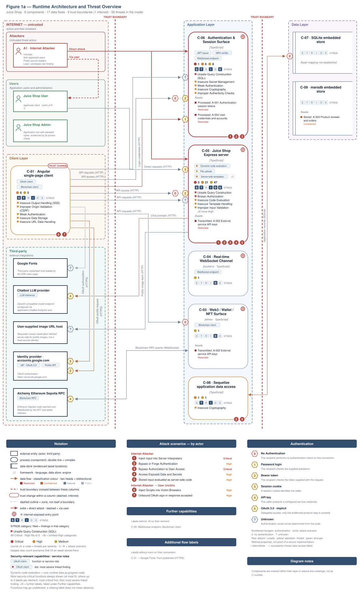</picture>

**Build pipeline**, not drawn in this runtime view: GitHub Actions, GitLab CI. ⑧ A2 · Supply-Chain / Build Attacker → [Figure 1b](#figure-1b).

Role access and finding assignments are listed in [Identified Actors](#identified-actors).

**Actor grouping.** Regular self-registered users are grouped with anonymous internet attackers because registration is open. Repository readers are grouped with anonymous internet attackers because the source repository is public. Each finding retains its login and privilege requirements.

<a id="figure-1b"></a>

**Figure 1b - Supply Chain and Build**

Juice Shop builds in GitHub Actions, GitLab CI. Figure 1b shows the inputs, build systems and release artifacts the repository evidences, with 7 findings attached to them. The highlighted path follows 🟡 [F-055](#f-055) — Untrusted npm Install/Postinstall Scripts Enabled as far as the repository evidences it. The control assessment is in [§6.11](#611-operations-runtime-and-supply-chain-controls).

<picture><source media="(prefers-color-scheme: dark)" srcset="security-assessment-juice-shop-standard-v0.1.0.figure1b-dark.svg">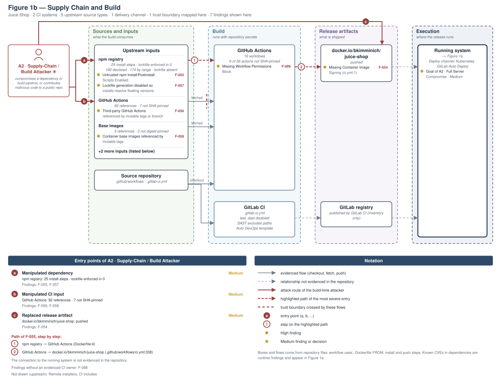</picture>

**Figure 2 - Attack Routes and Impact**

Each numbered route names one example finding from the corresponding Top Threats group with its access prerequisite, the register weakness it is linked to, and the group's potential business harm, which depends on deployment and affected assets. W-IDs in parentheses link the example to an existing weakness. The attack step, affected component and technical consequence are listed in the findings register. Red arrows indicate attacks; dashed red arrows involve a victim; grey arrows lead to potential harm.

<picture><source media="(prefers-color-scheme: dark)" srcset="security-assessment-juice-shop-standard-v0.1.0.figure2-dark.svg">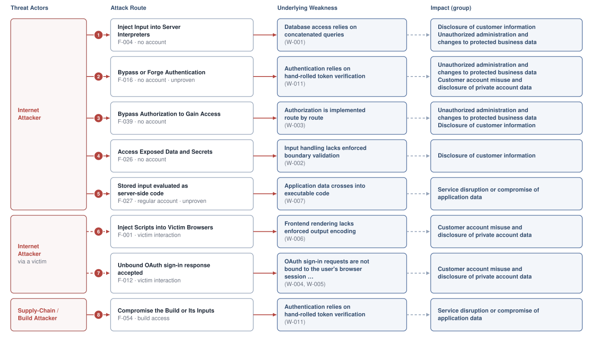</picture>

**Threat actors.** The actors below drive the numbered attack paths in the figures above. The **Juice Shop User** is the *victim* of client-side attacks (XSS / CSRF), not an attacker. Figure 2 marks victim interaction on the applicable attack routes.

- **Juice Shop User** — legitimate end user; target of client-side attacks; target of ⑥ Output Encoding / Cross-Site Scripting, ⑦ CSRF / Permissive CORS.
- **Internet Attacker** — can self-register a regular account; drives ① Insecure Query Construction & Data Access, ② Hardcoded Secrets & Weak Cryptography, ③ Broken Authorization & Access Control, ④ Sensitive File & Secret Exposure, ⑤ Remote Code Execution (unsafe eval).
- **Supply-Chain / Build Attacker** — compromises a dependency or build pipeline, or contributes malicious code to a public repo; drives ⑧ Build Pipeline & Dependency Integrity.

**8 structural threats**, grouped by weakness class - each row is one threat, not one finding. *Threat Description* states the general architectural weakness (STRIDE in brackets); *Findings* lists the concrete instances, each linked to [§8 Findings Register](#8-findings-register) with its component; *Risk & Impact* combines severity with business consequence.

| # | Threat Description | Findings (→ Component) | Risk & Impact | Fix |
|---|------------------------------------|------------------------------------------------|------------------------------------|--------|
| <a id="path-injection"></a>① | **Insecure Query Construction & Data Access** _(T·I)_<br/>Unsanitised request input reaches database queries, XML parsers and document-store filters, letting callers change query logic or read protected data. | <span style="white-space:nowrap">🔴&nbsp;[F-004](#f-004)</span> - SQL injection in login query enabling authentication bypass <span style="white-space:nowrap">→&nbsp;[C-05](#c-05)</span>&nbsp;Juice Shop Express server<br/><span style="white-space:nowrap">🔴&nbsp;[F-005](#f-005)</span> - SQL injection in product search query <span style="white-space:nowrap">→&nbsp;[C-05](#c-05)</span>&nbsp;Juice Shop Express server<br/><span style="white-space:nowrap">🟠&nbsp;[F-030](#f-030)</span> - NoSQL JavaScript injection <span style="white-space:nowrap">→&nbsp;[C-05](#c-05)</span>&nbsp;Juice Shop Express server<br/><span style="white-space:nowrap">🟠&nbsp;[F-033](#f-033)</span> - XML parser resolves external entities <span style="white-space:nowrap">→&nbsp;[C-05](#c-05)</span>&nbsp;Juice Shop Express server<br/><span style="white-space:nowrap">🟠&nbsp;[F-034](#f-034)</span> - XXE <span style="white-space:nowrap">→&nbsp;[C-05](#c-05)</span>&nbsp;Juice Shop Express server<br/><span style="white-space:nowrap">🟠&nbsp;[F-031](#f-031)</span> - Stored username compiled into Pug template source <span style="white-space:nowrap">→&nbsp;[C-05](#c-05)</span>&nbsp;Juice Shop Express server<br/><span style="white-space:nowrap">🟡&nbsp;[F-067](#f-067)</span> - NoSQL where-clause string built from product <span style="white-space:nowrap">→&nbsp;[C-05](#c-05)</span>&nbsp;Juice Shop Express server<br/><span style="white-space:nowrap">🟡&nbsp;[F-068](#f-068)</span> - NoSQL operator injection in review update <span style="white-space:nowrap">→&nbsp;[C-05](#c-05)</span>&nbsp;Juice Shop Express server | 🔴 **Critical**<br/>Customer Data Exfiltration · Full Admin Takeover | <span style="white-space:nowrap">● [M-031](#m-031)</span> — Use parameterized queries<br/><span style="white-space:nowrap">● [M-032](#m-032)</span> — Use parameterized database queries (F-005) |
| <a id="path-auth-bypass"></a>② | **Hardcoded Secrets & Weak Cryptography** _(S·E)_<br/>Weak or exposed credential material and token checks allow attackers to impersonate users without knowing their passwords. | <span style="white-space:nowrap">🟠&nbsp;[F-016](#f-016)</span> - JWT verification without pinned algorithm <span style="white-space:nowrap">→&nbsp;[C-05](#c-05)</span>&nbsp;Juice Shop Express server<br/><span style="white-space:nowrap">🟠&nbsp;[F-018](#f-018)</span> - Non-cryptographic RNG for a <span style="white-space:nowrap">→&nbsp;[C-06](#c-06)</span>&nbsp;Authentication & Session Surface<br/><span style="white-space:nowrap">🟠&nbsp;[F-023](#f-023)</span> - Hardcoded JWT signing private key in source <span style="white-space:nowrap">→&nbsp;[C-06](#c-06)</span>&nbsp;Authentication & Session Surface<br/><span style="white-space:nowrap">🟠&nbsp;[F-035](#f-035)</span> - Passwords hashed with unsalted fast `MD5` <span style="white-space:nowrap">→&nbsp;[C-05](#c-05)</span>&nbsp;Juice Shop Express server<br/><span style="white-space:nowrap">🟠&nbsp;[F-037](#f-037)</span> - Unsalted `MD5` password hashing <span style="white-space:nowrap">→&nbsp;[C-06](#c-06)</span>&nbsp;Authentication & Session Surface<br/><span style="white-space:nowrap">🟡&nbsp;[F-046](#f-046)</span> - Chat identity taken from unverified JWT decode <span style="white-space:nowrap">→&nbsp;[C-05](#c-05)</span>&nbsp;Juice Shop Express server<br/><span style="white-space:nowrap">🟡&nbsp;[F-048](#f-048)</span> - Token verify helper does not pin an algorithm <span style="white-space:nowrap">→&nbsp;[C-06](#c-06)</span>&nbsp;Authentication & Session Surface<br/><span style="white-space:nowrap">🟡&nbsp;[F-070](#f-070)</span> - Hardcoded HMAC key for security answers <span style="white-space:nowrap">→&nbsp;[C-06](#c-06)</span>&nbsp;Authentication & Session Surface | 🟠 **High**<br/>Full Admin Takeover · Customer Session Hijack | <span style="white-space:nowrap">◕ [M-037](#m-037)</span> — Enforce JWT signature and algorithm verification (F-016)<br/><span style="white-space:nowrap">◕ [M-039](#m-039)</span> — Use cryptographically secure random values |
| <a id="path-privilege-escalation"></a>③ | **Broken Authorization & Access Control** _(E·I)_<br/>Missing ownership, role and allow-list checks let callers act on other users' records or grant themselves higher privileges. | <span style="white-space:nowrap">🟠&nbsp;[F-002](#f-002)</span> - Basket IDOR: missing ownership checks on basket routes <span style="white-space:nowrap">→&nbsp;[C-05](#c-05)</span>&nbsp;Juice Shop Express server<br/><span style="white-space:nowrap">🔴&nbsp;[F-011](#f-011)</span> - Checkout trusts client-supplied UserId for wallet changes <span style="white-space:nowrap">→&nbsp;[C-05](#c-05)</span>&nbsp;Juice Shop Express server<br/><span style="white-space:nowrap">🟠&nbsp;[F-028](#f-028)</span> - Basket item update does not check item owner <span style="white-space:nowrap">→&nbsp;[C-05](#c-05)</span>&nbsp;Juice Shop Express server<br/><span style="white-space:nowrap">🟠&nbsp;[F-039](#f-039)</span> - Key and log file servers lack any authentication or role check <span style="white-space:nowrap">→&nbsp;[C-05](#c-05)</span>&nbsp;Juice Shop Express server<br/><span style="white-space:nowrap">🟠&nbsp;[F-043](#f-043)</span> - Unauthenticated update of products <span style="white-space:nowrap">→&nbsp;[C-05](#c-05)</span>&nbsp;Juice Shop Express server<br/><span style="white-space:nowrap">🟠&nbsp;[F-044](#f-044)</span> - User registration does not block a privileged role in the body <span style="white-space:nowrap">→&nbsp;[C-05](#c-05)</span>&nbsp;Juice Shop Express server<br/><span style="white-space:nowrap">🟠&nbsp;[F-045](#f-045)</span> - Registration accepts a role from the request body <span style="white-space:nowrap">→&nbsp;[C-05](#c-05)</span>&nbsp;Juice Shop Express server<br/><span style="white-space:nowrap">🟠&nbsp;[F-017](#f-017)</span> - Password change skips current password check <span style="white-space:nowrap">→&nbsp;[C-05](#c-05)</span>&nbsp;Juice Shop Express server<br/><span style="white-space:nowrap">🟠&nbsp;[F-040](#f-040)</span> - Sensitive routes registered without authentication middleware <span style="white-space:nowrap">→&nbsp;[C-05](#c-05)</span>&nbsp;Juice Shop Express server<br/><span style="white-space:nowrap">🟠&nbsp;[F-041](#f-041)</span> - Sensitive Routes Registered Without Authentication Middleware <span style="white-space:nowrap">→&nbsp;[C-05](#c-05)</span>&nbsp;Juice Shop Express server<br/><span style="white-space:nowrap">🟡&nbsp;[F-061](#f-061)</span> - Review update lacks author ownership check <span style="white-space:nowrap">→&nbsp;[C-05](#c-05)</span>&nbsp;Juice Shop Express server<br/><span style="white-space:nowrap">🟡&nbsp;[F-062](#f-062)</span> - Hint update endpoint lacks authentication and field limits <span style="white-space:nowrap">→&nbsp;[C-05](#c-05)</span>&nbsp;Juice Shop Express server<br/><span style="white-space:nowrap">🟡&nbsp;[F-063](#f-063)</span> - Basket item update accepts arbitrary body fields <span style="white-space:nowrap">→&nbsp;[C-05](#c-05)</span>&nbsp;Juice Shop Express server<br/><span style="white-space:nowrap">🟡&nbsp;[F-064](#f-064)</span> - Product review author is set <span style="white-space:nowrap">→&nbsp;[C-05](#c-05)</span>&nbsp;Juice Shop Express server<br/><span style="white-space:nowrap">🟡&nbsp;[F-065](#f-065)</span> - Wallet top-up amount is taken from the request body <span style="white-space:nowrap">→&nbsp;[C-05](#c-05)</span>&nbsp;Juice Shop Express server<br/><span style="white-space:nowrap">🟡&nbsp;[F-066](#f-066)</span> - Security answer creation accepts UserId from request body <span style="white-space:nowrap">→&nbsp;[C-05](#c-05)</span>&nbsp;Juice Shop Express server<br/><span style="white-space:nowrap">🟡&nbsp;[F-090](#f-090)</span> - Deluxe upgrade succeeds without a payment <span style="white-space:nowrap">→&nbsp;[C-05](#c-05)</span>&nbsp;Juice Shop Express server<br/><span style="white-space:nowrap">🟡&nbsp;[F-092](#f-092)</span> - Basket read lacks ownership check <span style="white-space:nowrap">→&nbsp;[C-05](#c-05)</span>&nbsp;Juice Shop Express server<br/><span style="white-space:nowrap">🟡&nbsp;[F-093](#f-093)</span> - Basket ownership check bypass <span style="white-space:nowrap">→&nbsp;[C-05](#c-05)</span>&nbsp;Juice Shop Express server<br/><span style="white-space:nowrap">🟡&nbsp;[F-094](#f-094)</span> - Chat order lookup binds ownership to masked email <span style="white-space:nowrap">→&nbsp;[C-05](#c-05)</span>&nbsp;Juice Shop Express server<br/><span style="white-space:nowrap">🟡&nbsp;[F-095](#f-095)</span> - Data export matches orders by masked email <span style="white-space:nowrap">→&nbsp;[C-05](#c-05)</span>&nbsp;Juice Shop Express server<br/><span style="white-space:nowrap">🟡&nbsp;[F-096](#f-096)</span> - Basket checkout lacks ownership check on basket id <span style="white-space:nowrap">→&nbsp;[C-05](#c-05)</span>&nbsp;Juice Shop Express server<br/><span style="white-space:nowrap">🟡&nbsp;[F-097](#f-097)</span> - Recycle records readable by any caller by id <span style="white-space:nowrap">→&nbsp;[C-05](#c-05)</span>&nbsp;Juice Shop Express server<br/><span style="white-space:nowrap">🟡&nbsp;[F-098](#f-098)</span> - Any authenticated user can read other users by id <span style="white-space:nowrap">→&nbsp;[C-05](#c-05)</span>&nbsp;Juice Shop Express server<br/><span style="white-space:nowrap">🟡&nbsp;[F-099](#f-099)</span> - Basket items readable and deletable by any authenticated user <span style="white-space:nowrap">→&nbsp;[C-05](#c-05)</span>&nbsp;Juice Shop Express server<br/><span style="white-space:nowrap">🟡&nbsp;[F-100](#f-100)</span> - Checkout does not bind basket to caller <span style="white-space:nowrap">→&nbsp;[C-05](#c-05)</span>&nbsp;Juice Shop Express server<br/><span style="white-space:nowrap">🟡&nbsp;[F-101](#f-101)</span> - Coupon application does not bind basket to caller <span style="white-space:nowrap">→&nbsp;[C-05](#c-05)</span>&nbsp;Juice Shop Express server<br/><span style="white-space:nowrap">🟡&nbsp;[F-102](#f-102)</span> - Order tracking returns any order by identifier <span style="white-space:nowrap">→&nbsp;[C-05](#c-05)</span>&nbsp;Juice Shop Express server<br/><span style="white-space:nowrap">🟡&nbsp;[F-104](#f-104)</span> - User list readable by any authenticated user <span style="white-space:nowrap">→&nbsp;[C-05](#c-05)</span>&nbsp;Juice Shop Express server<br/><span style="white-space:nowrap">🟡&nbsp;[F-105](#f-105)</span> - Any logged-in user can create products without a role check <span style="white-space:nowrap">→&nbsp;[C-05](#c-05)</span>&nbsp;Juice Shop Express server<br/><span style="white-space:nowrap">🟡&nbsp;[F-106](#f-106)</span> - Complaint list readable by any authenticated user <span style="white-space:nowrap">→&nbsp;[C-05](#c-05)</span>&nbsp;Juice Shop Express server<br/><span style="white-space:nowrap">🟡&nbsp;[F-107](#f-107)</span> - Any authenticated user can delete any feedback <span style="white-space:nowrap">→&nbsp;[C-05](#c-05)</span>&nbsp;Juice Shop Express server<br/><span style="white-space:nowrap">🟡&nbsp;[F-108](#f-108)</span> - Admin configuration and version routes lack authorization <span style="white-space:nowrap">→&nbsp;[C-05](#c-05)</span>&nbsp;Juice Shop Express server<br/><span style="white-space:nowrap">🟡&nbsp;[F-109](#f-109)</span> - Metrics endpoint exposed without authorization <span style="white-space:nowrap">→&nbsp;[C-05](#c-05)</span>&nbsp;Juice Shop Express server<br/><span style="white-space:nowrap">🟡&nbsp;[F-110](#f-110)</span> - Uncapped model-directed coupon generation in chat tool <span style="white-space:nowrap">→&nbsp;[C-05](#c-05)</span>&nbsp;Juice Shop Express server<br/><span style="white-space:nowrap">🟡&nbsp;[F-111](#f-111)</span> - Any authenticated user can list all user <span style="white-space:nowrap">→&nbsp;[C-06](#c-06)</span>&nbsp;Authentication & Session Surface<br/><span style="white-space:nowrap">🟡&nbsp;[F-113](#f-113)</span> - Address update by id lacks ownership check <span style="white-space:nowrap">→&nbsp;[C-05](#c-05)</span>&nbsp;Juice Shop Express server<br/><span style="white-space:nowrap">🟡&nbsp;[F-114](#f-114)</span> - User listing endpoint lacks role check <span style="white-space:nowrap">→&nbsp;[C-05](#c-05)</span>&nbsp;Juice Shop Express server | 🔴 **Critical**<br/>Full Admin Takeover · Customer Data Exfiltration | <span style="white-space:nowrap">● [M-033](#m-033)</span> — Enforce object-level (ownership) authorization (F-011)<br/><span style="white-space:nowrap">◕ [M-029](#m-029)</span> — Bind basket lookups to the authenticated user |
| <a id="path-sensitive-data-exposure"></a>④ | **Sensitive File & Secret Exposure** _(I)_<br/>Publicly served directories, path traversal and server-side requests expose files and internal resources that should stay private. | <span style="white-space:nowrap">🟠&nbsp;[F-025](#f-025)</span> - Attacker-controlled layout template path in data <span style="white-space:nowrap">→&nbsp;[C-05](#c-05)</span>&nbsp;Juice Shop Express server<br/><span style="white-space:nowrap">🟠&nbsp;[F-026](#f-026)</span> - Zip entry path traversal in complaint upload writes <span style="white-space:nowrap">→&nbsp;[C-05](#c-05)</span>&nbsp;Juice Shop Express server<br/><span style="white-space:nowrap">🟠&nbsp;[F-032](#f-032)</span> - Encryption keys directory is listed and served publicly <span style="white-space:nowrap">→&nbsp;[C-05](#c-05)</span>&nbsp;Juice Shop Express server<br/><span style="white-space:nowrap">🟠&nbsp;[F-036](#f-036)</span> - Server-side request forgery <span style="white-space:nowrap">→&nbsp;[C-05](#c-05)</span>&nbsp;Juice Shop Express server<br/><span style="white-space:nowrap">🟡&nbsp;[F-073](#f-073)</span> - FTP file allow-list bypass <span style="white-space:nowrap">→&nbsp;[C-05](#c-05)</span>&nbsp;Juice Shop Express server<br/><span style="white-space:nowrap">🟡&nbsp;[F-074](#f-074)</span> - Arbitrary field selection and JSONP in whoami <span style="white-space:nowrap">→&nbsp;[C-05](#c-05)</span>&nbsp;Juice Shop Express server<br/><span style="white-space:nowrap">🟡&nbsp;[F-075](#f-075)</span> - CAPTCHA answer returned to client <span style="white-space:nowrap">→&nbsp;[C-05](#c-05)</span>&nbsp;Juice Shop Express server<br/><span style="white-space:nowrap">🟡&nbsp;[F-076](#f-076)</span> - Prometheus metrics endpoint unauthenticated <span style="white-space:nowrap">→&nbsp;[C-05](#c-05)</span>&nbsp;Juice Shop Express server<br/><span style="white-space:nowrap">🟡&nbsp;[F-078](#f-078)</span> - Access logs exposed without authentication <span style="white-space:nowrap">→&nbsp;[C-05](#c-05)</span>&nbsp;Juice Shop Express server<br/><span style="white-space:nowrap">🟡&nbsp;[F-079](#f-079)</span> - Access log directory is listed and served publicly <span style="white-space:nowrap">→&nbsp;[C-05](#c-05)</span>&nbsp;Juice Shop Express server<br/><span style="white-space:nowrap">🟡&nbsp;[F-080](#f-080)</span> - Encryption keys served without authentication <span style="white-space:nowrap">→&nbsp;[C-05](#c-05)</span>&nbsp;Juice Shop Express server | 🟠 **High**<br/>Customer Data Exfiltration | <span style="white-space:nowrap">◕ [M-044](#m-044)</span> — Constrain file paths to a safe base directory (F-025)<br/><span style="white-space:nowrap">◕ [M-045](#m-045)</span> — Confine zip entries to the upload directory |
| <a id="path-remote-code-execution"></a>⑤ | **Remote Code Execution (unsafe eval)** _(E)_<br/>User-controlled values are evaluated as code on the server, giving authenticated callers a route to run their own commands. | <span style="white-space:nowrap">🟠&nbsp;[F-027](#f-027)</span> - Server-side eval of stored username on profile page <span style="white-space:nowrap">→&nbsp;[C-05](#c-05)</span>&nbsp;Juice Shop Express server<br/><span style="white-space:nowrap">🟠&nbsp;[F-038](#f-038)</span> - Untrusted B2B `orderLinesData` evaluated <span style="white-space:nowrap">→&nbsp;[C-05](#c-05)</span>&nbsp;Juice Shop Express server | 🟠 **High**<br/>Full Server Compromise | <span style="white-space:nowrap">◕ [M-046](#m-046)</span> — Remove eval of username and escape output<br/><span style="white-space:nowrap">◕ [M-056](#m-056)</span> — Replace expression evaluation with JSON parsing |
| <a id="path-cross-site-scripting"></a>⑥ | **Output Encoding / Cross-Site Scripting** _(T·I)_<br/>Unencoded content rendered in the browser lets attacker script run in a victim's session and reach the stored login token. | <span style="white-space:nowrap">🟠&nbsp;[F-001](#f-001)</span> - Angular trusted-HTML sanitizer bypass causing XSS <span style="white-space:nowrap">→&nbsp;[C-01](#c-01)</span>&nbsp;Angular single-page client<br/><span style="white-space:nowrap">🟠&nbsp;[F-003](#f-003)</span> - Auth Token Stored in Browser Storage <span style="white-space:nowrap">→&nbsp;[C-01](#c-01)</span>&nbsp;Angular single-page client<br/><span style="white-space:nowrap">🟠&nbsp;[F-024](#f-024)</span> - Reflected DOM XSS from search query parameter <span style="white-space:nowrap">→&nbsp;[C-01](#c-01)</span>&nbsp;Angular single-page client<br/><span style="white-space:nowrap">🟡&nbsp;[F-050](#f-050)</span> - Unsanitized HTML written to new window <span style="white-space:nowrap">→&nbsp;[C-01](#c-01)</span>&nbsp;Angular single-page client<br/><span style="white-space:nowrap">🟡&nbsp;[F-051](#f-051)</span> - DOM XSS from JWT `lastLoginIp` claim rendered <span style="white-space:nowrap">→&nbsp;[C-01](#c-01)</span>&nbsp;Angular single-page client<br/><span style="white-space:nowrap">🟡&nbsp;[F-052](#f-052)</span> - Product descriptions marked trusted HTML <span style="white-space:nowrap">→&nbsp;[C-01](#c-01)</span>&nbsp;Angular single-page client<br/><span style="white-space:nowrap">🟡&nbsp;[F-053](#f-053)</span> - Order ID wrapped as trusted HTML in track <span style="white-space:nowrap">→&nbsp;[C-01](#c-01)</span>&nbsp;Angular single-page client<br/><span style="white-space:nowrap">🟡&nbsp;[F-071](#f-071)</span> - Product description stored without sanitization <span style="white-space:nowrap">→&nbsp;[C-08](#c-08)</span>&nbsp;Sequelize application data access | 🟠 **High**<br/>Customer Session Hijack | <span style="white-space:nowrap">◕ [M-028](#m-028)</span> — Remove sanitizer bypass and render query as text<br/><span style="white-space:nowrap">◕ [M-030](#m-030)</span> — Store session tokens in HttpOnly, Secure cookies |
| <a id="path-cross-site-request-forgery"></a>⑦ | **CSRF / Permissive CORS** _(S·T)_<br/>The sign-in flow does not bind responses to the user's own request, so attacker-supplied tokens can be injected into a victim's session. | <span style="white-space:nowrap">🟠&nbsp;[F-012](#f-012)</span> - OAuth implicit flow without state, nonce or PKCE <span style="white-space:nowrap">→&nbsp;[C-01](#c-01)</span>&nbsp;Angular single-page client | 🟠 **High**<br/>Customer Session Hijack | <span style="white-space:nowrap">◕ [M-034](#m-034)</span> — Add anti-CSRF protection to state-changing requests |
| <a id="path-supply-chain"></a>⑧ | **Build Pipeline & Dependency Integrity** _(T·E)_<br/>Third-party build actions referenced by movable tags can be changed upstream to run attacker code inside the pipeline.<br/>Path through the build: [Figure 1b](#figure-1b) · controls: [§6.11](#611-operations-runtime-and-supply-chain-controls) | <span style="white-space:nowrap">🟡&nbsp;[F-056](#f-056)</span> - Third-party GitHub Actions referenced by mutable tags or branch <span style="white-space:nowrap">→&nbsp;[C-02](#c-02)</span>&nbsp;CI/CD Pipeline<br/><span style="white-space:nowrap">🟡&nbsp;[F-054](#f-054)</span> - Missing Container Image Signing <span style="white-space:nowrap">→&nbsp;[C-02](#c-02)</span>&nbsp;CI/CD Pipeline<br/><span style="white-space:nowrap">🟡&nbsp;[F-055](#f-055)</span> - Untrusted npm Install/Postinstall Scripts Enabled <span style="white-space:nowrap">→&nbsp;[C-02](#c-02)</span>&nbsp;CI/CD Pipeline<br/><span style="white-space:nowrap">🟡&nbsp;[F-057](#f-057)</span> - Lockfile generation disabled so installs resolve floating versions <span style="white-space:nowrap">→&nbsp;[C-02](#c-02)</span>&nbsp;CI/CD Pipeline<br/><span style="white-space:nowrap">🟡&nbsp;[F-058](#f-058)</span> - Container base images referenced by mutable tags <span style="white-space:nowrap">→&nbsp;[C-02](#c-02)</span>&nbsp;CI/CD Pipeline<br/><span style="white-space:nowrap">🟡&nbsp;[F-088](#f-088)</span> - Container Runs as Root <span style="white-space:nowrap">→&nbsp;[C-02](#c-02)</span>&nbsp;CI/CD Pipeline<br/><span style="white-space:nowrap">🟡&nbsp;[F-089](#f-089)</span> - Missing Workflow Permissions Block <span style="white-space:nowrap">→&nbsp;[C-02](#c-02)</span>&nbsp;CI/CD Pipeline | 🟡 **Medium**<br/>Full Server Compromise | <span style="white-space:nowrap">◑ [M-024](#m-024)</span> — Pin third-party dependencies to immutable versions<br/><span style="white-space:nowrap">◑ [M-022](#m-022)</span> — Sign and verify release artifacts |

_STRIDE: S spoofing · T tampering · R repudiation · I information disclosure · D denial of service · E elevation of privilege. Risk, findings, components, impact and Fix are derived deterministically; only the one-line weakness description is authored._

**Verified attack chains.** 6 fully viable ([AC-T-005](#ac-t-005), [AC-B-007](#ac-b-007), [AC-T-004](#ac-t-004), [AC-T-006](#ac-t-006), [AC-B-005](#ac-b-005), [AC-T-007](#ac-t-007)); 1 partially blocked ([AC-T-002](#ac-t-002)). These chains combine individual findings into end-to-end exploitation paths verified step-by-step against the code - see [§9 Abuse Cases](#9-abuse-cases) for the per-step breakdown and blocking mitigations.

### AI / LLM Exposure

This system embeds an LLM/AI surface (an LLM/AI integration); the risks below are architectural - they follow from how untrusted input reaches the model's prompt, tools, and outputs. See **[§6 Security Architecture](#6-security-architecture)** for the per-control detail.


- **[ASI03](https://genai.owasp.org/resource/owasp-top-10-for-agentic-applications-for-2026/) Agent Identity & Privilege Abuse** — The agent can act with an over-broad or inherited identity instead of scoped delegation. _([C-05](#c-05) — Juice Shop Express server)_
  - ↳ 🟡 [F-046](#f-046) — Chat identity taken from unverified JWT decode

- **[LLM01](https://genai.owasp.org/llmrisk/llm01/) Prompt Injection** — Untrusted user input reaches the LLM prompt/context without sufficient trust separation, letting an attacker override system instructions, redirect tool calls, or coerce unintended model behaviour. _([C-05](#c-05) — Juice Shop Express server)_
  - ↳ 🟡 [F-069](#f-069) — Client-supplied chat messages passed to model unvalidated _([ASI01](https://genai.owasp.org/resource/owasp-top-10-for-agentic-applications-for-2026/))_
  - ↳ 🟡 [F-110](#f-110) — Uncapped model-directed coupon generation in chat tool _([ASI02](https://genai.owasp.org/resource/owasp-top-10-for-agentic-applications-for-2026/))_

- **[LLM06](https://genai.owasp.org/llmrisk/llm06/) Excessive Agency** — The LLM is granted tool/function-calling authority without a secondary authorization boundary, so a manipulated model turn can invoke privileged actions on the user's behalf. _([C-05](#c-05) — Juice Shop Express server)_
  - ↳ 🟡 [F-110](#f-110) — Uncapped model-directed coupon generation in chat tool _([ASI02](https://genai.owasp.org/resource/owasp-top-10-for-agentic-applications-for-2026/))_

- **[LLM10](https://genai.owasp.org/llmrisk/llm10/) Unbounded Consumption** — The LLM endpoint imposes no authentication, rate, or quota boundary, so any client can drive unbounded model invocations — uncontrolled provider cost and denial of service for legitimate users. _([C-05](#c-05) — Juice Shop Express server)_
  - ↳ 🟡 [F-086](#f-086) — Unbounded LLM consumption on unauthenticated chat

### Operational Strengths

Operational controls rated Adequate or Partial - grouped into broad clusters (full per-control breakdown in [§6](#6-security-architecture)). Clusters demoted to Weak by open Critical/High findings appear in [§6](#6-security-architecture) instead, not here.

<table style="table-layout:fixed;width:100%">
<colgroup><col width="20%" style="width:20%"><col width="33%" style="width:33%"><col width="47%" style="width:47%"></colgroup>
<thead><tr><th>Strength</th><th>What's in Place</th><th>Effectiveness</th></tr></thead>
<tbody>
<tr><td style="overflow-wrap:break-word"><strong>Container &amp; Supply-Chain Hardening</strong></td><td style="overflow-wrap:break-word"><em>Build-time and runtime hardening - minimal base image, non-root execution, dependency inventory.</em><br/>Container image hardening<br/>Dependency lockfile and install reproducibility</td><td style="overflow-wrap:break-word">✅ Adequate</td></tr>
<tr><td style="overflow-wrap:break-word"><strong>Hardened HTTP Stack</strong></td><td style="overflow-wrap:break-word"><em>Browser-facing HTTP hardening - security headers, cookie flags, cross-origin policy, and abuse-protection limits.</em><br/>WebSocket connection origin restriction (CORS)<br/>Rate limiting</td><td style="overflow-wrap:break-word">⚠️ Partial - Bypassed by 1 High finding(s) of the kind this cluster is supposed to prevent - e.g.<br/>🟠 <a href="#f-012">F-012</a> — OAuth implicit flow without state, nonce or PKCE.</td></tr>
</tbody>
</table>


**Bottom line:** These controls narrow specific attack surfaces but none eliminates a Critical finding on its own.

---

<a id="critical-attack-chain"></a><a id="critical-attack-tree"></a><a id="critical-findings-by-root-cause"></a>
## Critical Findings by Root Cause

3 of 3 Critical findings trace back to 2 root causes; fixing a root cause addresses every finding linked to it.

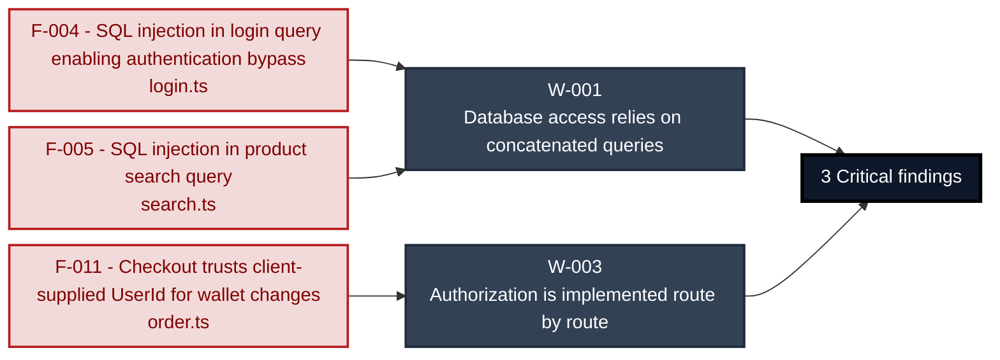

**Structural fixes** (full detail in [§7 Weakness Register](#7-weakness-register)):

- **[W-001](#w-001)** — Provide one parameterised repository or query-builder path and prohibit application-value interpolation in database queries _(closes [F-004](#f-004), [F-005](#f-005))_
- **[W-003](#w-003)** — Enforce authorization through a shared server-side policy layer and make ownership and tenant scope mandatory inputs to data access _(closes [F-011](#f-011))_

---

## 1. System Overview

Probably the most modern and sophisticated insecure web application

**Repository:** `https://github.com/juice-shop/juice-shop.git`
**Runtime:** Node\.js 22 - 26

### Scope

This threat model covers 9 components of juice-shop3: 

- Angular single-page client
- CI/CD Pipeline
- Web3 / Wallet / NFT Surface
- Real-time WebSocket Channel
- Juice Shop Express server
- Authentication & Session Surface
- SQLite embedded store
- Sequelize application data access
- marsdb embedded store

**Not individually examined:** 125 source files in 4 components had no route, lead or security signal (Angular single-page client 109, CI/CD Pipeline 4, Sequelize application data access 11, marsdb embedded store 1).

**Not assessed:** 2 security-relevant code locations were read but could not be judged (Angular single-page client 1, Authentication & Session Surface 1); `security-assessment.yaml` records each with its reason under `meta.undecided_targets`.

**Not assigned to any component:** 134 program files belong to no component and were not analysed (`data/` 97, `lib/` 21, `frontend/` 5, `(repository root)` 4, `rsn/` 4, `models/` 1, `routes/` 1, `views/` 1).

**Out of scope:** third-party hosted dependencies, browser runtime, operating-system kernel, and the underlying network infrastructure.

**Basis:** An automated, AI-assisted threat model built from the repository's source code and configuration - static analysis only, no dynamic or penetration testing. It describes the system as built, not as designed.

---

<a id="identified-actors"></a>
### Identified Actors

Figure 1a draws **Internet Attacker** as attacker and **Juice Shop User** and **Juice Shop Admin** as legitimate roles of Juice Shop. [Figure 1b](#figure-1b) draws **Supply-Chain / Build Attacker** and the build it attacks. Each row gives that actor's access and the findings attributed to it.

| Actor | Type | Access | Scenarios | Attributed findings |
|----------------------|---------------|----------------------|--------------|-------------------|
| A1 · Internet Attacker | Attacker | can self-register a regular account | ① ② ③ ④ ⑤ ⑥ ⑦ | 🔴 1 · 🟠 6 · 🟡 12 |
| A2 · Supply-Chain / Build Attacker | Attacker | compromises a dependency or build pipeline, or contributes malicious code to a public repo · [Figure 1b](#figure-1b) | ⑧ | 🟡 7 |
| Juice Shop User | Role (victim) | legitimate client | ⑥ ⑦ | - |
| Juice Shop Admin | Privileged role | Application role with elevated rights,<br/>evidenced by its access check. | - | - |

78 findings are not represented in the actor counts (2 Critical, 26 High, 50 Medium). These counts cover assigned findings only; absence from them does not establish inaccessibility.

---

### Trust Boundaries

Each row names a crossing and the condition it relies on. A modelled crossing does not prove that its control works.

<table style="table-layout:fixed;width:100%">
<colgroup><col width="7%" style="width:7%"><col width="25%" style="width:25%"><col width="36%" style="width:36%"><col width="32%" style="width:32%"></colgroup>
<thead><tr><th>ID</th><th>Crossing</th><th>Required condition</th><th>Findings / open question</th></tr></thead>
<tbody>
<tr><td style="white-space:nowrap"><a id="tb-1"></a>tb-1</td><td style="overflow-wrap:break-word">external → CI/CD Pipeline</td><td style="overflow-wrap:break-word">Every third-party workflow action is pinned to an immutable commit SHA.<br/>Control: SHA-pinned action references</td><td style="overflow-wrap:break-word">Gap evidenced: <em>Validation</em><br/>🟡 <a href="#f-056">F-056</a></td></tr>
<tr><td style="white-space:nowrap"><a id="tb-2"></a>tb-2</td><td style="overflow-wrap:break-word">external → Real-time WebSocket Channel</td><td style="overflow-wrap:break-word">Every socket event payload is validated before it influences server state.<br/>Control: Socket.IO server CORS origin setting</td><td style="overflow-wrap:break-word">1 related finding; relevance to this crossing remains unverified.</td></tr>
<tr><td style="white-space:nowrap"><a id="tb-3"></a>tb-3</td><td style="overflow-wrap:break-word">external → Juice Shop Express server</td><td style="overflow-wrap:break-word">Every state-changing or user-specific API route is registered behind <code>security.isAuthorized()</code> before its handler runs.<br/>Control: <code>security.isAuthorized()</code> route middleware</td><td style="overflow-wrap:break-word">70 related findings; relevance to this crossing remains unverified.</td></tr>
<tr><td style="white-space:nowrap"><a id="tb-4"></a>tb-4</td><td style="overflow-wrap:break-word">external → Authentication &amp;amp; Session Surface</td><td style="overflow-wrap:break-word">Every user-scoped route is registered behind <code>security.isAuthorized()</code>.<br/>Control: <code>security.isAuthorized()</code> <code>expressJwt</code> middleware</td><td style="overflow-wrap:break-word">13 related findings; relevance to this crossing remains unverified.</td></tr>
<tr><td style="white-space:nowrap"><a id="tb-5"></a>tb-5</td><td style="overflow-wrap:break-word">external → Web3 / Wallet / NFT Surface<br/>Crossing: inferred</td><td style="overflow-wrap:break-word">Every Web3 route that reads or changes challenge state authenticates its caller before responding.<br/>Control: not identified</td><td style="overflow-wrap:break-word">1 related finding; relevance to this crossing remains unverified.</td></tr>
<tr><td style="white-space:nowrap"><a id="tb-6"></a>tb-6</td><td style="overflow-wrap:break-word">Sequelize application data access → SQLite embedded store</td><td style="overflow-wrap:break-word">Every query reaches SQLite through Sequelize parameter binding.<br/>Control: Sequelize parameter binding</td><td style="overflow-wrap:break-word">No linked finding establishes a gap; control effectiveness is not established.</td></tr>
<tr><td style="white-space:nowrap"><a id="tb-7"></a>tb-7</td><td style="overflow-wrap:break-word">Juice Shop Express server → external</td><td style="overflow-wrap:break-word">Server-side fetches reach only destinations a user is permitted to target.<br/>Control: not identified</td><td style="overflow-wrap:break-word">Gap evidenced: <em>Egress destination</em><br/>🟠 <a href="#f-036">F-036</a></td></tr>
<tr><td style="white-space:nowrap"><a id="tb-8"></a>tb-8</td><td style="overflow-wrap:break-word">Web3 / Wallet / NFT Surface → external</td><td style="overflow-wrap:break-word">Contract event data from the RPC node is not treated as trusted proof of wallet ownership.<br/>Control: not identified</td><td style="overflow-wrap:break-word">No linked finding establishes a gap; control effectiveness is not established.</td></tr>
<tr><td style="white-space:nowrap"><a id="tb-9"></a>tb-9</td><td style="overflow-wrap:break-word">Juice Shop Express server → external</td><td style="overflow-wrap:break-word">Nothing attacker-controlled or confidential reaches the LLM provider unfiltered.<br/>Control: not identified</td><td style="overflow-wrap:break-word">No linked finding establishes a gap; control effectiveness is not established.</td></tr>
<tr><td style="white-space:nowrap"><a id="tb-10"></a>tb-10</td><td style="overflow-wrap:break-word">Angular single-page client → external</td><td style="overflow-wrap:break-word">Access token returned by the identity provider is only trusted after server-side verification.<br/>Control: not identified</td><td style="overflow-wrap:break-word">No linked finding establishes a gap; control effectiveness is not established.</td></tr>
</tbody>
</table>

Crossing types, source evidence and provenance are retained in `security-assessment.yaml`.

---

### Platform Security Settings

Settings of the hosting platform at check time, not of the examined source revision. `set` means configured, not effective. `not checkable` means unknown, not missing protection.

Repository selection 1: skipped (local repository; supply a GitHub or GitLab URL to check its platform settings).

---

## 2. Architecture Diagrams

### 2.1 System Context

Who uses and attacks Juice Shop, and which external systems it exchanges data with. Solid arrows name the data a flow carries; dashed red arrows are attack routes. Actors carry the names Figure 1 uses (C4 Level 1).

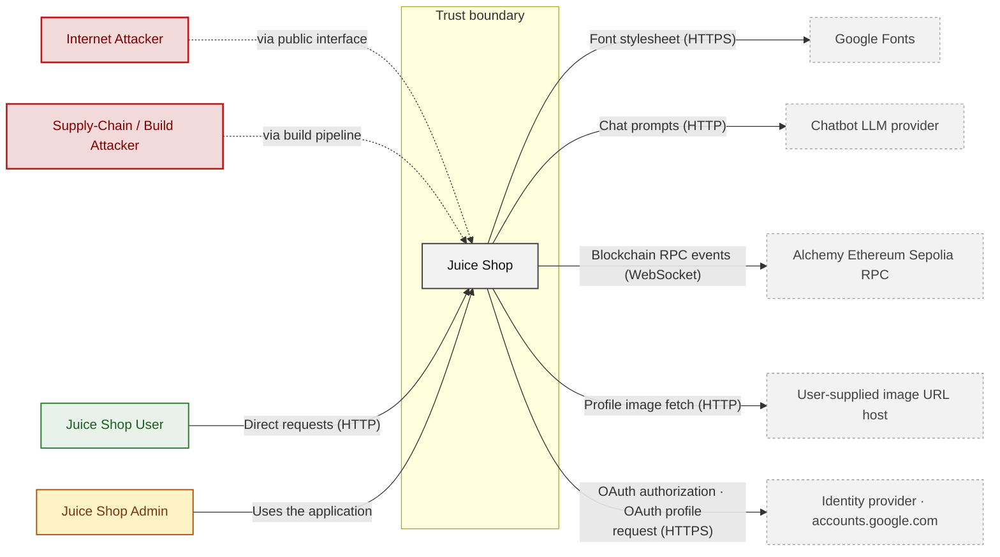

**Key takeaway:** Juice Shop serves Juice Shop User and Juice Shop Admin and depends on Google Fonts, Chatbot LLM provider, Alchemy Ethereum Sepolia RPC, User-supplied image URL host and Identity provider · accounts.google.com; Internet Attacker and Supply-Chain / Build Attacker attack it.

### 2.2 Container Architecture

How the system decomposes into deployable units. Each box is a separate runtime process or service container; arrows show synchronous request paths between them. Components with ≥3 Critical findings carry a red border, ≥2 High amber (C4 Level 2).

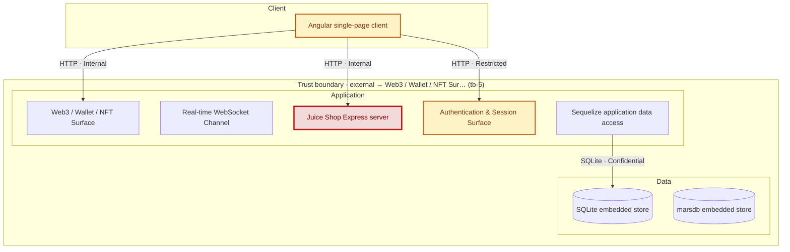

*Trust boundaries not drawn above: Sequelize application data access → SQLite embedded store (tb-6), Web3 / Wallet / NFT Surface → external (tb-8), Juice Shop Express server → external (tb-9, tb-7), external → CI/CD Pipeline (tb-1), +1 more - every boundary is listed in [§1 Trust Boundaries](#trust-boundaries).*

**Key takeaway:** The system decomposes into 1 client, 5 application and 2 data unit(s); Juice Shop Express server carries the most Critical findings (3) and bounds the worst-case blast radius. The build plane (CI/CD Pipeline) is shown in [Figure 1b](#figure-1b).

### 2.3 Components

How each component is reached, what it handles, how many threats hit it, and how effective the controls evidenced on it are. The component table below holds source paths and linked threats per `C-NN`; per-finding evidence is in [§8 Findings Register](#8-findings-register).

<!-- detail-table -->
| Component | Inbound flows | Data handled | Threats | Controls: worst effectiveness per domain |
|----------------------|----------------------|------------|----------------------|----------------------|
| [C-01](#c-01) · Angular single-page client | none modeled | Restricted | 11 (🟠 6 · 🟡 5) | – |
| [C-02](#c-02) · CI/CD Pipeline | none modeled | – | 7 (🟡 7) | 🟠 Weak: Supply chain (3) |
| [C-03](#c-03) · Web3 / Wallet / NFT Surface | 1 unauthenticated | Internal | 1 (🟡 1) | – |
| [C-04](#c-04) · Real-time WebSocket Channel | none modeled | – | 1 (🟡 1) | – |
| [C-05](#c-05) · Juice Shop Express server | 2 unauthenticated<br/>1 authentication unknown<br/>2 authenticated (bearer, cookie) | Confidential | 71 (🔴 3 · 🟠 21 · 🟡 47) | – |
| [C-06](#c-06) · Authentication &amp; Session Surface | 1 unauthenticated<br/>1 authentication unknown<br/>2 authenticated (bearer, password) | Restricted | 15 (🔴 1 · 🟠 6 · 🟡 8) | – |
| [C-07](#c-07) · SQLite embedded store | 1 unauthenticated | Confidential | none | 🟠 Weak: Secrets / crypto |
| [C-08](#c-08) · Sequelize application data access | none modeled | Confidential | 2 (🟠 1 · 🟡 1) | 🟠 Weak: Secrets / crypto |
| [C-09](#c-09) · marsdb embedded store | none modeled | – | none | – |
| System-wide: evidence not tied to one<br/>component | – | – | – | 🔴 Unsafe: AuthN (7)<br/>🔴 Missing: AuthZ (6), Input / query (5),<br/>Supply chain (4)<br/>🟠 Weak: Session (4), Secrets / crypto (2),<br/>Logging, LLM |

*🔴 **Unsafe**: relied upon but defeated or trivially bypassable - fix it · 🔴 **Missing**: never built - add it · 🟠 **Weak**: present, with exploitable gaps · 🟡 **Partial**: covers some surfaces, meaningful gaps remain · 🟢 **Adequate**: present and sound. A control counts for the component whose paths hold its implementation evidence; a domain without an evidenced control is not listed; (n) counts the controls behind a rating. Threat counts use the Figure 1 attribution; [§6](#6-security-architecture) holds the full assessment.*

**Key takeaway:** No component has a control rated Unsafe or Missing; 6 components have no component-specific control (C-01, C-03, C-04, C-05, C-06, C-09); 30 controls apply system-wide.

| ID | Name | Type | Key Paths | Linked Threats |
|----|----------------------|-----------|----------------------------------------|------------------------------------------------|
| <a id="c-01"></a><a id="component-1e946e84d9d002ff"></a><span style="white-space:nowrap">C-01</span> | Angular single-page client | client | `frontend/src/app/Models/backup.model.ts`<br/>`frontend/src/app/Models/challenge.model.ts`<br/>`frontend/src/app/Models/deliveryMethod.model.ts`<br/>`frontend/src/app/Models/hint.model.ts`<br/>`frontend/src/app/Models/product.model.ts` | 🟠 [F-001](#f-001) — Angular trusted-HTML sanitizer bypass causing XSS<br/>🟠 [F-003](#f-003) — Auth Token Stored in Browser Storage<br/>🟠 [F-012](#f-012) — OAuth implicit flow without state, nonce or PKCE<br/>🟠 [F-013](#f-013) — OAuth access token in userinfo URL and not validated<br/>🟠 [F-014](#f-014) — Predictable password derived from OAuth email<br/>🟠 [F-024](#f-024) — Reflected DOM XSS from search query parameter<br/>🟡 [F-050](#f-050) — Unsanitized HTML written to new window<br/>🟡 [F-051](#f-051) — DOM XSS from JWT lastLoginIp claim rendered<br/>🟡 [F-052](#f-052) — Product descriptions marked trusted HTML<br/>🟡 [F-053](#f-053) — Order ID wrapped as trusted HTML in track<br/>🟡 [F-072](#f-072) — Passwords sent in GET query string on password change |
| <a id="c-02"></a><a id="component-4ae14de3062e9ced"></a><span style="white-space:nowrap">C-02</span> | CI/CD Pipeline | application | `.dockerignore`<br/>`.github/workflows/ci.yml`<br/>`.github/workflows/codeql-analysis.yml`<br/>`.github/workflows/frontend-bundle-analysis.yml`<br/>`.github/workflows/image_actions.yml` | 🟡 [F-054](#f-054) — Missing Container Image Signing<br/>🟡 [F-055](#f-055) — Untrusted npm Install/Postinstall Scripts Enabled<br/>🟡 [F-056](#f-056) — Third-party GitHub Actions referenced by mutable tags or branch<br/>🟡 [F-057](#f-057) — Lockfile generation disabled so installs resolve floating versions<br/>🟡 [F-058](#f-058) — Container base images referenced by mutable tags<br/>🟡 [F-088](#f-088) — Container Runs as Root<br/>🟡 [F-089](#f-089) — Missing Workflow Permissions Block |
| <a id="c-03"></a><a id="component-54ef4e76d013d5e3"></a><span style="white-space:nowrap">C-03</span> | Web3 / Wallet / NFT Surface | application | `routes/checkKeys.ts`<br/>`routes/nftMint.ts`<br/>`routes/redirect.ts`<br/>`routes/web3Wallet.ts` | 🟡 [F-084](#f-084) — Unbounded wallet address set growth |
| <a id="c-04"></a><a id="component-65dba291a11444b2"></a><span style="white-space:nowrap">C-04</span> | Real-time WebSocket Channel | application | `lib/challengeUtils.ts`<br/>`lib/startup/registerWebsocketEvents.ts` | 🟡 [F-085](#f-085) — Unhandled exceptions from non-string socket |
| <a id="c-05"></a><a id="component-8f6e0a5a0f23ba52"></a><span style="white-space:nowrap">C-05</span> | Juice Shop Express server | application | `lib/startup/registerWebsocketEvents.ts`<br/>`routes/address.ts`<br/>`routes/appConfiguration.ts`<br/>`routes/appVersion.ts`<br/>`routes/b2bOrder.ts` | 🔴 [F-004](#f-004) — SQL injection in login query enabling authentication bypass<br/>🔴 [F-005](#f-005) — SQL injection in product search query<br/>🔴 [F-011](#f-011) — Checkout trusts client-supplied UserId for wallet changes<br/>🟠 [F-002](#f-002) — Basket IDOR: missing ownership checks on basket routes<br/>🟠 [F-016](#f-016) — JWT verification without pinned algorithm<br/>🟠 [F-017](#f-017) — Password change skips current password check<br/>🟠 [F-025](#f-025) — Attacker-controlled layout template path in data<br/>🟠 [F-026](#f-026) — Zip entry path traversal in complaint upload writes<br/>🟠 [F-027](#f-027) — Server-side eval of stored username on profile page<br/>🟠 [F-028](#f-028) — Basket item update does not check item owner<br/>🟠 [F-030](#f-030) — NoSQL JavaScript injection<br/>🟠 [F-031](#f-031) — Stored username compiled into Pug template source<br/>🟠 [F-032](#f-032) — Encryption keys directory is listed and served publicly<br/>🟠 [F-033](#f-033) — XML parser resolves external entities<br/>🟠 [F-034](#f-034) — XXE<br/>🟠 [F-035](#f-035) — Passwords hashed with unsalted fast MD5<br/>🟠 [F-036](#f-036) — Server-side request forgery<br/>🟠 [F-038](#f-038) — Untrusted B2B orderLinesData evaluated<br/>🟠 [F-039](#f-039) — Key and log file servers lack any authentication or role check<br/>🟠 [F-040](#f-040) — Sensitive routes registered without authentication middleware<br/>🟠 [F-041](#f-041) — Sensitive Routes Registered Without Authentication Middleware<br/>🟠 [F-043](#f-043) — Unauthenticated update of products<br/>🟠 [F-044](#f-044) — User registration does not block a privileged role in the body<br/>🟠 [F-045](#f-045) — Registration accepts a role from the request body<br/>🟡 [F-046](#f-046) — Chat identity taken from unverified JWT decode<br/>🟡 [F-059](#f-059) — Wallet top-up accepts unvalidated balance amount<br/>🟡 [F-060](#f-060) — Fetched remote content stored unvalidated<br/>🟡 [F-061](#f-061) — Review update lacks author ownership check<br/>🟡 [F-062](#f-062) — Hint update endpoint lacks authentication and field limits<br/>🟡 [F-063](#f-063) — Basket item update accepts arbitrary body fields<br/>🟡 [F-064](#f-064) — Product review author is set<br/>🟡 [F-065](#f-065) — Wallet top-up amount is taken from the request body<br/>🟡 [F-066](#f-066) — Security answer creation accepts UserId from request body<br/>🟡 [F-067](#f-067) — NoSQL where-clause string built from product<br/>🟡 [F-068](#f-068) — NoSQL operator injection in review update<br/>🟡 [F-069](#f-069) — Client-supplied chat messages passed to model unvalidated<br/>🟡 [F-073](#f-073) — FTP file allow-list bypass<br/>🟡 [F-074](#f-074) — Arbitrary field selection and JSONP in whoami<br/>🟡 [F-075](#f-075) — CAPTCHA answer returned to client<br/>🟡 [F-076](#f-076) — Prometheus metrics endpoint unauthenticated<br/>🟡 [F-077](#f-077) — Security question endpoint enables account<br/>🟡 [F-078](#f-078) — Access logs exposed without authentication<br/>🟡 [F-079](#f-079) — Access log directory is listed and served publicly<br/>🟡 [F-080](#f-080) — Encryption keys served without authentication<br/>🟡 [F-081](#f-081) — Allow-list checked before null-byte truncation<br/>🟡 [F-086](#f-086) — Unbounded LLM consumption on unauthenticated chat<br/>🟡 [F-087](#f-087) — Memory upload has no size limit and writes files before<br/>🟡 [F-090](#f-090) — Deluxe upgrade succeeds without a payment<br/>🟡 [F-091](#f-091) — Memories listing returns user records<br/>🟡 [F-092](#f-092) — Basket read lacks ownership check<br/>🟡 [F-093](#f-093) — Basket ownership check bypass<br/>🟡 [F-094](#f-094) — Chat order lookup binds ownership to masked email<br/>🟡 [F-095](#f-095) — Data export matches orders by masked email<br/>🟡 [F-096](#f-096) — Basket checkout lacks ownership check on basket id<br/>🟡 [F-097](#f-097) — Recycle records readable by any caller by id<br/>🟡 [F-098](#f-098) — Any authenticated user can read other users by id<br/>🟡 [F-099](#f-099) — Basket items readable and deletable by any authenticated user<br/>🟡 [F-100](#f-100) — Checkout does not bind basket to caller<br/>🟡 [F-101](#f-101) — Coupon application does not bind basket to caller<br/>🟡 [F-102](#f-102) — Order tracking returns any order by identifier<br/>🟡 [F-103](#f-103) — Deluxe upgrade without payment<br/>🟡 [F-104](#f-104) — User list readable by any authenticated user<br/>🟡 [F-105](#f-105) — Any logged-in user can create products without a role check<br/>🟡 [F-106](#f-106) — Complaint list readable by any authenticated user<br/>🟡 [F-107](#f-107) — Any authenticated user can delete any feedback<br/>🟡 [F-108](#f-108) — Admin configuration and version routes lack authorization<br/>🟡 [F-109](#f-109) — Metrics endpoint exposed without authorization<br/>🟡 [F-110](#f-110) — Uncapped model-directed coupon generation in chat tool<br/>🟡 [F-113](#f-113) — Address update by id lacks ownership check<br/>🟡 [F-114](#f-114) — User listing endpoint lacks role check |
| <a id="c-06"></a><a id="component-b5b9297602be7181"></a><span style="white-space:nowrap">C-06</span> | Authentication & Session Surface | application | `lib/insecurity.ts`<br/>`lib/startup/registerWebsocketEvents.ts`<br/>`routes/2fa.ts`<br/>`routes/authenticatedUsers.ts`<br/>`routes/login.ts` | 🟠 [F-018](#f-018) — Non-cryptographic RNG for a<br/>🟠 [F-021](#f-021) — Password reset accepts a security-question answer<br/>🟠 [F-022](#f-022) — Password reset relies on guessable security<br/>🟠 [F-023](#f-023) — Hardcoded JWT signing private key in source<br/>🟠 [F-037](#f-037) — Unsalted MD5 password hashing<br/>🟡 [F-047](#f-047) — Token verify helper skips expiry issuer and audience<br/>🟡 [F-048](#f-048) — Token verify helper does not pin an algorithm<br/>🟡 [F-049](#f-049) — Password reset enforces no password strength policy<br/>🟡 [F-070](#f-070) — Hardcoded HMAC key for security answers<br/>🟡 [F-082](#f-082) — Password hash embedded in issued JWT payload<br/>🟡 [F-083](#f-083) — Session token cookie set without HttpOnly or Secure<br/>🟡 [F-111](#f-111) — Any authenticated user can list all user<br/>🟡 [F-112](#f-112) — Weak attempt limiting on TOTP verification |
| <a id="c-07"></a><a id="component-c8ef162882af3179"></a><span style="white-space:nowrap">C-07</span> | SQLite embedded store | data | `models/index.ts` | - |
| <a id="c-08"></a><a id="component-d853fa131a0133b0"></a><span style="white-space:nowrap">C-08</span> | Sequelize application data access | application | `models/address.ts`<br/>`models/basket.ts`<br/>`models/basketitem.ts`<br/>`models/captcha.ts`<br/>`models/card.ts` | 🟡 [F-071](#f-071) — Product description stored without sanitization |
| <a id="c-09"></a><a id="component-f0b26ba864e7efb3"></a><span style="white-space:nowrap">C-09</span> | marsdb embedded store | data | `data/mongodb.ts` | - |

> **Legend:** `-->` synchronous request/response (REST, HTTPS, gRPC) · **red border** ≥ 3 Critical threats on the component · **amber border** ≥ 2 High threats

---

## 3. Attack Walkthroughs

This section walks through how the highest-risk findings are exploited - one short walkthrough per Critical, each with attack steps, a focused sequence diagram, and the primary mitigation. Which root cause each Critical traces back to is in [Critical Findings by Root Cause](#critical-findings-by-root-cause); full per-finding context (severity rationale, assets, detection signals) is in the [§8 Findings Register](#8-findings-register).

### 3.1 SQL injection in product search query

**Source:** 🔴 [F-005](#f-005) — `routes/search.ts:23`

Severity **Critical** ([CWE-89](https://cwe.mitre.org/data/definitions/89.html)). STRIDE: Tampering. See [§8 F-005](#f-005) for the full register row.

**Attack Steps**

1. An unauthenticated caller sends a crafted q parameter to GET `/rest/products/search` (`routes/search.ts:23`).
2. The value is concatenated into a raw SELECT; the only control is truncation to 200 characters.
3. An attacker can use UNION queries to read Users rows including emails and password hashes, and the schema.

**Sequence Diagram**

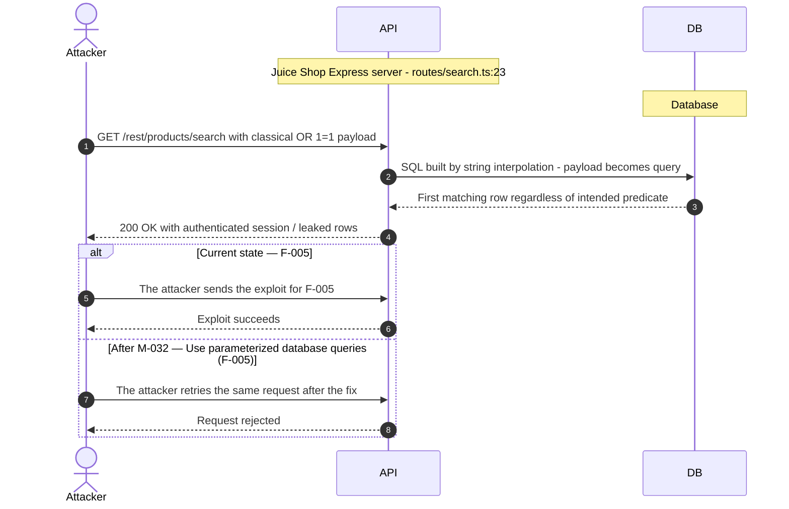

**Key takeaway:** Until ● [M-032](#m-032) (Use parameterized database queries (🔴 [F-005](#f-005))) lands, 🔴 [F-005](#f-005) — SQL injection in product search query is exploitable at `routes/search.ts:23` (Critical-severity, [CWE-89](https://cwe.mitre.org/data/definitions/89.html)).

**Defense in Depth**

- Primary mitigation: ● [M-032](#m-032) (Use parameterized database queries (🔴 [F-005](#f-005)))

### 3.2 SQL injection in login query enabling authentication bypass

**Source:** 🔴 [F-004](#f-004) — `routes/login.ts:34`

Severity **Critical** ([CWE-89](https://cwe.mitre.org/data/definitions/89.html)). STRIDE: Tampering. See [§8 F-004](#f-004) for the full register row.

**Attack Steps**

1. POST `/rest/user/login` with email set to admin@juice-`sh.op`'-- and any password.
2. The injected comment removes the password and `deletedAt` conditions so the admin row is returned.
3. Use the returned bearer token to call admin-only APIs as the admin user.

**Sequence Diagram**

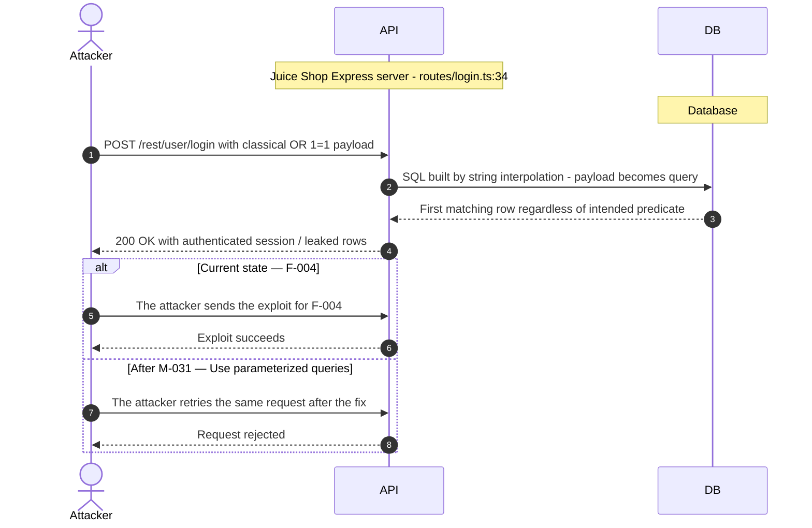

**Key takeaway:** Until ● [M-031](#m-031) (Use parameterized queries) lands, 🔴 [F-004](#f-004) — SQL injection in login query enabling authentication bypass is exploitable at `routes/login.ts:34` (Critical-severity, [CWE-89](https://cwe.mitre.org/data/definitions/89.html)).

**Defense in Depth**

- Primary mitigation: ● [M-031](#m-031) (Use parameterized queries)

### 3.3 Checkout trusts client-supplied UserId for wallet changes in Order

**Source:** 🔴 [F-011](#f-011) — `routes/order.ts:150`

Severity **Critical** ([CWE-639](https://cwe.mitre.org/data/definitions/639.html)). STRIDE: Tampering. See [§8 F-011](#f-011) for the full register row.

**Attack Steps**

1. In the checkout handler at `routes/order.ts:150`, `routes/order.ts:148` and `routes/order.ts:157`, a signed-in user posts checkout with body UserId set to a victim and `paymentId` wallet.
2. The server trusts `req.body.UserId` instead of the session identity, debits the victim's wallet and credits bonus points to the chosen UserId, with no comparison to the authenticated user.
3. The route has `isAuthorized` on `/rest/basket/:id` but no `appendUserId` was seen on checkout.

**Sequence Diagram**

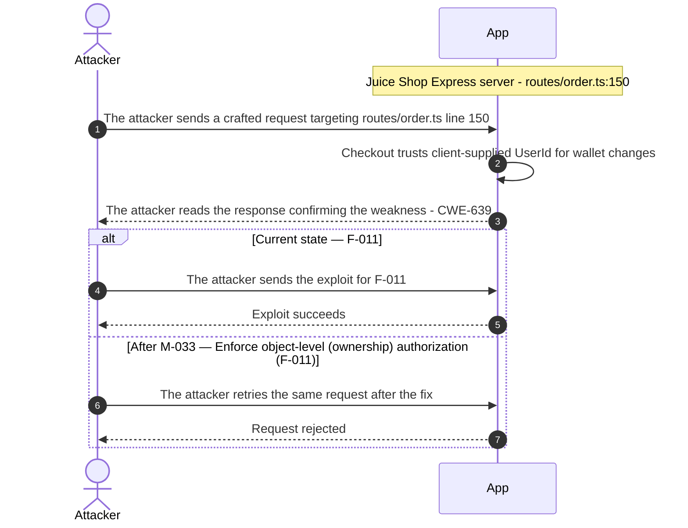

**Key takeaway:** Until ● [M-033](#m-033) (Enforce object-level (ownership) authorization (🔴 [F-011](#f-011))) lands, 🔴 [F-011](#f-011) — Checkout trusts client-supplied UserId for wallet changes is exploitable at `routes/order.ts:150` (Critical-severity, [CWE-639](https://cwe.mitre.org/data/definitions/639.html)).

**Defense in Depth**

- Primary mitigation: ● [M-033](#m-033) (Enforce object-level (ownership) authorization (🔴 [F-011](#f-011)))
- Defence in depth: ◑ [M-001](#m-001) (Manual review: verify Checkout trusts client-supplied UserId for wallet changes)

### 3.4 User registration does not block a privileged role in the body

**Source:** 🟠 [F-044](#f-044) — `server.ts:420`

Severity **High** ([CWE-915](https://cwe.mitre.org/data/definitions/915.html)). STRIDE: Elevation of Privilege. See [§8 F-044](#f-044) for the full register row.

**Attack Steps**

1. An attacker crafts a request that reaches the code at `server.ts:420`.
2. The POST `/api/Users` chain inspects `req.body.role` for admin only to mark a challenge and then calls `next()`.
3. Nothing removes or rejects role, so a registration body with role admin can reach the generated create handler.

**Sequence Diagram**

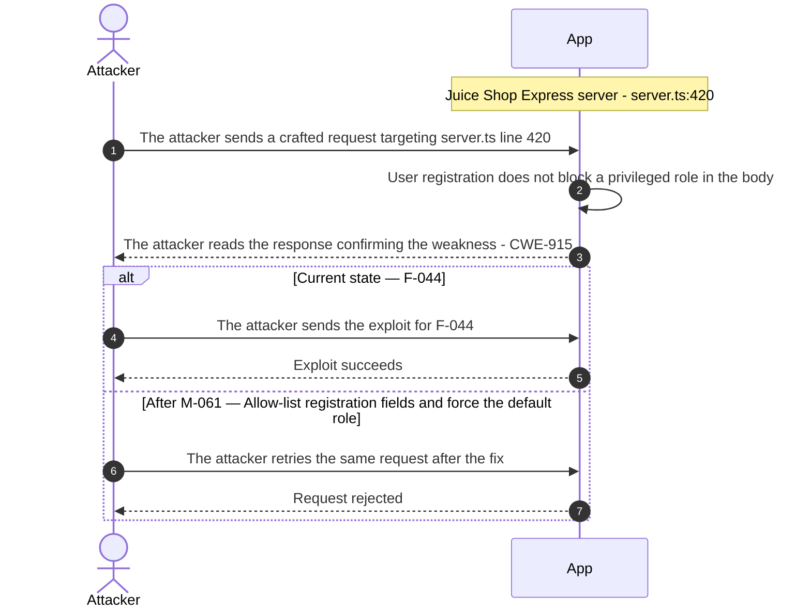

**Key takeaway:** Until ◕ [M-061](#m-061) (Allow-list registration fields and force the default role) lands, 🟠 [F-044](#f-044) — User registration does not block a privileged role in the body is exploitable at `server.ts:420` (High-severity, [CWE-915](https://cwe.mitre.org/data/definitions/915.html)).

**Defense in Depth**

- Primary mitigation: ◕ [M-061](#m-061) (Allow-list registration fields and force the default role)

### 3.5 Hardcoded JWT signing private key in source

**Source:** 🟠 [F-023](#f-023) — `lib/insecurity.ts:21`

Severity **High** ([CWE-798](https://cwe.mitre.org/data/definitions/798.html)). STRIDE: Spoofing. See [§8 F-023](#f-023) for the full register row.

**Attack Steps**

1. An attacker crafts a request that reaches the code at `lib/insecurity.ts:21`.
2. The `RS256` private key is embedded in source; anyone with repository or build access can forge valid tokens for any user or role.
3. The same key also keys the deluxe token HMAC.

**Sequence Diagram**

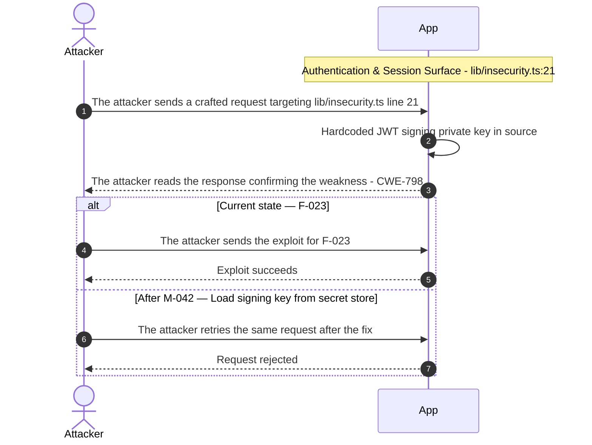

**Key takeaway:** Until ◕ [M-042](#m-042) (Load signing key from secret store) lands, 🟠 [F-023](#f-023) — Hardcoded JWT signing private key in source is exploitable at `lib/insecurity.ts:21` (High-severity, [CWE-798](https://cwe.mitre.org/data/definitions/798.html)).

**Defense in Depth**

- Primary mitigation: ◕ [M-042](#m-042) (Load signing key from secret store)

### 3.6 Registration accepts a role from the request body in Juice Shop Express server

**Source:** 🟠 [F-045](#f-045) — `server.ts:422`

Severity **High** ([CWE-915](https://cwe.mitre.org/data/definitions/915.html)). STRIDE: Elevation of Privilege. See [§8 F-045](#f-045) for the full register row.

**Attack Steps**

1. An attacker crafts a request that reaches the code at `server.ts:422`.
2. An anonymous caller posts to `/api/Users` with role set to admin.
3. The body goes to the User model, whose validation allows admin, and no allow-list strips the field, so an admin account is created.

**Sequence Diagram**

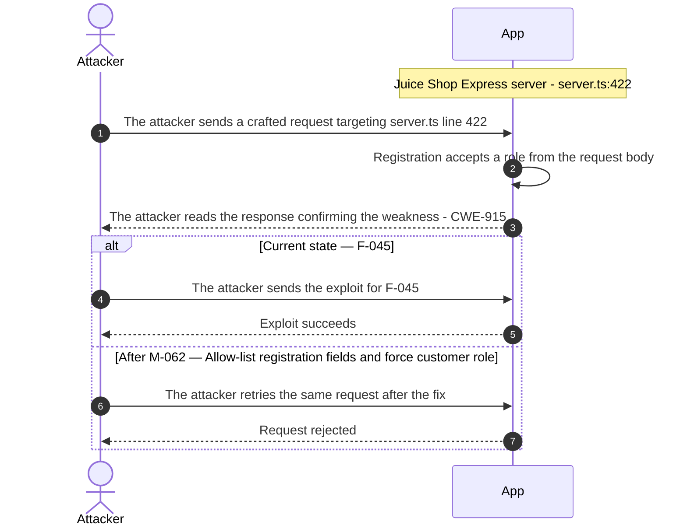

**Key takeaway:** Until ◕ [M-062](#m-062) (Allow-list registration fields and force customer role) lands, 🟠 [F-045](#f-045) — Registration accepts a role from the request body is exploitable at `server.ts:422` (High-severity, [CWE-915](https://cwe.mitre.org/data/definitions/915.html)).

**Defense in Depth**

- Primary mitigation: ◕ [M-062](#m-062) (Allow-list registration fields and force customer role)
- Defence in depth: ◑ [M-008](#m-008) (Manual review: verify Registration accepts a role from the request body)

<!-- generated:walkthrough_renderer -->

---

## 4. Assets

Information assets and the classification level that drives the Confidentiality / Integrity / Availability targets used in [§8 Findings Register](#8-findings-register) risk scoring.

<table style="table-layout:fixed;width:100%">
<colgroup><col width="22%" style="width:22%"><col width="13%" style="width:13%"><col width="32%" style="width:32%"><col width="33%" style="width:33%"></colgroup>
<thead><tr><th>Asset</th><th>Classification</th><th>Description</th><th>Linked Threats</th></tr></thead>
<tbody>
<tr><td style="overflow-wrap:break-word">Authentication session tokens</td><td>Restricted</td><td>Tokens issued at login and tracked in an <code>authenticatedUsers</code> store.</td><td style="overflow-wrap:break-word">🟠 <a href="#f-001">F-001</a> — Angular trusted-HTML sanitizer bypass causing XSS<br/>🟠 <a href="#f-003">F-003</a> — Auth Token Stored in Browser Storage<br/>🔴 <a href="#f-004">F-004</a> — SQL injection in login query enabling authentication bypass<br/>🟠 <a href="#f-012">F-012</a> — OAuth implicit flow without state, nonce or PKCE<br/>🟠 <a href="#f-016">F-016</a> — JWT verification without pinned algorithm<br/>🟠 <a href="#f-024">F-024</a> — Reflected DOM XSS from search query parameter<br/>🟡 <a href="#f-046">F-046</a> — Chat identity taken from unverified JWT decode<br/>🟡 <a href="#f-047">F-047</a> — Token verify helper skips expiry issuer and audience<br/>🟡 <a href="#f-048">F-048</a> — Token verify helper does not pin an algorithm<br/>🟡 <a href="#f-050">F-050</a> — Unsanitized HTML written to new window<br/>🟡 <a href="#f-051">F-051</a> — DOM XSS from JWT lastLoginIp claim rendered<br/>🟡 <a href="#f-052">F-052</a> — Product descriptions marked trusted HTML<br/>🟡 <a href="#f-053">F-053</a> — Order ID wrapped as trusted HTML in track<br/>🟡 <a href="#f-054">F-054</a> — Missing Container Image Signing<br/>🟡 <a href="#f-071">F-071</a> — Product description stored without sanitization<br/>🟡 <a href="#f-082">F-082</a> — Password hash embedded in issued JWT payload</td></tr>
<tr><td style="overflow-wrap:break-word">External service API keys</td><td>Restricted</td><td>Alchemy and LLM API keys read from environment and sent to external providers.</td><td style="overflow-wrap:break-word">-</td></tr>
<tr><td style="overflow-wrap:break-word">User credentials and accounts</td><td>Restricted</td><td>Email/password hashes and TOTP secret state queried from the Users table during login.</td><td style="overflow-wrap:break-word">🟠 <a href="#f-001">F-001</a> — Angular trusted-HTML sanitizer bypass causing XSS<br/>🔴 <a href="#f-004">F-004</a> — SQL injection in login query enabling authentication bypass<br/>🔴 <a href="#f-005">F-005</a> — SQL injection in product search query<br/>🟠 <a href="#f-012">F-012</a> — OAuth implicit flow without state, nonce or PKCE<br/>🟠 <a href="#f-014">F-014</a> — Predictable password derived from OAuth email<br/>🟠 <a href="#f-024">F-024</a> — Reflected DOM XSS from search query parameter<br/>🟠 <a href="#f-035">F-035</a> — Passwords hashed with unsalted fast MD5<br/>🟠 <a href="#f-037">F-037</a> — Unsalted MD5 password hashing<br/>🟡 <a href="#f-050">F-050</a> — Unsanitized HTML written to new window<br/>🟡 <a href="#f-051">F-051</a> — DOM XSS from JWT lastLoginIp claim rendered<br/>🟡 <a href="#f-052">F-052</a> — Product descriptions marked trusted HTML<br/>🟡 <a href="#f-053">F-053</a> — Order ID wrapped as trusted HTML in track<br/>🟡 <a href="#f-071">F-071</a> — Product description stored without sanitization<br/>🟡 <a href="#f-082">F-082</a> — Password hash embedded in issued JWT payload<br/>🟡 <a href="#f-112">F-112</a> — Weak attempt limiting on TOTP verification</td></tr>
<tr><td style="overflow-wrap:break-word">Product reviews and orders</td><td>Confidential</td><td>Review and order records in in-process MarsDB collections.</td><td style="overflow-wrap:break-word">-</td></tr>
</tbody>
</table>

---

## 5. Attack Surface

Network-reachable entry points classified by authentication requirement. Each row links to the threat(s) referenced in its **Notes** column. The **Risk** column reflects the highest-severity linked finding. Entry points with no linked finding are still listed when they sit on a sensitive surface (authentication, registration, management) or look like a missing-auth/authz suspect - marked **⚑ Review** in Notes.

### 5.1 Unauthenticated Entry Points (69)

<table style="table-layout:fixed;width:100%">
<colgroup><col width="9%" style="width:9%"><col width="30%" style="width:30%"><col width="14%" style="width:14%"><col width="47%" style="width:47%"></colgroup>
<thead><tr><th>Method</th><th>Route</th><th>Risk</th><th>Notes</th></tr></thead>
<tbody>
<tr><td>POST</td><td style="overflow-wrap:anywhere"><code>/rest/user/login</code></td><td>🔴 Critical</td><td>🔴 <a href="#f-004">F-004</a> — SQL injection in login query enabling authentication bypass<br/>🟠 <a href="#f-035">F-035</a> — Passwords hashed with unsalted fast MD5<br/>🟡 <a href="#f-082">F-082</a> — Password hash embedded in issued JWT payload<br/>Public by design</td></tr>
<tr><td>GET</td><td style="overflow-wrap:anywhere"><code>/rest/products/search</code></td><td>🔴 Critical</td><td>🔴 <a href="#f-005">F-005</a> — SQL injection in product search query</td></tr>
<tr><td>POST</td><td style="overflow-wrap:anywhere"><code>/api/Users</code></td><td>🟠 High</td><td>🟠 <a href="#f-044">F-044</a> — User registration does not block a privileged role in the body<br/>🟠 <a href="#f-045">F-045</a> — Registration accepts a role from the request body<br/>🟡 <a href="#f-098">F-098</a> — Any authenticated user can read other users by id</td></tr>
<tr><td>POST</td><td style="overflow-wrap:anywhere"><code>/file-upload</code></td><td>🟠 High</td><td>🟠 <a href="#f-026">F-026</a> — Zip entry path traversal in complaint upload writes<br/>🟠 <a href="#f-033">F-033</a> — XML parser resolves external entities<br/>🟠 <a href="#f-040">F-040</a> — Sensitive routes registered without authentication middleware</td></tr>
<tr><td>POST</td><td style="overflow-wrap:anywhere"><code>/rest/2fa/verify</code></td><td>🟠 High</td><td>🟠 <a href="#f-016">F-016</a> — JWT verification without pinned algorithm<br/>Public by design</td></tr>
<tr><td>PUT</td><td style="overflow-wrap:anywhere"><code>/​rest/​continue-​code-​findIt/​apply/​:​continueCode</code></td><td>🟠 High</td><td>🟠 <a href="#f-040">F-040</a> — Sensitive routes registered without authentication middleware</td></tr>
<tr><td>PUT</td><td style="overflow-wrap:anywhere"><code>/​rest/​continue-​code-​fixIt/​apply/​:​continueCode</code></td><td>🟠 High</td><td>🟠 <a href="#f-040">F-040</a> — Sensitive routes registered without authentication middleware</td></tr>
<tr><td>PUT</td><td style="overflow-wrap:anywhere"><code>/​rest/​continue-​code/​apply/​:​continueCode</code></td><td>🟠 High</td><td>🟠 <a href="#f-040">F-040</a> — Sensitive routes registered without authentication middleware</td></tr>
<tr><td>POST</td><td style="overflow-wrap:anywhere"><code>/rest/user/reset-password</code></td><td>🟠 High</td><td>🟠 <a href="#f-021">F-021</a> — Password reset accepts a security-question answer<br/>🟠 <a href="#f-022">F-022</a> — Password reset relies on guessable security<br/>🟡 <a href="#f-049">F-049</a> — Password reset enforces no password strength policy<br/>Public by design</td></tr>
<tr><td>ALL</td><td style="overflow-wrap:anywhere"><code>/encryptionkeys/:file</code></td><td>🟠 High</td><td>🟠 <a href="#f-032">F-032</a> — Encryption keys directory is listed and served publicly<br/>🟠 <a href="#f-039">F-039</a> — Key and log file servers lack any authentication or role check<br/>🟡 <a href="#f-080">F-080</a> — Encryption keys served without authentication</td></tr>
<tr><td>GET</td><td style="overflow-wrap:anywhere"><code>/rest/track-order/:id</code></td><td>🟠 High</td><td>🟠 <a href="#f-030">F-030</a> — NoSQL JavaScript injection<br/>🟡 <a href="#f-102">F-102</a> — Order tracking returns any order by identifier</td></tr>
<tr><td>GET</td><td style="overflow-wrap:anywhere"><code>/rest/user/change-password</code></td><td>🟠 High</td><td>🟠 <a href="#f-017">F-017</a> — Password change skips current password check<br/>🟠 <a href="#f-035">F-035</a> — Passwords hashed with unsalted fast MD5<br/>🟡 <a href="#f-072">F-072</a> — Passwords sent in GET query string on password change</td></tr>
<tr><td>ALL</td><td style="overflow-wrap:anywhere"><code>/support/logs/:file</code></td><td>🟠 High</td><td>🟠 <a href="#f-039">F-039</a> — Key and log file servers lack any authentication or role check<br/>🟡 <a href="#f-078">F-078</a> — Access logs exposed without authentication<br/>🟡 <a href="#f-079">F-079</a> — Access log directory is listed and served publicly</td></tr>
<tr><td>GET</td><td style="overflow-wrap:anywhere"><code>/​this/​page/​is/​hidden/​behind/​an/​incredibly/​high/​paywall/​that/​could/​only/​be/​unlocked/​by/​sending/​1btc/​to/​us</code></td><td>🟠 High</td><td>🟠 <a href="#f-013">F-013</a> — OAuth access token in userinfo URL and not validated<br/>🟠 <a href="#f-025">F-025</a> — Attacker-controlled layout template path in data</td></tr>
<tr><td>POST</td><td style="overflow-wrap:anywhere"><code>/api/Addresss</code></td><td>🟡 Medium</td><td>🟡 <a href="#f-113">F-113</a> — Address update by id lacks ownership check</td></tr>
<tr><td>PUT</td><td style="overflow-wrap:anywhere"><code>/api/Addresss/:id</code></td><td>🟡 Medium</td><td>🟡 <a href="#f-113">F-113</a> — Address update by id lacks ownership check</td></tr>
<tr><td>DELETE</td><td style="overflow-wrap:anywhere"><code>/api/Addresss/:id</code></td><td>🟡 Medium</td><td>🟡 <a href="#f-113">F-113</a> — Address update by id lacks ownership check</td></tr>
<tr><td>POST</td><td style="overflow-wrap:anywhere"><code>/api/Feedbacks</code></td><td>🟡 Medium</td><td>🟡 <a href="#f-107">F-107</a> — Any authenticated user can delete any feedback</td></tr>
<tr><td>GET</td><td style="overflow-wrap:anywhere"><code>/metrics</code></td><td>🟡 Medium</td><td>🟡 <a href="#f-076">F-076</a> — Prometheus metrics endpoint unauthenticated<br/>🟡 <a href="#f-109">F-109</a> — Metrics endpoint exposed without authorization<br/>Management surface</td></tr>
<tr><td>GET</td><td style="overflow-wrap:anywhere"><code>/​rest/​admin/​application-​configuration</code></td><td>🟡 Medium</td><td>🟡 <a href="#f-108">F-108</a> — Admin configuration and version routes lack authorization<br/>Management surface</td></tr>
<tr><td>GET</td><td style="overflow-wrap:anywhere"><code>/​rest/​admin/​application-​version</code></td><td>🟡 Medium</td><td>🟡 <a href="#f-108">F-108</a> — Admin configuration and version routes lack authorization<br/>Management surface</td></tr>
<tr><td>POST</td><td style="overflow-wrap:anywhere"><code>/rest/chat</code></td><td>🟡 Medium</td><td>🟡 <a href="#f-046">F-046</a> — Chat identity taken from unverified JWT decode<br/>🟡 <a href="#f-086">F-086</a> — Unbounded LLM consumption on unauthenticated chat<br/>🟡 <a href="#f-110">F-110</a> — Uncapped model-directed coupon generation in chat tool</td></tr>
<tr><td>POST</td><td style="overflow-wrap:anywhere"><code>/rest/deluxe-membership</code></td><td>🟡 Medium</td><td>🟡 <a href="#f-090">F-090</a> — Deluxe upgrade succeeds without a payment<br/>🟡 <a href="#f-103">F-103</a> — Deluxe upgrade without payment</td></tr>
<tr><td>POST</td><td style="overflow-wrap:anywhere"><code>/rest/memories</code></td><td>🟡 Medium</td><td>🟡 <a href="#f-087">F-087</a> — Memory upload has no size limit and writes files before<br/>🟡 <a href="#f-091">F-091</a> — Memories listing returns user records</td></tr>
<tr><td>PUT</td><td style="overflow-wrap:anywhere"><code>/rest/products/:id/reviews</code></td><td>🟡 Medium</td><td>🟡 <a href="#f-061">F-061</a> — Review update lacks author ownership check</td></tr>
<tr><td>POST</td><td style="overflow-wrap:anywhere"><code>/rest/user/data-export</code></td><td>🟡 Medium</td><td>🟡 <a href="#f-050">F-050</a> — Unsanitized HTML written to new window<br/>🟡 <a href="#f-095">F-095</a> — Data export matches orders by masked email</td></tr>
<tr><td>PUT</td><td style="overflow-wrap:anywhere"><code>/rest/wallet/balance</code></td><td>🟡 Medium</td><td>🟡 <a href="#f-059">F-059</a> — Wallet top-up accepts unvalidated balance amount<br/>🟡 <a href="#f-065">F-065</a> — Wallet top-up amount is taken from the request body</td></tr>
<tr><td>GET</td><td style="overflow-wrap:anywhere"><code>/api/Addresss</code></td><td>🟡 Medium</td><td>🟡 <a href="#f-113">F-113</a> — Address update by id lacks ownership check</td></tr>
<tr><td>GET</td><td style="overflow-wrap:anywhere"><code>/api/Addresss/:id</code></td><td>🟡 Medium</td><td>🟡 <a href="#f-113">F-113</a> — Address update by id lacks ownership check</td></tr>
<tr><td>GET</td><td style="overflow-wrap:anywhere"><code>/api/Recycles</code></td><td>🟡 Medium</td><td>🟡 <a href="#f-097">F-097</a> — Recycle records readable by any caller by id</td></tr>
<tr><td>GET</td><td style="overflow-wrap:anywhere"><code>/api/Recycles/:id</code></td><td>🟡 Medium</td><td>🟡 <a href="#f-097">F-097</a> — Recycle records readable by any caller by id</td></tr>
<tr><td>GET</td><td style="overflow-wrap:anywhere"><code>/rest/deluxe-membership</code></td><td>🟡 Medium</td><td>🟡 <a href="#f-090">F-090</a> — Deluxe upgrade succeeds without a payment<br/>🟡 <a href="#f-103">F-103</a> — Deluxe upgrade without payment</td></tr>
<tr><td>GET</td><td style="overflow-wrap:anywhere"><code>/rest/image-captcha</code></td><td>🟡 Medium</td><td>🟡 <a href="#f-075">F-075</a> — CAPTCHA answer returned to client</td></tr>
<tr><td>GET</td><td style="overflow-wrap:anywhere"><code>/rest/memories</code></td><td>🟡 Medium</td><td>🟡 <a href="#f-087">F-087</a> — Memory upload has no size limit and writes files before<br/>🟡 <a href="#f-091">F-091</a> — Memories listing returns user records</td></tr>
<tr><td>GET</td><td style="overflow-wrap:anywhere"><code>/rest/products/:id/reviews</code></td><td>🟡 Medium</td><td>🟡 <a href="#f-061">F-061</a> — Review update lacks author ownership check</td></tr>
<tr><td>GET</td><td style="overflow-wrap:anywhere"><code>/rest/user/security-question</code></td><td>🟡 Medium</td><td>🟡 <a href="#f-077">F-077</a> — Security question endpoint enables account</td></tr>
<tr><td>GET</td><td style="overflow-wrap:anywhere"><code>/rest/user/whoami</code></td><td>🟡 Medium</td><td>🟡 <a href="#f-074">F-074</a> — Arbitrary field selection and JSONP in whoami</td></tr>
<tr><td>GET</td><td style="overflow-wrap:anywhere"><code>/rest/wallet/balance</code></td><td>🟡 Medium</td><td>🟡 <a href="#f-059">F-059</a> — Wallet top-up accepts unvalidated balance amount<br/>🟡 <a href="#f-065">F-065</a> — Wallet top-up amount is taken from the request body</td></tr>
<tr><td>POST</td><td style="overflow-wrap:anywhere"><code>/api/Cards</code></td><td>-</td><td><em>⚑ Review: no auth guard detected</em></td></tr>
<tr><td>DELETE</td><td style="overflow-wrap:anywhere"><code>/api/Cards/:id</code></td><td>-</td><td><em>⚑ Review: no auth guard detected</em></td></tr>
<tr><td>POST</td><td style="overflow-wrap:anywhere"><code>/rest/web3/submitKey</code></td><td>-</td><td><em>⚑ Review: no auth guard detected</em></td></tr>
<tr><td>POST</td><td style="overflow-wrap:anywhere"><code>/​rest/​web3/​walletExploitAddress</code></td><td>-</td><td><em>⚑ Review: no auth guard detected</em></td></tr>
<tr><td>POST</td><td style="overflow-wrap:anywhere"><code>/rest/web3/walletNFTVerify</code></td><td>-</td><td><em>⚑ Review: no auth guard detected</em></td></tr>
<tr><td>POST</td><td style="overflow-wrap:anywhere"><code>/snippets/fixes</code></td><td>-</td><td><em>⚑ Review: no auth guard detected</em></td></tr>
<tr><td>POST</td><td style="overflow-wrap:anywhere"><code>/snippets/verdict</code></td><td>-</td><td><em>⚑ Review: no auth guard detected</em></td></tr>
</tbody>
</table>

_24 further entry point(s) in this category carry no linked finding and no elevated review signal, and are not listed individually (69 total). The complete route inventory is available in `.route-inventory.json` and, when exported, `pentest-tasks.yaml`._

### 5.2 Authenticated Entry Points (40)

<table style="table-layout:fixed;width:100%">
<colgroup><col width="9%" style="width:9%"><col width="30%" style="width:30%"><col width="14%" style="width:14%"><col width="47%" style="width:47%"></colgroup>
<thead><tr><th>Method</th><th>Route</th><th>Risk</th><th>Notes</th></tr></thead>
<tbody>
<tr><td>GET</td><td style="overflow-wrap:anywhere"><code>/rest/basket/:id</code></td><td>🔴 Critical</td><td>🔴 <a href="#f-011">F-011</a> — Checkout trusts client-supplied UserId for wallet changes<br/>🟠 <a href="#f-002">F-002</a> — Basket IDOR: missing ownership checks on basket routes<br/>🟡 <a href="#f-092">F-092</a> — Basket read lacks ownership check</td></tr>
<tr><td>PUT</td><td style="overflow-wrap:anywhere"><code>/api/BasketItems/:id</code></td><td>🟠 High</td><td>🟠 <a href="#f-002">F-002</a> — Basket IDOR: missing ownership checks on basket routes<br/>🟠 <a href="#f-028">F-028</a> — Basket item update does not check item owner<br/>🟡 <a href="#f-063">F-063</a> — Basket item update accepts arbitrary body fields<br/>Authorization not confirmed (review)</td></tr>
<tr><td>DELETE</td><td style="overflow-wrap:anywhere"><code>/api/Products/:id</code></td><td>🟠 High</td><td>🟠 <a href="#f-043">F-043</a> — Unauthenticated update of products<br/>🟡 <a href="#f-105">F-105</a> — Any logged-in user can create products without a role check<br/>Authorization not confirmed (review)</td></tr>
<tr><td>PUT</td><td style="overflow-wrap:anywhere"><code>/api/Products/:id</code></td><td>🟠 High</td><td>🟠 <a href="#f-043">F-043</a> — Unauthenticated update of products<br/>🟡 <a href="#f-105">F-105</a> — Any logged-in user can create products without a role check<br/>Authorization not confirmed (review)</td></tr>
<tr><td>POST</td><td style="overflow-wrap:anywhere"><code>/api/BasketItems</code></td><td>🟠 High</td><td>🟠 <a href="#f-002">F-002</a> — Basket IDOR: missing ownership checks on basket routes<br/>🟠 <a href="#f-028">F-028</a> — Basket item update does not check item owner<br/>🟡 <a href="#f-063">F-063</a> — Basket item update accepts arbitrary body fields<br/>Authorization not confirmed (review)</td></tr>
<tr><td>POST</td><td style="overflow-wrap:anywhere"><code>/api/Products</code></td><td>🟠 High</td><td>🟠 <a href="#f-043">F-043</a> — Unauthenticated update of products<br/>🟡 <a href="#f-105">F-105</a> — Any logged-in user can create products without a role check<br/>Authorization not confirmed (review)</td></tr>
<tr><td>GET</td><td style="overflow-wrap:anywhere"><code>/api/Users</code></td><td>🟠 High</td><td>🟠 <a href="#f-044">F-044</a> — User registration does not block a privileged role in the body<br/>🟠 <a href="#f-045">F-045</a> — Registration accepts a role from the request body<br/>🟡 <a href="#f-098">F-098</a> — Any authenticated user can read other users by id</td></tr>
<tr><td>POST</td><td style="overflow-wrap:anywhere"><code>/b2b/v2/orders</code></td><td>🟠 High</td><td>🟠 <a href="#f-038">F-038</a> — Untrusted B2B orderLinesData evaluated<br/>Authorization not confirmed (review)</td></tr>
<tr><td>GET</td><td style="overflow-wrap:anywhere"><code>/profile</code></td><td>🟠 High</td><td>🟠 <a href="#f-027">F-027</a> — Server-side eval of stored username on profile page<br/>🟠 <a href="#f-036">F-036</a> — Server-side request forgery<br/>🟡 <a href="#f-060">F-060</a> — Fetched remote content stored unvalidated</td></tr>
<tr><td>POST</td><td style="overflow-wrap:anywhere"><code>/profile</code></td><td>🟠 High</td><td>🟠 <a href="#f-027">F-027</a> — Server-side eval of stored username on profile page<br/>🟠 <a href="#f-036">F-036</a> — Server-side request forgery<br/>🟡 <a href="#f-060">F-060</a> — Fetched remote content stored unvalidated<br/>Authorization not confirmed (review)</td></tr>
<tr><td>POST</td><td style="overflow-wrap:anywhere"><code>/profile/image/file</code></td><td>🟠 High</td><td>🟠 <a href="#f-031">F-031</a> — Stored username compiled into Pug template source<br/>🟠 <a href="#f-036">F-036</a> — Server-side request forgery<br/>🟡 <a href="#f-060">F-060</a> — Fetched remote content stored unvalidated<br/>Authorization not confirmed (review)</td></tr>
<tr><td>POST</td><td style="overflow-wrap:anywhere"><code>/profile/image/url</code></td><td>🟠 High</td><td>🟠 <a href="#f-036">F-036</a> — Server-side request forgery<br/>🟡 <a href="#f-060">F-060</a> — Fetched remote content stored unvalidated<br/>Authorization not confirmed (review)</td></tr>
<tr><td>PUT</td><td style="overflow-wrap:anywhere"><code>/api/Feedbacks/:id</code></td><td>🟡 Medium</td><td>🟡 <a href="#f-107">F-107</a> — Any authenticated user can delete any feedback<br/>Authorization not confirmed (review)</td></tr>
<tr><td>PUT</td><td style="overflow-wrap:anywhere"><code>/api/Recycles/:id</code></td><td>🟡 Medium</td><td>🟡 <a href="#f-097">F-097</a> — Recycle records readable by any caller by id<br/>Authorization not confirmed (review)</td></tr>
<tr><td>DELETE</td><td style="overflow-wrap:anywhere"><code>/api/Recycles/:id</code></td><td>🟡 Medium</td><td>🟡 <a href="#f-097">F-097</a> — Recycle records readable by any caller by id<br/>Authorization not confirmed (review)</td></tr>
<tr><td>POST</td><td style="overflow-wrap:anywhere"><code>/rest/basket/:id/checkout</code></td><td>🟡 Medium</td><td>🟡 <a href="#f-092">F-092</a> — Basket read lacks ownership check<br/>Authorization not confirmed (review)</td></tr>
<tr><td>PUT</td><td style="overflow-wrap:anywhere"><code>/​rest/​basket/​:​id/​coupon/​:​coupon</code></td><td>🟡 Medium</td><td>🟡 <a href="#f-092">F-092</a> — Basket read lacks ownership check<br/>🟡 <a href="#f-101">F-101</a> — Coupon application does not bind basket to caller<br/>Authorization not confirmed (review)</td></tr>
<tr><td>GET</td><td style="overflow-wrap:anywhere"><code>/api/Complaints</code></td><td>🟡 Medium</td><td>🟡 <a href="#f-106">F-106</a> — Complaint list readable by any authenticated user</td></tr>
<tr><td>POST</td><td style="overflow-wrap:anywhere"><code>/api/Complaints</code></td><td>🟡 Medium</td><td>🟡 <a href="#f-106">F-106</a> — Complaint list readable by any authenticated user<br/>Authorization not confirmed (review)</td></tr>
<tr><td>POST</td><td style="overflow-wrap:anywhere"><code>/api/Hints</code></td><td>🟡 Medium</td><td>🟡 <a href="#f-062">F-062</a> — Hint update endpoint lacks authentication and field limits<br/>Authorization not confirmed (review)</td></tr>
<tr><td>POST</td><td style="overflow-wrap:anywhere"><code>/api/Recycles</code></td><td>🟡 Medium</td><td>🟡 <a href="#f-097">F-097</a> — Recycle records readable by any caller by id<br/>Authorization not confirmed (review)</td></tr>
<tr><td>GET</td><td style="overflow-wrap:anywhere"><code>/api/SecurityAnswers</code></td><td>🟡 Medium</td><td>🟡 <a href="#f-066">F-066</a> — Security answer creation accepts UserId from request body</td></tr>
<tr><td>PATCH</td><td style="overflow-wrap:anywhere"><code>/rest/products/reviews</code></td><td>🟡 Medium</td><td>🟡 <a href="#f-061">F-061</a> — Review update lacks author ownership check<br/>Authorization not confirmed (review)</td></tr>
<tr><td>POST</td><td style="overflow-wrap:anywhere"><code>/rest/products/reviews</code></td><td>🟡 Medium</td><td>🟡 <a href="#f-061">F-061</a> — Review update lacks author ownership check<br/>Authorization not confirmed (review)</td></tr>
<tr><td>GET</td><td style="overflow-wrap:anywhere"><code>/​rest/​user/​authentication-​details</code></td><td>🟡 Medium</td><td>🟡 <a href="#f-111">F-111</a> — Any authenticated user can list all user<br/>🟡 <a href="#f-114">F-114</a> — User listing endpoint lacks role check</td></tr>
<tr><td>PUT</td><td style="overflow-wrap:anywhere"><code>/api/Cards/:id</code></td><td>-</td><td>Authorization not confirmed (review)<br/><em>⚑ Review: no authz guard detected</em></td></tr>
<tr><td>DELETE</td><td style="overflow-wrap:anywhere"><code>/api/Quantitys/:id</code></td><td>-</td><td>Authorization not confirmed (review)<br/><em>⚑ Review: no authz guard detected</em></td></tr>
<tr><td>POST</td><td style="overflow-wrap:anywhere"><code>/rest/2fa/disable</code></td><td>-</td><td>Public by design<br/><em>⚑ Review: auth/token endpoint</em></td></tr>
<tr><td>POST</td><td style="overflow-wrap:anywhere"><code>/rest/2fa/setup</code></td><td>-</td><td>Public by design<br/><em>⚑ Review: auth/token endpoint</em></td></tr>
<tr><td>GET</td><td style="overflow-wrap:anywhere"><code>/rest/2fa/status</code></td><td>-</td><td>Public by design<br/><em>⚑ Review: auth/token endpoint</em></td></tr>
<tr><td>PUT</td><td style="overflow-wrap:anywhere"><code>/​rest/​order-​history/​:​id/​delivery-​status</code></td><td>-</td><td>Authorization not confirmed (review)<br/><em>⚑ Review: no authz guard detected</em></td></tr>
</tbody>
</table>

_9 further entry point(s) in this category carry no linked finding and no elevated review signal, and are not listed individually (40 total). The complete route inventory is available in `.route-inventory.json` and, when exported, `pentest-tasks.yaml`._

---

## 6. Security Architecture

This chapter is organized by security-control category. Findings are listed only where the affected control is described.

_Cataloged controls: 36 total - 3 adequate, 12 partial, 12 weak, 4 unsafe, 5 missing._

**How to read the verdicts.** Every control category (and every sub-control below it) carries exactly one status. The two red verdicts do **not** mean the same thing - this is the distinction that decides what you have to do about a finding:

| Status | Meaning | What it asks of you |
|----------|------------------------------------|------------------------|
| 🟢 Adequate | Control is present and sound | Nothing - keep it |
| 🟡 Partial | Present, but with meaningful gaps | Close the gap |
| 🟠 Weak | Present, but has exploitable gaps | Strengthen it |
| 🔴 Unsafe | **Present and relied upon, but defeated /<br/>trivially bypassable** | **Fix the existing control** |
| 🔴 Missing | **Control was never built** | **Add the control** |
| - | Not applicable to this codebase | - |

So "🔴 Unsafe" on a control category does *not* mean the control is absent - it means the control exists but does not hold (e.g. an `MD5` password hash, a raw-SQL query path, a hardcoded signing key). "🔴 Missing" is reserved for controls that were never built (e.g. no `Content-Security-Policy` header).

### 6.1 Security Control Overview

<!-- §6.1 MECHANICAL-FROZEN — DO NOT EDIT (overview table is pregenerator-owned) -->

| Control category | Verdict | Main reason |
|----------------------|---------|------------------------------------|
| [6.2 Identity and Authentication Controls](#62-identity-and-authentication-controls) | 🔴 Unsafe | 11 findings; catalogued controls are present<br/>but defeated (e.g. OAuth implicit flow<br/>redirect handling, Client-side credential<br/>handling). |
| [6.3 Session and Token Controls](#63-session-and-token-controls) | 🟠 Weak | 2 findings; catalogued controls are weak<br/>(e.g. Client-side session token storage,<br/>Cookie/session token check on profile image<br/>URL upload). |
| [6.4 Authorization Controls](#64-authorization-controls) | 🟠 Weak | 37 findings; catalogued controls are weak<br/>(e.g. Request authentication for API calls,<br/>Route-level authorization middleware). |
| [6.5 Query Construction and Data Access Controls](#65-query-construction-and-data-access-controls) | 🔴 Unsafe | 5 findings; catalogued controls are present<br/>but defeated (e.g. Login query construction,<br/>Database connection authentication and<br/>storage protection). |
| [6.6 Input Boundary Validation Controls](#66-input-boundary-validation-controls) | 🔴 Missing | 4 findings; required controls not in place<br/>(e.g. Guest basket input sanitization,<br/>Wallet address input validation). |
| [6.7 Output Encoding and Rendering Controls](#67-output-encoding-and-rendering-controls) | 🔴 Unsafe | 7 findings; catalogued controls are present<br/>but defeated (e.g. Redirect allowlist). |
| [6.8 Browser and Cross-Origin Controls](#68-browser-and-cross-origin-controls) | 🟠 Weak | 1 finding; catalogued controls are weak<br/>(e.g. Third-party resource loading,<br/>WebSocket connection origin restriction<br/>(CORS)). |
| [6.9 Cryptography Secrets and Data Protection](#69-cryptography-secrets-and-data-protection) | 🟠 Weak | 3 findings; catalogued controls are weak<br/>(e.g. Alchemy API key handling in RPC URL,<br/>Password hashing and HMAC secrets). |
| [6.10 File Parser and Outbound Request Controls](#610-file-parser-and-outbound-request-controls) | 🔴 Missing | 14 findings; required controls not in place<br/>(e.g. Outbound URL fetch (profile image<br/>URL)). |
| [6.11 Operations Runtime and Supply Chain Controls](#611-operations-runtime-and-supply-chain-controls) | 🔴 Missing | 8 findings; required controls not in place<br/>(e.g. GitHub Actions pinning to commit SHAs,<br/>Dependency lockfile and install<br/>reproducibility). |
| [6.12 Real-time and Not Applicable Controls](#612-real-time-and-not-applicable-controls) | 🔴 Missing | Required controls not in place (e.g.<br/>WebSocket connection and message-handler<br/>authentication/authorization). |

<!-- §6.1 MECHANICAL-FROZEN END -->

### 6.2 Identity and Authentication Controls

<a id="ctrl-identity-and-authentication-controls"></a>


**Systemic weaknesses:** [W-009](#w-009), [W-011](#w-011), [W-013](#w-013)
**Verdict:** 🔴 Unsafe - login, registration and password reset exist but are defeated by SQL injection, client-supplied roles and guessable recovery answers.

<!-- The line below is mechanically derived from the controls table — LLM must not re-author it. -->
**Controls covered:**

- [6.2.1 OAuth implicit flow redirect handling](#621-oauth-implicit-flow-redirect-handling)
- [6.2.2 Password reset via security answer](#622-password-reset-via-security-answer)
- [6.2.3 TOTP second factor](#623-totp-second-factor)
- [6.2.4 User Registration](#624-user-registration)

**Implemented controls:** OAuth implicit flow redirect handling, Client-side credential handling, Password reset via security answer, TOTP second factor, User Registration.

**Assessment:** Password login is bypassable through SQL injection (🔴 [F-004](#f-004)), registration accepts a role from the request body (🟠 [F-044](#f-044), 🟠 [F-045](#f-045)), and reset rests on a security answer (🟠 [F-021](#f-021), 🟠 [F-022](#f-022)). OAuth and TOTP are partial. Each successful flow above ends with the server issuing a session token; its signing, validation, storage and lifecycle are described in [§6.3 Session and Token Controls](#63-session-and-token-controls).

<!-- §6.2 AUTH-MECHANISMS-FROZEN — deterministic inventory, pregenerator-owned. DO NOT EDIT. -->
**Authentication mechanisms (at a glance).** Every authentication mechanism detected on the application, its effective status, where it is assessed, and its linked findings. Controls are catalogued by domain, so JWT/session handling is assessed under [§6.3 Session and Token Controls](#63-session-and-token-controls) and password hashing under [§6.9 Cryptography Secrets and Data Protection](#69-cryptography-secrets-and-data-protection).

| Mechanism | Status | Assessed in | Findings |
|----------------------|---------|-----------|------------------------------------------------|
| User registration | 🔴 Unsafe | [§6.2](#62-identity-and-authentication-controls) | [W-003](#w-003) — Authorization is implemented route by route<br/>[W-022](#w-022) — Privileged attributes lack an enforced write allowlist<br/>🟡 [F-085](#f-085) — Unhandled exceptions from non-string socket — `registerWebsocketEvents.ts:46` |
| Password login | 🔴 Unsafe | [§6.2](#62-identity-and-authentication-controls) | [W-001](#w-001) — Database access relies on concatenated queries |
| Password reset / change | 🟠 Weak | [§6.2](#62-identity-and-authentication-controls) | 🟠 [F-017](#f-017) — Password change skips current password check — `routes/changePassword.ts:39`<br/>🟠 [F-021](#f-021) — Password reset accepts a security-question answer — `routes/resetPassword.ts:10`<br/>🟠 [F-022](#f-022) — Password reset relies on guessable security — `routes/resetPassword.ts:41`<br/>🟡 [F-049](#f-049) — Password reset enforces no password strength policy — `routes/resetPassword.ts:26`<br/>[W-032](#w-032) — Passwords sent in GET query string on password change (`user.service.ts:54`)<br/>🟡 [F-077](#f-077) — Security question endpoint enables account — `routes/securityQuestion.ts:21` |
| Password storage (hashing) | 🟠 Weak | [§6.9](#69-cryptography-secrets-and-data-protection) | [W-034](#w-034) — Security-sensitive data uses weak cryptographic primitives<br/>🟡 [F-082](#f-082) — Password hash embedded in issued JWT payload — `routes/login.ts:24` |
| JWT / bearer-token session | 🟡 Partial | [§6.3](#63-session-and-token-controls) | [W-011](#w-011) — Authentication relies on hand-rolled token verification<br/>[W-010](#w-010) — Secrets are committed to source instead of a managed store<br/>[W-006](#w-006) — Frontend rendering lacks enforced output encoding<br/>🟡 [F-082](#f-082) — Password hash embedded in issued JWT payload — `routes/login.ts:24` |
| Session-token storage | 🟠 Weak | [§6.3](#63-session-and-token-controls) | [W-024](#w-024) — Browser scripts retain reusable session credentials<br/>[W-023](#w-023) — Sensitive cookies remain accessible to browser scripts |
| Multi-factor authentication (TOTP / 2FA) | 🟡 Partial | [§6.2](#62-identity-and-authentication-controls) | [W-013](#w-013) — Weak attempt limiting on TOTP verification (`2fa.ts:31`) |
| OAuth / OIDC federated login | 🟡 Partial | [§6.2](#62-identity-and-authentication-controls) | [W-004](#w-004) — OAuth sign-in requests are not bound to the user's browser session<br/>[W-031](#w-031) — OAuth access token in userinfo URL and not validated for audience (`user.service`.<br/>🟠 [F-014](#f-014) — Predictable password derived from OAuth email — `oauth.component.ts:30` |

<!-- §6.2 AUTH-MECHANISMS-FROZEN END -->

**Findings in this category without a control:**

- 🟡 [F-047](#f-047) — Token verify helper skips expiry issuer and audience
- 🟡 [F-048](#f-048) — Token verify helper does not pin an algorithm
- 🟡 [F-091](#f-091) — Memories listing returns user records

<a id="oauth-implicit-flow-redirect-handling"></a>
#### 6.2.1 OAuth implicit flow redirect handling

**Status:** 🟡 Partial - the redirect URI is allow-listed, but the implicit flow carries no state, nonce or PKCE.

`login.component.ts` starts a Google implicit flow after checking the redirect URI against a configured allow-list. `oauth.component.ts` receives the access token and turns it into a local session through the local login endpoint.

The diagram shows the frontend OAuth adapter entering the local login path:
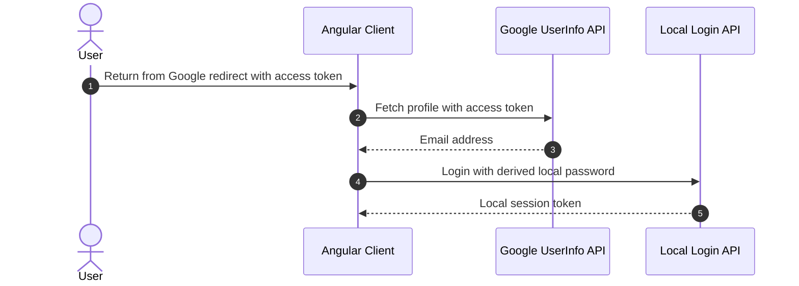

**Security assessment**

<!-- Model assessment (facts the narrative must not contradict): The redirect URI is checked against a configured allow-list before OAuth is enabled. However, the flow uses response_type=token (implicit) and sends no state parameter. The access token is also sent in a URL query string to the Google userinfo endpoint (user.service.ts line 68). -->
The OAuth adapter is a frontend hint that ends in a local password login, and it carries three weaknesses:

- The implicit flow sends no state, nonce or PKCE, so a redirect can be forged (🟠 [F-012](#f-012)).
- The access token travels in a userinfo URL query string and is never validated (🟠 [F-013](#f-013)).
- The local password is derived from the OAuth email, so anyone who knows the email can compute it (🟠 [F-014](#f-014)).


**Relevant findings**

- None linked to this control; see the other findings of this category.

<a id="client-side-credential-handling"></a>
**Client-side credential handling.**


**Status:** 🔴 Unsafe - a test password is hardcoded in the bundle and passwords travel in GET query strings.

The Angular client handles credentials in the login form and in the change-password call inside `user.service.ts`. The login validator only requires a minimum length of 1.

**Security assessment**

<!-- Model assessment (facts the narrative must not contradict): The bundle ships a hardcoded test account password. The change-password call sends current and new passwords as GET query parameters, which can leak into logs and history. The login password validator only requires a minimum length of 1. -->
Three independent weaknesses sit in the client credential path:

- Current and new passwords are sent as GET query parameters on password change, so they land in logs and history (🟡 [F-072](#f-072)).
- A hardcoded test account password ships in the bundle.
- The login password validator accepts any single character.
- The OAuth login password is predictable from the email (🟠 [F-014](#f-014)).

**Relevant findings**

- None linked to this control; see the other findings of this category.

<a id="wallet-ownership-verification-for-nft-mint-and-wallet-endpoints"></a>
**Wallet ownership verification for NFT mint and wallet endpoints.**


**Status:** 🔴 Missing - no signature or nonce challenge proves control of a wallet address, and no session is checked.

This control is not evidenced in the repository.

The diagram shows the current wallet claim path, which has no proof-of-ownership step:
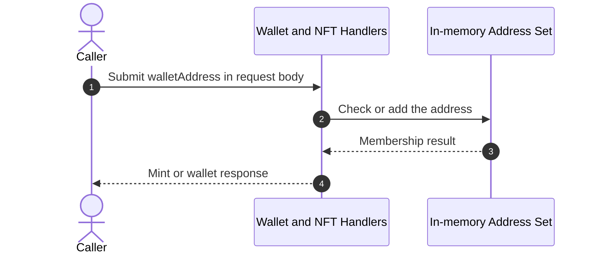

**Security assessment**

<!-- Model assessment (facts the narrative must not contradict): The wallet address is taken directly from the request body (req.body.walletAddress) and used as an identity claim. No signature or nonce challenge proves control of the address, and no authenticated session is checked in these handlers. Anyone can submit another party's minter address to claim its mint. The only gate is on-chain event membership in an in-memory set. -->
The wallet address from the request body acts as the identity claim:

- Anyone can submit another party's minter address and claim its mint.
- The only gate is on-chain event membership in an in-memory set.
- No finding is routed to this control, but unauthenticated route registration in this category is covered by 🟠 [F-040](#f-040) — Sensitive routes registered without authentication middleware and 🟠 [F-041](#f-041) — Sensitive Routes Registered Without Authentication Middleware.


**Relevant findings**

- None linked to this control; see the other findings of this category.

<a id="password-reset-via-security-answer"></a>
#### 6.2.2 Password reset via security answer

**Status:** 🟠 Weak - recovery depends on a guessable knowledge answer on an unauthenticated route.

`routes/resetPassword.ts` resets a password when the caller submits the correct security-question answer. A rate limit of 100 requests per 5 minutes sits in front of the route.

The diagram shows the intended security-answer reset path:
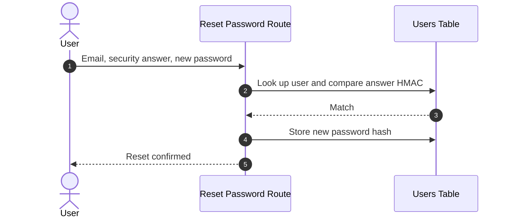

**Security assessment**

<!-- Model assessment (facts the narrative must not contradict): Reset relies on a knowledge-based security answer. The route is unauthenticated, and no rate limiting or lockout is visible in the inspected handler. -->
Recovery strength depends on one knowledge factor:

- A security-question answer alone resets the password (🟠 [F-021](#f-021)).
- The answers are guessable, and the endpoint reveals which accounts exist (🟠 [F-022](#f-022), 🟡 [F-077](#f-077)).
- No password strength policy applies on reset (🟡 [F-049](#f-049)).
- The limiter key derives from a spoofable header, covered in the rate limiting control of [§6.4](#64-authorization-controls).


**Relevant findings**

- None linked to this control; see the other findings of this category.

<a id="totp-second-factor"></a>
#### 6.2.3 TOTP second factor

**Status:** 🟡 Partial - the second factor is checked, but attempt limiting is weak.

`routes/2fa.ts` validates a temporary token and then a TOTP code. The TOTP secret is stored in the user record.

The diagram shows the TOTP verification step after the password check:
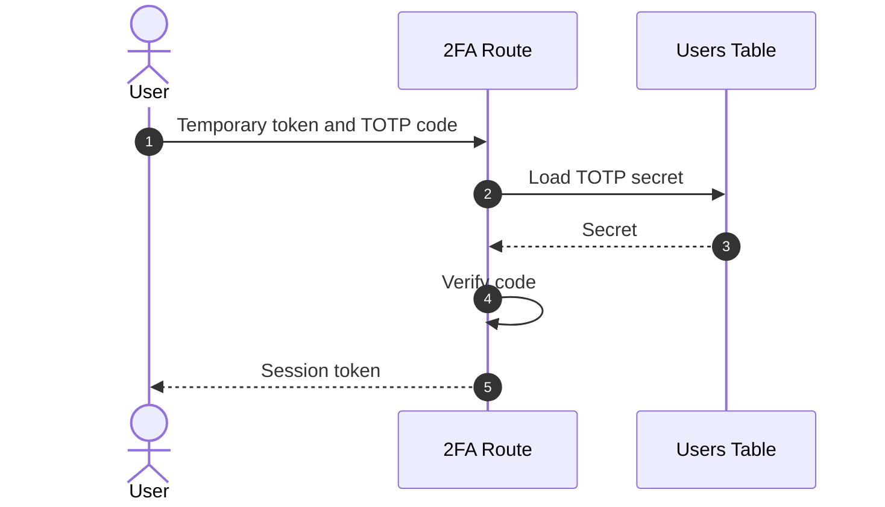

**Security assessment**

<!-- Model assessment (facts the narrative must not contradict): The 2FA step validates a typed temporary token and then a TOTP code. The TOTP secret is stored in the user record, and no attempt throttling is visible in the inspected code. -->
The factor works on the happy path but is thinly protected:

- Attempt limiting on verification is weak (🟡 [F-112](#f-112)).
- The route carries a 100-per-5-minutes limit, which is loose for a six-digit code.
- The TOTP secret sits in the same user record that other findings show to be exposed.


**Relevant findings**

- None linked to this control; see the other findings of this category.

<a id="user-registration"></a>
#### 6.2.4 User Registration

**Status:** 🔴 Unsafe - a privileged role can be supplied in the registration body.

<!-- Model implementation note (facts for the intro): Present at POST /api/Users -->
Registration is served at `POST /api/Users` from `server.ts`, creating the account record from the posted body.

The diagram shows the intended registration path:
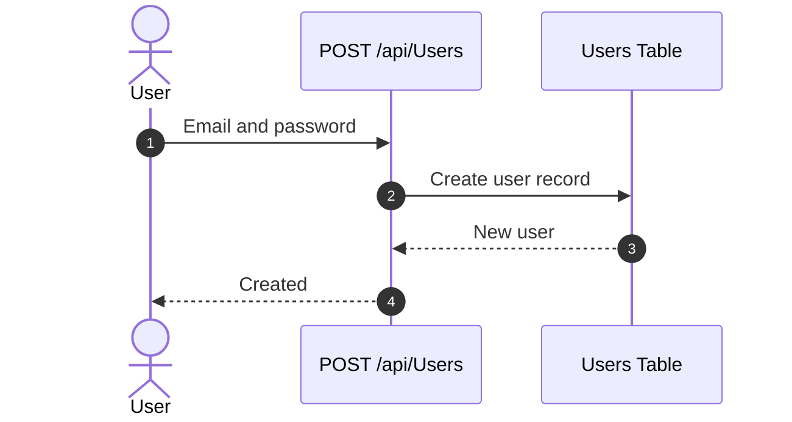

**Security assessment**

Registration trusts the request body and sits on an unauthenticated path:

- A role field in the body is accepted, so a caller can register as an admin (🟠 [F-044](#f-044), 🟠 [F-045](#f-045)).
- Sensitive routes are registered without authentication middleware (🟠 [F-040](#f-040), 🟠 [F-041](#f-041)).
- A non-string socket payload raises an unhandled exception in the real-time handler (🟡 [F-085](#f-085)).


**Relevant findings**

- 🟠 [F-040](#f-040) — Sensitive routes registered without authentication middleware
- 🟠 [F-041](#f-041) — Sensitive Routes Registered Without Authentication Middleware
- 🟠 [F-044](#f-044) — User registration does not block a privileged role in the body
- 🟠 [F-045](#f-045) — Registration accepts a role from the request body
- 🟡 [F-085](#f-085) — Unhandled exceptions from non-string socket

### 6.3 Session and Token Controls

<a id="ctrl-session-and-token-controls"></a>

**Verdict:** 🟠 Weak - tokens are `RS256`-signed with an expiry, but the key is public, storage is script-readable and nothing is revoked.

<!-- The line below is mechanically derived from the controls table — LLM must not re-author it. -->
**Controls covered:**

- [6.3.1 Client-side session token storage](#631-client-side-session-token-storage)
- [6.3.2 Cookie/session token check on profile image URL upload](#632-cookiesession-token-check-on-profile-image-url-upload)
- [6.3.3 Session Token Issuance](#633-session-token-issuance)

**Implemented controls:** Client-side session token storage, Cookie/session token check on profile image URL upload, Session Token Issuance (JWT Based).

**Assessment:** This application issues one locally signed token format (JWT) for every session, whichever login flow in [§6.2](#62-identity-and-authentication-controls) established it. The sub-sections trace browser storage, the cookie check on a sensitive route, and issuance. The token is stored in script-readable places (🟠 [F-003](#f-003), 🟡 [F-083](#f-083)), and the signing key is public (🟠 [F-023](#f-023)).

**Findings in this category without a control:**

- 🟠 [F-003](#f-003) — Auth Token Stored in Browser Storage
- 🟡 [F-083](#f-083) — Session token cookie set without HttpOnly or Secure

<a id="client-side-session-token-storage"></a>
#### 6.3.1 Client-side session token storage

**Status:** 🟠 Weak - the token sits in `localStorage` and a script-set cookie.

After login the Angular client writes the token to `localStorage` and to a cookie set through the client-side cookie service.

**Security assessment**

<!-- Model assessment (facts the narrative must not contradict): The login flow stores the auth token in localStorage and in a script-set cookie. Both are readable by any script in the page, so an XSS bug would expose the token. The cookie is set through the client-side cookie service, and no HttpOnly or Secure attributes are visible in the code. -->
Both stores are readable by any script on the page:

- The token in browser storage is exposed to any XSS bug (🟠 [F-003](#f-003)).
- The session cookie is set without HttpOnly or Secure (🟡 [F-083](#f-083)).

**Relevant findings**

- None linked to this control; see the other findings of this category.

<a id="cookiesession-token-check-on-profile-image-url-upload"></a>
#### 6.3.2 Cookie/session token check on profile image URL upload

**Status:** 🟡 Partial - unknown tokens are rejected, but the cookie secret is hardcoded and no CSRF protection is visible.

<!-- Model implementation note (facts for the intro): routes/profileImageUrlUpload.ts line 21; server.ts line 289 -->
`routes/profileImageUrlUpload.ts` looks up the token cookie in the in-memory `authenticatedUsers` map and rejects unknown tokens.

**Security assessment**

<!-- Model assessment (facts the narrative must not contradict): The handler looks up the token cookie in the in-memory authenticatedUsers map and rejects unknown tokens. The cookie parser secret is the hardcoded 'kekse'. There is no CSRF protection visible on this cookie-authenticated POST. -->
The cookie check is a thin gate:

- The cookie parser secret is the hardcoded value `kekse`.
- The cookie-authenticated POST has no visible CSRF protection.
- Behind this check the route fetches user-supplied URLs (🟠 [F-036](#f-036)).

**Relevant findings**

- None linked to this control; see the other findings of this category.

<a id="session-token-issuance"></a><a id="session-token-issuance-jwt-based"></a>
#### 6.3.3 Session Token Issuance

**Status:** 🟡 Partial - `RS256` signing with a 6h expiry, but a hardcoded key and no revocation.

`lib/insecurity.ts` signs `RS256` tokens with a 6h expiry on login, and `express-jwt` verifies them with the public key.

The diagram shows token issuance and validation on later requests:
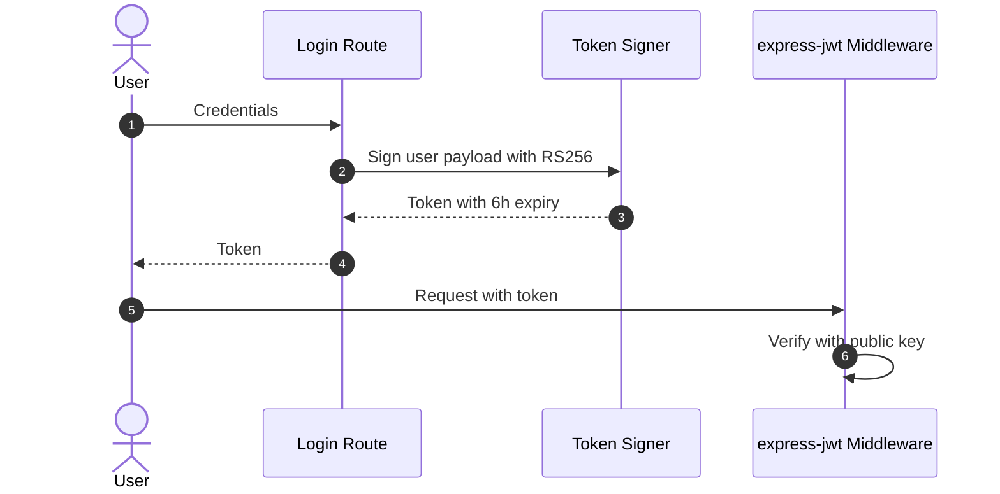

**Security assessment**

<!-- Model assessment (facts the narrative must not contradict): Tokens are RS256-signed with a 6h expiry and verified with the public key through express-jwt. The private key is hardcoded. The tokens carry the full user record, including the password hash, as payload. Tokens are held in an in-memory map with no revocation or logout invalidation. -->
The token format is sound, but its surroundings are not:

- The private signing key is committed in source, so anyone can forge tokens (🟠 [F-023](#f-023)).
- Verification does not pin an algorithm (🟠 [F-016](#f-016), 🟡 [F-048](#f-048)) and skips expiry, issuer and audience checks (🟡 [F-047](#f-047)).
- The payload carries the full user record, including the password hash (🟡 [F-082](#f-082)).
- Tokens live in an in-memory map with no revocation or logout invalidation.


**Relevant findings**

- None linked to this control; see the other findings of this category.

### 6.4 Authorization Controls

<a id="ctrl-authorization-controls"></a>


**Systemic weaknesses:** [W-003](#w-003), [W-004](#w-004), [W-005](#w-005), [W-021](#w-021), [W-022](#w-022)
**Verdict:** 🟠 Weak - middleware exists but covers routes inconsistently, and many object-level checks are missing.

<!-- The line below is mechanically derived from the controls table — LLM must not re-author it. -->
**Controls covered:**

- [6.4.1 Request authentication for API calls](#641-request-authentication-for-api-calls)
- [6.4.2 Route-level authorization middleware](#642-route-level-authorization-middleware)
- [6.4.3 Rate limiting](#643-rate-limiting)
- [6.4.4 Role checks and user binding](#644-role-checks-and-user-binding)

**Implemented controls:** Request authentication for API calls, Route-level authorization middleware, Rate limiting, Role checks and user binding.

**Assessment:** `isAuthorized`, `denyAll` and `isAccounting` guard some routes, but many are left open. Basket, order, user and admin routes lack ownership or role checks (🟠 [F-002](#f-002), 🟠 [F-028](#f-028), 🟡 [F-104](#f-104), 🟡 [F-105](#f-105), 🟡 [F-108](#f-108)). Checkout trusts a client-supplied user id (🔴 [F-011](#f-011)). Server-side authorization is the missing pattern.

**Findings in this category without a control:**

- 🟠 [F-002](#f-002) — Basket IDOR: missing ownership checks on basket routes
- 🔴 [F-011](#f-011) — Checkout trusts client-supplied UserId for wallet changes
- 🟠 [F-028](#f-028) — Basket item update does not check item owner
- 🟠 [F-039](#f-039) — Key and log file servers lack any authentication or role check
- 🟠 [F-040](#f-040) — Sensitive routes registered without authentication middleware
- 🟠 [F-041](#f-041) — Sensitive Routes Registered Without Authentication Middleware
- 🟠 [F-043](#f-043) — Unauthenticated update of products
- 🟠 [F-044](#f-044) — User registration does not block a privileged role in the body
- 🟠 [F-045](#f-045) — Registration accepts a role from the request body
- 🟡 [F-061](#f-061) — Review update lacks author ownership check
- 🟡 [F-062](#f-062) — Hint update endpoint lacks authentication and field limits
- 🟡 [F-063](#f-063) — Basket item update accepts arbitrary body fields
- 🟡 [F-064](#f-064) — Product review author is set
- 🟡 [F-065](#f-065) — Wallet top-up amount is taken from the request body
- 🟡 [F-066](#f-066) — Security answer creation accepts UserId from request body
- 🟡 [F-090](#f-090) — Deluxe upgrade succeeds without a payment
- 🟡 [F-092](#f-092) — Basket read lacks ownership check
- 🟡 [F-093](#f-093) — Basket ownership check bypass
- 🟡 [F-094](#f-094) — Chat order lookup binds ownership to masked email
- 🟡 [F-095](#f-095) — Data export matches orders by masked email
- 🟡 [F-096](#f-096) — Basket checkout lacks ownership check on basket id
- 🟡 [F-097](#f-097) — Recycle records readable by any caller by id
- 🟡 [F-098](#f-098) — Any authenticated user can read other users by id
- 🟡 [F-099](#f-099) — Basket items readable and deletable by any authenticated user
- 🟡 [F-100](#f-100) — Checkout does not bind basket to caller
- 🟡 [F-101](#f-101) — Coupon application does not bind basket to caller
- 🟡 [F-102](#f-102) — Order tracking returns any order by identifier
- 🟡 [F-104](#f-104) — User list readable by any authenticated user
- 🟡 [F-105](#f-105) — Any logged-in user can create products without a role check
- 🟡 [F-106](#f-106) — Complaint list readable by any authenticated user
- 🟡 [F-107](#f-107) — Any authenticated user can delete any feedback
- 🟡 [F-108](#f-108) — Admin configuration and version routes lack authorization
- 🟡 [F-109](#f-109) — Metrics endpoint exposed without authorization
- 🟡 [F-110](#f-110) — Uncapped model-directed coupon generation in chat tool
- 🟡 [F-111](#f-111) — Any authenticated user can list all user
- 🟡 [F-113](#f-113) — Address update by id lacks ownership check
- 🟡 [F-114](#f-114) — User listing endpoint lacks role check

<a id="request-authentication-for-api-calls"></a>
#### 6.4.1 Request authentication for API calls

**Status:** 🟡 Partial - object IDs come from client values and several flows have no server-side authentication scheme.

Angular services pass basket and address IDs from client-held values, and the server authenticates requests where `isAuthorized` is in the route chain.

**Security assessment**

<!-- Model assessment (facts the narrative must not contradict): Services reference object IDs (basket, address) taken from client-controlled values. Authorization must be enforced server-side. This client-side evidence does not show whether it is. Several flows have no authentication scheme resolved on the server side, and the chat route decodes its token without signature verification. -->
Authentication is applied unevenly across the API:

- Sensitive routes are registered without authentication middleware (🟠 [F-040](#f-040), 🟠 [F-041](#f-041)).
- The chat route decodes its token without verifying the signature (🟡 [F-046](#f-046)).
- Basket and address IDs from the client are not bound to the caller (🟠 [F-002](#f-002), 🟡 [F-113](#f-113)).

**Relevant findings**

- None linked to this control; see the other findings of this category.

<a id="route-level-authorization-middleware"></a>
#### 6.4.2 Route-level authorization middleware

**Status:** 🟡 Partial - guards cover baskets, B2B and some admin routes, but coverage has gaps.

<!-- Model implementation note (facts for the intro): server.ts lines 351-454 and 608-676 -->
`server.ts` chains `isAuthorized`, `denyAll` and `isAccounting` onto baskets, B2B, complaints, privacy requests and some admin routes.

**Security assessment**

<!-- Model assessment (facts the narrative must not contradict): isAuthorized/denyAll/isAccounting are applied to baskets, B2B, complaints, privacy requests and some admin routes. Coverage is inconsistent: /rest/chat, /rest/memories, /rest/wallet/balance, /rest/deluxe-membership, /rest/products/:id/reviews PUT and /api/Cards, /api/Addresss GET have no isAuthorized in the visible chain (appendUserId only). The PUT /api/Products isAuthorized line is commented out. -->
Coverage is inconsistent:

- The `isAuthorized` line on the product update route is commented out (🟠 [F-043](#f-043)).
- Memories, wallet balance, deluxe membership, cards and addresses have only `appendUserId` in the visible chain (🟡 [F-091](#f-091), 🟡 [F-090](#f-090)).
- User, complaint and admin routes accept any logged-in user (🟡 [F-104](#f-104), 🟡 [F-106](#f-106), 🟡 [F-114](#f-114)).

**Relevant findings**

- None linked to this control; see the other findings of this category.

<a id="rate-limiting"></a>
#### 6.4.3 Rate limiting

**Status:** 🟠 Weak - limits exist for reset and 2FA, but the key is spoofable and login is not covered.

<!-- Model implementation note (facts for the intro): server.ts lines 342-347, 458-475 -->
`server.ts` applies 100 requests per 5 minutes to the reset-password and 2FA routes.

**Security assessment**

<!-- Model assessment (facts the narrative must not contradict): Rate limits exist for reset-password and 2FA routes (100 per 5 minutes). The reset-password key derives from the X-Forwarded-For header, which a client can spoof to bypass the limit. The login and chat routes are not rate limited in the inspected scope. -->
The limiter protects less than it appears to:

- The reset-password key derives from `X-Forwarded-For`, which a client can spoof.
- The login route has no rate limit in the inspected scope (🔴 [F-004](#f-004)).
- The chat route has no rate limit either (🟡 [F-086](#f-086)).
- TOTP verification stays weakly limited (🟡 [F-112](#f-112)).

**Relevant findings**

- None linked to this control; see the other findings of this category.

<a id="role-checks-and-user-binding"></a>
#### 6.4.4 Role checks and user binding

**Status:** 🟡 Partial - roles are checked after signature verification, but the token key is public and roles can be self-assigned.

The accounting, deluxe and customer helpers verify the JWT signature and check the role claim. Deluxe status is also bound to an HMAC token.

**Security assessment**

<!-- Model assessment (facts the narrative must not contradict): Role helpers (accounting, deluxe, customer) verify the JWT signature and check the role claim. Deluxe status is additionally bound to an HMAC token. -->
The role checks depend on inputs the attacker can influence:

- A forged token with any role verifies, because the signing key is public (🟠 [F-023](#f-023)).
- Registration lets the caller choose the role (🟠 [F-044](#f-044), 🟠 [F-045](#f-045)).
- Deluxe status can be granted without payment (🟡 [F-090](#f-090), 🟡 [F-103](#f-103)).

**Relevant findings**

- None linked to this control; see the other findings of this category.

### 6.5 Query Construction and Data Access Controls

<a id="ctrl-query-construction-and-data-access-controls"></a>


**Systemic weaknesses:** [W-001](#w-001)
**Verdict:** 🔴 Unsafe - the login query is built by string interpolation and the other data stores are only lightly protected.

<!-- The line below is mechanically derived from the controls table — LLM must not re-author it. -->
**Controls covered:**

- [6.5.1 Login query construction](#651-login-query-construction)
- [6.5.2 Database connection authentication and storage protection](#652-database-connection-authentication-and-storage-protection)

**Implemented controls:** Login query construction, Database connection authentication and storage protection.

**Assessment:** Raw SQL on login and search lets input alter query structure (🔴 [F-004](#f-004), 🔴 [F-005](#f-005)). Review queries are NoSQL JavaScript built from request values (🟠 [F-030](#f-030), 🟡 [F-067](#f-067), 🟡 [F-068](#f-068)). The embedded SQLite file has no access login.

**Findings in this category without a control:**

- 🔴 [F-004](#f-004) — SQL injection in login query enabling authentication bypass
- 🔴 [F-005](#f-005) — SQL injection in product search query
- 🟠 [F-030](#f-030) — NoSQL JavaScript injection
- 🟡 [F-067](#f-067) — NoSQL where-clause string built from product
- 🟡 [F-068](#f-068) — NoSQL operator injection in review update

<a id="login-query-construction"></a>
#### 6.5.1 Login query construction

**Status:** 🔴 Unsafe - string interpolation of the email field bypasses the credential check.

`routes/login.ts` queries the Users table through raw `models.sequelize.query()`. The password is hashed first, then the email and hash are placed into the SQL string.

The diagram shows the intended credential lookup on login:
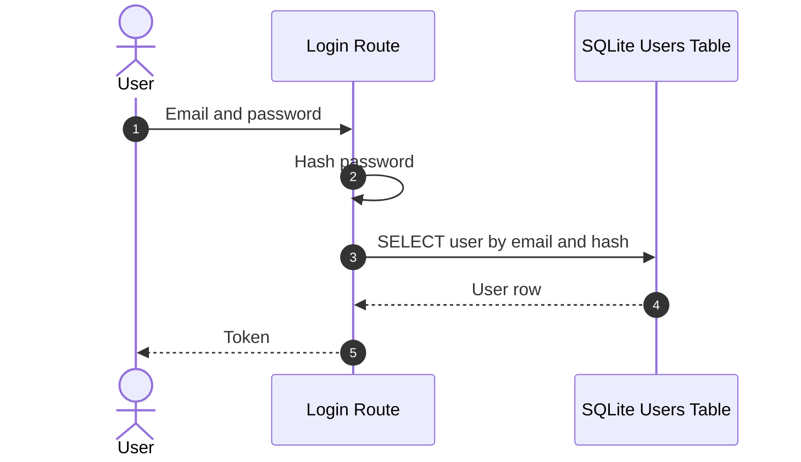

**Security assessment**

<!-- Model assessment (facts the narrative must not contradict): The login handler builds the SQL query by string interpolation of req.body.email, so the credential check can be bypassed by SQL injection. The password is hashed before interpolation, but the email is not escaped or parameterized. -->
The query builder fails in two places:

- The email value is neither escaped nor parameterized, so a crafted email returns the first user row (🔴 [F-004](#f-004)).
- Product search builds SQL the same way (🔴 [F-005](#f-005)).
- The password hash used in the query is unsalted `MD5` (🟠 [F-035](#f-035) — Passwords hashed with unsalted fast MD5 (Passwords hashed with unsalted fast `MD5`)).


**Relevant findings**

- None linked to this control; see the other findings of this category.

<a id="database-connection-authentication-and-storage-protection"></a>
#### 6.5.2 Database connection authentication and storage protection

**Status:** 🟠 Weak - SQLite ignores the placeholder credentials, so access depends on the filesystem.

<!-- Model implementation note (facts for the intro): models/index.ts createSequelize() -->
`createSequelize()` in `models/index.ts` connects Sequelize to the embedded SQLite file `data/juiceshop.sqlite`.

**Security assessment**

<!-- Model assessment (facts the narrative must not contradict): Sequelize connects to an embedded SQLite file (data/juiceshop.sqlite) with placeholder literal credentials; SQLite has no login, so access protection depends entirely on filesystem permissions and process isolation, none of which is configured in this file. No encryption at rest is configured here. Model-level query construction and setters in other files were not inspected, so no rating is given for them. -->
Protection rests on the host rather than the connection:

- The literal username and password have no effect, since SQLite has no login.
- No encryption at rest is configured in this file.
- Filesystem permissions and process isolation were not inspected and are not rated.

**Relevant findings**

- None linked to this control; see the other findings of this category.

### 6.6 Input Boundary Validation Controls

<a id="ctrl-input-boundary-validation-controls"></a>

**Verdict:** 🔴 Missing - there is no shared validation layer, and wallet input has no validation at all.

<!-- The line below is mechanically derived from the controls table — LLM must not re-author it. -->
**Controls covered:**

- [6.6.1 Validation Approach](#661-validation-approach)
- [6.6.2 Guest basket input sanitization](#662-guest-basket-input-sanitization)
- [6.6.3 Wallet address input validation](#663-wallet-address-input-validation)
- [6.6.4 WebSocket message input validation](#664-websocket-message-input-validation)
- [6.6.5 Chat LLM tool-call authorization and input handling](#665-chat-llm-tool-call-authorization-and-input-handling)
- [6.6.6 File upload constraints](#666-file-upload-constraints)

**Implemented controls:** Guest basket input sanitization, WebSocket message input validation, Chat LLM tool-call authorization and input handling, File upload constraints.

**Assessment:** Validation is per route and hand-written. Wallet amounts and addresses go unchecked (🟡 [F-059](#f-059), 🟡 [F-084](#f-084)). Chat and uploads lack consumption limits (🟡 [F-086](#f-086), 🟡 [F-087](#f-087)). Guest basket coercion is the only adequate check, and it runs in the browser.

**Findings in this category without a control:**

- 🟡 [F-059](#f-059) — Wallet top-up accepts unvalidated balance amount
- 🟡 [F-084](#f-084) — Unbounded wallet address set growth
- 🟡 [F-086](#f-086) — Unbounded LLM consumption on unauthenticated chat
- 🟡 [F-087](#f-087) — Memory upload has no size limit and writes files before

<a id="validation-approach"></a>
#### 6.6.1 Validation Approach

**Status:** 🟠 Weak - validation is ad hoc, and several routes accept unbounded or unvalidated values.

Checks are written per route: coercion in the guest basket, a MIME allowlist on uploads, zod schemas on chat tools and ad hoc tests in socket handlers. No shared schema layer is evidenced.

**Security assessment**

The gaps repeat across unrelated routes:

- Wallet top-up takes an unvalidated amount (🟡 [F-059](#f-059)).
- The wallet address set grows without bound (🟡 [F-084](#f-084)).
- Unauthenticated chat has no consumption limit (🟡 [F-086](#f-086)).
- Memory uploads have no size limit (🟡 [F-087](#f-087)).

**Relevant findings**

- None linked to this control; see the other findings of this category.

<a id="guest-basket-input-sanitization"></a>
#### 6.6.2 Guest basket input sanitization

**Status:** 🟢 Adequate - product IDs and quantities are coerced and invalid items dropped.

Guest basket data from `sessionStorage` is parsed in a try/catch, and product IDs and quantities are coerced to positive integers.

**Security assessment**

<!-- Model assessment (facts the narrative must not contradict): Guest basket data read from sessionStorage is parsed in a try/catch and coerced. Product IDs and quantities are validated as positive integers. Invalid items are dropped. This is a client-side convenience check only and does not replace server-side validation. -->
The check is sound for what it does:

- It runs in the client only, so it is a convenience and does not replace server-side validation.
- Server-side basket handling is assessed under [§6.4](#64-authorization-controls) (🟡 [F-063](#f-063)).

**Relevant findings**

- None linked to this control; see the other findings of this category.

<a id="wallet-address-input-validation"></a>
#### 6.6.3 Wallet address input validation

**Status:** 🔴 Missing - wallet addresses are stored with no type, format or checksum check.

This control is not evidenced in the repository.

**Security assessment**

<!-- Model assessment (facts the narrative must not contradict): walletAddress is added to an in-memory Set without type, format or checksum validation, and there is no size limit on the Set. An unauthenticated caller can grow it without bound, which is a memory-exhaustion risk. -->
The wallet handler accepts any value:

- No format or checksum check precedes insertion into the in-memory set.
- The set has no size limit, so an unauthenticated caller can exhaust memory (🟡 [F-084](#f-084)).

**Relevant findings**

- None linked to this control; see the other findings of this category.

<a id="websocket-message-input-validation"></a>
#### 6.6.4 WebSocket message input validation

**Status:** 🟠 Weak - payloads typed as `any` get only ad hoc checks.

`registerWebsocketEvents.ts` handlers check payloads with string-contains tests, a regex match with `isRedirectAllowed`, and `Array.isArray`.

**Security assessment**

<!-- Model assessment (facts the narrative must not contradict): Handler payloads typed as any are only checked with ad hoc criteria (string contains, regex match with isRedirectAllowed, Array.isArray). There is no schema validation or rate limiting. The effect is limited to marking challenges solved in this application. -->
Payload handling is loose:

- No schema validation applies to socket events.
- A non-string payload raises an unhandled exception (🟡 [F-085](#f-085)).
- No rate limiting exists, though the effect is limited to marking challenges solved.

**Relevant findings**

- None linked to this control; see the other findings of this category.

<a id="chat-llm-tool-call-authorization-and-input-handling"></a>
#### 6.6.5 Chat LLM tool-call authorization and input handling

**Status:** 🟠 Weak - the model-directed coupon action is not bound server-side.

<!-- Model implementation note (facts for the intro): routes/chat.ts lines 116-188 -->
`routes/chat.ts` defines LLM tools: `getOrderById`, `generateCoupon` and `getProductReviews`. `getOrderById` compares the caller's masked email with the order.

**Security assessment**

<!-- Model assessment (facts the narrative must not contradict): getOrderById checks the authenticated user's masked email against the order. generateCoupon enforces its policy (max 10%, damaged order) only in the prompt/description; the zod schema accepts any number and execute has no server-side cap, so the model-directed action is not bound. getProductReviews builds a \$where string from Number(id), which is coerced but is still string-built NoSQL JS. Chat route has no authentication middleware. Inspected scope: tool definitions only; the rest of the handler was not read. -->
Tool policy lives in the prompt rather than in code:

- `generateCoupon` states its cap and damaged-order rule only in the description, so coupon generation is uncapped (🟡 [F-110](#f-110)).
- `getProductReviews` still builds a NoSQL JavaScript string, though the id is coerced (🟡 [F-067](#f-067)).
- Order lookup binds ownership to a masked email (🟡 [F-094](#f-094)).
- Client chat messages reach the model unvalidated (🟡 [F-069](#f-069)).
- Only the tool definitions were inspected.

**Relevant findings**

- None linked to this control; see the other findings of this category.

<a id="file-upload-constraints"></a>
#### 6.6.6 File upload constraints

**Status:** 🟡 Partial - memory uploads have a size and MIME limit, but the MIME type is client-declared.

<!-- Model implementation note (facts for the intro): server.ts lines 692-717 -->
`server.ts` configures multer for memory uploads with a 200 KB limit, a png/jpeg MIME allowlist and timestamp-based filenames.

**Security assessment**

<!-- Model assessment (facts the narrative must not contradict): Memory uploads are limited by a 200 KB size limit and by a MIME allowlist (png/jpeg), and filenames are sanitized with a timestamp. The MIME type is the client-declared value and content is not verified. The disk-storage multer has no explicit size limit. -->
The constraints are partial:

- The MIME type is the client-declared value and content is not verified.
- The disk-storage multer instance has no explicit size limit (🟡 [F-087](#f-087)).
- Fetched remote content is stored unvalidated (🟡 [F-060](#f-060)).

**Relevant findings**

- None linked to this control; see the other findings of this category.

### 6.7 Output Encoding and Rendering Controls


**Systemic weaknesses:** [W-006](#w-006), [W-023](#w-023)
**Verdict:** 🔴 Unsafe - the redirect check passes attacker URLs, and Angular's escaping is bypassed in several components.

<!-- The line below is mechanically derived from the controls table — LLM must not re-author it. -->
**Controls covered:**

- [6.7.1 Redirect allowlist](#671-redirect-allowlist)

**Implemented controls:** Redirect allowlist.

**Assessment:** The redirect allowlist uses substring matching. Seven findings bypass or skip Angular escaping through trusted-HTML calls, DOM sinks and unsanitized stored data (🟠 [F-001](#f-001), 🟠 [F-024](#f-024), 🟡 [F-050](#f-050), 🟡 [F-051](#f-051) (DOM XSS from JWT `lastLoginIp` claim rendered), 🟡 [F-052](#f-052) — Product descriptions marked trusted HTML, 🟡 [F-053](#f-053) — Order ID wrapped as trusted HTML in track, 🟡 [F-071](#f-071) — Product description stored without sanitization).

**Findings in this category without a control:**

- 🟠 [F-001](#f-001) — Angular trusted-HTML sanitizer bypass causing XSS
- 🟠 [F-024](#f-024) — Reflected DOM XSS from search query parameter
- 🟡 [F-050](#f-050) — Unsanitized HTML written to new window
- 🟡 [F-051](#f-051) — DOM XSS from JWT lastLoginIp claim rendered
- 🟡 [F-052](#f-052) — Product descriptions marked trusted HTML
- 🟡 [F-053](#f-053) — Order ID wrapped as trusted HTML in track
- 🟡 [F-071](#f-071) — Product description stored without sanitization

<a id="redirect-allowlist"></a>
#### 6.7.1 Redirect allowlist

**Status:** 🔴 Unsafe - substring matching lets a URL containing an allowed URL pass.

`isRedirectAllowed` compares a requested redirect target against an allowlist of URLs, and the socket handlers also call it.

**Security assessment**

<!-- Model assessment (facts the narrative must not contradict): isRedirectAllowed uses substring matching (url.includes) against the allowlist. An attacker URL that contains an allowed URL as a substring therefore passes. -->
The allowlist test is loose:

- It uses `url.includes`, so an attacker URL that embeds an allowed URL passes.
- Output rendering elsewhere shows the same trust pattern, for example a trusted-HTML bypass (🟠 [F-001](#f-001)) and a DOM XSS from the search parameter (🟠 [F-024](#f-024)).

**Relevant findings**

- None linked to this control; see the other findings of this category.

### 6.8 Browser and Cross-Origin Controls


**Systemic weaknesses:** [W-004](#w-004), [W-005](#w-005)
**Verdict:** 🟠 Weak - third-party loading has no integrity attribute, no CSP is visible and the socket origin is a development value.

<!-- The line below is mechanically derived from the controls table — LLM must not re-author it. -->
**Controls covered:**

- [6.8.1 Third-party resource loading](#681-third-party-resource-loading)
- [6.8.2 WebSocket connection origin restriction](#682-websocket-connection-origin-restriction)

**Implemented controls:** Third-party resource loading, WebSocket connection origin restriction (CORS).

**Assessment:** The browser-facing controls are thin. A Google Fonts stylesheet loads without Subresource Integrity, no CSP is visible in the inspected component, and the socket CORS origin is hardcoded to localhost. The OAuth flow also lacks a state parameter (🟠 [F-012](#f-012)). Server and CDN headers were not inspected.

**Findings in this category without a control:**

- 🟠 [F-012](#f-012) — OAuth implicit flow without state, nonce or PKCE

<a id="third-party-resource-loading"></a>
#### 6.8.1 Third-party resource loading

**Status:** 🟠 Weak - an external stylesheet loads without Subresource Integrity and no CSP is visible.

The page loads a Google Fonts stylesheet and carries an inline script block.

**Security assessment**

<!-- Model assessment (facts the narrative must not contradict): The page loads a Google Fonts stylesheet with no Subresource Integrity attribute. An inline script block is also present, which would conflict with a strict script CSP. No CSP is visible in this component. Server or CDN headers were not inspected. -->
Browser hardening is thin:

- The stylesheet has no integrity attribute.
- The inline script would conflict with a strict script CSP.
- No CSP is visible in this component, and server headers were not inspected.

**Relevant findings**

- None linked to this control; see the other findings of this category.

<a id="websocket-connection-origin-restriction"></a><a id="websocket-connection-origin-restriction-cors"></a>
#### 6.8.2 WebSocket connection origin restriction

**Status:** 🟡 Partial - CORS is restricted, but to a single development origin.

The `socket.io` server sets a CORS origin restricted to `http://localhost:4200`.

**Security assessment**

<!-- Model assessment (facts the narrative must not contradict): socket.io Server is configured with a CORS origin restricted to a single hardcoded value (http://localhost:4200). This limits browser cross-origin use but is hardcoded to a development origin, and CORS is not a server-side authentication or Origin enforcement on non-browser clients. -->
The restriction limits less than it seems:

- The origin is hardcoded to a development value.
- CORS constrains browsers only, so non-browser clients connect freely.

**Relevant findings**

- None linked to this control; see the other findings of this category.

### 6.9 Cryptography Secrets and Data Protection


**Systemic weaknesses:** [W-034](#w-034)
**Verdict:** 🟠 Weak - passwords use unsalted `MD5`, signing and HMAC keys are in source, and the database file is unencrypted.

<!-- The line below is mechanically derived from the controls table — LLM must not re-author it. -->
**Controls covered:**

- [6.9.1 Alchemy API key handling in RPC URL](#691-alchemy-api-key-handling-in-rpc-url)
- [6.9.2 Password hashing and HMAC secrets](#692-password-hashing-and-hmac-secrets)
- [6.9.3 Embedded SQLite database access protection and encryption at rest](#693-embedded-sqlite-database-access-protection-and-encryption-at-rest)

**Implemented controls:** Alchemy API key handling in RPC URL, Password hashing and HMAC secrets, Embedded SQLite database access protection and encryption at rest.

**Assessment:** Secrets live in source: the JWT private key (🟠 [F-023](#f-023)) and the security-answer HMAC key (🟡 [F-070](#f-070)). Passwords use unsalted `MD5` (🟠 [F-035](#f-035) (Passwords hashed with unsalted fast `MD5`), 🟠 [F-037](#f-037) (Unsalted `MD5` password hashing)), and a secret or token comes from a non-cryptographic RNG (🟠 [F-018](#f-018)). The Alchemy key is read from the environment.

**Findings in this category without a control:**

- 🟠 [F-018](#f-018) — Non-cryptographic RNG for a
- 🟠 [F-023](#f-023) — Hardcoded JWT signing private key in source
- 🟡 [F-070](#f-070) — Hardcoded HMAC key for security answers

<a id="alchemy-api-key-handling-in-rpc-url"></a>
#### 6.9.1 Alchemy API key handling in RPC URL

**Status:** 🟡 Partial - the key comes from the environment over TLS, but it sits in the URL path.

<!-- Model implementation note (facts for the intro): process.env.ALCHEMY_API_KEY in WebSocketProvider URL -->
`process.env.ALCHEMY_API_KEY` is placed in the URL of an ethers `WebSocketProvider` that connects over `wss`.

**Security assessment**

<!-- Model assessment (facts the narrative must not contradict): The key is read from the environment, not hardcoded, and the connection uses wss (TLS). It is embedded in the URL path. It defaults to an empty string when unset, so the failure is silent. The WebSocket error handler logs only error.message, which may include the URL. -->
Handling is better than most secrets here but not clean:

- The key defaults to an empty string when unset, so a missing key fails silently.
- The error handler logs `error.message`, which may include the URL.
- No finding is routed to this control.

**Relevant findings**

- None linked to this control; see the other findings of this category.

<a id="password-hashing-and-hmac-secrets"></a>
#### 6.9.2 Password hashing and HMAC secrets

**Status:** 🟠 Weak - unsalted `MD5` passwords and a hardcoded HMAC key.

`lib/insecurity.ts` hashes passwords with `MD5`, computes security-answer HMACs with a fixed key and holds the JWT private key.

**Security assessment**

<!-- Model assessment (facts the narrative must not contradict): Passwords are hashed with unsalted MD5. Security answers use an HMAC with a hardcoded key. The JWT private key is embedded in source. -->
All three secrets are weak:

- Passwords are hashed with unsalted fast `MD5` (🟠 [F-035](#f-035) — Passwords hashed with unsalted fast MD5 (Passwords hashed with unsalted fast `MD5`), 🟠 [F-037](#f-037) — Unsalted MD5 password hashing (Unsalted `MD5` password hashing)).
- The security-answer HMAC key is hardcoded (🟡 [F-070](#f-070)).
- The JWT private key is committed in source (🟠 [F-023](#f-023)).
- The issued token embeds the password hash (🟡 [F-082](#f-082)).
- A secret or token comes from a non-cryptographic RNG (🟠 [F-018](#f-018)).

**Relevant findings**

- None linked to this control; see the other findings of this category.

<a id="embedded-sqlite-database-access-protection-and-encryption-at-rest"></a>
#### 6.9.3 Embedded SQLite database access protection and encryption at rest

**Status:** 🟠 Weak - the database is a plain file with ignored credentials and no configured encryption.

<!-- Model implementation note (facts for the intro): models/index.ts:33-41 createSequelize() -->
`createSequelize()` in `models/index.ts` opens `data/juiceshop.sqlite` with the literal credentials `username` and `password`.

**Security assessment**

<!-- Model assessment (facts the narrative must not contradict): The Sequelize SQLite connection uses placeholder credentials ('username'/'password'), which SQLite ignores. The database is a plain file at data/juiceshop.sqlite, and no encryption at rest is configured in this file. Access control depends entirely on the application process and filesystem permissions, which were not inspected. Filesystem permissions and host-level disk encryption are unknown and are not rated. -->
Protection depends on the host:

- SQLite ignores the placeholder credentials.
- No encryption at rest is configured in this file.
- Filesystem permissions and disk encryption are unknown and not rated.

**Relevant findings**

- None linked to this control; see the other findings of this category.

### 6.10 File Parser and Outbound Request Controls

<a id="ctrl-file-parser-and-outbound-request-controls"></a>


**Systemic weaknesses:** [W-002](#w-002), [W-033](#w-033)
**Verdict:** 🔴 Missing - no allowlist or parser hardening is evidenced on outbound fetches, archives and XML.

<!-- The line below is mechanically derived from the controls table — LLM must not re-author it. -->
**Controls covered:**

- [6.10.1 Outbound URL fetch](#6101-outbound-url-fetch)

<!-- Mechanically derived: every control of this category is Missing. Renderer must not rewrite the line below. -->
**Implemented controls:** No control in this category is evidenced in the repository.

**Assessment:** Fourteen findings land here. User URLs are fetched with no host allowlist (🟠 [F-036](#f-036)), XML resolves external entities (🟠 [F-033](#f-033), 🟠 [F-034](#f-034)), zip entries traverse paths (🟠 [F-026](#f-026)), and code is evaluated server-side (🟠 [F-027](#f-027), 🟠 [F-038](#f-038) (Untrusted B2B `orderLinesData` evaluated)). Key and log directories are served publicly (🟠 [F-032](#f-032), 🟡 [F-079](#f-079), 🟡 [F-080](#f-080)).

**Findings in this category without a control:**

- 🟠 [F-025](#f-025) — Attacker-controlled layout template path in data
- 🟠 [F-026](#f-026) — Zip entry path traversal in complaint upload writes
- 🟠 [F-027](#f-027) — Server-side eval of stored username on profile page
- 🟠 [F-031](#f-031) — Stored username compiled into Pug template source
- 🟠 [F-032](#f-032) — Encryption keys directory is listed and served publicly
- 🟠 [F-033](#f-033) — XML parser resolves external entities
- 🟠 [F-034](#f-034) — XXE
- 🟠 [F-036](#f-036) — Server-side request forgery
- 🟠 [F-038](#f-038) — Untrusted B2B orderLinesData evaluated
- 🟡 [F-074](#f-074) — Arbitrary field selection and JSONP in whoami
- 🟡 [F-075](#f-075) — CAPTCHA answer returned to client
- 🟡 [F-076](#f-076) — Prometheus metrics endpoint unauthenticated
- 🟡 [F-079](#f-079) — Access log directory is listed and served publicly
- 🟡 [F-080](#f-080) — Encryption keys served without authentication

<a id="outbound-url-fetch"></a><a id="outbound-url-fetch-profile-image-url"></a>
#### 6.10.1 Outbound URL fetch

**Status:** 🔴 Missing - user URLs reach `fetch` with no scheme, host or private-address check.

This control is not evidenced in the repository.

**Security assessment**

<!-- Model assessment (facts the narrative must not contradict): The user-supplied URL is passed directly to fetch with no scheme, host, or private-address allowlist, so SSRF is possible. Only an authenticated session check exists. The extension is whitelisted for the file name, and the file is named by user id. Redirects are not restricted. -->
The profile image URL route has no outbound restrictions:

- The URL goes directly to `fetch`, and redirects are not restricted (🟠 [F-036](#f-036)).
- Fetched content is stored without validation (🟡 [F-060](#f-060)).
- Only an authenticated session check exists, and the file name is derived from the user id.

**Relevant findings**

- None linked to this control; see the other findings of this category.

### 6.11 Operations Runtime and Supply Chain Controls

**Build path.** [Figure 1b](#figure-1b) shows the inputs, build systems and release artifacts that Juice Shop evidences.

Highlighted path of 🟡 [F-055](#f-055) — Untrusted npm Install/Postinstall Scripts Enabled: npm registry → GitHub Actions → docker.io/bkimminich/juice-shop. The path stops where the evidence ends.

**Attack entries:**

- **Manipulated dependency**
  - 🟡 [F-055](#f-055) — Untrusted npm Install/Postinstall Scripts Enabled
  - 🟡 [F-057](#f-057) — Lockfile generation disabled so installs resolve floating versions
- **Manipulated CI input**
  - 🟡 [F-056](#f-056) — Third-party GitHub Actions referenced by mutable tags or branch
  - 🟡 [F-058](#f-058) — Container base images referenced by mutable tags
- **Replaced release artifact**
  - 🟡 [F-054](#f-054) — Missing Container Image Signing

**Not attributable to a build step:**

- 🟡 [F-088](#f-088) — Container Runs as Root


**Systemic weaknesses:** [W-012](#w-012)
**Verdict:** 🔴 Missing - lockfiles are disabled, installs float and workflow tokens are unscoped.

<!-- The line below is mechanically derived from the controls table — LLM must not re-author it. -->
**Controls covered:**

- [6.11.1 GitHub Actions pinning to commit SHAs](#6111-github-actions-pinning-to-commit-shas)
- [6.11.2 Dependency lockfile and install reproducibility](#6112-dependency-lockfile-and-install-reproducibility)
- [6.11.3 Workflow token permissions and secret scoping](#6113-workflow-token-permissions-and-secret-scoping)
- [6.11.4 Container image hardening](#6114-container-image-hardening)
- [6.11.5 WebSocket listener lifecycle and error handling](#6115-websocket-listener-lifecycle-and-error-handling)
- [6.11.6 Access logging and exposed operational endpoints](#6116-access-logging-and-exposed-operational-endpoints)
- [6.11.7 Database concurrency and retry handling](#6117-database-concurrency-and-retry-handling)
- [6.11.8 Build pipeline and dependency controls](#6118-build-pipeline-and-dependency-controls)

**Implemented controls:** GitHub Actions pinning to commit SHAs, Dependency lockfile and install reproducibility, Workflow token permissions and secret scoping, Container image hardening, WebSocket listener lifecycle and error handling.

**Assessment:** Supply-chain controls are mostly absent. Lockfile generation is off (🟡 [F-057](#f-057)), actions and base images use mutable tags (🟡 [F-056](#f-056), 🟡 [F-058](#f-058)), and workflows set no token permissions (🟡 [F-089](#f-089)). Operational endpoints and logs are exposed (🟡 [F-078](#f-078)). The distroless runtime image is the one strong control.

**Findings in this category without a control:**

- 🟡 [F-054](#f-054) — Missing Container Image Signing
- 🟡 [F-057](#f-057) — Lockfile generation disabled so installs resolve floating versions
- 🟡 [F-078](#f-078) — Access logs exposed without authentication
- 🟡 [F-088](#f-088) — Container Runs as Root
- 🟡 [F-089](#f-089) — Missing Workflow Permissions Block

<a id="github-actions-pinning-to-commit-shas"></a>
#### 6.11.1 GitHub Actions pinning to commit SHAs

**Status:** 🟡 Partial - most actions are SHA-pinned, but one mutable tag receives `GITHUB_TOKEN`.

<!-- Model implementation note (facts for the intro): .github/workflows/ci.yml:29,188; .github/workflows/release.yml:80 -->
`ci.yml` and `release.yml` pin most actions to full commit SHAs. `coverallsapp/github-action@v2` stays a mutable tag.

**Security assessment**

<!-- Model assessment (facts the narrative must not contradict): Most actions are pinned to full commit SHAs, but coverallsapp/github-action@v2 is a mutable tag and receives GITHUB_TOKEN. dawidd6/action-get-tag is archived (noted in a TODO) in the release path that holds Docker Hub credentials. -->
Two pinning gaps remain:

- A mutable-tag action receives the repository token (🟡 [F-056](#f-056)).
- An archived action sits in the release path that holds Docker Hub credentials.

**Relevant findings**

- None linked to this control; see the other findings of this category.

<a id="dependency-lockfile-and-install-reproducibility"></a>
#### 6.11.2 Dependency lockfile and install reproducibility

**Status:** 🟠 Weak - lockfiles are disabled, so builds resolve floating versions.

<!-- Model implementation note (facts for the intro): .npmrc:1; Dockerfile:4-5,19; release.yml:38-40,55 -->
`.npmrc` sets `package-lock=false`. The `Dockerfile` and `release.yml` install `typescript`, `grunt-cli` and CycloneDX tooling globally.

**Security assessment**

<!-- Model assessment (facts the narrative must not contradict): package-lock=false disables lockfiles, so npm install resolves floating semver ranges at build time. Release builds and the Docker image install unpinned typescript, grunt-cli and cyclonedx ranges globally. Compromised dependency releases would flow into published artifacts. Lint job uses —ignore-scripts, but release and Docker builds do not. -->
Build reproducibility is not guaranteed:

- Lockfile generation is disabled, so installs resolve floating ranges (🟡 [F-057](#f-057)).
- Release and Docker builds run install scripts, unlike the lint job (🟡 [F-055](#f-055)).
- A compromised dependency release would flow into published artifacts.

**Relevant findings**

- None linked to this control; see the other findings of this category.

<a id="workflow-token-permissions-and-secret-scoping"></a>
#### 6.11.3 Workflow token permissions and secret scoping

**Status:** 🟠 Weak - no permissions block is set, so the token gets default scope.

<!-- Model implementation note (facts for the intro): ci.yml (no permissions key); release.yml:76-77 -->
The inspected workflows set no top-level or job-level `permissions` key. Secrets come from the `secrets` context, and the release job pushes images on tag.

**Security assessment**

<!-- Model assessment (facts the narrative must not contradict): No top-level or job-level permissions block in the inspected workflows, so GITHUB_TOKEN uses repository default scope. Secrets are referenced via the secrets context rather than hardcoded. The release docker job pushes images on tag with Docker Hub credentials. Other workflows were not inspected. -->
Token scope is broader than needed:

- `GITHUB_TOKEN` uses repository default scope (🟡 [F-089](#f-089)).
- Images are published without signing (🟡 [F-054](#f-054)).
- Other workflows were not inspected.

**Relevant findings**

- None linked to this control; see the other findings of this category.

<a id="container-image-hardening"></a>
#### 6.11.4 Container image hardening

**Status:** 🟢 Adequate - distroless runtime image with a non-root user.

<!-- Model implementation note (facts for the intro): Dockerfile:1,22,38-39 -->
The `Dockerfile` uses a multi-stage build, a distroless runtime image and user 65532. Dev dependencies and frontend sources are removed, and a CycloneDX SBOM is generated.

**Security assessment**

<!-- Model assessment (facts the narrative must not contradict): Multi-stage build with a distroless runtime image and a non-root user (65532). Dev dependencies and frontend sources are removed. Base images use mutable tags, not digests. A CycloneDX SBOM is generated. -->
Image hardening is the strongest supply-chain control, with open items:

- Base images use mutable tags rather than digests (🟡 [F-058](#f-058)).
- A finding reports the container running as root (🟡 [F-088](#f-088)), which conflicts with the `Dockerfile`'s non-root user and needs reconciling.

**Relevant findings**

- None linked to this control; see the other findings of this category.

<a id="websocket-listener-lifecycle-and-error-handling"></a>
#### 6.11.5 WebSocket listener lifecycle and error handling

**Status:** 🟡 Partial - a singleton flag prevents duplicate listeners, but nothing reconnects or cleans up.

<!-- Model implementation note (facts for the intro): isEventListenerCreated flag and websocket.onerror handler -->
An `isEventListenerCreated` flag guards the listener, and `websocket.onerror` logs and resets it. Handler errors pass through `utils.getErrorMessage`.

**Security assessment**

<!-- Model assessment (facts the narrative must not contradict): A singleton flag stops duplicate listeners, and onerror logs and resets the flag. Nothing reconnects the socket or cleans it up, and a concurrent first request can race past the flag check before it is set. Handler errors are returned through utils.getErrorMessage. -->
Lifecycle handling is basic:

- Nothing reconnects or cleans up the socket after an error.
- A concurrent first request can race past the flag check.
- Unhandled exceptions from bad payloads remain possible (🟡 [F-085](#f-085)).

**Relevant findings**

- None linked to this control; see the other findings of this category.

<a id="access-logging-and-exposed-operational-endpoints"></a>
#### 6.11.6 Access logging and exposed operational endpoints

**Status:** 🟠 Weak - logs rotate, but log and metrics endpoints are public.

<!-- Model implementation note (facts for the intro): server.ts lines 281-283, 329-338, 676 -->
Morgan writes access logs that rotate daily and are kept for 2 days. `server.ts` serves `/support/logs` and `/metrics`.

**Security assessment**

<!-- Model assessment (facts the narrative must not contradict): Morgan access logs rotate daily and are kept for 2 days. The /support/logs directory listing and /metrics are served without authentication in the visible chain, which exposes operational data. -->
Operational data is exposed:

- Access logs are served without authentication (🟡 [F-078](#f-078), 🟡 [F-079](#f-079)).
- The Prometheus metrics endpoint needs no authentication (🟡 [F-076](#f-076), 🟡 [F-109](#f-109)).

**Relevant findings**

- None linked to this control; see the other findings of this category.

<a id="database-concurrency-and-retry-handling"></a>
#### 6.11.7 Database concurrency and retry handling

**Status:** 🟢 Adequate - busy-database errors are retried and transactions are immediate.

<!-- Model implementation note (facts for the intro): models/index.ts retry and transactionType options -->
`models/index.ts` retries `SQLITE_BUSY` errors up to 5 times and sets the transaction type to IMMEDIATE.

**Security assessment**

<!-- Model assessment (facts the narrative must not contradict): SQLITE_BUSY errors are retried up to 5 times and transactions use IMMEDIATE mode, which supports write consistency under contention. SQL statement logging is disabled, so queries are not available for audit or monitoring from this layer. -->
The control holds for consistency:

- Write contention is handled with bounded retries.
- SQL statement logging is disabled, so this layer gives no query audit trail.
- No finding is routed to this control.

**Relevant findings**

- None linked to this control; see the other findings of this category.

<a id="build-pipeline-and-dependency-controls"></a>
#### 6.11.8 Build pipeline and dependency controls

**Status:** 🔴 Missing - gaps in Lockfile hygiene, CI install integrity, Action pinning, Base image pinning, Install scripts

<!-- Model implementation note (facts for the intro): In place: Automated SCA scanning, Action pinning, Static analysis (SAST) -->
CodeQL and a GitLab-based dependency scan run in CI, and the `Dockerfile` builds a multi-stage image. Dependency resolution otherwise happens at install time with no lockfile.

- **Automated SCA scanning** — 🟢 Adequate. Automated SCA scanning present: `.gitlab-ci.yml:2`.
- **Automated dependency updates** — Not evidenced in the repository; it may run outside it (GitHub App, default setup, organization policy, agent).
- **Lockfile hygiene** — 🔴 Missing. Lockfile hygiene not detected in the repository (.gitignore:10, `.npmrc:1`).
- **CI install integrity** — 🔴 Missing. CI installs dependencies by resolving versions at install time: `.github/workflows/ci.yml:36`, `.github/workflows/ci.yml:38`, `.github/workflows/ci.yml:51`.
- **Action pinning** — 🟡 Partial. Some CI action or image references use a mutable tag or branch: `.github/workflows/ci.yml:188`, `.github/workflows/codeql-analysis.yml:23`, `.github/workflows/codeql-analysis.yml:34`. → 🟡 [F-056](#f-056) — Third-party GitHub Actions referenced by mutable tags or branch
- **Base image pinning** — 🔴 Missing. Base images use no tag or a mutable tag: `Dockerfile:1`, `Dockerfile:22`, `test/smoke/Dockerfile:1`. → 🟡 [F-058](#f-058) — Container base images referenced by mutable tags
- **Install scripts** — 🟠 Weak. A build step executes code fetched from an external URL: `.github/workflows/ci.yml:358`. → 🟡 [F-055](#f-055) — Untrusted npm Install/Postinstall Scripts Enabled
- **Static analysis (SAST)** — 🟢 Adequate. Static analysis runs in CI: `.github/workflows/codeql-analysis.yml:36`, `.gitlab-ci.yml:2`.

**Security assessment**

Gaps: Lockfile hygiene (Missing), CI install integrity (Missing), Action pinning (Partial), Base image pinning (Missing), Install scripts (Weak). Not evidenced in the repository: Automated dependency updates.

**Relevant findings**

- 🟡 [F-056](#f-056) — Third-party GitHub Actions referenced by mutable tags or branch
- 🟡 [F-058](#f-058) — Container base images referenced by mutable tags
- 🟡 [F-055](#f-055) — Untrusted npm Install/Postinstall Scripts Enabled

### 6.12 Real-time and Not Applicable Controls

**Verdict:** 🔴 Missing - the socket server accepts every client with no handshake or per-event authorization.

<!-- The line below is mechanically derived from the controls table — LLM must not re-author it. -->
**Controls covered:**

- [6.12.1 WebSocket connection and message-handler authentication/authorization](#6121-websocket-connection-and-message-handler-authenticationauthorization)

<!-- Mechanically derived: every control of this category is Missing. Renderer must not rewrite the line below. -->
**Implemented controls:** No control in this category is evidenced in the repository.

**Assessment:** The `socket.io` channel is present and handles notifications and challenge verification, yet it has no authentication at connection or event level. Unhandled exceptions from bad payloads add a denial-of-service path (🟡 [F-085](#f-085)). Any gateway enforcement outside the repository is unknown.

<a id="websocket-connection-and-message-handler-authenticationauthorization"></a>
#### 6.12.1 WebSocket connection and message-handler authentication/authorization

**Status:** 🔴 Missing - every client is accepted with no handshake authentication or event authorization.

This control is not evidenced in the repository.

**Security assessment**

<!-- Model assessment (facts the narrative must not contradict): The connection handler accepts every client with no handshake authentication, no io.use middleware, and no per-event authorization. Any connected client receives all stored notifications and can invoke the 'notification received' handler, which removes entries from the shared notifications array by flag value, plus the challenge-verification handlers. Inspected scope was this file only; external gateway enforcement is unknown. -->
The connection handler trusts all clients:

- No handshake check or `io.use` middleware exists.
- Any connected client receives all stored notifications and can remove entries by flag value.
- Non-string payloads cause unhandled exceptions (🟡 [F-085](#f-085)).
- Only this file was inspected.

**Relevant findings**

- None.

### 6.13 Defense-in-Depth Summary

<!-- §6.13 FORMAT — NEVER a table, at most 120 words, no file:line. Two short bullet lists: **What holds** (the individual positive controls that exist, strongest first, e.g. distroless runtime image, RS256 algorithm choice) and **Repair first** (the control-boundary repairs that would restore layered defense, each with its mitigation link [M-NNN](#m-nnn)). Do NOT emit a Markdown table — `| header |` lines under §6.13 are a contract violation. -->

**What holds**

- Distroless, non-root runtime image.
- `RS256` token signing with a 6h expiry.
- CodeQL and dependency scanning run in CI.
- Rate limits on reset and 2FA routes.

**Repair first**

- Parameterize the login and search queries (🔴 [F-004](#f-004), 🔴 [F-005](#f-005)).
- Move the signing key out of source (🟠 [F-023](#f-023)).
- Stop accepting roles at registration (🟠 [F-044](#f-044)).
- Add server-side ownership and role checks (🟠 [F-002](#f-002)).
- Restrict outbound fetches (🟠 [F-036](#f-036)).

---

<a id="weakness-register"></a>
## 7. Weakness Register

Systemic control gaps behind the findings, ordered by severity (W-001 = most severe). Each weakness names the missing, home-grown, or misused control, the findings that evidence it, the components it spans, and its remediation. A weakness may also rest on observed unsafe practice or an absent architectural control with no confirmed exploit - only confirmed findings carry a CVSS score.

- 🔴 **Critical** · [W-001](#w-001) - Database access relies on concatenated queries · confirmed · 2 findings · 1 component
- 🟠 **High** · [W-002](#w-002) - Input handling lacks enforced boundary validation · confirmed · 2 findings · 1 component
- 🟠 **High** · [W-003](#w-003) - Authorization is implemented route by route · confirmed · 31 findings · 3 components
- 🟠 **High** · [W-004](#w-004) - OAuth sign-in requests are not bound to the user's browser session · confirmed · 1 finding · 1 component
- 🟠 **High** · [W-005](#w-005) - Cookie-authenticated changes lack request authenticity checks · confirmed · 1 finding · 2 components
- 🟠 **High** · [W-006](#w-006) - Frontend rendering lacks enforced output encoding · confirmed · 7 findings · 2 components
- 🟠 **High** · [W-007](#w-007) - Application data crosses into executable code · observed-practice · 2 findings · 1 component
- 🟠 **High** · [W-008](#w-008) - Document-database queries take their structure from application values · observed-practice · 3 findings · 1 component
- 🟠 **High** · [W-009](#w-009) - Endpoints are reachable without enforced authentication · design-risk · 1 finding · 2 components
- 🟠 **High** · [W-010](#w-010) - Secrets are committed to source instead of a managed store · design-risk · 2 findings · 5 components
- 🟡 **Medium** · [W-011](#w-011) - Authentication relies on hand-rolled token verification · confirmed · 5 findings · 3 components
- 🟡 **Medium** · [W-012](#w-012) - Build pipeline trusts mutable third-party references · confirmed · 2 findings · 2 components
- 🟡 **Medium** · [W-013](#w-013) - Weak attempt limiting on TOTP verification (`2fa.ts:31`) · observed-practice · 1 finding · 1 component
- 🟡 **Medium** · [W-014](#w-014) - Unauthenticated route re-creates WebSocket providers after errors · observed-practice · 0 findings · 1 component
- 🟡 **Medium** · [W-015](#w-015) - Unbounded LLM consumption on unauthenticated chat (`chat.ts:203`) · observed-practice · 1 finding · 1 component
- 🟡 **Medium** · [W-016](#w-016) - Unbounded code-fix cache and directory scan per key (`vulnCodeFixes.ts:24`) · observed-practice · 0 findings · 1 component
- 🟡 **Medium** · [W-017](#w-017) - Application data builds operating-system commands · observed-practice · 0 findings · 1 component
- 🟡 **Medium** · [W-018](#w-018) - Application data crosses into template source · observed-practice · 1 finding · 1 component
- 🟡 **Medium** · [W-019](#w-019) - XML parser resolves external entities (`xml.ts:35`) · observed-practice · 1 finding · 1 component
- 🟡 **Medium** · [W-020](#w-020) - XXE via XML complaint upload (`fileUpload.ts:76`) · observed-practice · 1 finding · 1 component
- 🟡 **Medium** · [W-021](#w-021) - Client-side role guards trust unverified JWT claims (`app.guard.ts:54`) · observed-practice · 0 findings · 1 component
- 🟡 **Medium** · [W-022](#w-022) - Privileged attributes lack an enforced write allowlist · observed-practice · 4 findings · 1 component
- 🟡 **Medium** · [W-023](#w-023) - Sensitive cookies remain accessible to browser scripts · observed-practice · 1 finding · 1 component
- 🟡 **Medium** · [W-024](#w-024) - Browser scripts retain reusable session credentials · observed-practice · 1 finding · 1 component
- 🟡 **Medium** · [W-025](#w-025) - CTF flags broadcast to every connecting client (`registerWebsocketEvents.ts:30`) · observed-practice · 0 findings · 1 component
- 🟡 **Medium** · [W-026](#w-026) - Unauthenticated full application configuration exposure (`appConfiguration.ts:15`) · observed-practice · 0 findings · 1 component
- 🟡 **Medium** · [W-027](#w-027) - Confidential business rule held in system prompt (`chat.ts:105`) · observed-practice · 0 findings · 1 component
- 🟡 **Medium** · [W-028](#w-028) - Raw LLM error text returned to chat client (`chat.ts:255`) · observed-practice · 0 findings · 1 component
- 🟡 **Medium** · [W-029](#w-029) - Unencrypted SQLite database file at rest (`index.ts:41`) · observed-practice · 0 findings · 1 component
- 🟡 **Medium** · [W-030](#w-030) - Payment card numbers stored in plaintext (`card.ts:39`) · observed-practice · 0 findings · 1 component
- 🟡 **Medium** · [W-031](#w-031) - OAuth access token in userinfo URL and not validated for audience (`user.service`. · observed-practice · 1 finding · 1 component
- 🟡 **Medium** · [W-032](#w-032) - Passwords sent in GET query string on password change (`user.service.ts:54`) · observed-practice · 1 finding · 1 component
- 🟡 **Medium** · [W-033](#w-033) - Fetched remote content stored unvalidated under web root · observed-practice · 1 finding · 1 component
- 🟡 **Medium** · [W-034](#w-034) - Security-sensitive data uses weak cryptographic primitives · observed-practice · 3 findings · 2 components

<a id="w-001"></a>
### W-001 — Database access relies on concatenated queries

🔴 **Critical** · design weakness · confirmed · 2 findings

Database queries are assembled from application values instead of passing those values through an enforced parameterised data-access path. This leaves every call site responsible for preserving query structure.

**Architectural anti-pattern - Raw SQL string interpolation.** Several routes build queries by concatenating request values instead of binding parameters, so each route is exploitable independently and fixing one does not close the others.

**Confirmed findings:**

- 🔴 [F-004](#f-004) — SQL injection in login query enabling authentication bypass
- 🔴 [F-005](#f-005) — SQL injection in product search query

**Practice sites:**

- `routes/login.ts:34`
- `routes/search.ts:23`

**Architecture evidence:** Parameterized Queries, ORM / Repository Layer, Source evidence (`routes/vulnCodeSnippet.ts:46`)

**Affected components:** [C-05](#c-05)

**Remediation:**

- **Structural** — provide one parameterised repository or query-builder path and prohibit application-value interpolation in database queries
- **Tactical** — ● [M-031](#m-031) — Use parameterized queries, ● [M-032](#m-032) — Use parameterized database queries (F-005)

<a id="w-002"></a>
### W-002 — Input handling lacks enforced boundary validation

🟠 **High** · design weakness · confirmed · 2 findings

Request handlers do not validate input against one enforced server-side schema or allowlist at the boundary - validation is either absent on the vulnerable parameters or limited to rejecting selected bad patterns (a blacklist). New encodings and unanticipated input forms can therefore reach downstream parsers or interpreters.

**Confirmed findings:**

- 🟠 [F-026](#f-026) — Zip entry path traversal in complaint upload writes

**Practice sites:**

- 🟠 [F-025](#f-025) — Attacker-controlled layout template path in data
- `routes/vulnCodeFixes.ts:81`

**Architecture evidence:** Schema Validation, Allowlist Validation, Source evidence (`server.ts:204`), Source evidence (`server.ts:246`), Source evidence (`server.ts:411`), Source evidence (`server.ts:412`) (+4 more)

**Affected components:** [C-05](#c-05)

**Remediation:**

- **Structural** — enforce server-side schemas and domain-specific allowlists before input reaches parsing, persistence, or command construction
- **Tactical** — ◕ [M-045](#m-045) — Confine zip entries to the upload directory, ◑ [M-003](#m-003) — Manual review: verify Attacker-controlled layout template path in data erasure, ◕ [M-044](#m-044) — Constrain file paths to a safe base directory (F-025)

<a id="w-003"></a>
### W-003 — Authorization is implemented route by route

🟠 **High** · design weakness · confirmed · 31 findings

Authorization depends on per-handler checks instead of a policy boundary that consistently enforces role, ownership, and tenant scope. New routes can bypass protection by omitting a local check.

**Confirmed findings:**

- 🟠 [F-039](#f-039) — Key and log file servers lack any authentication or role check
- 🟠 [F-040](#f-040) — Sensitive routes registered without authentication middleware
- 🟠 [F-043](#f-043) — Unauthenticated update of products
- 🟡 [F-061](#f-061) — Review update lacks author ownership check
- 🟡 [F-090](#f-090) — Deluxe upgrade succeeds without a payment
- 🟡 [F-092](#f-092) — Basket read lacks ownership check
- 🟡 [F-093](#f-093) — Basket ownership check bypass
- 🟡 [F-100](#f-100) — Checkout does not bind basket to caller
- 🟡 [F-101](#f-101) — Coupon application does not bind basket to caller
- 🟡 [F-104](#f-104) — User list readable by any authenticated user
- 🟡 [F-105](#f-105) — Any logged-in user can create products without a role check
- 🟡 [F-106](#f-106) — Complaint list readable by any authenticated user
- 🟡 [F-108](#f-108) — Admin configuration and version routes lack authorization
- 🟡 [F-109](#f-109) — Metrics endpoint exposed without authorization
- 🟡 [F-110](#f-110) — Uncapped model-directed coupon generation in chat tool
- 🟡 [F-111](#f-111) — Any authenticated user can list all user
- 🟡 [F-114](#f-114) — User listing endpoint lacks role check

**Practice sites:**

- 🟠 [F-002](#f-002) — Basket IDOR: missing ownership checks on basket routes
- 🔴 [F-011](#f-011) — Checkout trusts client-supplied UserId for wallet changes
- 🟠 [F-028](#f-028) — Basket item update does not check item owner
- 🟠 [F-041](#f-041) — Sensitive Routes Registered Without Authentication Middleware
- 🟡 [F-062](#f-062) — Hint update endpoint lacks authentication and field limits
- 🟡 [F-094](#f-094) — Chat order lookup binds ownership to masked email
- 🟡 [F-095](#f-095) — Data export matches orders by masked email
- 🟡 [F-096](#f-096) — Basket checkout lacks ownership check on basket id
- 🟡 [F-097](#f-097) — Recycle records readable by any caller by id
- 🟡 [F-098](#f-098) — Any authenticated user can read other users by id
- 🟡 [F-099](#f-099) — Basket items readable and deletable by any authenticated user
- 🟡 [F-102](#f-102) — Order tracking returns any order by identifier
- 🟡 [F-107](#f-107) — Any authenticated user can delete any feedback
- 🟡 [F-113](#f-113) — Address update by id lacks ownership check
- `routes/nftMint.ts:41`
- `server.ts:386`
- `server.ts:444`

**Architecture evidence:** Centralised AuthZ Policy, Role / Scope Enforcement, Ownership Check, Source evidence (`server.ts:371`), Source evidence (`server.ts:389`), Source evidence (`server.ts:390`) (+66 more)

**Affected components:** [C-03](#c-03), [C-05](#c-05), [C-06](#c-06)

**Remediation:**

- **Structural** — enforce authorization through a shared server-side policy layer and make ownership and tenant scope mandatory inputs to data access
- **Tactical** — ◕ [M-057](#m-057) — Restrict key and log endpoints to administrators, ◕ [M-058](#m-058) — Require authorization on progress restore routes, ◕ [M-060](#m-060) — Require admin role on product updates, ◑ [M-074](#m-074) — Enforce review author and scalar id on update, ◑ [M-101](#m-101) — Reject unknown payment modes before upgrading, ◑ [M-103](#m-103) — Scope basket queries to authenticated user, ◑ [M-104](#m-104) — Validate the same BasketId that is persisted, ◑ [M-111](#m-111) — Verify basket ownership before placing an order, ◑ [M-112](#m-112) — Verify basket ownership when applying coupons, ◑ [M-115](#m-115) — Limit user listing to administrators, ◑ [M-116](#m-116) — Restrict product creation to an admin role, ◑ [M-117](#m-117) — Filter complaint listing by caller or role, ◑ [M-119](#m-119) — Require admin role on administrative routes, ◑ [M-120](#m-120) — Restrict the metrics endpoint to operators, ◑ [M-121](#m-121) — Enforce correct server-side authorization, ◑ [M-122](#m-122) — Restrict user listing to admin role, ◑ [M-125](#m-125) — Restrict user listing to administrators, ◕ [M-029](#m-029) — Bind basket lookups to the authenticated user, ◑ [M-001](#m-001) — Manual review: verify Checkout trusts client-supplied UserId for wallet changes, ● [M-033](#m-033) — Enforce object-level (ownership) authorization (F-011), ◑ [M-004](#m-004) — Manual review: verify Basket item update does not check item owner, ◕ [M-047](#m-047) — Enforce object-level (ownership) authorization (F-028), ◑ [M-007](#m-007) — Manual review: verify Sensitive Routes Registered Without Authentication Middleware, ◕ [M-059](#m-059) — Enforce server-side authorization on every endpoint (F-041), ◑ [M-014](#m-014) — Manual review: verify Hint update endpoint lacks authentication and field limits, ◑ [M-075](#m-075) — Guard hint updates and limit fields, ◑ [M-105](#m-105) — Bind order lookups to the authenticated user ID, ◑ [M-106](#m-106) — Query exported orders by a unique caller identifier, ◑ [M-018](#m-018) — Manual review: verify Basket checkout lacks ownership check on basket id, ◑ [M-107](#m-107) — Verify basket belongs to authenticated user, ◑ [M-019](#m-019) — Manual review: verify Recycle records readable by any caller by id, ◑ [M-108](#m-108) — Bind recycle lookups to the authenticated user, ◑ [M-109](#m-109) — Bind user lookups to the caller, ◑ [M-110](#m-110) — Check basket ownership on item access, ◑ [M-020](#m-020) — Manual review: verify Order tracking returns any order by identifier, ◑ [M-113](#m-113) — Bind order lookup to the authenticated user, ◑ [M-021](#m-021) — Manual review: verify Any authenticated user can delete any feedback, ◑ [M-118](#m-118) — Restrict feedback deletion to admins, ◑ [M-124](#m-124) — Bind address updates to the authenticated owner

<a id="w-004"></a>
### W-004 — OAuth sign-in requests are not bound to the user's browser session

🟠 **High** · implementation weakness · confirmed · 1 finding

The client starts OAuth or OpenID Connect sign-in without a per-request state value that its callback verifies. A forged authorization response can then complete sign-in in the victim's browser with the attacker's grant.

**Confirmed findings:**

- 🟠 [F-012](#f-012) — OAuth implicit flow without state, nonce or PKCE

**Affected components:** [C-01](#c-01)

**Remediation:**

- **Structural** — start every sign-in through a maintained OAuth/OIDC client that generates and verifies state (and PKCE) for each authorization request
- **Tactical** — ◕ [M-034](#m-034) — Add anti-CSRF protection to state-changing requests

<a id="w-005"></a>
### W-005 — Cookie-authenticated changes lack request authenticity checks

🟠 **High** · implementation weakness · confirmed · 1 finding

A state-changing operation accepts ambient browser credentials without an enforced check that the authenticated user initiated the request. The affected mutation path lacks a request-authenticity boundary.

**Confirmed findings:**

- 🟠 [F-012](#f-012) — OAuth implicit flow without state, nonce or PKCE

**Practice sites:**

- `routes/updateUserProfile.ts:38`

**Affected components:** [C-01](#c-01), [C-05](#c-05)

**Remediation:**

- **Structural** — enforce framework CSRF protection or validated origin and anti-CSRF tokens on every mutation that accepts ambient browser credentials
- **Tactical** — ◕ [M-034](#m-034) — Add anti-CSRF protection to state-changing requests

<a id="w-006"></a>
### W-006 — Frontend rendering lacks enforced output encoding

🟠 **High** · design weakness · confirmed · 7 findings

Browser rendering paths write HTML or DOM content directly without one enforced contextual-encoding or sanitisation boundary. Safety depends on each individual component using the right API.

**Confirmed findings:**

- 🟠 [F-001](#f-001) — Angular trusted-HTML sanitizer bypass causing XSS
- 🟠 [F-024](#f-024) — Reflected DOM XSS from search query parameter

**Practice sites:**

- 🟡 [F-050](#f-050) — Unsanitized HTML written to new window
- 🟡 [F-051](#f-051) — DOM XSS from JWT lastLoginIp claim rendered
- 🟡 [F-052](#f-052) — Product descriptions marked trusted HTML
- 🟡 [F-053](#f-053) — Order ID wrapped as trusted HTML in track
- 🟡 [F-071](#f-071) — Product description stored without sanitization
- `frontend/src/app/score-board/score-board.component.ts:82`
- `frontend/src/app/about/about.component.ts:119`
- `frontend/src/app/administration/administration.component.ts:73`
- `frontend/src/app/administration/administration.component.ts:91`
- `frontend/src/app/data-export/data-export.component.ts:57`
- `frontend/src/app/last-login-ip/last-login-ip.component.ts:39`

**Architecture evidence:** Template Autoescape, Output Encoding, Content Security Policy, Source evidence (`frontend/src/app/about/about.component.ts:119`), Source evidence (`frontend/src/app/last-login-ip/last-login-ip.component.ts:39`), Source evidence (`frontend/src/app/administration/administration.component.ts:73`) (+5 more)

**Affected components:** [C-01](#c-01), [C-08](#c-08)

**Remediation:**

- **Structural** — use framework-safe rendering by default and isolate any required raw HTML behind one reviewed sanitisation and Trusted Types policy
- **Tactical** — ◕ [M-028](#m-028) — Remove sanitizer bypass and render query as text, ◕ [M-043](#m-043) — Render search term as text without trusted HTML, ◑ [M-010](#m-010) — Manual review: verify Unsanitized HTML written to new window via document.write, ◑ [M-067](#m-067) — Encode output instead of bypassing the framework sanitizer (F-050), ◑ [M-011](#m-011) — Manual review: verify DOM XSS from JWT lastLoginIp claim rendered as trusted HTML, ◑ [M-068](#m-068) — Display lastLoginIp as escaped text, ◑ [M-012](#m-012) — Manual review: verify Product descriptions marked trusted HTML in search results, ◑ [M-069](#m-069) — Stop trusting product descriptions as HTML, ◑ [M-013](#m-013) — Manual review: verify Order ID wrapped as trusted HTML in track result page, ◑ [M-070](#m-070) — Render order ID as text, not trusted HTML, ◑ [M-084](#m-084) — Remediate Product description stored without sanitization

<a id="w-007"></a>
### W-007 — Application data crosses into executable code

🟠 **High** · implementation weakness · observed-practice · 2 findings

An interpreter evaluates application values as code. The affected path mixes data processing with executable program construction instead of constraining callers to predefined operations.

**Practice sites:**

- 🟠 [F-027](#f-027) — Server-side eval of stored username on profile page
- 🟠 [F-038](#f-038) — Untrusted B2B orderLinesData evaluated

**Affected components:** [C-05](#c-05)

**Remediation:**

- **Structural** — replace evaluation of application values with a data parser or a fixed set of operations whose arguments remain data
- **Tactical** — ◕ [M-046](#m-046) — Remove eval of username and escape output, ◕ [M-056](#m-056) — Replace expression evaluation with JSON parsing

<a id="w-008"></a>
### W-008 — Document-database queries take their structure from application values

🟠 **High** · implementation weakness · observed-practice · 3 findings

Document-store queries take operators or JavaScript predicates from application values instead of fixed query structures with typed values. Callers can change what a query selects, for example through injected operators or evaluated expressions.

**Practice sites:**

- 🟠 [F-030](#f-030) — NoSQL JavaScript injection
- 🟡 [F-067](#f-067) — NoSQL where-clause string built from product
- 🟡 [F-068](#f-068) — NoSQL operator injection in review update

**Affected components:** [C-05](#c-05)

**Remediation:**

- **Structural** — build document queries from fixed operator structures, coerce request values to the expected scalar types, and disable server-side JavaScript evaluation in the database
- **Tactical** — ◕ [M-048](#m-048) — Use typed query predicates instead of \$where, ◑ [M-080](#m-080) — Query reviews with a fixed numeric predicate, ◑ [M-081](#m-081) — Validate review id type and drop multi update

<a id="w-009"></a>
### W-009 — Endpoints are reachable without enforced authentication

🟠 **High** · design weakness · design-risk · 1 finding

Sensitive API routes and real-time channels are exposed without an enforced authentication check at the endpoint boundary. Access control depends on each handler (or the caller) remembering to require a session, so an unauthenticated client can reach privileged operations directly.

**Practice sites:**

- 🟡 [F-091](#f-091) — Memories listing returns user records
- `lib/startup/registerWebsocketEvents.ts:23`

**Architecture evidence:** Route Authentication Middleware, Server-Side Session Enforcement, Source evidence (`server.ts:309`), Source evidence (`server.ts:312`), Source evidence (`server.ts:402`), Source evidence (`server.ts:404`) (+4 more)

**Affected components:** [C-04](#c-04), [C-05](#c-05)

**Remediation:**

- **Structural** — enforce authentication centrally at the routing and channel boundary so every exposed endpoint requires a verified session unless explicitly marked public
- **Tactical** — ◑ [M-102](#m-102) — Require authentication on every exposed endpoint

<a id="w-010"></a>
### W-010 — Secrets are committed to source instead of a managed store

🟠 **High** · design weakness · design-risk · 2 findings

Cryptographic keys, credentials, and other high-entropy secrets are embedded as literals in source or config rather than resolved at runtime from a managed secret store, so anyone with repository read access obtains reusable signing material and credentials.

**Architectural anti-pattern - Secrets hardcoded in source.** Token signing material is committed to the repository rather than held in a managed store, so repository access alone yields forged credentials. Rotation and secret injection must be introduced across components.

**Practice sites:**

- 🟠 [F-023](#f-023) — Hardcoded JWT signing private key in source
- 🟡 [F-070](#f-070) — Hardcoded HMAC key for security answers
- `frontend/src/app/login/login.component.ts:62`
- `routes/continueCode.ts:13`
- `routes/checkKeys.ts:10`
- `models/securityAnswer.ts:45`

**Architecture evidence:** Managed Secret Store, Runtime Secret Injection, Source evidence (`routes/checkKeys.ts:10`), Source evidence (`lib/insecurity.ts:21`)

**Affected components:** [C-01](#c-01), [C-03](#c-03), [C-05](#c-05), [C-06](#c-06), [C-08](#c-08)

**Remediation:**

- **Structural** — move every secret to a managed secret store or injected environment configuration, rotate the exposed values, and add secret-scanning to CI
- **Tactical** — ◕ [M-042](#m-042) — Load signing key from secret store, ◑ [M-083](#m-083) — Move HMAC key to secret storage

<a id="w-011"></a>
### W-011 — Authentication relies on hand-rolled token verification

🟡 **Medium** · implementation weakness · confirmed · 5 findings

Token validation is implemented in application code rather than behind one vetted and consistently configured authentication path. Algorithm, issuer, audience, and key-handling checks can diverge between callers.

**Confirmed findings:**

- 🟡 [F-054](#f-054) — Missing Container Image Signing

**Practice sites:**

- 🟠 [F-016](#f-016) — JWT verification without pinned algorithm
- 🟡 [F-046](#f-046) — Chat identity taken from unverified JWT decode
- 🟡 [F-047](#f-047) — Token verify helper skips expiry issuer and audience
- 🟡 [F-048](#f-048) — Token verify helper does not pin an algorithm

**Affected components:** [C-02](#c-02), [C-05](#c-05), [C-06](#c-06)

**Remediation:**

- **Structural** — centralise token validation on a vetted library with pinned algorithms, issuer and audience checks, and managed signing keys
- **Tactical** — ◑ [M-022](#m-022) — Sign and verify release artifacts, ◕ [M-037](#m-037) — Enforce JWT signature and algorithm verification (F-016), ◑ [M-009](#m-009) — Manual review: verify Chat identity taken from unverified JWT decode, ◑ [M-063](#m-063) — Verify JWT signature before trusting chat identity, ◑ [M-064](#m-064) — Validate token claims in the verify helper, ◑ [M-065](#m-065) — Pin RS256 in every token verification call

<a id="w-012"></a>
### W-012 — Build pipeline trusts mutable third-party references

🟡 **Medium** · design weakness · confirmed · 2 findings

CI/CD workflows resolve third-party actions and other build dependencies to mutable tags or branches instead of immutable commit digests, so a retagged or compromised upstream runs inside the pipeline with its token and secret scope.

**Confirmed findings:**

- 🟡 [F-056](#f-056) — Third-party GitHub Actions referenced by mutable tags or branch

**Practice sites:**

- 🟡 [F-057](#f-057) — Lockfile generation disabled so installs resolve floating versions — .npmrc:1
- `frontend/src/index.html:15`

**Architecture evidence:** Commit-SHA Action Pinning, Dependency Provenance Verification, Source evidence (`.github/workflows/image_actions.yml:33`), Source evidence (`.github/workflows/image_actions.yml:42`), Source evidence (`.github/workflows/ci.yml:188`)

**Affected components:** [C-01](#c-01), [C-02](#c-02)

**Remediation:**

- **Structural** — pin every third-party action and build dependency to an immutable commit SHA (or a vetted internal mirror) and enforce SHA-pinning in CI
- **Tactical** — ◑ [M-024](#m-024) — Pin third-party dependencies to immutable versions, ◑ [M-071](#m-071) — Commit lockfiles and install from them

<a id="w-013"></a>
### W-013 — Weak attempt limiting on TOTP verification (2fa.ts:31)

🟡 **Medium** · implementation weakness · observed-practice · 1 finding

**Practice sites:**

- 🟡 [F-112](#f-112) — Weak attempt limiting on TOTP verification

**Affected components:** [C-06](#c-06)

**Remediation:**

- **Tactical** — ◑ [M-123](#m-123) — Add per-account TOTP attempt lockout

<a id="w-014"></a>
### W-014 — Unauthenticated route re-creates WebSocket providers after errors

🟡 **Medium** · implementation weakness · observed-practice

**Practice sites:**

- `routes/nftMint.ts:18`

**Affected components:** [C-05](#c-05)

<a id="w-015"></a>
### W-015 — Unbounded LLM consumption on unauthenticated chat (chat.ts:203)

🟡 **Medium** · implementation weakness · observed-practice · 1 finding

**Practice sites:**

- 🟡 [F-086](#f-086) — Unbounded LLM consumption on unauthenticated chat

**Affected components:** [C-05](#c-05)

**Remediation:**

- **Tactical** — ◑ [M-099](#m-099) — Add rate limits and token bounds to chat

<a id="w-016"></a>
### W-016 — Unbounded code-fix cache and directory scan per key (vulnCodeFixes.ts:24)

🟡 **Medium** · implementation weakness · observed-practice

**Practice sites:**

- `routes/vulnCodeFixes.ts:24`

**Affected components:** [C-05](#c-05)

<a id="w-017"></a>
### W-017 — Application data builds operating-system commands

🟡 **Medium** · implementation weakness · observed-practice

A command line is assembled from application values and handed to a shell. Shell syntax in those values runs as further commands with the privileges of the service.

**Practice sites:**

- `.github/workflows/update-news-www.yml:19`

**Affected components:** [C-02](#c-02)

**Remediation:**

- **Structural** — call a fixed executable with an argument list and no shell, and accept only allowlisted argument values from callers

<a id="w-018"></a>
### W-018 — Application data crosses into template source

🟡 **Medium** · implementation weakness · observed-practice · 1 finding

Template construction treats application values as template source. Rendering can therefore interpret data as template instructions.

**Practice sites:**

- 🟠 [F-031](#f-031) — Stored username compiled into Pug template source

**Affected components:** [C-05](#c-05)

**Remediation:**

- **Structural** — compile fixed templates and pass application values only through their data-binding interface
- **Tactical** — ◕ [M-049](#m-049) — Pass username as Pug local, not template text

<a id="w-019"></a>
### W-019 — XML parser resolves external entities (xml.ts:35)

🟡 **Medium** · implementation weakness · observed-practice · 1 finding

**Practice sites:**

- 🟠 [F-033](#f-033) — XML parser resolves external entities

**Affected components:** [C-05](#c-05)

**Remediation:**

- **Tactical** — ◕ [M-051](#m-051) — Disable entity expansion and DTD loading

<a id="w-020"></a>
### W-020 — XXE via XML complaint upload (fileUpload.ts:76)

🟡 **Medium** · implementation weakness · observed-practice · 1 finding

**Practice sites:**

- 🟠 [F-034](#f-034) — XXE

**Affected components:** [C-05](#c-05)

**Remediation:**

- **Tactical** — ◑ [M-005](#m-005) — Manual review: verify XXE via XML complaint upload, ◕ [M-052](#m-052) — Disable external entities in XML parsing

<a id="w-021"></a>
### W-021 — Client-side role guards trust unverified JWT claims (app.guard.ts:54)

🟡 **Medium** · implementation weakness · observed-practice

**Practice sites:**

- `frontend/src/app/app.guard.ts:54`

**Affected components:** [C-01](#c-01)

<a id="w-022"></a>
### W-022 — Privileged attributes lack an enforced write allowlist

🟡 **Medium** · implementation weakness · observed-practice · 4 findings

Model binding accepts caller-selected attributes across a privileged write boundary. The affected binding path does not separate fields callers may change from fields reserved for server-side policy.

**Architectural anti-pattern - Mass-assignment / unscoped object binding.** Request bodies are bound directly to models without a write allow-list, letting callers set role and owner fields. A per-route patch will not stop new routes repeating it.

**Practice sites:**

- 🟠 [F-044](#f-044) — User registration does not block a privileged role in the body
- 🟠 [F-045](#f-045) — Registration accepts a role from the request body
- 🟡 [F-063](#f-063) — Basket item update accepts arbitrary body fields
- 🟡 [F-066](#f-066) — Security answer creation accepts UserId from request body
- `server.ts:382`

**Affected components:** [C-05](#c-05)

**Remediation:**

- **Structural** — define operation-specific write schemas and assign privileged attributes exclusively through server-side policy
- **Tactical** — ◕ [M-061](#m-061) — Allow-list registration fields and force the default role, ◑ [M-008](#m-008) — Manual review: verify Registration accepts a role from the request body, ◕ [M-062](#m-062) — Allow-list registration fields and force customer role, ◑ [M-015](#m-015) — Manual review: verify Basket item update accepts arbitrary body fields, ◑ [M-076](#m-076) — Allow-list updatable basket item fields, ◑ [M-079](#m-079) — Derive UserId from the session

<a id="w-023"></a>
### W-023 — Sensitive cookies remain accessible to browser scripts

🟡 **Medium** · implementation weakness · observed-practice · 1 finding

Sensitive cookies are issued without HttpOnly protection. Browser scripts in the same origin can read values that should remain confined to the browser's HTTP cookie handling.

**Practice sites:**

- 🟡 [F-083](#f-083) — Session token cookie set without HttpOnly or Secure

**Affected components:** [C-06](#c-06)

**Remediation:**

- **Structural** — issue sensitive cookies server-side with HttpOnly protection and keep script-readable application preferences separate from session credentials
- **Tactical** — ◑ [M-096](#m-096) — Set secure session-cookie attributes

<a id="w-024"></a>
### W-024 — Browser scripts retain reusable session credentials

🟡 **Medium** · implementation weakness · observed-practice · 1 finding

Browser code retains reusable authentication credentials in script-readable storage. Script execution in the same origin can obtain the credentials and reuse the authenticated session.

**Architectural anti-pattern - SPA without BFF.** The Angular client keeps the session token in browser storage and no backend-for-frontend holds it server-side, so any script injection reads it. Moving the token to a protected cookie is a design change, not a point fix.

**Practice sites:**

- 🟠 [F-003](#f-003) — Auth Token Stored in Browser Storage

**Affected components:** [C-01](#c-01)

**Remediation:**

- **Structural** — move reusable credentials behind a server-managed session boundary and keep browser-visible state free of reusable authentication secrets
- **Tactical** — ◕ [M-030](#m-030) — Store session tokens in HttpOnly, Secure cookies

<a id="w-025"></a>
### W-025 — CTF flags broadcast to every connecting client (registerWebsocketEvents.ts:30)

🟡 **Medium** · implementation weakness · observed-practice

**Practice sites:**

- `lib/startup/registerWebsocketEvents.ts:30`

**Affected components:** [C-04](#c-04)

<a id="w-026"></a>
### W-026 — Unauthenticated full application configuration exposure (appConfiguration.ts:15)

🟡 **Medium** · implementation weakness · observed-practice

**Practice sites:**

- `routes/appConfiguration.ts:15`

**Affected components:** [C-05](#c-05)

<a id="w-027"></a>
### W-027 — Confidential business rule held in system prompt (chat.ts:105)

🟡 **Medium** · implementation weakness · observed-practice

**Practice sites:**

- `routes/chat.ts:105`

**Affected components:** [C-05](#c-05)

<a id="w-028"></a>
### W-028 — Raw LLM error text returned to chat client (chat.ts:255)

🟡 **Medium** · implementation weakness · observed-practice

**Practice sites:**

- `routes/chat.ts:255`

**Affected components:** [C-05](#c-05)

<a id="w-029"></a>
### W-029 — Unencrypted SQLite database file at rest (index.ts:41)

🟡 **Medium** · implementation weakness · observed-practice

**Practice sites:**

- `models/index.ts:41`

**Affected components:** [C-07](#c-07)

<a id="w-030"></a>
### W-030 — Payment card numbers stored in plaintext (card.ts:39)

🟡 **Medium** · implementation weakness · observed-practice

**Practice sites:**

- `models/card.ts:39`

**Affected components:** [C-08](#c-08)

<a id="w-031"></a>
### W-031 — OAuth access token in userinfo URL and not validated for audience (user.service.

🟡 **Medium** · implementation weakness · observed-practice · 1 finding

OAuth access token in userinfo URL and not validated for audience (`user.service.ts:68`)

**Practice sites:**

- 🟠 [F-013](#f-013) — OAuth access token in userinfo URL and not validated

**Affected components:** [C-01](#c-01)

**Remediation:**

- **Tactical** — ◕ [M-035](#m-035) — Move token to header and validate audience server-side

<a id="w-032"></a>
### W-032 — Passwords sent in GET query string on password change (user.service.ts:54)

🟡 **Medium** · implementation weakness · observed-practice · 1 finding

**Practice sites:**

- 🟡 [F-072](#f-072) — Passwords sent in GET query string on password change

**Affected components:** [C-01](#c-01)

**Remediation:**

- **Tactical** — ◑ [M-085](#m-085) — Send passwords in POST body

<a id="w-033"></a>
### W-033 — Fetched remote content stored unvalidated under web root

🟡 **Medium** · implementation weakness · observed-practice · 1 finding

**Practice sites:**

- 🟡 [F-060](#f-060) — Fetched remote content stored unvalidated

**Affected components:** [C-05](#c-05)

**Remediation:**

- **Tactical** — ◑ [M-073](#m-073) — Validate fetched bytes as safe raster image

<a id="w-034"></a>
### W-034 — Security-sensitive data uses weak cryptographic primitives

🟡 **Medium** · implementation weakness · observed-practice · 3 findings

Password, token, or integrity protection uses a weak hash, predictable random source, or insufficient work factor. The application may use a standard library, but the selected primitive does not provide the required security property.

**Practice sites:**

- 🟠 [F-018](#f-018) — Non-cryptographic RNG for a
- 🟠 [F-035](#f-035) — Passwords hashed with unsalted fast MD5
- 🟠 [F-037](#f-037) — Unsalted MD5 password hashing

**Affected components:** [C-05](#c-05), [C-06](#c-06)

**Remediation:**

- **Structural** — standardise on a password KDF, a CSPRNG for secrets, and modern authenticated cryptographic primitives with centrally reviewed parameters
- **Tactical** — ◑ [M-002](#m-002) — Manual review: verify Non-cryptographic RNG for a, ◕ [M-039](#m-039) — Use cryptographically secure random values, ◑ [M-006](#m-006) — Manual review: verify Passwords hashed with unsalted fast MD5, ◕ [M-053](#m-053) — Store passwords with a salted adaptive hash, ◕ [M-055](#m-055) — Hash passwords with Argon2id or bcrypt

---

## 8. Findings Register

Findings are grouped by severity (Critical → High → Medium → Low); within a tier they are ordered by attack vektor (Repo-Read → Internet-Anon → Internet-User → Victim-Required). Every finding card shows **Severity · Component · Location**, **Issue**, **Fix**, and **Classification** (with external CWE / OWASP links). **Evidence**, **Root cause**, violated requirements, the weakness, and the trust boundary gap appear when they apply.

**Risk Distribution:** 🔴 Critical: 3 · 🟠 High: 32 · 🟡 Medium: 69 · 🟢 Low: n/a · **Total findings: 104**
*This register counts every finding card below. The Management Summary's risk distribution (Total: 56) counts folded insecure-practice sites under their weakness and adds each design risk once.*
**STRIDE Coverage:** Spoofing: 13 · Tampering: 33 · Repudiation: 0 · Information Disclosure: 19 · Denial of Service: 4 · Elevation of Privilege: 35

The root causes and the fixes to do first are summarized in **Remediation Priorities** in the Management Summary; evidence-backed weaknesses are documented in the [Weakness Register](#weakness-register).

**Findings index:**<br/>🔴 [F-004](#f-004) — SQL injection in login query enabling authentication bypass<br/>🔴 [F-005](#f-005) — SQL injection in product search query<br/>🔴 [F-011](#f-011) — Checkout trusts client-supplied UserId for wallet changes<br/>🟠 [F-001](#f-001) — Angular trusted-HTML sanitizer bypass causing XSS<br/>🟠 [F-002](#f-002) — Basket IDOR: missing ownership checks on basket routes<br/>🟠 [F-003](#f-003) — Auth Token Stored in Browser Storage<br/>🟠 [F-012](#f-012) — OAuth implicit flow without state, nonce or PKCE<br/>🟠 [F-013](#f-013) — OAuth access token in userinfo URL and not validated<br/>🟠 [F-014](#f-014) — Predictable password derived from OAuth email<br/>🟠 [F-016](#f-016) — JWT verification without pinned algorithm<br/>🟠 [F-017](#f-017) — Password change skips current password check<br/>🟠 [F-018](#f-018) — Non-cryptographic RNG for a<br/>🟠 [F-021](#f-021) — Password reset accepts a security-question answer<br/>🟠 [F-022](#f-022) — Password reset relies on guessable security<br/>🟠 [F-023](#f-023) — Hardcoded JWT signing private key in source<br/>🟠 [F-024](#f-024) — Reflected DOM XSS from search query parameter<br/>🟠 [F-025](#f-025) — Attacker-controlled layout template path in data<br/>🟠 [F-026](#f-026) — Zip entry path traversal in complaint upload writes<br/>🟠 [F-027](#f-027) — Server-side eval of stored username on profile page<br/>🟠 [F-028](#f-028) — Basket item update does not check item owner<br/>🟠 [F-030](#f-030) — NoSQL JavaScript injection<br/>🟠 [F-031](#f-031) — Stored username compiled into Pug template source<br/>🟠 [F-032](#f-032) — Encryption keys directory is listed and served publicly<br/>🟠 [F-033](#f-033) — XML parser resolves external entities<br/>🟠 [F-034](#f-034) — XXE<br/>🟠 [F-035](#f-035) — Passwords hashed with unsalted fast MD5<br/>🟠 [F-036](#f-036) — Server-side request forgery<br/>🟠 [F-037](#f-037) — Unsalted MD5 password hashing<br/>🟠 [F-038](#f-038) — Untrusted B2B orderLinesData evaluated<br/>🟠 [F-039](#f-039) — Key and log file servers lack any authentication or role check<br/>🟠 [F-040](#f-040) — Sensitive routes registered without authentication middleware<br/>🟠 [F-041](#f-041) — Sensitive Routes Registered Without Authentication Middleware<br/>🟠 [F-043](#f-043) — Unauthenticated update of products<br/>🟠 [F-044](#f-044) — User registration does not block a privileged role in the body<br/>🟠 [F-045](#f-045) — Registration accepts a role from the request body<br/>🟡 [F-046](#f-046) — Chat identity taken from unverified JWT decode<br/>🟡 [F-047](#f-047) — Token verify helper skips expiry issuer and audience<br/>🟡 [F-048](#f-048) — Token verify helper does not pin an algorithm<br/>🟡 [F-049](#f-049) — Password reset enforces no password strength policy<br/>🟡 [F-050](#f-050) — Unsanitized HTML written to new window<br/>🟡 [F-051](#f-051) — DOM XSS from JWT lastLoginIp claim rendered<br/>🟡 [F-052](#f-052) — Product descriptions marked trusted HTML<br/>🟡 [F-053](#f-053) — Order ID wrapped as trusted HTML in track<br/>🟡 [F-054](#f-054) — Missing Container Image Signing<br/>🟡 [F-055](#f-055) — Untrusted npm Install/Postinstall Scripts Enabled<br/>🟡 [F-056](#f-056) — Third-party GitHub Actions referenced by mutable tags or branch<br/>🟡 [F-057](#f-057) — Lockfile generation disabled so installs resolve floating versions<br/>🟡 [F-058](#f-058) — Container base images referenced by mutable tags<br/>🟡 [F-059](#f-059) — Wallet top-up accepts unvalidated balance amount<br/>🟡 [F-060](#f-060) — Fetched remote content stored unvalidated<br/>🟡 [F-061](#f-061) — Review update lacks author ownership check<br/>🟡 [F-062](#f-062) — Hint update endpoint lacks authentication and field limits<br/>🟡 [F-063](#f-063) — Basket item update accepts arbitrary body fields<br/>🟡 [F-064](#f-064) — Product review author is set<br/>🟡 [F-065](#f-065) — Wallet top-up amount is taken from the request body<br/>🟡 [F-066](#f-066) — Security answer creation accepts UserId from request body<br/>🟡 [F-067](#f-067) — NoSQL where-clause string built from product<br/>🟡 [F-068](#f-068) — NoSQL operator injection in review update<br/>🟡 [F-069](#f-069) — Client-supplied chat messages passed to model unvalidated<br/>🟡 [F-070](#f-070) — Hardcoded HMAC key for security answers<br/>🟡 [F-071](#f-071) — Product description stored without sanitization<br/>🟡 [F-072](#f-072) — Passwords sent in GET query string on password change<br/>🟡 [F-073](#f-073) — FTP file allow-list bypass<br/>🟡 [F-074](#f-074) — Arbitrary field selection and JSONP in whoami<br/>🟡 [F-075](#f-075) — CAPTCHA answer returned to client<br/>🟡 [F-076](#f-076) — Prometheus metrics endpoint unauthenticated<br/>🟡 [F-077](#f-077) — Security question endpoint enables account<br/>🟡 [F-078](#f-078) — Access logs exposed without authentication<br/>🟡 [F-079](#f-079) — Access log directory is listed and served publicly<br/>🟡 [F-080](#f-080) — Encryption keys served without authentication<br/>🟡 [F-081](#f-081) — Allow-list checked before null-byte truncation<br/>🟡 [F-082](#f-082) — Password hash embedded in issued JWT payload<br/>🟡 [F-083](#f-083) — Session token cookie set without HttpOnly or Secure<br/>🟡 [F-084](#f-084) — Unbounded wallet address set growth<br/>🟡 [F-085](#f-085) — Unhandled exceptions from non-string socket<br/>🟡 [F-086](#f-086) — Unbounded LLM consumption on unauthenticated chat<br/>🟡 [F-087](#f-087) — Memory upload has no size limit and writes files before<br/>🟡 [F-088](#f-088) — Container Runs as Root<br/>🟡 [F-089](#f-089) — Missing Workflow Permissions Block<br/>🟡 [F-090](#f-090) — Deluxe upgrade succeeds without a payment<br/>🟡 [F-091](#f-091) — Memories listing returns user records<br/>🟡 [F-092](#f-092) — Basket read lacks ownership check<br/>🟡 [F-093](#f-093) — Basket ownership check bypass<br/>🟡 [F-094](#f-094) — Chat order lookup binds ownership to masked email<br/>🟡 [F-095](#f-095) — Data export matches orders by masked email<br/>🟡 [F-096](#f-096) — Basket checkout lacks ownership check on basket id<br/>🟡 [F-097](#f-097) — Recycle records readable by any caller by id<br/>🟡 [F-098](#f-098) — Any authenticated user can read other users by id<br/>🟡 [F-099](#f-099) — Basket items readable and deletable by any authenticated user<br/>🟡 [F-100](#f-100) — Checkout does not bind basket to caller<br/>🟡 [F-101](#f-101) — Coupon application does not bind basket to caller<br/>🟡 [F-102](#f-102) — Order tracking returns any order by identifier<br/>🟡 [F-103](#f-103) — Deluxe upgrade without payment<br/>🟡 [F-104](#f-104) — User list readable by any authenticated user<br/>🟡 [F-105](#f-105) — Any logged-in user can create products without a role check<br/>🟡 [F-106](#f-106) — Complaint list readable by any authenticated user<br/>🟡 [F-107](#f-107) — Any authenticated user can delete any feedback<br/>🟡 [F-108](#f-108) — Admin configuration and version routes lack authorization<br/>🟡 [F-109](#f-109) — Metrics endpoint exposed without authorization<br/>🟡 [F-110](#f-110) — Uncapped model-directed coupon generation in chat tool<br/>🟡 [F-111](#f-111) — Any authenticated user can list all user<br/>🟡 [F-112](#f-112) — Weak attempt limiting on TOTP verification<br/>🟡 [F-113](#f-113) — Address update by id lacks ownership check<br/>🟡 [F-114](#f-114) — User listing endpoint lacks role check

<a id="th-01"></a><a id="th-06"></a><a id="th-02"></a><a id="th-03"></a><a id="th-04"></a><a id="th-05"></a><a id="th-07"></a><a id="th-08"></a><a id="th-09"></a><a id="th-10"></a><a id="th-11"></a><a id="th-15"></a><a id="th-12"></a><a id="th-14"></a><a id="th-16"></a><a id="th-17"></a>

### 🔴 Critical (3)

<a id="t-004"></a><a id="f-004"></a>
#### F-004 · SQL injection in login query enabling authentication bypass

**Severity:** 🔴 Critical  ·  **Component:** [C-05](#c-05) - Juice Shop Express server  ·  **Location:** `routes/login.ts:34`

**Found by:** survey, scanners and verification ([TC-INPUT-01](#tc-input-01))

**Weakness:** [W-001](#w-001) - Database access relies on concatenated queries

**Issue:** An unauthenticated attacker posts a crafted email such as admin@juice-`sh.op`'-- or ' OR 1=1-- to POST `/rest/user/login` (`routes/login.ts:34`). The handler interpolates `req.body.email` into a raw SQL string.

The password is hashed (`MD5`) before interpolation, but the email is unprotected. The injected quote and comment sequence removes the password and `deletedAt` conditions, so the targeted user row, including admin, is returned and the server issues a signed JWT/bearer token for that account without a password.

Full authentication bypass and account takeover of any user, including administrators.

**Evidence:** ✓ verified

```typescript
  31 │
  32 │   return (req: Request, res: Response, next: NextFunction) => {
  33 │     verifyPreLoginChallenges(req) // vuln-code-snippet hide-line
→ 34 │     models.sequelize.query(`SELECT * FROM Users WHERE email = '${req.body.email || ''}' AND password = '${security.hash(req.body.password || '')}' AND deletedAt IS NULL`, { model: UserModel, plain: true }) // vuln-code-snippet vuln-line loginAdminChallenge loginBenderChallenge loginJimChallenge
  35 │       .then((authenticatedUser) => { // vuln-code-snippet neutral-line loginAdminChallenge loginBenderChallenge loginJimChallenge
  36 │         const user = utils.queryResultToJson(authenticatedUser)
  37 │         if (user.data?.id && user.data.totpSecret !== '') {
```

**Fix:** Switch all SQL execution to parameterised queries or ORM-bound parameters → ● [M-031](#m-031) — Use parameterized queries

**Classification:** Injection · STRIDE: Tampering · [CWE-89](https://cwe.mitre.org/data/definitions/89.html) · [OWASP A05:2025](https://owasp.org/Top10/2025/A05_2025-Injection/) · Verification items: [TC-INPUT-01](#tc-input-01) · Rules: INJ-001 · walkthrough [Walkthrough §3.2](#32-sql-injection-in-login-query-enabling-authentication-bypass)

<a id="t-005"></a><a id="f-005"></a>
#### F-005 · SQL injection in product search query

**Severity:** 🔴 Critical  ·  **Component:** [C-05](#c-05) - Juice Shop Express server  ·  **Location:** `routes/search.ts:23`

**Found by:** survey, scanners and verification ([TC-INPUT-01](#tc-input-01))

**Weakness:** [W-001](#w-001) - Database access relies on concatenated queries

**Issue:** An unauthenticated caller sends a crafted q parameter to GET `/rest/products/search` (`routes/search.ts:23`). The value is concatenated into a raw SELECT; the only control is truncation to 200 characters.

The attacker can use UNION queries to read Users rows including emails and password hashes, and the schema. The scanner also flagged request data interpolated into a SQL string, which can allow exfiltrating or modifying rows.

**Evidence:** ✓ verified

```typescript
  20 │   return (req: Request, res: Response, next: NextFunction) => {
  21 │     let criteria: any = req.query.q === 'undefined' ? '' : req.query.q ?? ''
  22 │     criteria = (criteria.length <= 200) ? criteria : criteria.substring(0, 200)
→ 23 │     models.sequelize.query(`SELECT * FROM Products WHERE ((name LIKE '%${criteria}%' OR description LIKE '%${criteria}%') AND deletedAt IS NULL) ORDER BY name`) // vuln-code-snippet vuln-line unionSqlInjectionChallenge dbSchemaChallenge
  24 │       .then(([products]: any) => {
  25 │         const dataString = JSON.stringify(products)
  26 │         if (challengeUtils.notSolved(challenges.unionSqlInjectionChallenge)) { // vuln-code-snippet hide-start
```

**Fix:** Switch all SQL execution to parameterised queries or ORM-bound parameters → ● [M-032](#m-032) — Use parameterized database queries (🔴 [F-005](#f-005))

**Classification:** Injection · STRIDE: Tampering · [CWE-89](https://cwe.mitre.org/data/definitions/89.html) · [OWASP A05:2025](https://owasp.org/Top10/2025/A05_2025-Injection/) · Verification items: [TC-INPUT-01](#tc-input-01) · Rules: INJ-001 · walkthrough [Walkthrough §3.1](#31-sql-injection-in-product-search-query)

<a id="t-011"></a><a id="f-011"></a>
#### F-011 · Checkout trusts client-supplied UserId for wallet changes

**Severity:** 🔴 Critical  ·  **Component:** [C-05](#c-05) - Juice Shop Express server  ·  **Location:** Multiple locations (3)

**Found by:** survey and scanners

**Weakness:** [W-003](#w-003) - Authorization is implemented route by route

**Instances (3):** `routes/order.ts`: 150, 148, 157

**Issue:** In the checkout handler, `routes/order.ts:148` and `routes/order.ts:157`, a signed-in user posts checkout with body UserId set to a victim and `paymentId` wallet. The server trusts `req.body.UserId` instead of the session identity, debits the victim's wallet and credits bonus points to the chosen UserId, with no comparison to the authenticated user.

This is horizontal privilege escalation across accounts. The route has `isAuthorized` on `/rest/basket/:id` but no `appendUserId` was seen on checkout.

**Evidence:** ◌ ambiguous

```typescript
routes/order.ts
  147 │             if (req.body.orderDetails && req.body.orderDetails.paymentId === 'wallet') {
  148 │               const wallet = await WalletModel.findOne({ where: { UserId: req.body.UserId } })
  149 │               if ((wallet != null) && wallet.balance >= totalPrice) {
→ 150 │                 await WalletModel.decrement({ balance: totalPrice }, { where: { UserId: req.body.UserId } })
  151 │               } else {
  152 │                 next(new Error('Insufficient wallet balance.'))
  153 │                 return
```

**Fix:** Tie every object lookup to the requesting user's identity and reject cross-tenant references → ◑ [M-001](#m-001) — Manual review: verify Checkout trusts client-supplied UserId for wallet changes · ● [M-033](#m-033) — Enforce object-level (ownership) authorization (🔴 [F-011](#f-011))

**Classification:** Broken Access Control · STRIDE: Tampering · [CWE-639](https://cwe.mitre.org/data/definitions/639.html) · [OWASP A01:2025](https://owasp.org/Top10/2025/A01_2025-Broken_Access_Control/) · Verification items: [TC-AUTHZ-01](#tc-authz-01) · Rules: AUTHZ-001 · walkthrough [Walkthrough §3.3](#33-checkout-trusts-client-supplied-userid-for-wallet-changes-in-order)

### 🟠 High (32)

<a id="t-023"></a><a id="f-023"></a>
#### F-023 · Hardcoded JWT signing private key in source

**Severity:** 🟠 High - secret committed to the public source repo - extractable on clone, no prior access needed; elevated to Critical as a verified attack-chain keystone in AC-T-005 (Authentication Bypass via Exposed Secret Material); see [§9](#9-abuse-cases)  ·  **Component:** [C-06](#c-06) - Authentication & Session Surface  ·  **Location:** `lib/insecurity.ts:21`

**Weakness:** [W-010](#w-010) - Secrets are committed to source instead of a managed store

**Issue:** The `RS256` private key is embedded in source; anyone with repository or build access can forge valid tokens for any user or role. The same key also keys the deluxe token HMAC.

**Evidence:** ✓ verified

```typescript
  19 │
  20 │ export const publicKey = fs ? fs.readFileSync('encryptionkeys/jwt.pub', 'utf8') : 'placeholder-public-key'
→ 21 │ const privateKey = '[PEM PRIVATE KEY — REDACTED] …
  22 │
  23 │ interface ResponseWithUser {
```

**Fix:** Move the credential out of source control into a secret store and rotate it → ◕ [M-042](#m-042) — Load signing key from secret store

**Classification:** Cryptographic Failures · STRIDE: Spoofing · [CWE-798](https://cwe.mitre.org/data/definitions/798.html) · [OWASP A04:2025](https://owasp.org/Top10/2025/A04_2025-Cryptographic_Failures/) · walkthrough [Walkthrough §3.5](#35-hardcoded-jwt-signing-private-key-in-source)

<a id="t-002"></a><a id="f-002"></a>
#### F-002 · Basket IDOR: missing ownership checks on basket routes

**Severity:** 🟠 High  ·  **Component:** [C-05](#c-05) - Juice Shop Express server  ·  **Location:** Multiple locations (4)

**Found by:** scanners and verification ([TC-AUTHZ-01](#tc-authz-01))

**Weakness:** [W-003](#w-003) - Authorization is implemented route by route

**Instances (4):** `server.ts`: 426, 603, 604, 605

**Issue:** The PUT `/api/BasketItems/:id` handler loads a resource by a request-supplied id and enforces authentication but no ownership predicate. At `server.ts:603`, GET `/rest/basket/`<other id> only requires a valid token and `appendUserId`, and `retrieveBasket` looks the basket up by the URL id alone, so another user's basket contents are returned.

The finding holds further places beyond the cited locations (`location_count` is 4).

**Evidence:** ✓ verified

```typescript
server.ts
  424 │   app.use('/b2b/v2', security.isAuthorized())
  425 │   /* Check if the quantity is available in stock and limit per user not exceeded, then add item to basket */
→ 426 │   app.put('/api/BasketItems/:id', security.appendUserId(), utils.asyncHandler(basketItems.quantityCheckBeforeBasketItemUpdate()))
  427 │   app.post('/api/BasketItems', security.appendUserId(), utils.asyncHandler(basketItems.quantityCheckBeforeBasketItemAddition()), utils.asyncHandler(basketItems.addBasketItem()))
  428 │   /* Accounting users are allowed to check and update quantities */
```

**Fix:** Tie every object lookup to the requesting user's identity and reject cross-tenant references → ◕ [M-029](#m-029) — Bind basket lookups to the authenticated user

**Classification:** Broken Access Control · STRIDE: Elevation of Privilege · [CWE-639](https://cwe.mitre.org/data/definitions/639.html) · [OWASP A01:2025](https://owasp.org/Top10/2025/A01_2025-Broken_Access_Control/) · Verification items: [TC-AUTHZ-01](#tc-authz-01) · Rules: AUTHZ-301

<a id="t-014"></a><a id="f-014"></a>
#### F-014 · Predictable password derived from OAuth email

**Severity:** 🟠 High  ·  **Component:** [C-01](#c-01) - Angular single-page client  ·  **Location:** `frontend/src/app/oauth/oauth.component.ts:30`

**Found by:** survey and verification ([TC-AUTHN-07](#tc-authn-07))

**Issue:** At `frontend/src/app/oauth/oauth.component.ts:30` the SPA registers and logs in OAuth users with a password equal to btoa of the reversed email. An attacker learns the victim's email, computes that string and submits it to the login endpoint as the user's password, which logs into the account if the server accepts it.

The server login handler was not served, so acceptance is unconfirmed.

**Evidence:** ✓ verified

```typescript
  28 │     this.userService.oauthLogin(this.parseRedirectUrlParams().access_token).subscribe({
  29 │       next: (profile: any) => {
→ 30 │         const password = btoa(profile.email.split('').reverse().join(''))
  31 │         this.userService.save({ email: profile.email, password, passwordRepeat: password }).subscribe({
  32 │           next: () => {
```

**Fix:** ◕ [M-036](#m-036) — Remove client-derived passwords for OAuth accounts

**Classification:** OAuth / OIDC Misconfiguration · STRIDE: Spoofing · [CWE-1391](https://cwe.mitre.org/data/definitions/1391.html) · [OWASP A07:2025](https://owasp.org/Top10/2025/A07_2025-Authentication_Failures/) · Verification items: [TC-AUTHN-07](#tc-authn-07)

<a id="t-016"></a><a id="f-016"></a>
#### F-016 · JWT verification without pinned algorithm

**Severity:** 🟠 High - verified attack-chain contributor in AC-T-005 (Authentication Bypass via Exposed Secret Material); see [§9](#9-abuse-cases) _(raw Critical)_  ·  **Component:** [C-05](#c-05) - Juice Shop Express server  ·  **Location:** Multiple locations (3)

**Found by:** survey and scanners

**Weakness:** [W-011](#w-011) - Authentication relies on hand-rolled token verification

**Instances (3):** `lib/insecurity.ts`: 52, 189; `routes/verify.ts`: 120

**Issue:** `isAuthorized` at `lib/insecurity.ts:52` builds `express-jwt` with only a secret (the public key) and no algorithms list, and the verify calls at `lib/insecurity.ts:189` and `routes/verify.ts:120` also lack an algorithms allowlist. If the library accepts the header algorithm, an attacker could forge tokens with `alg:none` (older library versions) or sign an `HS256` token using the public key as the HMAC secret, and so forge identities.

Library version and default algorithm handling were not shown.

**Evidence:** ✓ verified

```typescript
routes/verify.ts
  118 │     }
  119 │
→ 120 │     jwt.verify(token, security.publicKey, (err: jwt.VerifyErrors | null) => {
  121 │       if (err === null) {
  122 │         challengeUtils.solveIf(challenge, () => {
```

**Fix:** Pin the signature algorithm explicitly and reject `alg:none` and unknown algorithms → ◕ [M-037](#m-037) — Enforce JWT signature and algorithm verification (🟠 [F-016](#f-016))

**Classification:** Broken Authentication · STRIDE: Spoofing · [CWE-347](https://cwe.mitre.org/data/definitions/347.html) · [OWASP A07:2025](https://owasp.org/Top10/2025/A07_2025-Authentication_Failures/) · Verification items: [TC-AUTHN-02](#tc-authn-02) · Rules: AUTHZ-005

<a id="t-017"></a><a id="f-017"></a>
#### F-017 · Password change skips current password check

**Severity:** 🟠 High  ·  **Component:** [C-05](#c-05) - Juice Shop Express server  ·  **Location:** `routes/changePassword.ts:39`

**Found by:** survey and verification ([TC-AUTHN-05](#tc-authn-05))

**Issue:** The change-password handler verifies the current password only when `currentPassword` is supplied. An attacker holding a stolen session token can omit the parameter and set a new password, taking over the account permanently. The only control is the bearer token lookup in `authenticatedUsers`.

**Evidence:** ✓ verified

```typescript
  37 │     }
  38 │
→ 39 │     if (currentPassword && security.hash(currentPassword) !== loggedInUser.data.password) {
  40 │       res.status(401).send(res.__('Current password is not correct.'))
  41 │       return
```

**Fix:** ◕ [M-038](#m-038) — Require the current password

**Classification:** Broken Authentication · STRIDE: Spoofing · [CWE-620](https://cwe.mitre.org/data/definitions/620.html) · [OWASP A07:2025](https://owasp.org/Top10/2025/A07_2025-Authentication_Failures/) · Verification items: [TC-AUTHN-05](#tc-authn-05)

<a id="t-018"></a><a id="f-018"></a>
#### F-018 · Non-cryptographic RNG for a

**Severity:** 🟠 High  ·  **Component:** [C-06](#c-06) - Authentication & Session Surface  ·  **Location:** `lib/insecurity.ts:53`

**Weakness:** [W-034](#w-034) - Security-sensitive data uses weak cryptographic primitives

**Issue:** A predictable token/secret lets an attacker guess or brute-force session identifiers, reset links, or OTPs.

**Evidence:** ◌ ambiguous

```typescript
  51 │
  52 │ export const isAuthorized = () => expressJwt(({ secret: publicKey }) as any)
→ 53 │ export const denyAll = () => expressJwt({ secret: '' + Math.random() } as any)
  54 │ export const authorize = (user = {}) => jwt.sign(user, privateKey, { expiresIn: '6h', algorithm: 'RS256' })
  55 │ export const verify = (token: string) => token ? (jws.verify as ((token: string, secret: string) => boolean))(token, publicKey) : false
```

**Fix:** Switch to a cryptographically secure RNG (`crypto.randomBytes` / OS `/dev/urandom`) → ◑ [M-002](#m-002) — Manual review: verify Non-cryptographic RNG for a · ◕ [M-039](#m-039) — Use cryptographically secure random values

**Classification:** Cryptographic Failures · STRIDE: Spoofing · [CWE-330](https://cwe.mitre.org/data/definitions/330.html) · [OWASP A04:2025](https://owasp.org/Top10/2025/A04_2025-Cryptographic_Failures/) · Verification items: [TC-CRYPTO-02](#tc-crypto-02) · Rules: CRYPTO-002

<a id="t-021"></a><a id="f-021"></a>
#### F-021 · Password reset accepts a security-question answer

**Severity:** 🟠 High  ·  **Component:** [C-06](#c-06) - Authentication & Session Surface  ·  **Location:** `routes/resetPassword.ts:10`

**Issue:** An attacker who can research or guess the answer can satisfy the recovery check and take over the account without the original credential.

**Evidence:** ✓ verified

```typescript
   8 │
   9 │ import type { Memory as MemoryConfig } from '../lib/config.schema'
→ 10 │ import { SecurityAnswerModel } from '../models/securityAnswer'
  11 │ import * as challengeUtils from '../lib/challengeUtils'
  12 │ import { challenges, users } from '../data/datacache'
```

**Fix:** ◕ [M-040](#m-040) — Replace security-question recovery with a CSPRNG reset token delivered…

**Classification:** Broken Authentication · STRIDE: Spoofing · [CWE-640](https://cwe.mitre.org/data/definitions/640.html) · [OWASP A07:2025](https://owasp.org/Top10/2025/A07_2025-Authentication_Failures/) · Verification items: [TC-AUTHN-05](#tc-authn-05) · Rules: AUTHN-001

<a id="t-022"></a><a id="f-022"></a>
#### F-022 · Password reset relies on guessable security

**Severity:** 🟠 High  ·  **Component:** [C-06](#c-06) - Authentication & Session Surface  ·  **Location:** `routes/resetPassword.ts:41`

**Found by:** survey and verification ([TC-AUTHN-05](#tc-authn-05))

**Issue:** POST `/rest/user/reset-password` (`routes/resetPassword.ts:41`) is unauthenticated and accepts an email, a security answer and a new password. The only check is an HMAC comparison of the answer.

An attacker can guess answers and, on a correct guess, overwrite the victim's password and take over the account.

**Evidence:** ✓ verified

```typescript
  39 │         }]
  40 │       })
→ 41 │       if ((data != null) && security.hmac(answer) === data.answer) {
  42 │         const user = await UserModel.findByPk(data.UserId)
  43 │         if (user) {
```

**Fix:** ◕ [M-041](#m-041) — Replace security-answer reset with an emailed one-time token

**Classification:** Broken Authentication · STRIDE: Spoofing · [CWE-640](https://cwe.mitre.org/data/definitions/640.html) · [OWASP A07:2025](https://owasp.org/Top10/2025/A07_2025-Authentication_Failures/) · Verification items: [TC-AUTHN-05](#tc-authn-05)

<a id="t-025"></a><a id="f-025"></a>
#### F-025 · Attacker-controlled layout template path in data

**Severity:** 🟠 High  ·  **Component:** [C-05](#c-05) - Juice Shop Express server  ·  **Location:** `routes/dataErasure.ts:104`

**Found by:** survey, scanners and verification ([TC-FILE-01](#tc-file-01))

**Weakness:** [W-002](#w-002) - Input handling lacks enforced boundary validation

**Issue:** At `routes/dataErasure.ts:104` a logged-in user posts a layout value to `/dataerasure`. It is resolved against the cwd, checked only by a substring deny-list (ftp, `ctf.key`, encryptionkeys) on the lowercased path, and then spread with the rest of `req.body` into `res.render` options, so the view engine loads another local file and returns its first 100 characters.

The view engine's handling of layout was not in the read source.

**Evidence:** ◌ ambiguous

```typescript
  102 │
  103 │       if (req.body.layout) {
→ 104 │         const filePath: string = path.resolve(req.body.layout).toLowerCase()
  105 │         const isForbiddenFile: boolean = (filePath.includes('ftp') || filePath.includes('ctf.key') || filePath.includes('encryptionkeys'))
  106 │         if (!isForbiddenFile) {
```

**Fix:** Resolve and normalise every constructed path and reject anything that escapes the intended base directory → ◑ [M-003](#m-003) — Manual review: verify Attacker-controlled layout template path in data erasure · ◕ [M-044](#m-044) — Constrain file paths to a safe base directory (🟠 [F-025](#f-025))

**Classification:** Insecure File Handling · STRIDE: Tampering · [CWE-22](https://cwe.mitre.org/data/definitions/22.html) · [OWASP A06:2025](https://owasp.org/Top10/2025/A06_2025-Insecure_Design/) · Verification items: [TC-FILE-01](#tc-file-01) · Rules: INJ-004

<a id="t-026"></a><a id="f-026"></a>
#### F-026 · Zip entry path traversal in complaint upload writes

**Severity:** 🟠 High  ·  **Component:** [C-05](#c-05) - Juice Shop Express server  ·  **Location:** `routes/fileUpload.ts:34`

**Found by:** survey and verification ([TC-FILE-02](#tc-file-02), [TC-FILE-01](#tc-file-01))

**Weakness:** [W-002](#w-002) - Input handling lacks enforced boundary validation

**Issue:** An unauthenticated attacker uploads a .zip to `/file-upload` (`routes/fileUpload.ts:34`) whose entry names contain ../ sequences, such as ../..`/ftp/legal.md`. The entry name is joined to uploads/complaints/ and the write uses the raw entry name.

The containment test is `absolutePath.includes(cwd)`, a substring check that any path inside the app root satisfies. Arbitrary file write anywhere inside the application directory, enabling content defacement and potentially code overwrite.

**Evidence:** ✓ verified

```typescript
  32 │     challengeUtils.solveIf(challenges.fileWriteChallenge, () => { return absolutePath === path.resolve('ftp/legal.md') })
  33 │     if (absolutePath.includes(path.resolve('.'))) {
→ 34 │       await pipeline(entry.stream(), fs.createWriteStream('uploads/complaints/' + fileName))
  35 │     }
  36 │   }
```

**Fix:** Resolve and normalise every constructed path and reject anything that escapes the intended base directory → ◕ [M-045](#m-045) — Confine zip entries to the upload directory

**Classification:** Insecure File Handling · STRIDE: Tampering · [CWE-22](https://cwe.mitre.org/data/definitions/22.html) · [OWASP A06:2025](https://owasp.org/Top10/2025/A06_2025-Insecure_Design/) · Verification items: [TC-FILE-02](#tc-file-02), [TC-FILE-01](#tc-file-01)

<a id="t-030"></a><a id="f-030"></a>
#### F-030 · NoSQL JavaScript injection

**Severity:** 🟠 High  ·  **Component:** [C-05](#c-05) - Juice Shop Express server  ·  **Location:** Multiple locations (2)

**Found by:** survey, scanners and verification ([TC-INPUT-02](#tc-input-02))

**Weakness:** [W-008](#w-008) - Document-database queries take their structure from application values

**Instances (2):** `routes/trackOrder.ts`: 18; `routes/showProductReviews.ts`: 36

**Issue:** Unauthenticated request input is placed into \$where JavaScript expressions in two places. At `routes/trackOrder.ts:18` (GET `/rest/track-order/:id`), input read at line 15 reaches the predicate; with the challenge flag on, the id is only truncated to 60 characters (character stripping applies only when the challenge is disabled).

Scanners observed the unsafe path in both places but noted that attacker control and active configuration require verification.

**Evidence:** ✓ verified

```typescript
routes/trackOrder.ts
  16 │
  17 │     challengeUtils.solveIf(challenges.reflectedXssChallenge, () => { return utils.contains(id, '<iframe src="javascript:alert(`xss`)">') })
→ 18 │     db.ordersCollection.find({ $where: `this.orderId === '${id}'` }).then((order: any) => {
  19 │       const result = utils.queryResultToJson(order)
  20 │       challengeUtils.solveIf(challenges.noSqlOrdersChallenge, () => { return result.data.length > 1 })
```

**Fix:** Replace string concatenation in query operators with parameter binding → ◕ [M-048](#m-048) — Use typed query predicates instead of \$where

**Classification:** Injection · STRIDE: Tampering · [CWE-943](https://cwe.mitre.org/data/definitions/943.html) · [OWASP A05:2025](https://owasp.org/Top10/2025/A05_2025-Injection/) · Verification items: [TC-INPUT-02](#tc-input-02) · Rules: INJ-NODE-006

<a id="t-032"></a><a id="f-032"></a>
#### F-032 · Encryption keys directory is listed and served publicly

**Severity:** 🟠 High  ·  **Component:** [C-05](#c-05) - Juice Shop Express server  ·  **Location:** `server.ts:277`

**Found by:** verification ([TC-FILE-01](#tc-file-01))

**Issue:** Any visitor browses `/encryptionkeys` and downloads every file there, including key material, because `serve-index` and a file handler are registered with no authentication.

**Evidence:** ✓ verified

```typescript
  275 │
  276 │   /* /encryptionkeys directory browsing */
→ 277 │   app.use('/encryptionkeys', serveIndexMiddleware, serveIndex('encryptionkeys', { icons: true, view: 'details' }))
  278 │   app.use('/encryptionkeys/:file', serveKeyFiles())
  279 │
```

**Fix:** ◕ [M-050](#m-050) — Remove public serving of the encryption keys directory

**Classification:** Unauthenticated Management Plane · STRIDE: Information Disclosure · [CWE-548](https://cwe.mitre.org/data/definitions/548.html) · [OWASP A01:2025](https://owasp.org/Top10/2025/A01_2025-Broken_Access_Control/) · Verification items: [TC-FILE-01](#tc-file-01)

<a id="t-033"></a><a id="f-033"></a>
#### F-033 · XML parser resolves external entities

**Severity:** 🟠 High  ·  **Component:** [C-05](#c-05) - Juice Shop Express server  ·  **Location:** `lib/xml.ts:35`

**Found by:** verification ([TC-INPUT-06](#tc-input-06))

**Weakness:** [W-019](#w-019) - XML parser resolves external entities (`xml.ts:35`)

**Issue:** An attacker uploads an XML file to `/file-upload`. The shared parser enables entity substitution, DTD loading and host filesystem input providers, so external entities such as `file:///etc/passwd` are resolved and returned in the error message.

**Evidence:** ✓ verified - Parser configuration is definitive; route authentication and the challenge flag default were not shown.

```typescript
  33 │ export async function parseXmlString (data: string, timeoutMs = 2000): Promise<string> {
  34 │   const libxml2 = await loadLibxml2()
→ 35 │   const option = libxml2.ParseOption.XML_PARSE_NOENT | libxml2.ParseOption.XML_PARSE_DTDLOAD | libxml2.ParseOption.XML_PARSE_NOBLANKS | libxml2.ParseOption.XML_PARSE_NOCDATA
  36 │   const sandbox = { libxml2, data, option }
  37 │   vm.createContext(sandbox)
```

**Fix:** Disable external entity resolution on every XML parser and reject DOCTYPE declarations → ◕ [M-051](#m-051) — Disable entity expansion and DTD loading

**Classification:** Insecure File Handling · STRIDE: Information Disclosure · [CWE-611](https://cwe.mitre.org/data/definitions/611.html) · [OWASP A06:2025](https://owasp.org/Top10/2025/A06_2025-Insecure_Design/) · Verification items: [TC-INPUT-06](#tc-input-06)

<a id="t-034"></a><a id="f-034"></a>
#### F-034 · XXE

**Severity:** 🟠 High  ·  **Component:** [C-05](#c-05) - Juice Shop Express server  ·  **Location:** `routes/fileUpload.ts:76`

**Weakness:** [W-020](#w-020) - XXE via XML complaint upload (`fileUpload.ts:76`)

**Issue:** An unauthenticated attacker uploads an .xml file with an external entity such as `file:///etc/passwd`. `parseXmlString` enables entity substitution, DTD loading and filesystem providers, and the parsed result is returned in the error message, disclosing local files.

Read of arbitrary server files (config, keys, `/etc/passwd`) reachable by the process.

**Evidence:** ◌ ambiguous

```typescript
  74 │       const data = file.buffer.toString()
  75 │       try {
→ 76 │         const xmlString = await parseXmlString(data)
  77 │         challengeUtils.solveIf(challenges.xxeFileDisclosureChallenge, () => { return (utils.matchesEtcPasswdFile(xmlString) || utils.matchesSystemIniFile(xmlString)) })
  78 │         res.status(410)
```

**Fix:** Disable external entity resolution on every XML parser and reject DOCTYPE declarations → ◑ [M-005](#m-005) — Manual review: verify XXE via XML complaint upload · ◕ [M-052](#m-052) — Disable external entities in XML parsing

**Classification:** Insecure File Handling · STRIDE: Information Disclosure · [CWE-611](https://cwe.mitre.org/data/definitions/611.html) · [OWASP A06:2025](https://owasp.org/Top10/2025/A06_2025-Insecure_Design/)

<a id="t-035"></a><a id="f-035"></a>
#### F-035 · Passwords hashed with unsalted fast MD5

**Severity:** 🟠 High  ·  **Component:** [C-05](#c-05) - Juice Shop Express server  ·  **Location:** `routes/login.ts:34`

**Found by:** verification ([TC-AUTHN-04](#tc-authn-04))

**Weakness:** [W-034](#w-034) - Security-sensitive data uses weak cryptographic primitives

**Issue:** Login and password change compare the unsalted `MD5` digest of the password, so a leaked user table lets an attacker crack passwords quickly with precomputed tables or GPUs and take over accounts.

**Evidence:** ◌ ambiguous - A non-iterating hash is used for password storage.

**Fix:** Replace the broken hash with a salted password-hashing function (bcrypt/Argon2id) → ◑ [M-006](#m-006) — Manual review: verify Passwords hashed with unsalted fast MD5 · ◕ [M-053](#m-053) — Store passwords with a salted adaptive hash

**Classification:** Cryptographic Failures · STRIDE: Information Disclosure · [CWE-916](https://cwe.mitre.org/data/definitions/916.html) · [OWASP A04:2025](https://owasp.org/Top10/2025/A04_2025-Cryptographic_Failures/) · Verification items: [TC-AUTHN-04](#tc-authn-04)

<a id="t-037"></a><a id="f-037"></a>
#### F-037 · Unsalted MD5 password hashing

**Severity:** 🟠 High  ·  **Component:** [C-06](#c-06) - Authentication & Session Surface  ·  **Location:** Multiple locations (2)

**Found by:** survey, scanners and verification ([TC-AUTHN-04](#tc-authn-04))

**Weakness:** [W-034](#w-034) - Security-sensitive data uses weak cryptographic primitives

**Instances (2):** `lib/insecurity.ts`: 41; `models/user.ts`: 76

**Issue:** Passwords are hashed with a single round of unsalted `MD5` (`security.hash` at `lib/insecurity.ts:41`), used by the User model password setter at `models/user.ts:76` and by login and 2FA checks. Hashes can leak through token payloads that carry the full user record, through SQL injection, or from the SQLite file or Users dump, and are cracked quickly offline with rainbow tables or GPU brute force.

`MD5` and `SHA-1` are also collision-broken.

**Evidence:** ✓ verified - A non-iterating hash is used for password storage.

**Fix:** Replace the broken hash with a salted password-hashing function (bcrypt/Argon2id) → ◕ [M-055](#m-055) — Hash passwords with Argon2id or bcrypt

**Classification:** Cryptographic Failures · STRIDE: Information Disclosure · [CWE-916](https://cwe.mitre.org/data/definitions/916.html) · [OWASP A04:2025](https://owasp.org/Top10/2025/A04_2025-Cryptographic_Failures/) · Verification items: [TC-AUTHN-04](#tc-authn-04), [TC-CRYPTO-01](#tc-crypto-01) · Rules: CRYPTO-001

<a id="t-038"></a><a id="f-038"></a>
#### F-038 · Untrusted B2B orderLinesData evaluated

**Severity:** 🟠 High - verified attack-chain keystone in AC-T-006 (Remote Code Execution via Server-Side Injection); see [§9](#9-abuse-cases)  ·  **Component:** [C-05](#c-05) - Juice Shop Express server  ·  **Location:** `routes/b2bOrder.ts:23`

**Found by:** survey and verification ([TC-INPUT-03](#tc-input-03))

**Weakness:** [W-007](#w-007) - Application data crosses into executable code

**Issue:** At `routes/b2bOrder.ts:23`, POST `/b2b/v2/orders` passes `body.orderLinesData` to the notevil evaluator inside a vm context. The vm module is no security boundary and notevil has known escapes, so an authenticated caller could send crafted input to run code or an infinite-loop or resource-exhaustion payload to hang the process.

Existing controls are `isAuthorized` on `/b2b/v2`, a 2 second vm timeout and the notevil sandbox, which do not remove the risk.

**Evidence:** ✓ verified - Route authentication and the sandbox escape were not demonstrated in served source.

```typescript
  21 │         const sandbox = { safeEval, orderLinesData }
  22 │         vm.createContext(sandbox)
→ 23 │         vm.runInContext('safeEval(orderLinesData)', sandbox, { timeout: 2000 })
  24 │         res.json({ cid: body.cid, orderNo: uniqueOrderNumber(), paymentDue: dateTwoWeeksFromNow() })
  25 │       } catch (err) {
```

**Fix:** Replace runtime code generation (eval/Function/template render) with a data-only execution path → ◕ [M-056](#m-056) — Replace expression evaluation with JSON parsing

**Classification:** Code Execution via Unsafe Deserialization or Eval · STRIDE: Elevation of Privilege · [CWE-94](https://cwe.mitre.org/data/definitions/94.html) · [OWASP A08:2025](https://owasp.org/Top10/2025/A08_2025-Software_or_Data_Integrity_Failures/) · Verification items: [TC-INPUT-03](#tc-input-03)

<a id="t-039"></a><a id="f-039"></a>
#### F-039 · Key and log file servers lack any authentication or role check

**Severity:** 🟠 High  ·  **Component:** [C-05](#c-05) - Juice Shop Express server  ·  **Location:** `server.ts:278`

**Found by:** verification ([TC-AUTHZ-02](#tc-authz-02))

**Weakness:** [W-003](#w-003) - Authorization is implemented route by route

**Issue:** `/encryptionkeys/:file` and `/support/logs/:file` are registered with `app.use` before any authorization middleware. Any anonymous caller can download key material and access logs by file name.

**Evidence:** ✓ verified

```typescript
  276 │   /* /encryptionkeys directory browsing */
  277 │   app.use('/encryptionkeys', serveIndexMiddleware, serveIndex('encryptionkeys', { icons: true, view: 'details' }))
→ 278 │   app.use('/encryptionkeys/:file', serveKeyFiles())
  279 │
  280 │   /* /logs directory browsing */ // vuln-code-snippet neutral-line accessLogDisclosureChallenge
```

**Fix:** ◕ [M-057](#m-057) — Restrict key and log endpoints to administrators

**Classification:** Broken Access Control · STRIDE: Elevation of Privilege · [CWE-862](https://cwe.mitre.org/data/definitions/862.html) · [OWASP A01:2025](https://owasp.org/Top10/2025/A01_2025-Broken_Access_Control/) · Verification items: [TC-AUTHZ-02](#tc-authz-02)

<a id="t-040"></a><a id="f-040"></a>
#### F-040 · Sensitive routes registered without authentication middleware

**Severity:** 🟠 High  ·  **Component:** [C-05](#c-05) - Juice Shop Express server  ·  **Location:** Multiple locations (11)

**Found by:** scanners and verification ([TC-AUTHZ-02](#tc-authz-02))

**Weakness:** [W-003](#w-003) - Authorization is implemented route by route

**Instances (11):** `server.ts`: 309, 606, 607, 612, 613, 614, 644, 671 … (+3 more)

**Issue:** Several state-changing routes in `server.ts` lack authentication. POST `/file-upload` (`server.ts:309`) has no authentication or authorization check in its handler, so an unauthenticated caller can reach it. The finding holds further places beyond these two, 11 locations in total.

**Evidence:** ✓ verified

```typescript
server.ts
  307 │   app.use(bodyParser.urlencoded({ extended: true }))
  308 │   /* File Upload */
→ 309 │   app.post('/file-upload', uploadToMemory.single('file'), ensureFileIsPassed, metrics.observeFileUploadMetricsMiddleware(), checkUploadSize, checkFileType, handleZipFileUpload, handleXmlUpload, handleYamlUpload)
  310 │   app.post('/profile/image/file', uploadToMemory.single('file'), ensureFileIsPassed, metrics.observeFileUploadMetricsMiddleware(), utils.asyncHandler(profileImageFileUpload()))
  311 │   app.post('/profile/image/url', uploadToMemory.single('file'), utils.asyncHandler(profileImageUrlUpload()))
```

**Fix:** ◕ [M-058](#m-058) — Require authorization on progress restore routes

**Classification:** Broken Access Control · STRIDE: Elevation of Privilege · [CWE-862](https://cwe.mitre.org/data/definitions/862.html) · [OWASP A01:2025](https://owasp.org/Top10/2025/A01_2025-Broken_Access_Control/) · Verification items: [TC-AUTHZ-02](#tc-authz-02) · Rules: AUTHZ-302

<a id="t-041"></a><a id="f-041"></a>
#### F-041 · Sensitive Routes Registered Without Authentication Middleware

**Severity:** 🟠 High  ·  **Component:** [C-05](#c-05) - Juice Shop Express server  ·  **Location:** Multiple locations (7)

**Weakness:** [W-003](#w-003) - Authorization is implemented route by route

**Instances (7):** `server.ts`: 310, 311, 598, 641, 667, 638, 645

**Issue:** The route registration carries no authentication marker, so an anonymous attacker may call this state-changing operation on a sensitive resource directly, unless a downstream check the scanner cannot see stops it.

**Evidence:** ◌ ambiguous

```typescript
server.ts
  308 │   /* File Upload */
  309 │   app.post('/file-upload', uploadToMemory.single('file'), ensureFileIsPassed, metrics.observeFileUploadMetricsMiddleware(), checkUploadSize, checkFileType, handleZipFileUpload, handleXmlUpload, handleYamlUpload)
→ 310 │   app.post('/profile/image/file', uploadToMemory.single('file'), ensureFileIsPassed, metrics.observeFileUploadMetricsMiddleware(), utils.asyncHandler(profileImageFileUpload()))
  311 │   app.post('/profile/image/url', uploadToMemory.single('file'), utils.asyncHandler(profileImageUrlUpload()))
  312 │   app.post('/rest/memories', uploadToDisk.single('image'), ensureFileIsPassed, security.appendUserId(), metrics.observeFileUploadMetricsMiddleware(), utils.asyncHandler(addMemory()))
```

**Fix:** ◑ [M-007](#m-007) — Manual review: verify Sensitive Routes Registered Without Authentication Middleware · ◕ [M-059](#m-059) — Enforce server-side authorization on every endpoint (🟠 [F-041](#f-041))

**Classification:** Broken Access Control · STRIDE: Elevation of Privilege · [CWE-862](https://cwe.mitre.org/data/definitions/862.html) · [OWASP A01:2025](https://owasp.org/Top10/2025/A01_2025-Broken_Access_Control/) · Verification items: [TC-AUTHN-01](#tc-authn-01) · Rules: AUTHZ-008

<a id="t-043"></a><a id="f-043"></a>
#### F-043 · Unauthenticated update of products

**Severity:** 🟠 High  ·  **Component:** [C-05](#c-05) - Juice Shop Express server  ·  **Location:** `server.ts:501`

**Found by:** verification ([TC-AUTHZ-01](#tc-authz-01), [TC-AUTHZ-02](#tc-authz-02), [TC-AUTHZ-03](#tc-authz-03))

**Weakness:** [W-003](#w-003) - Authorization is implemented route by route

**Issue:** The `isAuthorized` guard for PUT `/api/Products/:id` is commented out in `server.ts`, so the finale-generated update route accepts anonymous requests and the body can set price, name and other product fields.

**Evidence:** ✓ verified

```typescript
  499 │
  500 │   for (const { name, exclude, model, include } of autoModels) {
→ 501 │     const resource = finale.resource({
  502 │       model,
  503 │       endpoints: [`/api/${name}s`, `/api/${name}s/:id`],
```

**Fix:** ◕ [M-060](#m-060) — Require admin role on product updates

**Classification:** Broken Access Control · STRIDE: Elevation of Privilege · [CWE-862](https://cwe.mitre.org/data/definitions/862.html) · [OWASP A01:2025](https://owasp.org/Top10/2025/A01_2025-Broken_Access_Control/) · Verification items: [TC-AUTHZ-01](#tc-authz-01), [TC-AUTHZ-02](#tc-authz-02), [TC-AUTHZ-03](#tc-authz-03)

<a id="t-044"></a><a id="f-044"></a>
#### F-044 · User registration does not block a privileged role in the body

**Severity:** 🟠 High - reaches a privileged operation on an unauthenticated endpoint; elevated to Critical as a verified attack-chain keystone in AC-T-004 (Privilege Escalation via Mass-Assignment on Registration), AC-B-007 (User misuses a privileged function for another purpose); see [§9](#9-abuse-cases)  ·  **Component:** [C-05](#c-05) - Juice Shop Express server  ·  **Location:** `server.ts:420`

**Found by:** verification ([TC-AUTHZ-03](#tc-authz-03))

**Weakness:** [W-022](#w-022) - Privileged attributes lack an enforced write allowlist

**Issue:** The POST `/api/Users` chain inspects `req.body.role` for admin only to mark a challenge and then calls `next()`. Nothing removes or rejects role, so a registration body with role admin can reach the generated create handler.

**Evidence:** ✓ verified

```typescript
  418 │     next()
  419 │   })
→ 420 │   app.post('/api/Users', verify.registerAdminChallenge())
  421 │   app.post('/api/Users', verify.passwordRepeatChallenge()) // vuln-code-snippet hide-end
  422 │   app.post('/api/Users', verify.emptyUserRegistration())
```

**Fix:** ◕ [M-061](#m-061) — Allow-list registration fields and force the default role

**Classification:** Broken Access Control · STRIDE: Elevation of Privilege · [CWE-915](https://cwe.mitre.org/data/definitions/915.html) · [OWASP A01:2025](https://owasp.org/Top10/2025/A01_2025-Broken_Access_Control/) · Verification items: [TC-AUTHZ-03](#tc-authz-03) · walkthrough [Walkthrough §3.4](#34-user-registration-does-not-block-a-privileged-role-in-the-body)

<a id="t-045"></a><a id="f-045"></a>
#### F-045 · Registration accepts a role from the request body

**Severity:** 🟠 High - elevated to Critical: reaches a privileged operation on an unauthenticated endpoint  ·  **Component:** [C-05](#c-05) - Juice Shop Express server  ·  **Location:** `server.ts:422`

**Found by:** verification ([TC-AUTHZ-03](#tc-authz-03))

**Weakness:** [W-022](#w-022) - Privileged attributes lack an enforced write allowlist

**Issue:** An anonymous caller posts to `/api/Users` with role set to admin. The body goes to the User model, whose validation allows admin, and no allow-list strips the field, so an admin account is created.

**Evidence:** ◌ ambiguous

```typescript
  420 │   app.post('/api/Users', verify.registerAdminChallenge())
  421 │   app.post('/api/Users', verify.passwordRepeatChallenge()) // vuln-code-snippet hide-end
→ 422 │   app.post('/api/Users', verify.emptyUserRegistration())
  423 │   /* Unauthorized users are not allowed to access B2B API */
  424 │   app.use('/b2b/v2', security.isAuthorized())
```

**Fix:** ◑ [M-008](#m-008) — Manual review: verify Registration accepts a role from the request body · ◕ [M-062](#m-062) — Allow-list registration fields and force customer role

**Classification:** Broken Access Control · STRIDE: Elevation of Privilege · [CWE-915](https://cwe.mitre.org/data/definitions/915.html) · [OWASP A01:2025](https://owasp.org/Top10/2025/A01_2025-Broken_Access_Control/) · Verification items: [TC-AUTHZ-03](#tc-authz-03) · walkthrough [Walkthrough §3.6](#36-registration-accepts-a-role-from-the-request-body-in-juice-shop-express-server)

<a id="t-003"></a><a id="f-003"></a>
#### F-003 · Auth Token Stored in Browser Storage

**Severity:** 🟠 High  ·  **Component:** [C-01](#c-01) - Angular single-page client  ·  **Location:** Multiple locations (6)

**Weakness:** [W-024](#w-024) - Browser scripts retain reusable session credentials

**Instances (6):** `frontend/src/app/Services/request.interceptor.ts`: 16, 13; `frontend/src/app/login/login.component.ts`: 101; `frontend/src/app/payment/payment.component.ts`: 232; `frontend/src/app/two-factor-auth-enter/two-factor-auth-enter.component.ts`: 53; `frontend/src/app/Services/basket.service.ts`: 64

**Issue:** The auth token is persisted in `localStorage` and read by the HTTP interceptor on every request. Any script running in the page, for example via the stored XSS, can read and exfiltrate it for account takeover.

**Evidence:** ✓ verified

**Fix:** ◕ [M-030](#m-030) — Store session tokens in HttpOnly, Secure cookies

**Classification:** Insecure Client-Side Storage · STRIDE: Information Disclosure · [CWE-922](https://cwe.mitre.org/data/definitions/922.html) · [OWASP A04:2025](https://owasp.org/Top10/2025/A04_2025-Cryptographic_Failures/)

<a id="t-013"></a><a id="f-013"></a>
#### F-013 · OAuth access token in userinfo URL and not validated

**Severity:** 🟠 High  ·  **Component:** [C-01](#c-01) - Angular single-page client  ·  **Location:** `frontend/src/app/Services/user.service.ts:68`

**Found by:** survey and verification ([TC-AUTHN-06](#tc-authn-06), [TC-AUTHN-07](#tc-authn-07))

**Weakness:** [W-031](#w-031) - OAuth access token in userinfo URL and not validated for audience (`user.service`.

**Issue:** At `frontend/src/app/Services/user.service.ts:68` the Google access token is appended to the userinfo request URL as a query parameter, exposing it to logs, history and intermediaries instead of using an `Authorization` header. The returned profile email is then used to sign the user in without a seen check that the token was issued for this client, so a token from another app could be replayed.

HTTPS to `googleapis.com` is used; no audience check was seen in the served sources.

**Evidence:** ✓ verified

```typescript
  66 │
  67 │   oauthLogin (accessToken: string) {
→ 68 │     return this.http.get('https://www.googleapis.com/oauth2/v1/userinfo?alt=json&access_token=' + accessToken)
  69 │   }
  70 │
```

**Fix:** ◕ [M-035](#m-035) — Move token to header and validate audience server-side

**Classification:** Cryptographic Failures · STRIDE: Spoofing · [CWE-598](https://cwe.mitre.org/data/definitions/598.html) · [OWASP A04:2025](https://owasp.org/Top10/2025/A04_2025-Cryptographic_Failures/) · Verification items: [TC-AUTHN-06](#tc-authn-06), [TC-AUTHN-07](#tc-authn-07)

<a id="t-027"></a><a id="f-027"></a>
#### F-027 · Server-side eval of stored username on profile page

**Severity:** 🟠 High  ·  **Component:** [C-05](#c-05) - Juice Shop Express server  ·  **Location:** `routes/userProfile.ts:61`

**Found by:** survey, scanners and verification ([TC-INPUT-03](#tc-input-03))

**Weakness:** [W-007](#w-007) - Application data crosses into executable code

**Issue:** An authenticated user stores a username of the form #{code}. When GET `/profile` renders it, `routes/userProfile.ts:61` matches the pattern and passes the substring to `eval()`, executing attacker JavaScript in the Node server process.

The only gate is a challenge-enabled feature flag, which is not a security control; the cookie token lookup requires a logged-in user.

**Evidence:** ✓ verified

```typescript
  59 │           throw new Error('Username is null')
  60 │         }
→ 61 │         username = eval(code) // eslint-disable-line no-eval
  62 │       } catch (err) {
  63 │         username = '\\' + username
```

**Fix:** Replace runtime code generation (eval/Function/template render) with a data-only execution path → ◕ [M-046](#m-046) — Remove eval of username and escape output

**Classification:** Code Execution via Unsafe Deserialization or Eval · STRIDE: Tampering · [CWE-95](https://cwe.mitre.org/data/definitions/95.html) · [OWASP A08:2025](https://owasp.org/Top10/2025/A08_2025-Software_or_Data_Integrity_Failures/) · Verification items: [TC-INPUT-03](#tc-input-03) · Rules: INJ-NODE-007

<a id="t-028"></a><a id="f-028"></a>
#### F-028 · Basket item update does not check item owner

**Severity:** 🟠 High  ·  **Component:** [C-05](#c-05) - Juice Shop Express server  ·  **Location:** Multiple locations (2)

**Found by:** scanners and verification ([TC-AUTHZ-01](#tc-authz-01))

**Weakness:** [W-003](#w-003) - Authorization is implemented route by route

**Instances (2):** `routes/basketItems.ts`: 68; `routes/orderHistory.ts`: 36

**Issue:** At `routes/basketItems.ts:68` an authenticated user sends PUT `/api/BasketItems/``<id>` for an item in another user's basket. The pre-handler finds the item by id only, the query filter has no ownership clause, and the update proceeds without comparing the item's basket to the caller, so the target record can be read or modified.

The finding holds further places beyond the cited location.

**Evidence:** ◌ ambiguous

```typescript
routes/basketItems.ts
  66 │   return async (req: Request, res: Response, next: NextFunction) => {
  67 │     try {
→ 68 │       const item = await BasketItemModel.findOne({ where: { id: req.params.id } })
  69 │       const user = security.authenticatedUsers.from(req)
  70 │       challengeUtils.solveIf(challenges.basketManipulateChallenge, () => { return user && req.body.BasketId && user.bid != req.body.BasketId }) // eslint-disable-line eqeqeq
```

**Fix:** Tie every object lookup to the requesting user's identity and reject cross-tenant references → ◑ [M-004](#m-004) — Manual review: verify Basket item update does not check item owner · ◕ [M-047](#m-047) — Enforce object-level (ownership) authorization (🟠 [F-028](#f-028))

**Classification:** Broken Access Control · STRIDE: Tampering · [CWE-639](https://cwe.mitre.org/data/definitions/639.html) · [OWASP A01:2025](https://owasp.org/Top10/2025/A01_2025-Broken_Access_Control/) · Verification items: [TC-AUTHZ-01](#tc-authz-01) · Rules: AUTHZ-002

<a id="t-031"></a><a id="f-031"></a>
#### F-031 · Stored username compiled into Pug template source

**Severity:** 🟠 High  ·  **Component:** [C-05](#c-05) - Juice Shop Express server  ·  **Location:** `routes/userProfile.ts:87`

**Found by:** survey, scanners and verification ([TC-INPUT-03](#tc-input-03))

**Weakness:** [W-018](#w-018) - Application data crosses into template source

**Issue:** At `routes/userProfile.ts:87` the persisted username (read at line 41) is substituted into the Pug template source with `String.replace` before `pug.compile`. A user whose username contains Pug interpolation or HTML markup can inject template code or script, and execute JavaScript on the server.

The CSP is also built from user-controlled `profileImage` with unsafe-eval allowed.

**Evidence:** ✓ verified

```typescript
  85 │     try {
  86 │       const pug = (await import('pug')).default
→ 87 │       const fn = pug.compile(template)
  88 │       const CSP = `img-src 'self' ${user?.profileImage}; script-src 'self' 'unsafe-eval'`
  89 │
```

**Fix:** ◕ [M-049](#m-049) — Pass username as Pug local, not template text

**Classification:** Injection · STRIDE: Tampering · [CWE-1336](https://cwe.mitre.org/data/definitions/1336.html) · [OWASP A05:2025](https://owasp.org/Top10/2025/A05_2025-Injection/) · Verification items: [TC-INPUT-03](#tc-input-03) · Rules: INJ-NODE-008

<a id="t-036"></a><a id="f-036"></a>
#### F-036 · Server-side request forgery

**Severity:** 🟠 High  ·  **Component:** [C-05](#c-05) - Juice Shop Express server  ·  **Location:** `routes/profileImageUrlUpload.ts:24`

**Found by:** survey and verification ([TC-INPUT-05](#tc-input-05), [TC-FILE-02](#tc-file-02))

**Trust boundary gap:** [tb-7](#tb-7) - Juice Shop Express server → external · Egress destination: The fetch sink at this line is the server-side egress to a user-chosen destination.

**Issue:** An authenticated user (cookie token must exist in `authenticatedUsers`) posts `imageUrl` pointing at loopback, cloud metadata or internal hosts (`routes/profileImageUrlUpload.ts:24`). The server fetches it with no scheme, host or redirect restriction and follows redirects.

It writes the response body to the public uploads directory as the profile image, with no type or size checks, which exposes the internal content.

**Evidence:** ✓ verified

```typescript
  22 │       if (loggedInUser) {
  23 │         try {
→ 24 │           const response = await fetch(url)
  25 │           if (!response.ok || !response.body) {
  26 │             throw new Error('url returned a non-OK status code or an empty body')
```

**Fix:** Validate the URL scheme + host against an explicit allow-list before issuing outbound requests → ◕ [M-054](#m-054) — Validate and allowlist outbound request targets

**Classification:** Server-Side Request Forgery · STRIDE: Information Disclosure · [CWE-918](https://cwe.mitre.org/data/definitions/918.html) · [OWASP A01:2025](https://owasp.org/Top10/2025/A01_2025-Broken_Access_Control/) · Verification items: [TC-INPUT-05](#tc-input-05), [TC-FILE-02](#tc-file-02)

<a id="t-001"></a><a id="f-001"></a>
#### F-001 · Angular trusted-HTML sanitizer bypass causing XSS

**Severity:** 🟠 High  ·  **Component:** [C-01](#c-01) - Angular single-page client  ·  **Location:** Multiple locations (4)

**Found by:** survey and verification ([TC-INPUT-04](#tc-input-04))

**Weakness:** [W-006](#w-006) - Frontend rendering lacks enforced output encoding

**Instances (4):** `frontend/src/app/about/about.component.ts`: 119; `frontend/src/app/administration/administration.component.ts`: 91, 73; `frontend/src/app/search-result/search-result.component.html`: 11

**Issue:** Several components bypass Angular`'s sanitizer. In frontend/src/app/search-result/search-result.component.html:11 the q query parameter is marked trusted and bound to innerHTML; an attacker sends a victim a crafted /search?q= link whose payload (e.g. an event handler) runs in the app origin and can read the token from localStorage.

In `frontend/src/app/about/about.component.ts:119`, feedback submitted through the unauthenticated feedback API is concatenated into markup and marked trusted, so it runs in every visitor'`s browser (stored XSS). Script runs in the victim's session and can steal the JWT stored in `localStorage` or act as the user.

**Evidence:** ✓ verified

```html
frontend/src/app/search-result/search-result.component.html
   9 │       <div>
  10 │         <span>{{ "TITLE_SEARCH_RESULTS" | translate }} - </span>
→ 11 │         <span id="searchValue" [innerHTML]="searchValue"></span>
  12 │       </div>
  13 │     } @else {
```

**Fix:** Output-encode untrusted strings at every sink and remove all `bypassSecurityTrustHtml` calls → ◕ [M-028](#m-028) — Remove sanitizer bypass and render query as text

**Classification:** Cross-Site Scripting (XSS) · STRIDE: Tampering · [CWE-79](https://cwe.mitre.org/data/definitions/79.html) · [OWASP A05:2025](https://owasp.org/Top10/2025/A05_2025-Injection/) · Verification items: [TC-INPUT-04](#tc-input-04)

<a id="t-012"></a><a id="f-012"></a>
#### F-012 · OAuth implicit flow without state, nonce or PKCE

**Severity:** 🟠 High  ·  **Component:** [C-01](#c-01) - Angular single-page client  ·  **Location:** `frontend/src/app/login/login.component.ts:148`

**Found by:** survey and verification ([TC-AUTHN-06](#tc-authn-06), [TC-AUTHN-07](#tc-authn-07))

**Weakness:** [W-004](#w-004) - OAuth sign-in requests are not bound to the user's browser session

**Issue:** At `frontend/src/app/login/login.component.ts:148` Google login uses `response_type=token` with no state, nonce or PKCE, so the SPA cannot bind the response to its own request. An attacker can inject or replay an access token into the redirect fragment, so a victim is signed in as an attacker-chosen identity or has a token leaked.

A redirect URI allow-list check exists before OAuth is enabled.

**Evidence:** ✓ verified - A state-changing request can be triggered cross-origin without a synchroniser token.

**Fix:** Enforce a same-origin or signed CSRF token on every state-changing endpoint → ◕ [M-034](#m-034) — Add anti-CSRF protection to state-changing requests

**Classification:** Cross-Site Request Forgery (CSRF) · STRIDE: Spoofing · [CWE-352](https://cwe.mitre.org/data/definitions/352.html) · [OWASP A01:2025](https://owasp.org/Top10/2025/A01_2025-Broken_Access_Control/) · Verification items: [TC-AUTHN-06](#tc-authn-06), [TC-AUTHN-07](#tc-authn-07)

<a id="t-024"></a><a id="f-024"></a>
#### F-024 · Reflected DOM XSS from search query parameter

**Severity:** 🟠 High  ·  **Component:** [C-01](#c-01) - Angular single-page client  ·  **Location:** `frontend/src/app/search-result/search-result.component.ts:143`

**Found by:** verification ([TC-INPUT-04](#tc-input-04))

**Weakness:** [W-006](#w-006) - Frontend rendering lacks enforced output encoding

**Issue:** An attacker sends a victim a link with a q parameter containing HTML; the search page trusts it and renders it via `innerHTML`, running script in the victim's session.

**Evidence:** ✓ verified

```typescript
  141 │       }) // vuln-code-snippet hide-end
  142 │       this.dataSource.filter = queryParam.toLowerCase()
→ 143 │       this.searchValue = this.sanitizer.bypassSecurityTrustHtml(queryParam) // vuln-code-snippet vuln-line localXssChallenge xssBonusChallenge
  144 │       if (this.gridDataSourceSubscription) {
  145 │         this.gridDataSourceSubscription.unsubscribe()
```

**Fix:** Output-encode untrusted strings at every sink and remove all `bypassSecurityTrustHtml` calls → ◕ [M-043](#m-043) — Render search term as text without trusted HTML

**Classification:** Cross-Site Scripting (XSS) · STRIDE: Tampering · [CWE-79](https://cwe.mitre.org/data/definitions/79.html) · [OWASP A05:2025](https://owasp.org/Top10/2025/A05_2025-Injection/) · Verification items: [TC-INPUT-04](#tc-input-04)

### 🟡 Medium (69)

<a id="t-070"></a><a id="f-070"></a>
#### F-070 · Hardcoded HMAC key for security answers

**Severity:** 🟡 Medium  ·  **Component:** [C-06](#c-06) - Authentication & Session Surface  ·  **Location:** `lib/insecurity.ts:42`

**Weakness:** [W-010](#w-010) - Secrets are committed to source instead of a managed store

**Issue:** Security answers are HMACed with a constant key in source, so an attacker with the key and a leaked answer table can precompute answers offline to take over accounts via reset.

**Evidence:** ✓ verified

**Fix:** Move the credential out of source control into a secret store and rotate it → ◑ [M-083](#m-083) — Move HMAC key to secret storage

**Classification:** Cryptographic Failures · STRIDE: Tampering · [CWE-798](https://cwe.mitre.org/data/definitions/798.html) · [OWASP A04:2025](https://owasp.org/Top10/2025/A04_2025-Cryptographic_Failures/)

<a id="t-046"></a><a id="f-046"></a>
#### F-046 · Chat identity taken from unverified JWT decode

**Severity:** 🟡 Medium  ·  **Component:** [C-05](#c-05) - Juice Shop Express server  ·  **Location:** `routes/chat.ts:45`

**Weakness:** [W-011](#w-011) - Authentication relies on hand-rolled token verification

**Issue:** ASI03: `getUserId` takes the user id from `security.decode(token)` with no signature verification on an unauthenticated route. A forged token with another user's id makes `getOrderById` and the username lookup act as that user, exposing their orders.

**Evidence:** ◌ ambiguous

**Fix:** Pin the signature algorithm explicitly and reject `alg:none` and unknown algorithms → ◑ [M-009](#m-009) — Manual review: verify Chat identity taken from unverified JWT decode · ◑ [M-063](#m-063) — Verify JWT signature before trusting chat identity

**Classification:** Broken Authentication · STRIDE: Spoofing · [CWE-347](https://cwe.mitre.org/data/definitions/347.html) · [OWASP A07:2025](https://owasp.org/Top10/2025/A07_2025-Authentication_Failures/)

<a id="t-047"></a><a id="f-047"></a>
#### F-047 · Token verify helper skips expiry issuer and audience

**Severity:** 🟡 Medium  ·  **Component:** [C-06](#c-06) - Authentication & Session Surface  ·  **Location:** `lib/insecurity.ts:55`

**Found by:** verification ([TC-AUTHN-03](#tc-authn-03))

**Weakness:** [W-011](#w-011) - Authentication relies on hand-rolled token verification

**Issue:** `jws.verify` validates only the signature, so exp, iss and aud are never checked. An expired 2FA temporary token, TOTP setup token or role token stays accepted by `isAccounting`, `isDeluxe` and the 2FA handlers.

**Evidence:** ✓ verified

**Fix:** ◑ [M-064](#m-064) — Validate token claims in the verify helper

**Classification:** Supply-Chain Integrity · STRIDE: Spoofing · [CWE-345](https://cwe.mitre.org/data/definitions/345.html) · [OWASP A03:2025](https://owasp.org/Top10/2025/A03_2025-Software_Supply_Chain_Failures/) · Verification items: [TC-AUTHN-03](#tc-authn-03)

<a id="t-048"></a><a id="f-048"></a>
#### F-048 · Token verify helper does not pin an algorithm

**Severity:** 🟡 Medium  ·  **Component:** [C-06](#c-06) - Authentication & Session Surface  ·  **Location:** `lib/insecurity.ts:55`

**Found by:** verification ([TC-AUTHN-02](#tc-authn-02))

**Weakness:** [W-011](#w-011) - Authentication relies on hand-rolled token verification

**Issue:** The verify helper calls `jws.verify` with only the token and the public key, so no algorithm is pinned. Tokens checked through it (2FA temporary tokens, setup tokens, role checks) rely on library behaviour instead of an explicit allowlist, which risks algorithm confusion.

**Evidence:** ✓ verified

**Fix:** Pin the signature algorithm explicitly and reject `alg:none` and unknown algorithms → ◑ [M-065](#m-065) — Pin RS256 in every token verification call

**Classification:** Broken Authentication · STRIDE: Spoofing · [CWE-347](https://cwe.mitre.org/data/definitions/347.html) · [OWASP A07:2025](https://owasp.org/Top10/2025/A07_2025-Authentication_Failures/) · Verification items: [TC-AUTHN-02](#tc-authn-02)

<a id="t-049"></a><a id="f-049"></a>
#### F-049 · Password reset enforces no password strength policy

**Severity:** 🟡 Medium  ·  **Component:** [C-06](#c-06) - Authentication & Session Surface  ·  **Location:** `routes/resetPassword.ts:26`

**Found by:** verification ([TC-AUTHN-04](#tc-authn-04))

**Issue:** The reset handler only checks that the new password is non-empty and matches the repeat, then writes it. Users can set trivially guessable passwords such as one character, which enables credential guessing.

**Evidence:** ✓ verified

**Fix:** Enforce a length and complexity policy and reject reused / breached passwords → ◑ [M-066](#m-066) — Enforce a password strength policy on reset

**Classification:** Broken Authentication · STRIDE: Spoofing · [CWE-521](https://cwe.mitre.org/data/definitions/521.html) · [OWASP A07:2025](https://owasp.org/Top10/2025/A07_2025-Authentication_Failures/) · Verification items: [TC-AUTHN-04](#tc-authn-04)

<a id="t-059"></a><a id="f-059"></a>
#### F-059 · Wallet top-up accepts unvalidated balance amount

**Severity:** 🟡 Medium - verified attack-chain keystone in AC-B-005 (User exceeds a limit or a one-time entitlement); see [§9](#9-abuse-cases)  ·  **Component:** [C-05](#c-05) - Juice Shop Express server  ·  **Location:** `routes/wallet.ts:27`

**Issue:** An authenticated user calls PUT `/rest/wallet/balance` with any balance value and a `paymentId` for one of their own cards. `addWalletBalance` increments the wallet by that raw body value. No payment is charged and the amount has no type, range or sign check, so the user can credit arbitrary funds.

**Evidence:** ✓ verified

**Fix:** ◑ [M-072](#m-072) — Validate wallet top-up amount server-side

**Classification:** Injection · STRIDE: Tampering · [CWE-20](https://cwe.mitre.org/data/definitions/20.html) · [OWASP A05:2025](https://owasp.org/Top10/2025/A05_2025-Injection/)

<a id="t-061"></a><a id="f-061"></a>
#### F-061 · Review update lacks author ownership check

**Severity:** 🟡 Medium  ·  **Component:** [C-05](#c-05) - Juice Shop Express server  ·  **Location:** `routes/updateProductReviews.ts:18`

**Found by:** survey and verification ([TC-AUTHZ-01](#tc-authz-01))

**Weakness:** [W-003](#w-003) - Authorization is implemented route by route

**Issue:** Any logged-in user sends PATCH `/rest/products/reviews` (`routes/updateProductReviews.ts:18`) with an arbitrary or operator-object id from the body and multi enabled. Only `isAuthorized` runs; the authenticated user is read but not compared with the review author.

The update therefore rewrites other users' review messages, in bulk.

**Evidence:** ✓ verified

**Fix:** Tie every object lookup to the requesting user's identity and reject cross-tenant references → ◑ [M-074](#m-074) — Enforce review author and scalar id on update

**Classification:** Broken Access Control · STRIDE: Tampering · [CWE-639](https://cwe.mitre.org/data/definitions/639.html) · [OWASP A01:2025](https://owasp.org/Top10/2025/A01_2025-Broken_Access_Control/) · Verification items: [TC-AUTHZ-01](#tc-authz-01)

<a id="t-062"></a><a id="f-062"></a>
#### F-062 · Hint update endpoint lacks authentication and field limits

**Severity:** 🟡 Medium  ·  **Component:** [C-05](#c-05) - Juice Shop Express server  ·  **Location:** `server.ts:501`

**Found by:** verification ([TC-AUTHZ-02](#tc-authz-02), [TC-AUTHZ-03](#tc-authz-03))

**Weakness:** [W-003](#w-003) - Authorization is implemented route by route

**Issue:** PUT `/api/Hints/:id` is not covered by `denyAll` or `isAuthorized` in the registrations, so an anonymous caller can change hint text, order, ChallengeId and unlocked via the generated route.

**Evidence:** ◌ ambiguous

**Fix:** ◑ [M-014](#m-014) — Manual review: verify Hint update endpoint lacks authentication and field limits · ◑ [M-075](#m-075) — Guard hint updates and limit fields

**Classification:** Broken Access Control · STRIDE: Tampering · [CWE-862](https://cwe.mitre.org/data/definitions/862.html) · [OWASP A01:2025](https://owasp.org/Top10/2025/A01_2025-Broken_Access_Control/) · Verification items: [TC-AUTHZ-02](#tc-authz-02), [TC-AUTHZ-03](#tc-authz-03)

<a id="t-064"></a><a id="f-064"></a>
#### F-064 · Product review author is set

**Severity:** 🟡 Medium  ·  **Component:** [C-05](#c-05) - Juice Shop Express server  ·  **Location:** `routes/createProductReviews.ts:26`

**Found by:** verification ([TC-AUTHZ-03](#tc-authz-03))

**Issue:** Any caller sends PUT `/rest/products/:id/reviews` with an author of another user. The handler stores the body author instead of the authenticated user's email, so reviews are attributed to others.

**Evidence:** ✓ verified

**Fix:** ◑ [M-077](#m-077) — Derive review author from the authenticated user

**Classification:** Broken Access Control · STRIDE: Tampering · [CWE-915](https://cwe.mitre.org/data/definitions/915.html) · [OWASP A01:2025](https://owasp.org/Top10/2025/A01_2025-Broken_Access_Control/) · Verification items: [TC-AUTHZ-03](#tc-authz-03)

<a id="t-065"></a><a id="f-065"></a>
#### F-065 · Wallet top-up amount is taken from the request body

**Severity:** 🟡 Medium  ·  **Component:** [C-05](#c-05) - Juice Shop Express server  ·  **Location:** `routes/wallet.ts:27`

**Found by:** verification ([TC-AUTHZ-03](#tc-authz-03))

**Issue:** An authenticated user with any saved card sends PUT `/rest/wallet/balance` with an arbitrary balance. The value is incremented into the wallet with no payment verification or bounds check.

**Evidence:** ✓ verified

**Fix:** ◑ [M-078](#m-078) — Validate and charge wallet top-up amounts server-side

**Classification:** Broken Access Control · STRIDE: Tampering · [CWE-915](https://cwe.mitre.org/data/definitions/915.html) · [OWASP A01:2025](https://owasp.org/Top10/2025/A01_2025-Broken_Access_Control/) · Verification items: [TC-AUTHZ-03](#tc-authz-03)

<a id="t-066"></a><a id="f-066"></a>
#### F-066 · Security answer creation accepts UserId from request body

**Severity:** 🟡 Medium  ·  **Component:** [C-05](#c-05) - Juice Shop Express server  ·  **Location:** `server.ts:501`

**Found by:** verification ([TC-AUTHZ-01](#tc-authz-01), [TC-AUTHZ-03](#tc-authz-03))

**Weakness:** [W-022](#w-022) - Privileged attributes lack an enforced write allowlist

**Issue:** POST `/api/SecurityAnswers` is generated by finale with no guard or field allow-list in the registrations, so a caller can supply UserId and bind an answer to another account.

**Evidence:** ✓ verified

**Fix:** ◑ [M-079](#m-079) — Derive UserId from the session

**Classification:** Broken Access Control · STRIDE: Tampering · [CWE-915](https://cwe.mitre.org/data/definitions/915.html) · [OWASP A01:2025](https://owasp.org/Top10/2025/A01_2025-Broken_Access_Control/) · Verification items: [TC-AUTHZ-01](#tc-authz-01), [TC-AUTHZ-03](#tc-authz-03)

<a id="t-067"></a><a id="f-067"></a>
#### F-067 · NoSQL where-clause string built from product

**Severity:** 🟡 Medium  ·  **Component:** [C-05](#c-05) - Juice Shop Express server  ·  **Location:** `routes/showProductReviews.ts:36`

**Found by:** verification ([TC-INPUT-02](#tc-input-02))

**Weakness:** [W-008](#w-008) - Document-database queries take their structure from application values

**Issue:** GET `/rest/products/:id/reviews` builds a \$where string from the id. When the challenge flag is enabled the id is only truncated to 40 characters, allowing JS expression injection and sleep-based DoS.

**Evidence:** ✓ verified - Number coercion applies when the flag is off; default flag value is not shown.

**Fix:** Replace string concatenation in query operators with parameter binding → ◑ [M-080](#m-080) — Query reviews with a fixed numeric predicate

**Classification:** Injection · STRIDE: Tampering · [CWE-943](https://cwe.mitre.org/data/definitions/943.html) · [OWASP A05:2025](https://owasp.org/Top10/2025/A05_2025-Injection/) · Verification items: [TC-INPUT-02](#tc-input-02)

<a id="t-068"></a><a id="f-068"></a>
#### F-068 · NoSQL operator injection in review update

**Severity:** 🟡 Medium  ·  **Component:** [C-05](#c-05) - Juice Shop Express server  ·  **Location:** `routes/updateProductReviews.ts:18`

**Found by:** verification ([TC-INPUT-02](#tc-input-02))

**Weakness:** [W-008](#w-008) - Document-database queries take their structure from application values

**Issue:** The review update passes `req.body.id` straight into the filter with `multi:true`, and the like handler does the same. An attacker sends an operator object such as `{"$ne":-1}` to modify every review's message or manipulate likes.

**Evidence:** ✓ verified - Route-level authentication for PATCH was not read; the filter takes an unvalidated body value.

**Fix:** Replace string concatenation in query operators with parameter binding → ◑ [M-081](#m-081) — Validate review id type and drop multi update

**Classification:** Injection · STRIDE: Tampering · [CWE-943](https://cwe.mitre.org/data/definitions/943.html) · [OWASP A05:2025](https://owasp.org/Top10/2025/A05_2025-Injection/) · Verification items: [TC-INPUT-02](#tc-input-02)

<a id="t-069"></a><a id="f-069"></a>
#### F-069 · Client-supplied chat messages passed to model unvalidated

**Severity:** 🟡 Medium - verified attack-chain keystone in AC-T-007 (Privileged Action via Prompt Injection into a Tool-Calling Model); see [§9](#9-abuse-cases)  ·  **Component:** [C-05](#c-05) - Juice Shop Express server  ·  **Location:** `routes/chat.ts:206`

**Issue:** LLM01/ASI01: `req.body.messages` is passed directly to `streamText`, so a caller can inject system or assistant roles, fabricated history or fake tool results, overriding the bot's rules and steering tool calls.

**Evidence:** ✓ verified

**Fix:** ◑ [M-082](#m-082) — Validate chat roles and history before model use

**Classification:** Injection · STRIDE: Tampering · [CWE-1427](https://cwe.mitre.org/data/definitions/1427.html) · [OWASP A05:2025](https://owasp.org/Top10/2025/A05_2025-Injection/)

<a id="t-073"></a><a id="f-073"></a>
#### F-073 · FTP file allow-list bypass

**Severity:** 🟡 Medium  ·  **Component:** [C-05](#c-05) - Juice Shop Express server  ·  **Location:** `routes/fileServer.ts:28`

**Found by:** verification ([TC-FILE-01](#tc-file-01))

**Issue:** The extension allow-list is checked before the null-byte cut-off, so a name like `package.json.bak`%`2500.md` passes the check and `sendFile` then serves the non-allow-listed ftp file.

**Evidence:** ✓ verified

**Fix:** ◑ [M-086](#m-086) — Reject null bytes before allow-list check

**Classification:** Insecure File Handling · STRIDE: Information Disclosure · [CWE-158](https://cwe.mitre.org/data/definitions/158.html) · [OWASP A06:2025](https://owasp.org/Top10/2025/A06_2025-Insecure_Design/) · Verification items: [TC-FILE-01](#tc-file-01)

<a id="t-075"></a><a id="f-075"></a>
#### F-075 · CAPTCHA answer returned to client

**Severity:** 🟡 Medium  ·  **Component:** [C-05](#c-05) - Juice Shop Express server  ·  **Location:** `routes/imageCaptcha.ts:31`

**Issue:** The image CAPTCHA endpoint returns the answer field in its JSON response, so a script reads it and solves the check; verification also passes when no CAPTCHA was requested (empty result). The CAPTCHA protecting data export provides no anti-automation value.

**Evidence:** ✓ verified

**Fix:** Restrict the response to the minimum fields needed and never echo secrets → ◑ [M-088](#m-088) — Withhold CAPTCHA answer from responses

**Classification:** Error Information Disclosure · STRIDE: Information Disclosure · [CWE-200](https://cwe.mitre.org/data/definitions/200.html) · [OWASP A02:2025](https://owasp.org/Top10/2025/A02_2025-Security_Misconfiguration/)

<a id="t-076"></a><a id="f-076"></a>
#### F-076 · Prometheus metrics endpoint unauthenticated

**Severity:** 🟡 Medium  ·  **Component:** [C-05](#c-05) - Juice Shop Express server  ·  **Location:** `routes/metrics.ts:92`

**Issue:** Anyone can GET `/metrics` and read user counts, total wallet balance, order counts and cheat scores, since `serveMetrics` has no credential check. Internal business and runtime metrics disclosed to anonymous clients.

**Evidence:** ✓ verified

**Fix:** Restrict the response to the minimum fields needed and never echo secrets → ◑ [M-089](#m-089) — Protect the metrics endpoint

**Classification:** Error Information Disclosure · STRIDE: Information Disclosure · [CWE-200](https://cwe.mitre.org/data/definitions/200.html) · [OWASP A02:2025](https://owasp.org/Top10/2025/A02_2025-Security_Misconfiguration/)

<a id="t-079"></a><a id="f-079"></a>
#### F-079 · Access log directory is listed and served publicly

**Severity:** 🟡 Medium  ·  **Component:** [C-05](#c-05) - Juice Shop Express server  ·  **Location:** `server.ts:281`

**Found by:** verification ([TC-FILE-01](#tc-file-01))

**Issue:** Any visitor browses `/support/logs` and downloads access logs, exposing request URLs, IPs and tokens in query strings.

**Evidence:** ✓ verified

**Fix:** ◑ [M-092](#m-092) — Restrict log directory access to administrators

**Classification:** Unauthenticated Management Plane · STRIDE: Information Disclosure · [CWE-548](https://cwe.mitre.org/data/definitions/548.html) · [OWASP A01:2025](https://owasp.org/Top10/2025/A01_2025-Broken_Access_Control/) · Verification items: [TC-FILE-01](#tc-file-01)

<a id="t-080"></a><a id="f-080"></a>
#### F-080 · Encryption keys served without authentication

**Severity:** 🟡 Medium  ·  **Component:** [C-05](#c-05) - Juice Shop Express server  ·  **Location:** `routes/keyServer.ts:14`

**Issue:** Any anonymous client can browse `/encryptionkeys` and fetch any file, since `serveKeyFiles` only blocks slashes and has no auth, exposing key material such as the JWT public key and premium key. Disclosure of cryptographic keys and secrets stored in the encryptionkeys directory.

**Evidence:** ✓ verified

**Fix:** ◑ [M-093](#m-093) — Stop serving the key directory

**Classification:** Unauthenticated Management Plane · STRIDE: Information Disclosure · [CWE-552](https://cwe.mitre.org/data/definitions/552.html) · [OWASP A01:2025](https://owasp.org/Top10/2025/A01_2025-Broken_Access_Control/)

<a id="t-081"></a><a id="f-081"></a>
#### F-081 · Allow-list checked before null-byte truncation

**Severity:** 🟡 Medium  ·  **Component:** [C-05](#c-05) - Juice Shop Express server  ·  **Location:** `routes/fileServer.ts:28`

**Issue:** An unauthenticated attacker requests `/ftp/package.json.bak%2500.md`. The .md suffix check runs on the raw name, then `cutOffPoisonNullByte` truncates it before `sendFile`, so otherwise blocked files in ftp/ are served. Download of backup and internal files from the ftp directory.

**Evidence:** ◌ ambiguous

**Fix:** ◑ [M-016](#m-016) — Manual review: verify Allow-list checked before null-byte truncation in FTP server · ◑ [M-094](#m-094) — Validate filename after normalization

**Classification:** Insecure File Handling · STRIDE: Information Disclosure · [CWE-626](https://cwe.mitre.org/data/definitions/626.html) · [OWASP A06:2025](https://owasp.org/Top10/2025/A06_2025-Insecure_Design/)

<a id="t-082"></a><a id="f-082"></a>
#### F-082 · Password hash embedded in issued JWT payload

**Severity:** 🟡 Medium  ·  **Component:** [C-06](#c-06) - Authentication & Session Surface  ·  **Location:** `routes/login.ts:24`

**Issue:** The login handler signs the full user record, including the password hash and TOTP secret, into the JWT. Tokens are only signed, not encrypted, so any holder or log of the token reads the hash for offline cracking.

**Evidence:** ✓ verified

**Fix:** ◑ [M-095](#m-095) — Restrict JWT claims to minimal fields

**Classification:** Broken Authentication · STRIDE: Information Disclosure · [CWE-522](https://cwe.mitre.org/data/definitions/522.html) · [OWASP A07:2025](https://owasp.org/Top10/2025/A07_2025-Authentication_Failures/)

<a id="t-083"></a><a id="f-083"></a>
#### F-083 · Session token cookie set without HttpOnly or Secure

**Severity:** 🟡 Medium  ·  **Component:** [C-06](#c-06) - Authentication & Session Surface  ·  **Location:** `lib/insecurity.ts:192`

**Weakness:** [W-023](#w-023) - Sensitive cookies remain accessible to browser scripts

**Issue:** `updateAuthenticatedUsers` sets the JWT cookie with default options, so script running in the page can read it and steal the session.

**Evidence:** ✓ verified

**Fix:** Set `HttpOnly` on every session cookie → ◑ [M-096](#m-096) — Set secure session-cookie attributes

**Classification:** Insecure Client-Side Storage · STRIDE: Information Disclosure · [CWE-1004](https://cwe.mitre.org/data/definitions/1004.html) · [OWASP A04:2025](https://owasp.org/Top10/2025/A04_2025-Cryptographic_Failures/)

<a id="t-084"></a><a id="f-084"></a>
#### F-084 · Unbounded wallet address set growth

**Severity:** 🟡 Medium  ·  **Component:** [C-03](#c-03) - Web3 / Wallet / NFT Surface  ·  **Location:** `routes/web3Wallet.ts:16`

**Issue:** An unauthenticated caller repeatedly POSTs distinct `walletAddress` values to `walletExploitAddress`, which adds each unvalidated value to an in-memory Set with no size limit or rate limit, growing process memory until exhaustion.

**Evidence:** ✓ verified

**Fix:** Bound the request rate and the per-request resource budget on this endpoint → ◑ [M-097](#m-097) — Validate and bound stored wallet addresses

**Classification:** Denial of Service · STRIDE: Denial of Service · [CWE-770](https://cwe.mitre.org/data/definitions/770.html) · [OWASP A06:2025](https://owasp.org/Top10/2025/A06_2025-Insecure_Design/)

<a id="t-085"></a><a id="f-085"></a>
#### F-085 · Unhandled exceptions from non-string socket

**Severity:** 🟡 Medium  ·  **Component:** [C-04](#c-04) - Real-time WebSocket Channel  ·  **Location:** `lib/startup/registerWebsocketEvents.ts:46`

**Issue:** An attacker emits `verifyLocalXssChallenge` or `verifySvgInjectionChallenge` with a number or object; `str.includes` or `data.match` is not a function, throwing synchronously inside the handler, which may terminate the Node process unless a process-level handler exists.

**Evidence:** ◌ ambiguous

**Fix:** ◑ [M-017](#m-017) — Manual review: verify Unhandled exceptions from non-string socket payloads · ◑ [M-098](#m-098) — Validate payload types and catch handler errors

**Classification:** Denial of Service · STRIDE: Denial of Service · [CWE-248](https://cwe.mitre.org/data/definitions/248.html) · [OWASP A06:2025](https://owasp.org/Top10/2025/A06_2025-Insecure_Design/)

<a id="t-086"></a><a id="f-086"></a>
#### F-086 · Unbounded LLM consumption on unauthenticated chat

**Severity:** 🟡 Medium  ·  **Component:** [C-05](#c-05) - Juice Shop Express server  ·  **Location:** `routes/chat.ts:203`

**Weakness:** [W-015](#w-015) - Unbounded LLM consumption on unauthenticated chat (`chat.ts:203`)

**Issue:** LLM10: POST `/rest/chat` has no authentication or rate limit, no limits on message count or size, and no output token cap; each request can run up to 10 tool steps against a provider billed via `LLM_API_KEY`.

**Evidence:** ✓ verified

**Fix:** Bound the request rate and the per-request resource budget on this endpoint → ◑ [M-099](#m-099) — Add rate limits and token bounds to chat

**Classification:** Denial of Service · STRIDE: Denial of Service · [CWE-770](https://cwe.mitre.org/data/definitions/770.html) · [OWASP A06:2025](https://owasp.org/Top10/2025/A06_2025-Insecure_Design/)

<a id="t-087"></a><a id="f-087"></a>
#### F-087 · Memory upload has no size limit and writes files before

**Severity:** 🟡 Medium  ·  **Component:** [C-05](#c-05) - Juice Shop Express server  ·  **Location:** `server.ts:312`

**Found by:** survey and verification ([TC-FILE-02](#tc-file-02))

**Issue:** On `/rest/memories` (`server.ts:312`), the disk-storage multer `uploadToDisk` runs before `appendUserId` rejects the request. An unauthenticated client can stream large files with a client-declared PNG/JPEG MIME type to the public uploads directory, with no `fileSize` limit, until disk space is exhausted.

Disk exhaustion and hosting of attacker files on the origin.

**Evidence:** ✓ verified

**Fix:** Bound the request rate and the per-request resource budget on this endpoint → ◑ [M-100](#m-100) — Authenticate before accepting uploads

**Classification:** Denial of Service · STRIDE: Denial of Service · [CWE-770](https://cwe.mitre.org/data/definitions/770.html) · [OWASP A06:2025](https://owasp.org/Top10/2025/A06_2025-Insecure_Design/) · Verification items: [TC-FILE-02](#tc-file-02)

<a id="t-090"></a><a id="f-090"></a>
#### F-090 · Deluxe upgrade succeeds without a payment

**Severity:** 🟡 Medium  ·  **Component:** [C-05](#c-05) - Juice Shop Express server  ·  **Location:** `routes/deluxe.ts:43`

**Found by:** verification ([TC-AUTHZ-02](#tc-authz-02))

**Weakness:** [W-003](#w-003) - Authorization is implemented route by route

**Issue:** A customer posts to `/rest/deluxe-membership` with a `paymentMode` other than wallet or card. Neither payment check runs, and the handler still sets the role to deluxe and issues a deluxe token.

**Evidence:** ✓ verified

**Fix:** Add explicit server-side authorisation checks on every protected route → ◑ [M-101](#m-101) — Reject unknown payment modes before upgrading

**Classification:** Broken Access Control · STRIDE: Elevation of Privilege · [CWE-285](https://cwe.mitre.org/data/definitions/285.html) · [OWASP A01:2025](https://owasp.org/Top10/2025/A01_2025-Broken_Access_Control/) · Verification items: [TC-AUTHZ-02](#tc-authz-02)

<a id="t-094"></a><a id="f-094"></a>
#### F-094 · Chat order lookup binds ownership to masked email

**Severity:** 🟡 Medium  ·  **Component:** [C-05](#c-05) - Juice Shop Express server  ·  **Location:** `routes/chat.ts:169`

**Found by:** verification ([TC-AUTHZ-01](#tc-authz-01))

**Weakness:** [W-003](#w-003) - Authorization is implemented route by route

**Issue:** The chat `getOrderById` tool compares the order's email with the caller's email after replacing vowels with asterisks. Different accounts can share the same masked value, so an attacker whose masked email collides with a victim's can read the victim's order by ID.

**Evidence:** ✓ verified

**Fix:** Tie every object lookup to the requesting user's identity and reject cross-tenant references → ◑ [M-105](#m-105) — Bind order lookups to the authenticated user ID

**Classification:** Broken Access Control · STRIDE: Elevation of Privilege · [CWE-639](https://cwe.mitre.org/data/definitions/639.html) · [OWASP A01:2025](https://owasp.org/Top10/2025/A01_2025-Broken_Access_Control/) · Verification items: [TC-AUTHZ-01](#tc-authz-01)

<a id="t-095"></a><a id="f-095"></a>
#### F-095 · Data export matches orders by masked email

**Severity:** 🟡 Medium  ·  **Component:** [C-05](#c-05) - Juice Shop Express server  ·  **Location:** `routes/dataExport.ts:33`

**Found by:** verification ([TC-AUTHZ-01](#tc-authz-01))

**Weakness:** [W-003](#w-003) - Authorization is implemented route by route

**Issue:** The data export selects the caller's orders with the e-mail having vowels replaced by '*'. A user whose address masks to the same string, such as one differing only in vowels, receives another user's orders.

**Evidence:** ✓ verified

**Fix:** Tie every object lookup to the requesting user's identity and reject cross-tenant references → ◑ [M-106](#m-106) — Query exported orders by a unique caller identifier

**Classification:** Broken Access Control · STRIDE: Elevation of Privilege · [CWE-639](https://cwe.mitre.org/data/definitions/639.html) · [OWASP A01:2025](https://owasp.org/Top10/2025/A01_2025-Broken_Access_Control/) · Verification items: [TC-AUTHZ-01](#tc-authz-01)

<a id="t-096"></a><a id="f-096"></a>
#### F-096 · Basket checkout lacks ownership check on basket id

**Severity:** 🟡 Medium  ·  **Component:** [C-05](#c-05) - Juice Shop Express server  ·  **Location:** `routes/order.ts:35`

**Weakness:** [W-003](#w-003) - Authorization is implemented route by route

**Issue:** An authenticated user calls checkout on another user's basket id; the basket is loaded by id alone and ordered, consuming the victim's basket contents.

**Evidence:** ◌ ambiguous

**Fix:** Tie every object lookup to the requesting user's identity and reject cross-tenant references → ◑ [M-018](#m-018) — Manual review: verify Basket checkout lacks ownership check on basket id · ◑ [M-107](#m-107) — Verify basket belongs to authenticated user

**Classification:** Broken Access Control · STRIDE: Elevation of Privilege · [CWE-639](https://cwe.mitre.org/data/definitions/639.html) · [OWASP A01:2025](https://owasp.org/Top10/2025/A01_2025-Broken_Access_Control/)

<a id="t-097"></a><a id="f-097"></a>
#### F-097 · Recycle records readable by any caller by id

**Severity:** 🟡 Medium  ·  **Component:** [C-05](#c-05) - Juice Shop Express server  ·  **Location:** `routes/recycles.ts:14`

**Found by:** verification ([TC-AUTHZ-01](#tc-authz-01))

**Weakness:** [W-003](#w-003) - Authorization is implemented route by route

**Issue:** GET `/api/Recycles/:id` is served by `getRecycleItem`, which looks up the record by the path id only. No authentication or owner comparison is registered, so any caller can enumerate ids and read other users' recycle requests, including UserId and AddressId.

**Evidence:** ◌ ambiguous

**Fix:** Tie every object lookup to the requesting user's identity and reject cross-tenant references → ◑ [M-019](#m-019) — Manual review: verify Recycle records readable by any caller by id · ◑ [M-108](#m-108) — Bind recycle lookups to the authenticated user

**Classification:** Broken Access Control · STRIDE: Elevation of Privilege · [CWE-639](https://cwe.mitre.org/data/definitions/639.html) · [OWASP A01:2025](https://owasp.org/Top10/2025/A01_2025-Broken_Access_Control/) · Verification items: [TC-AUTHZ-01](#tc-authz-01)

<a id="t-098"></a><a id="f-098"></a>
#### F-098 · Any authenticated user can read other users by id

**Severity:** 🟡 Medium  ·  **Component:** [C-05](#c-05) - Juice Shop Express server  ·  **Location:** `server.ts:501`

**Found by:** verification ([TC-AUTHZ-01](#tc-authz-01))

**Weakness:** [W-003](#w-003) - Authorization is implemented route by route

**Issue:** GET `/api/Users/:id` only requires a valid JWT; the generated handler returns the user record for any id without comparing it to the caller.

**Evidence:** ✓ verified

**Fix:** Tie every object lookup to the requesting user's identity and reject cross-tenant references → ◑ [M-109](#m-109) — Bind user lookups to the caller

**Classification:** Broken Access Control · STRIDE: Elevation of Privilege · [CWE-639](https://cwe.mitre.org/data/definitions/639.html) · [OWASP A01:2025](https://owasp.org/Top10/2025/A01_2025-Broken_Access_Control/) · Verification items: [TC-AUTHZ-01](#tc-authz-01)

<a id="t-099"></a><a id="f-099"></a>
#### F-099 · Basket items readable and deletable by any authenticated user

**Severity:** 🟡 Medium  ·  **Component:** [C-05](#c-05) - Juice Shop Express server  ·  **Location:** `server.ts:501`

**Found by:** verification ([TC-AUTHZ-01](#tc-authz-01))

**Weakness:** [W-003](#w-003) - Authorization is implemented route by route

**Issue:** GET and DELETE `/api/BasketItems/:id` require only a JWT; the generated handlers do not check the basket owner, so a user can read or delete other users' basket items by id.

**Evidence:** ✓ verified

**Fix:** Tie every object lookup to the requesting user's identity and reject cross-tenant references → ◑ [M-110](#m-110) — Check basket ownership on item access

**Classification:** Broken Access Control · STRIDE: Elevation of Privilege · [CWE-639](https://cwe.mitre.org/data/definitions/639.html) · [OWASP A01:2025](https://owasp.org/Top10/2025/A01_2025-Broken_Access_Control/) · Verification items: [TC-AUTHZ-01](#tc-authz-01)

<a id="t-100"></a><a id="f-100"></a>
#### F-100 · Checkout does not bind basket to caller

**Severity:** 🟡 Medium  ·  **Component:** [C-05](#c-05) - Juice Shop Express server  ·  **Location:** `server.ts:604`

**Found by:** verification ([TC-AUTHZ-01](#tc-authz-01))

**Weakness:** [W-003](#w-003) - Authorization is implemented route by route

**Issue:** An authenticated user posts to `/rest/basket/`<other id>`/checkout`. `placeOrder` finds the basket by URL id only, so the attacker can order and empty another user's basket.

**Evidence:** ✓ verified

**Fix:** Tie every object lookup to the requesting user's identity and reject cross-tenant references → ◑ [M-111](#m-111) — Verify basket ownership before placing an order

**Classification:** Broken Access Control · STRIDE: Elevation of Privilege · [CWE-639](https://cwe.mitre.org/data/definitions/639.html) · [OWASP A01:2025](https://owasp.org/Top10/2025/A01_2025-Broken_Access_Control/) · Verification items: [TC-AUTHZ-01](#tc-authz-01)

<a id="t-101"></a><a id="f-101"></a>
#### F-101 · Coupon application does not bind basket to caller

**Severity:** 🟡 Medium  ·  **Component:** [C-05](#c-05) - Juice Shop Express server  ·  **Location:** `server.ts:605`

**Found by:** verification ([TC-AUTHZ-01](#tc-authz-01))

**Weakness:** [W-003](#w-003) - Authorization is implemented route by route

**Issue:** An authenticated user calls PUT `/rest/basket/`<other id>`/coupon/`<code>. `applyCoupon` uses `findByPk(id)` and updates the basket, so another user's basket coupon can be changed.

**Evidence:** ✓ verified

**Fix:** Tie every object lookup to the requesting user's identity and reject cross-tenant references → ◑ [M-112](#m-112) — Verify basket ownership when applying coupons

**Classification:** Broken Access Control · STRIDE: Elevation of Privilege · [CWE-639](https://cwe.mitre.org/data/definitions/639.html) · [OWASP A01:2025](https://owasp.org/Top10/2025/A01_2025-Broken_Access_Control/) · Verification items: [TC-AUTHZ-01](#tc-authz-01)

<a id="t-102"></a><a id="f-102"></a>
#### F-102 · Order tracking returns any order by identifier

**Severity:** 🟡 Medium  ·  **Component:** [C-05](#c-05) - Juice Shop Express server  ·  **Location:** `server.ts:617`

**Found by:** verification ([TC-AUTHZ-01](#tc-authz-01))

**Weakness:** [W-003](#w-003) - Authorization is implemented route by route

**Issue:** An unauthenticated caller requests GET `/rest/track-order/`<orderId>. The handler looks the order up by id only, with no authentication or owner comparison, so any customer's order data is returned.

**Evidence:** ◌ ambiguous

**Fix:** Tie every object lookup to the requesting user's identity and reject cross-tenant references → ◑ [M-020](#m-020) — Manual review: verify Order tracking returns any order by identifier · ◑ [M-113](#m-113) — Bind order lookup to the authenticated user

**Classification:** Broken Access Control · STRIDE: Elevation of Privilege · [CWE-639](https://cwe.mitre.org/data/definitions/639.html) · [OWASP A01:2025](https://owasp.org/Top10/2025/A01_2025-Broken_Access_Control/) · Verification items: [TC-AUTHZ-01](#tc-authz-01)

<a id="t-103"></a><a id="f-103"></a>
#### F-103 · Deluxe upgrade without payment

**Severity:** 🟡 Medium  ·  **Component:** [C-05](#c-05) - Juice Shop Express server  ·  **Location:** `routes/deluxe.ts:43`

**Issue:** An authenticated customer posts to `/rest/deluxe-membership` with `paymentMode` omitted or unknown; only wallet and card are checked, and card validity is never charged, so `user.update` sets the deluxe role anyway and a deluxe token is issued. Paid role obtained for free; a missing wallet row also skips the debit.

**Evidence:** ✓ verified

**Fix:** ◑ [M-114](#m-114) — Require successful payment before role change

**Classification:** Broken Access Control · STRIDE: Elevation of Privilege · [CWE-841](https://cwe.mitre.org/data/definitions/841.html) · [OWASP A01:2025](https://owasp.org/Top10/2025/A01_2025-Broken_Access_Control/)

<a id="t-104"></a><a id="f-104"></a>
#### F-104 · User list readable by any authenticated user

**Severity:** 🟡 Medium  ·  **Component:** [C-05](#c-05) - Juice Shop Express server  ·  **Location:** `server.ts:363`

**Found by:** verification ([TC-AUTHZ-02](#tc-authz-02))

**Weakness:** [W-003](#w-003) - Authorization is implemented route by route

**Issue:** GET `/api/Users` has only `isAuthorized` and is served by the generated finale resource. Any logged-in customer lists all user records, including emails and roles.

**Evidence:** ✓ verified

**Fix:** ◑ [M-115](#m-115) — Limit user listing to administrators

**Classification:** Broken Access Control · STRIDE: Elevation of Privilege · [CWE-862](https://cwe.mitre.org/data/definitions/862.html) · [OWASP A01:2025](https://owasp.org/Top10/2025/A01_2025-Broken_Access_Control/) · Verification items: [TC-AUTHZ-02](#tc-authz-02)

<a id="t-105"></a><a id="f-105"></a>
#### F-105 · Any logged-in user can create products without a role check

**Severity:** 🟡 Medium  ·  **Component:** [C-05](#c-05) - Juice Shop Express server  ·  **Location:** `server.ts:369`

**Found by:** verification ([TC-AUTHZ-02](#tc-authz-02))

**Weakness:** [W-003](#w-003) - Authorization is implemented route by route

**Issue:** POST `/api/Products` is guarded only by `isAuthorized`, which verifies the JWT but checks no role. Any authenticated user can create catalog products with chosen prices.

**Evidence:** ✓ verified

**Fix:** ◑ [M-116](#m-116) — Restrict product creation to an admin role

**Classification:** Broken Access Control · STRIDE: Elevation of Privilege · [CWE-862](https://cwe.mitre.org/data/definitions/862.html) · [OWASP A01:2025](https://owasp.org/Top10/2025/A01_2025-Broken_Access_Control/) · Verification items: [TC-AUTHZ-02](#tc-authz-02)

<a id="t-106"></a><a id="f-106"></a>
#### F-106 · Complaint list readable by any authenticated user

**Severity:** 🟡 Medium  ·  **Component:** [C-05](#c-05) - Juice Shop Express server  ·  **Location:** `server.ts:381`

**Found by:** verification ([TC-AUTHZ-02](#tc-authz-02))

**Weakness:** [W-003](#w-003) - Authorization is implemented route by route

**Issue:** GET `/api/Complaints` has only `isAuthorized` and returns every user's complaints from the generated resource, with no filter on the caller.

**Evidence:** ✓ verified

**Fix:** ◑ [M-117](#m-117) — Filter complaint listing by caller or role

**Classification:** Broken Access Control · STRIDE: Elevation of Privilege · [CWE-862](https://cwe.mitre.org/data/definitions/862.html) · [OWASP A01:2025](https://owasp.org/Top10/2025/A01_2025-Broken_Access_Control/) · Verification items: [TC-AUTHZ-02](#tc-authz-02)

<a id="t-107"></a><a id="f-107"></a>
#### F-107 · Any authenticated user can delete any feedback

**Severity:** 🟡 Medium  ·  **Component:** [C-05](#c-05) - Juice Shop Express server  ·  **Location:** `server.ts:501`

**Found by:** verification ([TC-AUTHZ-01](#tc-authz-01), [TC-AUTHZ-02](#tc-authz-02))

**Weakness:** [W-003](#w-003) - Authorization is implemented route by route

**Issue:** DELETE `/api/Feedbacks/:id` is guarded only by `isAuthorized`, with no role or ownership check, so any logged-in customer can delete other users' feedback.

**Evidence:** ◌ ambiguous

**Fix:** ◑ [M-021](#m-021) — Manual review: verify Any authenticated user can delete any feedback · ◑ [M-118](#m-118) — Restrict feedback deletion to admins

**Classification:** Broken Access Control · STRIDE: Elevation of Privilege · [CWE-862](https://cwe.mitre.org/data/definitions/862.html) · [OWASP A01:2025](https://owasp.org/Top10/2025/A01_2025-Broken_Access_Control/) · Verification items: [TC-AUTHZ-01](#tc-authz-01), [TC-AUTHZ-02](#tc-authz-02)

<a id="t-108"></a><a id="f-108"></a>
#### F-108 · Admin configuration and version routes lack authorization

**Severity:** 🟡 Medium  ·  **Component:** [C-05](#c-05) - Juice Shop Express server  ·  **Location:** `server.ts:607`

**Found by:** verification ([TC-AUTHZ-02](#tc-authz-02))

**Weakness:** [W-003](#w-003) - Authorization is implemented route by route

**Issue:** The `/rest/admin` routes are registered with no authentication or role middleware. An anonymous caller reads the full application configuration and version.

**Evidence:** ✓ verified

**Fix:** ◑ [M-119](#m-119) — Require admin role on administrative routes

**Classification:** Broken Access Control · STRIDE: Elevation of Privilege · [CWE-862](https://cwe.mitre.org/data/definitions/862.html) · [OWASP A01:2025](https://owasp.org/Top10/2025/A01_2025-Broken_Access_Control/) · Verification items: [TC-AUTHZ-02](#tc-authz-02)

<a id="t-109"></a><a id="f-109"></a>
#### F-109 · Metrics endpoint exposed without authorization

**Severity:** 🟡 Medium  ·  **Component:** [C-05](#c-05) - Juice Shop Express server  ·  **Location:** `server.ts:676`

**Found by:** verification ([TC-AUTHZ-02](#tc-authz-02))

**Weakness:** [W-003](#w-003) - Authorization is implemented route by route

**Issue:** GET `/metrics` is registered without any guard, so any anonymous caller reads operational Prometheus metrics.

**Evidence:** ✓ verified

**Fix:** ◑ [M-120](#m-120) — Restrict the metrics endpoint to operators

**Classification:** Broken Access Control · STRIDE: Elevation of Privilege · [CWE-862](https://cwe.mitre.org/data/definitions/862.html) · [OWASP A01:2025](https://owasp.org/Top10/2025/A01_2025-Broken_Access_Control/) · Verification items: [TC-AUTHZ-02](#tc-authz-02)

<a id="t-110"></a><a id="f-110"></a>
#### F-110 · Uncapped model-directed coupon generation in chat tool

**Severity:** 🟡 Medium  ·  **Component:** [C-05](#c-05) - Juice Shop Express server  ·  **Location:** `routes/chat.ts:184`

**Found by:** survey and verification ([TC-AUTHZ-02](#tc-authz-02), [TC-AI-01](#tc-ai-01), [TC-AI-03](#tc-ai-03))

**Weakness:** [W-003](#w-003) - Authorization is implemented route by route

**Issue:** The POST `/rest/chat` route has no authentication (no `isAuthorized` middleware). The coupon policy (max 10%, damaged order) lives only in the system prompt and tool description. Location: `routes/chat.ts:184`.

**Evidence:** ✓ verified

**Fix:** ◑ [M-121](#m-121) — Enforce correct server-side authorization

**Classification:** Broken Access Control · STRIDE: Elevation of Privilege · [CWE-863](https://cwe.mitre.org/data/definitions/863.html) · [OWASP A01:2025](https://owasp.org/Top10/2025/A01_2025-Broken_Access_Control/) · Verification items: [TC-AUTHZ-02](#tc-authz-02), [TC-AI-01](#tc-ai-01), [TC-AI-03](#tc-ai-03)

<a id="t-112"></a><a id="f-112"></a>
#### F-112 · Weak attempt limiting on TOTP verification

**Severity:** 🟡 Medium  ·  **Component:** [C-06](#c-06) - Authentication & Session Surface  ·  **Location:** `routes/2fa.ts:31`

**Weakness:** [W-013](#w-013) - Weak attempt limiting on TOTP verification (2fa.ts:31)

**Issue:** The 2FA verify step accepts 6-digit TOTP codes with a 30-second tolerance behind only a per-IP limit of 100 per 5 minutes, and the temp token lasts 6 hours, so a distributed attacker with a password can brute-force the second factor.

**Evidence:** ✓ verified

**Fix:** Apply rate limiting and lock-out thresholds on authentication endpoints → ◑ [M-123](#m-123) — Add per-account TOTP attempt lockout

**Classification:** Broken Authentication · STRIDE: Elevation of Privilege · [CWE-307](https://cwe.mitre.org/data/definitions/307.html) · [OWASP A07:2025](https://owasp.org/Top10/2025/A07_2025-Authentication_Failures/)

<a id="t-113"></a><a id="f-113"></a>
#### F-113 · Address update by id lacks ownership check

**Severity:** 🟡 Medium  ·  **Component:** [C-05](#c-05) - Juice Shop Express server  ·  **Location:** `server.ts:450`

**Found by:** verification ([TC-AUTHZ-01](#tc-authz-01))

**Weakness:** [W-003](#w-003) - Authorization is implemented route by route

**Issue:** Any authenticated user sends PUT `/api/Addresss/:id` with another user's address id. `appendUserId` only overwrites the body UserId with the caller's id; the generated finale update does not compare the record's owner with the caller, so the victim's address is modified or reassigned to the attacker.

**Evidence:** ✓ verified

**Fix:** Tie every object lookup to the requesting user's identity and reject cross-tenant references → ◑ [M-124](#m-124) — Bind address updates to the authenticated owner

**Classification:** Broken Access Control · STRIDE: Elevation of Privilege · [CWE-639](https://cwe.mitre.org/data/definitions/639.html) · [OWASP A01:2025](https://owasp.org/Top10/2025/A01_2025-Broken_Access_Control/) · Verification items: [TC-AUTHZ-01](#tc-authz-01)

<a id="t-114"></a><a id="f-114"></a>
#### F-114 · User listing endpoint lacks role check

**Severity:** 🟡 Medium  ·  **Component:** [C-05](#c-05) - Juice Shop Express server  ·  **Location:** `server.ts:601`

**Found by:** verification ([TC-AUTHZ-02](#tc-authz-02))

**Weakness:** [W-003](#w-003) - Authorization is implemented route by route

**Issue:** Any authenticated user calls GET `/rest/user/authentication-details`. Only `isAuthorized` (valid JWT) guards it; the handler returns every user record (email, role, last login) via `findAll` with no admin check, disclosing other users' data.

**Evidence:** ✓ verified

**Fix:** ◑ [M-125](#m-125) — Restrict user listing to administrators

**Classification:** Broken Access Control · STRIDE: Elevation of Privilege · [CWE-862](https://cwe.mitre.org/data/definitions/862.html) · [OWASP A01:2025](https://owasp.org/Top10/2025/A01_2025-Broken_Access_Control/) · Verification items: [TC-AUTHZ-02](#tc-authz-02)

<a id="t-060"></a><a id="f-060"></a>
#### F-060 · Fetched remote content stored unvalidated

**Severity:** 🟡 Medium  ·  **Component:** [C-05](#c-05) - Juice Shop Express server  ·  **Location:** `routes/profileImageUrlUpload.ts:29`

**Weakness:** [W-033](#w-033) - Fetched remote content stored unvalidated under web root

**Issue:** The server writes the fetched response body to a web-served uploads path with an extension taken from the URL, permitting svg; an attacker hosting a script-bearing SVG could get it served from the app origin.

**Evidence:** ✓ verified

**Fix:** Validate uploaded file type, size, and storage path; never execute uploaded content → ◑ [M-073](#m-073) — Validate fetched bytes as safe raster image

**Classification:** Insecure File Handling · STRIDE: Tampering · [CWE-434](https://cwe.mitre.org/data/definitions/434.html) · [OWASP A06:2025](https://owasp.org/Top10/2025/A06_2025-Insecure_Design/)

<a id="t-063"></a><a id="f-063"></a>
#### F-063 · Basket item update accepts arbitrary body fields

**Severity:** 🟡 Medium  ·  **Component:** [C-05](#c-05) - Juice Shop Express server  ·  **Location:** `routes/basketItems.ts:70`

**Found by:** verification ([TC-AUTHZ-03](#tc-authz-03))

**Weakness:** [W-022](#w-022) - Privileged attributes lack an enforced write allowlist

**Issue:** PUT `/api/BasketItems/:id` passes the request body to the generated update of a model with no field allow-list. The body can carry BasketId or ProductId, moving items between baskets.

**Evidence:** ◌ ambiguous

**Fix:** ◑ [M-015](#m-015) — Manual review: verify Basket item update accepts arbitrary body fields · ◑ [M-076](#m-076) — Allow-list updatable basket item fields

**Classification:** Broken Access Control · STRIDE: Tampering · [CWE-915](https://cwe.mitre.org/data/definitions/915.html) · [OWASP A01:2025](https://owasp.org/Top10/2025/A01_2025-Broken_Access_Control/) · Verification items: [TC-AUTHZ-03](#tc-authz-03)

<a id="t-072"></a><a id="f-072"></a>
#### F-072 · Passwords sent in GET query string on password change

**Severity:** 🟡 Medium  ·  **Component:** [C-01](#c-01) - Angular single-page client  ·  **Location:** `frontend/src/app/Services/user.service.ts:54`

**Weakness:** [W-032](#w-032) - Passwords sent in GET query string on password change (user.service.ts:54)

**Issue:** The change-password call places current, new and repeat passwords in the URL query string, where they can leak into server and proxy logs, browser history and referrers.

**Evidence:** ✓ verified

**Fix:** ◑ [M-085](#m-085) — Send passwords in POST body

**Classification:** Cryptographic Failures · STRIDE: Information Disclosure · [CWE-598](https://cwe.mitre.org/data/definitions/598.html) · [OWASP A04:2025](https://owasp.org/Top10/2025/A04_2025-Cryptographic_Failures/)

<a id="t-074"></a><a id="f-074"></a>
#### F-074 · Arbitrary field selection and JSONP in whoami

**Severity:** 🟡 Medium  ·  **Component:** [C-05](#c-05) - Juice Shop Express server  ·  **Location:** `routes/currentUser.ts:30`

**Issue:** `/rest/user/whoami` returns any `user.data` field named in the fields query (including password hash) and supports a JSONP callback, enabling cross-origin script inclusion to read data.

**Evidence:** ✓ verified

**Fix:** Restrict the response to the minimum fields needed and never echo secrets → ◑ [M-087](#m-087) — Allowlist whoami fields and remove JSONP

**Classification:** Error Information Disclosure · STRIDE: Information Disclosure · [CWE-200](https://cwe.mitre.org/data/definitions/200.html) · [OWASP A02:2025](https://owasp.org/Top10/2025/A02_2025-Security_Misconfiguration/)

<a id="t-077"></a><a id="f-077"></a>
#### F-077 · Security question endpoint enables account

**Severity:** 🟡 Medium  ·  **Component:** [C-05](#c-05) - Juice Shop Express server  ·  **Location:** `routes/securityQuestion.ts:21`

**Found by:** survey and verification ([TC-AUTHN-05](#tc-authn-05))

**Issue:** The unauthenticated security-question endpoint returns a question for registered emails and an empty object otherwise. An attacker can enumerate registered accounts and learn recovery questions for takeover attempts. No controls were seen.

**Evidence:** ✓ verified

**Fix:** ◑ [M-090](#m-090) — Return uniform recovery responses

**Classification:** Error Information Disclosure · STRIDE: Information Disclosure · [CWE-204](https://cwe.mitre.org/data/definitions/204.html) · [OWASP A02:2025](https://owasp.org/Top10/2025/A02_2025-Security_Misconfiguration/) · Verification items: [TC-AUTHN-05](#tc-authn-05)

<a id="t-078"></a><a id="f-078"></a>
#### F-078 · Access logs exposed without authentication

**Severity:** 🟡 Medium  ·  **Component:** [C-05](#c-05) - Juice Shop Express server  ·  **Location:** `routes/logfileServer.ts:14`

**Issue:** An anonymous attacker lists `/support/logs` and downloads any log file, as `serveLogFiles` has no authorization, exposing request URLs, IPs and user agents. Operational and user activity data leak to anonymous parties.

**Evidence:** ✓ verified

**Fix:** Strip secrets and PII from every log sink and rotate any token that already leaked → ◑ [M-091](#m-091) — Restrict log access to operators

**Classification:** Missing Audit Logging & Accountability · STRIDE: Information Disclosure · [CWE-532](https://cwe.mitre.org/data/definitions/532.html) · [OWASP A09:2025](https://owasp.org/Top10/2025/A09_2025-Security_Logging_and_Alerting_Failures/)

<a id="t-091"></a><a id="f-091"></a>
#### F-091 · Memories listing returns user records

**Severity:** 🟡 Medium  ·  **Component:** [C-05](#c-05) - Juice Shop Express server  ·  **Location:** `routes/memory.ts:24`

**Weakness:** [W-009](#w-009) - Endpoints are reachable without enforced authentication

**Issue:** An anonymous attacker calls GET `/rest/memories`, which has no auth middleware, and receives all memories with the joined UserModel records; which user fields are exposed depends on the model, which was not read. Exposure of user data tied to photo memories to unauthenticated callers.

**Evidence:** ✓ verified

**Fix:** ◑ [M-102](#m-102) — Require authentication on every exposed endpoint

**Classification:** Unauthenticated Management Plane · STRIDE: Elevation of Privilege · [CWE-306](https://cwe.mitre.org/data/definitions/306.html) · [OWASP A01:2025](https://owasp.org/Top10/2025/A01_2025-Broken_Access_Control/)

<a id="t-092"></a><a id="f-092"></a>
#### F-092 · Basket read lacks ownership check

**Severity:** 🟡 Medium  ·  **Component:** [C-05](#c-05) - Juice Shop Express server  ·  **Location:** Multiple locations (2)

**Weakness:** [W-003](#w-003) - Authorization is implemented route by route

**Instances (2):** `routes/basket.ts`: 19; `routes/coupon.ts`: 18

**Issue:** GET `/rest/basket/:id` loads any basket by the path id after only a JWT presence check; an authenticated user changes the id to read other users' baskets.

**Evidence:** ✓ verified

**Fix:** Tie every object lookup to the requesting user's identity and reject cross-tenant references → ◑ [M-103](#m-103) — Scope basket queries to authenticated user

**Classification:** Broken Access Control · STRIDE: Elevation of Privilege · [CWE-639](https://cwe.mitre.org/data/definitions/639.html) · [OWASP A01:2025](https://owasp.org/Top10/2025/A01_2025-Broken_Access_Control/)

<a id="t-093"></a><a id="f-093"></a>
#### F-093 · Basket ownership check bypass

**Severity:** 🟡 Medium  ·  **Component:** [C-05](#c-05) - Juice Shop Express server  ·  **Location:** `routes/basketItems.ts:42`

**Found by:** survey and verification ([TC-AUTHZ-01](#tc-authz-01), [TC-AUTHZ-03](#tc-authz-03))

**Weakness:** [W-003](#w-003) - Authorization is implemented route by route

**Issue:** The `addBasketItem` handler parses the raw body and validates only the first BasketId occurrence (`basketIds[0]`, check at line 37) against the caller's basket, but saves the last (`basketIds[length-1]`). An attacker sends two BasketId keys, the first being their own, and adds items to another user's basket.

**Evidence:** ✓ verified

**Fix:** Tie every object lookup to the requesting user's identity and reject cross-tenant references → ◑ [M-104](#m-104) — Validate the same BasketId that is persisted

**Classification:** Broken Access Control · STRIDE: Elevation of Privilege · [CWE-639](https://cwe.mitre.org/data/definitions/639.html) · [OWASP A01:2025](https://owasp.org/Top10/2025/A01_2025-Broken_Access_Control/) · Verification items: [TC-AUTHZ-01](#tc-authz-01), [TC-AUTHZ-03](#tc-authz-03)

<a id="t-111"></a><a id="f-111"></a>
#### F-111 · Any authenticated user can list all user

**Severity:** 🟡 Medium  ·  **Component:** [C-06](#c-06) - Authentication & Session Surface  ·  **Location:** `routes/authenticatedUsers.ts:12`

**Weakness:** [W-003](#w-003) - Authorization is implemented route by route

**Issue:** GET `/rest/user/authentication-details` requires only a valid JWT, then returns every user's record including email and role with no role check, exposing the account roster to any customer.

**Evidence:** ✓ verified

**Fix:** Add explicit server-side authorisation checks on every protected route → ◑ [M-122](#m-122) — Restrict user listing to admin role

**Classification:** Broken Access Control · STRIDE: Elevation of Privilege · [CWE-285](https://cwe.mitre.org/data/definitions/285.html) · [OWASP A01:2025](https://owasp.org/Top10/2025/A01_2025-Broken_Access_Control/)

<a id="t-050"></a><a id="f-050"></a>
#### F-050 · Unsanitized HTML written to new window

**Severity:** 🟡 Medium  ·  **Component:** [C-01](#c-01) - Angular single-page client  ·  **Location:** `frontend/src/app/data-export/data-export.component.ts:71`

**Weakness:** [W-006](#w-006) - Frontend rendering lacks enforced output encoding

**Issue:** The data export response field `userData` is passed to `document.write` in a window opened from the app origin. If an attacker stored markup in a field that ends up in the export, it runs script in that origin and can read the token in `localStorage`. The server side of the export was not read.

**Evidence:** ◌ ambiguous

**Fix:** Output-encode untrusted strings at every sink and remove all `bypassSecurityTrustHtml` calls → ◑ [M-010](#m-010) — Manual review: verify Unsanitized HTML written to new window via document.write · ◑ [M-067](#m-067) — Encode output instead of bypassing the framework sanitizer (🟡 [F-050](#f-050))

**Classification:** Cross-Site Scripting (XSS) · STRIDE: Tampering · [CWE-79](https://cwe.mitre.org/data/definitions/79.html) · [OWASP A05:2025](https://owasp.org/Top10/2025/A05_2025-Injection/)

<a id="t-051"></a><a id="f-051"></a>
#### F-051 · DOM XSS from JWT lastLoginIp claim rendered

**Severity:** 🟡 Medium  ·  **Component:** [C-01](#c-01) - Angular single-page client  ·  **Location:** `frontend/src/app/last-login-ip/last-login-ip.component.ts:39`

**Found by:** survey and verification ([TC-INPUT-04](#tc-input-04))

**Weakness:** [W-006](#w-006) - Frontend rendering lacks enforced output encoding

**Issue:** At `frontend/src/app/last-login-ip/last-login-ip.component.ts:39` the page decodes the stored JWT and inserts `payload.data.lastLoginIp` into an HTML string that is marked trusted, bypassing the Angular sanitizer. An attacker who controls the recorded IP value (for example via a forwarded header) or who plants a token in `localStorage` gets script executed in the victim's origin when the page renders.

The server's handling of the value was not read.

**Evidence:** ◌ ambiguous

**Fix:** Output-encode untrusted strings at every sink and remove all `bypassSecurityTrustHtml` calls → ◑ [M-011](#m-011) — Manual review: verify DOM XSS from JWT lastLoginIp claim rendered as trusted HTML · ◑ [M-068](#m-068) — Display lastLoginIp as escaped text

**Classification:** Cross-Site Scripting (XSS) · STRIDE: Tampering · [CWE-79](https://cwe.mitre.org/data/definitions/79.html) · [OWASP A05:2025](https://owasp.org/Top10/2025/A05_2025-Injection/) · Verification items: [TC-INPUT-04](#tc-input-04)

<a id="t-052"></a><a id="f-052"></a>
#### F-052 · Product descriptions marked trusted HTML

**Severity:** 🟡 Medium  ·  **Component:** [C-01](#c-01) - Angular single-page client  ·  **Location:** `frontend/src/app/search-result/search-result.component.ts:110`

**Found by:** survey and verification ([TC-INPUT-04](#tc-input-04))

**Weakness:** [W-006](#w-006) - Frontend rendering lacks enforced output encoding

**Issue:** At `frontend/src/app/search-result/search-result.component.ts:110` every product description from the product API is passed through the sanitizer bypass before rendering. An attacker able to alter a product description via the API gets script run for every shopper viewing the product list.

Stored markup in product data could execute in all visitors' browsers, exposing tokens in `localStorage`.

**Evidence:** ◌ ambiguous

**Fix:** Output-encode untrusted strings at every sink and remove all `bypassSecurityTrustHtml` calls → ◑ [M-012](#m-012) — Manual review: verify Product descriptions marked trusted HTML in search results · ◑ [M-069](#m-069) — Stop trusting product descriptions as HTML

**Classification:** Cross-Site Scripting (XSS) · STRIDE: Tampering · [CWE-79](https://cwe.mitre.org/data/definitions/79.html) · [OWASP A05:2025](https://owasp.org/Top10/2025/A05_2025-Injection/) · Verification items: [TC-INPUT-04](#tc-input-04)

<a id="t-053"></a><a id="f-053"></a>
#### F-053 · Order ID wrapped as trusted HTML in track

**Severity:** 🟡 Medium  ·  **Component:** [C-01](#c-01) - Angular single-page client  ·  **Location:** `frontend/src/app/track-result/track-result.component.ts:48`

**Found by:** survey and verification ([TC-INPUT-04](#tc-input-04))

**Weakness:** [W-006](#w-006) - Frontend rendering lacks enforced output encoding

**Issue:** At `frontend/src/app/track-result/track-result.component.ts:48` the `orderId` returned by the tracking API, derived from the id query parameter, is interpolated into an HTML string, marked trusted and bound to `innerHtml`. If the server echoes the id, a crafted tracking link executes markup or script in the victim's browser.

Script execution in the victim session via a crafted tracking link, exposing the stored token.

**Evidence:** ◌ ambiguous

**Fix:** Output-encode untrusted strings at every sink and remove all `bypassSecurityTrustHtml` calls → ◑ [M-013](#m-013) — Manual review: verify Order ID wrapped as trusted HTML in track result page · ◑ [M-070](#m-070) — Render order ID as text, not trusted HTML

**Classification:** Cross-Site Scripting (XSS) · STRIDE: Tampering · [CWE-79](https://cwe.mitre.org/data/definitions/79.html) · [OWASP A05:2025](https://owasp.org/Top10/2025/A05_2025-Injection/) · Verification items: [TC-INPUT-04](#tc-input-04)

<a id="t-071"></a><a id="f-071"></a>
#### F-071 · Product description stored without sanitization

**Severity:** 🟡 Medium  ·  **Component:** [C-08](#c-08) - Sequelize application data access  ·  **Location:** `models/product.ts:55`

**Weakness:** [W-006](#w-006) - Frontend rendering lacks enforced output encoding

**Issue:** When `restfulXssChallenge` is enabled, the Product description setter writes attacker-supplied markup unchanged into the database. If a client renders it as HTML, script executes in viewers' browsers. Rendering path is outside this component.

**Evidence:** ✓ verified

**Fix:** Output-encode untrusted strings at every sink and remove all `bypassSecurityTrustHtml` calls → ◑ [M-084](#m-084) — Remediate Product description stored without sanitization

**Classification:** Cross-Site Scripting (XSS) · STRIDE: Tampering · [CWE-79](https://cwe.mitre.org/data/definitions/79.html) · [OWASP A05:2025](https://owasp.org/Top10/2025/A05_2025-Injection/)

<a id="t-054"></a><a id="f-054"></a>
#### F-054 · Missing Container Image Signing

**Severity:** 🟡 Medium  ·  **Component:** [C-02](#c-02) - CI/CD Pipeline  ·  **Location:** `.github/workflows/ci.yml:1`

**Weakness:** [W-011](#w-011) - Authentication relies on hand-rolled token verification

**Issue:** Missing Container Image Signing: Unsigned container images cannot be verified for provenance - any registry intermediary could substitute them.

**Evidence:** ✓ verified

**Fix:** Pin the signature algorithm explicitly and reject `alg:none` and unknown algorithms → ◑ [M-022](#m-022) — Sign and verify release artifacts

**Classification:** Broken Authentication · STRIDE: Tampering · [CWE-347](https://cwe.mitre.org/data/definitions/347.html) · [OWASP A07:2025](https://owasp.org/Top10/2025/A07_2025-Authentication_Failures/) · Verification items: [TC-SUPPLY-04](#tc-supply-04) · Rules: IAC-040

<a id="t-055"></a><a id="f-055"></a>
#### F-055 · Untrusted npm Install/Postinstall Scripts Enabled

**Severity:** 🟡 Medium  ·  **Component:** [C-02](#c-02) - CI/CD Pipeline  ·  **Location:** Multiple locations (2)

**Instances (2):** `Dockerfile`: 4; `package.json`: 56

**Issue:** Dependency Install Scripts Run at Build Time: Without `--ignore-scripts`, any compromised dependency publisher can execute postinstall code at build time.

**Evidence:** ✓ verified

**Fix:** ◑ [M-023](#m-023) — Disable untrusted package install scripts

**Classification:** Supply-Chain Integrity · STRIDE: Tampering · [CWE-506](https://cwe.mitre.org/data/definitions/506.html) · [OWASP A03:2025](https://owasp.org/Top10/2025/A03_2025-Software_Supply_Chain_Failures/) · Verification items: [TC-SUPPLY-03](#tc-supply-03) · Rules: IAC-005

<a id="t-056"></a><a id="f-056"></a>
#### F-056 · Third-party GitHub Actions referenced by mutable tags or branch

**Severity:** 🟡 Medium - elevated to High because verified finding evidence ties the weakness to confirmed internet ingress tb-1  ·  **Component:** [C-02](#c-02) - CI/CD Pipeline  ·  **Location:** Multiple locations (3)

**Found by:** survey and scanners

**Weakness:** [W-012](#w-012) - Build pipeline trusts mutable third-party references

**Trust boundary gap:** [tb-1](#tb-1) 🌐 External - external → CI/CD Pipeline · Validation: The finding's evidence line is the interface this boundary cites; CWE-829 breaks its validation condition.<br>_⬆ Confirmed internet ingress at tb-1 raised this finding: Medium → High._

**Instances (3):** `.github/workflows/ci.yml`: 188; `.github/workflows/image_actions.yml`: 33; `.github/workflows/codeql-analysis.yml`: 23

**Issue:** Workflows reference third-party actions by movable tags or a branch. At `.github/workflows/ci.yml:188`, coverallsapp/github-action@v2 and github/codeql-action@v3 are tag-referenced. Most other actions are pinned to full commit SHAs, and the image workflow only runs for juice-shop/juice-shop.

**Evidence:** ✓ verified

**Fix:** ◑ [M-024](#m-024) — Pin third-party dependencies to immutable versions

**Classification:** Supply-Chain Integrity · STRIDE: Tampering · [CWE-829](https://cwe.mitre.org/data/definitions/829.html) · [OWASP A03:2025](https://owasp.org/Top10/2025/A03_2025-Software_Supply_Chain_Failures/) · Verification items: [TC-SUPPLY-01](#tc-supply-01) · Rules: IAC-011

<a id="t-057"></a><a id="f-057"></a>
#### F-057 · Lockfile generation disabled so installs resolve floating versions

**Severity:** 🟡 Medium  ·  **Component:** [C-02](#c-02) - CI/CD Pipeline  ·  **Location:** `.npmrc:1`

**Weakness:** [W-012](#w-012) - Build pipeline trusts mutable third-party references

**Issue:** The npmrc disables lockfiles, so CI, release packaging and the Docker build resolve semver ranges fresh, including global typescript, grunt-cli and cyclonedx installs. A malicious new dependency release is pulled into published artifacts, and release/Docker installs run lifecycle scripts.

**Evidence:** ✓ verified

**Fix:** ◑ [M-071](#m-071) — Commit lockfiles and install from them

**Classification:** Supply-Chain Integrity · STRIDE: Tampering · [CWE-829](https://cwe.mitre.org/data/definitions/829.html) · [OWASP A03:2025](https://owasp.org/Top10/2025/A03_2025-Software_Supply_Chain_Failures/)

<a id="t-058"></a><a id="f-058"></a>
#### F-058 · Container base images referenced by mutable tags

**Severity:** 🟡 Medium  ·  **Component:** [C-02](#c-02) - CI/CD Pipeline  ·  **Location:** Multiple locations (2)

**Found by:** survey and scanners

**Instances (2):** `Dockerfile`: 1; `test/smoke/Dockerfile`: 1

**Issue:** `Dockerfile:1` builds from tag-only images (node:24 and the distroless nodejs24 tag) and `test/smoke/Dockerfile:1` uses plain alpine; none are digest-pinned. A publisher or replaced upstream tag could silently change the image content used in builds.

Existing controls are a multi-stage build, distroless runtime and non-root user.

**Evidence:** ✓ verified

**Fix:** Replace the unmaintained dependency with a maintained equivalent or fork it under ownership → ◑ [M-025](#m-025) — Pin the container base image to an immutable digest

**Classification:** Supply-Chain Integrity · STRIDE: Tampering · [CWE-1104](https://cwe.mitre.org/data/definitions/1104.html) · [OWASP A03:2025](https://owasp.org/Top10/2025/A03_2025-Software_Supply_Chain_Failures/) · Verification items: [TC-SUPPLY-01](#tc-supply-01) · Rules: IAC-001

<a id="t-088"></a><a id="f-088"></a>
#### F-088 · Container Runs as Root

**Severity:** 🟡 Medium  ·  **Component:** [C-02](#c-02) - CI/CD Pipeline  ·  **Location:** `test/smoke/Dockerfile:1`

**Issue:** Container Runs as Root: Containers running as root expand container-escape blast radius.

**Evidence:** ✓ verified

**Fix:** ◑ [M-026](#m-026) — Drop unnecessary privileges in build and runtime

**Classification:** Supply-Chain Integrity · STRIDE: Elevation of Privilege · [CWE-250](https://cwe.mitre.org/data/definitions/250.html) · [OWASP A03:2025](https://owasp.org/Top10/2025/A03_2025-Software_Supply_Chain_Failures/) · Verification items: [TC-INFRA-01](#tc-infra-01) · Rules: IAC-002

<a id="t-089"></a><a id="f-089"></a>
#### F-089 · Missing Workflow Permissions Block

**Severity:** 🟡 Medium  ·  **Component:** [C-02](#c-02) - CI/CD Pipeline  ·  **Location:** Multiple locations (13)

**Instances (13):** `.github/workflows/ci.yml`: 25; `.github/workflows/frontend-bundle-analysis.yml`: 13; `.github/workflows/image_actions.yml`: 21; `.github/workflows/lint-fixer.yml`: 6; `.github/workflows/rebase.yml`: 8; `.github/workflows/release.yml`: 10; `.github/workflows/stale.yml`: 7; `.github/workflows/update-challenges-ebook.yml`: 11 … (+5 more)

**Issue:** Missing Workflow Permissions Block: Without an explicit permissions block at workflow or job level, the job inherits the repository default (commonly write-all) for `GITHUB_TOKEN` - any compromised step can push code, create releases, or approve PRs.

**Evidence:** ✓ verified

**Fix:** ◑ [M-027](#m-027) — Apply least-privilege permissions

**Classification:** Supply-Chain Integrity · STRIDE: Elevation of Privilege · [CWE-732](https://cwe.mitre.org/data/definitions/732.html) · [OWASP A03:2025](https://owasp.org/Top10/2025/A03_2025-Software_Supply_Chain_Failures/) · Verification items: [TC-CI-01](#tc-ci-01) · Rules: IAC-010

---

## 9. Abuse Cases

_Abuse cases connect findings into attack scenarios. The verdict records whether repository evidence confirms the path. Combined risk is the highest policy-rated risk of the linked findings in the [§8 Findings Register](#8-findings-register); verification adds no severity. Within each verification group, higher-risk cases appear first. Equal risks use the strongest finding's assessed reach, impact and likelihood. Case IDs remain stable and do not indicate priority._

**Confirmed attack paths**

| # | Scenario | Actor | Combined Risk | Verdict |
|--------|------------------------------------|-----------------|-------------|--------------|
| [AC-T-005](#ac-t-005) | Authentication Bypass via Exposed Secret<br/>Material | Internet Attacker | 🔴 Critical | ⚠ Fully viable |
| [AC-B-007](#ac-b-007) | User misuses a privileged function for<br/>another purpose | attacker | 🟠 High | ⚠ Fully viable |
| [AC-T-004](#ac-t-004) | Privilege Escalation via Mass-Assignment on<br/>Registration | Internet Attacker | 🔴 Critical | ⚠ Fully viable |
| [AC-T-006](#ac-t-006) | Remote Code Execution via Server-Side<br/>Injection | Internet Attacker | 🔴 Critical | ⚠ Fully viable |
| [AC-B-005](#ac-b-005) | User exceeds a limit or a one-time<br/>entitlement | attacker | 🟡 Medium | ⚠ Fully viable |
| [AC-T-007](#ac-t-007) | Privileged Action via Prompt Injection into<br/>a Tool-Calling Model | Internet Attacker | 🟡 Medium | ⚠ Fully viable |

**Partially blocked attack paths**

| # | Scenario | Actor | Combined Risk | Verdict |
|--------|------------------------------------|-----------------|-------------|--------------|
| [AC-T-002](#ac-t-002) | Bulk Data Exfiltration via Broken Object<br/>Authorization | Internet Attacker | 🟠 High | ◐ Partially blocked |

**Unresolved scenarios**

| Case | Findings | Unresolved evidence |
|----------------------|------------------|----------------------|
| <a id="ac-t-003"></a>AC-T-003 - Privilege Escalation to Admin via<br/>JWT Algorithm Confusion | 🟠 [F-016](#f-016) — JWT verification without pinned algorithm | Step 1: The matched jwt.verify (no<br/>algorithms option) is in jwtChallenge, which<br/>only marks a challenge solved on success. It<br/>grants no session or authorization, so it<br/>does not yield a forgeable token usable for<br/>access. (routes/verify.ts:120)<br/>Step 2: No matching sink for role-claim<br/>trust was found in the supplied sources, and<br/>the real authorization code was not<br/>examined. |
| <a id="ac-t-001"></a>AC-T-001 - Account Takeover via XSS + Token<br/>Hijacking | 🟠 [F-001](#f-001) — Angular trusted-HTML sanitizer bypass causing XSS, 🟠 [F-003](#f-003) — Auth Token Stored in Browser Storage | Step 1: Template binds \[innerHTML\] to<br/>searchValue, but Angular sanitizes plain<br/>strings by default. Whether searchValue is a<br/>trusted SafeHtml (bypassSecurityTrustHtml)<br/>is set in the component .ts, which is not<br/>readable here.<br/>(frontend/src/app/search-result/search-result.component.html:11)<br/>Step 2: The session token is read from<br/>localStorage, so any script running in the<br/>page can read it. No HttpOnly cookie control<br/>is present.<br/>(frontend/src/app/Services/basket.service.ts:64)<br/>Step 3: The matched location is an AI skill<br/>documentation file (SKILL.md), not a<br/>token-accepting server flow. It is unrelated<br/>to the chain&#x27;s stolen-token replay, so<br/>the matcher&#x27;s pairing is wrong. |
| <a id="ac-b-004"></a>AC-B-004 - User bypasses a required approval | No matched finding | Step 1: evidence not admitted (no evidence):<br/>The product review create and update routes<br/>publish and edit reviews immediately. They<br/>have no approval or moderation state, no<br/>approver role and no re-approval step. So<br/>there is no required approval<br/>Does the process require separation between<br/>requester and approver? |

_Verdict: ⚠ Fully viable - no effective control blocks this chain · ◐ Partially blocked - at least one step has a compensating control but the chain is not fully closed · ✓ Mitigated - chain is broken at a verified step · ? Inconclusive - could not be verified end-to-end. Step: ✗ Refuted - the matched pairing does not hold on the code._

_Proposed fixes address confirmed steps; their effectiveness still requires validation._

---

<a id="ac-t-005"></a>
### AC-T-005 — Authentication Bypass via Exposed Secret Material

> **Source:** technical abuse case · **Actor:** Internet Attacker - unauthenticated external attacker · **Combined Risk:** 🔴 Critical · **Verdict:** ⚠ Fully viable

**Goal:** Forge trusted tokens / credentials and impersonate any user.

**Prerequisite:** Signing material or other secrets are reachable (committed to a public repo, served by an unauthenticated route, or in an exposed directory).

**Attack chain**

| Step | Finding | Outcome |
|--------|------------------------------------------------|----------------------|
| 1 | 🟠 [F-023](#f-023) — Hardcoded JWT signing private key in source | A private key, signing secret, or credential<br/>file is committed to the source repository<br/>or served without authentication. |
| 2 | 🟠 [F-016](#f-016) — JWT verification without pinned algorithm | The exposed key/secret is the same one the<br/>server trusts, so a token signed with it (or<br/>the leaked credential) is accepted as<br/>authentic. |

**Scenario impact**

Exposed signing material collapses the entire authentication boundary: any attacker who reads the key can mint a valid token for any identity or role, with no credential ever required.

**Proposed fixes for confirmed steps**

- ◕ [M-042](#m-042) — Load signing key from secret store (**P2**): addresses 🟠 [F-023](#f-023) — Hardcoded JWT signing private key in source at **Step 1**. Validate the fix against this step before treating the chain as blocked.
- ◕ [M-037](#m-037) — Enforce JWT signature and algorithm verification (🟠 [F-016](#f-016)) (**P2**): addresses 🟠 [F-016](#f-016) — JWT verification without pinned algorithm at **Step 2**. Validate the fix against this step before treating the chain as blocked.

---

<a id="ac-b-007"></a>
### AC-B-007 — User misuses a privileged function for another purpose

> **Source:** business abuse case · **Actor:** attacker · **Combined Risk:** 🟠 High · **Verdict:** ⚠ Fully viable

**Goal:** 

**Attack chain**

| Step | Finding | Outcome |
|--------|------------------------------------------------|----------------------|
| 1 | 🟠 [F-044](#f-044) — User registration does not block a privileged role in the body | Check whether a user can make a privileged<br/>function, such as support impersonation, an<br/>administrative action, or a background job,<br/>act on resources or perform operations<br/>outside that user's own authority. |

**Proposed fixes for confirmed steps**

- ◕ [M-061](#m-061) — Allow-list registration fields and force the default role (**P2**): addresses 🟠 [F-044](#f-044) — User registration does not block a privileged role in the body at **Step 1**. Validate the fix against this step before treating the chain as blocked.

---

<a id="ac-t-004"></a>
### AC-T-004 — Privilege Escalation via Mass-Assignment on Registration

> **Source:** technical abuse case · **Actor:** Internet Attacker - unauthenticated external attacker · **Combined Risk:** 🔴 Critical · **Verdict:** ⚠ Fully viable

**Goal:** Obtain an administrator account without any existing privilege.

**Prerequisite:** Self-registration is open (one unauthenticated POST).

**Attack chain**

| Step | Finding | Outcome |
|--------|------------------------------------------------|----------------------|
| 1 | 🟠 [F-044](#f-044) — User registration does not block a privileged role in the body | The account-creation handler persists the<br/>request body wholesale, so a client-supplied<br/>`role` (or `isAdmin`) field is written verbatim. |

**Scenario impact**

A single unauthenticated request mints an admin account when the registration handler trusts a client-supplied role field - the most direct full-compromise path in role-based apps with open sign-up.

**Proposed fixes for confirmed steps**

- ◕ [M-061](#m-061) — Allow-list registration fields and force the default role (**P2**): addresses 🟠 [F-044](#f-044) — User registration does not block a privileged role in the body at **Step 1**. Validate the fix against this step before treating the chain as blocked.

---

<a id="ac-t-006"></a>
### AC-T-006 — Remote Code Execution via Server-Side Injection

> **Source:** technical abuse case · **Actor:** Internet Attacker - unauthenticated external attacker · **Combined Risk:** 🔴 Critical · **Verdict:** ⚠ Fully viable

**Goal:** Execute arbitrary code in the application process.

**Prerequisite:** An input reaches a server-side interpreter / template / eval.

**Attack chain**

| Step | Finding | Outcome |
|--------|------------------------------------------------|----------------------|
| 1 | 🟠 [F-038](#f-038) — Untrusted B2B orderLinesData evaluated | Attacker-controlled input is passed to `eval`,<br/>a server-side template engine, an unsafe<br/>sandbox, or an unsafe deserializer. |

**Scenario impact**

A single injection into a server-side interpreter yields code execution in the application process - the highest-impact outcome, granting full filesystem and network access from one unauthenticated request.

**Proposed fixes for confirmed steps**

- ◕ [M-056](#m-056) — Replace expression evaluation with JSON parsing (**P2**): addresses 🟠 [F-038](#f-038) — Untrusted B2B orderLinesData evaluated at **Step 1**. Validate the fix against this step before treating the chain as blocked.

---

<a id="ac-b-005"></a>
### AC-B-005 — User exceeds a limit or a one-time entitlement

> **Source:** business abuse case · **Actor:** attacker · **Combined Risk:** 🟡 Medium · **Verdict:** ⚠ Fully viable

**Goal:** 

**Attack chain**

| Step | Finding | Outcome |
|--------|------------------------------------------------|----------------------|
| 1 | 🟡 [F-059](#f-059) — Wallet top-up accepts unvalidated balance amount | Check whether a one-time or limited<br/>entitlement, such as a coupon, voucher,<br/>quota, or balance, can be used more often or<br/>for more value than allowed, including by<br/>repeating or racing the operation. |

**Proposed fixes for confirmed steps**

- ◑ [M-072](#m-072) — Validate wallet top-up amount server-side (**P3**): addresses 🟡 [F-059](#f-059) — Wallet top-up accepts unvalidated balance amount at **Step 1**. Validate the fix against this step before treating the chain as blocked.

---

<a id="ac-t-007"></a>
### AC-T-007 — Privileged Action via Prompt Injection into a Tool-Calling Model

> **Source:** technical abuse case · **Actor:** Internet Attacker - unauthenticated external attacker · **Combined Risk:** 🟡 Medium · **Verdict:** ⚠ Fully viable

**Goal:** Make the model invoke a privileged tool or return data the attacker is not entitled to, using the application's own authority.

**Prerequisite:** Attacker can place text into a conversation, document, or record that the application later sends to a language model.

**Attack chain**

| Step | Finding | Outcome |
|--------|------------------------------------------------|----------------------|
| 1 | 🟡 [F-069](#f-069) — Client-supplied chat messages passed to model unvalidated | The handler builds the prompt by<br/>interpolating request or stored text into<br/>the same string as the system instructions,<br/>so attacker text is read as instruction. |
| 2 | _no matching finding_<br/>`routes/chat.ts:184` | Tools exposed to the model run with the<br/>application's authority; a manipulated model<br/>turn therefore performs actions the caller<br/>could not. |

**Scenario impact**

Text an attacker can place anywhere the application later feeds to the model becomes instruction, and the tools behind that model run with the application's authority rather than the caller's - so a comment or a stored record reaches actions the attacker was never entitled to.

**Proposed fixes for confirmed steps**

- ◑ [M-082](#m-082) — Validate chat roles and history before model use (**P3**): addresses 🟡 [F-069](#f-069) — Client-supplied chat messages passed to model unvalidated at **Step 1**. Validate the fix against this step before treating the chain as blocked.

---

<a id="ac-t-002"></a>
### AC-T-002 — Bulk Data Exfiltration via Broken Object Authorization

> **Source:** technical abuse case · **Actor:** Internet Attacker - authenticated low-privilege user · **Combined Risk:** 🟠 High · **Verdict:** ◐ Partially blocked

**Goal:** Enumerate and exfiltrate other users' records, then escalate own permissions via unguarded mass assignment.

**Prerequisite:** Attacker holds a valid, non-privileged user account.

**Attack chain**

| Step | Finding | Outcome |
|--------|------------------------------------------------|----------------------|
| 1 | 🟠 [F-002](#f-002) — Basket IDOR: missing ownership checks on basket routes | Attacker enumerates and retrieves records<br/>for arbitrary object IDs; no ownership<br/>comparison is performed. |
| 2 | 🟠 [F-044](#f-044) — User registration does not block a privileged role in the body | Update endpoint persists an unfiltered `role`<br/>(or equivalent) field supplied in the<br/>request body. |

**Scenario impact**

The ownership gap exposes every record, and the mass-assignment gap lets the same low-privilege actor self-elevate - together they turn a single compromised account into full tenant data access and role escalation.

**Proposed fixes for confirmed steps**

- ◕ [M-029](#m-029) — Bind basket lookups to the authenticated user (**P2**): addresses 🟠 [F-002](#f-002) — Basket IDOR: missing ownership checks on basket routes at **Step 1**. Validate the fix against this step before treating the chain as blocked.

---

### Business-case coverage

- 4 business abuse case(s) were not performed: exceeds the limit of 3 business abuse cases at standard depth; exceeds the limit of 3 business abuse cases at standard depth, which go first to cases that no verified aspect covers; verification of AuthN asks the same question; exceeds the limit of 3 business abuse cases at standard depth, which go first to cases that no verified aspect covers; verification of AuthZ asks the same question.

---

## 10. Mitigation Register

Each mitigation block lists the findings it **Addresses**, the CWEs it **Prevents**, and the **Priority** (P1 = before deployment, P2 = current sprint, P3 = next quarter, P4 = backlog). **Why**, **How**, and **Verification** appear when written; every P1 or P2 mitigation that changes code gives **How** and **Verification**. If a field is omitted, refer to the linked finding's *Evidence* line for file:line context and to the threat-category description in [§8 Findings Register](#8-findings-register) for the underlying weakness.

**Mitigations index:**<br/>● [M-031](#m-031) — Use parameterized queries<br/>● [M-032](#m-032) — Use parameterized database queries (🔴 [F-005](#f-005))<br/>● [M-033](#m-033) — Enforce object-level (ownership) authorization (🔴 [F-011](#f-011))<br/>◕ [M-028](#m-028) — Remove sanitizer bypass and render query as text<br/>◕ [M-029](#m-029) — Bind basket lookups to the authenticated user<br/>◕ [M-030](#m-030) — Store session tokens in HttpOnly, Secure cookies<br/>◕ [M-034](#m-034) — Add anti-CSRF protection to state-changing requests<br/>◕ [M-035](#m-035) — Move token to header and validate audience server-side<br/>◕ [M-036](#m-036) — Remove client-derived passwords for OAuth accounts<br/>◕ [M-037](#m-037) — Enforce JWT signature and algorithm verification (🟠 [F-016](#f-016))<br/>◕ [M-038](#m-038) — Require the current password<br/>◕ [M-039](#m-039) — Use cryptographically secure random values<br/>◕ [M-040](#m-040) — Replace security-question recovery with a CSPRNG reset token delivered…<br/>◕ [M-041](#m-041) — Replace security-answer reset with an emailed one-time token<br/>◕ [M-042](#m-042) — Load signing key from secret store<br/>◕ [M-043](#m-043) — Render search term as text without trusted HTML<br/>◕ [M-044](#m-044) — Constrain file paths to a safe base directory (🟠 [F-025](#f-025))<br/>◕ [M-045](#m-045) — Confine zip entries to the upload directory<br/>◕ [M-046](#m-046) — Remove eval of username and escape output<br/>◕ [M-047](#m-047) — Enforce object-level (ownership) authorization (🟠 [F-028](#f-028))<br/>◕ [M-048](#m-048) — Use typed query predicates instead of \$where<br/>◕ [M-049](#m-049) — Pass username as Pug local, not template text<br/>◕ [M-050](#m-050) — Remove public serving of the encryption keys directory<br/>◕ [M-051](#m-051) — Disable entity expansion and DTD loading<br/>◕ [M-052](#m-052) — Disable external entities in XML parsing<br/>◕ [M-053](#m-053) — Store passwords with a salted adaptive hash<br/>◕ [M-054](#m-054) — Validate and allowlist outbound request targets<br/>◕ [M-055](#m-055) — Hash passwords with Argon2id or bcrypt<br/>◕ [M-056](#m-056) — Replace expression evaluation with JSON parsing<br/>◕ [M-057](#m-057) — Restrict key and log endpoints to administrators<br/>◕ [M-058](#m-058) — Require authorization on progress restore routes<br/>◕ [M-059](#m-059) — Enforce server-side authorization on every endpoint (🟠 [F-041](#f-041))<br/>◕ [M-060](#m-060) — Require admin role on product updates<br/>◕ [M-061](#m-061) — Allow-list registration fields and force the default role<br/>◕ [M-062](#m-062) — Allow-list registration fields and force customer role<br/>◑ [M-001](#m-001) — Manual review: verify Checkout trusts client-supplied UserId for…<br/>◑ [M-002](#m-002) — Manual review: verify Non-cryptographic RNG for a<br/>◑ [M-003](#m-003) — Manual review: verify Attacker-controlled layout template path in data…<br/>◑ [M-004](#m-004) — Manual review: verify Basket item update does not check item owner<br/>◑ [M-005](#m-005) — Manual review: verify XXE via XML complaint upload<br/>◑ [M-006](#m-006) — Manual review: verify Passwords hashed with unsalted fast MD5<br/>◑ [M-007](#m-007) — Manual review: verify Sensitive Routes Registered Without…<br/>◑ [M-008](#m-008) — Manual review: verify Registration accepts a role from the request body<br/>◑ [M-009](#m-009) — Manual review: verify Chat identity taken from unverified JWT decode<br/>◑ [M-010](#m-010) — Manual review: verify Unsanitized HTML written to new window via…<br/>◑ [M-011](#m-011) — Manual review: verify DOM XSS from JWT lastLoginIp claim rendered as…<br/>◑ [M-012](#m-012) — Manual review: verify Product descriptions marked trusted HTML in…<br/>◑ [M-013](#m-013) — Manual review: verify Order ID wrapped as trusted HTML in track result…<br/>◑ [M-014](#m-014) — Manual review: verify Hint update endpoint lacks authentication and…<br/>◑ [M-015](#m-015) — Manual review: verify Basket item update accepts arbitrary body fields<br/>◑ [M-016](#m-016) — Manual review: verify Allow-list checked before null-byte truncation…<br/>◑ [M-017](#m-017) — Manual review: verify Unhandled exceptions from non-string socket…<br/>◑ [M-018](#m-018) — Manual review: verify Basket checkout lacks ownership check on basket id<br/>◑ [M-019](#m-019) — Manual review: verify Recycle records readable by any caller by id<br/>◑ [M-020](#m-020) — Manual review: verify Order tracking returns any order by identifier<br/>◑ [M-021](#m-021) — Manual review: verify Any authenticated user can delete any feedback<br/>◑ [M-022](#m-022) — Sign and verify release artifacts<br/>◑ [M-023](#m-023) — Disable untrusted package install scripts<br/>◑ [M-024](#m-024) — Pin third-party dependencies to immutable versions<br/>◑ [M-025](#m-025) — Pin the container base image to an immutable digest<br/>◑ [M-026](#m-026) — Drop unnecessary privileges in build and runtime<br/>◑ [M-027](#m-027) — Apply least-privilege permissions<br/>◑ [M-063](#m-063) — Verify JWT signature before trusting chat identity<br/>◑ [M-064](#m-064) — Validate token claims in the verify helper<br/>◑ [M-065](#m-065) — Pin RS256 in every token verification call<br/>◑ [M-066](#m-066) — Enforce a password strength policy on reset<br/>◑ [M-067](#m-067) — Encode output instead of bypassing the framework sanitizer (🟡 [F-050](#f-050))<br/>◑ [M-068](#m-068) — Display lastLoginIp as escaped text<br/>◑ [M-069](#m-069) — Stop trusting product descriptions as HTML<br/>◑ [M-070](#m-070) — Render order ID as text, not trusted HTML<br/>◑ [M-071](#m-071) — Commit lockfiles and install from them<br/>◑ [M-072](#m-072) — Validate wallet top-up amount server-side<br/>◑ [M-073](#m-073) — Validate fetched bytes as safe raster image<br/>◑ [M-074](#m-074) — Enforce review author and scalar id on update<br/>◑ [M-075](#m-075) — Guard hint updates and limit fields<br/>◑ [M-076](#m-076) — Allow-list updatable basket item fields<br/>◑ [M-077](#m-077) — Derive review author from the authenticated user<br/>◑ [M-078](#m-078) — Validate and charge wallet top-up amounts server-side<br/>◑ [M-079](#m-079) — Derive UserId from the session<br/>◑ [M-080](#m-080) — Query reviews with a fixed numeric predicate<br/>◑ [M-081](#m-081) — Validate review id type and drop multi update<br/>◑ [M-082](#m-082) — Validate chat roles and history before model use<br/>◑ [M-083](#m-083) — Move HMAC key to secret storage<br/>◑ [M-084](#m-084) — Remediate Product description stored without sanitization<br/>◑ [M-085](#m-085) — Send passwords in POST body<br/>◑ [M-086](#m-086) — Reject null bytes before allow-list check<br/>◑ [M-087](#m-087) — Allowlist whoami fields and remove JSONP<br/>◑ [M-088](#m-088) — Withhold CAPTCHA answer from responses<br/>◑ [M-089](#m-089) — Protect the metrics endpoint<br/>◑ [M-090](#m-090) — Return uniform recovery responses<br/>◑ [M-091](#m-091) — Restrict log access to operators<br/>◑ [M-092](#m-092) — Restrict log directory access to administrators<br/>◑ [M-093](#m-093) — Stop serving the key directory<br/>◑ [M-094](#m-094) — Validate filename after normalization<br/>◑ [M-095](#m-095) — Restrict JWT claims to minimal fields<br/>◑ [M-096](#m-096) — Set secure session-cookie attributes<br/>◑ [M-097](#m-097) — Validate and bound stored wallet addresses<br/>◑ [M-098](#m-098) — Validate payload types and catch handler errors<br/>◑ [M-099](#m-099) — Add rate limits and token bounds to chat<br/>◑ [M-100](#m-100) — Authenticate before accepting uploads<br/>◑ [M-101](#m-101) — Reject unknown payment modes before upgrading<br/>◑ [M-102](#m-102) — Require authentication on every exposed endpoint<br/>◑ [M-103](#m-103) — Scope basket queries to authenticated user<br/>◑ [M-104](#m-104) — Validate the same BasketId that is persisted<br/>◑ [M-105](#m-105) — Bind order lookups to the authenticated user ID<br/>◑ [M-106](#m-106) — Query exported orders by a unique caller identifier<br/>◑ [M-107](#m-107) — Verify basket belongs to authenticated user<br/>◑ [M-108](#m-108) — Bind recycle lookups to the authenticated user<br/>◑ [M-109](#m-109) — Bind user lookups to the caller<br/>◑ [M-110](#m-110) — Check basket ownership on item access<br/>◑ [M-111](#m-111) — Verify basket ownership before placing an order<br/>◑ [M-112](#m-112) — Verify basket ownership when applying coupons<br/>◑ [M-113](#m-113) — Bind order lookup to the authenticated user<br/>◑ [M-114](#m-114) — Require successful payment before role change<br/>◑ [M-115](#m-115) — Limit user listing to administrators<br/>◑ [M-116](#m-116) — Restrict product creation to an admin role<br/>◑ [M-117](#m-117) — Filter complaint listing by caller or role<br/>◑ [M-118](#m-118) — Restrict feedback deletion to admins<br/>◑ [M-119](#m-119) — Require admin role on administrative routes<br/>◑ [M-120](#m-120) — Restrict the metrics endpoint to operators<br/>◑ [M-121](#m-121) — Enforce correct server-side authorization<br/>◑ [M-122](#m-122) — Restrict user listing to admin role<br/>◑ [M-123](#m-123) — Add per-account TOTP attempt lockout<br/>◑ [M-124](#m-124) — Bind address updates to the authenticated owner<br/>◑ [M-125](#m-125) — Restrict user listing to administrators

### P1 — Immediate

<a id="m-031"></a>
#### M-031 — Use parameterized queries

**Addresses:**

- 🔴 [F-004](#f-004) — SQL injection in login query enabling authentication bypass

**Weaknesses addressed:** [W-001](#w-001)

**Prevents CWEs:**

- [CWE-89](https://cwe.mitre.org/data/definitions/89.html) - SQL Injection

**Priority:** P1 - Immediate · **Effort:** Low · **File:** `routes/login.ts:34`

**How:**

1. Replace the template-literal raw query with `UserModel.findOne` using where: { email, password: hash, `deletedAt: null` }, or a Sequelize query with named replacements or bind parameters for email and password hash.
2. Compare the hashed password as a bound value.
3. Validate that email and password are strings before querying.

_Example implementation in `routes/login.ts:34`: it applies **Use parameterized queries**._

```javascript
models.sequelize.query('SELECT * FROM Users WHERE email = :email AND password = :pw AND deletedAt IS NULL', { replacements: { email: String(req.body.email ?? ''), pw: security.hash(req.body.password ?? '') }, model: UserModel, plain: true })
```

**Verification:** POST `/rest/user/login` with email "' OR 1=1--" and any password, and confirm a 401 response instead of a token.

---

<a id="m-032"></a>
#### M-032 — Use parameterized database queries (F-005)

**Addresses:**

- 🔴 [F-005](#f-005) — SQL injection in product search query

**Weaknesses addressed:** [W-001](#w-001)

**Prevents CWEs:**

- [CWE-89](https://cwe.mitre.org/data/definitions/89.html) - SQL Injection

**Priority:** P1 - Immediate · **Effort:** Low · **File:** `routes/search.ts:23`

**How:**

1. Use `sequelize.query` with replacements or bind parameters for the LIKE terms, for example LIKE :term with the term wrapped in % wildcards.
2. Reject or normalize non-string q values.
3. Select only needed columns and run with least-privilege database access.

_Generic CWE-89 pattern, not code from this repository:_

```typescript
// Reject string interpolation; use parameter binding.
await sequelize.query(
  'SELECT * FROM Users WHERE email = :email AND password = :password',
  { replacements: { email, password: hash(password) }, type: QueryTypes.SELECT }
)
```

**Verification:** Request `/rest/products/search?q=`')) `UNION SELECT id,email,password,1,1,1,1,1 FROM Users`-- and confirm no user data, extra rows or SQL error is returned.

---

<a id="m-033"></a>
#### M-033 — Enforce object-level (ownership) authorization (F-011)

**Addresses:**

- 🔴 [F-011](#f-011) — Checkout trusts client-supplied UserId for wallet changes

**Weaknesses addressed:** [W-003](#w-003)

**Prevents CWEs:**

- [CWE-639](https://cwe.mitre.org/data/definitions/639.html) - Authorization Bypass Through User-Controlled Key (IDOR)

**Priority:** P1 - Immediate · **Effort:** Low · **File:** `routes/order.ts:150`

**How:**

1. Ignore `req.body.UserId` and use the id from `authenticatedUsers.from(req)`.
2. Validate `totalPrice` is non-negative before wallet operations.

_Generic CWE-639 pattern, not code from this repository:_

```typescript
// Ownership check before touching a resource.
const basket = await Basket.findByPk(req.params.id)
if (!basket || basket.UserId !== req.user.id) return res.status(403).end()
```

**Verification:** Checkout as user A with body UserId of user B and confirm B's wallet and bonus points are unchanged.

---

### P2 — This Sprint

<a id="m-028"></a>
#### M-028 — Remove sanitizer bypass and render query as text

**Addresses:**

- 🟠 [F-001](#f-001) — Angular trusted-HTML sanitizer bypass causing XSS

**Weaknesses addressed:** [W-006](#w-006)

**Prevents CWEs:**

- [CWE-79](https://cwe.mitre.org/data/definitions/79.html) - Cross-site Scripting

**Priority:** P2 - This Sprint · **Effort:** Low · **File:** `frontend/src/app/search-result/search-result.component.html:11`

**How:**

1. Remove the sanitizer bypass calls at the `searchValue` assignment, in `about.component.ts`, and in `administration.component.ts`, so Angular sanitizes bound values.
2. Render queries, comments and emails with text interpolation instead of [`innerHTML`], building markup with template bindings.
3. Apply the active/inactive style in the administration table through a class binding instead of injected markup.
4. Add a restrictive CSP.

_Generic CWE-79 pattern, not code from this repository:_

```typescript
// Never call bypassSecurityTrust*; let Angular sanitize.
// template:  <div [innerHTML]="product.description"></div>
// component: no DomSanitizer.bypassSecurityTrustHtml(...)
this.product.description = raw  // bound directly; Angular escapes
```

**Verification:** Load `/search`?q=``, submit feedback and register an email with an HTML payload, and confirm each is shown as inert text and no script runs on the search, About or administration pages.

---

<a id="m-029"></a>
#### M-029 — Bind basket lookups to the authenticated user

**Addresses:**

- 🟠 [F-002](#f-002) — Basket IDOR: missing ownership checks on basket routes

**Weaknesses addressed:** [W-003](#w-003)

**Prevents CWEs:**

- [CWE-639](https://cwe.mitre.org/data/definitions/639.html) - Authorization Bypass Through User-Controlled Key (IDOR)

**Priority:** P2 - This Sprint · **Effort:** Low · **File:** `server.ts:426`

**How:**

1. Look up the basket with both the id and the caller's basket or user id (`req.body.UserId`).
2. Return 403 or 404 when the basket or item does not belong to the caller.
3. Add an ownership predicate to the PUT `/api/BasketItems/:id` handler.

_Generic CWE-639 pattern, not code from this repository:_

```typescript
// Ownership check before touching a resource.
const basket = await Basket.findByPk(req.params.id)
if (!basket || basket.UserId !== req.user.id) return res.status(403).end()
```

**Verification:** As user A request GET `/rest/basket/`<user B basket id> and PUT `/api/BasketItems/`<user B item id> and expect 403 or 404.

---

<a id="m-030"></a>
#### M-030 — Store session tokens in HttpOnly, Secure cookies

**Addresses:**

- 🟠 [F-003](#f-003) — Auth Token Stored in Browser Storage

**Weaknesses addressed:** [W-024](#w-024)

**Prevents CWEs:**

- [CWE-922](https://cwe.mitre.org/data/definitions/922.html) - Insecure Storage of Sensitive Information

**Priority:** P2 - This Sprint · **Effort:** Medium · **File:** `frontend/src/app/Services/request.interceptor.ts:16`

**How:**

1. Issue the session as a Secure, HttpOnly, SameSite cookie from the server.
2. Remove `localStorage` token reads and the interceptor Authorization injection.
3. Add a strict CSP to limit script injection.

_Generic CWE-922 pattern, not code from this repository:_

```typescript
// Move the JWT out of localStorage into an httpOnly cookie.
res.cookie('session', token, {
  httpOnly: true, secure: true, sameSite: 'lax', maxAge: 3600_000
})
```

**Verification:** Confirm `localStorage` and `document.cookie` contain no session token after login.

---

<a id="m-034"></a>
#### M-034 — Add anti-CSRF protection to state-changing requests

**Addresses:**

- 🟠 [F-012](#f-012) — OAuth implicit flow without state, nonce or PKCE

**Weaknesses addressed:** [W-004](#w-004)

**Prevents CWEs:**

- [CWE-352](https://cwe.mitre.org/data/definitions/352.html) - Cross-Site Request Forgery (CSRF)

**Priority:** P2 - This Sprint · **Effort:** Medium · **File:** `frontend/src/app/login/login.component.ts:148`

**How:**

1. Switch to the authorization code flow with PKCE and a server-side token exchange.
2. Generate and verify a random state and nonce per sign-in request.

_Generic CWE-352 pattern, not code from this repository:_

```typescript
// Use double-submit cookie / SameSite=Strict for state-changing routes.
app.use(csrf({ cookie: { sameSite: 'strict', httpOnly: true, secure: true } }))
```

**Verification:** Inspect the authorization request: it must carry `response_type=code`, `code_challenge` and state, and a callback with a mismatched state must be rejected.

---

<a id="m-035"></a>
#### M-035 — Move token to header and validate audience server-side

**Addresses:**

- 🟠 [F-013](#f-013) — OAuth access token in userinfo URL and not validated

**Weaknesses addressed:** [W-031](#w-031)

**Prevents CWEs:**

- [CWE-598](https://cwe.mitre.org/data/definitions/598.html)

**Priority:** P2 - This Sprint · **Effort:** Medium · **File:** `frontend/src/app/Services/user.service.ts:68`

**How:**

1. Pass the access token in an `Authorization`: Bearer header, or exchange the code server-side.
2. Prefer authorization-code flow with PKCE over the implicit flow.
3. Validate issuer, audience and expiry of the token on the server before creating a session.

**Verification:** Inspect requests and confirm no URL contains `access_token`, and that a token minted for a different `client_id` is rejected at sign-in.

---

<a id="m-036"></a>
#### M-036 — Remove client-derived passwords for OAuth accounts

**Addresses:**

- 🟠 [F-014](#f-014) — Predictable password derived from OAuth email

**Prevents CWEs:**

- [CWE-1391](https://cwe.mitre.org/data/definitions/1391.html)

**Priority:** P2 - This Sprint · **Effort:** Medium · **File:** `frontend/src/app/oauth/oauth.component.ts:30`

**How:**

1. Have the server verify the provider token and issue the session itself, with no client-derived password.
2. Remove the client-side derived password and the oauth flag login path.
3. Give OAuth accounts a random server-held secret and reject oauth login attempts that use a password.

**Verification:** Attempt login with the computed password for an existing OAuth user's email and confirm it is rejected.

---

<a id="m-037"></a>
#### M-037 — Enforce JWT signature and algorithm verification (F-016)

**Addresses:**

- 🟠 [F-016](#f-016) — JWT verification without pinned algorithm

**Weaknesses addressed:** [W-011](#w-011)

**Prevents CWEs:**

- [CWE-347](https://cwe.mitre.org/data/definitions/347.html) - Improper Verification of Cryptographic Signature

**Priority:** P2 - This Sprint · **Effort:** Low · **File:** `routes/verify.ts:120`

**How:**

1. Pass algorithms: ['RS256'] to `expressJwt` and to every `jwt.verify` call, including `lib/insecurity.ts:189` and `routes/verify.ts:120`.
2. Pass the algorithm explicitly in the `jws.verify` helper.

_Generic CWE-347 pattern, not code from this repository:_

```typescript
// Always verify on the public key; never trust the unsigned header.
const decoded = jwt.verify(token, publicKey, { algorithms: ['RS256'] })
```

**Verification:** Send an `HS256` token signed with the public key and an `alg:none` token to `/rest/2fa/status` and the other verifying routes; expect 401.

---

<a id="m-038"></a>
#### M-038 — Require the current password

**Addresses:**

- 🟠 [F-017](#f-017) — Password change skips current password check

**Prevents CWEs:**

- [CWE-620](https://cwe.mitre.org/data/definitions/620.html)

**Priority:** P2 - This Sprint · **Effort:** Low · **File:** `routes/changePassword.ts:39`

**How:**

1. Reject requests with a missing or wrong current password and verify it before updating.
2. Move the operation to POST with a body instead of GET with passwords in the query string.

**Verification:** Call change-password with a valid token and no current parameter and confirm it returns 401 without changing the password.

---

<a id="m-039"></a>
#### M-039 — Use cryptographically secure random values

**Addresses:**

- 🟠 [F-018](#f-018) — Non-cryptographic RNG for a

**Weaknesses addressed:** [W-034](#w-034)

**Prevents CWEs:**

- [CWE-330](https://cwe.mitre.org/data/definitions/330.html)

**Priority:** P2 - This Sprint · **Effort:** Medium · **File:** `lib/insecurity.ts:53`

**How:** Use `crypto.randomBytes` / `crypto.randomUUID` / webcrypto `getRandomValues` for any security value.

1. Add a regression test (or CI check) that fails on the vulnerable pattern and passes once the fix is in place.

**Verification:** Re-run the CRYPTO-002 scanner check; it reports no match at `lib/insecurity.ts:53`, and the regression test passes.

---

<a id="m-040"></a>
#### M-040 — Replace security-question recovery with a CSPRNG reset token delivered…

**Addresses:**

- 🟠 [F-021](#f-021) — Password reset accepts a security-question answer

**Prevents CWEs:**

- [CWE-640](https://cwe.mitre.org/data/definitions/640.html) - Weak Password Recovery Mechanism

**Priority:** P2 - This Sprint · **Effort:** Medium · **File:** `routes/resetPassword.ts:10`

**How:** Replace security-question recovery with a CSPRNG reset token delivered through a verified out-of-band channel; expire it quickly and invalidate it after one use.

1. Add a regression test (or CI check) that fails on the vulnerable pattern and passes once the fix is in place.

**Verification:** Re-run the AUTHN-001 scanner check; it reports no match at `routes/resetPassword.ts:10`, and the regression test passes.

---

<a id="m-041"></a>
#### M-041 — Replace security-answer reset with an emailed one-time token

**Addresses:**

- 🟠 [F-022](#f-022) — Password reset relies on guessable security

**Prevents CWEs:**

- [CWE-640](https://cwe.mitre.org/data/definitions/640.html) - Weak Password Recovery Mechanism

**Priority:** P2 - This Sprint · **Effort:** Medium · **File:** `routes/resetPassword.ts:41`

**How:**

1. Issue a single-use, short-lived reset token to the account email and require it for the reset, replacing knowledge-based answers.
2. Add per-account and per-IP attempt limits and lockout on the reset route.

**Verification:** Send more than N wrong answers for one email and confirm HTTP 429 or lockout, and confirm a reset without the emailed token fails.

---

<a id="m-042"></a>
#### M-042 — Load signing key from secret store

**Addresses:**

- 🟠 [F-023](#f-023) — Hardcoded JWT signing private key in source

**Weaknesses addressed:** [W-010](#w-010)

**Prevents CWEs:**

- [CWE-798](https://cwe.mitre.org/data/definitions/798.html) - Use of Hard-coded Credentials

**Priority:** P2 - This Sprint · **Effort:** Medium · **File:** `lib/insecurity.ts:21`

**How:**

1. Remove the key from source, rotate it, and load it from a secret manager or environment-provided file.
2. Use a separate secret for the deluxe token HMAC.

_Generic CWE-798 pattern, not code from this repository:_

```typescript
// Read secrets from env / vault, not the source.
const hmacKey = process.env.ORDER_HMAC_KEY
if (!hmacKey) throw new Error('ORDER_HMAC_KEY not set')
const sig = createHmac('sha256', hmacKey).update(payload).digest('hex')
```

**Verification:** Search repository for PEM headers and confirm zero hits; confirm old-key tokens are rejected.

**Reference:** [CWE-798: Use of Hard-coded Credentials](https://cwe.mitre.org/data/definitions/798.html)

---

<a id="m-043"></a>
#### M-043 — Render search term as text without trusted HTML

**Addresses:**

- 🟠 [F-024](#f-024) — Reflected DOM XSS from search query parameter

**Weaknesses addressed:** [W-006](#w-006)

**Prevents CWEs:**

- [CWE-79](https://cwe.mitre.org/data/definitions/79.html) - Cross-site Scripting

**Priority:** P2 - This Sprint · **Effort:** Low · **File:** `frontend/src/app/search-result/search-result.component.ts:143`

**How:**

1. Assign the raw string to `searchValue` and bind with text interpolation.
2. Remove the sanitizer bypass for the query value.

_Example implementation in `frontend/src/app/search-result/search-result.component.ts:143`: it applies **Render search term as text without trusted HTML**._

```javascript
this.searchValue = queryParam
```

**Verification:** Open the search page with q set to an img onerror payload and confirm no script executes and the text is shown literally.

---

<a id="m-044"></a>
#### M-044 — Constrain file paths to a safe base directory (F-025)

**Addresses:**

- 🟠 [F-025](#f-025) — Attacker-controlled layout template path in data

**Weaknesses addressed:** [W-002](#w-002)

**Prevents CWEs:**

- [CWE-22](https://cwe.mitre.org/data/definitions/22.html)

**Priority:** P2 - This Sprint · **Effort:** Low · **File:** `routes/dataErasure.ts:104`

**How:**

1. Do not spread `req.body` into `res.render`; pass only an explicit whitelist of fields.
2. Remove the layout parameter or map it to a fixed set of known layout names.
3. Resolve the path and verify containment within the views directory.

**Verification:** POST layout=`/etc/passwd` and `layout=`../..`/etc/passwd` to `/dataerasure` and confirm both are rejected and no file content is returned.

---

<a id="m-045"></a>
#### M-045 — Confine zip entries to the upload directory

**Addresses:**

- 🟠 [F-026](#f-026) — Zip entry path traversal in complaint upload writes

**Weaknesses addressed:** [W-002](#w-002)

**Prevents CWEs:**

- [CWE-22](https://cwe.mitre.org/data/definitions/22.html)

**Priority:** P2 - This Sprint · **Effort:** Low · **File:** `routes/fileUpload.ts:34`

**How:**

1. Resolve each entry against the intended target directory (uploads/complaints) and require the result to start with the target directory plus `path.sep`.
2. Write to the resolved absolute path.
3. Skip directory entries and entries with absolute paths or parent segments such as '..'.
4. Cap entry count and size.

**Verification:** Upload a zip containing an entry ../..`/ftp/legal.md` and confirm the request is rejected and no file is written outside uploads/complaints.

---

<a id="m-046"></a>
#### M-046 — Remove eval of username and escape output

**Addresses:**

- 🟠 [F-027](#f-027) — Server-side eval of stored username on profile page

**Weaknesses addressed:** [W-007](#w-007)

**Prevents CWEs:**

- [CWE-95](https://cwe.mitre.org/data/definitions/95.html)

**Priority:** P2 - This Sprint · **Effort:** Low · **File:** `routes/userProfile.ts:61`

**How:**

1. Delete the `eval()` branch in `getUserProfile` and never evaluate stored user data; treat username as plain text.
2. Escape the username with an HTML encoder and use a Pug local variable instead of string replacement.
3. Validate usernames on write against an allow-list.

**Verification:** Set the username to #{`process.version`} or #{1+1} and request `/profile`; the page must show the literal text with no server-side evaluation.

---

<a id="m-047"></a>
#### M-047 — Enforce object-level (ownership) authorization (F-028)

**Addresses:**

- 🟠 [F-028](#f-028) — Basket item update does not check item owner

**Weaknesses addressed:** [W-003](#w-003)

**Prevents CWEs:**

- [CWE-639](https://cwe.mitre.org/data/definitions/639.html) - Authorization Bypass Through User-Controlled Key (IDOR)

**Priority:** P2 - This Sprint · **Effort:** Low · **File:** `routes/basketItems.ts:68`

**How:**

1. Join the item to the caller's basket in the lookup and reject mismatches.
2. Apply the same ownership check to the generated update and delete routes.

_Generic CWE-639 pattern, not code from this repository:_

```typescript
// Ownership check before touching a resource.
const basket = await Basket.findByPk(req.params.id)
if (!basket || basket.UserId !== req.user.id) return res.status(403).end()
```

**Verification:** As user A send PUT `/api/BasketItems/`<user B item id> and expect 403 or 404.

---

<a id="m-048"></a>
#### M-048 — Use typed query predicates instead of \$where

**Addresses:**

- 🟠 [F-030](#f-030) — NoSQL JavaScript injection

**Weaknesses addressed:** [W-008](#w-008)

**Prevents CWEs:**

- [CWE-943](https://cwe.mitre.org/data/definitions/943.html) - Special-Element Injection in Data Query

**Priority:** P2 - This Sprint · **Effort:** Low · **File:** `routes/trackOrder.ts:18`

**How:**

1. In `trackOrder`, query with { `orderId: String`(`req.params.id`) } instead of \$where.
2. Always apply the strict character allow-list regardless of challenge flags.
3. In `showProductReviews`, coerce id to Number and query { product: id } without \$where.
4. Remove the global sleep helper from the server.

_Generic CWE-943 pattern, not code from this repository:_

```javascript
// Reject `$where` and operator keys from user-controlled input.
function safeQuery(filter) {
  for (const k of Object.keys(filter)) {
    if (k.startsWith('$')) throw new Error('operator not allowed')
  }
  return collection.find(filter)
}
```

**Verification:** Request `/rest/track-order/x`' || true || ' and confirm only an exact `orderId` match or not-found result; request `/rest/products/1`||true/reviews and confirm a 400 or only product 1 reviews.

---

<a id="m-049"></a>
#### M-049 — Pass username as Pug local, not template text

**Addresses:**

- 🟠 [F-031](#f-031) — Stored username compiled into Pug template source

**Weaknesses addressed:** [W-018](#w-018)

**Prevents CWEs:**

- [CWE-1336](https://cwe.mitre.org/data/definitions/1336.html)

**Priority:** P2 - This Sprint · **Effort:** Low · **File:** `routes/userProfile.ts:87`

**How:**

1. Keep the template static, reference the username as a variable, and render with locals, which Pug escapes by default.
2. Never concatenate user data into template source.
3. Remove user-controlled `profileImage` from the CSP header and drop unsafe-eval.

**Verification:** Set the username to `<script>``alert(1)``</script>` and #{7*7}; `/profile` must display both as inert literal text, not 49.

---

<a id="m-050"></a>
#### M-050 — Remove public serving of the encryption keys directory

**Addresses:**

- 🟠 [F-032](#f-032) — Encryption keys directory is listed and served publicly

**Prevents CWEs:**

- [CWE-548](https://cwe.mitre.org/data/definitions/548.html)

**Priority:** P2 - This Sprint · **Effort:** Low · **File:** `server.ts:277`

**How:**

1. Remove the `serveIndex` and `serveKeyFiles` registrations for `/encryptionkeys`.
2. Keep key files outside any served path and out of the web root.

**Verification:** Request GET `/encryptionkeys` and `/encryptionkeys/``<file>` and confirm a 404 or 401 response.

---

<a id="m-051"></a>
#### M-051 — Disable entity expansion and DTD loading

**Addresses:**

- 🟠 [F-033](#f-033) — XML parser resolves external entities

**Weaknesses addressed:** [W-019](#w-019)

**Prevents CWEs:**

- [CWE-611](https://cwe.mitre.org/data/definitions/611.html) - XML External Entity (XXE)

**Priority:** P2 - This Sprint · **Effort:** Low · **File:** `lib/xml.ts:35`

**How:**

1. Remove `XML_PARSE_NOENT` and `XML_PARSE_DTDLOAD` and do not register filesystem input providers.
2. Reject documents containing a DOCTYPE.

_Generic CWE-611 pattern, not code from this repository:_

```javascript
// libxmljs2 — disable external entities and network fetch.
const doc = libxmljs.parseXml(xmlBuf, { noent: false, nonet: true, recover: false })
if (doc.errors.length) throw new Error('xml rejected')
```

**Verification:** Upload XML with an external entity for `file:///etc/passwd` and confirm no file content is returned.

---

<a id="m-052"></a>
#### M-052 — Disable external entities in XML parsing

**Addresses:**

- 🟠 [F-034](#f-034) — XXE

**Weaknesses addressed:** [W-020](#w-020)

**Prevents CWEs:**

- [CWE-611](https://cwe.mitre.org/data/definitions/611.html) - XML External Entity (XXE)

**Priority:** P2 - This Sprint · **Effort:** Low · **File:** `routes/fileUpload.ts:76`

**How:**

1. Remove `XML_PARSE_NOENT` and `XML_PARSE_DTDLOAD` and do not register filesystem input providers.
2. Do not echo parsed content in error responses.

_Generic CWE-611 pattern, not code from this repository:_

```javascript
// libxmljs2 — disable external entities and network fetch.
const doc = libxmljs.parseXml(xmlBuf, { noent: false, nonet: true, recover: false })
if (doc.errors.length) throw new Error('xml rejected')
```

**Verification:** Upload an XML with a `file:///etc/passwd` entity and confirm no file content appears in the response.

---

<a id="m-053"></a>
#### M-053 — Store passwords with a salted adaptive hash

**Addresses:**

- 🟠 [F-035](#f-035) — Passwords hashed with unsalted fast MD5

**Weaknesses addressed:** [W-034](#w-034)

**Prevents CWEs:**

- [CWE-916](https://cwe.mitre.org/data/definitions/916.html)

**Priority:** P2 - This Sprint · **Effort:** Medium · **File:** `routes/login.ts:34`

**How:**

1. Replace the `MD5` hash with argon2id or bcrypt with a per-user salt and adequate cost.
2. Add a minimum length and strength check on registration and password change, and migrate existing hashes on next login.

_Generic CWE-916 pattern, not code from this repository:_

```typescript
// Replace md5/sha1 password hashes with bcrypt or argon2.
import bcrypt from 'bcrypt'
const hash = await bcrypt.hash(plaintext, 12)
const ok = await bcrypt.compare(plaintext, storedHash)
```

**Verification:** Inspect stored password values to confirm they carry an argon2/bcrypt prefix, and confirm weak passwords are rejected.

---

<a id="m-054"></a>
#### M-054 — Validate and allowlist outbound request targets

**Addresses:**

- 🟠 [F-036](#f-036) — Server-side request forgery

**Prevents CWEs:**

- [CWE-918](https://cwe.mitre.org/data/definitions/918.html) - Server-Side Request Forgery (SSRF)

**Priority:** P2 - This Sprint · **Effort:** Medium · **File:** `routes/profileImageUrlUpload.ts:24`

**How:**

1. Allow only https URLs and resolve the host; reject loopback, link-local and private ranges so only public IPs are fetched.
2. Disable redirects or re-validate each hop.
3. Enforce response size and timeout limits.
4. Verify the bytes are an image before saving.

_Generic CWE-918 pattern, not code from this repository:_

```typescript
// Allowlist external image hosts; block private IP ranges.
const ALLOWED_HOSTS = new Set(['images.example.com', 'cdn.example.com'])
const url = new URL(input)
if (!ALLOWED_HOSTS.has(url.hostname)) throw new Error('host not allowed')
if (/^(10\.|172\.(1[6-9]|2[0-9]|3[01])\.|192\.168\.|127\.)/.test(url.hostname))
  throw new Error('private range blocked')
```

**Verification:** POST `imageUrl`=`http://127.0.0.1:3000/metrics` and a cloud metadata IP, and confirm both are rejected with no fetch and no file written.

---

<a id="m-055"></a>
#### M-055 — Hash passwords with Argon2id or bcrypt

**Addresses:**

- 🟠 [F-037](#f-037) — Unsalted MD5 password hashing

**Weaknesses addressed:** [W-034](#w-034)

**Prevents CWEs:**

- [CWE-916](https://cwe.mitre.org/data/definitions/916.html)

**Priority:** P2 - This Sprint · **Effort:** Medium · **File:** `lib/insecurity.ts:41`

**How:**

1. Replace `MD5` for passwords in `security.hash` and the User password setter with argon2id or bcrypt with a per-user salt and adequate cost.
2. Migrate existing hashes by rehashing on next successful login.
3. Use a constant-time compare in login and 2FA setup/disable.
4. Stop embedding password hashes in tokens.
5. Add a minimum password strength check on registration and change.

_Generic CWE-916 pattern, not code from this repository:_

```typescript
// Replace md5/sha1 password hashes with bcrypt or argon2.
import bcrypt from 'bcrypt'
const hash = await bcrypt.hash(plaintext, 12)
const ok = await bcrypt.compare(plaintext, storedHash)
```

**Verification:** Create a user and confirm the stored password begins with an argon2/bcrypt prefix rather than a 32-char hex `MD5`, identical passwords give different hashes, and weak passwords are rejected.

---

<a id="m-056"></a>
#### M-056 — Replace expression evaluation with JSON parsing

**Addresses:**

- 🟠 [F-038](#f-038) — Untrusted B2B orderLinesData evaluated

**Weaknesses addressed:** [W-007](#w-007)

**Prevents CWEs:**

- [CWE-94](https://cwe.mitre.org/data/definitions/94.html) - Code Injection

**Priority:** P2 - This Sprint · **Effort:** Medium · **File:** `routes/b2bOrder.ts:23`

**How:**

1. Parse `orderLinesData` as JSON and validate it with a schema.
2. Remove the notevil/vm evaluation.
3. If evaluation is truly needed, run it in an isolated process or worker with no host access.

_Generic CWE-94 pattern, not code from this repository:_

```javascript
// Replace `eval()` / sandbox with a strict whitelist parser.
import { evaluate } from 'mathjs'
const allowed = /^[\d+\-*/().\s]+$/
if (!allowed.test(expr)) throw new Error('invalid expression')
return evaluate(expr)
```

**Verification:** Send an expression, infinite-loop or constructor-escape payload to POST `/b2b/v2/orders` and confirm it is rejected as invalid input without code execution.

---

<a id="m-057"></a>
#### M-057 — Restrict key and log endpoints to administrators

**Addresses:**

- 🟠 [F-039](#f-039) — Key and log file servers lack any authentication or role check

**Weaknesses addressed:** [W-003](#w-003)

**Prevents CWEs:**

- [CWE-862](https://cwe.mitre.org/data/definitions/862.html) - Missing Authorization

**Priority:** P2 - This Sprint · **Effort:** Low · **File:** `server.ts:278`

**How:**

1. Remove the encryptionkeys and logs directory serving from the application, or
2. Place `security.isAuthorized()` and an admin role check before these routes.

_Generic CWE-862 pattern, not code from this repository:_

```typescript
// Add server-side role check on every admin route.
router.use('/admin/*', (req, res, next) => {
  if (req.user?.role !== 'admin') return res.status(403).end()
  next()
})
```

**Verification:** curl `/encryptionkeys/jwt.pub` and `/support/logs/``<file>` without a token and expect 401 or 403.

---

<a id="m-058"></a>
#### M-058 — Require authorization on progress restore routes

**Addresses:**

- 🟠 [F-040](#f-040) — Sensitive routes registered without authentication middleware

**Weaknesses addressed:** [W-003](#w-003)

**Prevents CWEs:**

- [CWE-862](https://cwe.mitre.org/data/definitions/862.html) - Missing Authorization

**Priority:** P2 - This Sprint · **Effort:** Low · **File:** `server.ts:309`

**How:**

1. Register `isAuthorized` (authentication middleware) before the POST `/file-upload` handler and the continue-code apply handlers.
2. Scope restored progress to the authenticated user rather than global state.
3. Review the remaining routes in this finding for missing authentication.

_Generic CWE-862 pattern, not code from this repository:_

```typescript
// Add server-side role check on every admin route.
router.use('/admin/*', (req, res, next) => {
  if (req.user?.role !== 'admin') return res.status(403).end()
  next()
})
```

**Verification:** Send unauthenticated requests to POST `/file-upload` and the PUT continue-code apply routes and confirm each returns 401.

---

<a id="m-059"></a>
#### M-059 — Enforce server-side authorization on every endpoint (F-041)

**Addresses:**

- 🟠 [F-041](#f-041) — Sensitive Routes Registered Without Authentication Middleware

**Weaknesses addressed:** [W-003](#w-003)

**Prevents CWEs:**

- [CWE-862](https://cwe.mitre.org/data/definitions/862.html) - Missing Authorization

**Priority:** P2 - This Sprint · **Effort:** Medium · **File:** `server.ts:310`

**How:** Add an explicit auth middleware (`isAuthorized()` / `passport.authenticate()` / `requireAuth`) to the route registration, or mark the route intentionally public via `app.get(...)` for read-only access only.

1. Add a regression test (or CI check) that fails on the vulnerable pattern and passes once the fix is in place.

_Generic CWE-862 pattern, not code from this repository:_

```typescript
// Add server-side role check on every admin route.
router.use('/admin/*', (req, res, next) => {
  if (req.user?.role !== 'admin') return res.status(403).end()
  next()
})
```

**Verification:** Re-run the AUTHZ-008 scanner check; it reports no match at `server.ts:310`, and the regression test passes.

---

<a id="m-060"></a>
#### M-060 — Require admin role on product updates

**Addresses:**

- 🟠 [F-043](#f-043) — Unauthenticated update of products

**Weaknesses addressed:** [W-003](#w-003)

**Prevents CWEs:**

- [CWE-862](https://cwe.mitre.org/data/definitions/862.html) - Missing Authorization

**Priority:** P2 - This Sprint · **Effort:** Low · **File:** `server.ts:501`

**How:**

1. Register `security.isAuthorized()` plus an admin role check on PUT `/api/Products/:id` before `finale.initialize`.
2. Restrict updatable product attributes with an allow-list.

_Generic CWE-862 pattern, not code from this repository:_

```typescript
// Add server-side role check on every admin route.
router.use('/admin/*', (req, res, next) => {
  if (req.user?.role !== 'admin') return res.status(403).end()
  next()
})
```

**Verification:** Send PUT `/api/Products/1` without a token and with a customer token and expect 401/403.

---

<a id="m-061"></a>
#### M-061 — Allow-list registration fields and force the default role

**Addresses:**

- 🟠 [F-044](#f-044) — User registration does not block a privileged role in the body

**Weaknesses addressed:** [W-022](#w-022)

**Prevents CWEs:**

- [CWE-915](https://cwe.mitre.org/data/definitions/915.html)

**Priority:** P2 - This Sprint · **Effort:** Low · **File:** `server.ts:420`

**How:**

1. Delete role and other server-owned fields from the body before the create handler.
2. Set the role server-side to customer.

_Generic CWE-915 pattern, not code from this repository:_

```typescript
// Whitelist mutable fields server-side; never trust the body.
const ALLOWED = ['email', 'username'] as const
const patch = Object.fromEntries(
  Object.entries(req.body).filter(([k]) => ALLOWED.includes(k as any))
)
await user.update(patch)
```

**Verification:** POST `/api/Users` with role admin and confirm the created account has the customer role.

---

<a id="m-062"></a>
#### M-062 — Allow-list registration fields and force customer role

**Addresses:**

- 🟠 [F-045](#f-045) — Registration accepts a role from the request body

**Weaknesses addressed:** [W-022](#w-022)

**Prevents CWEs:**

- [CWE-915](https://cwe.mitre.org/data/definitions/915.html)

**Priority:** P2 - This Sprint · **Effort:** Low · **File:** `server.ts:422`

**How:**

1. Pick only email, password and `passwordRepeat` from the body before creating the user.
2. Assign role customer on the server and ignore any supplied role.

_Generic CWE-915 pattern, not code from this repository:_

```typescript
// Whitelist mutable fields server-side; never trust the body.
const ALLOWED = ['email', 'username'] as const
const patch = Object.fromEntries(
  Object.entries(req.body).filter(([k]) => ALLOWED.includes(k as any))
)
await user.update(patch)
```

**Verification:** POST `/api/Users` with role admin and confirm the created user has role customer.

---

### P3 — Next Quarter

<a id="m-001"></a>
#### M-001 — Manual review: verify Checkout trusts client-supplied UserId for wallet changes

**Addresses:**

- 🔴 [F-011](#f-011) — Checkout trusts client-supplied UserId for wallet changes

**Weaknesses addressed:** [W-003](#w-003)

**Priority:** P3 - Next Quarter · **Effort:** Medium · **File:** `routes/order.ts:150`

**How:** The evidence-verifier sample could not confirm or refute the claim from the cited snippet alone. Have a developer familiar with this code path read ±20 lines around the cited location (`routes/order.ts:150`) and decide whether to keep, downgrade, or remove this finding.

1. Ignore `req.body.UserId` and use the id from `authenticatedUsers.from(req)`.
2. Validate `totalPrice` is non-negative before wallet operations.

_Generic CWE-639 pattern, not code from this repository:_

```typescript
// Ownership check before touching a resource.
const basket = await Basket.findByPk(req.params.id)
if (!basket || basket.UserId !== req.user.id) return res.status(403).end()
```

**Verification:** Checkout as user A with body UserId of user B and confirm B's wallet and bonus points are unchanged.

---

<a id="m-002"></a>
#### M-002 — Manual review: verify Non-cryptographic RNG for a at insecurity.ts:53

**Addresses:**

- 🟠 [F-018](#f-018) — Non-cryptographic RNG for a

**Weaknesses addressed:** [W-034](#w-034)

**Priority:** P3 - Next Quarter · **Effort:** Medium · **File:** `lib/insecurity.ts:53`

**How:** The evidence-verifier sample could not confirm or refute the claim from the cited snippet alone. Have a developer familiar with this code path read ±20 lines around the cited location (`lib/insecurity.ts:53`) and decide whether to keep, downgrade, or remove this finding.

1. Use `crypto.randomBytes` / `crypto.randomUUID` / webcrypto `getRandomValues` for any security value.
2. Add a regression test (or CI check) that fails on the vulnerable pattern and passes once the fix is in place.

**Verification:** Re-run the CRYPTO-002 scanner check; it reports no match at `lib/insecurity.ts:53`, and the regression test passes.

---

<a id="m-003"></a>
#### M-003 — Manual review: verify Attacker-controlled layout template path in data erasure

**Addresses:**

- 🟠 [F-025](#f-025) — Attacker-controlled layout template path in data

**Weaknesses addressed:** [W-002](#w-002)

**Priority:** P3 - Next Quarter · **Effort:** Medium · **File:** `routes/dataErasure.ts:104`

**How:** The evidence-verifier sample could not confirm or refute the claim from the cited snippet alone. Have a developer familiar with this code path read ±20 lines around the cited location (`routes/dataErasure.ts:104`) and decide whether to keep, downgrade, or remove this finding.

1. Do not spread `req.body` into `res.render`; pass only an explicit whitelist of fields.
2. Remove the layout parameter or map it to a fixed set of known layout names.
3. Resolve the path and verify containment within the views directory.

**Verification:** POST layout=`/etc/passwd` and `layout=`../..`/etc/passwd` to `/dataerasure` and confirm both are rejected and no file content is returned.

---

<a id="m-004"></a>
#### M-004 — Manual review: verify Basket item update does not check item owner

**Addresses:**

- 🟠 [F-028](#f-028) — Basket item update does not check item owner

**Weaknesses addressed:** [W-003](#w-003)

**Priority:** P3 - Next Quarter · **Effort:** Medium · **File:** `routes/basketItems.ts:68`

**How:** The evidence-verifier sample could not confirm or refute the claim from the cited snippet alone. Have a developer familiar with this code path read ±20 lines around the cited location (`routes/basketItems.ts:68`) and decide whether to keep, downgrade, or remove this finding.

1. Join the item to the caller's basket in the lookup and reject mismatches.
2. Apply the same ownership check to the generated update and delete routes.

_Generic CWE-639 pattern, not code from this repository:_

```typescript
// Ownership check before touching a resource.
const basket = await Basket.findByPk(req.params.id)
if (!basket || basket.UserId !== req.user.id) return res.status(403).end()
```

**Verification:** As user A send PUT `/api/BasketItems/`<user B item id> and expect 403 or 404.

---

<a id="m-005"></a>
#### M-005 — Manual review: verify XXE via XML complaint upload at fileUpload.ts:76

**Addresses:**

- 🟠 [F-034](#f-034) — XXE

**Weaknesses addressed:** [W-020](#w-020)

**Priority:** P3 - Next Quarter · **Effort:** Medium · **File:** `routes/fileUpload.ts:76`

**How:** The evidence-verifier sample could not confirm or refute the claim from the cited snippet alone. Have a developer familiar with this code path read ±20 lines around the cited location (`routes/fileUpload.ts:76`) and decide whether to keep, downgrade, or remove this finding.

1. Remove `XML_PARSE_NOENT` and `XML_PARSE_DTDLOAD` and do not register filesystem input providers.
2. Do not echo parsed content in error responses.

_Generic CWE-611 pattern, not code from this repository:_

```javascript
// libxmljs2 — disable external entities and network fetch.
const doc = libxmljs.parseXml(xmlBuf, { noent: false, nonet: true, recover: false })
if (doc.errors.length) throw new Error('xml rejected')
```

**Verification:** Upload an XML with a `file:///etc/passwd` entity and confirm no file content appears in the response.

---

<a id="m-006"></a>
#### M-006 — Manual review: verify Passwords hashed with unsalted fast MD5 at login.ts:34

**Addresses:**

- 🟠 [F-035](#f-035) — Passwords hashed with unsalted fast MD5

**Weaknesses addressed:** [W-034](#w-034)

**Priority:** P3 - Next Quarter · **Effort:** Medium · **File:** `routes/login.ts:34`

**How:** The evidence-verifier sample could not confirm or refute the claim from the cited snippet alone. Have a developer familiar with this code path read ±20 lines around the cited location (`routes/login.ts:34`) and decide whether to keep, downgrade, or remove this finding.

1. Replace the `MD5` hash with argon2id or bcrypt with a per-user salt and adequate cost.
2. Add a minimum length and strength check on registration and password change, and migrate existing hashes on next login.

_Generic CWE-916 pattern, not code from this repository:_

```typescript
// Replace md5/sha1 password hashes with bcrypt or argon2.
import bcrypt from 'bcrypt'
const hash = await bcrypt.hash(plaintext, 12)
const ok = await bcrypt.compare(plaintext, storedHash)
```

**Verification:** Inspect stored password values to confirm they carry an argon2/bcrypt prefix, and confirm weak passwords are rejected.

---

<a id="m-007"></a>
#### M-007 — Manual review: verify Sensitive Routes Registered Without Authentication Middleware

**Addresses:**

- 🟠 [F-041](#f-041) — Sensitive Routes Registered Without Authentication Middleware

**Weaknesses addressed:** [W-003](#w-003)

**Priority:** P3 - Next Quarter · **Effort:** Medium · **File:** `server.ts:310`

**How:** The evidence-verifier sample could not confirm or refute the claim from the cited snippet alone. Have a developer familiar with this code path read ±20 lines around the cited location (`server.ts:310`) and decide whether to keep, downgrade, or remove this finding.

1. Add an explicit auth middleware (`isAuthorized()` / `passport.authenticate()` / `requireAuth`) to the route registration, or mark the route intentionally public via `app.get(...)` for read-only access only.
2. Add a regression test (or CI check) that fails on the vulnerable pattern and passes once the fix is in place.

_Generic CWE-862 pattern, not code from this repository:_

```typescript
// Add server-side role check on every admin route.
router.use('/admin/*', (req, res, next) => {
  if (req.user?.role !== 'admin') return res.status(403).end()
  next()
})
```

**Verification:** Re-run the AUTHZ-008 scanner check; it reports no match at `server.ts:310`, and the regression test passes.

---

<a id="m-008"></a>
#### M-008 — Manual review: verify Registration accepts a role from the request body

**Addresses:**

- 🟠 [F-045](#f-045) — Registration accepts a role from the request body

**Weaknesses addressed:** [W-022](#w-022)

**Priority:** P3 - Next Quarter · **Effort:** Medium · **File:** `server.ts:422`

**How:** The evidence-verifier sample could not confirm or refute the claim from the cited snippet alone. Have a developer familiar with this code path read ±20 lines around the cited location (`server.ts:422`) and decide whether to keep, downgrade, or remove this finding.

1. Pick only email, password and `passwordRepeat` from the body before creating the user.
2. Assign role customer on the server and ignore any supplied role.

_Generic CWE-915 pattern, not code from this repository:_

```typescript
// Whitelist mutable fields server-side; never trust the body.
const ALLOWED = ['email', 'username'] as const
const patch = Object.fromEntries(
  Object.entries(req.body).filter(([k]) => ALLOWED.includes(k as any))
)
await user.update(patch)
```

**Verification:** POST `/api/Users` with role admin and confirm the created user has role customer.

---

<a id="m-009"></a>
#### M-009 — Manual review: verify Chat identity taken from unverified JWT decode

**Addresses:**

- 🟡 [F-046](#f-046) — Chat identity taken from unverified JWT decode

**Weaknesses addressed:** [W-011](#w-011)

**Priority:** P3 - Next Quarter · **Effort:** Medium · **File:** `routes/chat.ts:45`

**How:** The evidence-verifier sample could not confirm or refute the claim from the cited snippet alone. Have a developer familiar with this code path read ±20 lines around the cited location (`routes/chat.ts:45`) and decide whether to keep, downgrade, or remove this finding.

1. Use `security.verify` and the `authenticatedUsers` map instead of decode in `getUserId`.
2. Reject chat tool calls needing identity when verification fails.

_Generic CWE-347 pattern, not code from this repository:_

```typescript
// Always verify on the public key; never trust the unsigned header.
const decoded = jwt.verify(token, publicKey, { algorithms: ['RS256'] })
```

**Verification:** Call `/rest/chat` with an unsigned forged token and confirm `getOrderById` returns 'Customer not authenticated'.

---

<a id="m-010"></a>
#### M-010 — Manual review: verify Unsanitized HTML written to new window via document.write

**Addresses:**

- 🟡 [F-050](#f-050) — Unsanitized HTML written to new window

**Weaknesses addressed:** [W-006](#w-006)

**Priority:** P3 - Next Quarter · **Effort:** Medium · **File:** `frontend/src/app/data-export/data-export.component.ts:71`

**How:** The evidence-verifier sample could not confirm or refute the claim from the cited snippet alone. Have a developer familiar with this code path read ±20 lines around the cited location (`frontend/src/app/data-export/data-export.component.ts:71`) and decide whether to keep, downgrade, or remove this finding.

1. Do not use `document.write` with server data; offer the JSON as a Blob download or put it in a pre element with `textContent`.
2. If HTML must be shown, sanitize it with Angular `DomSanitizer.sanitize` or DOMPurify first.

_Generic CWE-79 pattern, not code from this repository:_

```typescript
// Never call bypassSecurityTrust*; let Angular sanitize.
// template:  <div [innerHTML]="product.description"></div>
// component: no DomSanitizer.bypassSecurityTrustHtml(...)
this.product.description = raw  // bound directly; Angular escapes
```

**Verification:** Store an img onerror payload in a profile or review field, request a data export, and confirm no script runs in the opened window.

---

<a id="m-011"></a>
#### M-011 — Manual review: verify DOM XSS from JWT lastLoginIp claim rendered as trusted HTML

**Addresses:**

- 🟡 [F-051](#f-051) — DOM XSS from JWT lastLoginIp claim rendered

**Weaknesses addressed:** [W-006](#w-006)

**Priority:** P3 - Next Quarter · **Effort:** Medium · **File:** `frontend/src/app/last-login-ip/last-login-ip.component.ts:39`

**How:** The evidence-verifier sample could not confirm or refute the claim from the cited snippet alone. Have a developer familiar with this code path read ±20 lines around the cited location (`frontend/src/app/last-login-ip/last-login-ip.component.ts:39`) and decide whether to keep, downgrade, or remove this finding.

1. Remove the trusted-HTML call and bind `lastLoginIp` as a plain string with text interpolation.
2. Validate the value as an IP address format server-side before it is stored in the token.

_Generic CWE-79 pattern, not code from this repository:_

```typescript
// Never call bypassSecurityTrust*; let Angular sanitize.
// template:  <div [innerHTML]="product.description"></div>
// component: no DomSanitizer.bypassSecurityTrustHtml(...)
this.product.description = raw  // bound directly; Angular escapes
```

**Verification:** Log in with a forged forwarded-for header or set a token whose `lastLoginIp` holds a script tag, open the last-login-ip page and confirm it is shown as text and does not run.

---

<a id="m-012"></a>
#### M-012 — Manual review: verify Product descriptions marked trusted HTML in search results

**Addresses:**

- 🟡 [F-052](#f-052) — Product descriptions marked trusted HTML

**Weaknesses addressed:** [W-006](#w-006)

**Priority:** P3 - Next Quarter · **Effort:** Medium · **File:** `frontend/src/app/search-result/search-result.component.ts:110`

**How:** The evidence-verifier sample could not confirm or refute the claim from the cited snippet alone. Have a developer familiar with this code path read ±20 lines around the cited location (`frontend/src/app/search-result/search-result.component.ts:110`) and decide whether to keep, downgrade, or remove this finding.

1. Remove the `trustProductDescription` bypass loop so Angular sanitizes descriptions.
2. Sanitize or escape descriptions server-side when product data is written.
3. Restrict product update endpoints to authorized users server-side.

_Generic CWE-79 pattern, not code from this repository:_

```typescript
// Never call bypassSecurityTrust*; let Angular sanitize.
// template:  <div [innerHTML]="product.description"></div>
// component: no DomSanitizer.bypassSecurityTrustHtml(...)
this.product.description = raw  // bound directly; Angular escapes
```

**Verification:** Set a product description to an img onerror payload and confirm no script runs in the product list.

---

<a id="m-013"></a>
#### M-013 — Manual review: verify Order ID wrapped as trusted HTML in track result page

**Addresses:**

- 🟡 [F-053](#f-053) — Order ID wrapped as trusted HTML in track

**Weaknesses addressed:** [W-006](#w-006)

**Priority:** P3 - Next Quarter · **Effort:** Medium · **File:** `frontend/src/app/track-result/track-result.component.ts:48`

**How:** The evidence-verifier sample could not confirm or refute the claim from the cited snippet alone. Have a developer familiar with this code path read ±20 lines around the cited location (`frontend/src/app/track-result/track-result.component.ts:48`) and decide whether to keep, downgrade, or remove this finding.

1. Remove the sanitizer bypass and store `orderId` as a plain string.
2. Use interpolation inside a code element in the template instead of [`innerHtml`].

_Generic CWE-79 pattern, not code from this repository:_

```typescript
// Never call bypassSecurityTrust*; let Angular sanitize.
// template:  <div [innerHTML]="product.description"></div>
// component: no DomSanitizer.bypassSecurityTrustHtml(...)
this.product.description = raw  // bound directly; Angular escapes
```

**Verification:** Open the track page with an HTML payload as the id and confirm it is displayed as literal text.

---

<a id="m-014"></a>
#### M-014 — Manual review: verify Hint update endpoint lacks authentication and field limits

**Addresses:**

- 🟡 [F-062](#f-062) — Hint update endpoint lacks authentication and field limits

**Weaknesses addressed:** [W-003](#w-003)

**Priority:** P3 - Next Quarter · **Effort:** Medium · **File:** `server.ts:501`

**How:** The evidence-verifier sample could not confirm or refute the claim from the cited snippet alone. Have a developer familiar with this code path read ±20 lines around the cited location (`server.ts:501`) and decide whether to keep, downgrade, or remove this finding.

1. Require authentication and a role check on PUT `/api/Hints/:id`.
2. Allow-list updatable fields such as unlocked only.

_Generic CWE-862 pattern, not code from this repository:_

```typescript
// Add server-side role check on every admin route.
router.use('/admin/*', (req, res, next) => {
  if (req.user?.role !== 'admin') return res.status(403).end()
  next()
})
```

**Verification:** PUT `/api/Hints/1` without a token and expect 401.

---

<a id="m-015"></a>
#### M-015 — Manual review: verify Basket item update accepts arbitrary body fields

**Addresses:**

- 🟡 [F-063](#f-063) — Basket item update accepts arbitrary body fields

**Weaknesses addressed:** [W-022](#w-022)

**Priority:** P3 - Next Quarter · **Effort:** Medium · **File:** `routes/basketItems.ts:70`

**How:** The evidence-verifier sample could not confirm or refute the claim from the cited snippet alone. Have a developer familiar with this code path read ±20 lines around the cited location (`routes/basketItems.ts:70`) and decide whether to keep, downgrade, or remove this finding.

1. Accept only quantity from the body for updates.
2. Reject or strip BasketId and ProductId.

_Generic CWE-915 pattern, not code from this repository:_

```typescript
// Whitelist mutable fields server-side; never trust the body.
const ALLOWED = ['email', 'username'] as const
const patch = Object.fromEntries(
  Object.entries(req.body).filter(([k]) => ALLOWED.includes(k as any))
)
await user.update(patch)
```

**Verification:** PUT with a changed BasketId and confirm it is ignored or rejected.

---

<a id="m-016"></a>
#### M-016 — Manual review: verify Allow-list checked before null-byte truncation in FTP server

**Addresses:**

- 🟡 [F-081](#f-081) — Allow-list checked before null-byte truncation

**Priority:** P3 - Next Quarter · **Effort:** Medium · **File:** `routes/fileServer.ts:28`

**How:** The evidence-verifier sample could not confirm or refute the claim from the cited snippet alone. Have a developer familiar with this code path read ±20 lines around the cited location (`routes/fileServer.ts:28`) and decide whether to keep, downgrade, or remove this finding.

1. Reject names containing %00 or NUL before validation and run the allow-list on the final name.
2. Serve only an explicit set of files from ftp/.

**Verification:** Request `/ftp/package.json.bak%2500.md` and confirm a 403 response.

---

<a id="m-017"></a>
#### M-017 — Manual review: verify Unhandled exceptions from non-string socket payloads

**Addresses:**

- 🟡 [F-085](#f-085) — Unhandled exceptions from non-string socket

**Priority:** P3 - Next Quarter · **Effort:** Medium · **File:** `lib/startup/registerWebsocketEvents.ts:46`

**How:** The evidence-verifier sample could not confirm or refute the claim from the cited snippet alone. Have a developer familiar with this code path read ±20 lines around the cited location (`lib/startup/registerWebsocketEvents.ts:46`) and decide whether to keep, downgrade, or remove this finding.

1. Check typeof data === 'string' before calling contains or match, and wrap handlers in try/catch.
2. Add per-socket rate limiting and a `maxHttpBufferSize` bound.

**Verification:** Emit a numeric payload to `verifySvgInjectionChallenge` and confirm the server stays up and ignores it.

---

<a id="m-018"></a>
#### M-018 — Manual review: verify Basket checkout lacks ownership check on basket id

**Addresses:**

- 🟡 [F-096](#f-096) — Basket checkout lacks ownership check on basket id

**Weaknesses addressed:** [W-003](#w-003)

**Priority:** P3 - Next Quarter · **Effort:** Medium · **File:** `routes/order.ts:35`

**How:** The evidence-verifier sample could not confirm or refute the claim from the cited snippet alone. Have a developer familiar with this code path read ±20 lines around the cited location (`routes/order.ts:35`) and decide whether to keep, downgrade, or remove this finding.

1. Add UserId of the authenticated user to the `BasketModel.findOne` where clause
2. Return 403 when the basket is not owned

_Generic CWE-639 pattern, not code from this repository:_

```typescript
// Ownership check before touching a resource.
const basket = await Basket.findByPk(req.params.id)
if (!basket || basket.UserId !== req.user.id) return res.status(403).end()
```

**Verification:** Checkout another user's basket id with a valid token and confirm a 403.

---

<a id="m-019"></a>
#### M-019 — Manual review: verify Recycle records readable by any caller by id

**Addresses:**

- 🟡 [F-097](#f-097) — Recycle records readable by any caller by id

**Weaknesses addressed:** [W-003](#w-003)

**Priority:** P3 - Next Quarter · **Effort:** Medium · **File:** `routes/recycles.ts:14`

**How:** The evidence-verifier sample could not confirm or refute the claim from the cited snippet alone. Have a developer familiar with this code path read ±20 lines around the cited location (`routes/recycles.ts:14`) and decide whether to keep, downgrade, or remove this finding.

1. Register `security.isAuthorized()` and `appendUserId()` on GET `/api/Recycles/:id`.
2. Add UserId: `req.body.UserId` to the where clause in `getRecycleItem` and stop `JSON.parse` of the path id.

_Generic CWE-639 pattern, not code from this repository:_

```typescript
// Ownership check before touching a resource.
const basket = await Basket.findByPk(req.params.id)
if (!basket || basket.UserId !== req.user.id) return res.status(403).end()
```

**Verification:** Request `/api/Recycles/`<other user's id> with a different user's token and expect an empty result or 403.

---

<a id="m-020"></a>
#### M-020 — Manual review: verify Order tracking returns any order by identifier

**Addresses:**

- 🟡 [F-102](#f-102) — Order tracking returns any order by identifier

**Weaknesses addressed:** [W-003](#w-003)

**Priority:** P3 - Next Quarter · **Effort:** Medium · **File:** `server.ts:617`

**How:** The evidence-verifier sample could not confirm or refute the claim from the cited snippet alone. Have a developer familiar with this code path read ±20 lines around the cited location (`server.ts:617`) and decide whether to keep, downgrade, or remove this finding.

1. Require `isAuthorized` on the route and derive the user from the token.
2. Query orders by `orderId` and the caller's email or user id, returning 404 otherwise.

_Generic CWE-639 pattern, not code from this repository:_

```typescript
// Ownership check before touching a resource.
const basket = await Basket.findByPk(req.params.id)
if (!basket || basket.UserId !== req.user.id) return res.status(403).end()
```

**Verification:** Request another user's `orderId` with a valid token and confirm a 404 response.

---

<a id="m-021"></a>
#### M-021 — Manual review: verify Any authenticated user can delete any feedback

**Addresses:**

- 🟡 [F-107](#f-107) — Any authenticated user can delete any feedback

**Weaknesses addressed:** [W-003](#w-003)

**Priority:** P3 - Next Quarter · **Effort:** Medium · **File:** `server.ts:501`

**How:** The evidence-verifier sample could not confirm or refute the claim from the cited snippet alone. Have a developer familiar with this code path read ±20 lines around the cited location (`server.ts:501`) and decide whether to keep, downgrade, or remove this finding.

1. Add an admin role check on DELETE `/api/Feedbacks/:id`.
2. Deny by default for unlisted methods.

_Generic CWE-862 pattern, not code from this repository:_

```typescript
// Add server-side role check on every admin route.
router.use('/admin/*', (req, res, next) => {
  if (req.user?.role !== 'admin') return res.status(403).end()
  next()
})
```

**Verification:** DELETE with a customer token and expect 403.

---

<a id="m-022"></a>
#### M-022 — Sign and verify release artifacts

**Addresses:**

- 🟡 [F-054](#f-054) — Missing Container Image Signing

**Weaknesses addressed:** [W-011](#w-011)

**Prevents CWEs:**

- [CWE-347](https://cwe.mitre.org/data/definitions/347.html) - Improper Verification of Cryptographic Signature

**Priority:** P3 - Next Quarter · **Effort:** Low · **File:** `.github/workflows/ci.yml:1`

**How:** Add cosign signing step to release workflow; or use actions/attest-build-provenance - Unsigned container images cannot be verified for provenance - any registry intermediary could substitute them.

1. Add cosign signing step to release workflow; or use actions/attest-build-provenance
2. Add a regression test (or CI check) that fails on the vulnerable pattern and passes once the fix is in place.

_Generic CWE-347 pattern, not code from this repository:_

```typescript
// Always verify on the public key; never trust the unsigned header.
const decoded = jwt.verify(token, publicKey, { algorithms: ['RS256'] })
```

**Verification:** Re-run the IAC-040 scanner check; it reports no match at `.github/workflows/ci.yml:1`, and the regression test passes.

---

<a id="m-023"></a>
#### M-023 — Disable untrusted package install scripts

**Addresses:**

- 🟡 [F-055](#f-055) — Untrusted npm Install/Postinstall Scripts Enabled

**Prevents CWEs:**

- [CWE-506](https://cwe.mitre.org/data/definitions/506.html)

**Priority:** P3 - Next Quarter · **Effort:** Low · **File:** `Dockerfile:4`

**How:** Use `npm ci --ignore-scripts` and audit required postinstalls separately - Without `--ignore-scripts`, any compromised dependency publisher can execute postinstall code at build time.

1. Use `npm ci --ignore-scripts` and audit required postinstalls separately
2. Add a regression test (or CI check) that fails on the vulnerable pattern and passes once the fix is in place.

**Verification:** Re-run the IAC-005 scanner check; it reports no match at `Dockerfile:4`, and the regression test passes.

---

<a id="m-024"></a>
#### M-024 — Pin third-party dependencies to immutable versions

**Addresses:**

- 🟡 [F-056](#f-056) — Third-party GitHub Actions referenced by mutable tags or branch

**Weaknesses addressed:** [W-012](#w-012)

**Prevents CWEs:**

- [CWE-829](https://cwe.mitre.org/data/definitions/829.html)

**Priority:** P3 - Next Quarter · **Effort:** Low · **File:** `.github/workflows/ci.yml:188`

**How:** Pin every third-party action to a full 40-char commit SHA - Tag-based action references (@v3, @main) are mutable - a compromised publisher can retroactively inject malicious code into an already-used tag.

1. Pin coverallsapp/github-action, `github/codeql-action/*`, calibreapp/image-actions, peter-evans/create-pull-request and actions/checkout to full commit SHAs with a version comment.
2. Add an explicit least-privilege permissions block to the `image_actions.yml` workflow.
3. Enable Dependabot or Renovate for github-actions to update the SHAs.

**Verification:** grep -`rnE` 'uses: .+@(v[0-9]+|main)\$' .github/workflows returns no third-party hits.

---

<a id="m-025"></a>
#### M-025 — Pin the container base image to an immutable digest

**Addresses:**

- 🟡 [F-058](#f-058) — Container base images referenced by mutable tags

**Prevents CWEs:**

- [CWE-1104](https://cwe.mitre.org/data/definitions/1104.html) - Use of Unmaintained Third-Party Components

**Priority:** P3 - Next Quarter · **Effort:** Low · **File:** `Dockerfile:1`

**How:** Pin base image to @sha256:`<digest>` - Tag-only base images (FROM node:24) can be silently substituted by a malicious publisher. Digest-pinning (@sha256:…) ensures the exact image bytes are used on every build.

1. Pin FROM lines to image@sha256 digests, retaining the tag in a comment.
2. Use Dependabot or Renovate docker ecosystem to bump digests.

_Generic CWE-1104 pattern, not code from this repository:_

```bash
# Pin and audit dependencies; fail CI on known vulns.
npm audit --omit=dev --audit-level=high
# Upgrade unmaintained packages in package.json, then:
npm install && npm test
```

**Verification:** grep -n '^FROM' `Dockerfile` `test/smoke/Dockerfile` shows @sha256 on every line.

---

<a id="m-026"></a>
#### M-026 — Drop unnecessary privileges in build and runtime

**Addresses:**

- 🟡 [F-088](#f-088) — Container Runs as Root

**Prevents CWEs:**

- [CWE-250](https://cwe.mitre.org/data/definitions/250.html)

**Priority:** P3 - Next Quarter · **Effort:** Low · **File:** `test/smoke/Dockerfile:1`

**How:** Add USER `<non-root-uid>` - Containers running as root expand container-escape blast radius.

1. Add USER `<non-root-uid>`
2. Add a regression test (or CI check) that fails on the vulnerable pattern and passes once the fix is in place.

**Verification:** Re-run the IAC-002 scanner check; it reports no match at `test/smoke/Dockerfile:1`, and the regression test passes.

---

<a id="m-027"></a>
#### M-027 — Apply least-privilege permissions

**Addresses:**

- 🟡 [F-089](#f-089) — Missing Workflow Permissions Block

**Prevents CWEs:**

- [CWE-732](https://cwe.mitre.org/data/definitions/732.html)

**Priority:** P3 - Next Quarter · **Effort:** Low · **File:** `.github/workflows/ci.yml:25`

**How:** Add `permissions: { contents: read }` at workflow root; elevate per-job only where needed - Without an explicit permissions block at workflow or job level, the job inherits the repository default (commonly write-all) for `GITHUB_TOKEN` - any compromised step can push code, create releases, or approve PRs.

1. Add `permissions: { contents: read }` at workflow root; elevate per-job only where needed
2. Add a regression test (or CI check) that fails on the vulnerable pattern and passes once the fix is in place.

**Verification:** Re-run the IAC-010 scanner check; it reports no match at `.github/workflows/ci.yml:25`, and the regression test passes.

---

<a id="m-063"></a>
#### M-063 — Verify JWT signature before trusting chat identity

**Addresses:**

- 🟡 [F-046](#f-046) — Chat identity taken from unverified JWT decode

**Weaknesses addressed:** [W-011](#w-011)

**Prevents CWEs:**

- [CWE-347](https://cwe.mitre.org/data/definitions/347.html) - Improper Verification of Cryptographic Signature

**Priority:** P3 - Next Quarter · **Effort:** Low · **File:** `routes/chat.ts:45`

**How:**

1. Use `security.verify` and the `authenticatedUsers` map instead of decode in `getUserId`.
2. Reject chat tool calls needing identity when verification fails.

_Generic CWE-347 pattern, not code from this repository:_

```typescript
// Always verify on the public key; never trust the unsigned header.
const decoded = jwt.verify(token, publicKey, { algorithms: ['RS256'] })
```

**Verification:** Call `/rest/chat` with an unsigned forged token and confirm `getOrderById` returns 'Customer not authenticated'.

---

<a id="m-064"></a>
#### M-064 — Validate token claims in the verify helper

**Addresses:**

- 🟡 [F-047](#f-047) — Token verify helper skips expiry issuer and audience

**Weaknesses addressed:** [W-011](#w-011)

**Prevents CWEs:**

- [CWE-345](https://cwe.mitre.org/data/definitions/345.html)

**Priority:** P3 - Next Quarter · **Effort:** Low · **File:** `lib/insecurity.ts:55`

**How:**

1. Use `jwt.verify` with algorithms and, where applicable, issuer and audience options so exp is enforced.
2. Replace the verify and decode pair with the single verifying call and use its result.

**Verification:** Present a token with a past exp to `/rest/2fa/verify` and a role-protected route; both must return 401 or 403.

---

<a id="m-065"></a>
#### M-065 — Pin RS256 in every token verification call

**Addresses:**

- 🟡 [F-048](#f-048) — Token verify helper does not pin an algorithm

**Weaknesses addressed:** [W-011](#w-011)

**Prevents CWEs:**

- [CWE-347](https://cwe.mitre.org/data/definitions/347.html) - Improper Verification of Cryptographic Signature

**Priority:** P3 - Next Quarter · **Effort:** Low · **File:** `lib/insecurity.ts:55`

**How:**

1. Replace `jws.verify` with `jwt.verify(token, publicKey, { algorithms: ['RS256'] })` in the verify helper.
2. Set algorithms: ['RS256'] on the express-jwt middleware.

_Generic CWE-347 pattern, not code from this repository:_

```typescript
// Always verify on the public key; never trust the unsigned header.
const decoded = jwt.verify(token, publicKey, { algorithms: ['RS256'] })
```

**Verification:** Submit tokens signed with `HS256` using the public key and with alg none; both must be rejected.

---

<a id="m-066"></a>
#### M-066 — Enforce a password strength policy on reset

**Addresses:**

- 🟡 [F-049](#f-049) — Password reset enforces no password strength policy

**Prevents CWEs:**

- [CWE-521](https://cwe.mitre.org/data/definitions/521.html)

**Priority:** P3 - Next Quarter · **Effort:** Low · **File:** `routes/resetPassword.ts:26`

**How:**

1. Validate minimum length and breached-password check server-side before `user.update`.
2. Apply the same policy to registration and password change.

**Verification:** POST a one-character password to `/rest/user/reset-password`; the server must reject it.

---

<a id="m-067"></a>
#### M-067 — Encode output instead of bypassing the framework sanitizer (F-050)

**Addresses:**

- 🟡 [F-050](#f-050) — Unsanitized HTML written to new window

**Weaknesses addressed:** [W-006](#w-006)

**Prevents CWEs:**

- [CWE-79](https://cwe.mitre.org/data/definitions/79.html) - Cross-site Scripting

**Priority:** P3 - Next Quarter · **Effort:** Low · **File:** `frontend/src/app/data-export/data-export.component.ts:71`

**How:**

1. Do not use `document.write` with server data; offer the JSON as a Blob download or put it in a pre element with `textContent`.
2. If HTML must be shown, sanitize it with Angular `DomSanitizer.sanitize` or DOMPurify first.

_Generic CWE-79 pattern, not code from this repository:_

```typescript
// Never call bypassSecurityTrust*; let Angular sanitize.
// template:  <div [innerHTML]="product.description"></div>
// component: no DomSanitizer.bypassSecurityTrustHtml(...)
this.product.description = raw  // bound directly; Angular escapes
```

**Verification:** Store an img onerror payload in a profile or review field, request a data export, and confirm no script runs in the opened window.

---

<a id="m-068"></a>
#### M-068 — Display lastLoginIp as escaped text

**Addresses:**

- 🟡 [F-051](#f-051) — DOM XSS from JWT lastLoginIp claim rendered

**Weaknesses addressed:** [W-006](#w-006)

**Prevents CWEs:**

- [CWE-79](https://cwe.mitre.org/data/definitions/79.html) - Cross-site Scripting

**Priority:** P3 - Next Quarter · **Effort:** Low · **File:** `frontend/src/app/last-login-ip/last-login-ip.component.ts:39`

**How:**

1. Remove the trusted-HTML call and bind `lastLoginIp` as a plain string with text interpolation.
2. Validate the value as an IP address format server-side before it is stored in the token.

_Generic CWE-79 pattern, not code from this repository:_

```typescript
// Never call bypassSecurityTrust*; let Angular sanitize.
// template:  <div [innerHTML]="product.description"></div>
// component: no DomSanitizer.bypassSecurityTrustHtml(...)
this.product.description = raw  // bound directly; Angular escapes
```

**Verification:** Log in with a forged forwarded-for header or set a token whose `lastLoginIp` holds a script tag, open the last-login-ip page and confirm it is shown as text and does not run.

---

<a id="m-069"></a>
#### M-069 — Stop trusting product descriptions as HTML

**Addresses:**

- 🟡 [F-052](#f-052) — Product descriptions marked trusted HTML

**Weaknesses addressed:** [W-006](#w-006)

**Prevents CWEs:**

- [CWE-79](https://cwe.mitre.org/data/definitions/79.html) - Cross-site Scripting

**Priority:** P3 - Next Quarter · **Effort:** Low · **File:** `frontend/src/app/search-result/search-result.component.ts:110`

**How:**

1. Remove the `trustProductDescription` bypass loop so Angular sanitizes descriptions.
2. Sanitize or escape descriptions server-side when product data is written.
3. Restrict product update endpoints to authorized users server-side.

_Generic CWE-79 pattern, not code from this repository:_

```typescript
// Never call bypassSecurityTrust*; let Angular sanitize.
// template:  <div [innerHTML]="product.description"></div>
// component: no DomSanitizer.bypassSecurityTrustHtml(...)
this.product.description = raw  // bound directly; Angular escapes
```

**Verification:** Set a product description to an img onerror payload and confirm no script runs in the product list.

---

<a id="m-070"></a>
#### M-070 — Render order ID as text, not trusted HTML

**Addresses:**

- 🟡 [F-053](#f-053) — Order ID wrapped as trusted HTML in track

**Weaknesses addressed:** [W-006](#w-006)

**Prevents CWEs:**

- [CWE-79](https://cwe.mitre.org/data/definitions/79.html) - Cross-site Scripting

**Priority:** P3 - Next Quarter · **Effort:** Low · **File:** `frontend/src/app/track-result/track-result.component.ts:48`

**How:**

1. Remove the sanitizer bypass and store `orderId` as a plain string.
2. Use interpolation inside a code element in the template instead of [`innerHtml`].

_Generic CWE-79 pattern, not code from this repository:_

```typescript
// Never call bypassSecurityTrust*; let Angular sanitize.
// template:  <div [innerHTML]="product.description"></div>
// component: no DomSanitizer.bypassSecurityTrustHtml(...)
this.product.description = raw  // bound directly; Angular escapes
```

**Verification:** Open the track page with an HTML payload as the id and confirm it is displayed as literal text.

---

<a id="m-071"></a>
#### M-071 — Commit lockfiles and install from them

**Addresses:**

- 🟡 [F-057](#f-057) — Lockfile generation disabled so installs resolve floating versions

**Weaknesses addressed:** [W-012](#w-012)

**Prevents CWEs:**

- [CWE-829](https://cwe.mitre.org/data/definitions/829.html)

**Priority:** P3 - Next Quarter · **Effort:** Medium · **File:** `.npmrc:1`

**How:**

1. Remove the lockfile-disabling setting, commit `package-lock.json` for root and frontend.
2. Use npm ci in CI, release and `Dockerfile`, and pin global CLI versions exactly.
3. Add a minimum release age policy and `--ignore-scripts` where scripts are not required.

**Verification:** Run npm ci in a clean checkout; CI fails when `package.json` and lockfile diverge.

---

<a id="m-072"></a>
#### M-072 — Validate wallet top-up amount server-side

**Addresses:**

- 🟡 [F-059](#f-059) — Wallet top-up accepts unvalidated balance amount

**Prevents CWEs:**

- [CWE-20](https://cwe.mitre.org/data/definitions/20.html)

**Priority:** P3 - Next Quarter · **Effort:** Low · **File:** `routes/wallet.ts:27`

**How:**

1. Parse `req.body.balance` as a number and enforce a positive finite value with an upper bound.
2. Charge the card through the payment provider before incrementing the wallet.

**Verification:** PUT `/rest/wallet/balance` with balance -1000 and with a non-numeric value; both must return 400 and leave the wallet unchanged.

---

<a id="m-073"></a>
#### M-073 — Validate fetched bytes as safe raster image

**Addresses:**

- 🟡 [F-060](#f-060) — Fetched remote content stored unvalidated

**Weaknesses addressed:** [W-033](#w-033)

**Prevents CWEs:**

- [CWE-434](https://cwe.mitre.org/data/definitions/434.html) - Unrestricted Upload of File with Dangerous Type

**Priority:** P3 - Next Quarter · **Effort:** Low · **File:** `routes/profileImageUrlUpload.ts:29`

**How:**

1. Detect type from the fetched bytes and accept only png/jpeg/gif; drop svg
2. Serve uploads with a restrictive `Content-Security-Policy` and nosniff

_Generic CWE-434 pattern, not code from this repository:_

```typescript
// Validate MIME, extension, and magic bytes; cap size.
const ALLOWED = new Set(['image/png', 'image/jpeg'])
if (!ALLOWED.has(file.mimetype)) throw new Error('mime not allowed')
if (file.size > 2 * 1024 * 1024) throw new Error('too large')
```

**Verification:** Submit a URL serving SVG with script and confirm it is rejected or not served as executable.

---

<a id="m-074"></a>
#### M-074 — Enforce review author and scalar id on update

**Addresses:**

- 🟡 [F-061](#f-061) — Review update lacks author ownership check

**Weaknesses addressed:** [W-003](#w-003)

**Prevents CWEs:**

- [CWE-639](https://cwe.mitre.org/data/definitions/639.html) - Authorization Bypass Through User-Controlled Key (IDOR)

**Priority:** P3 - Next Quarter · **Effort:** Low · **File:** `routes/updateProductReviews.ts:18`

**How:**

1. Add the authenticated user's email to the update filter as the author, for example { _id: id, author: `user.data.email` }.
2. Require id to be a string.
3. Remove `multi:true`.

_Generic CWE-639 pattern, not code from this repository:_

```typescript
// Ownership check before touching a resource.
const basket = await Basket.findByPk(req.params.id)
if (!basket || basket.UserId !== req.user.id) return res.status(403).end()
```

**Verification:** As user A, PATCH a review authored by user B and confirm zero documents are modified.

---

<a id="m-075"></a>
#### M-075 — Guard hint updates and limit fields

**Addresses:**

- 🟡 [F-062](#f-062) — Hint update endpoint lacks authentication and field limits

**Weaknesses addressed:** [W-003](#w-003)

**Prevents CWEs:**

- [CWE-862](https://cwe.mitre.org/data/definitions/862.html) - Missing Authorization

**Priority:** P3 - Next Quarter · **Effort:** Low · **File:** `server.ts:501`

**How:**

1. Require authentication and a role check on PUT `/api/Hints/:id`.
2. Allow-list updatable fields such as unlocked only.

_Generic CWE-862 pattern, not code from this repository:_

```typescript
// Add server-side role check on every admin route.
router.use('/admin/*', (req, res, next) => {
  if (req.user?.role !== 'admin') return res.status(403).end()
  next()
})
```

**Verification:** PUT `/api/Hints/1` without a token and expect 401.

---

<a id="m-076"></a>
#### M-076 — Allow-list updatable basket item fields

**Addresses:**

- 🟡 [F-063](#f-063) — Basket item update accepts arbitrary body fields

**Weaknesses addressed:** [W-022](#w-022)

**Prevents CWEs:**

- [CWE-915](https://cwe.mitre.org/data/definitions/915.html)

**Priority:** P3 - Next Quarter · **Effort:** Low · **File:** `routes/basketItems.ts:70`

**How:**

1. Accept only quantity from the body for updates.
2. Reject or strip BasketId and ProductId.

_Generic CWE-915 pattern, not code from this repository:_

```typescript
// Whitelist mutable fields server-side; never trust the body.
const ALLOWED = ['email', 'username'] as const
const patch = Object.fromEntries(
  Object.entries(req.body).filter(([k]) => ALLOWED.includes(k as any))
)
await user.update(patch)
```

**Verification:** PUT with a changed BasketId and confirm it is ignored or rejected.

---

<a id="m-077"></a>
#### M-077 — Derive review author from the authenticated user

**Addresses:**

- 🟡 [F-064](#f-064) — Product review author is set

**Prevents CWEs:**

- [CWE-915](https://cwe.mitre.org/data/definitions/915.html)

**Priority:** P3 - Next Quarter · **Effort:** Low · **File:** `routes/createProductReviews.ts:26`

**How:**

1. Require `isAuthorized` on the route.
2. Set author from the token user's email and ignore the body value.

_Generic CWE-915 pattern, not code from this repository:_

```typescript
// Whitelist mutable fields server-side; never trust the body.
const ALLOWED = ['email', 'username'] as const
const patch = Object.fromEntries(
  Object.entries(req.body).filter(([k]) => ALLOWED.includes(k as any))
)
await user.update(patch)
```

**Verification:** Submit a review with a different author and confirm the stored author is the caller.

---

<a id="m-078"></a>
#### M-078 — Validate and charge wallet top-up amounts server-side

**Addresses:**

- 🟡 [F-065](#f-065) — Wallet top-up amount is taken from the request body

**Prevents CWEs:**

- [CWE-915](https://cwe.mitre.org/data/definitions/915.html)

**Priority:** P3 - Next Quarter · **Effort:** Medium · **File:** `routes/wallet.ts:27`

**How:**

1. Validate the amount as a positive number within limits.
2. Credit the wallet only after a successful charge against the card.

_Generic CWE-915 pattern, not code from this repository:_

```typescript
// Whitelist mutable fields server-side; never trust the body.
const ALLOWED = ['email', 'username'] as const
const patch = Object.fromEntries(
  Object.entries(req.body).filter(([k]) => ALLOWED.includes(k as any))
)
await user.update(patch)
```

**Verification:** Send a negative or huge balance and confirm the request is rejected.

---

<a id="m-079"></a>
#### M-079 — Derive UserId from the session

**Addresses:**

- 🟡 [F-066](#f-066) — Security answer creation accepts UserId from request body

**Weaknesses addressed:** [W-022](#w-022)

**Prevents CWEs:**

- [CWE-915](https://cwe.mitre.org/data/definitions/915.html)

**Priority:** P3 - Next Quarter · **Effort:** Low · **File:** `server.ts:501`

**How:**

1. Add `security.isAuthorized()` and `security.appendUserId()` on POST `/api/SecurityAnswers`.
2. Ignore any client-supplied UserId.

_Generic CWE-915 pattern, not code from this repository:_

```typescript
// Whitelist mutable fields server-side; never trust the body.
const ALLOWED = ['email', 'username'] as const
const patch = Object.fromEntries(
  Object.entries(req.body).filter(([k]) => ALLOWED.includes(k as any))
)
await user.update(patch)
```

**Verification:** POST with a foreign UserId and expect the stored UserId to equal the caller's.

---

<a id="m-080"></a>
#### M-080 — Query reviews with a fixed numeric predicate

**Addresses:**

- 🟡 [F-067](#f-067) — NoSQL where-clause string built from product

**Weaknesses addressed:** [W-008](#w-008)

**Prevents CWEs:**

- [CWE-943](https://cwe.mitre.org/data/definitions/943.html) - Special-Element Injection in Data Query

**Priority:** P3 - Next Quarter · **Effort:** Low · **File:** `routes/showProductReviews.ts:36`

**How:**

1. Use `find({ product: Number(id) })` and reject NaN.
2. Remove the truncate-only branch.

_Generic CWE-943 pattern, not code from this repository:_

```javascript
// Reject `$where` and operator keys from user-controlled input.
function safeQuery(filter) {
  for (const k of Object.keys(filter)) {
    if (k.startsWith('$')) throw new Error('operator not allowed')
  }
  return collection.find(filter)
}
```

**Verification:** GET `/rest/products/1`;`sleep(2000)``/reviews` returns 400 or no delay.

---

<a id="m-081"></a>
#### M-081 — Validate review id type and drop multi update

**Addresses:**

- 🟡 [F-068](#f-068) — NoSQL operator injection in review update

**Weaknesses addressed:** [W-008](#w-008)

**Prevents CWEs:**

- [CWE-943](https://cwe.mitre.org/data/definitions/943.html) - Special-Element Injection in Data Query

**Priority:** P3 - Next Quarter · **Effort:** Low · **File:** `routes/updateProductReviews.ts:18`

**How:**

1. Require typeof id === 'string' and cast before using it as a filter.
2. Remove `multi:true` and check review ownership before update.

_Generic CWE-943 pattern, not code from this repository:_

```javascript
// Reject `$where` and operator keys from user-controlled input.
function safeQuery(filter) {
  for (const k of Object.keys(filter)) {
    if (k.startsWith('$')) throw new Error('operator not allowed')
  }
  return collection.find(filter)
}
```

**Verification:** PATCH `/rest/products/reviews` with id `{"$ne":-1}` returns 400 and modifies nothing.

---

<a id="m-082"></a>
#### M-082 — Validate chat roles and history before model use

**Addresses:**

- 🟡 [F-069](#f-069) — Client-supplied chat messages passed to model unvalidated

**Prevents CWEs:**

- [CWE-1427](https://cwe.mitre.org/data/definitions/1427.html)

**Priority:** P3 - Next Quarter · **Effort:** Medium · **File:** `routes/chat.ts:206`

**How:**

1. Validate messages with a zod schema that allows only user role and bounded string content.
2. Keep conversation history server-side keyed to the verified session instead of trusting client history.

**Verification:** POST a messages array containing a system-role entry and confirm a 400 response.

---

<a id="m-083"></a>
#### M-083 — Move HMAC key to secret storage

**Addresses:**

- 🟡 [F-070](#f-070) — Hardcoded HMAC key for security answers

**Weaknesses addressed:** [W-010](#w-010)

**Prevents CWEs:**

- [CWE-798](https://cwe.mitre.org/data/definitions/798.html) - Use of Hard-coded Credentials

**Priority:** P3 - Next Quarter · **Effort:** Low · **File:** `lib/insecurity.ts:42`

**How:**

1. Load the HMAC key from a secret store and rotate it.
2. Prefer a slow salted hash for security answers.

_Generic CWE-798 pattern, not code from this repository:_

```typescript
// Read secrets from env / vault, not the source.
const hmacKey = process.env.ORDER_HMAC_KEY
if (!hmacKey) throw new Error('ORDER_HMAC_KEY not set')
const sig = createHmac('sha256', hmacKey).update(payload).digest('hex')
```

**Verification:** Confirm no literal key remains in source.

---

<a id="m-084"></a>
#### M-084 — Remediate Product description stored without sanitization

**Addresses:**

- 🟡 [F-071](#f-071) — Product description stored without sanitization

**Weaknesses addressed:** [W-006](#w-006)

**Prevents CWEs:**

- [CWE-79](https://cwe.mitre.org/data/definitions/79.html) - Cross-site Scripting

**Priority:** P3 - Next Quarter · **Effort:** Low · **File:** `models/product.ts:55`

**How:**

1. Always apply `security.sanitizeSecure` to description regardless of challenge flags.
2. Encode output at the rendering layer.

_Generic CWE-79 pattern, not code from this repository:_

```typescript
// Never call bypassSecurityTrust*; let Angular sanitize.
// template:  <div [innerHTML]="product.description"></div>
// component: no DomSanitizer.bypassSecurityTrustHtml(...)
this.product.description = raw  // bound directly; Angular escapes
```

**Verification:** Write a product description containing an iframe javascript: payload and confirm the stored value is sanitized.

---

<a id="m-085"></a>
#### M-085 — Send passwords in POST body

**Addresses:**

- 🟡 [F-072](#f-072) — Passwords sent in GET query string on password change

**Weaknesses addressed:** [W-032](#w-032)

**Prevents CWEs:**

- [CWE-598](https://cwe.mitre.org/data/definitions/598.html)

**Priority:** P3 - Next Quarter · **Effort:** Low · **File:** `frontend/src/app/Services/user.service.ts:54`

**How:**

1. Change the endpoint to POST and send passwords in the JSON body.
2. Update the server route to read the body and reject GET.

**Verification:** Capture the request and confirm no password appears in the URL.

---

<a id="m-086"></a>
#### M-086 — Reject null bytes before allow-list check

**Addresses:**

- 🟡 [F-073](#f-073) — FTP file allow-list bypass

**Prevents CWEs:**

- [CWE-158](https://cwe.mitre.org/data/definitions/158.html)

**Priority:** P3 - Next Quarter · **Effort:** Low · **File:** `routes/fileServer.ts:28`

**How:**

1. Reject any file name containing a null byte or percent-encoded null before validation.
2. Validate the final path value that is passed to `sendFile`.

**Verification:** GET `/ftp/package.json.bak%2500.md` must return 4xx.

---

<a id="m-087"></a>
#### M-087 — Allowlist whoami fields and remove JSONP

**Addresses:**

- 🟡 [F-074](#f-074) — Arbitrary field selection and JSONP in whoami

**Prevents CWEs:**

- [CWE-200](https://cwe.mitre.org/data/definitions/200.html) - Exposure of Sensitive Information

**Priority:** P3 - Next Quarter · **Effort:** Low · **File:** `routes/currentUser.ts:30`

**How:**

1. Restrict fields to an allowlist excluding password and secrets.
2. Remove `res.jsonp` support.

_Generic CWE-200 pattern, not code from this repository:_

```typescript
// Remove directory-listing middleware; require auth on management endpoints.
// app.use('/ftp', serveIndex(...))   // delete
app.use('/metrics', requireRole('admin'), promBundle())
```

**Verification:** Request ?`fields=password` and ?`callback=x` and confirm neither returns data.

---

<a id="m-088"></a>
#### M-088 — Withhold CAPTCHA answer from responses

**Addresses:**

- 🟡 [F-075](#f-075) — CAPTCHA answer returned to client

**Prevents CWEs:**

- [CWE-200](https://cwe.mitre.org/data/definitions/200.html) - Exposure of Sensitive Information

**Priority:** P3 - Next Quarter · **Effort:** Low · **File:** `routes/imageCaptcha.ts:31`

**How:**

1. Return only the image and an id; keep the answer server-side.
2. Fail verification when no unexpired CAPTCHA exists.

_Generic CWE-200 pattern, not code from this repository:_

```typescript
// Remove directory-listing middleware; require auth on management endpoints.
// app.use('/ftp', serveIndex(...))   // delete
app.use('/metrics', requireRole('admin'), promBundle())
```

**Verification:** Call GET `/rest/image-captcha` and confirm the response has no answer field.

---

<a id="m-089"></a>
#### M-089 — Protect the metrics endpoint

**Addresses:**

- 🟡 [F-076](#f-076) — Prometheus metrics endpoint unauthenticated

**Prevents CWEs:**

- [CWE-200](https://cwe.mitre.org/data/definitions/200.html) - Exposure of Sensitive Information

**Priority:** P3 - Next Quarter · **Effort:** Low · **File:** `routes/metrics.ts:92`

**How:**

1. Require authentication or restrict `/metrics` to an internal network or scraper address.
2. Remove sensitive aggregate gauges from the public exposition.

_Generic CWE-200 pattern, not code from this repository:_

```typescript
// Remove directory-listing middleware; require auth on management endpoints.
// app.use('/ftp', serveIndex(...))   // delete
app.use('/metrics', requireRole('admin'), promBundle())
```

**Verification:** GET `/metrics` from an external client and confirm 401/403.

---

<a id="m-090"></a>
#### M-090 — Return uniform recovery responses

**Addresses:**

- 🟡 [F-077](#f-077) — Security question endpoint enables account

**Prevents CWEs:**

- [CWE-204](https://cwe.mitre.org/data/definitions/204.html)

**Priority:** P3 - Next Quarter · **Effort:** Low · **File:** `routes/securityQuestion.ts:21`

**How:**

1. Return an identical response shape for known and unknown emails.
2. Rate limit the endpoint.
3. Avoid exposing the question before identity proof.

**Verification:** Query with a known and an unknown email and confirm the responses are indistinguishable.

---

<a id="m-091"></a>
#### M-091 — Restrict log access to operators

**Addresses:**

- 🟡 [F-078](#f-078) — Access logs exposed without authentication

**Prevents CWEs:**

- [CWE-532](https://cwe.mitre.org/data/definitions/532.html)

**Priority:** P3 - Next Quarter · **Effort:** Low · **File:** `routes/logfileServer.ts:14`

**How:**

1. Remove the public `/support/logs` route or put it behind an admin authentication check.
2. Keep logs outside the served tree.

**Verification:** GET `/support/logs/access.log` without credentials and confirm 401/404.

---

<a id="m-092"></a>
#### M-092 — Restrict log directory access to administrators

**Addresses:**

- 🟡 [F-079](#f-079) — Access log directory is listed and served publicly

**Prevents CWEs:**

- [CWE-548](https://cwe.mitre.org/data/definitions/548.html)

**Priority:** P3 - Next Quarter · **Effort:** Low · **File:** `server.ts:281`

**How:**

1. Remove `serveIndex` and `serveLogFiles` for `/support/logs`, or place them behind an admin authorization check.
2. Ship logs to a protected sink instead of the web server.

**Verification:** Request GET `/support/logs` unauthenticated and confirm it is denied.

---

<a id="m-093"></a>
#### M-093 — Stop serving the key directory

**Addresses:**

- 🟡 [F-080](#f-080) — Encryption keys served without authentication

**Prevents CWEs:**

- [CWE-552](https://cwe.mitre.org/data/definitions/552.html)

**Priority:** P3 - Next Quarter · **Effort:** Low · **File:** `routes/keyServer.ts:14`

**How:**

1. Remove the `/encryptionkeys` routes and move keys out of the web-served tree.
2. If needed, require authentication and serve only the public key.

**Verification:** GET `/encryptionkeys/` and a key file unauthenticated and confirm 404 or 401.

---

<a id="m-094"></a>
#### M-094 — Validate filename after normalization

**Addresses:**

- 🟡 [F-081](#f-081) — Allow-list checked before null-byte truncation

**Prevents CWEs:**

- [CWE-626](https://cwe.mitre.org/data/definitions/626.html)

**Priority:** P3 - Next Quarter · **Effort:** Low · **File:** `routes/fileServer.ts:28`

**How:**

1. Reject names containing %00 or NUL before validation and run the allow-list on the final name.
2. Serve only an explicit set of files from ftp/.

**Verification:** Request `/ftp/package.json.bak%2500.md` and confirm a 403 response.

---

<a id="m-095"></a>
#### M-095 — Restrict JWT claims to minimal fields

**Addresses:**

- 🟡 [F-082](#f-082) — Password hash embedded in issued JWT payload

**Prevents CWEs:**

- [CWE-522](https://cwe.mitre.org/data/definitions/522.html)

**Priority:** P3 - Next Quarter · **Effort:** Low · **File:** `routes/login.ts:24`

**How:**

1. Include only id, email and role in the token payload.
2. Keep secrets and hashes server-side.

**Verification:** Decode an issued token and confirm no password or `totpSecret` claims.

---

<a id="m-096"></a>
#### M-096 — Set secure session-cookie attributes

**Addresses:**

- 🟡 [F-083](#f-083) — Session token cookie set without HttpOnly or Secure

**Weaknesses addressed:** [W-023](#w-023)

**Prevents CWEs:**

- [CWE-1004](https://cwe.mitre.org/data/definitions/1004.html)

**Priority:** P3 - Next Quarter · **Effort:** Low · **File:** `lib/insecurity.ts:192`

**How:**

1. Set `httpOnly`, secure and `sameSite` options in `res.cookie`.
2. Prefer `Authorization` header only if cookie is unnecessary.

**Verification:** Inspect `Set-Cookie` header for HttpOnly; Secure; `SameSite` attributes.

---

<a id="m-097"></a>
#### M-097 — Validate and bound stored wallet addresses

**Addresses:**

- 🟡 [F-084](#f-084) — Unbounded wallet address set growth

**Prevents CWEs:**

- [CWE-770](https://cwe.mitre.org/data/definitions/770.html)

**Priority:** P3 - Next Quarter · **Effort:** Low · **File:** `routes/web3Wallet.ts:16`

**How:**

1. Validate `walletAddress` as a checksummed Ethereum address and reject other values.
2. Cap the Set size or expire entries, and apply rate limiting to the route.

**Verification:** Send many distinct `walletAddress` values and confirm requests are rejected or the Set stays under its cap.

---

<a id="m-098"></a>
#### M-098 — Validate payload types and catch handler errors

**Addresses:**

- 🟡 [F-085](#f-085) — Unhandled exceptions from non-string socket

**Prevents CWEs:**

- [CWE-248](https://cwe.mitre.org/data/definitions/248.html)

**Priority:** P3 - Next Quarter · **Effort:** Low · **File:** `lib/startup/registerWebsocketEvents.ts:46`

**How:**

1. Check typeof data === 'string' before calling contains or match, and wrap handlers in try/catch.
2. Add per-socket rate limiting and a `maxHttpBufferSize` bound.

**Verification:** Emit a numeric payload to `verifySvgInjectionChallenge` and confirm the server stays up and ignores it.

---

<a id="m-099"></a>
#### M-099 — Add rate limits and token bounds to chat

**Addresses:**

- 🟡 [F-086](#f-086) — Unbounded LLM consumption on unauthenticated chat

**Weaknesses addressed:** [W-015](#w-015)

**Prevents CWEs:**

- [CWE-770](https://cwe.mitre.org/data/definitions/770.html)

**Priority:** P3 - Next Quarter · **Effort:** Low · **File:** `routes/chat.ts:203`

**How:**

1. Add `rateLimit` middleware and authentication to `/rest/chat`.
2. Cap messages count, content length and set `maxOutputTokens`.

**Verification:** Send an oversized messages payload and rapid repeated requests and confirm 400/429 responses.

---

<a id="m-100"></a>
#### M-100 — Authenticate before accepting uploads

**Addresses:**

- 🟡 [F-087](#f-087) — Memory upload has no size limit and writes files before

**Prevents CWEs:**

- [CWE-770](https://cwe.mitre.org/data/definitions/770.html)

**Priority:** P3 - Next Quarter · **Effort:** Low · **File:** `server.ts:312`

**How:**

1. Run authentication (`security.isAuthorized()`) before the multer upload middleware on this route.
2. Add a limits: { `fileSize` } option to the `uploadToDisk` multer options.
3. Verify image content by magic bytes rather than the client-declared MIME type.

**Verification:** POST an oversized image to `/rest/memories` without a token and confirm a 401 or 413 response and no new file on disk.

---

<a id="m-101"></a>
#### M-101 — Reject unknown payment modes before upgrading

**Addresses:**

- 🟡 [F-090](#f-090) — Deluxe upgrade succeeds without a payment

**Weaknesses addressed:** [W-003](#w-003)

**Prevents CWEs:**

- [CWE-285](https://cwe.mitre.org/data/definitions/285.html)

**Priority:** P3 - Next Quarter · **Effort:** Low · **File:** `routes/deluxe.ts:43`

**How:**

1. Allow only wallet or card as `paymentMode` and return 400 otherwise.
2. Upgrade the role only after the payment check has succeeded.

**Verification:** Post `paymentMode` 'none' and confirm a 400 response and an unchanged role.

---

<a id="m-102"></a>
#### M-102 — Require authentication on every exposed endpoint

**Addresses:**

- 🟡 [F-091](#f-091) — Memories listing returns user records

**Weaknesses addressed:** [W-009](#w-009)

**Prevents CWEs:**

- [CWE-306](https://cwe.mitre.org/data/definitions/306.html)

**Priority:** P3 - Next Quarter · **Effort:** Low · **File:** `routes/memory.ts:24`

**How:**

1. Add `security.isAuthorized()` to GET `/rest/memories`.
2. Select only username/id attributes of the included user.

**Verification:** GET `/rest/memories` without a token and confirm 401.

---

<a id="m-103"></a>
#### M-103 — Scope basket queries to authenticated user

**Addresses:**

- 🟡 [F-092](#f-092) — Basket read lacks ownership check

**Weaknesses addressed:** [W-003](#w-003)

**Prevents CWEs:**

- [CWE-639](https://cwe.mitre.org/data/definitions/639.html) - Authorization Bypass Through User-Controlled Key (IDOR)

**Priority:** P3 - Next Quarter · **Effort:** Low · **File:** `routes/basket.ts:19`

**How:**

1. Compare the basket's UserId or `user.bid` with the authenticated user before returning.
2. Return 403 on mismatch.

_Generic CWE-639 pattern, not code from this repository:_

```typescript
// Ownership check before touching a resource.
const basket = await Basket.findByPk(req.params.id)
if (!basket || basket.UserId !== req.user.id) return res.status(403).end()
```

**Verification:** Request another user's basket id with a valid token and confirm 403.

---

<a id="m-104"></a>
#### M-104 — Validate the same BasketId that is persisted

**Addresses:**

- 🟡 [F-093](#f-093) — Basket ownership check bypass

**Weaknesses addressed:** [W-003](#w-003)

**Prevents CWEs:**

- [CWE-639](https://cwe.mitre.org/data/definitions/639.html) - Authorization Bypass Through User-Controlled Key (IDOR)

**Priority:** P3 - Next Quarter · **Effort:** Low · **File:** `routes/basketItems.ts:42`

**How:**

1. Ignore the body BasketId and set it from the authenticated user's basket id.
2. Reject requests with duplicate keys, or use the same value for the check and for saving.

_Generic CWE-639 pattern, not code from this repository:_

```typescript
// Ownership check before touching a resource.
const basket = await Basket.findByPk(req.params.id)
if (!basket || basket.UserId !== req.user.id) return res.status(403).end()
```

**Verification:** POST with duplicate BasketId keys, one foreign, and confirm a 401 and no item created in the other basket.

---

<a id="m-105"></a>
#### M-105 — Bind order lookups to the authenticated user ID

**Addresses:**

- 🟡 [F-094](#f-094) — Chat order lookup binds ownership to masked email

**Weaknesses addressed:** [W-003](#w-003)

**Prevents CWEs:**

- [CWE-639](https://cwe.mitre.org/data/definitions/639.html) - Authorization Bypass Through User-Controlled Key (IDOR)

**Priority:** P3 - Next Quarter · **Effort:** Low · **File:** `routes/chat.ts:169`

**How:**

1. Store the owning user ID on each order and query with both `orderId` and the caller's user ID.
2. Stop using masked or transformed email addresses as the ownership key.

_Generic CWE-639 pattern, not code from this repository:_

```typescript
// Ownership check before touching a resource.
const basket = await Basket.findByPk(req.params.id)
if (!basket || basket.UserId !== req.user.id) return res.status(403).end()
```

**Verification:** Request an order owned by another account whose masked email collides and confirm the tool returns not found.

---

<a id="m-106"></a>
#### M-106 — Query exported orders by a unique caller identifier

**Addresses:**

- 🟡 [F-095](#f-095) — Data export matches orders by masked email

**Weaknesses addressed:** [W-003](#w-003)

**Prevents CWEs:**

- [CWE-639](https://cwe.mitre.org/data/definitions/639.html) - Authorization Bypass Through User-Controlled Key (IDOR)

**Priority:** P3 - Next Quarter · **Effort:** Medium · **File:** `routes/dataExport.ts:33`

**How:**

1. Store the user id with each order and query by it.
2. Stop using the masked e-mail as a lookup key.

_Generic CWE-639 pattern, not code from this repository:_

```typescript
// Ownership check before touching a resource.
const basket = await Basket.findByPk(req.params.id)
if (!basket || basket.UserId !== req.user.id) return res.status(403).end()
```

**Verification:** Register two users with colliding masked emails and confirm each export holds only own orders.

---

<a id="m-107"></a>
#### M-107 — Verify basket belongs to authenticated user

**Addresses:**

- 🟡 [F-096](#f-096) — Basket checkout lacks ownership check on basket id

**Weaknesses addressed:** [W-003](#w-003)

**Prevents CWEs:**

- [CWE-639](https://cwe.mitre.org/data/definitions/639.html) - Authorization Bypass Through User-Controlled Key (IDOR)

**Priority:** P3 - Next Quarter · **Effort:** Low · **File:** `routes/order.ts:35`

**How:**

1. Add UserId of the authenticated user to the `BasketModel.findOne` where clause
2. Return 403 when the basket is not owned

_Generic CWE-639 pattern, not code from this repository:_

```typescript
// Ownership check before touching a resource.
const basket = await Basket.findByPk(req.params.id)
if (!basket || basket.UserId !== req.user.id) return res.status(403).end()
```

**Verification:** Checkout another user's basket id with a valid token and confirm a 403.

---

<a id="m-108"></a>
#### M-108 — Bind recycle lookups to the authenticated user

**Addresses:**

- 🟡 [F-097](#f-097) — Recycle records readable by any caller by id

**Weaknesses addressed:** [W-003](#w-003)

**Prevents CWEs:**

- [CWE-639](https://cwe.mitre.org/data/definitions/639.html) - Authorization Bypass Through User-Controlled Key (IDOR)

**Priority:** P3 - Next Quarter · **Effort:** Low · **File:** `routes/recycles.ts:14`

**How:**

1. Register `security.isAuthorized()` and `appendUserId()` on GET `/api/Recycles/:id`.
2. Add UserId: `req.body.UserId` to the where clause in `getRecycleItem` and stop `JSON.parse` of the path id.

_Generic CWE-639 pattern, not code from this repository:_

```typescript
// Ownership check before touching a resource.
const basket = await Basket.findByPk(req.params.id)
if (!basket || basket.UserId !== req.user.id) return res.status(403).end()
```

**Verification:** Request `/api/Recycles/`<other user's id> with a different user's token and expect an empty result or 403.

---

<a id="m-109"></a>
#### M-109 — Bind user lookups to the caller

**Addresses:**

- 🟡 [F-098](#f-098) — Any authenticated user can read other users by id

**Weaknesses addressed:** [W-003](#w-003)

**Prevents CWEs:**

- [CWE-639](https://cwe.mitre.org/data/definitions/639.html) - Authorization Bypass Through User-Controlled Key (IDOR)

**Priority:** P3 - Next Quarter · **Effort:** Low · **File:** `server.ts:501`

**How:**

1. Compare the requested id with the authenticated user id or require an admin role.
2. Return only the caller's record.

_Generic CWE-639 pattern, not code from this repository:_

```typescript
// Ownership check before touching a resource.
const basket = await Basket.findByPk(req.params.id)
if (!basket || basket.UserId !== req.user.id) return res.status(403).end()
```

**Verification:** Request `/api/Users/`<other id> with a customer token and expect 403.

---

<a id="m-110"></a>
#### M-110 — Check basket ownership on item access

**Addresses:**

- 🟡 [F-099](#f-099) — Basket items readable and deletable by any authenticated user

**Weaknesses addressed:** [W-003](#w-003)

**Prevents CWEs:**

- [CWE-639](https://cwe.mitre.org/data/definitions/639.html) - Authorization Bypass Through User-Controlled Key (IDOR)

**Priority:** P3 - Next Quarter · **Effort:** Medium · **File:** `server.ts:501`

**How:**

1. Look up the basket item together with the caller's basket id.
2. Reject when the basket does not belong to the caller.

_Generic CWE-639 pattern, not code from this repository:_

```typescript
// Ownership check before touching a resource.
const basket = await Basket.findByPk(req.params.id)
if (!basket || basket.UserId !== req.user.id) return res.status(403).end()
```

**Verification:** Delete another user's basket item id and expect 403/404.

---

<a id="m-111"></a>
#### M-111 — Verify basket ownership before placing an order

**Addresses:**

- 🟡 [F-100](#f-100) — Checkout does not bind basket to caller

**Weaknesses addressed:** [W-003](#w-003)

**Prevents CWEs:**

- [CWE-639](https://cwe.mitre.org/data/definitions/639.html) - Authorization Bypass Through User-Controlled Key (IDOR)

**Priority:** P3 - Next Quarter · **Effort:** Low · **File:** `server.ts:604`

**How:**

1. Add the caller's id to the `BasketModel.findOne` where clause in `placeOrder`.
2. Reject checkout of baskets not owned by the caller.

_Generic CWE-639 pattern, not code from this repository:_

```typescript
// Ownership check before touching a resource.
const basket = await Basket.findByPk(req.params.id)
if (!basket || basket.UserId !== req.user.id) return res.status(403).end()
```

**Verification:** POST checkout for another user's basket id and expect 403/404.

---

<a id="m-112"></a>
#### M-112 — Verify basket ownership when applying coupons

**Addresses:**

- 🟡 [F-101](#f-101) — Coupon application does not bind basket to caller

**Weaknesses addressed:** [W-003](#w-003)

**Prevents CWEs:**

- [CWE-639](https://cwe.mitre.org/data/definitions/639.html) - Authorization Bypass Through User-Controlled Key (IDOR)

**Priority:** P3 - Next Quarter · **Effort:** Low · **File:** `server.ts:605`

**How:**

1. Load the basket by id and the caller's user id.
2. Return 403 when it is not the caller's basket.

_Generic CWE-639 pattern, not code from this repository:_

```typescript
// Ownership check before touching a resource.
const basket = await Basket.findByPk(req.params.id)
if (!basket || basket.UserId !== req.user.id) return res.status(403).end()
```

**Verification:** PUT a coupon on another user's basket and expect 403/404.

---

<a id="m-113"></a>
#### M-113 — Bind order lookup to the authenticated user

**Addresses:**

- 🟡 [F-102](#f-102) — Order tracking returns any order by identifier

**Weaknesses addressed:** [W-003](#w-003)

**Prevents CWEs:**

- [CWE-639](https://cwe.mitre.org/data/definitions/639.html) - Authorization Bypass Through User-Controlled Key (IDOR)

**Priority:** P3 - Next Quarter · **Effort:** Low · **File:** `server.ts:617`

**How:**

1. Require `isAuthorized` on the route and derive the user from the token.
2. Query orders by `orderId` and the caller's email or user id, returning 404 otherwise.

_Generic CWE-639 pattern, not code from this repository:_

```typescript
// Ownership check before touching a resource.
const basket = await Basket.findByPk(req.params.id)
if (!basket || basket.UserId !== req.user.id) return res.status(403).end()
```

**Verification:** Request another user's `orderId` with a valid token and confirm a 404 response.

---

<a id="m-114"></a>
#### M-114 — Require successful payment before role change

**Addresses:**

- 🟡 [F-103](#f-103) — Deluxe upgrade without payment

**Prevents CWEs:**

- [CWE-841](https://cwe.mitre.org/data/definitions/841.html)

**Priority:** P3 - Next Quarter · **Effort:** Low · **File:** `routes/deluxe.ts:43`

**How:**

1. Reject `paymentMode` values other than wallet or card and require a wallet row.
2. Charge the card or decrement the wallet atomically before updating the role.

**Verification:** POST with no `paymentMode` and confirm 400 and the role stays customer.

---

<a id="m-115"></a>
#### M-115 — Limit user listing to administrators

**Addresses:**

- 🟡 [F-104](#f-104) — User list readable by any authenticated user

**Weaknesses addressed:** [W-003](#w-003)

**Prevents CWEs:**

- [CWE-862](https://cwe.mitre.org/data/definitions/862.html) - Missing Authorization

**Priority:** P3 - Next Quarter · **Effort:** Low · **File:** `server.ts:363`

**How:**

1. Add an admin role check to the GET `/api/Users` list route.
2. Limit returned attributes for non-admin callers.

_Generic CWE-862 pattern, not code from this repository:_

```typescript
// Add server-side role check on every admin route.
router.use('/admin/*', (req, res, next) => {
  if (req.user?.role !== 'admin') return res.status(403).end()
  next()
})
```

**Verification:** As a customer, GET `/api/Users` and expect 403.

---

<a id="m-116"></a>
#### M-116 — Restrict product creation to an admin role

**Addresses:**

- 🟡 [F-105](#f-105) — Any logged-in user can create products without a role check

**Weaknesses addressed:** [W-003](#w-003)

**Prevents CWEs:**

- [CWE-862](https://cwe.mitre.org/data/definitions/862.html) - Missing Authorization

**Priority:** P3 - Next Quarter · **Effort:** Low · **File:** `server.ts:369`

**How:**

1. Add a role-checking middleware (admin) to POST `/api/Products`.
2. Deny product writes by default, as done for DELETE.

_Generic CWE-862 pattern, not code from this repository:_

```typescript
// Add server-side role check on every admin route.
router.use('/admin/*', (req, res, next) => {
  if (req.user?.role !== 'admin') return res.status(403).end()
  next()
})
```

**Verification:** POST `/api/Products` with a customer token and confirm a 403 response.

---

<a id="m-117"></a>
#### M-117 — Filter complaint listing by caller or role

**Addresses:**

- 🟡 [F-106](#f-106) — Complaint list readable by any authenticated user

**Weaknesses addressed:** [W-003](#w-003)

**Prevents CWEs:**

- [CWE-862](https://cwe.mitre.org/data/definitions/862.html) - Missing Authorization

**Priority:** P3 - Next Quarter · **Effort:** Low · **File:** `server.ts:381`

**How:**

1. Restrict the list to accounting/admin roles or filter by the caller's UserId.
2. Add a finale list hook that enforces the filter.

_Generic CWE-862 pattern, not code from this repository:_

```typescript
// Add server-side role check on every admin route.
router.use('/admin/*', (req, res, next) => {
  if (req.user?.role !== 'admin') return res.status(403).end()
  next()
})
```

**Verification:** As a customer, GET `/api/Complaints` and confirm only own complaints or 403.

---

<a id="m-118"></a>
#### M-118 — Restrict feedback deletion to admins

**Addresses:**

- 🟡 [F-107](#f-107) — Any authenticated user can delete any feedback

**Weaknesses addressed:** [W-003](#w-003)

**Prevents CWEs:**

- [CWE-862](https://cwe.mitre.org/data/definitions/862.html) - Missing Authorization

**Priority:** P3 - Next Quarter · **Effort:** Low · **File:** `server.ts:501`

**How:**

1. Add an admin role check on DELETE `/api/Feedbacks/:id`.
2. Deny by default for unlisted methods.

_Generic CWE-862 pattern, not code from this repository:_

```typescript
// Add server-side role check on every admin route.
router.use('/admin/*', (req, res, next) => {
  if (req.user?.role !== 'admin') return res.status(403).end()
  next()
})
```

**Verification:** DELETE with a customer token and expect 403.

---

<a id="m-119"></a>
#### M-119 — Require admin role on administrative routes

**Addresses:**

- 🟡 [F-108](#f-108) — Admin configuration and version routes lack authorization

**Weaknesses addressed:** [W-003](#w-003)

**Prevents CWEs:**

- [CWE-862](https://cwe.mitre.org/data/definitions/862.html) - Missing Authorization

**Priority:** P3 - Next Quarter · **Effort:** Low · **File:** `server.ts:607`

**How:**

1. Register `isAuthorized` and an admin role check on `/rest/admin`.
2. Return only the configuration fields the client needs.

_Generic CWE-862 pattern, not code from this repository:_

```typescript
// Add server-side role check on every admin route.
router.use('/admin/*', (req, res, next) => {
  if (req.user?.role !== 'admin') return res.status(403).end()
  next()
})
```

**Verification:** Request `/rest/admin/application-configuration` without a token and expect 401 or 403.

---

<a id="m-120"></a>
#### M-120 — Restrict the metrics endpoint to operators

**Addresses:**

- 🟡 [F-109](#f-109) — Metrics endpoint exposed without authorization

**Weaknesses addressed:** [W-003](#w-003)

**Prevents CWEs:**

- [CWE-862](https://cwe.mitre.org/data/definitions/862.html) - Missing Authorization

**Priority:** P3 - Next Quarter · **Effort:** Low · **File:** `server.ts:676`

**How:**

1. Protect `/metrics` with authentication or restrict it to the monitoring network.
2. Serve it on an internal port only.

_Generic CWE-862 pattern, not code from this repository:_

```typescript
// Add server-side role check on every admin route.
router.use('/admin/*', (req, res, next) => {
  if (req.user?.role !== 'admin') return res.status(403).end()
  next()
})
```

**Verification:** Request `/metrics` anonymously and expect 401, 403 or no route.

---

<a id="m-121"></a>
#### M-121 — Enforce correct server-side authorization

**Addresses:**

- 🟡 [F-110](#f-110) — Uncapped model-directed coupon generation in chat tool

**Weaknesses addressed:** [W-003](#w-003)

**Prevents CWEs:**

- [CWE-863](https://cwe.mitre.org/data/definitions/863.html)

**Priority:** P3 - Next Quarter · **Effort:** Low · **File:** `routes/chat.ts:184`

**How:**

1. Constrain the schema with `z.number().min(1).max(10)` and reject or clamp larger values in `generateCoupon.execute()` on the server.
2. Require authentication on the chat route.
3. Verify an eligible damaged order for the authenticated user (via `getOrderById` logic) in `execute()` before minting a coupon.

**Verification:** Send a chat prompt forcing `generateCoupon` with discount 50 or 90 without authentication and confirm the server rejects or clamps it and no coupon is issued.

---

<a id="m-122"></a>
#### M-122 — Restrict user listing to admin role

**Addresses:**

- 🟡 [F-111](#f-111) — Any authenticated user can list all user

**Weaknesses addressed:** [W-003](#w-003)

**Prevents CWEs:**

- [CWE-285](https://cwe.mitre.org/data/definitions/285.html)

**Priority:** P3 - Next Quarter · **Effort:** Low · **File:** `routes/authenticatedUsers.ts:12`

**How:**

1. Add an admin role check middleware to the route.
2. Return only fields the caller needs.

**Verification:** Call the endpoint with a customer token; expect 403.

---

<a id="m-123"></a>
#### M-123 — Add per-account TOTP attempt lockout

**Addresses:**

- 🟡 [F-112](#f-112) — Weak attempt limiting on TOTP verification

**Weaknesses addressed:** [W-013](#w-013)

**Prevents CWEs:**

- [CWE-307](https://cwe.mitre.org/data/definitions/307.html) - Improper Restriction of Excessive Authentication Attempts

**Priority:** P3 - Next Quarter · **Effort:** Low · **File:** `routes/2fa.ts:31`

**How:**

1. Track failed TOTP attempts per user and lock or invalidate the `tmpToken` after a few failures.
2. Issue the `tmpToken` with a short expiry (a few minutes).

_Generic CWE-307 pattern, not code from this repository:_

```typescript
// Per-IP + per-account rate limiting on auth endpoints.
import rateLimit from 'express-rate-limit'
app.use('/rest/user/login',
  rateLimit({ windowMs: 60_000, max: 5, standardHeaders: true }))
```

**Verification:** Submit repeated wrong TOTP codes with one `tmpToken` and confirm it is rejected after the limit.

---

<a id="m-124"></a>
#### M-124 — Bind address updates to the authenticated owner

**Addresses:**

- 🟡 [F-113](#f-113) — Address update by id lacks ownership check

**Weaknesses addressed:** [W-003](#w-003)

**Prevents CWEs:**

- [CWE-639](https://cwe.mitre.org/data/definitions/639.html) - Authorization Bypass Through User-Controlled Key (IDOR)

**Priority:** P3 - Next Quarter · **Effort:** Low · **File:** `server.ts:450`

**How:**

1. Replace the generated PUT with a handler that loads the address with where { id, UserId: caller id }.
2. Return 404 or 403 when no owned record matches and never update by id alone.

_Generic CWE-639 pattern, not code from this repository:_

```typescript
// Ownership check before touching a resource.
const basket = await Basket.findByPk(req.params.id)
if (!basket || basket.UserId !== req.user.id) return res.status(403).end()
```

**Verification:** As user A, PUT `/api/Addresss/`<id of user B's address> and expect 403/404 with the record unchanged.

---

<a id="m-125"></a>
#### M-125 — Restrict user listing to administrators

**Addresses:**

- 🟡 [F-114](#f-114) — User listing endpoint lacks role check

**Weaknesses addressed:** [W-003](#w-003)

**Prevents CWEs:**

- [CWE-862](https://cwe.mitre.org/data/definitions/862.html) - Missing Authorization

**Priority:** P3 - Next Quarter · **Effort:** Low · **File:** `server.ts:601`

**How:**

1. Add an admin role check middleware to the route registration.
2. Limit returned fields or scope the result to the caller's own record.

_Generic CWE-862 pattern, not code from this repository:_

```typescript
// Add server-side role check on every admin route.
router.use('/admin/*', (req, res, next) => {
  if (req.user?.role !== 'admin') return res.status(403).end()
  next()
})
```

**Verification:** Call the endpoint with a customer token and expect 403.

---

### P4 — Backlog

_No P4 mitigations._

---

## 11. Out of Scope

### Not Covered by This Method

An automated, AI-assisted threat model built from the repository's source code and configuration - static analysis only, no dynamic or penetration testing. It models the system as built rather than as designed. It does not replace a threat-modeling session with the team. Business context was taken from `juice-shop3/docs/business-context.md`; design intent, runtime behaviour and production configuration are not covered, and each finding still needs confirmation in the deployed system.

- Design intent and the reasoning behind it - no design documents, ADRs or workshop context are read.
- Business processes and user journeys beyond the supplied business context.
- Runtime behaviour, deployment topology and production-only configuration.
- External and organizational controls.

Treat this report as review input, not sign-off.

### Excluded from This Assessment

The following items are **explicitly excluded** from this threat model. Findings against these areas should be tracked separately.

- Third-party hosted dependencies and SaaS endpoints
- Browser runtime vulnerabilities and end-user device security
- Operating system kernel and container runtime
- Underlying network infrastructure (DNS, BGP, ISP)
- Physical security of hosting facilities
- Opt-in threat actors, not assessed: malicious insiders with repository or pipeline access; malicious insiders with production access; attackers holding a user's device. Enable them with `enable:` in `.appsec/actors.yaml`.

---

<a id="appendix-verification-items"></a>
## Appendix: Verification Items

Verification catalog version 6. Examined in this run: 31 finding · 3 control evidenced · 17 no finding, no control · 14 undecidable · 178 not applicable. A verification item is reported as a control only when every applicable rule is satisfied; a rule without a recorded scanner result never counts as satisfied. A finding that several verification items link counts once in the severity totals and once per verification item here.

A model-investigated verification item shows one row per component. It is a control only when the control is evidenced at every candidate location; a partial, no finding or undecidable result is never a control. Comments, documentation and controls outside the examined sources are not control evidence.

| Verification item | Aspect | Outcome | Reason |
|----------------------|-------------|----------------------|------------------------------------|
| [TC-AUTHN-01](#tc-authn-01) | AuthNRoutes | Not examined | Needs a model investigation that this run<br/>did not make. |
| [TC-AUTHN-02](#tc-authn-02) · Angular single-page client | AuthN | No finding, no control | every candidate location was rejected with<br/>evidence |
| [TC-AUTHN-02](#tc-authn-02) · Juice Shop Express server | AuthN | No finding, no control | every candidate location was rejected with<br/>evidence |
| [TC-AUTHN-02](#tc-authn-02) · Authentication &amp; Session Surface | AuthN | Finding | weakness at 1 of 6 candidate locations;<br/>control evidenced by model review only at 2 |
| [TC-AUTHN-02](#tc-authn-02) · 6 components | AuthN | Not applicable | no applicability signal of the test case<br/>shows in the examined code: CI/CD Pipeline,<br/>Web3 / Wallet / NFT Surface, Real-time<br/>WebSocket Channel, SQLite embedded store,<br/>Sequelize application data access, marsdb<br/>embedded store |
| [TC-AUTHN-03](#tc-authn-03) · Angular single-page client | AuthN | No finding, no control | every candidate location was rejected with<br/>evidence |
| [TC-AUTHN-03](#tc-authn-03) · Juice Shop Express server | AuthN | No finding, no control | no weakness or control at 1 examined<br/>candidate locations |
| [TC-AUTHN-03](#tc-authn-03) · Authentication &amp; Session Surface | AuthN | Finding | weakness at 1 of 6 candidate locations;<br/>control evidenced by model review only at 1 |
| [TC-AUTHN-03](#tc-authn-03) · 6 components | AuthN | Not applicable | no applicability signal of the test case<br/>shows in the examined code: CI/CD Pipeline,<br/>Web3 / Wallet / NFT Surface, Real-time<br/>WebSocket Channel, SQLite embedded store,<br/>Sequelize application data access, marsdb<br/>embedded store |
| [TC-AUTHN-04](#tc-authn-04) · Angular single-page client | AuthN | Undecidable | the investigation examined no candidate<br/>location in the component |
| [TC-AUTHN-04](#tc-authn-04) · Juice Shop Express server | AuthN | Finding | weakness at 2 of 3 candidate locations |
| [TC-AUTHN-04](#tc-authn-04) · Authentication &amp; Session Surface | AuthN | Finding | weakness at 6 of 12 candidate locations |
| [TC-AUTHN-04](#tc-authn-04) · Sequelize application data access | AuthN | Finding | weakness at 2 of 2 candidate locations |
| [TC-AUTHN-04](#tc-authn-04) · 5 components | AuthN | Not applicable | no applicability signal of the test case<br/>shows in the examined code: CI/CD Pipeline,<br/>Web3 / Wallet / NFT Surface, Real-time<br/>WebSocket Channel, SQLite embedded store,<br/>marsdb embedded store |
| [TC-AUTHN-05](#tc-authn-05) · Angular single-page client | AuthN | Undecidable | the investigation examined no candidate<br/>location in the component |
| [TC-AUTHN-05](#tc-authn-05) · Juice Shop Express server | AuthN | Finding | weakness at 2 of 3 candidate locations;<br/>control evidenced by model review only at 1 |
| [TC-AUTHN-05](#tc-authn-05) · Authentication &amp; Session Surface | AuthN | Finding | weakness at 2 of 9 candidate locations;<br/>control evidenced by model review only at 3 |
| [TC-AUTHN-05](#tc-authn-05) · Sequelize application data access | AuthN | Undecidable | the investigation examined no candidate<br/>location in the component |
| [TC-AUTHN-05](#tc-authn-05) · 5 components | AuthN | Not applicable | no applicability signal of the test case<br/>shows in the examined code: CI/CD Pipeline,<br/>Web3 / Wallet / NFT Surface, Real-time<br/>WebSocket Channel, SQLite embedded store,<br/>marsdb embedded store |
| [TC-AUTHN-06](#tc-authn-06) · Angular single-page client | AuthN | Finding | weakness at 2 of 2 candidate locations |
| [TC-AUTHN-06](#tc-authn-06) · 8 components | AuthN | Not applicable | no applicability signal of the test case<br/>shows in the examined code: CI/CD Pipeline,<br/>Web3 / Wallet / NFT Surface, Real-time<br/>WebSocket Channel, Juice Shop Express<br/>server, Authentication &amp; Session<br/>Surface, SQLite embedded store, Sequelize<br/>application data access, marsdb embedded<br/>store |
| [TC-AUTHN-07](#tc-authn-07) · Angular single-page client | AuthN | Finding | weakness at 4 of 4 candidate locations |
| [TC-AUTHN-07](#tc-authn-07) · 8 components | AuthN | Not applicable | no applicability signal of the test case<br/>shows in the examined code: CI/CD Pipeline,<br/>Web3 / Wallet / NFT Surface, Real-time<br/>WebSocket Channel, Juice Shop Express<br/>server, Authentication &amp; Session<br/>Surface, SQLite embedded store, Sequelize<br/>application data access, marsdb embedded<br/>store |
| [TC-SESSION-01](#tc-session-01) | SessionMgmt | Not examined | Needs a model investigation that this run<br/>did not make. |
| [TC-AUTHZ-01](#tc-authz-01) · Web3 / Wallet / NFT Surface | AuthZ | Finding | weakness at 2 of 2 candidate locations |
| [TC-AUTHZ-01](#tc-authz-01) · Juice Shop Express server | AuthZ | Finding | weakness at 21 of 84 candidate locations;<br/>control evidenced by model review only at 49 |
| [TC-AUTHZ-01](#tc-authz-01) · Authentication &amp; Session Surface | AuthZ | Finding | weakness at 1 of 5 candidate locations;<br/>control evidenced by model review only at 2 |
| [TC-AUTHZ-01](#tc-authz-01) · 6 components | AuthZ | Not applicable | no applicability signal of the test case<br/>shows in the examined code: Angular<br/>single-page client, CI/CD Pipeline,<br/>Real-time WebSocket Channel, SQLite embedded<br/>store, Sequelize application data access,<br/>marsdb embedded store |
| [TC-AUTHZ-02](#tc-authz-02) · Web3 / Wallet / NFT Surface | AuthZ | No finding, no control | every candidate location was rejected with<br/>evidence |
| [TC-AUTHZ-02](#tc-authz-02) · Juice Shop Express server | AuthZ | Finding | weakness at 16 of 52 candidate locations;<br/>control evidenced by model review only at 29 |
| [TC-AUTHZ-02](#tc-authz-02) · Authentication &amp; Session Surface | AuthZ | Finding | weakness at 1 of 4 candidate locations;<br/>control evidenced by model review only at 3 |
| [TC-AUTHZ-02](#tc-authz-02) · 6 components | AuthZ | Not applicable | no applicability signal of the test case<br/>shows in the examined code: Angular<br/>single-page client, CI/CD Pipeline,<br/>Real-time WebSocket Channel, SQLite embedded<br/>store, Sequelize application data access,<br/>marsdb embedded store |
| [TC-AUTHZ-03](#tc-authz-03) · Web3 / Wallet / NFT Surface | AuthZ | No finding, no control | every candidate location was rejected with<br/>evidence |
| [TC-AUTHZ-03](#tc-authz-03) · Juice Shop Express server | AuthZ | Finding | weakness at 13 of 39 candidate locations;<br/>control evidenced by model review only at 21 |
| [TC-AUTHZ-03](#tc-authz-03) · Authentication &amp; Session Surface | AuthZ | Control evidenced | control evidenced by model review only at<br/>all 6 candidate locations |
| [TC-AUTHZ-03](#tc-authz-03) · 6 components | AuthZ | Not applicable | no applicability signal of the test case<br/>shows in the examined code: Angular<br/>single-page client, CI/CD Pipeline,<br/>Real-time WebSocket Channel, SQLite embedded<br/>store, Sequelize application data access,<br/>marsdb embedded store |
| [TC-AUTHZ-04](#tc-authz-04) · 9 components | AuthZ | Not applicable | no applicability signal of the test case<br/>shows in the examined code: Angular<br/>single-page client, CI/CD Pipeline, Web3 /<br/>Wallet / NFT Surface, Real-time WebSocket<br/>Channel, Juice Shop Express server,<br/>Authentication &amp; Session Surface, SQLite<br/>embedded store, Sequelize application data<br/>access, marsdb embedded store |
| [TC-AUTHZ-05](#tc-authz-05) · Angular single-page client | AuthZ | Undecidable | no test case of the aspect has a starting<br/>candidate in the component, so no model job<br/>ran |
| [TC-AUTHZ-05](#tc-authz-05) · 8 components | AuthZ | Not applicable | no applicability signal of the test case<br/>shows in the examined code: CI/CD Pipeline,<br/>Web3 / Wallet / NFT Surface, Real-time<br/>WebSocket Channel, Juice Shop Express<br/>server, Authentication &amp; Session<br/>Surface, SQLite embedded store, Sequelize<br/>application data access, marsdb embedded<br/>store |
| [TC-AUTHZ-06](#tc-authz-06) · Web3 / Wallet / NFT Surface | AuthZ | No finding, no control | the goal was examined across the component<br/>without a weakness beyond its other test<br/>cases |
| [TC-AUTHZ-06](#tc-authz-06) · Juice Shop Express server | AuthZ | No finding, no control | the goal was examined across the component<br/>without a weakness beyond its other test<br/>cases |
| [TC-AUTHZ-06](#tc-authz-06) · Authentication &amp; Session Surface | AuthZ | No finding, no control | the goal was examined across the component<br/>without a weakness beyond its other test<br/>cases |
| [TC-AUTHZ-06](#tc-authz-06) · 6 components | AuthZ | Not applicable | no applicability signal of the test case<br/>shows in the examined code: Angular<br/>single-page client, CI/CD Pipeline,<br/>Real-time WebSocket Channel, SQLite embedded<br/>store, Sequelize application data access,<br/>marsdb embedded store |
| [TC-INPUT-01](#tc-input-01) · Angular single-page client | InputVal | Undecidable | the investigation examined no candidate<br/>location in the component |
| [TC-INPUT-01](#tc-input-01) · Real-time WebSocket Channel | InputVal | Undecidable | no test case of the aspect has a starting<br/>candidate in the component, so no model job<br/>ran |
| [TC-INPUT-01](#tc-input-01) · Juice Shop Express server | InputVal | Finding | weakness at 3 of 3 candidate locations |
| [TC-INPUT-01](#tc-input-01) · Authentication &amp; Session Surface | InputVal | Finding | weakness at 2 of 2 candidate locations |
| [TC-INPUT-01](#tc-input-01) · SQLite embedded store | InputVal | Undecidable | no test case of the aspect has a starting<br/>candidate in the component, so no model job<br/>ran |
| [TC-INPUT-01](#tc-input-01) · Sequelize application data access | InputVal | Undecidable | no test case of the aspect has a starting<br/>candidate in the component, so no model job<br/>ran |
| [TC-INPUT-01](#tc-input-01) · 3 components | InputVal | Not applicable | no applicability signal of the test case<br/>shows in the examined code: CI/CD Pipeline,<br/>Web3 / Wallet / NFT Surface, marsdb embedded<br/>store |
| [TC-INPUT-02](#tc-input-02) · Angular single-page client | InputVal | Undecidable | the investigation examined no candidate<br/>location in the component |
| [TC-INPUT-02](#tc-input-02) · Real-time WebSocket Channel | InputVal | Undecidable | no test case of the aspect has a starting<br/>candidate in the component, so no model job<br/>ran |
| [TC-INPUT-02](#tc-input-02) · Juice Shop Express server | InputVal | Finding | weakness at 6 of 8 candidate locations |
| [TC-INPUT-02](#tc-input-02) · Authentication &amp; Session Surface | InputVal | Undecidable | the investigation examined no candidate<br/>location in the component |
| [TC-INPUT-02](#tc-input-02) · SQLite embedded store | InputVal | Undecidable | no test case of the aspect has a starting<br/>candidate in the component, so no model job<br/>ran |
| [TC-INPUT-02](#tc-input-02) · Sequelize application data access | InputVal | Undecidable | no test case of the aspect has a starting<br/>candidate in the component, so no model job<br/>ran |
| [TC-INPUT-02](#tc-input-02) · 3 components | InputVal | Not applicable | no applicability signal of the test case<br/>shows in the examined code: CI/CD Pipeline,<br/>Web3 / Wallet / NFT Surface, marsdb embedded<br/>store |
| [TC-INPUT-03](#tc-input-03) · Juice Shop Express server | InputVal | Finding | weakness at 4 of 4 candidate locations |
| [TC-INPUT-03](#tc-input-03) · 8 components | InputVal | Not applicable | no applicability signal of the test case<br/>shows in the examined code: Angular<br/>single-page client, CI/CD Pipeline, Web3 /<br/>Wallet / NFT Surface, Real-time WebSocket<br/>Channel, Authentication &amp; Session<br/>Surface, SQLite embedded store, Sequelize<br/>application data access, marsdb embedded<br/>store |
| [TC-INPUT-04](#tc-input-04) · Angular single-page client | InputVal | Finding | weakness at 14 of 16 candidate locations |
| [TC-INPUT-04](#tc-input-04) · 8 components | InputVal | Not applicable | no applicability signal of the test case<br/>shows in the examined code: CI/CD Pipeline,<br/>Web3 / Wallet / NFT Surface, Real-time<br/>WebSocket Channel, Juice Shop Express<br/>server, Authentication &amp; Session<br/>Surface, SQLite embedded store, Sequelize<br/>application data access, marsdb embedded<br/>store |
| [TC-INPUT-05](#tc-input-05) · Angular single-page client | InputVal | Undecidable | the investigation examined no candidate<br/>location in the component |
| [TC-INPUT-05](#tc-input-05) · Juice Shop Express server | InputVal | Finding | weakness at 1 of 1 candidate locations |
| [TC-INPUT-05](#tc-input-05) · 7 components | InputVal | Not applicable | no applicability signal of the test case<br/>shows in the examined code: CI/CD Pipeline,<br/>Web3 / Wallet / NFT Surface, Real-time<br/>WebSocket Channel, Authentication &amp;<br/>Session Surface, SQLite embedded store,<br/>Sequelize application data access, marsdb<br/>embedded store |
| [TC-INPUT-06](#tc-input-06) · Juice Shop Express server | InputVal | Finding | weakness at 1 of 2 candidate locations |
| [TC-INPUT-06](#tc-input-06) · 8 components | InputVal | Not applicable | no applicability signal of the test case<br/>shows in the examined code: Angular<br/>single-page client, CI/CD Pipeline, Web3 /<br/>Wallet / NFT Surface, Real-time WebSocket<br/>Channel, Authentication &amp; Session<br/>Surface, SQLite embedded store, Sequelize<br/>application data access, marsdb embedded<br/>store |
| [TC-FILE-01](#tc-file-01) · Angular single-page client | InputVal | No finding, no control | every candidate location was rejected with<br/>evidence |
| [TC-FILE-01](#tc-file-01) · Juice Shop Express server | InputVal | Finding | weakness at 6 of 8 candidate locations;<br/>control evidenced by model review only at 1 |
| [TC-FILE-01](#tc-file-01) · Authentication &amp; Session Surface | InputVal | No finding, no control | every candidate location was rejected with<br/>evidence |
| [TC-FILE-01](#tc-file-01) · 6 components | InputVal | Not applicable | no applicability signal of the test case<br/>shows in the examined code: CI/CD Pipeline,<br/>Web3 / Wallet / NFT Surface, Real-time<br/>WebSocket Channel, SQLite embedded store,<br/>Sequelize application data access, marsdb<br/>embedded store |
| [TC-FILE-02](#tc-file-02) · Juice Shop Express server | InputVal | Finding | weakness at 5 of 8 candidate locations;<br/>control evidenced by model review only at 1 |
| [TC-FILE-02](#tc-file-02) · 8 components | InputVal | Not applicable | no applicability signal of the test case<br/>shows in the examined code: Angular<br/>single-page client, CI/CD Pipeline, Web3 /<br/>Wallet / NFT Surface, Real-time WebSocket<br/>Channel, Authentication &amp; Session<br/>Surface, SQLite embedded store, Sequelize<br/>application data access, marsdb embedded<br/>store |
| [TC-INPUT-07](#tc-input-07) · Web3 / Wallet / NFT Surface | InputVal | No finding, no control | the goal was examined across the component<br/>without a weakness beyond its other test<br/>cases |
| [TC-INPUT-07](#tc-input-07) · Juice Shop Express server | InputVal | No finding, no control | the goal was examined across the component<br/>without a weakness beyond its other test<br/>cases |
| [TC-INPUT-07](#tc-input-07) · Authentication &amp; Session Surface | InputVal | No finding, no control | the goal was examined across the component<br/>without a weakness beyond its other test<br/>cases |
| [TC-INPUT-07](#tc-input-07) · 6 components | InputVal | Not applicable | no applicability signal of the test case<br/>shows in the examined code: Angular<br/>single-page client, CI/CD Pipeline,<br/>Real-time WebSocket Channel, SQLite embedded<br/>store, Sequelize application data access,<br/>marsdb embedded store |
| [TC-DATA-01](#tc-data-01) | DataProt | Not examined | Needs a model investigation that this run<br/>did not make. |
| [TC-DATA-02](#tc-data-02) | DataProt | Not examined | Needs a model investigation that this run<br/>did not make. |
| [TC-DATA-03](#tc-data-03) | DataProt | Not examined | Needs a model investigation that this run<br/>did not make. |
| [TC-DATA-04](#tc-data-04) | DataProt | Not examined | Needs a model investigation that this run<br/>did not make. |
| [TC-DATA-05](#tc-data-05) | DataProt | Not examined | Needs a model investigation that this run<br/>did not make. |
| [TC-CRYPTO-01](#tc-crypto-01) | Crypto | Not examined | Needs a model investigation that this run<br/>did not make. |
| [TC-CRYPTO-02](#tc-crypto-02) | Crypto | Not examined | Needs a model investigation that this run<br/>did not make. |
| [TC-FRONT-01](#tc-front-01) | FrontendSec | Not examined | Needs a model investigation that this run<br/>did not make. |
| [TC-MOBILE-01](#tc-mobile-01) | FrontendSec | Not examined | Needs a model investigation that this run<br/>did not make. |
| [TC-AUDIT-01](#tc-audit-01) | Audit | Not examined | Needs a model investigation that this run<br/>did not make. |
| [TC-AVAIL-01](#tc-avail-01) | Availability | Not examined | Needs a model investigation that this run<br/>did not make. |
| [TC-LOGIC-01](#tc-logic-01) | BusinessLogic | Not examined | Needs a model investigation that this run<br/>did not make. |
| [TC-AI-01](#tc-ai-01) · Juice Shop Express server | AI | Finding | weakness at 1 of 1 candidate locations |
| [TC-AI-01](#tc-ai-01) · 8 components | AI | Not applicable | no applicability signal of the test case<br/>shows in the examined code: Angular<br/>single-page client, CI/CD Pipeline, Web3 /<br/>Wallet / NFT Surface, Real-time WebSocket<br/>Channel, Authentication &amp; Session<br/>Surface, SQLite embedded store, Sequelize<br/>application data access, marsdb embedded<br/>store |
| [TC-AI-02](#tc-ai-02) · Juice Shop Express server | AI | No finding, no control | no weakness or control at 1 examined<br/>candidate locations |
| [TC-AI-02](#tc-ai-02) · 8 components | AI | Not applicable | no applicability signal of the test case<br/>shows in the examined code: Angular<br/>single-page client, CI/CD Pipeline, Web3 /<br/>Wallet / NFT Surface, Real-time WebSocket<br/>Channel, Authentication &amp; Session<br/>Surface, SQLite embedded store, Sequelize<br/>application data access, marsdb embedded<br/>store |
| [TC-AI-03](#tc-ai-03) · Juice Shop Express server | AI | Finding | weakness at 1 of 2 candidate locations;<br/>control evidenced by model review only at 1 |
| [TC-AI-03](#tc-ai-03) · 8 components | AI | Not applicable | no applicability signal of the test case<br/>shows in the examined code: Angular<br/>single-page client, CI/CD Pipeline, Web3 /<br/>Wallet / NFT Surface, Real-time WebSocket<br/>Channel, Authentication &amp; Session<br/>Surface, SQLite embedded store, Sequelize<br/>application data access, marsdb embedded<br/>store |
| [TC-AI-04](#tc-ai-04) · Juice Shop Express server | AI | No finding, no control | no weakness or control at 1 examined<br/>candidate locations |
| [TC-AI-04](#tc-ai-04) · 8 components | AI | Not applicable | no applicability signal of the test case<br/>shows in the examined code: Angular<br/>single-page client, CI/CD Pipeline, Web3 /<br/>Wallet / NFT Surface, Real-time WebSocket<br/>Channel, Authentication &amp; Session<br/>Surface, SQLite embedded store, Sequelize<br/>application data access, marsdb embedded<br/>store |
| [TC-AI-05](#tc-ai-05) · Juice Shop Express server | AI | No finding, no control | the goal was examined across the component<br/>without a weakness beyond its other test<br/>cases |
| [TC-AI-05](#tc-ai-05) · 8 components | AI | Not applicable | no applicability signal of the test case<br/>shows in the examined code: Angular<br/>single-page client, CI/CD Pipeline, Web3 /<br/>Wallet / NFT Surface, Real-time WebSocket<br/>Channel, Authentication &amp; Session<br/>Surface, SQLite embedded store, Sequelize<br/>application data access, marsdb embedded<br/>store |
| [TC-INFRA-01](#tc-infra-01) | Infra | Finding | 1 of 6 applicable rules violated |
| [TC-INFRA-02](#tc-infra-02) | Infra | Control evidenced | all 1 applicable rules satisfied |
| [TC-INFRA-03](#tc-infra-03) | Infra | Not examined | Needs a model investigation that this run<br/>did not make. |
| [TC-SUPPLY-01](#tc-supply-01) | SupplyChain | Finding | 4 of 4 applicable rules violated |
| [TC-SUPPLY-02](#tc-supply-02) | SupplyChain | Not applicable | no rule of this test case applies to the<br/>examined sources |
| [TC-SUPPLY-03](#tc-supply-03) | SupplyChain | Finding | 2 of 2 applicable rules violated |
| [TC-SUPPLY-04](#tc-supply-04) | SupplyChain | Finding | 1 of 2 applicable rules violated |
| [TC-CI-01](#tc-ci-01) | SupplyChain | Finding | 1 of 2 applicable rules violated |
| [TC-CI-02](#tc-ci-02) | SupplyChain | Not examined | Needs a model investigation that this run<br/>did not make. |
| [TC-DEVAGENT-01](#tc-devagent-01) | DevTooling | Control evidenced | all 1 applicable rules satisfied |
| [TC-DEVAGENT-02](#tc-devagent-02) | DevTooling | Not applicable | no rule of this test case applies to the<br/>examined sources |

<a id="tc-authn-01"></a>
### TC-AUTHN-01: Sensitive routes, operations, and channels require authentication

Mode: seeded. STRIDE: Spoofing, Elevation of Privilege. CWE: CWE-306.

Objective: Determine whether every route, operation, and channel that reaches sensitive data or functions requires an authenticated caller.

Evidence for a control: location where authentication is enforced for the route or channel.

<a id="tc-authn-02"></a>
### TC-AUTHN-02: Tokens are verified with a pinned algorithm and a server-held key

Mode: seeded. STRIDE: Spoofing. CWE: CWE-347, CWE-345.

Objective: Determine whether every token the application accepts is verified with a pinned algorithm and a key held by the server.

Evidence for a control: location of the verification call with its algorithm and key source.

Not applicable for 6 components: CI/CD Pipeline, Web3 / Wallet / NFT Surface, Real-time WebSocket Channel, SQLite embedded store, Sequelize application data access, marsdb embedded store.

Outcome for Angular single-page client: No finding, no control. every candidate location was rejected with evidence. Candidate locations: 0 (3 rejected).

Outcome for Juice Shop Express server: No finding, no control. every candidate location was rejected with evidence. Candidate locations: 0 (2 rejected).

Outcome for Authentication &amp; Session Surface: Finding. weakness at 1 of 6 candidate locations; control evidenced by model review only at 2. Candidate locations: 6 (1 weakness, 2 control, 1 undecidable).

Confirmed by the evidence review; no post-check confirmed it.

Findings: 🟡 [F-048](#f-048) — Token verify helper does not pin an algorithm.

<a id="tc-authn-03"></a>
### TC-AUTHN-03: Token expiry, issuer, and audience are validated

Mode: seeded. STRIDE: Spoofing. CWE: CWE-345.

Objective: Determine whether token lifetime, issuer, and audience are checked wherever tokens are accepted.

Evidence for a control: location of the claim validation.

Not applicable for 6 components: CI/CD Pipeline, Web3 / Wallet / NFT Surface, Real-time WebSocket Channel, SQLite embedded store, Sequelize application data access, marsdb embedded store.

Outcome for Angular single-page client: No finding, no control. every candidate location was rejected with evidence. Candidate locations: 0 (3 rejected).

Outcome for Juice Shop Express server: No finding, no control. no weakness or control at 1 examined candidate locations. Candidate locations: 1 (1 rejected).

Outcome for Authentication &amp; Session Surface: Finding. weakness at 1 of 6 candidate locations; control evidenced by model review only at 1. Candidate locations: 6 (1 weakness, 1 control, 1 undecidable).

Confirmed by the evidence review; no post-check confirmed it.

Findings: 🟡 [F-047](#f-047) — Token verify helper skips expiry issuer and audience.

<a id="tc-authn-04"></a>
### TC-AUTHN-04: Passwords are strong and stored with an adaptive hash

Mode: seeded. STRIDE: Spoofing, Information Disclosure. CWE: CWE-916, CWE-521.

Objective: Determine whether passwords are subject to a minimum strength and stored only with an adaptive hash and a sufficient cost.

Evidence for a control: location of the adaptive hash call with its cost and of the policy check.

Not applicable for 5 components: CI/CD Pipeline, Web3 / Wallet / NFT Surface, Real-time WebSocket Channel, SQLite embedded store, marsdb embedded store.

Outcome for Angular single-page client: Undecidable. the investigation examined no candidate location in the component. Candidate locations: 0.

Outcome for Juice Shop Express server: Finding. weakness at 2 of 3 candidate locations. Candidate locations: 3 (2 weakness, 7 rejected).

Evidenced by model review only; no post-check confirmed it.

Findings: 🟠 [F-035](#f-035) — Passwords hashed with unsalted fast MD5.

Outcome for Authentication &amp; Session Surface: Finding. weakness at 6 of 12 candidate locations. Candidate locations: 12 (6 weakness).

Confirmed by the evidence review; no post-check confirmed it.

Findings: 🟠 [F-037](#f-037) — Unsalted MD5 password hashing, 🟡 [F-049](#f-049) — Password reset enforces no password strength policy.

Outcome for Sequelize application data access: Finding. weakness at 2 of 2 candidate locations. Candidate locations: 2 (2 weakness).

Confirmed by the evidence review; no post-check confirmed it.

Findings: 🟠 [F-037](#f-037) — Unsalted MD5 password hashing.

<a id="tc-authn-05"></a>
### TC-AUTHN-05: Recovery, re-authentication, and login responses resist takeover and enumeration

Mode: model. STRIDE: Spoofing, Information Disclosure. CWE: CWE-640, CWE-204.

Objective: Determine whether account recovery, password change, and login responses prevent takeover and do not reveal which accounts exist.

Evidence for a control: location of the verification step or uniform response.

Not applicable for 5 components: CI/CD Pipeline, Web3 / Wallet / NFT Surface, Real-time WebSocket Channel, SQLite embedded store, marsdb embedded store.

Outcome for Angular single-page client: Undecidable. the investigation examined no candidate location in the component. Candidate locations: 0.

Outcome for Juice Shop Express server: Finding. weakness at 2 of 3 candidate locations; control evidenced by model review only at 1. Candidate locations: 3 (2 weakness, 1 control, 5 rejected).

Confirmed by the evidence review; no post-check confirmed it.

Findings: 🟡 [F-077](#f-077) — Security question endpoint enables account, 🟠 [F-017](#f-017) — Password change skips current password check.

Outcome for Authentication &amp; Session Surface: Finding. weakness at 2 of 9 candidate locations; control evidenced by model review only at 3. Candidate locations: 9 (2 weakness, 3 control).

Confirmed by the evidence review; no post-check confirmed it.

Findings: 🟠 [F-022](#f-022) — Password reset relies on guessable security.

Outcome for Sequelize application data access: Undecidable. the investigation examined no candidate location in the component. Candidate locations: 0.

<a id="tc-authn-06"></a>
### TC-AUTHN-06: SSO and OAuth sign-in binds each response to its request and validates the identity it receives

Mode: seeded. STRIDE: Spoofing, Tampering. CWE: CWE-352, CWE-601, CWE-345, CWE-347.

Objective: Determine whether every OAuth 2.0, OpenID Connect, or SAML sign-in uses the authorization code flow with PKCE or a confidential client, binds the response to its request with state or nonce, redirects only to exactly registered URIs, and validates the token, user info, or assertion it receives before it signs a user in.

Evidence for a control: location of the PKCE, state, or nonce check, the redirect allow-list, or the token or assertion validation.

Not applicable for 8 components: CI/CD Pipeline, Web3 / Wallet / NFT Surface, Real-time WebSocket Channel, Juice Shop Express server, Authentication &amp; Session Surface, SQLite embedded store, Sequelize application data access, marsdb embedded store.

Outcome for Angular single-page client: Finding. weakness at 2 of 2 candidate locations. Candidate locations: 2 (2 weakness, 1 rejected).

Confirmed by the evidence review; no post-check confirmed it.

Findings: 🟠 [F-012](#f-012) — OAuth implicit flow without state, nonce or PKCE, 🟠 [F-013](#f-013) — OAuth access token in userinfo URL and not validated.

<a id="tc-authn-07"></a>
### TC-AUTHN-07: Credentials and tokens travel only by secure authentication methods

Mode: seeded. STRIDE: Spoofing, Information Disclosure. CWE: CWE-598, CWE-522, CWE-1390.

Objective: Determine whether the application authenticates only by methods that keep credentials and tokens out of URLs and cleartext, avoid deprecated flows such as the OAuth implicit or password grant, and never accept a credential that a client can derive from public data.

Evidence for a control: location that enforces the secure method, such as a header-only token read or a TLS-only listener.

Not applicable for 8 components: CI/CD Pipeline, Web3 / Wallet / NFT Surface, Real-time WebSocket Channel, Juice Shop Express server, Authentication &amp; Session Surface, SQLite embedded store, Sequelize application data access, marsdb embedded store.

Outcome for Angular single-page client: Finding. weakness at 4 of 4 candidate locations. Candidate locations: 4 (4 weakness, 1 rejected).

Confirmed by the evidence review; no post-check confirmed it.

Findings: 🟠 [F-012](#f-012) — OAuth implicit flow without state, nonce or PKCE, 🟠 [F-013](#f-013) — OAuth access token in userinfo URL and not validated, 🟠 [F-014](#f-014) — Predictable password derived from OAuth email.

<a id="tc-session-01"></a>
### TC-SESSION-01: Session tokens are protected in storage, transport, lifetime, and logout

Mode: model. STRIDE: Spoofing, Information Disclosure. CWE: CWE-613, CWE-1004, CWE-614.

Objective: Determine whether session tokens are protected against theft and reuse in storage, transport, lifetime, and logout.

Evidence for a control: location of the protecting attribute, invalidation, or lifetime limit.

<a id="tc-authz-01"></a>
### TC-AUTHZ-01: Object access checks the owner

Mode: seeded. STRIDE: Elevation of Privilege. CWE: CWE-639.

Objective: Determine whether every access to user-owned objects in this component is bound to the authenticated caller or tenant.

Evidence for a control: location of the ownership comparison.

Not applicable for 6 components: Angular single-page client, CI/CD Pipeline, Real-time WebSocket Channel, SQLite embedded store, Sequelize application data access, marsdb embedded store.

Outcome for Web3 / Wallet / NFT Surface: Finding. weakness at 2 of 2 candidate locations. Candidate locations: 2 (2 weakness, 1 rejected).

Evidenced by model review only; no post-check confirmed it.

Findings: 1 not in the findings register.

Outcome for Juice Shop Express server: Finding. weakness at 21 of 84 candidate locations; control evidenced by model review only at 49. Candidate locations: 84 (21 weakness, 49 control, 11 undecidable, 31 rejected).

Evidenced by model review only; no post-check confirmed it.

Findings: 🟠 [F-002](#f-002) — Basket IDOR: missing ownership checks on basket routes, 🟡 [F-100](#f-100) — Checkout does not bind basket to caller, 🟡 [F-101](#f-101) — Coupon application does not bind basket to caller, 🟠 [F-028](#f-028) — Basket item update does not check item owner, 🟡 [F-095](#f-095) — Data export matches orders by masked email, 🟡 [F-097](#f-097) — Recycle records readable by any caller by id, 🟡 [F-102](#f-102) — Order tracking returns any order by identifier, 🟡 [F-094](#f-094) — Chat order lookup binds ownership to masked email, 🟡 [F-093](#f-093) — Basket ownership check bypass, 🟠 [F-043](#f-043) — Unauthenticated update of products, 🟡 [F-098](#f-098) — Any authenticated user can read other users by id, 🟡 [F-066](#f-066) — Security answer creation accepts UserId from request body, 🟡 [F-099](#f-099) — Basket items readable and deletable by any authenticated user, 🟡 [F-107](#f-107) — Any authenticated user can delete any feedback, 🟡 [F-061](#f-061) — Review update lacks author ownership check, 3 not in the findings register.

Outcome for Authentication &amp; Session Surface: Finding. weakness at 1 of 5 candidate locations; control evidenced by model review only at 2. Candidate locations: 5 (1 weakness, 2 control, 2 undecidable, 3 rejected).

Confirmed by the evidence review; no post-check confirmed it.

Findings: 🟡 [F-113](#f-113) — Address update by id lacks ownership check.

<a id="tc-authz-02"></a>
### TC-AUTHZ-02: Privileged operations check the role or permission

Mode: seeded. STRIDE: Elevation of Privilege. CWE: CWE-285, CWE-862.

Objective: Determine whether every privileged operation checks the caller's role or permission on the server.

Evidence for a control: location of the role or permission check.

Not applicable for 6 components: Angular single-page client, CI/CD Pipeline, Real-time WebSocket Channel, SQLite embedded store, Sequelize application data access, marsdb embedded store.

Outcome for Web3 / Wallet / NFT Surface: No finding, no control. every candidate location was rejected with evidence. Candidate locations: 0 (3 rejected).

Outcome for Juice Shop Express server: Finding. weakness at 16 of 52 candidate locations; control evidenced by model review only at 29. Candidate locations: 52 (16 weakness, 29 control, 3 undecidable, 35 rejected).

Evidenced by model review only; no post-check confirmed it.

Findings: 🟠 [F-039](#f-039) — Key and log file servers lack any authentication or role check, 🟠 [F-040](#f-040) — Sensitive routes registered without authentication middleware, 🟡 [F-090](#f-090) — Deluxe upgrade succeeds without a payment, 🟡 [F-110](#f-110) — Uncapped model-directed coupon generation in chat tool, 🟡 [F-105](#f-105) — Any logged-in user can create products without a role check, 🟠 [F-043](#f-043) — Unauthenticated update of products, 🟡 [F-107](#f-107) — Any authenticated user can delete any feedback, 🟡 [F-062](#f-062) — Hint update endpoint lacks authentication and field limits, 🟡 [F-108](#f-108) — Admin configuration and version routes lack authorization, 🟡 [F-109](#f-109) — Metrics endpoint exposed without authorization, 🟡 [F-104](#f-104) — User list readable by any authenticated user, 🟡 [F-106](#f-106) — Complaint list readable by any authenticated user.

Outcome for Authentication &amp; Session Surface: Finding. weakness at 1 of 4 candidate locations; control evidenced by model review only at 3. Candidate locations: 4 (1 weakness, 3 control, 6 rejected).

Confirmed by the evidence review; no post-check confirmed it.

Findings: 🟡 [F-114](#f-114) — User listing endpoint lacks role check.

<a id="tc-authz-03"></a>
### TC-AUTHZ-03: Request bodies cannot set privileged fields

Mode: seeded. STRIDE: Tampering, Elevation of Privilege. CWE: CWE-915.

Objective: Determine whether request bodies can set fields that only the server or a privileged role may set, such as role, owner, price, or status.

Evidence for a control: location of the field allow-list or explicit field assignment.

Not applicable for 6 components: Angular single-page client, CI/CD Pipeline, Real-time WebSocket Channel, SQLite embedded store, Sequelize application data access, marsdb embedded store.

Outcome for Web3 / Wallet / NFT Surface: No finding, no control. every candidate location was rejected with evidence. Candidate locations: 0 (3 rejected).

Outcome for Juice Shop Express server: Finding. weakness at 13 of 39 candidate locations; control evidenced by model review only at 21. Candidate locations: 39 (13 weakness, 21 control, 21 rejected).

Evidenced by model review only; no post-check confirmed it.

Findings: 🟡 [F-063](#f-063) — Basket item update accepts arbitrary body fields, 🟠 [F-044](#f-044) — User registration does not block a privileged role in the body, 🟠 [F-045](#f-045) — Registration accepts a role from the request body, 🟡 [F-065](#f-065) — Wallet top-up amount is taken from the request body, 🟡 [F-064](#f-064) — Product review author is set, 🟡 [F-093](#f-093) — Basket ownership check bypass, 🟠 [F-043](#f-043) — Unauthenticated update of products, 🟡 [F-066](#f-066) — Security answer creation accepts UserId from request body, 🟡 [F-062](#f-062) — Hint update endpoint lacks authentication and field limits, 4 not in the findings register.

Outcome for Authentication &amp; Session Surface: Control evidenced. control evidenced by model review only at all 6 candidate locations. Candidate locations: 6 (6 control, 2 rejected).

Evidenced by model review only; no post-check confirmed it.

<a id="tc-authz-04"></a>
### TC-AUTHZ-04: Tenant data stays isolated

Mode: model. STRIDE: Information Disclosure, Elevation of Privilege. CWE: CWE-639, CWE-284.

Objective: Determine whether data of one tenant is reachable only with that tenant's identity at every data access.

Evidence for a control: location of the tenant scope on the data access.

Not applicable for 9 components: Angular single-page client, CI/CD Pipeline, Web3 / Wallet / NFT Surface, Real-time WebSocket Channel, Juice Shop Express server, Authentication &amp; Session Surface, SQLite embedded store, Sequelize application data access, marsdb embedded store.

<a id="tc-authz-05"></a>
### TC-AUTHZ-05: Authorization the client interface implies is enforced on the server

Mode: model. STRIDE: Elevation of Privilege. CWE: CWE-602, CWE-285.

Objective: Determine whether restrictions that the client interface implies, such as hidden buttons or disabled forms, are also enforced by the server.

Evidence for a control: location of the server-side check.

Not applicable for 8 components: CI/CD Pipeline, Web3 / Wallet / NFT Surface, Real-time WebSocket Channel, Juice Shop Express server, Authentication &amp; Session Surface, SQLite embedded store, Sequelize application data access, marsdb embedded store.

Outcome for Angular single-page client: Undecidable. no test case of the aspect has a starting candidate in the component, so no model job ran. Candidate locations: 0.

<a id="tc-authz-06"></a>
### TC-AUTHZ-06: Callers cannot read or change data beyond their rights

Mode: model. STRIDE: Information Disclosure, Tampering, Elevation of Privilege. CWE: .

Objective: Determine whether a caller can read, change, or delete records of other users, or records that only privileged roles may change, by any path in this component.

Evidence for a control: location of the check that keeps the object out of reach.

Not applicable for 6 components: Angular single-page client, CI/CD Pipeline, Real-time WebSocket Channel, SQLite embedded store, Sequelize application data access, marsdb embedded store.

Outcome for Web3 / Wallet / NFT Surface: No finding, no control. the goal was examined across the component without a weakness beyond its other test cases. Candidate locations: 0.

Outcome for Juice Shop Express server: No finding, no control. the goal was examined across the component without a weakness beyond its other test cases. Candidate locations: 0.

Outcome for Authentication &amp; Session Surface: No finding, no control. the goal was examined across the component without a weakness beyond its other test cases. Candidate locations: 0.

<a id="tc-input-01"></a>
### TC-INPUT-01: Database queries are parameterized

Mode: seeded. STRIDE: Tampering. CWE: CWE-89.

Objective: Determine whether request-derived values reach database queries only as bound parameters.

Evidence for a control: location of the parameter binding or query builder.

Not applicable for 3 components: CI/CD Pipeline, Web3 / Wallet / NFT Surface, marsdb embedded store.

Outcome for Angular single-page client: Undecidable. the investigation examined no candidate location in the component. Candidate locations: 0.

Outcome for Real-time WebSocket Channel: Undecidable. no test case of the aspect has a starting candidate in the component, so no model job ran. Candidate locations: 0.

Outcome for Juice Shop Express server: Finding. weakness at 3 of 3 candidate locations. Candidate locations: 3 (3 weakness).

Findings: 🔴 [F-004](#f-004) — SQL injection in login query enabling authentication bypass, 🔴 [F-005](#f-005) — SQL injection in product search query.

Outcome for Authentication &amp; Session Surface: Finding. weakness at 2 of 2 candidate locations. Candidate locations: 2 (2 weakness).

Findings: 🔴 [F-004](#f-004) — SQL injection in login query enabling authentication bypass.

Outcome for SQLite embedded store: Undecidable. no test case of the aspect has a starting candidate in the component, so no model job ran. Candidate locations: 0.

Outcome for Sequelize application data access: Undecidable. no test case of the aspect has a starting candidate in the component, so no model job ran. Candidate locations: 0.

<a id="tc-input-02"></a>
### TC-INPUT-02: NoSQL predicates are not built from input

Mode: seeded. STRIDE: Tampering. CWE: CWE-943.

Objective: Determine whether query predicates for document databases are free of request-controlled operators and code.

Evidence for a control: location of the schema validation or fixed predicate.

Not applicable for 3 components: CI/CD Pipeline, Web3 / Wallet / NFT Surface, marsdb embedded store.

Outcome for Angular single-page client: Undecidable. the investigation examined no candidate location in the component. Candidate locations: 0.

Outcome for Real-time WebSocket Channel: Undecidable. no test case of the aspect has a starting candidate in the component, so no model job ran. Candidate locations: 0.

Outcome for Juice Shop Express server: Finding. weakness at 6 of 8 candidate locations. Candidate locations: 8 (6 weakness, 5 rejected).

Findings: 🟠 [F-030](#f-030) — NoSQL JavaScript injection, 🟡 [F-067](#f-067) — NoSQL where-clause string built from product, 🟡 [F-068](#f-068) — NoSQL operator injection in review update.

Outcome for Authentication &amp; Session Surface: Undecidable. the investigation examined no candidate location in the component. Candidate locations: 0.

Outcome for SQLite embedded store: Undecidable. no test case of the aspect has a starting candidate in the component, so no model job ran. Candidate locations: 0.

Outcome for Sequelize application data access: Undecidable. no test case of the aspect has a starting candidate in the component, so no model job ran. Candidate locations: 0.

<a id="tc-input-03"></a>
### TC-INPUT-03: Input cannot reach OS commands, code evaluation, or template compilation

Mode: seeded. STRIDE: Tampering, Elevation of Privilege. CWE: CWE-78, CWE-94, CWE-1336.

Objective: Determine whether request-derived values can reach a shell, a code evaluator, or a template compiler.

Evidence for a control: location of the fixed command, argument array, or sandbox.

Not applicable for 8 components: Angular single-page client, CI/CD Pipeline, Web3 / Wallet / NFT Surface, Real-time WebSocket Channel, Authentication &amp; Session Surface, SQLite embedded store, Sequelize application data access, marsdb embedded store.

Outcome for Juice Shop Express server: Finding. weakness at 4 of 4 candidate locations. Candidate locations: 4 (4 weakness, 4 rejected).

Findings: 🟠 [F-027](#f-027) — Server-side eval of stored username on profile page, 🟠 [F-031](#f-031) — Stored username compiled into Pug template source, 🟠 [F-038](#f-038) — Untrusted B2B orderLinesData evaluated.

<a id="tc-input-04"></a>
### TC-INPUT-04: Output is encoded for its context, including DOM sinks

Mode: model. STRIDE: Tampering, Information Disclosure. CWE: CWE-79.

Objective: Determine whether untrusted values are encoded for the context in which they are rendered, including server templates and DOM sinks.

Evidence for a control: location of the context-aware encoding or sanitizer.

Not applicable for 8 components: CI/CD Pipeline, Web3 / Wallet / NFT Surface, Real-time WebSocket Channel, Juice Shop Express server, Authentication &amp; Session Surface, SQLite embedded store, Sequelize application data access, marsdb embedded store.

Outcome for Angular single-page client: Finding. weakness at 14 of 16 candidate locations. Candidate locations: 16 (14 weakness, 9 rejected).

Findings: 🟠 [F-001](#f-001) — Angular trusted-HTML sanitizer bypass causing XSS, 🟡 [F-051](#f-051) — DOM XSS from JWT lastLoginIp claim rendered, 🟠 [F-024](#f-024) — Reflected DOM XSS from search query parameter, 🟡 [F-052](#f-052) — Product descriptions marked trusted HTML, 🟡 [F-053](#f-053) — Order ID wrapped as trusted HTML in track.

<a id="tc-input-05"></a>
### TC-INPUT-05: Outbound requests cannot be steered to unintended destinations

Mode: seeded. STRIDE: Information Disclosure, Tampering. CWE: CWE-918.

Objective: Determine whether request-derived values can choose the destination of an outbound request.

Evidence for a control: location of the destination allow-list.

Not applicable for 7 components: CI/CD Pipeline, Web3 / Wallet / NFT Surface, Real-time WebSocket Channel, Authentication &amp; Session Surface, SQLite embedded store, Sequelize application data access, marsdb embedded store.

Outcome for Angular single-page client: Undecidable. the investigation examined no candidate location in the component. Candidate locations: 0.

Outcome for Juice Shop Express server: Finding. weakness at 1 of 1 candidate locations. Candidate locations: 1 (1 weakness).

Findings: 🟠 [F-036](#f-036) — Server-side request forgery.

<a id="tc-input-06"></a>
### TC-INPUT-06: Parsers reject external entities and unsafe deserialization

Mode: seeded. STRIDE: Tampering, Information Disclosure, Elevation of Privilege. CWE: CWE-611, CWE-502.

Objective: Determine whether XML parsers disable external entities and whether deserialization of untrusted data is restricted to safe types.

Evidence for a control: location of the hardened parser configuration or type allow-list.

Not applicable for 8 components: Angular single-page client, CI/CD Pipeline, Web3 / Wallet / NFT Surface, Real-time WebSocket Channel, Authentication &amp; Session Surface, SQLite embedded store, Sequelize application data access, marsdb embedded store.

Outcome for Juice Shop Express server: Finding. weakness at 1 of 2 candidate locations. Candidate locations: 2 (1 weakness, 3 rejected).

Confirmed by the evidence review; no post-check confirmed it.

Findings: 🟠 [F-033](#f-033) — XML parser resolves external entities.

<a id="tc-file-01"></a>
### TC-FILE-01: File paths stay within intended directories and files are served only as intended

Mode: seeded. STRIDE: Tampering, Information Disclosure. CWE: CWE-22.

Objective: Determine whether request-derived values can select files outside the intended directories and whether static serving exposes more than intended.

Evidence for a control: location of the path normalization and containment check.

Not applicable for 6 components: CI/CD Pipeline, Web3 / Wallet / NFT Surface, Real-time WebSocket Channel, SQLite embedded store, Sequelize application data access, marsdb embedded store.

Outcome for Angular single-page client: No finding, no control. every candidate location was rejected with evidence. Candidate locations: 0 (5 rejected).

Outcome for Juice Shop Express server: Finding. weakness at 6 of 8 candidate locations; control evidenced by model review only at 1. Candidate locations: 8 (6 weakness, 1 control, 1 undecidable, 13 rejected).

Evidenced by model review only; no post-check confirmed it.

Findings: 🟠 [F-025](#f-025) — Attacker-controlled layout template path in data, 🟡 [F-073](#f-073) — FTP file allow-list bypass, 🟠 [F-026](#f-026) — Zip entry path traversal in complaint upload writes, 🟠 [F-032](#f-032) — Encryption keys directory is listed and served publicly, 🟡 [F-079](#f-079) — Access log directory is listed and served publicly, 1 not in the findings register.

Outcome for Authentication &amp; Session Surface: No finding, no control. every candidate location was rejected with evidence. Candidate locations: 0 (1 rejected).

<a id="tc-file-02"></a>
### TC-FILE-02: Uploads and archives are type-checked, size-limited, and extracted safely

Mode: model. STRIDE: Tampering, Denial of Service. CWE: CWE-434, CWE-409, CWE-22.

Objective: Determine whether uploads and archives are checked for type and size and are extracted without writing outside the target directory.

Evidence for a control: location of the type, size, and path checks.

Not applicable for 8 components: Angular single-page client, CI/CD Pipeline, Web3 / Wallet / NFT Surface, Real-time WebSocket Channel, Authentication &amp; Session Surface, SQLite embedded store, Sequelize application data access, marsdb embedded store.

Outcome for Juice Shop Express server: Finding. weakness at 5 of 8 candidate locations; control evidenced by model review only at 1. Candidate locations: 8 (5 weakness, 1 control, 3 rejected).

Confirmed by the evidence review; no post-check confirmed it.

Findings: 🟠 [F-036](#f-036) — Server-side request forgery, 🟠 [F-026](#f-026) — Zip entry path traversal in complaint upload writes, 🟡 [F-087](#f-087) — Memory upload has no size limit and writes files before.

<a id="tc-input-07"></a>
### TC-INPUT-07: Input cannot take control of what the server executes, stores, or reaches

Mode: model. STRIDE: Tampering, Elevation of Privilege, Information Disclosure. CWE: .

Objective: Determine whether untrusted input can make this component run code or commands of the attacker's choice, read or change stored data outside the intended query, or reach files, hosts, or resources it should not, by any interpreter, parser, or library.

Evidence for a control: location of the validation, binding, or isolation that stops it.

Not applicable for 6 components: Angular single-page client, CI/CD Pipeline, Real-time WebSocket Channel, SQLite embedded store, Sequelize application data access, marsdb embedded store.

Outcome for Web3 / Wallet / NFT Surface: No finding, no control. the goal was examined across the component without a weakness beyond its other test cases. Candidate locations: 0.

Outcome for Juice Shop Express server: No finding, no control. the goal was examined across the component without a weakness beyond its other test cases. Candidate locations: 0.

Outcome for Authentication &amp; Session Surface: No finding, no control. the goal was examined across the component without a weakness beyond its other test cases. Candidate locations: 0.

<a id="tc-data-01"></a>
### TC-DATA-01: Responses contain only intended fields

Mode: model. STRIDE: Information Disclosure. CWE: CWE-200, CWE-213.

Objective: Determine whether responses contain only the fields the caller needs and may see.

Evidence for a control: location of the field selection or response mapping.

<a id="tc-data-02"></a>
### TC-DATA-02: Sensitive data is protected at rest

Mode: seeded. STRIDE: Information Disclosure. CWE: CWE-311, CWE-922.

Objective: Determine whether sensitive data is stored encrypted or in protected storage.

Evidence for a control: location of the encryption or protected storage configuration.

<a id="tc-data-03"></a>
### TC-DATA-03: Secrets are not embedded in code, client bundles, or deployment files

Mode: seeded. STRIDE: Information Disclosure. CWE: CWE-798, CWE-540.

Objective: Determine whether credentials, keys, and tokens are kept out of source, client bundles, and deployment files.

Evidence for a control: location of the secret reference to an external store.

<a id="tc-data-04"></a>
### TC-DATA-04: Data in transit is encrypted and kept out of URLs

Mode: seeded. STRIDE: Information Disclosure, Tampering. CWE: CWE-319, CWE-598.

Objective: Determine whether sensitive data travels only over encrypted channels and is kept out of URLs.

Evidence for a control: location of the TLS configuration or header.

<a id="tc-data-05"></a>
### TC-DATA-05: Sensitive data cannot reach anyone not entitled to it

Mode: model. STRIDE: Information Disclosure. CWE: .

Objective: Determine whether credentials, personal data, or payment data that this component handles can reach a person or system not entitled to it, through responses, errors, logs, exports, files, caches, or outbound calls.

Evidence for a control: location of the field selection, masking, or access check.

<a id="tc-crypto-01"></a>
### TC-CRYPTO-01: Cryptographic primitives are current and not hand-rolled

Mode: seeded. STRIDE: Information Disclosure, Tampering. CWE: CWE-327, CWE-328.

Objective: Determine whether security-relevant cryptography uses current algorithms and modes from vetted libraries.

Evidence for a control: location of the current primitive and mode.

<a id="tc-crypto-02"></a>
### TC-CRYPTO-02: Secrets and tokens use cryptographic randomness and are not derived from public data

Mode: seeded. STRIDE: Spoofing, Information Disclosure. CWE: CWE-330, CWE-338.

Objective: Determine whether secrets, tokens, and identifiers that grant access are generated with cryptographic randomness.

Evidence for a control: location of the cryptographic generator.

<a id="tc-front-01"></a>
### TC-FRONT-01: Browser protections are configured: CSP, framing, CORS, subresource integrity, message origins

Mode: model. STRIDE: Tampering, Information Disclosure. CWE: CWE-1021, CWE-942, CWE-346.

Objective: Determine whether the browser protections that apply to this application are configured: content security policy, framing, CORS, subresource integrity, cross-site request forgery, and message origins.

Evidence for a control: location of each configured protection.

<a id="tc-mobile-01"></a>
### TC-MOBILE-01: Mobile WebViews and inter-process interfaces do not expose privileged functions

Mode: seeded. STRIDE: Elevation of Privilege. CWE: CWE-749.

Objective: Determine whether mobile WebViews and exported components expose functions that untrusted content or other apps can call.

Evidence for a control: location of the origin restriction or removed export.

<a id="tc-audit-01"></a>
### TC-AUDIT-01: Security-relevant actions are logged, and logs and errors do not leak data

Mode: model. STRIDE: Repudiation, Information Disclosure. CWE: CWE-778, CWE-532, CWE-209.

Objective: Determine whether authentication, authorization failures, and administrative actions are logged, and whether logs and error responses are free of secrets and internal details.

Evidence for a control: location of the log call or error handler.

<a id="tc-avail-01"></a>
### TC-AVAIL-01: Expensive and authentication endpoints are rate-limited and input-driven work is bounded

Mode: model. STRIDE: Denial of Service. CWE: CWE-770, CWE-307, CWE-400.

Objective: Determine whether login, recovery, and expensive endpoints are rate-limited and whether work driven by input has an upper bound.

Evidence for a control: location of the limit.

<a id="tc-logic-01"></a>
### TC-LOGIC-01: Business values and workflow order are decided on the server

Mode: model. STRIDE: Tampering, Elevation of Privilege. CWE: CWE-840, CWE-639.

Objective: Determine whether prices, quantities, balances, and the order of workflow steps are decided on the server and not accepted from the client.

Evidence for a control: location of the server-side computation or state check.

<a id="tc-ai-01"></a>
### TC-AI-01: Untrusted content cannot steer the model into privileged actions

Mode: model. STRIDE: Tampering, Elevation of Privilege. CWE: CWE-1427.

Objective: Determine whether untrusted content that reaches a model prompt can cause privileged actions.

Evidence for a control: location of the control that limits the action regardless of model output.

Not applicable for 8 components: Angular single-page client, CI/CD Pipeline, Web3 / Wallet / NFT Surface, Real-time WebSocket Channel, Authentication &amp; Session Surface, SQLite embedded store, Sequelize application data access, marsdb embedded store.

Outcome for Juice Shop Express server: Finding. weakness at 1 of 1 candidate locations. Candidate locations: 1 (1 weakness, 1 rejected).

Findings: 🟡 [F-110](#f-110) — Uncapped model-directed coupon generation in chat tool.

<a id="tc-ai-02"></a>
### TC-AI-02: Model output is validated before it reaches interpreters, browsers, or structured sinks

Mode: seeded. STRIDE: Tampering, Elevation of Privilege. CWE: CWE-94, CWE-79, CWE-20.

Objective: Determine whether model output is validated before it is rendered, executed, or parsed as structured data.

Evidence for a control: location of the output validation or schema check.

Not applicable for 8 components: Angular single-page client, CI/CD Pipeline, Web3 / Wallet / NFT Surface, Real-time WebSocket Channel, Authentication &amp; Session Surface, SQLite embedded store, Sequelize application data access, marsdb embedded store.

Outcome for Juice Shop Express server: No finding, no control. no weakness or control at 1 examined candidate locations. Candidate locations: 1 (1 rejected).

<a id="tc-ai-03"></a>
### TC-AI-03: Model-selected tools, objects, and destinations are authorized and restricted

Mode: seeded. STRIDE: Elevation of Privilege, Information Disclosure. CWE: CWE-285, CWE-918.

Objective: Determine whether tools, objects, and destinations that a model selects are authorized for the caller and restricted by an allow-list.

Evidence for a control: location of the authorization or allow-list.

Not applicable for 8 components: Angular single-page client, CI/CD Pipeline, Web3 / Wallet / NFT Surface, Real-time WebSocket Channel, Authentication &amp; Session Surface, SQLite embedded store, Sequelize application data access, marsdb embedded store.

Outcome for Juice Shop Express server: Finding. weakness at 1 of 2 candidate locations; control evidenced by model review only at 1. Candidate locations: 2 (1 weakness, 1 control).

Findings: 🟡 [F-110](#f-110) — Uncapped model-directed coupon generation in chat tool.

<a id="tc-ai-04"></a>
### TC-AI-04: Retrieval and memory respect the caller's access

Mode: model. STRIDE: Information Disclosure. CWE: CWE-639, CWE-200.

Objective: Determine whether retrieved documents and stored memories are limited to what the caller may access.

Evidence for a control: location of the access filter.

Not applicable for 8 components: Angular single-page client, CI/CD Pipeline, Web3 / Wallet / NFT Surface, Real-time WebSocket Channel, Authentication &amp; Session Surface, SQLite embedded store, Sequelize application data access, marsdb embedded store.

Outcome for Juice Shop Express server: No finding, no control. no weakness or control at 1 examined candidate locations. Candidate locations: 1 (1 rejected).

<a id="tc-ai-05"></a>
### TC-AI-05: The model cannot be made to act or disclose beyond what the caller may

Mode: model. STRIDE: Tampering, Information Disclosure, Elevation of Privilege. CWE: .

Objective: Determine whether a caller, or content the model reads, can make this component's language model features perform actions, reveal data or instructions, or grant benefits beyond what the caller may receive, by any path.

Evidence for a control: location of the check that limits the model's actions or output.

Not applicable for 8 components: Angular single-page client, CI/CD Pipeline, Web3 / Wallet / NFT Surface, Real-time WebSocket Channel, Authentication &amp; Session Surface, SQLite embedded store, Sequelize application data access, marsdb embedded store.

Outcome for Juice Shop Express server: No finding, no control. the goal was examined across the component without a weakness beyond its other test cases. Candidate locations: 0.

<a id="tc-infra-01"></a>
### TC-INFRA-01: Containers and pods run with least privilege

Mode: rules. STRIDE: Elevation of Privilege. CWE: CWE-250.

Objective: Determine whether containers and pods run as non-root, without extra capabilities, and with restricted privileges.

Evidence for a control: configuration matching a rule's expected pattern.

Outcome: Finding. 1 of 6 applicable rules violated. Evidenced for 5 of 6 applicable rules.

Rules: IAC-002 (violated), IAC-004 (satisfied), IAC-020 (satisfied), IAC-021 (satisfied), IAC-022 (satisfied), IAC-080 (not applicable), IAC-081 (not applicable), IAC-082 (not applicable), IAC-085 (satisfied)

<a id="tc-infra-02"></a>
### TC-INFRA-02: Data and admin services are not publicly exposed

Mode: rules. STRIDE: Information Disclosure, Elevation of Privilege. CWE: CWE-668.

Objective: Determine whether data stores and administrative services are kept off public networks.

Evidence for a control: configuration matching a rule's expected pattern.

Outcome: Control evidenced. all 1 applicable rules satisfied. Evidenced for 1 of 1 applicable rules.

Rules: IAC-024 (satisfied), IAC-090 (not applicable), IAC-091 (not applicable), IAC-095 (not applicable), IAC-096 (not applicable)

<a id="tc-infra-03"></a>
### TC-INFRA-03: Service identities and cloud permissions follow least privilege

Mode: seeded. STRIDE: Elevation of Privilege. CWE: CWE-269, CWE-250.

Objective: Determine whether service identities and cloud roles have only the permissions their workloads need.

Evidence for a control: location of the scoped permission.

<a id="tc-supply-01"></a>
### TC-SUPPLY-01: Build inputs are pinned and locked

Mode: rules. STRIDE: Tampering. CWE: CWE-829, CWE-494.

Objective: Determine whether base images, actions, and dependencies are pinned and locked.

Evidence for a control: configuration matching a rule's expected pattern.

Outcome: Finding. 4 of 4 applicable rules violated. Evidenced for 0 of 4 applicable rules.

Rules: IAC-001 (violated), IAC-011 (violated), IAC-050 (violated), ARCH-SUPPLY-001 (violated)

<a id="tc-supply-02"></a>
### TC-SUPPLY-02: Dependencies are updated automatically

Mode: rules. STRIDE: Tampering. CWE: CWE-1104.

Objective: Determine whether an update tool covers every dependency ecosystem in use.

Evidence for a control: update configuration covering the ecosystem.

Outcome: Not applicable. no rule of this test case applies to the examined sources. Evidenced for 0 of 0 applicable rules.

Rules: IAC-030 (not applicable), IAC-031 (not applicable), IAC-032 (not applicable), IAC-033 (not applicable), IAC-034 (not applicable), IAC-035 (not applicable)

<a id="tc-supply-03"></a>
### TC-SUPPLY-03: Install and build scripts cannot run untrusted code

Mode: rules. STRIDE: Tampering, Elevation of Privilege. CWE: CWE-829.

Objective: Determine whether install and build steps can run code from unreviewed or unpinned sources.

Evidence for a control: configuration matching a rule's expected pattern.

Outcome: Finding. 2 of 2 applicable rules violated. Evidenced for 0 of 2 applicable rules.

Rules: IAC-005 (violated), IAC-051 (violated)

<a id="tc-supply-04"></a>
### TC-SUPPLY-04: Released artifacts are signed and described by an SBOM

Mode: rules. STRIDE: Tampering. CWE: CWE-494.

Objective: Determine whether released artifacts are signed and accompanied by a software bill of materials.

Evidence for a control: release workflow step that signs or describes the artifact.

Outcome: Finding. 1 of 2 applicable rules violated. Evidenced for 1 of 2 applicable rules.

Rules: IAC-040 (violated), IAC-041 (satisfied)

<a id="tc-ci-01"></a>
### TC-CI-01: Workflows run with least-privilege tokens

Mode: rules. STRIDE: Elevation of Privilege. CWE: CWE-732.

Objective: Determine whether workflows declare minimal token permissions.

Evidence for a control: workflow permissions block.

Outcome: Finding. 1 of 2 applicable rules violated. Evidenced for 1 of 2 applicable rules.

Rules: IAC-010 (violated), IAC-015 (satisfied)

<a id="tc-ci-02"></a>
### TC-CI-02: Untrusted event data and forks cannot execute in privileged workflows

Mode: seeded. STRIDE: Elevation of Privilege, Tampering. CWE: CWE-94, CWE-829.

Objective: Determine whether data from untrusted events and workflows triggered by forks can run with secrets or write permissions.

Evidence for a control: location of the restriction on the trigger or the value.

<a id="tc-devagent-01"></a>
### TC-DEVAGENT-01: Coding agents run sandboxed and with approvals

Mode: rules. STRIDE: Elevation of Privilege. CWE: CWE-250, CWE-693.

Objective: Determine whether coding-agent configuration in the repository keeps agents sandboxed and requires approvals.

Evidence for a control: configuration matching a rule's expected pattern.

Outcome: Control evidenced. all 1 applicable rules satisfied. Evidenced for 1 of 1 applicable rules.

Rules: IAC-060 (not applicable), IAC-061 (not applicable), IAC-063 (not applicable), IAC-064 (not applicable), IAC-066 (not applicable), IAC-067 (not applicable), IAC-068 (not applicable), IAC-071 (satisfied)

<a id="tc-devagent-02"></a>
### TC-DEVAGENT-02: Agent tools, MCP servers, hooks, and permission rules are not auto-trusted or over-broad

Mode: rules. STRIDE: Elevation of Privilege, Tampering. CWE: CWE-250, CWE-829.

Objective: Determine whether agent tools, MCP servers, hooks, and permission rules in the repository are not trusted automatically or granted too broadly.

Evidence for a control: configuration matching a rule's expected pattern.

Outcome: Not applicable. no rule of this test case applies to the examined sources. Evidenced for 0 of 0 applicable rules.

Rules: IAC-062 (not applicable), IAC-065 (not applicable), IAC-069 (not applicable), IAC-070 (not applicable), IAC-072 (not applicable), IAC-073 (not applicable), IAC-074 (not applicable), IAC-075 (not applicable)

---

## Appendix: Run Statistics

| Field | Value |
|----------------------|----------------------|
| Invocation | `/appsec-advisor:appsec-analyzer --hard-budget 30.0 --assessment-depth standard --trust-mode untrusted` |
| Generated | 2026-10-26 20:05 UTC |
| Mode | full |
| Assessment depth | standard |
| Business context | `juice-shop3/docs/business-context.md` -<br/>applies to 104 finding(s) |
| Analyzer version | 0.1.0a0 (analysis v5) |
| Reasoning models | sonnet-economy - STRIDE claude-sonnet-5-5,<br/>triage claude-sonnet-5-5, merger<br/>claude-sonnet-5-5 |
| Repository | /home/mrohr/juice-shop3 |
| Output directory | /tmp/standard |
| Wall clock (active) | 40m 11s |
| Agent compute (Σ parallel dispatches) | 89m 44s |

### Per-Stage Breakdown

| Stage | Description | Agent | Model | Duration | Tool calls | Tokens |
|--------|------------------------------------|----------------------|--------|--------|----------|--------|
| 2 | Reconnaissance: recon scanner (1 job, 2<br/>model calls) | recon_scanner | - | 0m 34s | 0 | 0 |
| 3 | Architecture: actor discoverer (1 job, 2<br/>model calls) | actor_discoverer | - | 0m 16s | 0 | 0 |
| 3 | Architecture: architecture analyst (1 job, 2<br/>model calls) | architecture_analyst | - | 1m 14s | 0 | 0 |
| 7 | Trust Boundaries: trust boundary analyst (7<br/>jobs, 10 model calls) | trust_boundary_analyst | - | 3m 08s | 0 | 0 |
| 8 | Controls: control analyst (9 jobs, 13 model<br/>calls) | control_analyst | - | 2m 58s | 0 | 0 |
| 9 | Survey: evidence verifier (26 jobs, 33 model<br/>calls) | evidence_verifier | - | 14m 26s | 0 | 0 |
| 9 | Survey: stride analyzer (22 jobs, 26 model<br/>calls) | stride_analyzer | - | 24m 35s | 0 | 0 |
| 9 | Verify: test case investigator (19 jobs, 28<br/>model calls) | test_case_investigator | - | 34m 59s | 0 | 0 |
| 10 | Scan Synthesis: finding combiner (3 jobs, 3<br/>model calls) | finding_combiner | - | 1m 08s | 0 | 0 |
| 10 | Scan Synthesis: post stride synthesizer (1<br/>job, 1 model calls) | post_stride_synthesizer | - | 0m 13s | 0 | 0 |
| 10 | Scan Synthesis: threat merger (3 jobs, 3<br/>model calls) | threat_merger | - | 0m 37s | 0 | 0 |
| 11 | Finalization: abuse case verifier (10 jobs,<br/>22 model calls) | abuse_case_verifier | - | 2m 58s | 0 | 0 |
| 11 | Finalization: ms renderer (1 job, 1 model<br/>calls) | ms_renderer | - | 0m 40s | 0 | 0 |
| 11 | Finalization: secarch renderer (1 job, 1<br/>model calls) | secarch_renderer | - | 1m 52s | 0 | 0 |
| **Total** | - | - | - | **89m 44s** | **0** | **0** |

---

<a id="appendix-a-vektor-taxonomy"></a>
## Appendix A — Attack Vector Taxonomy

This appendix defines the attacker-starting-position labels used in the Top Threats table and throughout [§8 Findings Register](#8-findings-register). Each label answers the question *what does the attacker need before the exploit begins?*

<a id="vektor-internet-anon"></a>
### Internet Anon

**Attacker position:** Unauthenticated attacker from the public internet · **Breach distance:** 1

**Preconditions:**

- Endpoint is reachable from the internet (no IP allowlist, no VPN)
- No authentication middleware blocks the request

**Typical CWEs:** [CWE-89](https://cwe.mitre.org/data/definitions/89.html) · [CWE-79](https://cwe.mitre.org/data/definitions/79.html) · [CWE-306](https://cwe.mitre.org/data/definitions/306.html) · [CWE-327](https://cwe.mitre.org/data/definitions/327.html) · [CWE-611](https://cwe.mitre.org/data/definitions/611.html) · [CWE-918](https://cwe.mitre.org/data/definitions/918.html)

**Typical OWASP Top 10:** A01:2025, A05:2025, A07:2025

<a id="vektor-internet-user"></a>
### Internet User

**Attacker position:** Any authenticated low-privilege user (valid JWT / session) · **Breach distance:** 2

**Preconditions:**

- Attacker has signed up or otherwise obtained a valid user session
- Endpoint is behind auth but not behind role/admin checks

**Typical CWEs:** [CWE-434](https://cwe.mitre.org/data/definitions/434.html) · [CWE-611](https://cwe.mitre.org/data/definitions/611.html) · [CWE-918](https://cwe.mitre.org/data/definitions/918.html) · [CWE-352](https://cwe.mitre.org/data/definitions/352.html) · [CWE-287](https://cwe.mitre.org/data/definitions/287.html)

**Typical OWASP Top 10:** A01:2025, A06:2025, A02:2025

<a id="vektor-internet-priv-user"></a>
### Internet Priv User

**Attacker position:** Authenticated admin-level user (JWT with admin role or equivalent) · **Breach distance:** 2

**Preconditions:**

- Attacker holds admin credentials or has elevated privileges
- Endpoint gated on admin role but still exploitable once reached

**Typical CWEs:** [CWE-862](https://cwe.mitre.org/data/definitions/862.html) · [CWE-79](https://cwe.mitre.org/data/definitions/79.html) · [CWE-94](https://cwe.mitre.org/data/definitions/94.html)

**Typical OWASP Top 10:** A01:2025

<a id="vektor-victim-required"></a>
### Victim-Required

**Attacker position:** Attacker needs victim interaction - social engineering, crafted link, or live session · **Breach distance:** 2

**Preconditions:**

- Victim must click a link, load a page, or have an active session
- Applies to XSS, CSRF, click-jacking, open redirect

**Typical CWEs:** [CWE-79](https://cwe.mitre.org/data/definitions/79.html) · [CWE-352](https://cwe.mitre.org/data/definitions/352.html) · [CWE-601](https://cwe.mitre.org/data/definitions/601.html) · [CWE-1021](https://cwe.mitre.org/data/definitions/1021.html)

**Typical OWASP Top 10:** A01:2025, A05:2025

<a id="vektor-build-time"></a>
### Build-Time

**Attacker position:** Attacker controls a build input - CI runner, dependency, base image, or external data fetched during build · **Breach distance:** 3

**Preconditions:**

- Compromise of a dependency, registry, or base image
- OR compromise of a CI runner with write access to artifacts

**Typical CWEs:** [CWE-506](https://cwe.mitre.org/data/definitions/506.html) · [CWE-829](https://cwe.mitre.org/data/definitions/829.html) · [CWE-1039](https://cwe.mitre.org/data/definitions/1039.html) · [CWE-1104](https://cwe.mitre.org/data/definitions/1104.html)

**Typical OWASP Top 10:** A08:2025

<a id="vektor-repo-read"></a>
### Repo-Read

**Attacker position:** Attacker gains read access to source repository (leaked clone, forked fork, insider, compromised developer workstation) · **Breach distance:** 3

**Preconditions:**

- Read access to the source tree at or after commit time
- No runtime exploit needed - the vulnerability is the content of the repo

**Typical CWEs:** [CWE-798](https://cwe.mitre.org/data/definitions/798.html) · [CWE-312](https://cwe.mitre.org/data/definitions/312.html) · [CWE-540](https://cwe.mitre.org/data/definitions/540.html)

**Typical OWASP Top 10:** A04:2025, A07:2025

<a id="vektor-n-a"></a>
### Architectural (no runtime entry point)

**Attacker position:** Architectural / meta-finding - no runtime entry point, the finding describes a design defect aggregating multiple code-level findings

**Preconditions:**

- Finding is AF-NNN (architectural) rather than F-NNN (code-level)